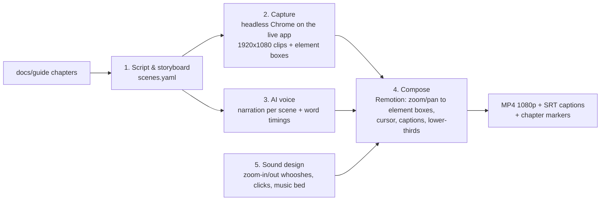

# BiG Equity 360: video tutorial pipeline (plan)

**Goal:** a guided video tutorial of the platform. It is screen-recorded from the real app, narrated by an AI voice, and uses zoom-ins on each component with matching zoom sound effects. The content and order come from the user guide (`docs/guide/`).

**Principle:** everything is generated from source files, so the video can be **re-rendered automatically** whenever the app or the guide changes. No manual video editing is needed.

## Pipeline

1. **Script and storyboard** (`video/scenes.yaml`)
   - Built from the guide: each scene gives its route (e.g. `/company/AAPL?tab=technicals`), the actions to perform (click, type in Ctrl+K, hover), the **zoom targets** as CSS selectors or the guide's `data-testid`s, and the narration text.
   - Narration is written for speech: short sentences, about 140–150 words per minute, and each scene says what the component is, how to use it, and one pitfall.
   - Validation labels are kept exactly as the guide states them: "model-based", "experimental", "calibrated over history".
2. **Capture**
   - A script drives Chrome through the CDP connection already used by the QA suite (`app/qa/smoke.py`), in read-only mode against http://127.0.0.1:8010.
   - It records each scene at 1920×1080 and 30 fps: either real-time screencast frames, or high-resolution stills animated by the composer, which looks sharper.
   - It logs every zoom target's on-screen box per frame, so zooms land exactly on the component.
   - Scenes that need saved content (theses, backtests) use a seeded test copy, as the guide did.
3. **AI voice:** one audio file per scene. Its length sets the scene duration, and word timestamps drive the captions and the zoom timing.
4. **Composition (Remotion, video built from React code)**
   - Smooth **zoom-in to a component** (eased, about 0.6 s), a highlight ring, then **zoom-out** to context. Optional cursor and click ripples.
   - Lower-third titles with the component name and mnemonic (e.g. `AAPL GP`), chapter cards in BiG orange, and burnt-in or separate SRT subtitles.
5. **Sound design**
   - **Zoom-in "whoosh up" and zoom-out "whoosh down"** on every zoom, soft clicks on UI actions, and a low background music bed ducked under the voice.
   - All sounds are **synthesised locally** (filtered noise sweeps and tones), so there is no licensing issue, or taken from CC0 libraries.
   - Mixed to −16 LUFS (loudness target) for clear speech.
6. **Output**
   - `BiG360_Overview.mp4`: about 6–8 min, the main tour.
   - A series of chapter videos of about 3–6 min each, following the guide chapters.
   - SRT captions and YouTube/Teams-style chapter markers. Optional pt-PT version from the same storyboard.

## Proposed content (from the guide)

**Overview video (about 7 min)**
1. Launch and tray: BiG360.exe, the tray menu, data-as-of and freshness chips.
2. Command bar and mnemonics: `AAPL GP`, `DES`, `HELP`.
3. Markets Overview morning view: the regime chip, cross-asset tape, sector heatmap.
4. Company 360 tour: overview, financials, **Technicals** (the cone, touch probabilities, trade setup), Ownership, Network & Geo.
5. Screener, then "Backtest this screen", Backtest Lab results and robustness.
6. News Terminal (live) and alerts.
7. BQL console: one query, then export.
8. Thesis Tracker.
9. Data Health and the "model-based / experimental" labels: how to read probabilities correctly.

**Chapter series:** one video per guide chapter, chapters 00–15 (16 videos).

## Progress (pipeline in `video/`, see `video/README.md`)

Decisions taken (25 Oct 2026): English; Kokoro-82M; overview video first; subtle music bed (switch off with `-NoMusic`); locally synthesised sound effects.

- [x] Installs: ffmpeg 9.0.2 (winget), Remotion 4.0.538 (`video/remotion`, pinned), Kokoro 0.9.4 in `video/.venv-tts` (Python 3.12)
- [x] Storyboard `video/scenes/overview.yaml` (routes, actions, zoom targets, narration, lower-thirds)
- [x] Sound design: `video/sfx/make_sfx.py` (zoom-in / zoom-out whooshes, clicks, key ticks, chime, music bed)
- [x] AI voice: narration per scene (Kokoro `af_heart`, 6.7 min), sentence and word timings, SRT
- [x] Remotion composition: eased zooms with highlight ring, cursor glide and click ripple, chapter cards, lower-thirds, captions, ducked music
- [x] Capture from the live app (read-only, data as of 19 Oct 2026) and the seeded test API (copy deleted afterwards)
- [x] Render `video/out/BiG360_Overview.mp4` (7:27, 155 MB) + `.srt` + chapters, final mix at −16 LUFS (25 Oct 2026, data as of 19 Oct 2026)
- [x] One-command rebuild `video/build.ps1 -Video overview [-NoMusic] [-BurnCaptions]`
- [ ] Chapter series (16 videos): same storyboard format, one `video/scenes/<chapter>.yaml` each

## Decisions needed
1. **Language:** English, Portuguese (pt-PT), or both.
2. **AI voice engine**
   - (a) **Kokoro-82M**: local, free, Apache-2.0, very natural English. Its Portuguese voices are Brazilian only.
   - (b) **Azure Neural TTS**: excellent **pt-PT** voices (Raquel, Duarte) and English, bank-friendly, free tier of 0.5M characters/month. Needs an Azure Speech key.
   - (c) **ElevenLabs**: best overall quality and voice cloning, about $5–22/month. Needs an API key.
3. **Installs** (each needs your OK):
   - ffmpeg: `winget install Gyan.FFmpeg`;
   - Remotion: npm, in a separate `video/` folder, not touching the app;
   - for option (a), the Python packages `kokoro` and `soundfile` in the venv, plus about a 330 MB model download.
4. **Scope first:** the overview video, then the chapter series.
5. **Music bed:** yes or no.
