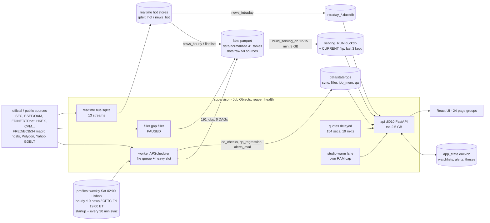

# BiG Equity 360 - application map, critique and datapoint gaps (2026-11-06)

Read-only audit. Evidence comes from:

- the live API on 127.0.0.1:8010, captured 07:35-08:05 UTC: `/system/sync`, `/system/data-health`, `/system/status`, `/system/qa`, `/system/dq`, `/system/jobs/runs` (all 3,092 runs, 2026-10-10 to 11-06) and `/live/status`;
- `data/state/ops/job_mem.jsonl` (950 runs);
- `data/logs/api.log*` (113k requests, 10-20 to 11-06);
- the contracts: `jobs.yaml` v47, `coverage.yaml`, `bql_fields.yaml` (885 fields) and `field_availability.yaml` (snapshot of 2026-10-31);
- read-only DuckDB probes of the lake.

Financial-statement line-item coverage is covered by the parallel financial-statements audit and is not repeated here.

---

## 1. Application and process map

### 1.1 Processes (supervisor children, live at 07:52 UTC)

| Child | State | RSS | Role | Notes |
|---|---|---|---|---|
| api | running, ready | 2,504 MB | FastAPI: 220 operations, contract 1.50.0 | 0 restarts since 06:13 |
| worker | running | 66 MB (jobs run as child processes) | APScheduler; 79 process-executor jobs, 112 thread jobs | heavy slot held by `build_serving_db` |
| filler | running, **paused** | 105 MB | Gap filler and 15 campaigns | `filler.PAUSE` file dated **2026-10-24 04:45** ("paused by orchestrator: API restart loop") was never cleared; also paused because the machine is on battery |
| realtime | running | 1,630 MB | bus.sqlite (410 MB, head 1.18 M); streams: edgar, fca_nsm, tdnet, hkex, rss_official (45 feeds), gdelt, polygon_news, macro_capture, enrich, newsdesk, insider, changepoint, alerts, earnings, activism | `dart` stream disabled (no OPENDART key); 1 dead letter |
| quotes | running | 188 MB | delayed quotes, 154 securities, 19 open markets | |
| studio | running | 913 MB | warm Model Studio / backtest lane (v46) | `studio_run` / `backtest_run` jobs are only the fallback path |

### 1.2 Schedules

| Profile entry | When | Contents | Last status |
|---|---|---|---|
| **weekly** (active, SLA 9 days) | Sat 02:00 Europe/Lisbon | nightly → weekly → monthly (if due) chain | partial (last run 10-31 07:16) |
| daily (alternative) | nightly Tue-Sat 01:30; weekly Sat 06:00; monthly first Sun 08:00 | jobs.yaml crons, SLA 3 days | not active |
| intraday | placeholder | behaves like daily | - |
| hourly_news (all profiles) | :10 every hour, UTC | news_hourly → news_finalise → news_intraday | news_finalise: 11 failures (timeouts at 40 min) |
| cftc_weekly | Fri 19:00 ET | cftc_cot (+ history) | success 10-30 |
| startup sync | after start, then every 30 min (90 s delay) | re-checks 74 datasets; fetchers run in parallel, heavy steps in sequence; section-incremental publish | see §2.1: interval runs lasted 33-39 h on 11-01 to 11-04 |

### 1.3 Job DAG (`contracts/jobs.yaml` v47, 191 jobs)

| DAG | Jobs | Sum of est_min_full | Critical path (est_min_full) |
|---|---|---|---|
| nightly | 119 | 1,579 min | **338 min**: cn_fundamentals(90) → identity_resolve → fundamentals_normalize → ratios_kpis → forecast → scoring → ml_features → ml_predict → ml_predict_full → composite_ml_blend → dq_checks → build_serving_db → alerts_eval → qa_regression |
| weekly | 34 | 1,102 min | 195 min: yf_fundamentals(120) → identity_resolve_weekly → fundamentals_rebuild |
| monthly | 14 | 200 min | 60 min: openfigi_refresh (times out at 60 min) |
| hourly | 3 | 9 min | news_hourly → news_finalise → news_intraday |
| cftc_weekly / manual | 2 / 19 | - | manual: backfill_prices 900, backfill_fundamentals 600, oam_filings_history 600, ml_train_transformer 360 |

- **Jobs by owner (family):** ingest-global 20, ingest-market 15, coverage-B 13, ml 11, technicals 10, event-models 9, ref-identity 8, ingest-us 7, rates-w3 7, linkage 7, other families (22) 1-6 each.
- **Heavy jobs (`mem_gb` 7 or more):** prices_finalize 10, build_serving_db 9, serving_sections_publish 9, regime_performance 9, confluence_zones 9, forecast 8.5, cross_asset_signals 8.5, sec_xbrl_bulk 8, fundamentals_normalize / fundamentals_rebuild / register_backfill 7.5, identity_resolve(_weekly) / insider_signals / tech_levels 7.
- **Highest measured private peaks** (`job_mem.jsonl`): prices_finalize 21.9 GB, confluence_zones 19.8, tech_levels 18.4, fundamentals_normalize 16.1, dq_checks 15.2, regime_performance 14.1, ratios_kpis 13.0 GB. The machine has 31.6 GB of RAM.

### 1.4 Storage layers

| Layer | Path | Writer → reader |
|---|---|---|
| raw | `data/raw/<source>` (58 sources) | ingestion jobs |
| lake | `data/normalized/<table>` Parquet, hive partitions (41 tables, e.g. prices_daily, fundamentals_canonical, insider_transactions 2.8 M, institutional_holdings 30.6 M, short_interest 1.8 M, corporate_actions 512 k) | normalize / derive jobs → build_serving_db |
| scores / features | `data/scores`, `data/features`, `models_store` | analytics, ML |
| serving | `data/db/serving_<run>.duckdb`, flipped atomically via `CURRENT`; plus `intraday_*.duckdb` | build_serving_db / serving_sections_publish → api (read-only) |
| app_state | `data/db/app_state.duckdb` | api (read/write: watchlists, alerts, theses) |
| realtime | `data/realtime/bus.sqlite`, `quotes.sqlite`, `gdelt_hot`, `news_hot` | realtime / quotes services → api, hourly DAG |
| ops | `data/state/ops/*` (sync, filler, job_mem, qa, ram, heavy) | worker / supervisor → `/system/*` |

---

## 2. Dataset coverage (49 datasets in `coverage.yaml`, live state 2026-11-06 07:52 UTC)

Columns: SLA = sessions or days on the daily profile (the active weekly profile raises the effective SLA to 9 days); actual = `data_as_of` and sync reason. Fill strategies: `polygon_dates` / `yf_refetch` = re-fetch missing sessions; `job` = re-run the live job; `campaign` = resumable filler backfill (currently paused).

| Dataset | Region / entities | SLA | Actual (as_of · reason) | Fill strategy |
|---|---|---|---|---|
| prices.US | XNYS | 1 | 11-05 · fresh | polygon_dates |
| prices.CA | XTSE | 1 | 11-05 · fresh | yf_refetch |
| prices.EU | XETR (EU) | 1 | 11-04 · not_yet_published (2nd attempt) | yf_refetch |
| prices.UK | XLON | 1 | 11-04 · not_yet_published | yf_refetch |
| prices.JP | XTKS | 1 | 11-06 · fresh | yf_refetch |
| prices.KR | XKRX | 1 | 11-06 · fresh | yf_refetch |
| prices.HK | XHKG | 1 | 11-05 · fresh | yf_refetch |
| prices.CN | XSHG (BaoStock, degraded) | 1 | 11-05 · due | yf_refetch |
| prices.LATAM | BVMF | 2 | 11-05 · fresh | yf_refetch |
| prices.APAC | XTAI | 2 | 11-06 · fresh | yf_refetch |
| prices.history | all regions (2,987 unpriced securities) | 30 | n/a · campaign | campaign yahoo_price_history (waiting) |
| fx.rates | 34 currencies | 2 | 11-06 · fresh | job fx_rates |
| macro.releases | global official calendars | 3 | 11-05 · not_yet_published | job macro_fred / macro_global |
| macro.ingest | 34 macro sources | 3 | 11-06 · fresh | job macro_global run_all |
| gdelt.days | global | 2 | 11-05 · fresh | gdelt_redo (+ campaign gdelt_e6) |
| news.live | global (realtime + hourly DAG) | 1 | 11-05 · fresh | job news_hourly / news_finalise |
| news.items | weekdays (Polygon news + official) | 2 | 11-05 · **due** | job news_ingest |
| filings.sec | US | 1 | 11-05 · fresh | job sec_filings_index |
| insider.us | US Form 4 | 2 | 11-05 · fresh | job sec_filings_index + sec_form4 |
| corporate_actions | global (yfinance, BaoStock, TWSE/TPEx, Polygon) | 3 | 11-06 · fresh | none |
| cftc.cot | CFTC markets | 7 | 10-27 · fresh | job cftc_cot_history |
| inst.13f | US 13F | 14 | 2026-06-30 · fresh (Q3 deadline 11-14) | campaign sec_13f_history |
| short_interest | US FINRA | 10 | 10-15 · fresh (next 11-11) | job finra_short_interest |
| earnings.dates | full universe | 7 | 11-06 · fresh (0 sentinel rows) | campaign earnings_dates_history |
| register.US / EU / UK | SEC / ESMA+FCA FIRDS / GLEIF | 2 / 9 / 9 | 11-06 · fresh | job regulatory_register |
| filings.uk_ch | UK Companies House | 3 | **10-31** · reported "fresh" but "1 of 1 table stale" | job ch_accounts |
| statements.register.US / EU / UK | register vs statements | 2 | 11-06 · fresh (backfill pending) | campaigns register_statements_us / eu_uk |
| analytics.scores | MVP universe (770/780 issuers) | 1 | 11-05 · due | none |
| analytics.valuation | 26,176 securities | 1 | 11-05 · due | none |
| analytics.technicals | full | 1 | **10-30 · due (7 days; tech_levels OOM)** | none |
| analytics.ml | MVP + extrapolated segments | 1 | 11-05 · due | none |
| analytics.sentiment | weekdays | 2 | 11-05 · due | none |
| analytics.moat | weekly | 8 | 10-30 · fresh | none |
| analytics.exposures | weekly | 35 | 10-23 · fresh (macro_exposures timed out 10-31) | none |
| analytics.conformal_envelopes / peers / coverage | XNYS | 1 / 2 / 2 | 11-03 · due | none |
| rates.curves | 22 sovereign curves | 1 | 11-05 · fresh (22/22) | job rates_curves |
| rates.money | SOFR, EFFR, OBFR, TGCR/BGCR, ESTR, SONIA, TONA, CORRA | 1 | 11-04 · not_yet_published (8/8) | job macro_national / macro_eu |
| credit.oas | ICE US IG/HY, ratings buckets, Moody's (FRED, personal use) | 2 | 11-04 · fresh | job macro_fred |
| rates.auctions | US Treasury, UK DMO | 3 | 11-04 · not_yet_published | job rates_auctions |
| credit.bonds_eu | ESMA FIRDS | 1 | 10-31 · fresh (weekly file) | job bonds_reference |
| credit.trace | FINRA TRACE | 2 | **none · needs_key** (FINRA_API_CLIENT_ID) | job credit_trace |
| debt.company | derived from filings | 3 | 11-06 · fresh | job company_debt |
| sovereign.debt | Eurostat quarterly, TARGET2 | 3 | 09-01 · fresh | job macro_eu / macro_intl |

The sync also tracks 25 job-level datasets (ESEF, EDINET, TDnet, HKEX, 13 national OAM / PDMR feeds, EU shorts, activist filings, futures curves, CN fundamentals). All were fresh at 02:43-02:57 UTC except `opendart_filings`, which is needs_key.

**Sync totals:** fresh 56, due 11, not_yet_published 6, needs_key 1. The sync RAM peak was 10.5 GB for the process tree, with **2.29 GB of machine RAM left free**.

**Field availability on the full universe** (23,828 securities; `field_availability.yaml`): reason distribution is not_applicable 2,030, out_of_scope 892, no_source 862, insufficient_data 660, needs_key 312, source_unavailable 281. Representative coverage (full / mvp_us):

| Field | full | mvp_us |
|---|---|---|
| div_yld | 15.6 % | 98.8 % |
| si.pct_float | 11.1 % | 99.2 % |
| own.put_value_usd | 12.9 % | 99 % |
| pe_fwd (model-based) | 17 % | 97.8 % |
| eps_surprise (model-based) | 8.3 % | 74.6 % |
| kpi.rule_of_40 | 1.1 % | 10.2 % |

### 2.1 UI pages and their data dependencies

| Route(s) | Page | Main API families / datasets |
|---|---|---|
| `/` `/market` | Market overview | market overview, live quotes, cross-asset cockpit and risk, central-bank implied paths, macro series |
| `/macro/*` (17 routes) | Macro: dashboard, country, theme, calendar, nowcast, series, central banks, curves, credit, markets, cross-asset, positioning | macro_cells / cycle / releases / expectations / nowcast, rates.curves / money, credit.oas, cftc.cot, futures_curve, regime_performance, exposures |
| `/company/:id` | Company 360 | prices, fundamentals, ratios / KPIs, forecast, valuation, earnings, debt, geography / network (supply chain), insiders, 13F ownership, short interest, sentiment, moat, technicals, conformal envelopes, ML model, macro sensitivity, events / news |
| `/screener` `/bql` | Screener and BQL | all 885 BQL fields (serving), saved screens |
| `/sectors` | Sectors | sector taxonomy, scores, macro exposures |
| `/earnings` `/earnings/season` | Earnings | earnings.dates, earnings_events (model-based expectations) |
| `/smart-money/*` `/insiders` | Smart money, EU shorts, activism, insider radar | inst.13f, insider.us + PDMR registers, eu_short_positions, short_interest, activist_filings |
| `/events` `/news` `/news/top` | Event models, news | gdelt.days, news.live / items, story layer, event models |
| `/instruments` `/instruments/:id` | Instruments | futures_curve, live quotes, CFTC |
| `/studio` `/backtest` `/models` | Model Studio, Backtest lab, Model Lab | studio lane, serving panels, ML registry |
| `/theses/*` `/watchlist` | Thesis tracker, watchlist | app_state, macro, screener, live quotes |
| `/conformal` `/system` `/system/data-health` `/system/conformal` | Ops and conformal | /system/*, conformal coverage |

---

## 3. What could be better (ranked by impact)

| # | Area | Finding (evidence) | Impact | Fix |
|---|---|---|---|---|
| 1 | Reliability | **ratios_kpis and tech_levels in an OOM loop since 11-03.** Both have 0 successes since 10-31 21:46. Each attempt dies at its Job Object cap (6.0-6.1 GB for budget 6, 7.0-7.1 GB for budget 7), and the `oom_params` retry dies too, as do 16 / 9 failures in the window. Their last good peaks were 5.8 and 5.1 GB, so the data has outgrown the budgets. As a result analytics.technicals has been stuck at 10-30 for 7 days and ratios feed forecast → scoring → ML. | High: stale core analytics on every Company / Screener page | Raise `mem_gb` (ratios_kpis 8, tech_levels 9) or chunk by region; make the OOM retry reduce memory by at least 2x; alert after 2 consecutive OOMs |
| 2 | Reliability / perf | **RAM starvation.** 87 of 950 measured runs saw under 2 GB of machine RAM free, the minimum being 0.03 GB (nlp_sentiment, cross_asset_signals, prices_finalize, ratios_kpis). The pagefile is at 25.7 GB and growing. Peaks of up to 21.9 GB (prices_finalize) run on a 31.6 GB laptop next to the API (2.5 GB), realtime (1.6 GB) and studio (0.9 GB). | High: root cause of OOMs, the "process died" failures (24) and the 10-24 API restart loop | Make admission-control headroom adaptive; serialise every job of 7 GB or more; move confluence_zones / tech_levels / prices_finalize to DuckDB out-of-core with spill limits |
| 3 | Operability | **Gap filler paused for 13 days.** `filler.PAUSE` was written 10-24 04:45 by the orchestrator after the API restart loop and never cleared. The UI says "paused by user". Meanwhile 24 gaps are open, 4 failed and 29 manual, and the yahoo_price_history (2,987 unpriced securities), earnings_dates_history, register_statements_us, register_oam, ccnews and us_bonds_openfigi campaigns all wait. | High: coverage stops improving silently | Give PAUSE files an expiry and owner, show the reason and age on Data Health, and auto-resume when the condition clears. Running on battery is a second, separate block. |
| 4 | Reliability | **Sync runs far beyond their 30-min cadence.** Interval syncs on 11-01, 11-03 and 11-04 ran for 39.1 h, 39.4 h and 33.2 h (52 datasets due, 23 failed jobs). The 11-06 startup sync took 4.3 h. Overall 239 of 3,092 runs failed (7.7 %): 83 timeouts, 31 OOMs, 24 process deaths, 9 HTTP errors, 2 circuit breakers. Worst offenders: build_serving_db 20 failures (9 retries), ratios_kpis 16, prices_cn_baostock 15 (BaoStock IP-ban sensitive), fundamentals_normalize 11, news_finalise 11, dq_checks 11. | High | Put a wall-clock cap on each sync pass and defer heavy steps to the scheduled refresh; set per-job timeouts from p95 of job history; add jitter and back-off for the CN sources |
| 5 | Model quality | **Composite and factor scores show no out-of-sample edge.** The orchestrator cites AUC 0.48 from STUDIO_V2_PLAN, but that figure is not in the file (4.9 KB), so here is corroborating evidence. Studio run `SR20261012T0319222S5ZX` ("3M outperformance GBM", factor scores, mvp_us, purged 5-fold) has AUC **0.490**. The smart-money composite has rank-IC −0.004 (21 d) and −0.005 (63 d). The insider XGB has AUC 0.493 and IC −0.013. Technicals v2 leakage check: AUC 0.488. The balanced composite also covers only 770 of 780 MVP issuers, not the 23.8 k universe. | High: the headline score misleads users | Label composites "descriptive, no predictive edge" in the UI; gate any "signal" wording on OOS IC t > 2 (as the ML blend already does, IC 0.035); show calibration per score |
| 6 | Data quality | **The DQ gate is 6 days old and has blind spots.** The last complete dq_checks run is 10-31 21:53 (906 checks, 0 errors, 6 warnings), so nothing has been checked since. dq_checks itself failed 11 times (60-min timeouts on 10-24; institutional_holdings freshness errors). Open warnings: prices_daily `ohlc_consistency` future 4.3 % and fx 6.2 % (threshold 1 %), `ohlc_inconsistent` 0.17 %, 11 unsupported FX currencies, earnings_calendar row delta 0.86, conformal_peer_groups freshness, credit_market_stats empty. The lake holds **Form 4 transaction_date values up to 2047**, which no check catches. Known suspicious gaps: 538 UK 100x unit flips, 86 Yahoo FX scale jumps, 40 % of 13F rows without security_id, ticker reuse (SPCX/BNY/FIG). | Medium-high | Run a light DQ subset in every sync publish; add a future-date check for event tables; map 13F CUSIPs through FIRDS / OpenFIGI |
| 7 | Performance | **API p95 is 3.2 s overall (p50 129 ms, p99 8.5 s).** `/system/status` was polled 17,902 times, with p95 5.4 s and **442 HTTP 5xx (all on this route)**. `/live/status` was polled 9,413 times with p95 8.2 s. Other slow routes: `/bql` p95 10.7 s, `/studio/catalog/datasets` p95 24.8 s, `/backtest/catalog` 8.2 s, `/news/stories` 6.4 s, `/live/news` 5.0 s, `/market/overview` 4.8 s. The QA sweep measures p95 659 ms, because it does not reproduce polling under refresh load. | Medium-high: header and status bar freeze during refreshes | Cache status payloads (TTL of 5-10 s, computed off the request path); use ETag / SSE instead of polling; precompute the studio catalog |
| 8 | UX | **The Debt tab is broken for ticker URLs.** QA smoke shows `/company/AAPL` and `/company/7203.T` return HTTP 404 `unknown security_id 'AAPL'` on the Debt panel (dark and light themes). QA has been failing since 11-01 (API suite 1 failure; smoke 4). | Medium | Resolve tickers in the debt route as the other company routes do; make a failing QA run turn the header chip amber |
| 9 | Compliance | **Open robots.txt issues.** TDnet: `www.release.tdnet.info` robots.txt says `Disallow: /`, yet `tdnet_disclosures` (nightly) and the realtime `tdnet` stream (436 events today) fetch it (COVERAGE_V2_PLAN.md:149). BoE: the IADB endpoint `/boeapps/database/_iadb-FromShowColumns.asp` is disallowed, yet macro_national `boe` (SONIA, Bank Rate, gilts) and cb_balance_sheets ("BoE IADB weekly") still call it (DATA_LICENSING.md:174). | Medium (policy) | TDnet: switch to JPX-licensed data or EDINET plus the company IR feeds, or get written permission. BoE: SONIA via the BoE media zips or FRED (IUDSOIA); Bank Rate via the BoE official CSV under /-/media. |
| 10 | Reliability (weekly) | **Weekly and monthly jobs that never complete.** ml_train_transformer has never succeeded (process died 10-20). tech_meta_fit times out at 120 min, macro_exposures at 90 min, openfigi_refresh at 60 min. These stay in the `refresh_failed` alert, which has been open since 10-20, so the alert gets ignored. | Medium | Make these jobs resumable or checkpointed, retire ml_train_transformer, and give alerts an acknowledgement and escalation |
| 11 | Operability | **Missing keys.** credit.trace (FINRA), opendart / dart stream (KR filings, insiders) and the keyed macro sources (BOK, Banxico, INEGI, e-Stat, BCCh) lack credentials, and KR fundamentals stay thin. | Medium | Free registrations; the Data Health page should list them as one-click to-dos |
| 12 | UX | **Header chip and alerts lack context.** The "Syncing data... 20/23" chip shows no ETA, even though syncs have run for up to 39 h. The weekly profile with a 9-day SLA hides daily staleness: analytics are "due", not breached, and `sla_breaches` is 0 while technicals are 7 days old. | Medium | Show per-dataset age against the daily SLA on Company pages ("technicals as of 10-30") |

---

## 4. Datapoints a professional terminal has that we lack

Status values: **Have**, **Partial**, **Missing**. Rows are ordered by priority, with items derivable from data already landed first. Effort: S = days, M = 1-2 weeks, L = more than 2 weeks or licensing.

| # | Datapoint | Status here (evidence) | Best free / public source (robots / terms) | Method | Effort | Value |
|---|---|---|---|---|---|---|
| 1 | **Segment data** (business / product) | Missing. FSDS `num.txt segments` is read, but `sec_fsds.py:93` drops every dimensioned fact; `georev` keeps only Geographical= and MajorCustomers= | SEC Financial Statement Data Sets (already landed); ESEF iXBRL (landed); EDINET XBRL (landed) | XBRL dimensions: `StatementBusinessSegmentsAxis`, `srt:ProductOrServiceAxis`, `ifrs-full:SegmentsAxis`, jpcrp segment info | S (US) / M (ESEF, JP) | Very high |
| 2 | **Guidance** | Partial. TDnet tanshin forecasts are already parsed with `ResultForecast=ForecastMember/Upper/Lower` (`tdnet.py:230`), but not served; `guidance_revision` exists only as an event type | JP: tanshin XBRL (landed). US: 8-K Item 2.02 / 7.01 Ex-99.1 text (EDGAR, fair access 10 req/s). EU: ad-hoc MAR releases from the OAMs | JP: XBRL tags. US: rule-based extraction ("expects revenue of $X to $Y") over the sec_text unit store | S (JP) / M (US) | Very high: the best substitute for consensus |
| 3 | Dividend forecast and calendar | Partial. 459 k cash dividends of history; only 679 future ex-dates (627 US Polygon, 13 EU); no DPS forecast | tanshin forecast DPS tags (landed); declared dividends from Polygon / filings | Derivation: declared plus a policy model (payout × forecast EPS, labelled model-based) | S | High |
| 4 | **Corporate actions completeness** | Partial. Only splits and dividends (yfinance, BaoStock, TWSE/TPEx, Polygon); no M&A, spin-offs, tender offers, delistings or ticker changes; ticker reuse is a known gap | EDGAR full-index (landed): 8-K Items 1.01 / 2.01 / 3.01, Form 25, SC TO-T / 14D9, Form 15; FIRDS / FCA terminations (landed); JPX delisting list | Derivation from the filing index plus listing diffs | M | High (survivorship, event studies) |
| 5 | Litigation and contingencies | Missing (event taxonomy only) | XBRL `LossContingency*` tags in companyfacts (landed); SEC litigation releases / AAER (official RSS); CourtListener RECAP API (free key, polite) | XBRL tags (S), then API (M) | S / M | Medium |
| 6 | **Consensus estimates and revisions** | Missing. pe_fwd and eps_surprise are model-based by design (r23 / r48) | **No clean free source.** Yahoo / Zacks / Nasdaq scraping breaks terms (api.nasdaq.com `Disallow: /`). Licensed: LSEG I/B/E/S (the LSEG connector here needs auth), FactSet | Licence, or keep model-based expectations plus management guidance (#2) as the proxy | L (licence) | Very high |
| 7 | KPIs (same-store sales, ARPU, RPM, NIM) | Missing; `sector_kpis` are ratio-derived (kpi.* coverage 1 % full) | Company-extension XBRL tags in FSDS (landed, custom tags); FFIEC CDR call reports (official bulk, US banks); BTS T-100 / Form 41 (airlines); 10-Q MD&A text | Tag mining plus rules; bulk files | M | High for banks, retail, telecom |
| 8 | Ownership: funds (N-PORT) and insiders outside the US/EU | Partial. 13F Have (30.6 M rows, through 06-30; 40 % without security_id). Insiders Have for SEC 2.8 M, CVM 5.4 k, FCA 1.6 k, HKEX 749, BaFin 234, AFM 226. Missing: JP, KR, CA, AU; AMF is metadata only | SEC Form N-PORT quarterly data sets (bulk, official); EDINET large-shareholding reports (API, key already used); DART major-holder / executive APIs (free key); CA SEDI (terms restrict automated access, flag); ASX Appendix 3Y (terms, flag) | Bulk / API | M | High |
| 9 | Short volume and borrow | Partial. FINRA SI (bi-monthly), EU net shorts, FTD Have; **no Reg SHO daily short volume, no JP / HK short positions, no borrow** | FINRA Reg SHO daily short-volume files (free CDN); JPX short-selling position reports (≥ 0.5 %, official); HK SFC weekly aggregated short positions; borrow fee / utilisation: **no clean free source** (broker FTPs are customer-only) | Bulk files | S | Medium-high |
| 10 | Index membership history | Missing (`ml/labels.py:131` survivorship simplification; BQL universes "not official constituents") | Official constituent files are licensed (S&P, MSCI, FTSE: flag). Public proxy: index-ETF holdings from SEC N-PORT (IVV/SPY/QQQ), Nikkei / JPX TOPIX official lists | Derivation from N-PORT holdings | M | High (backtests, benchmarks) |
| 11 | Fund flows | Missing | SEC N-PORT monthly sales / redemptions (bulk); Fed Z.1 (FRED, already keyed); ECB investment-fund statistics (SDW, already used); ICI weekly (check terms) | Bulk / API | S (macro) / M (fund-level) | Medium-high |
| 12 | FX forwards | Missing (spot only) | Official money-market rates and curves already landed (SOFR, ESTR, SONIA, TONA, CORRA, 22 curves) | Covered-interest-parity derivation, labelled model-based | S | Medium |
| 13 | Options / implied volatility | Partial. Index IV only (VIX family, MOVE); 13F put / call values | Polygon Options Basic (free EOD, shares the 5 req/min budget); OCC daily volume by underlying (official); single-name IV surfaces: **no clean official source** | API plus Black-Scholes IV derivation from EOD aggregates | M | High |
| 14 | Credit ratings | Missing per issuer (Moody's Aaa/Baa index yields only) | ESMA RADAR / CEREP (official, public); NRSRO Rule 17g-7 XBRL rating histories (free, click-through terms: flag) | Bulk XBRL | M | High (debt pages) |
| 15 | ESG / emissions | Missing | ESRS XBRL tagging is not yet mandatory (EFRAG taxonomy exists; Omnibus delay), so text extraction from the CSRD sustainability statements in already-landed ESEF reports; EU ETS / EUTL verified emissions (bulk); EPA GHGRP (bulk); UK SECR in Companies House iXBRL (landed) | Text rules / bulk plus issuer mapping | M | Medium |
| 16 | Government contracts | Missing | USAspending.gov API and bulk award files (official, no key); EU TED open data | Bulk / API, recipient UEI → parent → issuer (OrgLinker) | M | Medium (defence, IT, healthcare) |
| 17 | Patents | Missing | USPTO PatentsView bulk (CC BY 4.0); EPO OPS (free registration, fair use) | Bulk plus assignee-to-issuer matching | M | Medium-low |
| 18 | Lobbying | Missing | Senate LDA API (lda.senate.gov, official) | API plus client → issuer match | S | Low-medium |
| 19 | Commodity curves | Partial. futures_curve: 43 roots, 224 k rows, Yahoo (labelled) | EIA API (official, free key) for energy; USDA for agriculture; CME settlements are licensed (flag) | API | S | Medium |
| 20 | CDS | Missing | DTCC weekly single-name gross / net notionals (public); spreads: **no clean free source** (Markit / ICE licensed) | Bulk file | S (notionals) | Low-medium |
| 21 | Transcripts | Missing | **No clean free source** (SA / Motley Fool terms prohibit). Partial: 8-K Ex-99 prepared remarks, TDnet / HKEX presentation PDFs (already in filing feeds) | Text from landed filings | M | Medium |
| 22 | Web / app alt-data | Missing (GDELT media attention Have) | Wikimedia pageviews REST API (official, polite UA); Google Trends and app downloads: **no clean free source** | API | S | Low-medium |
| 23 | Supply chain / customers | **Have**: company_links (customer 6,847, supplier 323, co-mention 231 k); geo revenue for 2,458 issuers | Extend: supplier-side 10-K rules, ESEF IFRS 8 customer notes | Text rules / XBRL | S | Medium |

**Suggested order:** first #1, #2, #3, #5 and #12, all derivations from data already landed (about 2-3 weeks in total, no new sources). Then #4, #8, #9, #10 and #11 (SEC / FINRA bulk files: N-PORT unlocks funds, index membership and flows at once). Then #13, #14 and #7. #6 and #21 need a licence; keep them labelled as gaps rather than scraping.
