# 0. Getting started

BiG Equity 360 is a research terminal for listed equities and macro data that runs on your own PC. It collects public and official data (stock prices, company filings, insider and ownership filings, macro statistics, central-bank publications, news and global events) into a local data store. It then computes scores, valuations, technical levels and statistical models, and shows everything in a browser-based dashboard at `http://127.0.0.1:8010/`.

This chapter covers installing and starting the app, the tray icon, a tour of the interface, the command bar, keyboard shortcuts, themes, the freshness indicators, and how to read the labels the app puts on its numbers. It ends with a 15-minute walkthrough.

> **Note:** Everything runs locally. Nothing you type is sent to an external service, and the data refreshes on a schedule (weekly by default, see [Data and coverage](01-data-and-coverage.md#refresh-schedule)). The numbers you see are as of the date in the top bar, not live market prices.

---

## What the app is

**Route:** `/` (opens the Macro cockpit) · **Menu:** all · **Refresh:** weekly profile by default (Saturday 02:00 Lisbon), daily optional

### Purpose

BiG Equity 360 gives a 360-degree view of a listed company (fundamentals, valuation, quality, moat, insiders, ownership, news, technicals, macro sensitivity, event risk and a machine-learning view) and of the macro and market backdrop it trades in. It is built for analysts and portfolio managers who want one place to screen, drill down and check a thesis, with every number traceable to an official or labelled source.

The app is organised in four layers:

| Layer | What it covers | Main pages |
|---|---|---|
| Top-down | Economies, central banks, markets, cross-asset, positioning | Macro (cockpit, calendar, nowcast, themes, countries, series, central banks, markets, instruments, cross-asset, CFTC positioning) |
| Cross-section | Sectors, ranking, events, smart money, insiders, news | Sector Explorer, Screener / Ranking, Earnings & Events, Smart Money, Insider Radar, Global Events, News Terminal |
| Single name | One company in depth | Company 360 (14 tabs) |
| Research tools | Your own studies, backtests, queries, decisions and lists | Model Studio, Backtest Lab, BQL console, Thesis Tracker, Model Lab, Watchlist & Alerts |

The **System** pages (System overview, Data health, Conformal validation) show how fresh the data is and whether the background jobs are healthy. The **Guide** page (`/help`) is this user guide, built into the app.

### Limitations and pitfalls

- The app is a **research tool**, not an order-management or real-time trading system. Prices are end-of-day.
- Some sources are not licensed for use beyond one analyst's research (see [Licensing caveats](01-data-and-coverage.md#licensing-caveats)).
- There are **no consensus estimates and no options data**. Earnings and macro "expectations" are the app's own model-based estimates, clearly labelled.

---

## Install and launch

**Route:** `http://127.0.0.1:8010/` · **Menu:** none (Windows) · **Refresh:** not applicable

### Purpose

The everyday way to run the app is the Windows launcher **`BiG360.exe`**. It starts everything in the background (no terminal windows, no Node.js), puts a BiG icon in the Windows notification area and opens the dashboard in your default browser.

Behind the icon there is a single process tree:

```
BiG360.exe → tray app → supervisor → API (serves the dashboard), worker (schedule), gap filler, live news service
```

The **supervisor** restarts any part that crashes, with an increasing back-off (5 s, 15 s, 60 s, then 5 min).

### Install options

| Option | How | Notes |
|---|---|---|
| **Project folder (this PC)** | Double-click `BiG360.exe` in the project folder (`C:\Users\Asus\Documents\STOCK SCANNER`) | Uses the project's Python environment, its `data\` folder and its settings. Nothing is installed. |
| **Installer** | Run `BiG360Setup-<version>.exe` | Per user, no administrator rights. Installs to `%LOCALAPPDATA%\Programs\BiG360` with Start-menu and desktop shortcuts. Optional tasks: *start at login* and *copy API keys from .env*. The installer is built by IT with `packaging\build.ps1 -Installer` (needs Inno Setup 6). |
| **Portable** | Unzip `BiG360-<version>-portable.zip` and double-click `BiG360.exe` | Same files as the installer. Point it at the data folder by setting `BIG360_DATA_DIR=<folder>` in the `.env` file of that folder. |

> **Note:** The data folder (tens of GB) is never copied. The installer asks for the existing data folder and writes its location to `<install folder>\.env` as `BIG360_DATA_DIR`. The trained models (`models_store`) are linked, not copied.

### First run

1. **API keys (one-time, usually done by the app owner or IT).** The Windows app reads data-provider keys from **Windows Credential Manager**, where they are stored per user and protected by Windows (DPAPI). Each key appears under *Control Panel › Credential Manager › Windows Credentials* as `BiG360/<key name>`. Copy them once from the `.env` file with the credentials tool (commands below). The tool prints key **names** only, never values.
2. **Start `BiG360.exe`.** A Windows notification says *Starting... the dashboard opens at http://127.0.0.1:8010/*. The browser opens when the API answers, usually after 10 to 60 seconds.
3. **Optional:** tray menu › **Start at login** (a per-user entry; no administrator rights needed). At login the app starts in the background without opening the browser.

The credentials commands for step 1, run from the `backend` folder:

```powershell
..\.venv\Scripts\python.exe -m app.desktop.credentials migrate   # copy keys from .env into Credential Manager
..\.venv\Scripts\python.exe -m app.desktop.credentials verify    # "match" / "differs" per key
..\.venv\Scripts\python.exe -m app.desktop.credentials status    # which keys are stored (yes / no only)
..\.venv\Scripts\python.exe -m app.desktop.credentials set <key name>   # set or change one key (hidden input)
```

In an installed or portable build the Python path is `..\python\python.exe` instead of `..\.venv\Scripts\python.exe`. The `.env` file is not modified; keep it as the development fallback or blank the keys once `verify` reports `match`.

The key names the app understands are:

| Key name | Unlocks | Needed? |
|---|---|---|
| `fred_apikey` | US macro (FRED / ALFRED) | Yes |
| `polygon_apikey` | US end-of-day prices, corporate actions, US news (Massive, formerly Polygon.io) | Yes |
| `edinet_apikey` | Japanese filings (EDINET) | Recommended |
| `opendart_apikey` | Korean financial statements and insider holdings (OpenDART) | Recommended: largest coverage gain |
| `krx_openapi_key` | Korean prices for the whole market | Optional |
| `companies_house_apikey` | UK registry data | Optional |
| `openfigi_apikey` | Faster identifier mapping (OpenFIGI) | Optional |
| `bok_ecos_apikey`, `banxico_token`, `estat_appid`, `kosis_apikey`, `inegi_token`, `bcch_user`, `bcch_pass`, `eia_apikey` | Extra national macro series (Korea, Mexico, Japan, Chile, US energy) | Optional |
| `comtrade_apikey` | Faster UN Comtrade trade-linkage refreshes | Optional |

Keys are optional except FRED and Polygon: a job whose key is missing skips that source and reports "missing key". The order of precedence is: an explicit environment variable, then Credential Manager, then `.env`. The SEC also requires a contact string in the environment variable `SEC_USER_AGENT` (not a secret).

### Dev mode (for IT and the app owner)

Developers can run the parts in separate PowerShell windows instead of the tray app:

```powershell
cd "C:\Users\Asus\Documents\STOCK SCANNER"
.\run_all.ps1 -Live              # API + worker + Vite dashboard, each in its own window
.\run_all.ps1 -Live -NoWorker    # dashboard only, no scheduled jobs
```

In dev mode the dashboard is served by Vite on `http://localhost:5173` and calls the API at the URL in `frontend\.env` (`VITE_API_URL`). The app build (`npm run build:app` → `frontend\dist_app`) instead calls `/api/v1` on its own origin. Setting `VITE_USE_MOCK=true` in `frontend\.env` shows the whole interface with synthetic data and a **MOCK DATA** badge; this is for development only.

> **Caution:** Do not run a dev API and the Windows app on the same port. If a dev API already listens on 8010, the supervisor treats the API as "external" and the dashboard is not served at `/`. See [Dev mode and the app on the same port](18-troubleshooting-faq.md#dev-mode-and-the-app-on-the-same-port).

### Quit

Right-click the tray icon › **Quit BiG360**. Running jobs finish or cancel (this can take up to about 5 minutes), then the icon disappears. Closing the browser tab does **not** stop the app; it keeps running in the background so that scheduled refreshes and the gap filler can work.

---

## Tray icon and menu

**Route:** Windows notification area (BiG icon) · **Menu:** right-click the icon · **Refresh:** status polled every 60 s

### Purpose

The tray icon is the control panel of the background app: it shows whether the app is running, what the data date is, when the next refresh is due, and lets you run or pause background work without opening a terminal. Hover over the icon to see a tooltip such as *BiG Equity 360 - data 19 Oct 2026 - weekly*. **Double-click** opens the dashboard.

### Screenshot

> Screenshot pending: the tray menu opened from the Windows notification area, with the Status submenu expanded (Windows desktop, not a browser page).
<!-- PENDING-SHOT id=00-tray route=(Windows notification area) actions=right-click the BiG icon; hover Status -->

### Controls

| Menu item | What it does |
|---|---|
| **Open dashboard** | Opens `http://127.0.0.1:8010/` in the default browser. This is the default item (bold); double-clicking the icon does the same. |
| **Status ▸** | A read-only summary: app version; supervisor running or not; *Data as of* date; schedule profile and whether the scheduler is on; *Next refresh*; gap filler state; live news state; number of error and warning alerts; *Update available* if any. **Refresh status** re-reads it immediately. |
| **Run refresh now** | Starts the active profile's refresh in the worker as if it had been scheduled (weekly profile: nightly → weekly → monthly if due). A notification confirms it. |
| **Pause background jobs** / **Resume background jobs** | Pauses or resumes the **gap filler** (the low-priority background repair of missing data). Scheduled refreshes still run. The item is ticked while paused. |
| **Live news on/off** | Starts or stops the live news service (GDELT 15-minute files, official RSS feeds, Polygon news) that feeds the News Terminal and the live strip. Data already received is kept. |
| **Schedule ▸** | Choose **Weekly** or **Daily**. *Intraday (placeholder)* is shown but disabled. The worker applies the change within seconds; no restart is needed. |
| **News Terminal** | Opens `/news` in the browser. |
| **Data health** | Opens `/system/data-health`. |
| **Open logs folder** | Opens `data\logs` in Explorer. |
| **Start at login** | Turns autostart on or off (ticked when on). |
| **Update available: x.y.z** | Only shown when a newer build is available in the update folder configured by IT. Opens that folder. |
| **Quit BiG360** | Stops everything gracefully (running jobs finish or cancel, up to about 5 minutes), then removes the icon. |

**Windows notifications.** The tray shows a Windows notification for new operational alerts (refresh failed or overdue, data stale beyond the service level, scheduler off, worker down) and when a scheduled refresh finishes (success, partial or failed). The hourly news job never raises a notification. To turn notifications off, IT sets `notifications: false` in `config\app.yaml`.

### Limitations and pitfalls

- The tray is for an interactive Windows user. On a server, IT runs the same supervisor as a Windows service instead (see `docs/it/DEPLOYMENT_SERVER.md`).
- **Pause background jobs** does not stop the scheduled Saturday refresh; to stop all activity, use **Quit BiG360**.

---

## Interface tour

**Route:** every page · **Menu:** not applicable · **Mnemonics:** `HELP` · **Refresh:** freshness polled in the background

### Purpose

Every page shares the same frame: a menu on the left, a top bar with search, region filter and data-status indicators, a live strip, and the page itself. Knowing the frame once makes every page familiar.

### Screenshot

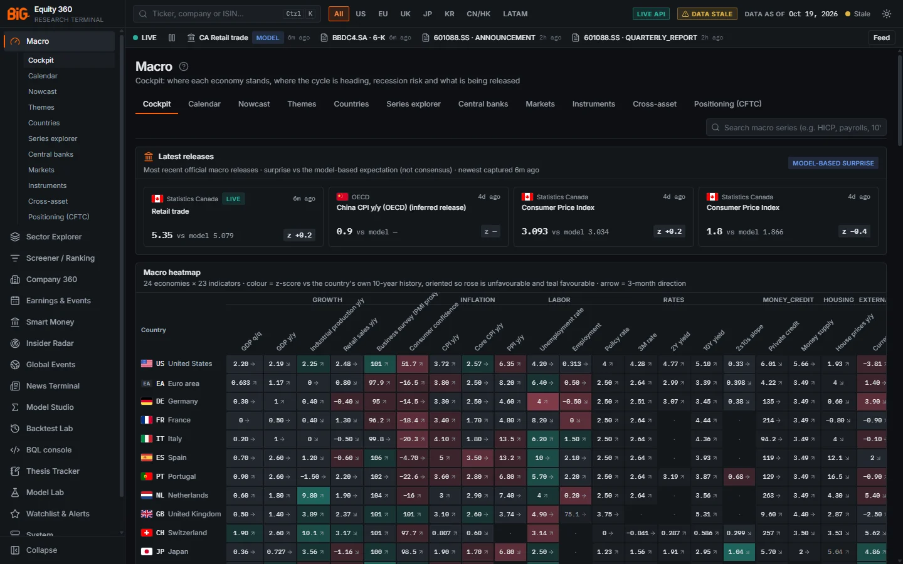

*Figure 0.1: The application frame on the Macro cockpit (`/macro`), dark theme, data as of 19 Oct 2026, with the live strip connected (LIVE).*

| Region | Where | What it is |
|---|---|---|
| A | Left column | **Sidebar menu**: the BiG logo, the main sections, the sub-pages of the active section, and **Collapse** at the bottom |
| B | Top row | **Top bar**: search box / command bar (`Ctrl K`), region filter chips (All, US, EU, UK, JP, KR, CN/HK, LATAM), **LIVE API** badge, **DATA STALE** warning chip, **DATA AS OF** date, freshness dot ("Stale") and the theme toggle |
| C | Second row | **Live strip**: connection state (here **LIVE**), pause button, the latest live items (a Canadian retail-trade release with a MODEL badge, filings such as a 6-K) and the **Feed** button |
| D | Below the strip | **Page header**: page title ("Macro") with the **?** guide icon, and a one-line description of the page |
| E | Under the header | **Page tabs** ("Cockpit", "Calendar", "Nowcast" ...) and page-level tools, here the macro series search |
| F | Main area | **Panels**: each has a title, a subtitle that states the method and units, and status badges such as "MODEL-BASED SURPRISE"; a release that arrived through the live layer carries a LIVE badge |

### Sidebar menu

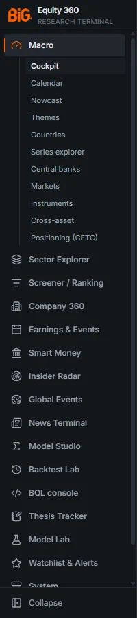

*Figure 0.2: Sidebar with the Macro section expanded. The menu scrolls: System and Guide are below Watchlist & Alerts.*

The sidebar lists the main sections. The section you are in is highlighted with an orange bar, and its sub-pages appear indented underneath.

| Menu item | Route | Sub-pages |
|---|---|---|
| Macro | `/macro` | Cockpit, Calendar, Nowcast, Themes, Countries, Series explorer, Central banks, Markets, Instruments, Cross-asset, Positioning (CFTC) |
| Sector Explorer | `/sectors` | none |
| Screener / Ranking | `/screener` | none |
| Company 360 | `/company/<ticker>` | none; opens the last company you visited (Microsoft by default) |
| Earnings & Events | `/earnings` | Calendar, Earnings season |
| Smart Money | `/smart-money` | Overview, EU / UK short register, Activism (13D), Sectors |
| Insider Radar | `/insiders` | none |
| Global Events | `/events` | none (tabs inside the page) |
| News Terminal | `/news` | Live, Top stories |
| Model Studio | `/studio` | none (tabs inside the page) |
| Backtest Lab | `/backtest` | none (tabs inside the page) |
| BQL console | `/bql` | none |
| Thesis Tracker | `/theses` | none |
| Model Lab | `/models` | none |
| Watchlist & Alerts | `/watchlist` | none |
| System | `/system` | Overview, Data health, Conformal validation |
| Guide | `/help` | The chapters of this user guide (see [User guide (Help page)](#user-guide-help-page)) |

**Collapse** (bottom of the sidebar) shrinks the menu to icons only; hover an icon to see its name, and click **Expand** (same place) to restore it. The choice is remembered in this browser.

### Top bar

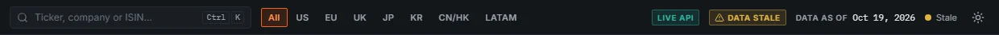

*Figure 0.3: Top bar, data as of 19 Oct 2026, with the "Data stale" warning.*

| Control | What it does |
|---|---|
| **Search box** ("Ticker, company or ISIN...", `Ctrl K`) | Opens the command bar (see [Command bar](#command-bar)). On a Mac the hint reads `⌘ K`. |
| **Region chips** (All, US, EU, UK, JP, KR, CN/HK, LATAM) | Sets the region filter used by the Screener, Sector Explorer, Insider Radar and Markets overview. Hover a chip for its full name ("Continental Europe (incl. CH, Nordics)", "Mainland China & Hong Kong" ...). Below 1,180 px of window width the chips become a drop-down. The choice is remembered in this browser. |
| **LIVE API** badge | The dashboard is reading the real API. Hover to see its address. |
| **MOCK DATA** badge | Shown instead of LIVE API in a development build that uses synthetic data. Figures are not real. |
| **MOCK FALLBACK · n** badge | Development builds only: n endpoints did not answer and were replaced by synthetic data. Hover for the list. |
| **Warning chip** ("Data stale", "Scheduler off", "Worker off", "Prices failed", "Analytics stale", "Analytics failed") | Appears only when something needs attention. Hover for the alerts behind it; click to open Data health ("Data stale") or the System page (the others). See [Data-as-of and freshness indicators](#data-as-of-and-freshness-indicators). |
| **DATA AS OF** date | The date of the most recent data in the published snapshot. Hover for the date per region. |
| **Freshness dot** and word ("Fresh", "Stale", "Error", "offline") | Overall status of the published data. Hover for the snapshot rebuild time, scheduler state and profile, and the list of stale or failing sections. |
| **Theme toggle** (sun / moon icon) | Switches between dark and light themes. |

### Live strip

The strip under the top bar shows the newest filings, news, macro releases and alerts as they arrive.

| Element | What it means |
|---|---|
| Connection dot and text | **LIVE** (green, pulsing): the live stream is connected and the realtime service is running. **Connected · realtime layer stopped** (amber): the browser is connected, but the background service that collects live items is not running. Also: *Paused*, *Connecting...*, *Reconnecting...*, *Disconnected · retrying*. |
| Pause / resume button | Pauses the stream in this browser. On resume, items missed while paused are replayed. |
| **NOT LIVE · LAST HEARTBEAT ... AGO · LAST ITEMS RECEIVED:** | Shown when the realtime service is stopped. The items that follow are the last ones received, not current news; the strip is dimmed to make this clear. Hover the label for the exact time of the last heartbeat. |
| Latest items (up to 4) | Icon by type (filing, news, macro, alert, event), headline and age. A "model" badge marks model-based items (for example a macro surprise measured against the app's model). Click an item to open it. |
| **Feed** button ("Feed · 3 new") | Opens the **Live feed** side panel: every item received, filterable by All / Filings / News / Macro / Alerts, each tagged *streamed* (arrived live) or *nightly* (from the last refresh), with the stream counters and last heartbeat. |

To turn live news on, use tray › **Live news on/off** (see [Tray icon and menu](#tray-icon-and-menu)).

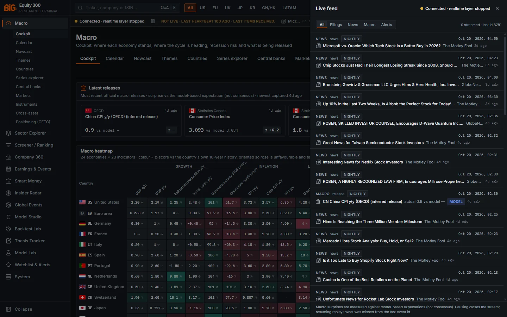

*Figure 0.4: The Live feed side panel (Feed button in the live strip) with the realtime layer stopped: every item is tagged NIGHTLY (received with the last refresh) and the macro release carries a MODEL badge.*

### Page header, tabs and panels

Each page starts with its title and a one-line description, followed by tabs where the page has several views. A **?** icon next to the page title (on Company 360, next to **Create thesis**) opens the section of this guide that describes the page, and the tab you are on where the guide has one. The selected tab is part of the address (for example `/company/AAPL?tab=technicals`), so you can bookmark or share a view.

Panels follow one convention:

- the **title** names the object ("Macro heatmap");
- the **subtitle** states units, method and window ("colour = z-score vs the country's own 10-year history ...");
- **badges** on the right carry labels and warnings ("MODEL-BASED SURPRISE", "NO NEW RELEASE INGESTED FOR 3 DAYS");
- hover over most figures, column headers and badges for a tooltip with the definition.

When a panel cannot show data, it says why, using one of four states:

| State | Text | Meaning |
|---|---|---|
| Loading | grey placeholder rows | The request is running. |
| Empty | "No data" plus a reason | The query worked but returned nothing for this selection. |
| Pending | "Not yet available — pipeline pending" | The view exists but the pipeline has not produced it yet (for example a model still training). |
| Error | "Could not load data" with a **Retry** button | The request failed; the message gives the reason. See [A panel says "Could not load data"](18-troubleshooting-faq.md#a-panel-says-could-not-load-data). |

A yellow note "Partial data — some inputs for this view are missing or stale" means the figures are what the pipeline has published, but some inputs are missing.

### Related mnemonics and BQL fields

The **?** icon next to each page title opens this guide; `HELP` in the command bar opens it too and lists every command-bar function. Related chapters: [Data Health](15-system.md) for the status pages, [Troubleshooting](18-troubleshooting-faq.md) for warning chips.

---

## Command bar

**Route:** every page (overlay) · **Menu:** top bar search box · **Mnemonics:** `HELP`, `HELP <function>` · **Refresh:** not applicable

### Purpose

The command bar is the fastest way around the app. It finds a security by ticker, name or ISIN, jumps to any page, and understands Bloomberg-style functions such as `AAPL US Equity GP` or `WIRP US`.

Open it with `Ctrl K` (`⌘ K` on a Mac), with `/` when you are not typing in a field, or by clicking the search box in the top bar. Press `Esc` to close it.

### Screenshot

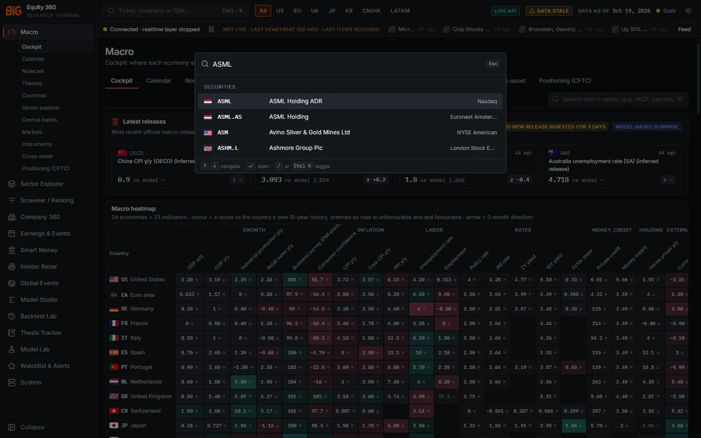

*Figure 0.5: Command bar with "ASML" typed: matching securities with flag, ticker, name and exchange.*

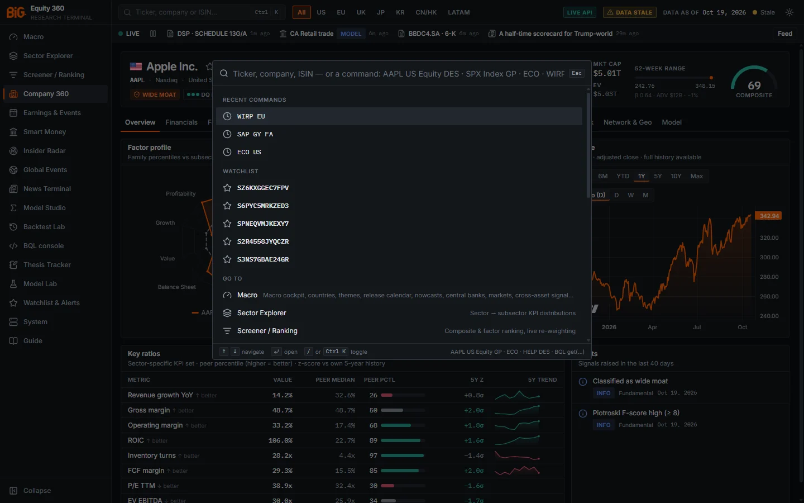

*Figure 0.6: Command bar with an empty input on Company 360: recent commands (WIRP EU, SAP GY FA, ECO US), the watchlist, then "Go to" pages.*

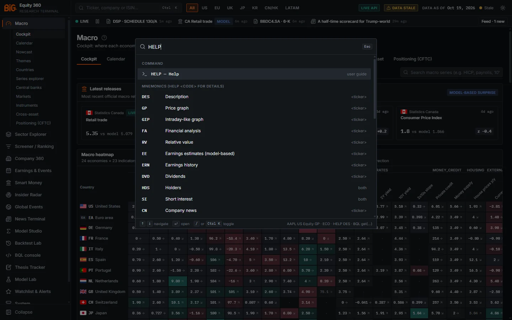

*Figure 0.7: `HELP` typed: the first item "HELP — Help" opens the user guide, followed by every mnemonic with its scope (`<ticker>`, both or global).*

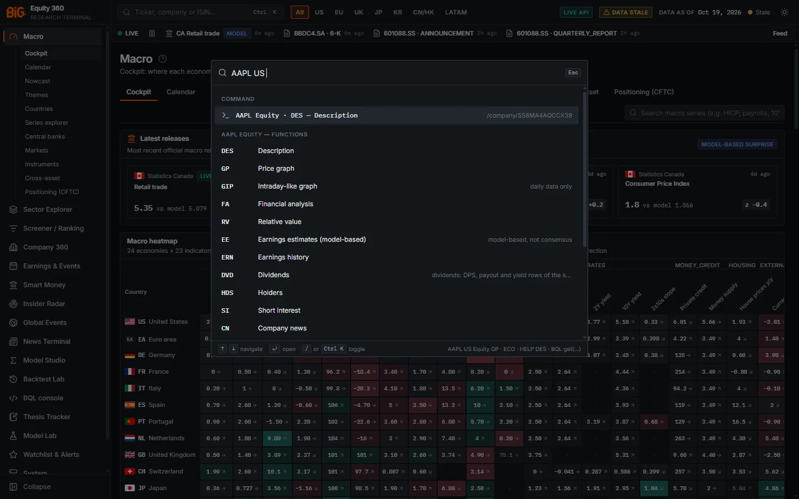

*Figure 0.8: `AAPL US ` typed (with a trailing space): the command "AAPL Equity · DES — Description" and the list of functions available for Apple, with notes such as "model-based, not consensus" for `EE`.*

> **Note:** The watchlist group shows each name's ticker and company name once the watchlist has synced with the server (the screenshot was taken before the 24 Oct 2026 fix and shows internal security ids such as `SZ6KXGGEC7FPV`). Names not yet resolved show their id; selecting one still opens the right company.

### Controls

What appears depends on what you type:

| Input | Groups shown | Enter does |
|---|---|---|
| Nothing | **Recent commands** (last 6), **Watchlist** (up to 8), **Go to** (every menu page), **Actions** | Opens the highlighted item |
| A ticker, name or ISIN (`asml`, `toyota`, `US0378331005`) | **Securities** (flag, ticker, name, ISIN, exchange), **Go to** pages whose name or description matches, and **Functions** whose code starts with the text | Opens the security's page: Company 360 for a stock, the instrument page for an index, FX pair or future |
| A security with a market or asset class (`AAPL US`, `SPX Index`, `EURUSD Curncy`) | **Command** (the security's description, `DES`) | Opens it |
| A security followed by a space (`AAPL US `) | **"AAPL Equity — functions"** (the security's functions): every function that applies to that asset class | Opens the highlighted function |
| A security and a function (`AAPL GP`, `SAP GY FA`, `7203 JT TECH`) | **Command** with its target | Runs it |
| A function with an optional argument (`ECO`, `ECO US`, `WIRP US`, `ECST DE`, `N`, `TOP`) | **Command** | Runs it |
| A security-only function on its own (`DES`, `GP`) on a Company 360 or instrument page | **Command** applied to that page's security | Runs it |
| `HELP` | **Command**: "HELP — Help" (first item, opens the user guide at `/help`), then **Mnemonics**: every function with its scope | Opens the guide; on a mnemonic row, shows `HELP <code>` for it |
| `HELP DES` | **Help**: one-line description and usage, then "Open the mnemonic reference in the user guide" | First row: fills the input with the function; second row: opens the mnemonic reference in [chapter 14](14-bql-mnemonics.md) |
| `BQL get(...) for(...)` or `get(...)` | **Command**: "Run BQL: ..." | Opens the BQL console and runs the query |

The **Actions** group (shown with an empty input, or when you type "theme") offers: **Switch to light / dark theme**, **Open example: Microsoft 360**, **Command bar help (mnemonics)** (types `HELP` for you) and **Open the user guide**.

**Forms of a command:**

- `<TICKER> [<MARKET>] [Equity|Index|Curncy|Comdty] <FUNCTION>`, for example `AAPL GP`, `AAPL US Equity DES`, `SAP GY FA`, `SX5E Index GP`, `EURUSD Curncy GP`, `CL1 Comdty GP`.
- `<FUNCTION> [argument]`, for example `ECO US` (US release calendar) or `WIRP EU` (ECB page with the implied policy path).
- Market codes follow Bloomberg (`US`, `UN`, `UW`, `LN`, `GY`, `FP`, `NA`, `SM`, `IM`, `SW`, `JT`, `KS`, `HK`, `CH`, `AU`, `CN`, `BZ`, `MM`, `IN` and others). `CN` is both the Canada market code and the company-news function: `RY CN` is the Canadian listing of Royal Bank, while `AAPL US CN` is Apple news.
- A function marked unavailable is shown but cannot run. `OMON` (options monitor) is listed as "no options data".
- If the input is not a command, the bar falls back to the ordinary security search.

**Mnemonics overview.** The 34 functions fall into four families:

| Family | Functions |
|---|---|
| Security | `DES` description, `GP` / `GIP` price graph, `FA` financials, `RV` relative value, `EE` earnings estimates (model-based, not consensus), `ERN` earnings history, `DVD` dividends, `CN` company news, `TECH` technicals, `OMON` (unavailable) |
| Security or market-wide | `HDS` holders, `SI` short interest, `PEERS`, `NET` network and geography, `SMRT` smart money, `EVTS` events, `THES` thesis, `BQL` console |
| Market-wide | `WEI` world indices, `WIRP` implied policy rates (approximation), `ECO` economic calendar, `ECST` country statistics, `GC` curves, `FXIP` (alias `FX`), `CMDTY` commodities, `COT` CFTC positioning, `EQS` screener, `PORT` (alias `BT`) backtest, `TOP` top news, `N` news terminal, `ALRT` alerts, `MDL` model registry |
| Help | `HELP` (opens the user guide and lists the functions), `HELP <function>` |

The full reference, with the page each function opens and its fallbacks, is in [BQL console and mnemonics](14-bql-mnemonics.md).

**Recent commands.** Commands you run are remembered (up to 20, the last 6 shown) in this browser only. Clearing the browser's site data clears them.

### Correct usage and worked example

1. Press `Ctrl K` and type `asml`. The **Securities** group lists ASML (the Nasdaq ADR) and ASML.AS (the Amsterdam home listing). Pick **ASML.AS** to see scores and technicals: for an ADR, the composite score, technicals and fair value are computed on the home listing. An ADR page says so in its header, with a link to the home listing (Figure 0.9).
2. On the ASML.AS page, press `Ctrl K` again and type `GP`: the command applies to the page's security and opens the Technicals tab.
3. Type `ECO DE` to jump to the release calendar filtered on Germany.

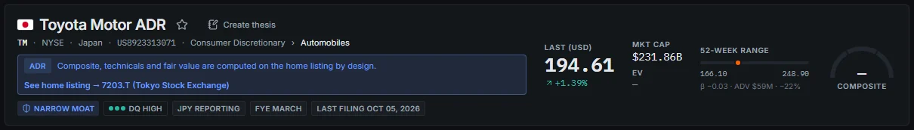

*Figure 0.9: Header of the Toyota Motor ADR page (`/company/TM`): the ADR note "Composite, technicals and fair value are computed on the home listing by design" and the link "See home listing → 7203.T (Tokyo Stock Exchange)"; the composite gauge is empty on the ADR.*

### Limitations and pitfalls

- Search matches tickers, names and ISINs in the app's universe only. A company that is not covered does not appear (see [A company is not found](18-troubleshooting-faq.md#a-company-is-not-found)).
- The index names `'S&P 500'` and `'STOXX 600'` in BQL map to the app's own universes, which are approximations, not official constituents.

### Related mnemonics and BQL fields

All functions above; full list in [chapter 14](14-bql-mnemonics.md).

---

## User guide (Help page)

**Route:** `/help`, `/help/<chapter>`, `/help/print` · **Menu:** Guide (last item of the sidebar) · **Mnemonics:** `HELP` · **Refresh:** not applicable

### Purpose

This guide is built into the app. The **Guide** page renders every chapter with its figures, so you can look up how a page works, how a number is computed and what its validation status is without leaving the dashboard. It opens on the contents page, with every chapter listed in the sidebar.

### Screenshot

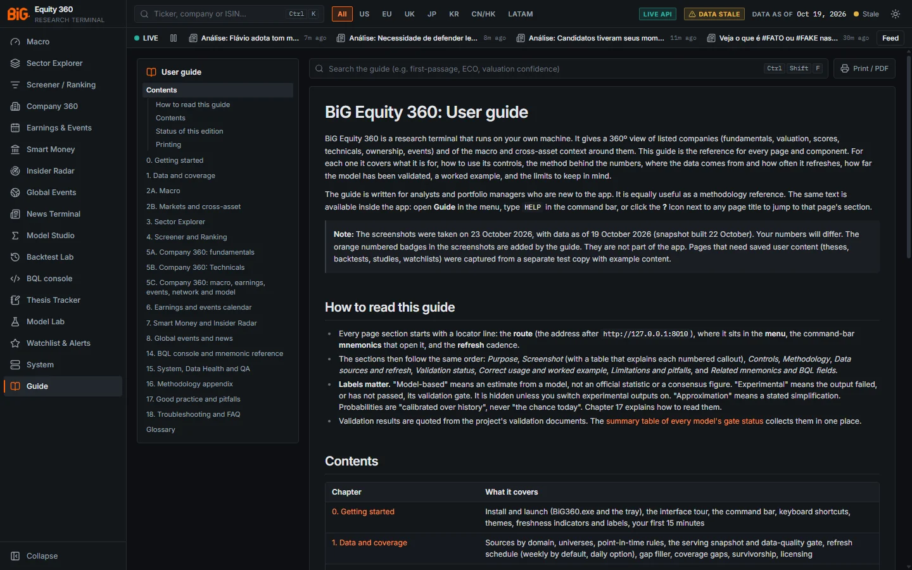

*Figure 0.10: The Guide (`/help`) on its contents page: chapter list on the left, the search box and **Print / PDF** at the top.*

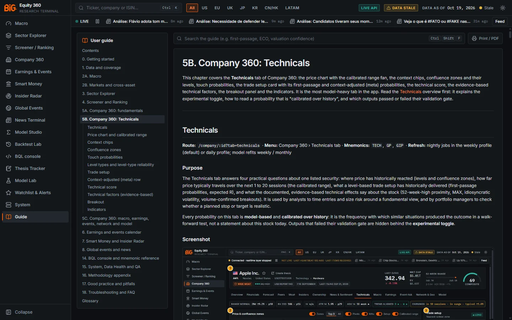

*Figure 0.11: Chapter 5B open (`/help/05b-company-technicals`): the sidebar expands the open chapter into its sections.*

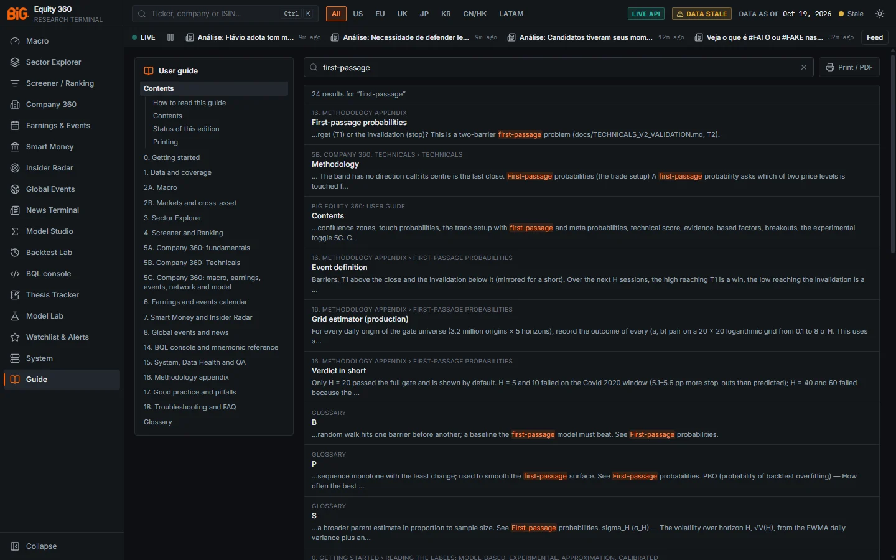

*Figure 0.12: Searching the guide for "first-passage": 24 results, each with its chapter and section and the matching text highlighted.*

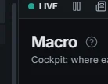

*Figure 0.13: The **?** icon next to the page title ("Macro"), which opens the guide section for the page.*

### Controls

| Control | What it does |
|---|---|
| **Guide** (sidebar) | Opens `/help` on the contents page |
| Chapter sidebar | Lists the chapters with their sections; click one to open it (the address becomes `/help/<chapter>#<section>`) |
| **Search the guide** box | Full-text search across every section; the results list the matching sections. `Ctrl Shift F` focuses the box, `Esc` clears it. |
| Heading anchor links | Each heading has its own link, so you can copy the address of one section and share it |
| Previous / next chapter links | At the bottom of each chapter |
| **Print / PDF** | Opens `/help/print` in a new tab: the whole guide on one page in the light theme, ready for the browser's print dialog or "Save as PDF" |
| **?** icon next to a page title | Opens the guide section for that page (and tab). Tooltip: "Guide: how this page works". On Company 360 it sits next to **Create thesis**. |
| `HELP` in the command bar | The first item "HELP — Help" opens the guide; **Actions › Open the user guide** does the same |

### Limitations and pitfalls

- The figures in the guide were captured on data as of 19 Oct 2026, so the numbers in them will differ from what you see today.

---

## Keyboard shortcuts

**Route:** every page · **Menu:** not applicable

### Controls

| Where | Keys | Action |
|---|---|---|
| Anywhere | `Ctrl K` (`⌘ K` on a Mac) | Open or close the command bar |
| Anywhere, when not typing in a field (except the News Terminal) | `/` | Open the command bar |
| Command bar | `↑` `↓` | Move through the results (the list wraps around) |
| Command bar | `Enter` | Open the highlighted item |
| Command bar, dialogs, side panels | `Esc` | Close |
| Any page, first `Tab` | `Tab` then `Enter` | "Skip to content": jump past the menu to the page |
| Tables with clickable rows (Screener, Data Health ...) | `Tab` to a row, then `Enter` | Open the row (same as clicking it) |
| User guide (`/help`) | `Ctrl Shift F` (`⌘ Shift F` on a Mac) | Focus the guide search box |
| User guide search box | `Esc` | Clear the search |
| Tabs and segmented controls | `←` `→` | Move between tabs or options once one has focus |
| Macro series search | `Esc` | Clear the search |
| Security inputs (Model Studio, Backtest Lab) | `Enter` | Accept the typed ticker or id |
| BQL console editor | `Ctrl Enter` | Run the query |
| BQL console editor, suggestion list open | `↑` `↓`, `Tab` or `Enter`, `Esc` | Move, accept the suggestion, close the list |
| News Terminal (not typing) | `j` / `↓`, `k` / `↑` | Next / previous headline |
| News Terminal | `/` | Focus the filter box (`Esc` leaves it) |
| News Terminal | `Enter` | Open the selected story's detail |
| News Terminal | `o` | Open the source article in a new tab |
| News Terminal | `s` | Mute the selected story |
| News Terminal | `w` | Toggle "watchlist only" |
| News Terminal | `g` | Toggle grouping by story |

> **Note:** In the News Terminal, `/` only focuses the page's own filter (the command bar no longer opens at the same time); use `Ctrl K` there.

---

## Themes and number locale

**Route:** top bar (theme), `/system` (locale) · **Menu:** System › Overview › Preferences & connection

### Purpose

The app has a **dark** theme (default) and a **light** theme, and formats numbers and dates in the locale you choose. Both choices are stored in this browser and apply to every page and chart.

### Screenshot

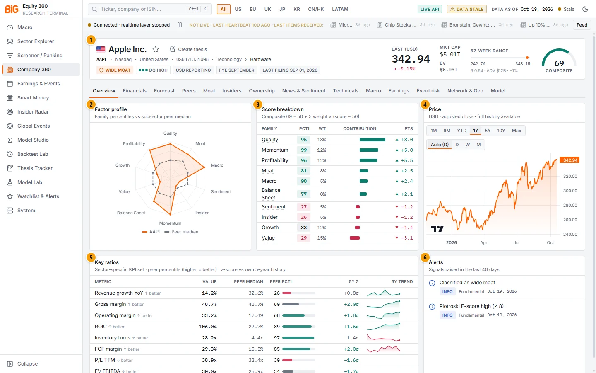

*Figure 0.14: Company 360 for Apple (`/company/AAPL`), light theme.*

| # | Panel | What it shows |
|---|---|---|
| 1 | Apple Inc. (header) | Name, ticker, exchange, ISIN, sector › subsector, badges (WIDE MOAT, DQ HIGH, USD REPORTING, FYE SEPTEMBER, LAST FILING), last price, market cap, EV, 52-week range and the composite score gauge (69) |
| 2 | Factor profile | Radar of the ten factor-family percentiles vs the subsector peer median |
| 3 | Score breakdown | How each family moves the composite: `Composite = 50 + Σ weight × (score − 50)` |
| 4 | Price | Adjusted-close chart with range buttons (1M ... Max) and bar size (Auto, D, W, M) |
| 5 | Key ratios | Sector-specific KPIs with peer percentile, 5-year z-score and trend |
| 6 | Alerts | Signals raised in the last 40 days (here "Classified as wide moat", "Piotroski F-score high") |

The panels are described in [Company 360](05a-company-fundamentals.md).

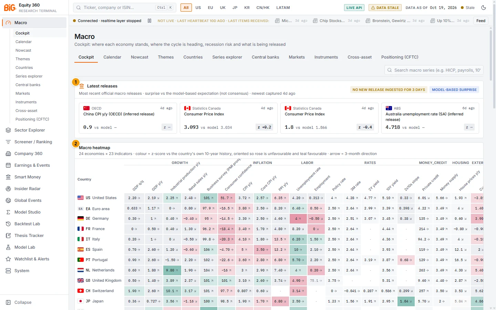

*Figure 0.15: Macro cockpit (`/macro`), light theme.*

| # | Panel | What it shows |
|---|---|---|
| 1 | Latest releases | Most recent official macro releases and the surprise vs the model-based expectation (not consensus) |
| 2 | Macro heatmap | 24 economies × 23 indicators, coloured by z-score vs each country's own 10-year history |

See [Macro cockpit](02a-macro.md) for the full page.

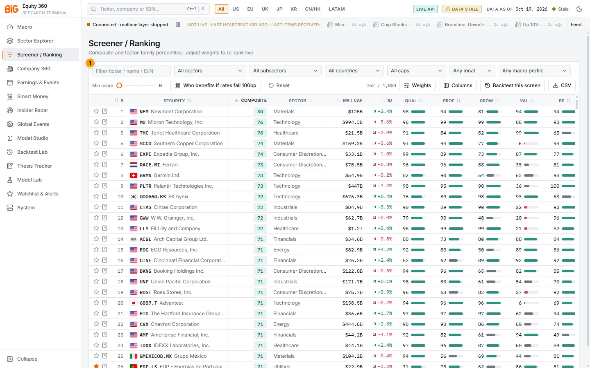

*Figure 0.16: Screener / Ranking (`/screener`), light theme.*

| # | Panel | What it shows |
|---|---|---|
| 1 | Filters and ranking table | Filters (text, sector, subsector, country, size, moat, macro profile, minimum score), Weights, Columns, Backtest this screen, CSV export, and the ranked table |

See [Screener](04-screener.md).

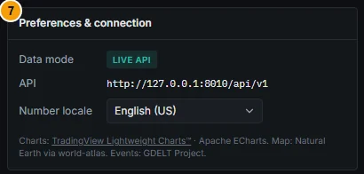

*Figure 0.17: System › Overview › Preferences & connection: data mode, API address and number locale.*

### Controls

| Control | What it does |
|---|---|
| Theme toggle (top bar, sun / moon icon) | Switches theme. The sun icon is shown in the dark theme ("Switch to light theme"), the moon in the light theme. |
| Command bar › Actions › **Switch to light / dark theme** | Same, from the keyboard. |
| **Number locale** (System › Overview › Preferences & connection) | Formats every number and date: English (US), English (UK), Português (PT), Deutsch (DE), Français (FR), 日本語 (JP). For example, in Português (PT) and Deutsch (DE) the decimal separator is a comma. Charts follow the same locale. |

### Limitations and pitfalls

- Both settings are per browser. A colleague on the same PC with another browser profile sees their own choice.
- Changing the locale changes only formatting, never the values. Units are still in the panel subtitles (for example "%", "bn", "x").
- Times (for example the next scheduled run on the System page) are shown in your browser's time zone, while schedules are defined in Lisbon time.

---

## Data-as-of and freshness indicators

**Route:** top bar (every page) · **Menu:** System › Data health for details · **Refresh:** re-read in the background

### Purpose

The top bar always tells you how current the numbers are. This matters because the app refreshes on a schedule (weekly by default), regions close at different times, and a failed job can leave one region behind.

### Methodology

The indicators are computed from `GET /api/v1/system/status`:

- **DATA AS OF** is the latest data date in the published snapshot (`data_as_of_overall`). The tooltip lists the date per region (US, EU, UK, JP, KR, CN, HK, CA, LATAM, APAC, Other). It is the date of the data, not the time the snapshot was rebuilt.
- The **freshness status** follows the snapshot's sections:
  - *Error* (red dot) when a critical table (prices, FX, macro observations) is missing or a price section failed;
  - *Stale* (amber dot) when any market section (prices of a region, FX, macro, filings, insider, events, news, CFTC) is behind, or when an alert says core data is stale beyond the service level or the refresh is overdue;
  - *Fresh* (green dot) otherwise;
  - *offline* (red) when the status endpoint does not answer.
- The **warning chip** shows the most important problem, in this order: *Worker off* (no worker, so nothing runs), *Scheduler off* (worker running without its schedule; red after 24 hours), *Prices failed*, *Data stale*, then *Analytics failed* / *Analytics stale* (scores, valuation, technicals or models behind while the market data is fine).

**What "stale" means.** Each dataset has an expected cadence (exchange trading calendars for prices, official release calendars for macro, the CFTC Friday schedule and so on) and a service level. A dataset is stale when its data lags its latest expected date by more than the service level. For the weekly profile the default service level is 9 days (prices 6 days); for the daily profile it is 3 days. Stale does not mean wrong: the numbers are correct as of their date, but newer data exists at the source.

### Correct usage and worked example

On 23 Oct 2026 the top bar read **DATA STALE**, **DATA AS OF Oct 19, 2026** and a **Stale** dot (Figure 0.3). Hovering the date showed US 16 Oct, EU / UK / KR / CN 19 Oct, HK and LATAM 16 Oct, and **JP 13 Oct**. The freshness tooltip listed `prices:JP (stale)`: Japanese prices were six days behind the snapshot date, which is what turned the chip on. Everything else was usable; only Japanese prices and anything derived from them that week (Japanese technicals, momentum) were older.

What to do:
1. Check the per-region date before comparing names across regions.
2. Click the chip to open Data health and see the dataset, its lag and whether the gap filler is already repairing it.
3. If you need fresher data before the next scheduled run, use tray › **Run refresh now** (it takes one to several hours).

### Limitations and pitfalls

- A snapshot can be rebuilt today with data from last week: always read **DATA AS OF**, not the rebuild time.
- Per-panel dates matter as well: many panels show their own "as of" or "newest captured 4d ago" in the subtitle.

### Related mnemonics and BQL fields

The System pages are described in [System and Data Health](15-system.md); data cadences in [Refresh schedule](01-data-and-coverage.md#refresh-schedule).

---

## Reading the labels: model-based, experimental, approximation, calibrated

**Route:** every page · **Menu:** not applicable · **Refresh:** not applicable

### Purpose

The app never presents its own estimates as official data or as consensus. Every number that comes from a model, a simplification or a test that failed carries a label. Read these labels before you use a number.

### Screenshot

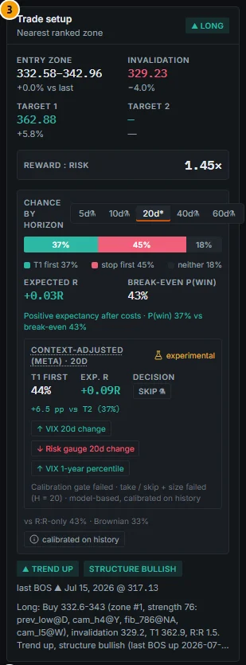

*Figure 0.18: Trade setup card for Apple with "show experimental" switched on: experimental horizons and the meta row are marked with a flask icon, and the card states "Calibration gate failed ... model-based, calibrated on history".*

### Methodology

| Label (as shown) | Meaning | Examples |
|---|---|---|
| **official** | Published by a statistics office, central bank, regulator or exchange, shown as published | Releases in the macro calendar, filings, policy rates |
| **model-based** (also "model", "MODEL-BASED SURPRISE", "model-based (ours)") | Estimated by the app's own model from historical data. It is not an official figure and not analyst consensus. | Macro expectations and surprises, earnings expectations (seasonal model on the company's own history, 80% band), nowcasts, recession and regime models, Taylor rule, central-bank tone, smart-money score, setup probabilities |
| **approximation** | Derived from official data with a simplified method that a market professional would compute differently | Central-bank implied paths: "Approximation from official curves (not futures/OIS-implied probabilities)" |
| **calibrated on history**, **Calibrated range**, calibrated band | A range or probability whose realised frequency has been checked against history. A 90% calibrated range contained the realised price about 90% of the time in the walk-forward test (89.6% to 90.0% at every horizon from 1 to 20 sessions). | The calibrated range fan on the Technicals chart, touch probabilities, the 20-session first-passage probabilities |
| **experimental** (flask icon, "experimental", "failed validation") | The output was tested and **failed** its validation gate (or has not passed it). It is hidden by default and only shown when you switch it on, or in Model Studio and the Backtest Lab. | Setup probabilities at 5, 10, 40 and 60 sessions; P(hold given touch); the calibrated technical score ("no out-of-sample edge"); the joint conformal envelope |
| **descriptive · model-based · not a trading signal** | Passed a calibration test as a description, but failed as a predictor | Conformal peer-group anomaly measures |
| **n/v** | Not validated | Shown in validation lists where no gate exists |
| **Announced / Provider est. / Projection** | Source of an earnings date: published by the company or exchange; a data provider's estimate; the app's projection from the reporting cadence | Earnings calendar, Company 360 › Earnings |

How to read a probability: "37% T1 first" means that, over the history used to calibrate it, setups like this one reached the first target before the stop about 37% of the time. It is **calibrated over history**, not "a 37% chance today".

### Controls

| Control | What it does |
|---|---|
| **show experimental (failed validation)** switch | On the Company 360 › Technicals tab, click **calibrated on history** on the trade setup, technical score or breakout card to open the popover with the validation lines and this switch. When on, outputs that failed their gate are shown with a flask icon and an "experimental" badge. When off (default), they are hidden and the card says so, for example "Experimental (failed the validation gate) — turn on “show experimental” to see it." |

The switch is stored per browser (key `big360.technicals.experimental`) and applies to the Technicals tab and to the setup probabilities shown in the Thesis Tracker.

### Validation status

The gate result of every model is summarised in [Methodology appendix](16-methodology.md). Examples quoted from the validation documents: the marginal calibrated range fan is validated (on target per horizon, about 40% narrower than a 2×ATR band); the first-passage probabilities pass at 20 sessions and fail at 5, 10, 40 and 60 sessions; the calibrated technical score shows no out-of-sample edge. See [Technicals](05b-company-technicals.md#technicals) for details.

### Limitations and pitfalls

- "Model-based" is not a quality grade: some model-based outputs passed strict tests, others did not. Check the validation line.
- Switching on experimental outputs does not make them more reliable. Use them for research, not for decisions.

---

## Where things live

| What | Where |
|---|---|
| Data (lake, serving snapshots, state) | The folder in `BIG360_DATA_DIR`; by default `<project>\data` (about 125 GB on this PC) |
| Your watchlists, alerts, theses, journal, studies, backtests, scenarios | `data\db\app_state.duckdb` (back it up; it cannot be rebuilt). The watchlist and alert rules are also cached in the browser. |
| Your display preferences (theme, region, collapsed menu, locale, experimental switch, recent commands, BQL history) | This browser only (local storage) |
| Logs | `data\logs\` (see [Logs to send to IT](18-troubleshooting-faq.md#logs-to-send-to-it)) |
| App settings | `config\app.yaml` (port, dashboard serving, gap filler, notifications, update folder), `config\schedule.yaml` (refresh profiles), `config\ops.yaml` (gap filler limits) |
| API keys | Windows Credential Manager, `BiG360/<key name>`; `.env` as the development fallback |
| Version and updates | `VERSION` file; IT can point `update_dir` in `config\app.yaml` at a share with newer builds |

---

## Your first 15 minutes

A suggested first session, using data as of 19 Oct 2026.

1. **Start the app (1 minute).** Double-click `BiG360.exe`, wait for the browser to open on the Macro cockpit. Check the tray tooltip says the data date and "weekly".
2. **Read the top bar (1 minute).** Note **DATA AS OF**, hover it to see the per-region dates, and note any warning chip. In our example, Japan was at 13 Oct while the US was at 16 Oct and Europe at 19 Oct.
3. **Macro backdrop (3 minutes).** On the Cockpit, scan **Latest releases** (each card shows the release and "vs model": the surprise is against the app's model, not consensus) and the **Macro heatmap** (rose = unfavourable, teal = favourable vs each country's own 10-year history). Open **Markets** in the sub-menu for indices, breadth and the cross-asset tape. See [Macro](02a-macro.md).
4. **Find ideas (3 minutes).** Open **Screener / Ranking**, pick a region chip (for example **EU**), then sort by **Composite**. Move a factor weight under **Weights** and watch the ranking change. Export with **CSV** if needed. See [Screener](04-screener.md).
5. **One company in depth (5 minutes).** Press `Ctrl K`, type `AAPL`, press `Enter`. On **Overview**, Apple shows a composite score of 69, a wide moat, Quality at the 95th percentile of its peers and Value at the 29th. Then visit:
  - **Financials** (point-in-time statements);
  - **Forecast** (DCF and multiples; model-based, not consensus);
  - **Technicals** (levels, confluence zones, calibrated range, trade setup; open **calibrated on history** to see what is validated);
  - **Earnings** (date source label, reactions, model-based surprises);
  - click the star next to the name to add it to your watchlist. See [Company 360](05a-company-fundamentals.md).
6. **Set up tracking (2 minutes).** Open **Watchlist & Alerts** and add an alert rule, or click **Create thesis** in the company header to record why you are interested. See [Watchlists and alerts](13-watchlists-alerts.md) and [Thesis Tracker](12-thesis-tracker.md).
7. **Know where to look when something seems off.** Open **System › Data health** once to see what it shows. See [System and Data Health](15-system.md). On any page, the **?** icon next to the title opens the matching section of this guide.

Then read [Data and coverage](01-data-and-coverage.md) to understand what the numbers are built from, and [Good practice](17-good-practice.md) before using any output in a decision.
