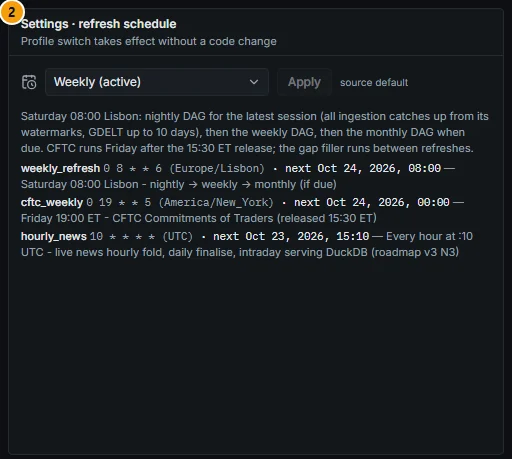
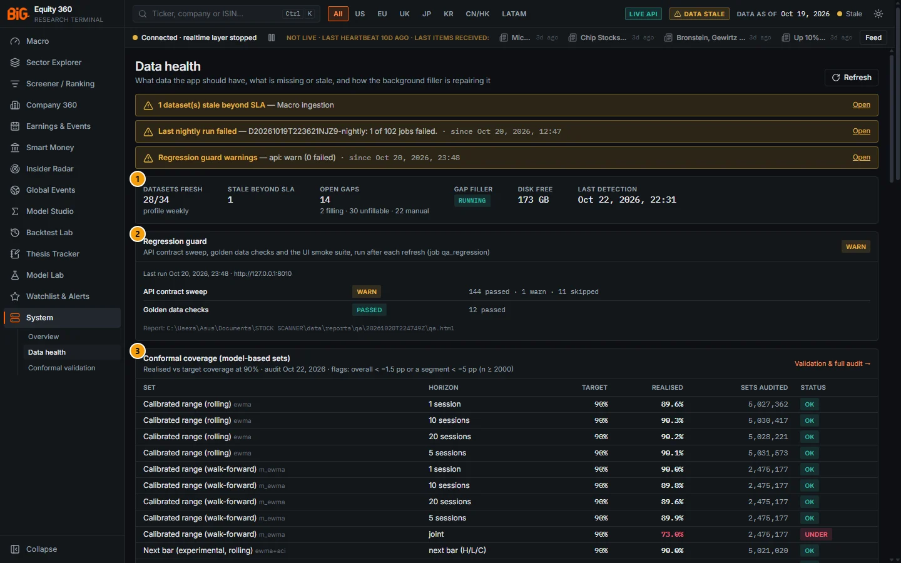

# 1. Data and coverage

This chapter explains where the numbers come from, how the app keeps them point-in-time, when they refresh, how missing data is repaired, which regions are well covered, and which sources need a licence review before the app is used more widely in the bank.

Read it once before relying on any page: most "why does this number look odd?" questions are answered by a source, a lag or a coverage gap described here.

> **Note:** Figures in this chapter are as of the snapshot published on 22 Oct 2026 (data as of 19 Oct 2026) unless stated otherwise. Live counts are on the System and Data health pages.

---

## How data flows through the app

**Route:** `/system`, `/system/data-health` · **Menu:** System · **Refresh:** weekly profile by default

### Purpose

Every page reads from one read-only, internally consistent copy of the data (the **serving snapshot**), rebuilt at the end of each refresh. Knowing the pipeline helps you understand lags and labels.

### Methodology

```
sources → raw (landing zone) → normalised (point-in-time tables) → features → scores / models → serving snapshot → API → dashboard
```

1. **Ingestion jobs** download from each source into the raw zone, using rate limits and per-source watermarks so that each run only fetches what is new.
2. **Normalisation** maps every record to the app's identifiers (issuer, security, listing), converts currencies and units, and stamps each fact with a **knowledge date**: the date it became public.
3. **Analytics** compute ratios, sector KPIs, valuation, scores, moat, technicals, sentiment, macro models and machine-learning predictions from the normalised tables.
4. **`build_serving_db`** materialises everything the dashboard needs into a new snapshot file and publishes it atomically. A data-quality gate decides whether it may be published (see [Serving snapshot and data-quality gate](#serving-snapshot-and-data-quality-gate)).

The storage is a Parquet data lake (about 125 GB on this PC) and DuckDB snapshot files (about 6.6 GB each). There is no database server.

---

## Data sources by domain

**Route:** System › Overview › Data sources; System › Data health › Sources · **Menu:** System · **Refresh:** see [Refresh schedule](#refresh-schedule)

### Purpose

The app uses official sources wherever they exist (statistics offices, central banks, regulators, filing systems), commercial or unofficial sources only where no official one is available, and labels its own estimates as model-based.

### Prices and market data

| Region / instrument | Source | Notes |
|---|---|---|
| United States | Massive (formerly Polygon.io) grouped daily bars (one call per day covers the whole market), splits and dividends; Yahoo Finance via `yfinance` as fallback and for history | Polygon free tier allows 5 calls per minute, so history comes from Yahoo |
| Europe, UK, Japan, Hong Kong, Korea, Canada, India, Australia | Yahoo Finance (`yfinance`) | Korea switches to the official KRX Open API when the `krx_openapi_key` is present |
| China A-shares | BaoStock, then Yahoo | BaoStock has blocked this PC's IP address; several hundred Shanghai names are priced from Yahoo only and do not update nightly |
| Brazil | B3 COTAHIST (official exchange file) and Yahoo | Pre-2005 B3 units need review |
| Taiwan | TWSE / TPEx OpenAPI | Official open data |
| Benchmarks (indices, ETFs, futures, FX, commodities) | Yahoo | Futures curves for the cross-asset dashboard are Yahoo market data and labelled as such |

Prices are stored in the trading currency (pence and cents are normalised to pounds and rand) and adjusted for splits and dividends. Before publication, `prices_finalize` breaks series where a ticker was reused by a different company, repairs 100× unit flips (for example pence vs pounds), and drops unfinished intraday bars.

### FX

| Source | Use |
|---|---|
| ECB euro reference rates | First choice for every currency it publishes |
| FRED H.10 (Federal Reserve) | Currencies the ECB does not publish, and pre-1999 history. Taiwan dollar is only weekly, so it can lag up to about 7 days. |
| Central banks (BCRA, BCRP, Colombia) | Latin American currencies |
| Yahoo | Last resort |

Gaps are forward-filled for up to 5 days and marked `filled`. Balance-sheet items are converted at the period-end rate, flow items (revenue, earnings) at the period-average rate, and valuation ratios are always computed in USD on both sides, which removes the trading-currency vs reporting-currency mismatch for ADRs and dual listings.

### Macro and central banks

Macro data comes from **official sources only**. The app's own expectations, surprises, nowcasts and regime estimates are model-based and labelled.

| Group | Sources |
|---|---|
| United States | FRED / ALFRED (vintages give the knowledge date), BLS and BEA release calendars, US Treasury, New York Fed (ACM term premium, r*, staff nowcast), Atlanta Fed GDPNow |
| Euro area and Europe | ECB Data Portal, Eurostat, Bundesbank, Destatis, INSEE, ISTAT, INE Spain, Banco de Portugal BPstat, SNB, Riksbank, Norges Bank, Bank of England, ONS |
| International organisations | OECD, IMF, BIS, World Bank (including the commodity Pink Sheet) |
| Asia-Pacific | Bank of Japan, Ministry of Finance Japan, e-Stat (key), Bank of Korea ECOS (key), KOSIS (key), HKMA, Census and Statistics Department (HK), CBC Taiwan, RBA, ABS, PBoC / ChinaMoney (LPR) |
| Americas | Statistics Canada, Bank of Canada, BCB, IBGE, BCRA / INDEC, BCRP, BanRep, INE Chile, BCCh (key), INEGI (key), Banxico (key) |
| Release calendars | Official calendars of BLS / BEA, FOMC, Eurostat, ECB, ONS, BoE, BoJ, StatCan, BoC, ABS, RBA, IBGE, BCB, INSEE, Destatis, ISTAT, INE |

### Company filings and fundamentals

| Region | Source (filing system) | What it provides | Knowledge date |
|---|---|---|---|
| United States | SEC EDGAR: XBRL company facts, Financial Statement Data Sets (needed for IFRS 20-F filers), filing index and text | Point-in-time statements (XBRL from 2009), 10-K risk-factor text, 8-K Item 2.02 earnings times | SEC filing date (acceptance time kept) |
| Japan | EDINET (FSA) and TDnet (Tokyo Stock Exchange) | Annual and half-year XBRL, large holdings, quarterly earnings releases (kessan tanshin), JPX earnings schedule | EDINET submission time; TDnet publication |
| EU / EEA | ESEF reports from filings.xbrl.org and national storage mechanisms: DILA / AMF (FR), AFM (NL), FSMA (BE), CNMV (ES), eMarket Storage / 1Info (IT), Nasdaq Nordic, Oslo NewsWeb | Annual reports from FY2020/21 | Deposit / publication date (conservative) |
| United Kingdom | FCA National Storage Mechanism; Companies House (key) | Annual reports, director dealings, UK registry data | Publication date |
| Korea | OpenDART (key) and DART bulk files | K-IFRS statements, disclosures, insider holdings | Receipt date |
| Hong Kong | HKEXnews | Announcements, results dates, disclosure of interests | Publication |
| China | AKShare / BaoStock (CNINFO and exchange sites) | A-share statements and announcements | Imputed where no date is given |
| Taiwan | MOPS (TWSE) | IFRS iXBRL | Upload time |
| Brazil | CVM open data | DFP / ITR statements, insider positions | `DT_RECEB` (receipt date) |
| Mexico, Chile, Peru | BIVA, CMF, SMV | IFRS statements | Filing date |
| Fallback (any region) | Yahoo fundamentals | Latest 4 to 5 annual periods | **Imputed** (not point-in-time; see below) |

### Insiders, ownership, short interest and positioning

| Dataset | Source | Cadence |
|---|---|---|
| US insider trades | SEC Forms 3, 4 and 5 (open-market buys and sells only are scored) | Daily (filing date, never the trade date, is the knowledge date) |
| Non-US insider trades | FCA (UK), BaFin (DE), AFM (NL), AMF (FR), HKEX (HK), CVM (BR) | Daily; CVM monthly |
| Institutional holdings | SEC 13F | Quarterly; filed up to 45 days after the quarter (median 42 days), history from 2023-Q2 |
| Activism | SEC 13D / 13G | Daily |
| US short interest | FINRA | Twice a month, published one to two weeks after the settlement date |
| Fails-to-deliver | SEC | Twice a month |
| EU / UK net short positions | FCA, AMF, CNMV, AFM, CBI, FSMA, FI (Sweden), Finanstilsynet (Norway) registers | Daily; Germany and Italy are not available (robots exclusion and captcha) |
| Futures positioning | CFTC Commitments of Traders (official Public Reporting Environment) | Weekly: Tuesday positions released Friday 15:30 ET; full history from 1986 |

### News, events and text

| Source | Use |
|---|---|
| Massive (Polygon) news | US company news |
| Curated RSS / Atom feeds (45 verified feeds) | Central banks, statistics offices, regulators, exchanges and selected financial press. Only headline, a snippet of up to 300 characters, URL, publisher, time and language are stored, never article text. |
| GDELT 2.0 (events, mentions, Global Knowledge Graph) | Event intensity and tone by country and company, escalation, contagion |
| Common Crawl CC-NEWS | Historical news metadata (headline, short description, URL, publisher); no article bodies |
| SEC 8-K, TDnet and HKEX announcements | Official corporate news in the story layer |
| Caldara–Iacoviello GPR index | Geopolitical risk |

Sentiment is scored with FinBERT for English and XLM-R for other languages; central-bank tone with a RoBERTa hawkish / dovish classifier plus a lexicon (model-based).

### Reference, identity and linkage

- **Identifiers:** SEC company tickers, ESMA FIRDS, GLEIF LEI, OpenFIGI, JPX and KRX listed lists, Shanghai / Shenzhen exchange lists, CVM register. ADR ratios come from a checked seed file.
- **Supply chain and geography:** UN Comtrade, OECD inter-country input-output tables, IMF trade statistics, BIS banking statistics, company filings (rules only, no language model).
- **Maps:** Natural Earth.

### Limitations and pitfalls

- Yahoo data has no publication date, so Yahoo fundamentals get an **imputed** knowledge date and are never treated as truly point-in-time.
- Some sources need keys that are not installed on this PC (OpenDART, KRX, Companies House, OpenFIGI and several national macro keys); the jobs skip them with "missing key".

---

## Universes

**Route:** Screener filters, BQL `members(...)`, Backtest Lab universe selector · **Menu:** Screener / Ranking, BQL console, Backtest Lab

### Purpose

A universe is a named list of securities used by screens, scores, models and backtests. Membership is stored with validity dates so that history can be reconstructed.

### Methodology

| Universe | Contents | Count |
|---|---|---|
| `mvp_us` | The 500 largest US-domiciled common stocks by market cap. Excludes ADRs, SPACs, funds and REIT preferreds. | 500 |
| `mvp_global` | A curated list of global large caps: Europe, UK, Japan, Korea, China / Hong Kong, Latin America, Asia-Pacific and Canada | 271 (248 when measured on 11 Oct 2026) |
| `eu_broad` | European issuers (EU-27, UK, CH, NO, IS) with market cap of at least €300M and liquid prices. Fundamentals from official ESEF or national filing systems where available (54% had an official FY2025 report when built on 12 Oct 2026); the rest use Yahoo. | 1,708 issuers |
| `full` | Everything priced: US above $300M market cap and $5, `eu_broad`, full exchange lists for China A-shares, Taiwan, Japan, Korea, Hong Kong and Brazil, plus `mvp_global` | 24,595 securities |

On 23 Oct 2026 the System status reported 24,961 securities, 24,943 with prices, 5,022 with fundamentals and **769 with a composite score**. Composite scores, valuation and the machine-learning predictions are computed for the two MVP universes (`mvp_us` and `mvp_global`); the broad universes are mostly price-only outside the US, Japan and Europe.

Benchmarks (indices, ETFs and futures) and delisted US stocks have prices but belong to no universe.

In BQL, `'S&P 500'` maps to `mvp_us` and `'STOXX 600'` to `eu_broad`. These are approximations (top names by market cap, current membership), not the official index constituents, and the query result says so.

### Limitations and pitfalls

- See [Survivorship and history depth](#survivorship-and-history-depth): membership history only starts on 10 Oct 2026.
- `full` mixes very different data depth by region; filter by region or use `mvp_*` for score-based work.

---

## Point-in-time rules

**Route:** every page (applied in the data layer) · **Menu:** not applicable

### Purpose

Point-in-time (PIT) means every figure is used only from the date it became public. This prevents look-ahead bias in screens, backtests and models, and lets you see what was known on a past date (BQL `as_of=`).

### Methodology

**Knowledge dates.** Fundamentals, filings, insider trades, news, GDELT events, macro observations, 13F holdings and short interest all carry a mandatory `knowledge_date`:

| Source | Knowledge date |
|---|---|
| SEC | Filing date (acceptance time stored separately) |
| EDINET | Submission time |
| DART | Receipt date |
| ESEF | Date the filing was added or processed (conservative), or the publication date if present |
| CVM | Receipt date (`DT_RECEB`) |
| FRED | ALFRED vintage start date |
| GDELT | Date added |
| Form 4 | Filing date, never the transaction date |

**Imputed knowledge dates** (flag `knowledge_date_estimated`) apply to sources without a publication date (Yahoo fundamentals, some AKShare data, non-vintage macro):

| Case | Lag added after period end |
|---|---|
| US quarterly | 45 days |
| US annual | 75 days |
| Non-US quarterly / half-year | 60 days |
| Non-US annual | 120 days |
| Macro | The series' usual release lag |

**As-of rule.** For a date D, the app takes, for each item, the row with the latest knowledge date on or before D. In practice:

- fundamentals use the latest period known at D, preferring trailing twelve months (TTM);
- a **restatement** of an older period never overwrites a newer period;
- a restatement of the same period counts only from its own filing date, so the original figure stays visible before that date;
- prices use bars dated on or before D.

**Snapshot-only fields.** Some fields exist only for the current snapshot (for example the forward P/E `pe_fwd`, the score grade `grade`, `beta_1y`). BQL refuses them with a date range or an earlier `as_of`.

**Model labels.** Forward returns used to train and test models run from the close of D+1 to the close of D+1+h, so information released after the close on D never leaks into the outcome.

### Limitations and pitfalls

- **Sector classification is current only.** A company reclassified last year appears in its new sector for all of history (a small, accepted look-ahead).
- Imputed knowledge dates are conservative estimates; a company that filed early is treated as having filed late.
- The Financials tab shows each figure as it was first known on its filing date; restatements appear as new versions.

---

## Serving snapshot and data-quality gate

**Route:** System › Overview (status), System › Data health · **Menu:** System

### Purpose

The dashboard never reads data while it is being written. Each refresh builds a complete new snapshot, checks it, and switches to it only if it passes. A failed refresh therefore never breaks the dashboard; at worst it shows older data, labelled as such.

### Methodology

1. `build_serving_db` writes `data\db\serving_<run id>.duckdb`.
2. `publish` rewrites the pointer file `data\db\CURRENT`. The API checks it at most once a second, sends new requests to the new file and closes the old one after a 120-second grace period. No restart is needed.
3. Housekeeping keeps the last 2 snapshots, so IT can roll back by writing the previous file name into `CURRENT`.

**Per-section status.** Market data (prices per region, FX, macro, filings, insider, events, news, CFTC) is published even if an analytics job fails. Sections whose inputs failed or are behind are marked in `serving_sections` with their own data date, and the top bar shows "Data stale" or "Analytics stale" (see [Data-as-of and freshness indicators](00-getting-started.md#data-as-of-and-freshness-indicators)).

**Data-quality checks** (`dq_checks`, run every refresh):

| Check | Severity |
|---|---|
| Schema conformance, primary-key uniqueness | error |
| Point-in-time violations (knowledge date before period end) | error |
| FX coverage (a currency without a rate in the window) | error |
| Freshness beyond the expected lag | warning / error |
| Null rate more than twice the 30-day baseline | warning |
| Row count change of more than ±50% vs the previous run | warning |
| Value ranges (for example a daily return above 80% without a corporate action) | warning |
| Polygon vs Yahoo close differing by more than 1% | warning |
| Share of unresolved identities | warning |

A failed **error** check blocks publication and the previous snapshot stays live; a **warning** is shown on the System page.

### Correct usage and worked example

The data-quality run of 20 Oct 2026 (`dq summary`) reported 151 error-level checks passed and 0 failed, 301 warning-level checks passed and 4 failed, and 264 informational checks passed and 1 failed. Because no error-level check failed, the gate was not blocking and the snapshot was published.

### Limitations and pitfalls

- A warning-level failure does not stop publication: read the DQ column on the System page if a number looks implausible.
- The previous snapshot stays live after a blocked refresh; the **DATA AS OF** date then stops moving forward, which is your signal.

---

## Refresh schedule

**Route:** System › Overview › Settings · refresh schedule; tray › Schedule · **Menu:** System · **Refresh:** this section

### Purpose

Data refreshes on a **schedule profile**. The default is **weekly** (one full refresh every Saturday morning), chosen to keep the PC quiet during the week. A **daily** profile is available, and an **intraday** profile is reserved for later.

### Screenshot



*Figure 1.1: System › Overview › Settings · refresh schedule, weekly profile active, next runs as of 23 Oct 2026 (times shown in the browser's time zone).*

### Controls

| Control | What it does |
|---|---|
| Profile drop-down and **Apply** (System page) | Switches the profile; the worker applies it within seconds without a restart |
| Tray › **Schedule ▸ Weekly / Daily** | Same, from the tray |
| Tray › **Run refresh now** | Runs the active profile's refresh immediately |
| `BIG360_SCHEDULE_PROFILE` environment variable (IT) | Overrides the stored choice |

### Methodology

**Profiles** (defined in `config\schedule.yaml`; times in Europe/Lisbon unless noted):

| Profile | Entry | When | What runs | Service level |
|---|---|---|---|---|
| **Weekly** (default) | `weekly_refresh` | Saturday 02:00 | One chain: the nightly job group for the latest session (all ingestion catches up from its watermarks, GDELT up to 10 days back), then the weekly group, then the monthly group if its last run is more than 28 days old | 9 days |
| | `cftc_weekly` | Friday 19:00 New York time | CFTC Commitments of Traders, after the 15:30 ET release | |
| | `hourly_news` | Every hour at :10 UTC | Folds live news into the store; never wakes the PC, no notification | |
| **Daily** | `nightly` | Tuesday to Saturday 01:30 | Nightly job group (the previous US session; Asian and European sessions of that date are already closed) | 3 days |
| | `weekly` | Saturday 06:00 | Weekly job group (waits for the nightly) | |
| | `monthly` | First Sunday of the month 08:00 | Monthly job group | |
| | `cftc_weekly`, `hourly_news` | As in weekly | | |
| **Intraday (placeholder)** | | Behaves like daily today | Will later turn on the realtime layer and intraday pulls | |

The gap filler runs between refreshes in every profile (see [Gap filler](#gap-filler)).

**Job groups** (defined in `contracts/jobs.yaml`):

| Group | Typical jobs |
|---|---|
| **Nightly** (about 100 jobs) | Reference universe and identities; prices for every region, FX, corporate actions; macro (FRED, ECB, Eurostat, international and national sources, release calendar, expectations, surprises, nowcasts, recession and regime models, central-bank rates, curves, projections, tone); SEC filings index, XBRL facts, filing text, Form 4, activism; global filings (EDINET, TDnet, ESEF and national storage mechanisms, FCA, BaFin / AMF / AFM director dealings, HKEX, CVM, BIVA, CMF, SMV, China, OpenDART); EU short positions; GDELT events and knowledge graph; news and sentiment; fundamentals normalisation, ratios and KPIs, valuation, forecast, scoring, technicals (levels, confluence zones, probabilities, factors, breakouts, calibrated ranges, peer groups); ML features and predictions; earnings dates, expectations, reactions and signals; cross-asset signals; thesis and alert evaluation; data-quality checks, snapshot build, regression guard, gap detection |
| **Weekly** | SEC bulk XBRL and Financial Statement Data Sets, 13F, FINRA short interest, moat, ML labels and training, model ensemble, level-type backtests, technical probability and meta-model fits, macro betas, exposures and regime fit, conformal peer-group fit, event studies and spillovers, DART bulk, MOPS Taiwan, CVM, Yahoo fundamentals, Companies House, scheduled Model Studio studies and Backtest Lab strategies |
| **Monthly** | Universe rebalance, JPX and KRX listed lists, OpenFIGI refresh, supply-chain and geography linkage tables, news story re-clustering, technical factor evaluation |
| **CFTC weekly** | CFTC report download and positioning signals |
| **Hourly** | Live news hourly fold, daily finalisation, intraday news store |
| **Manual** | Backfills and on-demand training, run by the app owner or the gap filler |

A full weekly refresh uses all CPU cores for one to three hours on Saturday morning.

**Unattended running.**
- **Catch-up:** if the PC was asleep or off at the scheduled time, the worker runs the missed refresh at start-up or within 15 minutes, as long as it is not older than the profile's catch-up limit (6 days for weekly, 2 for daily).
- **Keep awake:** the worker keeps the PC awake while a refresh runs and sets a Windows wake timer for the next one. Wake timers must be allowed in the Windows power plan.
- **Retries:** each job retries twice (60 s back-off by default); jobs that time out are cancelled, killed and retried.

### Correct usage and worked example

On Friday 23 Oct 2026 the System page showed the weekly profile active (source "default"), with `weekly_refresh` next on Saturday 24 Oct at 08:00 Lisbon and `cftc_weekly` the same evening at 19:00 New York (shown as 00:00 on 24 Oct in a Lisbon browser). The last nightly and weekly runs had completed on 20 Oct (manual catch-up runs). Data dated 19 Oct is therefore what you see until Saturday's refresh publishes the week of 19 to 23 Oct.

If you need more current data for a meeting, switch to **Daily** for the week, or use **Run refresh now** the evening before.

### Limitations and pitfalls

- With the weekly profile, prices can be up to a week old by Friday. This is by design; the top bar shows the date.
- The daily profile uses more CPU every night and needs the PC on or able to wake at 01:30.
- `contracts/jobs.yaml` describes the crons as New York time, but the worker interprets them in its scheduler time zone, Europe/Lisbon, as the System page shows.

---

## Gap filler

**Route:** System › Data health (Gap filler & resource governor, Gap queue, Backfill campaigns) · **Menu:** System › Data health · **Refresh:** continuous, low priority

### Purpose

The gap filler (the "Data Ops supervisor", operations roadmap O1) makes the data self-repairing. It knows what data should exist, finds what is missing, stale or partial, and fills it in the background between refreshes using the same code as the scheduled jobs, so backfilled and live data are identical.

### Methodology

1. **Coverage registry** (`contracts/coverage.yaml`): for each dataset, the expected cadence (exchange trading calendars, official release calendars, the CFTC Friday schedule, 13F deadlines), the expected entities, the service level, the source, the fill action and its cost.
2. **Gap detector** (job `data_gaps_detect`, after every refresh and once a day): compares expected against actual and classifies each gap as **missing**, **stale**, **partial** (for example a GDELT day with 512 of 576 files), **suspicious** (failed a data-quality rule, unit or FX glitch) or **unfillable** (the source never published it; recorded so the detector stops retrying).
3. **Filler** (`python -m app.ops.filler`): drains the gap queue by priority, with exponential back-off per gap and per-source rate budgets (Polygon about 5 requests per minute, SEC 10 requests per second, OECD 60 downloads per hour, GDELT bandwidth, and so on).
4. **Resource governor** (`config\ops.yaml`):

| Setting | Default | Effect |
|---|---|---|
| RAM cap | 4 GB for the filler's processes | No new task above it; the least urgent task is stopped above 1.5× the cap |
| Minimum free RAM | 3 GB (resume above 3.5 GB) | Pauses every filler task when the PC is short of memory |
| Concurrency | 2 tasks | |
| CPU priority | Below normal | Your work always comes first |
| Pause on battery / metered connection | On | Pauses on battery power or a phone hotspot |
| Minimum free disk | 15 GB | Pauses below it |
| Yield to refreshes | nightly, weekly, monthly | Heavy filler tasks stop while a refresh runs |

5. **Campaigns** are long, resumable backfills that report progress and an estimated finish time. On 23 Oct 2026:

| Campaign | Status |
|---|---|
| GDELT 2015-02 to 2026-07 deep backfill | Waiting, 15.9% done |
| GDELT partial / missing days re-run | Waiting (runs through the gap queue) |
| 13F holdings history (2023-Q2 onwards) | Done |
| CFTC full history (1986 onwards) | Done |
| Earnings dates history (Yahoo, JPX, SEC 8-K) | Done |
| Yahoo price history for unpriced securities | Running, 90.9% (18 securities left) |
| CC-NEWS historical news metadata | Waiting |
| SEC 8-K, TDnet and HKEX announcements history | Waiting |

### Controls

| Control | What it does |
|---|---|
| Tray › **Pause background jobs** / **Resume background jobs** | Pauses the filler (it stops its tasks within about 15 s). Scheduled refreshes still run. |
| Gap filler state on Data health | Shows *running* or *paused* with the reasons (battery, metered network, low RAM, low disk, refresh running, manual pause) |

### Limitations and pitfalls

- The filler cannot create data that a source never published; such gaps stay *unfillable*.
- Some gaps are marked *manual*: they need a decision or a key (for example the OpenDART key for Korea) and are listed for the app owner.

---

## Data Health overview

**Route:** `/system/data-health` · **Menu:** System › Data health · **Refresh:** on load; **Refresh** button

### Purpose

Data health answers "what data should the app have, what is missing or stale, and how is it being repaired?" It is the place to go when the top bar shows a warning chip. The page is described in full in [System and Data Health](15-system.md); this section gives an overview.

### Screenshot



*Figure 1.2: Data health (`/system/data-health`), 23 Oct 2026, with three open alerts.*

| # | Panel | What it shows |
|---|---|---|
| 1 | Summary tiles | Datasets fresh (28 of 34), stale beyond service level (1), open gaps (14: 2 filling, 30 unfillable, 22 manual), gap filler state (RUNNING), free disk (173 GB), last gap detection |
| 2 | Regression guard | The automatic checks run after each refresh: API contract sweep (144 passed, 1 warning, 11 skipped) and golden data checks (12 passed) |
| 3 | Conformal coverage (model-based sets) | Realised vs target coverage of the calibrated ranges at 90% (for example 89.6% at 1 session); flags any set under target |
| 4 | Freshness heatmap | Coverage per day (actual vs expected entities) for each dataset over the last 21 days |
| 5 | Backfill campaigns | Progress and estimated finish of the long backfills listed above |
| 6 | Gap filler & resource governor | Filler process, heartbeat, running tasks and the governor's readings (free RAM, power, network, disk) |
| 7 | Gap queue | Every tracked gap by class (missing, stale, partial, unfillable, suspicious) and status |
| 8 | Sources | Health of each source over 14 days (ok, degraded, failing, idle) and rate-budget use |
| 9 | SLA breaches & recent failures | Datasets beyond their service level and failed job runs of the last 7 days, with error messages |

The banners above the tiles repeat the operational alerts (here "1 dataset(s) stale beyond SLA — Macro ingestion", "Last nightly run failed ... 1 of 102 jobs failed", "Regression guard warnings"), each with an **Open** link.

---

## Coverage by region and known gaps

**Route:** System › Overview › Data sources (per region view) · **Menu:** System

### Purpose

Coverage is not uniform. The US is the deepest; some markets have prices but few fundamentals. Check this table before comparing companies across regions.

### Methodology

| Region | Prices (as of in the 22 Oct snapshot) | Fundamentals | Other gaps |
|---|---|---|---|
| United States | Polygon + Yahoo (16 Oct) | Deepest: SEC XBRL, point-in-time, 10 to 15 years; about 488 of the 500 `mvp_us` names had recent fundamentals | US earnings dates are Yahoo estimates ("Provider est."), as there is no free official confirmed-date source |
| Europe | Yahoo (19 Oct) | ESEF from FY2020/21 via filings.xbrl.org and national storage mechanisms. No free official source for Germany and Switzerland (Yahoo only). No national adapter for PL, GR, PT, LU, RO, HU, CZ. Spain partly covered. | German and Italian short positions not available |
| United Kingdom | Yahoo (19 Oct) | ESEF via FCA NSM and filings.xbrl.org | Companies House key not installed |
| Japan | Yahoo (13 Oct, stale in this snapshot) | EDINET and TDnet; EDINET history was short (about FY2025 onwards) when last measured on 11 Oct 2026 | |
| Korea | Yahoo (19 Oct) | Thin: OpenDART key not installed (15 issuers had FY2025 statements on 19 Oct) | KRX key not installed |
| China A-shares | BaoStock / Yahoo (19 Oct) | Thin (21 issuers with FY2025 statements on 19 Oct); AKShare / BaoStock | BaoStock IP block: several hundred Shanghai names on Yahoo only |
| Hong Kong | Yahoo (16 Oct) | Thin | |
| Taiwan | TWSE / TPEx | Very thin (MOPS: 2 issuers with FY2025 statements on 19 Oct) | Taiwan dollar FX weekly |
| India, Australia, Singapore | Yahoo | None or Yahoo only | |
| Latin America | B3 + Yahoo (16 Oct) | Good for Brazil (CVM); Mexico, Chile and Peru from BIVA, CMF and SMV | |
| Canada | Yahoo (19 Oct) | SEC EDGAR for 40-F filers, else Yahoo | |

On 19 Oct 2026 (audit), FY2025 or later fundamentals by source were: SEC EDGAR 2,686 issuers, Yahoo 1,073, ESEF 679, TDnet 240, AKShare / BaoStock 21, DART 15, MOPS 2.

**Other known gaps:**

- **History depth.** GDELT history is being backfilled (15.9% of the 2015 to 2026 target done), news sentiment starts around August 2026, 13F starts in 2023-Q2.
- **13F mapping.** Part of the 13F rows cannot be mapped to a security without an OpenFIGI batch or key (81% of 2025-26 value mapped).
- **FINRA short interest.** Symbol resolution is partial; free float is approximated by shares outstanding.
- **Macro.** No euro investment-grade credit spread from an official free source; some BIS daily policy series lag by weeks.
- **Realtime.** The live layer is off unless live news is switched on.
- **Consensus and options.** Not available: no free source.

Open data issues are tracked in `docs/PHASE3_TODO.md`.

### Limitations and pitfalls

- A low peer percentile for a Korean or Chinese company may reflect missing data rather than a weak company. Check the factor coverage shown next to each score.
- Japanese prices in this snapshot are as of 13 Oct while US prices are as of 16 Oct and European prices 19 Oct: cross-region return comparisons over short windows are not like for like.

---

## Survivorship and history depth

**Route:** Backtest Lab, Model Lab, Screener history · **Menu:** not applicable

### Purpose

Survivorship bias arises when a backtest uses today's list of companies, which excludes those that later failed or were taken over.

### Methodology

- **Universe membership history starts on 10 Oct 2026.** From that date, `universe_membership` keeps delisted securities, so results are survivorship-free going forward.
- **Before 10 Oct 2026, backtests and model training use today's company lists.** This flatters them, because failures are missing. Delisted US stocks have prices but are not in any universe.
- Prices go back to 2000 where the source has them. Fundamentals go back 10 to 15 years in the US (XBRL since 2009) and typically 5 to 10 years elsewhere (ESEF from FY2020/21).

### Limitations and pitfalls

- Treat any backtest that starts before 10 Oct 2026 as an upper bound. The Backtest Lab and Model Lab repeat this warning; see [Backtest Lab](11-backtest-lab.md) and [Model Lab](10-model-lab.md).

---

## Licensing caveats

**Route:** not applicable · **Menu:** not applicable · **Source:** `docs/it/DATA_LICENSING.md`

### Purpose

The app was built for one analyst's research. Several sources allow that but not wider use inside a bank (display to several employees, feeding internal systems or decisions). BiG Legal / Compliance and the market-data team must confirm each source before wider use. The assessment below is an engineering view, not legal advice.

### Methodology

| Status | Sources | Action before bank use |
|---|---|---|
| **Fine with attribution** | SEC EDGAR (filings, insiders, 13F, fails-to-deliver); FRED public-domain series, ECB, Eurostat, OECD, IMF, World Bank, BIS, national statistics offices and central banks; CFTC; EU / UK short registers; GDELT (with citation); EDINET, OpenDART, CVM, Companies House, filings.xbrl.org, French DILA, Dutch, Belgian and Spanish registers; Taiwan open data; GLEIF, ESMA FIRDS, OpenFIGI, Natural Earth | Add an attribution notice; set `SEC_USER_AGENT` to a bank contact mailbox |
| **Needs review** | Massive (Polygon): free and individual plans are for personal use, internal display needs a business plan; exchange websites (TDnet, HKEX, KRX, JPX, Shanghai / Shenzhen lists, Nasdaq Nordic, Oslo, B3); FCA NSM and other undocumented endpoints; FINRA short interest; Common Crawl news metadata; UN Comtrade free tier; GPR index; Loughran–McDonald word list; FinBERT and XLM-R model licences | Confirm terms or buy the relevant licence |
| **Not licensed for this use** | **Yahoo Finance / yfinance** (non-US prices, benchmarks, futures curves, earnings dates, fallback fundamentals); AKShare and BaoStock (China); Google News RSS (already off); mindicador.cl; the archived ICE BofA credit-spread series copied from FRED | Switch off and replace with a licensed vendor or the official source; delete or license the ICE archive |

A **vendor adapter interface** lets a licensed feed (Bloomberg, LSEG, FactSet or the bank's own market-data service) replace Yahoo for prices and fundamentals without changing anything downstream. A file-drop adapter for vendor end-of-day files already works; the others are skeletons. See `docs/it/DATA_LICENSING.md` §4.

### Limitations and pitfalls

- Until the review is done, do not distribute screenshots, exports or numbers from the app outside the research team.
- Removing Yahoo without a replacement would remove most non-US prices.

---

## Related sections

- [Getting started](00-getting-started.md) for the top-bar freshness indicators.
- [System and Data Health](15-system.md) for the operational pages.
- [Methodology appendix](16-methodology.md) for how each model uses this data.
- [Troubleshooting and FAQ](18-troubleshooting-faq.md) for stale data and failed refreshes.
- For IT: `docs/it/ARCHITECTURE.md`, `docs/it/RUNBOOK.md`, `docs/it/DATA_LICENSING.md`, `docs/CONFIGURATION.md`.
