# 2A. Macro

The Macro section covers the world economy, from the cockpit overview down to individual official series and central banks. This chapter covers the cockpit, the release calendar, GDP nowcasts, the theme dashboards, the 24 country pages, the series explorer and the central-bank monitor. The macro-to-markets pages (Markets, Instruments, Cross-asset, Positioning) are in [2B. Markets and cross-asset](02b-markets-cross-asset.md).

Three rules apply to every page in this chapter. They are policy decisions recorded in `docs/MACRO_V2_PLAN.md` and `docs/MACRO_V3_PLAN.md`:

- **Official sources only.** Every input comes from a central bank, a statistical office, a Treasury, a Federal Reserve bank, the OECD, the BIS, the IMF, the World Bank or Eurostat. FRED and ALFRED (St. Louis Fed) count as official. Scraped commercial sources (for example AKShare) are excluded from every macro calculation.
- **Expectations are our model, not a consensus.** The app has no consensus feed. Every "expected" value comes from the app's own forecast and carries the label **Model-based expectation (not consensus)**. Surprises are measured against that forecast.
- **Approximations are allowed but labelled.** For example, central-bank implied paths are built from official government curves, not from OIS or futures. The label says so wherever a path appears.

All macro pages share the **macro sections strip** under the page title: Cockpit · Calendar · Nowcast · Themes · Countries · Series explorer · Central banks · Markets · Instruments · Cross-asset · Positioning (CFTC). The **Search macro series** box at its right edge searches the whole macro catalogue from any of these pages (see [Series explorer](#series-explorer)).

> **Note:** The screenshots in this chapter were taken on 23 Oct 2026 against the snapshot whose data runs to 19 Oct 2026, which is why the header shows **DATA STALE**. Live values will differ.

---

## Macro cockpit

**Route:** `/macro` · **Menu:** Macro › Cockpit · **Mnemonics:** none open it directly (`ECO` opens the calendar, `ECST` a country page) · **Refresh:** nightly DAG (weekly profile by default: Saturday 08:00 Lisbon; daily profile: Tue–Sat 01:30 Lisbon); the Latest releases tiles poll every 2 minutes

### Purpose

The cockpit answers four questions on one screen: where each of the 24 covered economies stands against its own history, where its cycle is heading, how large recession risk is under several independent methods, and what has just been released or is about to be. Portfolio managers use it as the morning macro check, and analysts use it as the jumping-off point into country pages, series and the calendar. `/macro` is also the app's start page: the root URL redirects here.

### Screenshot

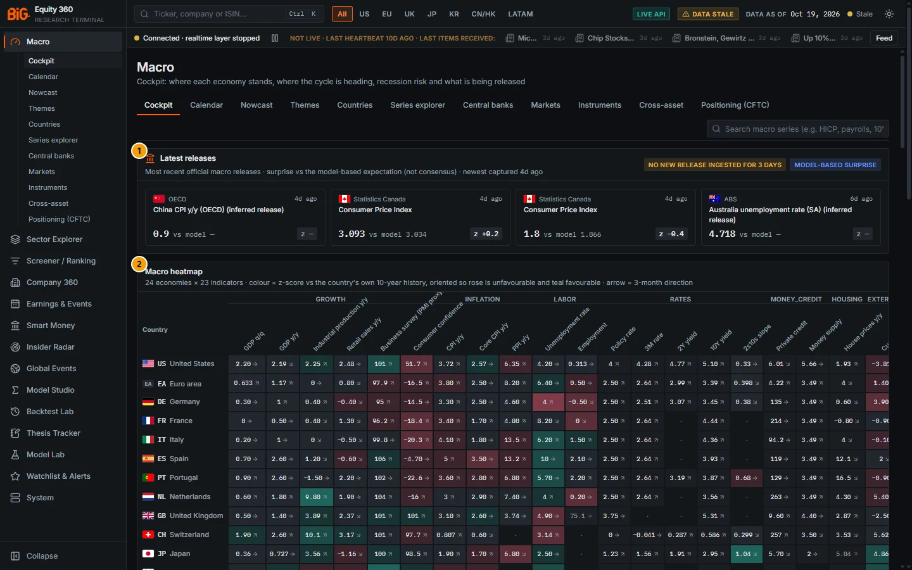

*Figure 2A.1: Macro cockpit (`/macro`), data as of 19 Oct 2026.*

| # | Panel | What it shows |
|---|---|---|
| 1 | Latest releases | The four most recent official releases captured, each showing the actual, the model expectation ("vs model") and the surprise z. Neutral chip when z is between −1 and +1, teal or rose otherwise |
| 2 | Macro heatmap | 24 economies × 23 indicators, coloured by the z-score against each country's own 10-year history and oriented so that teal is favourable and rose unfavourable |
| 3 | Cycle clock | Each country placed by growth momentum against inflation momentum, with 12-month trails |
| 4 | Surprise index | Exponentially weighted index of releases against our model expectations, one bar per country plus GLOBAL |
| 5 | Recession risk | Official and model-based recession indicators side by side, each labelled |
| 6 | Today and the next 7 days | Upcoming tier 1–2 releases from official calendars, with the model expectation and its 80% band |

Panels 3 to 6 are below the fold:

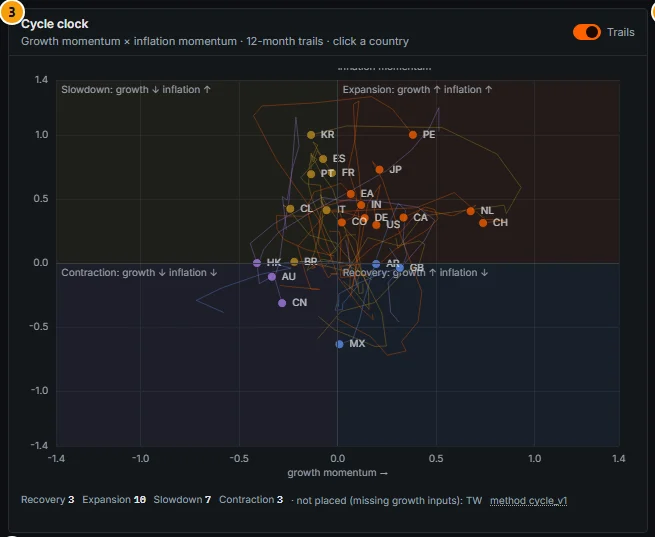

*Figure 2A.2: Cycle clock. 23 countries placed (Expansion 10, Slowdown 7, Recovery 3, Contraction 3); TW not placed.*

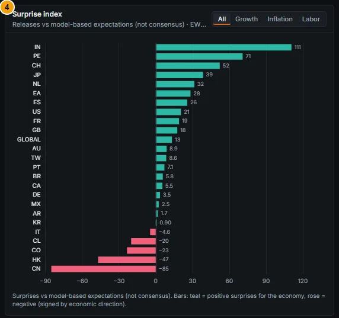

*Figure 2A.3: Surprise index, theme "All". IN +111 at the top, CN −85 at the bottom; US +21; GLOBAL +13.*

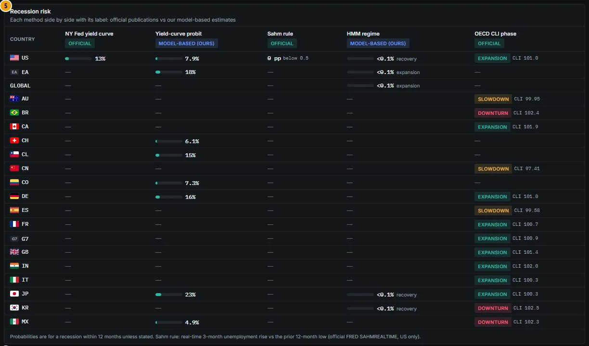

*Figure 2A.4: Recession risk. Official methods carry a green OFFICIAL badge and ours a blue MODEL-BASED (OURS) badge.*

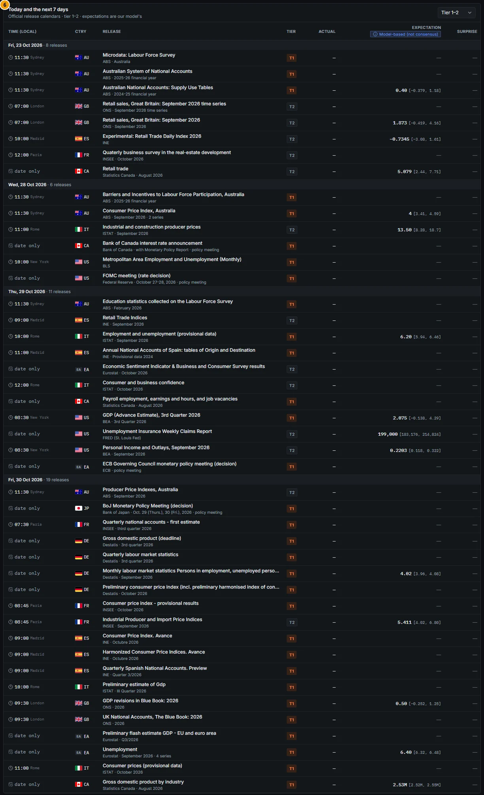

*Figure 2A.5: Today and the next 7 days, Tier 1–2 (23–30 Oct 2026).*

### Controls

| Control | What it does |
|---|---|
| Macro sections strip | Moves between the macro pages. The active page is underlined |
| Search macro series (top right) | Type at least 2 characters to search the macro catalogue (12 best matches with flag, series id, frequency and last date). A click opens the series in the [Series explorer](#series-explorer). Esc clears the box |
| Latest releases tile | Click to open the country page of the release (the cockpit itself when no country is known). The **live** badge marks items streamed by the realtime layer. The z chip's tooltip reads "Surprise z vs the model-based expectation" |
| "no new release ingested for N days" badge | Appears when the newest captured release is more than 3 days old, so that "no new data" is not mistaken for "nothing was released" |
| Heatmap column header (hover) | Shows the indicator name and "higher is better", "lower is better" or "neutral (no good/bad direction)" |
| Heatmap country name | Opens the country page (`/macro/country/:cc`) |
| Heatmap cell (hover) | Tooltip with country, indicator and series title; value, units and period; release date (marked "(estimated)" when inferred) and status; 3/6/12-month changes; z (10y) and percentile; a favourable / unfavourable / neutral verdict; first release → revised value for series with vintages; source and series id with an **official** tag; a link to the official source page |
| Heatmap cell (click) | Opens the series drawer (see below) |
| Trails switch (cycle clock) | Shows or hides each country's 12-month trail |
| Cycle clock dot (hover / click) | Hover lists the growth and inflation momentum, every input (as the z of its 6-month change) and the as-of date. Click opens the country page |
| "method cycle_v1" (hover) | Shows the full method text of the cycle clock |
| All / Growth / Inflation / Labor (surprise index) | Theme filter: recomputes the bars from that theme's releases only |
| Surprise bar (hover / click) | Hover shows the index value, the number of releases in the 365-day window and the date of the last release. Click opens the country page (GLOBAL is not clickable) |
| Recession method header (hover) | The method's full label, e.g. "Yield-curve probit 3m10y, 12m ahead (model-based re-estimate, ours)" |
| Recession country code | Opens the country page (for two-letter codes; G7 and GLOBAL are aggregates) |
| Maximum tier (next 7 days) | Tier 1 only / Tier 1–2 (default) / All tiers |
| Release row (next 7 days) | Opens the release drawer (see [Release calendar](#release-calendar)) |

**Series drawer.** Clicking a heatmap cell, a country tile or a theme source line opens a side drawer for that series. It contains a **Transform** control (Canonical / Level / y/y / m/m / z-score), a 10-year chart (US series are shaded for NBER recessions), the **Provenance** box, and two buttons: **Open in series explorer** and **Open in Model Studio** (see [Series explorer](#series-explorer)). Close it with the × or Esc.

### Methodology

#### Heatmap cells and z-scores

A *cell* is one (country, indicator) pair, e.g. (DE, CPI y/y). For each cell the app picks a **primary series** from the official candidates in the macro catalogue. The ranking is freshness first (fresh, then stale, then discontinued), then catalogue rank, then latest observation. Euro-area members (DE, FR, IT, ES, PT, NL) inherit the EA policy rate, 3M rate and money supply cells, marked "[euro area]".

Each cell is shown on its **canonical measure**:

- **y/y** for growth-rate indicators published as an index or level (CPI, core CPI, PPI, GDP y/y, industrial production, retail sales, house prices, money, credit, employment, REER): `100 × (xₜ / xₜ₋₁₂ₘ − 1)`.
- **q/q** for GDP q/q from an index: `100 × (xₜ / xₜ₋₃ₘ − 1)`.
- **level** for anything already published as a rate or percentage, and for diffusion and confidence indices.
- The **2s10s slope** is derived as `10Y yield − 2Y yield` in percentage points.

Statistics are computed on the canonical measure over the **10 years ending at the latest period** (at least 8 points):

```
z_10y          = (value − mean₁₀ᵧ) / std₁₀ᵧ          (sample std, ddof 1)
percentile_10y = share of window values ≤ value
change_k       = value − canonical value k months earlier (k = 3, 6, 12)
direction      = sign of the 3-month change (falls back to 6m, then 12m);
                 'flat' when |change| ≤ 0.1 × window std
```

The arrow in each cell is the 3-month direction (↗ up, ↘ down, → flat).

#### Colour orientation

The colour is based on an **oriented** z, so that teal always means "economically favourable" and rose "unfavourable":

```
oriented z = z_10y × sign(good_direction)
bucket     = clip(round(1.5 × oriented z), −3, +3)
```

| good_direction | Indicators |
|---|---|
| +1 (higher is better) | GDP q/q and y/y, industrial production, retail sales, business survey (PMI proxy), consumer confidence, employment, 2s10s slope, current account % GDP, fiscal balance % GDP |
| −1 (lower is better) | CPI y/y, core CPI y/y, PPI y/y, unemployment rate, government debt % GDP |
| 0 (neutral, grey) | Policy rate, 3M rate, 2Y and 10Y yields, private credit, money supply, house prices y/y, real effective FX y/y |

Bucket 0 (|oriented z| < 0.33) is the "normal" grey. Buckets ±1, ±2 and ±3 use increasingly strong teal or rose tints. Bucket ±3 starts at |oriented z| ≈ 1.67, and the legend says so ("favourable (oriented z ≥ +1.67σ)" / "unfavourable (oriented z ≤ −1.67σ)"). Neutral indicators never take a colour, however extreme their z. A faded cell is **stale**: its series has missed its expected update given its frequency and usual publication lag. A dot (·) means no official series is available for that cell.

#### Point in time

The heatmap is served from a daily **point-in-time snapshot**: each snapshot uses only observations known on its date (latest vintage per period as known then). For series with vintages (ALFRED real-time rows for the US, or first-seen revisions recorded at ingest elsewhere), the cell also stores the canonical value **as first published** and the revision since then. The footer shows the snapshot date, coverage and method version (`cells_v1`).

#### Cycle clock (method `cycle_v1`)

1. **Inputs.** Growth: GDP y/y (GDP q/q when there is no y/y cell), industrial production, retail sales and the PMI proxy (OECD CLI/BCI, EC ESI, Tankan and similar). Inflation: CPI y/y, core CPI y/y and PPI y/y. Each input is the cell's canonical measure from its primary series. If that history is shorter than 42 months, the longest current candidate series of the same cell is used instead.
2. **Monthly grid.** Monthly inputs are carried forward at most 3 months, quarterly 6 and annual 12, so a discontinued input drops out instead of freezing the clock.
3. **Momentum.** `mₜ = xₜ − xₜ₋₆` (6-month change).
4. **Standardisation.** `zₜ = mₜ / sdₜ`, where `sdₜ` is the standard deviation of `m` over the trailing 120 months (at least 36), and `zₜ` is clipped to ±3.
5. **Composites.** Growth momentum `G` is the mean of the available growth z's; inflation momentum `I` is the same for the inflation inputs. Both are smoothed with a 3-month moving average.
6. **Quadrants**, from the signs of the smoothed composites:

| Quadrant | Rule | Clock label |
|---|---|---|
| Expansion | G > 0, I > 0 | growth ↑ inflation ↑ |
| Recovery | G > 0, I ≤ 0 | growth ↑ inflation ↓ |
| Slowdown | G ≤ 0, I > 0 | growth ↓ inflation ↑ |
| Contraction | G ≤ 0, I ≤ 0 | growth ↓ inflation ↓ |

The clock measures *momentum* (acceleration or deceleration against the country's own volatility), not levels. A country with weak but improving growth sits in a "growth ↑" quadrant. The history uses **latest revised** data, not first releases, and is recomputed nightly. The trail is the last 12 monthly points. Countries without growth inputs are listed as "not placed" (TW in Figure 2A.2).

#### Surprise index

Each released value is compared with the primary **model-based expectation** made before the release (see [Release calendar](#release-calendar)):

```
error       = actual − model expectation
scale       = std of the series' past forecast errors (last 36 releases, ≥ 6)
              else std of past release-to-release changes (≥ 6)
surprise_z  = clip(error / scale, −5, +5)
signed_z    = surprise_z × direction
```

`direction` is +1 for every series except **unemployment and jobless claims (−1)**. In the code's words, a positive `signed_z` means "higher = stronger growth / hotter inflation / tighter labour".

The index for each country, GLOBAL, and theme (all, growth, inflation, labour) is computed daily:

```
index_d = 100 × Σ wᵢ · signed_zᵢ / max(Σ wᵢ, 1)
wᵢ      = tier weight (T1 1.0, T2 0.6, T3 0.3) × 0.5^(ageᵢ / 45 days)
```

It sums over releases in the last 365 days, which gives a 45-day half-life. The `max(Σw, 1)` floor pulls the index towards 0 when there is little recent information. As a scale reference, +100 corresponds roughly to recent releases averaging one standard deviation above our model.

> **Caution:** The surprise index is signed by *economic strength*, not by welfare. An inflation print above our model gives a **positive** (teal) bar; the panel note says so: "teal = above our model in the direction of economic strength (for inflation: hotter than expected, not better), rose = below". Read the inflation theme as "hotter than expected", not "better than expected".

#### Recession risk

| Column | Method | Label | Horizon |
|---|---|---|---|
| NY Fed yield curve | The New York Fed's published probability: a probit of an NBER recession 12 months ahead on the 10y − 3m Treasury spread. Stored at the spread month | official | 12 months |
| Yield-curve probit | Our re-estimate of the same probit per country, `P(rec₍ₜ₊₁₂₎) = Φ(a + b · spread₍ₜ₎)` on monthly 10y − 3m official rates. Recession = NBER (FRED USREC) for the US; elsewhere 2+ consecutive negative quarters of official real GDP q/q. Needs ≥ 2 recession episodes and ≥ 10 years of spreads | model-based (ours), **in-sample fit** | 12 months |
| Sahm rule | FRED SAHMREALTIME (real-time Sahm rule, St. Louis Fed). Triggered at ≥ 0.5 pp. US only | official | current |
| HMM regime | P(contraction) from our 4-state Gaussian HMM on monthly macro factors: forward-filtered (no look-ahead), refitted weekly, filtered nightly. The regime label is shown next to it | model-based (ours) | current state |
| OECD CLI phase | The official OECD CLI (amplitude adjusted) with our turning-point rule: expansion = ≥ 100 and rising; downturn = ≥ 100 and falling; recovery = < 100 and rising; slowdown = < 100 and falling. Turning points are local extremes within ±6 months, confirmed after 6 months | official CLI; rule ours | current phase |

Probability bars turn amber at ≥ 30% and rose at ≥ 50%. The panel footnote reads: "Yield-curve probabilities are for a recession within 12 months; the HMM value is the probability of being in the contraction regime now (current state), not a 12-month forecast."

### Data sources and refresh

- Cells: the official series in `contracts/macro_catalog.yaml`, i.e. FRED/ALFRED, ECB Data Portal, Eurostat, ONS, BoE, BoJ, national statistical offices and central banks, OECD, BIS, IMF and the World Bank. Job `macro_cells` runs nightly and writes today's point-in-time snapshot. The first run backfilled 36 month-end snapshots.
- Cycle clock: job `macro_cycle` (nightly), recomputed from the cell history.
- Surprise index: job `macro_surprise` (nightly), after `macro_calendar` and `macro_expectations`.
- Recession panel: job `macro_recession` (nightly). It downloads the NY Fed `allmonth.xls`, FRED SAHMREALTIME and the OECD CLI, and reads the HMM output from `macro_regime_nowcast`, which is refitted weekly by `macro_regime_fit`.
- Latest releases: the realtime layer (`/live/macro`), polled every 2 minutes, with streamed items merged in when the realtime supervisor is running. Otherwise the panel shows the latest releases from the nightly snapshot.
- Coverage on 16 Oct 2026: 447 of 552 possible cells (TW 8, HK 12, PE 13; US, EA, DE, PT and CA complete).

### Validation status

- **Heatmap:** a descriptive statistic; no model and no gate.
- **Cycle clock:** a rule-based composite (`cycle_v1`). It has not been formally validated as a predictor of returns or of turning points.
- **Surprise index:** its inputs are model-based expectations (see [Release calendar](#release-calendar)). The bar chart's caption carries the API label "Surprises vs model-based expectations (not consensus)". Not formally validated as a signal.
- **Recession panel:** each column carries its own label and the panel never blends them. Our yield-curve probit is an **in-sample** fit and is labelled so in the API (`in_sample: true`). The October 2026 audit (`docs/AUDIT_2026-10-19.md`, section 4) calls the HMM over-confident (a 99.99% "Expansion" posterior on the Markets overview). Read the HMM column's "<0.1%" accordingly: the model rarely expresses uncertainty.
- **Latest releases staleness:** audit finding F41 ("does not say no new releases ingested since …") is fixed: the panel now shows "newest captured … ago" and the warning badge.

### Correct usage and worked example

Use the heatmap to find **where** an economy is unusual, then click through to the series before drawing conclusions. A z of +1.5 on a series that was stable for 10 years is a bigger event than the same z on a volatile one, and the tooltip's 10-year percentile helps here.

Worked example (snapshot of 16 Oct 2026, US row):

- **CPI y/y** is 3.717% for September 2026 (released 14 Oct), with z (10y) +0.20 and percentile 76. Because lower inflation is better, the oriented z is −0.20, which rounds to bucket 0, so the cell is **grey (normal)**. The 10-year window contains the 2021–23 inflation spike, which is why a 3.7% print is unremarkable against this history.
- **Consumer confidence** (UMich, `fred:UMCSENT`) is 51.7 for August, with z −1.50 and percentile 6. Higher is better, so the oriented z is −1.50 and the bucket is round(−2.25) = −2: a **medium rose** cell, even though the arrow points up (+6.9 over 3 months).
- On the JP row, the policy rate cell shows z +3.9 but stays grey, because rates are a neutral indicator.

Cycle clock: the US sits in **Expansion** with growth momentum +0.20 and inflation momentum +0.30 (as of 1 Oct 2026). Its inputs are industrial production +0.17, retail sales +0.30, PMI proxy +0.33; CPI −0.04, core CPI −0.21, PPI +0.28.

Surprise index (theme All, 19 Oct 2026): US **+21** from 210 releases in the window, GLOBAL **+13** from 1,808 releases. Under the orientation above, part of the US reading comes from hotter-than-modelled inflation prints (see the CPI example under [Release calendar](#release-calendar)).

Recession panel, US row: NY Fed 13% (official), our probit 7.9%, Sahm 0 pp (below 0.5), HMM <0.1% (regime "recovery"), OECD CLI 101.0 (expansion).

### Limitations and pitfalls

- **z is relative to the country's own decade.** It does not compare countries. A 4% unemployment rate can be rose in one country and teal in another.
- **Stale cells** keep their last value and are only faded. Check the release date in the tooltip before treating a cell as current.
- Euro-area member cells for the policy rate, 3M rate and money supply are EA values, not national ones.
- The cycle clock uses **revised** history and 3-month smoothing: it lags turning points, and past positions on the trail can move when data are revised.
- The **surprise index measures surprise against our model, not against the market's consensus.** A large positive reading can simply mean our time-series model under-predicts a trending series. It is not a measure of what markets were positioned for.
- Recession probabilities are "calibrated over history" statements for the method in question, not "X% chance today". Our probit is fitted in-sample, and outside the US its recession definition is a technical one (2+ negative quarters).
- When the realtime layer is stopped (as in the screenshots), the Latest releases tiles can be days old. The amber badge tells you so.

### Related mnemonics and BQL fields

- `ECO` (calendar), `ECST <cc>` (country page), `WIRP` (central banks). See [14. BQL and mnemonics](14-bql-mnemonics.md).
- No BQL fields expose macro series directly. The `macro.beta_*` fields are security exposures to macro factors and are covered in [2B](02b-markets-cross-asset.md) and [5C](05c-company-macro-events-model.md).
- Macro alert rules `macro_release`, `macro_surprise` (|z| above a threshold) and `regime_change` (cycle quadrant change, recession probability crossing a level): see [13. Watchlists and alerts](13-watchlists-alerts.md).

---

## Release calendar

**Route:** `/macro/calendar` · **Menu:** Macro › Calendar · **Mnemonics:** `ECO`, `ECO <cc>` · **Refresh:** nightly (`macro_calendar`, `macro_expectations`, `macro_surprise`)

### Purpose

The release calendar lists scheduled data releases and central-bank policy decisions from **official publisher calendars**. For each release it shows the actual (once published), our **model-based expectation** with its 80% interval, the prior and its revision, and the surprise z. Use it to prepare for the week, to check whether a print was out of line with a simple statistical forecast, and to open the full surprise history of a release.

### Screenshot

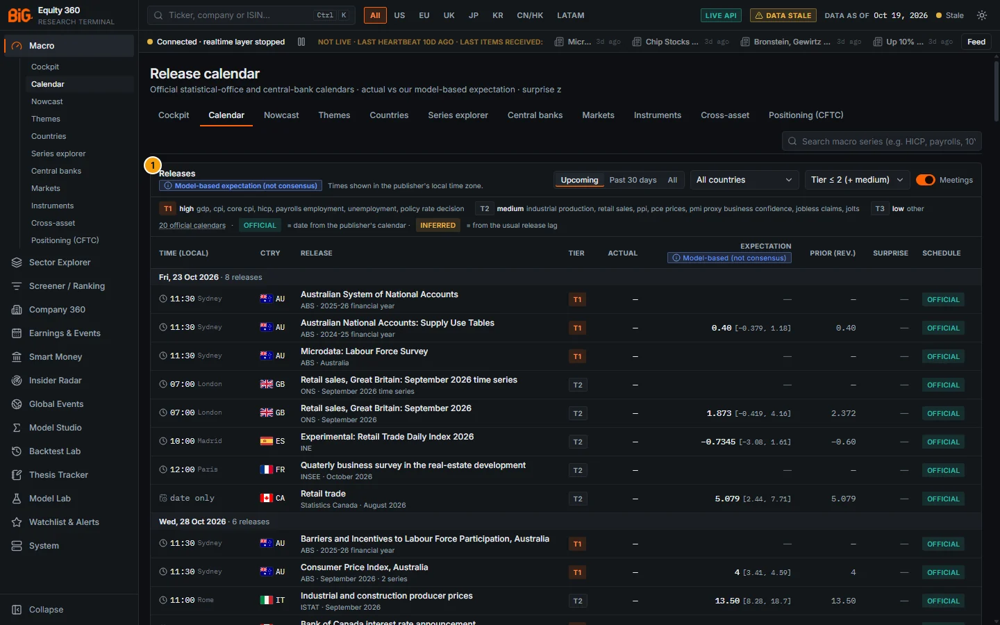

*Figure 2A.6: Release calendar (`/macro/calendar`), Upcoming, all countries, Tier ≤ 2, meetings on.*

| # | Panel | What it shows |
|---|---|---|
| 1 | Releases | The tier legend, the official-calendar count and the schedule badge legend, then releases grouped by day. Columns: Time (local), Ctry, Release, Tier, Actual, Expectation (model-based, with 80% band), Prior (rev.), Surprise, Schedule |

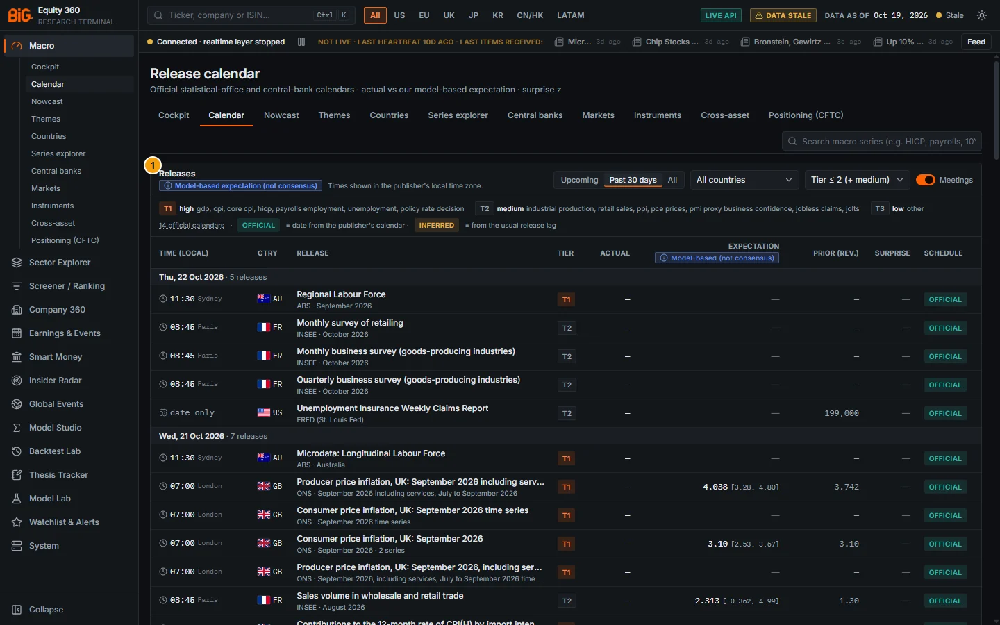

*Figure 2A.7: Release calendar, Past 30 days (most recent day first; 14 official calendars contribute to this window). The top rows (21–22 Oct) fall after the 19 Oct data snapshot, so their actuals are still blank while priors and model expectations are filled in.*

| # | Panel | What it shows |
|---|---|---|
| 1 | Releases | The same table as Figure 2A.6 in reverse date order. Actuals and surprise chips appear once the release has been ingested |

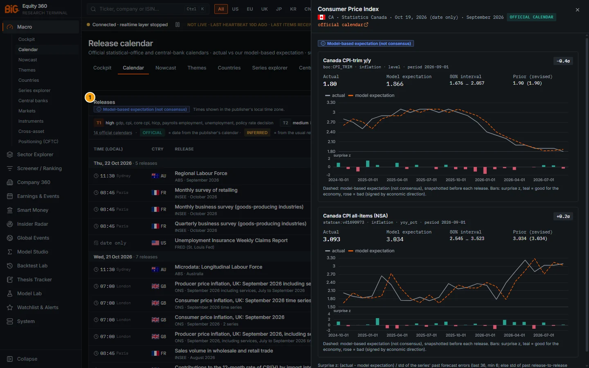

*Figure 2A.8: Release drawer for Statistics Canada's Consumer Price Index (19 Oct 2026, date only, official calendar). CPI-trim y/y: actual 1.80, model 1.866 (80% interval 1.676 to 2.057), surprise −0.4σ. CPI all-items y/y: actual 3.093, model 3.034 (2.545 to 3.523), surprise +0.2σ. Each card has the history of actual against the dashed model expectation, with surprise-z bars underneath.*

| # | Panel | What it shows |
|---|---|---|
| 1 | Releases | The calendar table, behind the open drawer |

### Controls

| Control | What it does |
|---|---|
| Upcoming / Past 30 days / All | Upcoming = today to +45 days; Past 30 days = −30 days to today (most recent day first); All = −30 to +45 days |
| Country | All countries, or one of the 24 coverage countries |
| Maximum tier | Tier 1 (high) / Tier ≤ 2 (+ medium) (default) / Tier ≤ 3 (+ low) |
| Meetings switch | Includes or hides central-bank policy meetings |
| "N official calendars" (hover) | Lists the calendar sources contributing to the loaded window (20 in Figure 2A.6) |
| Model-based expectation tag (hover) | "Our own forecast (ARIMA/SARIMA with order search, seasonal-naive fallback, nowcast-informed where available), snapshotted before the release. It is not a market consensus." |
| Expectation value (hover) | The model label, model and specification (e.g. `ARIMA(2, 1, 1)`), version, 80% and 95% intervals, when the forecast was made (UTC), the data cut-off, and "point-in-time backfill" for historical rows |
| Surprise chip (hover) | "(actual − model expectation) / std of past forecast errors; colour = signed by economic direction" |
| Time icon | A clock means the publisher states an exact time, shown in the publisher's time zone (e.g. "11:30 Sydney"). A calendar icon with "date only" means only the date is published |
| Schedule badge | **official** = date from the publisher's calendar; **inferred** = reconstructed from the usual release lag |
| Release row (click) | Opens the **release drawer** |

**Release drawer.** The drawer has a header with country, publisher, date and local time, reference period, an official-calendar or inferred-date badge, and a link to the official calendar. It repeats the model-based tag, then shows one card per linked series. Each card has the title (click to open the series drawer), series id, theme, measure and period, the surprise chip, and four figures: **Actual**, **Model expectation**, **80% interval** and **Prior (revised)**. Below them is a history chart of actual against the dashed model expectation for past releases, with surprise-z bars underneath, coloured by economic direction. The footer states the surprise method. A policy meeting with no linked series shows "No linked series".

### Methodology

#### Calendar and tiers

- **Sources.** FRED/ALFRED release dates for US releases (BLS CPI, Employment Situation, PPI, JOLTS; BEA GDP and personal income; Census retail sales, housing starts and durable goods; Fed G.17; DOL claims; UMich). FRED supplies dates only, so their time is the publisher's documented release time. One parser per official calendar covers BLS, BEA, FOMC, Eurostat, ECB, ONS, BoE, BoJ, StatCan, BoC, ABS, RBA, IBGE, BCB, INSEE, Destatis, ISTAT and INE. A failed parser is skipped rather than failing the job.
- **Window.** The past 3 years plus 90 days ahead.
- **Point in time.** The actual of a release is the **first vintage** of that period (ALFRED `realtime_start` for US vintage series, the real-time knowledge date elsewhere), not today's revised value. A past release that no official calendar covered gets an **inferred** row dated at the period's first knowledge date, so that surprise history is complete. Inferred rows are never shown as upcoming, and the calendar API excludes them unless asked.
- **Importance tiers.** Tier 1 = GDP, CPI / core CPI / HICP, payrolls / employment, unemployment, policy-rate decisions. Tier 2 = industrial production, retail sales, PPI, PCE prices, PMI proxies / business confidence, jobless claims, JOLTS. Tier 3 = everything else. A release linked to several series takes the best tier among them.

#### Model-based expectations (job `macro_expectations`, version `v2`)

For every release in the next 14 days and every linked series, the job snapshots a forecast of the value about to be published, **strictly before the release**:

| Model | How | Interval |
|---|---|---|
| `sarima` | SARIMA / ARIMA on the release measure (e.g. m/m % for US CPI). Bounded AIC order search (p, q ≤ 2; P, Q ≤ 1 for seasonal series; d chosen by ADF/KPSS, max 1), at most 16 orders, fitted with Model Studio's SARIMAX fitter on the last ≤ 15 years (monthly: 180 obs). The order is re-searched at most once a year | Gaussian 80% and 95% from the forecast standard error |
| `seasonal_naive` / `naive` | The value one season earlier (seasonal series) or the last value | Empirical spread of past same-horizon naive errors |
| `dfm_nowcast` | For GDP (US, EA, GB, JP): our DynamicFactorMQ nowcast for the target quarter (see [Nowcast](#nowcast)) | From the nowcast |

- **Primary model.** One model per release is marked primary, and that is the one the calendar shows and the surprise uses. The choice is data-driven and re-evaluated quarterly. Among the candidate models, the primary is the one with the lowest RMSE over the last 12 releases dated before the start of the release's quarter on which every candidate had a forecast (at least 4). Otherwise the default ranking applies (SARIMA, then DFM nowcast, then naive).
- **Pandemic mask.** Observations from March 2020 to September 2021 are treated as missing when fitting.
- **Point in time and immutability.** Training data is the as-of series known before the release. `forecast_made_at` is always before `scheduled_at`: live forecasts are made at run time, while backfilled ones are dated 12 hours before the release using data known through the previous day. Stored rows are never rewritten.

#### Surprise z

The surprise uses the same formula as the cockpit's [surprise index](#macro-cockpit): `surprise_z = clip((actual − expectation) / scale, −5, 5)`, where `scale` is the std of up to 36 past forecast errors (at least 6). The chip's colour uses `signed_z` (sign flipped for unemployment and claims), with buckets `clip(round(signed_z), −3, 3)`. The expectation must target the released period, or no surprise is computed.

### Data sources and refresh

- Calendars: FRED release dates plus the official publisher calendars above. Job `macro_calendar` runs nightly; the plan also schedules a weekly horizon extension.
- Expectations: job `macro_expectations` (nightly, releases in the next 14 days). Historical expectations come from the manual, resumable `macro_expectations_backfill` job (ALFRED vintages / real-time knowledge dates).
- Surprises: job `macro_surprise` (nightly).
- An actual appears in the calendar after the next nightly run that ingests the new observation. Under the default weekly profile that can be up to a week later; the realtime layer (Latest releases tiles) can be faster when it is running.

### Validation status

- Expectations are **model-based**, labelled "Model-based expectation (not consensus)" on every view, and are **not consensus**.
- Backtest result recorded in `docs/MACRO_V2_PLAN.md` (W2.2): 9,683 model-based expectations for 171 series, a point-in-time backfill of 9,595 rows, and "SARIMA beats naive on 120/168 series". This is the only accuracy statistic recorded. There is no formal pass/fail gate, and the app shows no accuracy figure on the page.
- The primary-model rule (trailing out-of-sample RMSE, quarterly) is itself a guard against using a model that is worse than the naive benchmark for that series.

### Correct usage and worked example

Use the expectation as a **statistical baseline**: "what would a simple time-series model have expected?". Do not use it as a market forecast. The 80% interval is the more useful part: a print outside it is unusual relative to the series' own dynamics.

Worked example: US CPI, released 14 Oct 2026 (event `RE408e2d546e72d7cd`):

| Series | Measure | Actual | Model expectation | 80% interval | Model | Surprise z |
|---|---|---|---|---|---|---|
| CPI all items (`fred:CPIAUCSL`) | m/m % | 0.649 | 0.355 | 0.074 to 0.636 | ARIMA(2, 1, 1) | +1.33 |
| Core CPI (`fred:CPILFESL`) | m/m % | 0.335 | 0.235 | 0.129 to 0.341 | ARIMA(0, 1, 2) | +0.91 |

Headline CPI printed just **above** the model's 80% band, giving a +1.33σ surprise; its chip is teal because higher inflation counts as positive (see the caution under [Macro cockpit](#macro-cockpit)). By contrast, the US unemployment rate on 2 Oct 2026 printed 4.2% against a naive expectation of 4.1% (80% band 3.94 to 4.26). The surprise z is +0.89 but the signed z is −0.89, so its chip is rose. For a print inside the band, see Canada's CPI on 19 Oct 2026 (Figure 2A.8): both series landed inside their 80% intervals, and the surprises were small (−0.4σ and +0.2σ).

To see one country's week, type `ECO <cc>` (for example `ECO DE`) or choose the country in the **Country** list. Then click the tier-1 rows to read each release's surprise history in the drawer.

### Limitations and pitfalls

- **Not consensus.** A "surprise" here is a deviation from our model. Market reactions depend on the consensus survey, which the app does not have.
- `ECO US` opens `/macro/calendar?country=US` and the calendar opens filtered on that country (the Country list is kept in the address, so a filtered calendar can be bookmarked or shared). Choose "All countries" to clear it.
- Upcoming rows from FRED-sourced US releases may show "date only". Their time is the publisher's documented time and is not confirmed for the specific date.
- Only the first linked series of a release fills the row's Actual / Expectation / Surprise columns. Open the drawer for multi-series releases ("· N series").
- Many upcoming rows have no expectation (—): only releases linked to a tracked series get one, and only within 14 days of the release.
- Policy meetings carry no expectation. For what is priced, use [Central banks overview](#central-banks-overview).

### Related mnemonics and BQL fields

- `ECO` opens the calendar. `ECO <cc>` opens it filtered on that country (`ECO JP`).
- Alert rules `macro_release` and `macro_surprise`: [13. Watchlists and alerts](13-watchlists-alerts.md).
- Company earnings expectations use the same "model-based, not consensus" convention: [6. Earnings and events](06-earnings-events.md).

---

## Nowcast

**Route:** `/macro/nowcast` (`?cc=US|EA|GB|JP`) · **Menu:** Macro › Nowcast · **Mnemonics:** none · **Refresh:** nightly (`macro_nowcast`, re-estimated only when the input panel changed)

### Purpose

The Nowcast page tracks our model-based estimate of the current and next quarter's real GDP growth, how it has moved as data arrived, and which releases moved it. For the US it shows the Atlanta Fed **GDPNow** and the New York Fed **Staff Nowcast** next to ours as official reference points. It answers "is incoming data pointing up or down for this quarter?".

### Screenshot

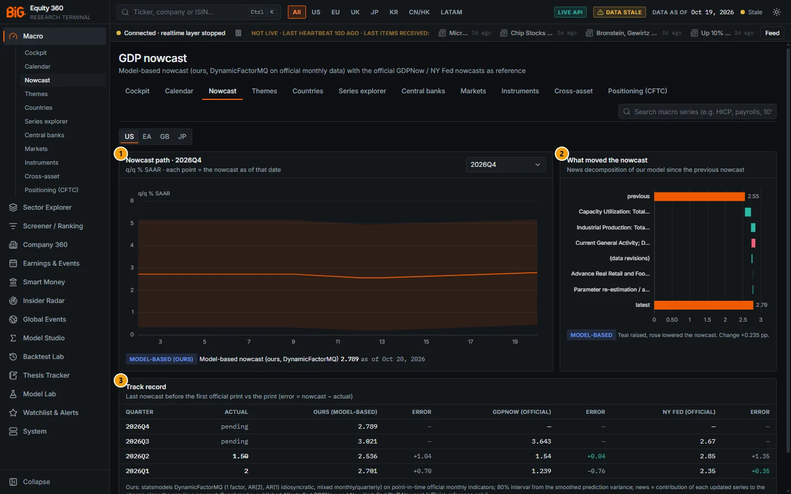

*Figure 2A.9: GDP nowcast (`/macro/nowcast`), US, target 2026Q4, nowcast as of 20 Oct 2026.*

| # | Panel | What it shows |
|---|---|---|
| 1 | Nowcast path · 2026Q4 | Our nowcast for the chosen quarter at each as-of date, with its 80% band, the official nowcasts (dashed) and the first print once released. Below: each model's latest value, badged official or model-based (ours) |
| 2 | What moved the nowcast | Waterfall from the previous nowcast to the latest: contribution of each updated series, data revisions, and parameter re-estimation |
| 3 | Track record | For each quarter, the last nowcast before the first official print against that print, with errors, for ours, GDPNow and the NY Fed. Followed by the method text and the input panel |

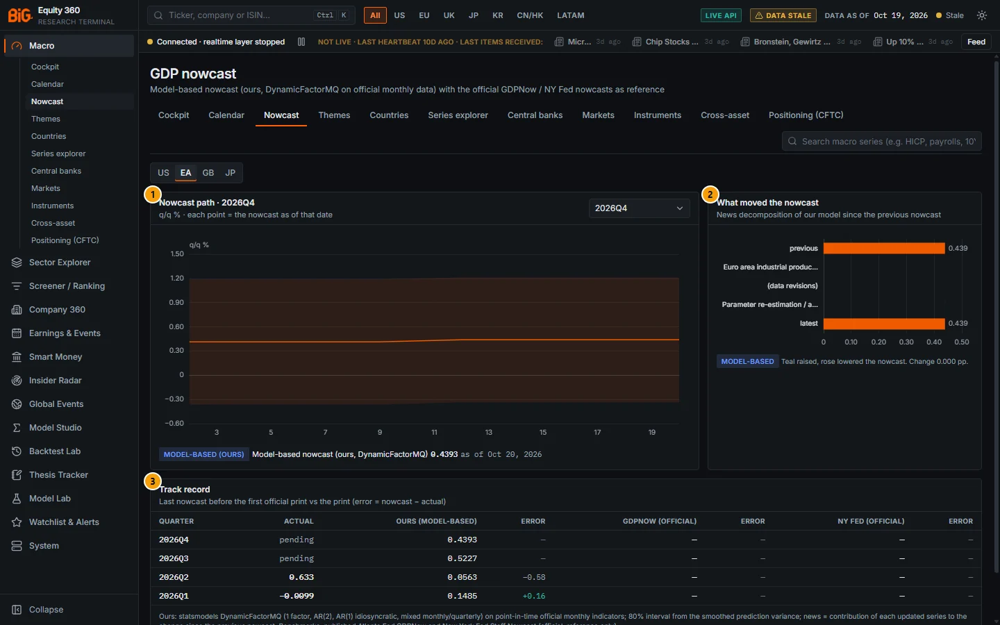

*Figure 2A.10: GDP nowcast for the euro area (`/macro/nowcast?cc=EA`), target 2026Q4: 0.4393% q/q (not annualised), as of 20 Oct 2026. There are no official benchmarks, so the GDPNow and NY Fed columns are empty.*

| # | Panel | What it shows |
|---|---|---|
| 1 | Nowcast path · 2026Q4 | Our EA nowcast (q/q %) with its 80% band; flat through October |
| 2 | What moved the nowcast | Previous 0.439 → latest 0.439: euro-area industrial production, data revisions and parameter re-estimation net to 0.000 pp |
| 3 | Track record | 2026Q2: actual 0.633, ours 0.0563 (error −0.58). 2026Q1: actual −0.0099, ours 0.1485 (+0.16) |

### Controls

| Control | What it does |
|---|---|
| US / EA / GB / JP | Country; written to the URL as `?cc=` (any other value falls back to US) |
| Target quarter | Every quarter from the first one without a published GDP up to the current quarter, plus released ones marked "(released)" |
| Model chip (hover) | The model's source (e.g. the official workbook URL) |
| Waterfall bar (hover) | Contribution in pp and the series id |
| Track-record error colour | Green when the absolute error is below 0.5 pp, rose above 1.5 pp |

### Methodology

**Model (`dfm_mq`, model-based).** statsmodels `DynamicFactorMQ`, which mixes monthly and quarterly data (Mariano–Murasawa aggregation, Bańbura–Modugno EM). It uses 1 global factor with AR(2) dynamics, AR(1) idiosyncratic errors and standardised inputs. The sample starts in January 2000. Pandemic months (March–December 2020; 2020Q2–Q4) are masked as missing.

**Point in time.** Inputs are as known on each nowcast date: ALFRED vintages for US vintage series, real-time knowledge dates elsewhere.

**Panels (official sources only).**

| Country | Target | Monthly inputs |
|---|---|---|
| US | Real GDP (GDPC1), q/q % SAAR | IP, payrolls, real retail sales, unemployment, real PCE, real income ex transfers, housing starts, durable goods orders, initial claims (monthly mean), capacity utilisation, real manufacturing and trade sales, UMich sentiment, Philadelphia and Dallas Fed manufacturing surveys, OECD CLI (15 series) |
| EA | Real GDP q/q % (ECB MNA) | IP (Eurostat), retail y/y, unemployment, EC ESI / industry / consumer confidence, OECD BCI |
| GB | Real GDP q/q % (ONS IHYQ) | IP, retail volumes, monthly GDP index, unemployment, employment rate, OECD BCI/CCI |
| JP | Real GDP q/q % (OECD QNA) | IP y/y, retail y/y, unemployment (OECD KEI), OECD BCI/CCI/CLI |

**Interval.** 80%, from the smoothed prediction variance (including idiosyncratic noise).

**News decomposition.** The latest results are compared with the previous vintage using the current parameters for both. This gives the contribution of each updated series, plus a "(data revisions)" item. The effect of re-estimating the parameters is reported as its own item ("Parameter re-estimation / …"), so the bars add up exactly to `latest − previous`.

**Track record.** The last nowcast of each model **before** the first official print, against that print: `error = nowcast − actual`.

**Official benchmarks.** These are downloaded verbatim and labelled official, for reference only: Atlanta Fed GDPNow (`GDPTrackingModelDataAndForecasts.xlsx`) and the NY Fed Staff Nowcast (download workbook; 80% bands of concluded quarters). They exist for the US only.

**Which countries.** Models exist only for **US, EA, GB and JP**. Any other country returns 404 (e.g. DE, CN, BR), and the country pages of those countries show upcoming releases instead of a nowcast.

### Data sources and refresh

Job `macro_nowcast` runs nightly but re-estimates only when the input panel's fingerprint has changed (a new observation or revision). The nowcast history is weekly and point-in-time since July 2023. The GDPNow and NY Fed workbooks are downloaded on the same job. The US first print comes from BEA via FRED.

### Validation status

Not formally validated; no gate. The app shows the evidence in the **Track record** panel. The October 2026 audit (F27) states: "For 2026Q2 our nowcast error is +1.04 pp vs GDPNow +0.04 pp." It recommends showing the track record more prominently "as it currently understates how weak the model is". The model chips are labelled **model-based (ours)**, and the page title says "Model-based nowcast (ours, DynamicFactorMQ …)".

### Correct usage and worked example

Use the nowcast **direction** and the news waterfall ("payrolls and IP lifted it, sentiment lowered it") as a summary of incoming data. For the US, prefer the official GDPNow and NY Fed values as the level estimate, and treat ours as a cross-check. Always read the 80% band: for the US it is roughly ±2.3 pp wide.

Worked example (US, 20 Oct 2026, Figure 2A.9):

- **2026Q4**: ours 2.789% SAAR (80% band 0.45 to 5.17). The waterfall shows the change from the previous nowcast of 2.55: capacity utilisation and industrial production raised it, the Philadelphia Fed survey ("Current General Activity") lowered it, and data revisions, retail sales and parameter re-estimation contributed little. Net change **+0.235 pp**.
- **2026Q3** (pending): ours 3.021, GDPNow 3.643, NY Fed 2.67.
- **Track record**: 2026Q2 actual 1.50, ours 2.536 (error +1.04), GDPNow 1.54 (+0.04), NY Fed 2.85 (+1.35). 2026Q1 actual 2.0, ours 2.701 (+0.70), GDPNow 1.239 (−0.76), NY Fed 2.35 (+0.35).

### Limitations and pitfalls

- Our model has a short and, so far, unflattering track record against GDPNow (audit F27). Do not trade on it.
- The 80% band is wide, especially early in the quarter.
- EA, GB and JP have no official benchmark in the app, so there is nothing to cross-check them against.
- **Units differ.** The US is q/q % SAAR (annualised); EA, GB and JP are plain q/q % (Figure 2A.10). Multiply a non-US figure by roughly 4 before comparing it with the US.
- Inputs with publication lags (OECD CLI, quarterly-only data for JP) make the JP and EA nowcasts update in steps.
- The 2020 masking means the model has never been estimated on a pandemic-size shock.

### Related mnemonics and BQL fields

- No mnemonic. The country pages for US, EA, GB and JP carry a **GDP nowcast** summary with an "Open nowcast →" link.
- GDP releases use the DFM nowcast as their model expectation in the [Release calendar](#release-calendar) when it beats SARIMA on trailing RMSE.

---

## Themes

**Route:** `/macro/theme/:theme` with `growth`, `inflation`, `labor`, `rates`, `credit_conditions`, `liquidity`, `commodities_fx` (`/macro/theme` redirects to growth) · **Menu:** Macro › Themes · **Mnemonics:** none · **Refresh:** nightly (`macro_cells` and source ingests)

### Purpose

Theme dashboards gather the official series that matter for one macro topic, across countries and in detail for the largest economies. Use them to compare the same indicator across up to four countries, to look inside inflation or the labour market by component, or to animate yield curves through history.

### Screenshot

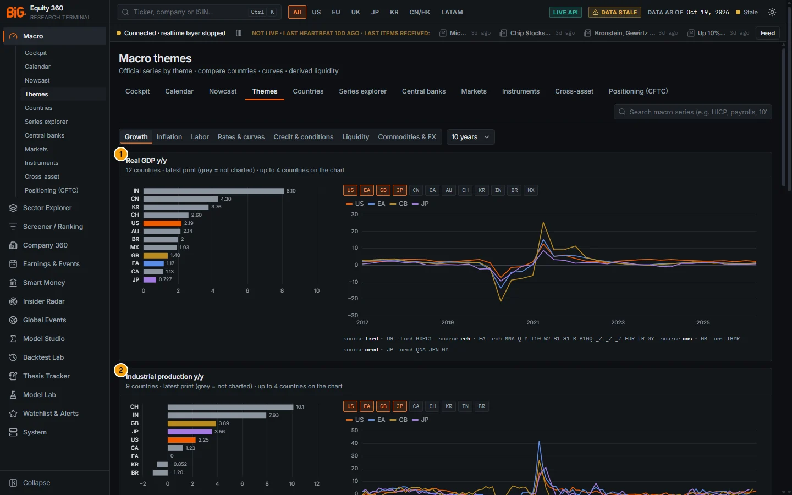

*Figure 2A.11: Themes › Growth (`/macro/theme/growth`), 10 years.*

| # | Panel | What it shows |
|---|---|---|
| 1 | Real GDP y/y | Compare panel: latest print for 12 countries (bars), history for up to 4 chosen countries |
| 2 | Industrial production y/y | Compare panel, 9 countries |
| 3 | Retail sales y/y | Compare panel, 9 countries |
| 4 | Business surveys (PMI proxy) | Compare panel, 12 countries (OECD BCI/CLI, EC ESI, ...) |
| 5 | US activity | Series panel: 5 official US activity series |
| 6 | Euro area members: GDP y/y | Compare panel, 7 euro-area economies |

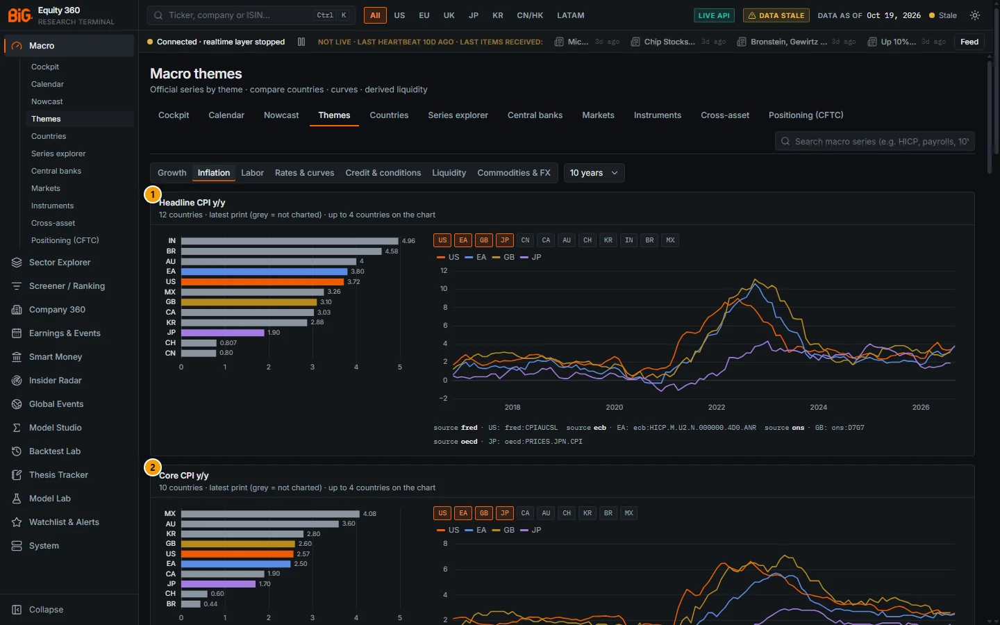

*Figure 2A.12: Themes › Inflation (`/macro/theme/inflation`).*

| # | Panel | What it shows |
|---|---|---|
| 1 | Headline CPI y/y | Compare panel, 12 countries |
| 2 | Core CPI y/y | Compare panel, 10 countries |
| 3 | US CPI components (BLS via FRED), % y/y | 9 official series (small multiples) |
| 4 | US PCE and alternative core measures, % y/y | 4 official series |
| 5 | Euro area HICP components (ECB), % y/y | 6 official series |
| 6 | UK CPI components (ONS), % y/y | 7 official series |
| 7 | US breakevens, real yields, expectations (%) | 6 official series (FRED T5YIE / T10YIE / DFII10 and related) |
| 8 | Producer prices y/y | Compare panel, 6 countries |

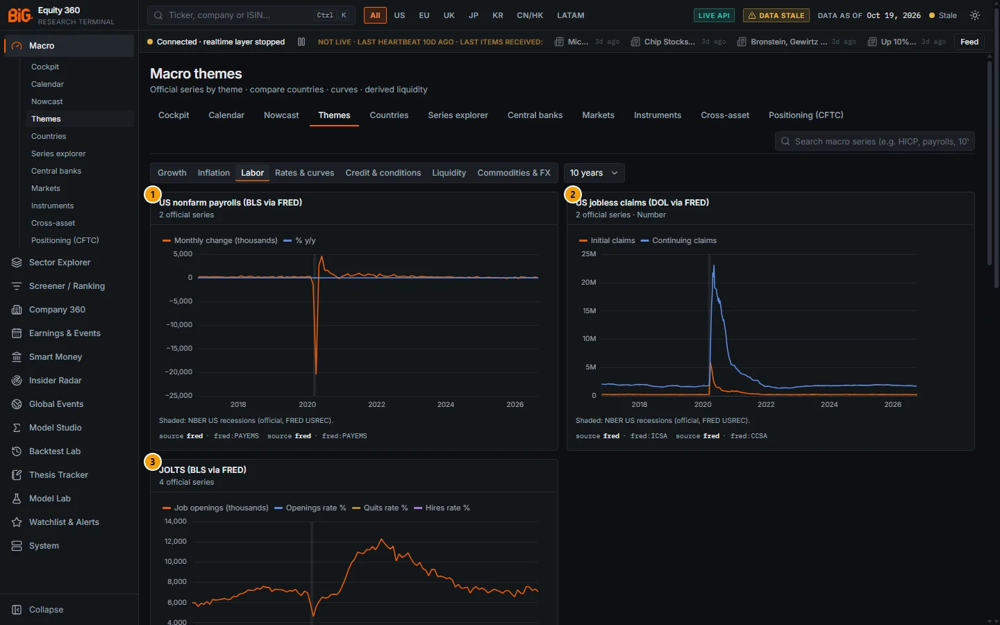

*Figure 2A.13: Themes › Labor (`/macro/theme/labor`).*

| # | Panel | What it shows |
|---|---|---|
| 1 | US nonfarm payrolls (BLS via FRED) | Monthly change (thousands) and % y/y |
| 2 | US jobless claims (DOL via FRED) | Initial and continuing claims |
| 3 | JOLTS (BLS via FRED) | Job openings, openings rate, quits rate, hires rate |
| 4 | US unemployment, participation, wages | 5 official series |
| 5 | Unemployment rate | Compare panel, 10 countries |
| 6 | Employment | Compare panel, 4 countries |

**Other themes.** Credit & conditions, Liquidity and Commodities & FX have no screenshot in this edition. Rates & curves is shown after the table.

| Theme | Panels |
|---|---|
| Credit & conditions | Corporate OAS (ICE BofA via FRED); financial conditions and stress (Chicago Fed NFCI/ANFCI, St. Louis Fed STLFSI); ECB CISS; Fed Senior Loan Officer Survey; ECB Bank Lending Survey; private credit (compare) |
| Liquidity | Fed balance sheet (H.4.1); **US net liquidity = Fed assets − TGA − ON RRP** (derived); Eurosystem balance sheet (ECB ILM); broad money (compare); US M2 |
| Commodities & FX | Energy, metals and agriculture (World Bank Pink Sheet, monthly); daily spot energy (EIA via FRED); trade-weighted USD (Fed H.10); FX rates (Fed H.10); real effective exchange rates (BIS, compare) |

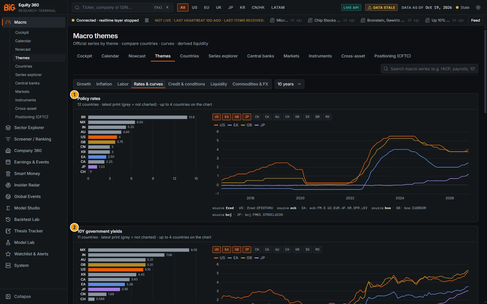

*Figure 2A.14: Themes › Rates & curves (`/macro/theme/rates`), 10 years.*

| # | Panel | What it shows |
|---|---|---|
| 1 | Policy rates | Compare panel, 12 countries (BR 13.8 at the top, CH 0 at the bottom) |
| 2 | 10Y government yields | Compare panel, 11 countries |
| 3 | 2s10s slope (pp) | Compare panel, 6 countries |
| 4 | US curve spreads (pp) | 3 official series |
| 5 | US real yields (TIPS, %) | 2 official series |
| 6 | Treasury term premia (%) | 5 official series (NY Fed ACM) |
| 7 | Sovereign curve history (month-end) | Animated month-end curve with Curve selector, Play, date slider and Pin date |

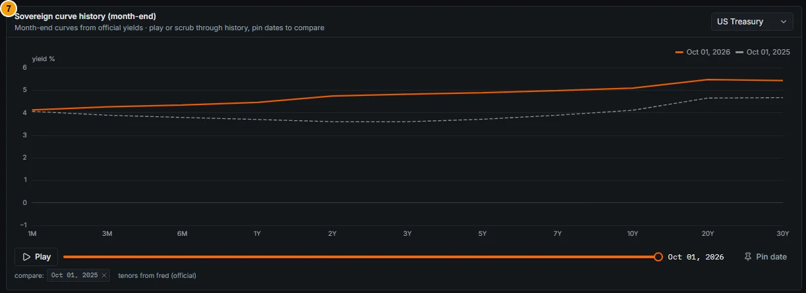

*Figure 2A.15: Sovereign curve history, US Treasury. The latest month-end (1 Oct 2026, solid) is compared with the default pin one year earlier (1 Oct 2025, dashed); tenors 1M to 30Y come from FRED (official).*

### Controls

| Control | What it does |
|---|---|
| Theme (Growth · Inflation · Labor · Rates & curves · Credit & conditions · Liquidity · Commodities & FX) | Switches the dashboard and the URL |
| History | 3 / 5 / 10 (default) / 20 years of history |
| Compare panel: country chips | Toggle countries on the line chart. At most 4; adding a fifth drops the oldest. Defaults to US, EA, GB, JP. In the bar chart, charted countries take their line colour and the rest are grey |
| Compare panel: bar (hover) | Latest value, period and source |
| Source line (click) | Opens the series drawer (not available for derived series) |
| Series panel with more than 4 series | Drawn as small multiples (one chart per series) |
| Curve panel: Curve | Picks the sovereign curve |
| Curve panel: Play / Pause | Animates month-end curves from the start (one step per ~0.26 s) |
| Curve panel: date slider | Scrubs to any month-end |
| Curve panel: Pin date | Adds the current date as a dashed comparison curve (up to 3 pins). The date one year ago is pinned by default; × unpins |

US-only series panels are shaded for NBER recessions (FRED USREC).

### Methodology

- **Series panels** show explicit official series with a display transform (level, y/y, difference or m/m). Daily series are thinned to weekly (last observation per ISO week) beyond 3 years.
- **Compare panels** show one cell indicator across countries, using the canonical primary series of each country's cell, the same as the [heatmap](#macro-cockpit).
- **Curve panels** show month-end snapshots per tenor from official yields. The tenor sources are listed under the chart.
- **Derived panels** are computed from official inputs and badged "derived from official inputs". US net liquidity = `WALCL − WTREGEN − 1000 × RRPONTSYD` (USD millions).

These dashboards involve no models: every number is an official observation or a simple transform of one.

### Data sources and refresh

FRED (copies of BLS, BEA, Fed Board, DOL, EIA and ICE BofA OAS); Chicago, Kansas City, St. Louis, Atlanta and Cleveland Feds; NY Fed (ACM term premia, official CSV); ECB Data Portal; Eurostat; ONS; World Bank Pink Sheet; OECD, BIS and IMF via the cells. Refreshed nightly with the source ingests.

### Validation status

Not applicable: official data and arithmetic transforms only. The derived panel is labelled.

### Correct usage and worked example

Use compare panels to rank countries on the latest print, then add up to four of them to the line chart to see whether the ranking is new or long-standing. In Figure 2A.11 the Real GDP y/y bars run from IN 8.10% and CN 4.30% down to EA 1.17%, CA 1.13% and JP 0.727%, with US at 2.19%. The line chart shows that the 2020–21 swings dwarf everything since, so pick 3 or 5 years in **History** to see recent divergence clearly.

### Limitations and pitfalls

- The latest prints are **not synchronised**: one country's bar can be for Q2 and another's for Q3. Hover a bar for its period.
- Compare panels use each country's canonical measure. Where only a level or different definition exists, values are not strictly comparable (e.g. national unemployment definitions, PMI proxies on different scales).
- Lines with very different units in one series panel (e.g. payrolls change and % y/y) share one axis.
- Daily series are weekly beyond 3 years, so short spikes are smoothed.

### Related mnemonics and BQL fields

- `GC` opens the central-bank monitor for policy and yield curves. See [Central banks overview](#central-banks-overview).
- Series from any panel can be opened in Model Studio through the series drawer: [9. Model Studio](09-model-studio.md).

---

## Countries

**Route:** `/macro/country/:cc` (24 codes: US, EA, DE, FR, IT, ES, PT, NL, GB, CH, JP, KR, CN, HK, TW, IN, AU, CA, BR, MX, CL, CO, PE, AR; `/macro/country` redirects to US) · **Menu:** Macro › Countries · **Mnemonics:** `ECST <cc>` (default US) · **Refresh:** nightly

### Purpose

A country page is the one-stop view of one economy. It shows its cycle quadrant, headline cells, nine sections of official series, its equity index against the macro composite, its surprise index, recession indicators, a GDP nowcast where available, upcoming releases, and recent event coverage. Analysts covering a market start here.

### Screenshot

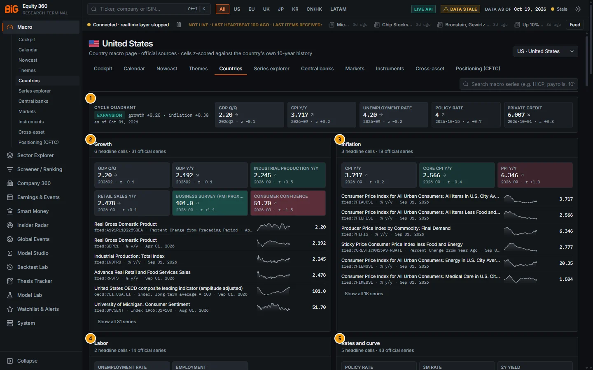

*Figure 2A.16: United States (`/macro/country/US`).*

| # | Panel | What it shows |
|---|---|---|
| 1 | Cycle quadrant | Quadrant badge, growth and inflation momentum, as-of date, plus five headline tiles (the first cell of each of the first five sections) |
| 2 | Growth | Headline cells (GDP q/q and y/y, IP, retail, PMI proxy, consumer confidence) and the list of official growth series with 5-year sparklines |
| 3 | Inflation | CPI, core CPI and PPI cells; series list |
| 4 | Labor | Unemployment and employment cells; series list |
| 5 | Rates and curve | Policy rate, 3M, 2Y, 10Y and 2s10s cells; series list |
| 6 | Money, credit and stress | Private credit and money supply cells; series list |
| 7 | Housing | House prices cell; series list |
| 8 | External | Current account cell; series list |
| 9 | Fiscal | Fiscal balance and debt cells; series list |
| 10 | FX | Real effective FX cell; series list |
| 11 | Equities vs the macro composite | Equity index y/y (top) against growth and inflation momentum (bottom), with their correlation |
| 12 | Surprise index | The country's surprise index history (theme all), labelled model-based (not consensus) |
| 13 | Recession risk | Each method's latest reading and label, plus probability histories |
| 14 | GDP nowcast | First two target quarters: each model's latest value and band, actual when released; "Open nowcast →" |
| 15 | Upcoming releases | Next 30 days, all tiers, compact list |
| 16 | Events | GDELT coverage labelled to this country, last 90 days (see [8. Global events](08-global-events-news.md)) |

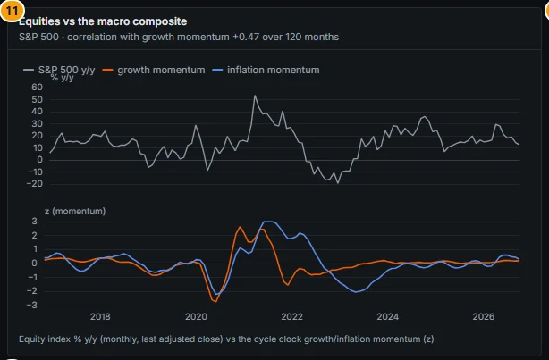

*Figure 2A.17: S&P 500 y/y against US growth and inflation momentum; correlation with growth momentum +0.47 over 120 months.*

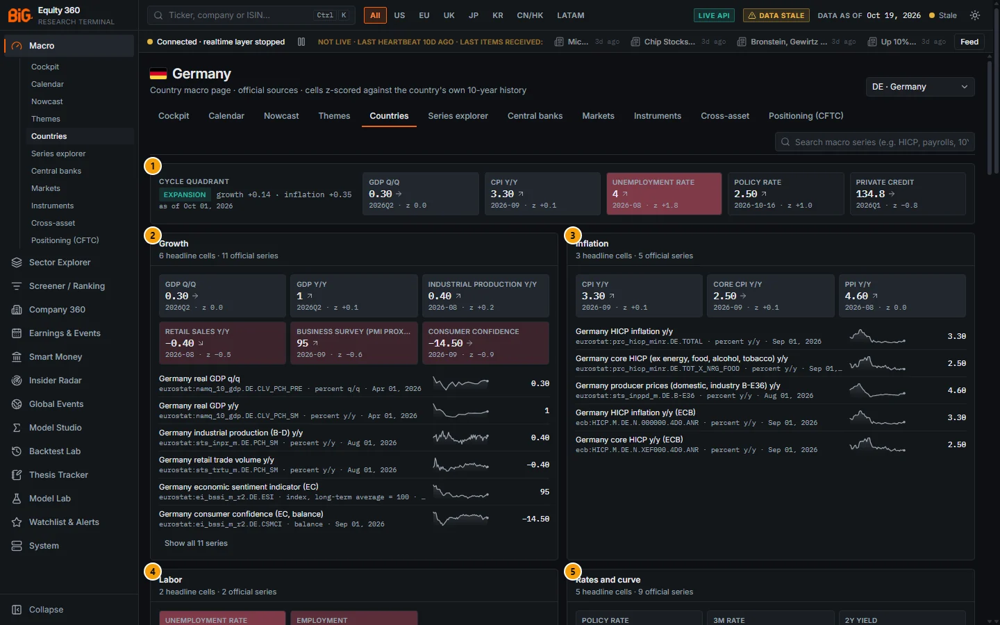

*Figure 2A.18: Germany (`/macro/country/DE`). Same layout, but with no nowcast panel.*

| # | Panel | What it shows |
|---|---|---|
| 1 | Cycle quadrant | Expansion; growth +0.14, inflation +0.35; headline tiles (unemployment 4%, z +1.8, rose) |
| 2 | Growth | 6 headline cells, 11 official series (Eurostat, EC) |
| 3 | Inflation | 3 cells, 5 series (Eurostat HICP, ECB) |
| 4 | Labor | 2 cells, 2 series |
| 5 | Rates and curve | 5 cells, 9 series (policy rate inherited from EA) |
| 6 | Money, credit and stress | 2 cells, 5 series |
| 7 | Housing | 1 cell, 3 series |
| 8 | External | 1 cell, 3 series |
| 9 | Fiscal | 2 cells, 5 series |
| 10 | FX | 1 cell, 2 series |
| 11 | Equities vs the macro composite | DAX; correlation with growth momentum +0.41 over 120 months |
| 12 | Surprise index | DE surprise history |
| 13 | Recession risk | Probit and OECD CLI phase |
| 14 | Upcoming releases | Next 30 days (shown in place of the nowcast) |
| 15 | Events | GDELT coverage for DE |

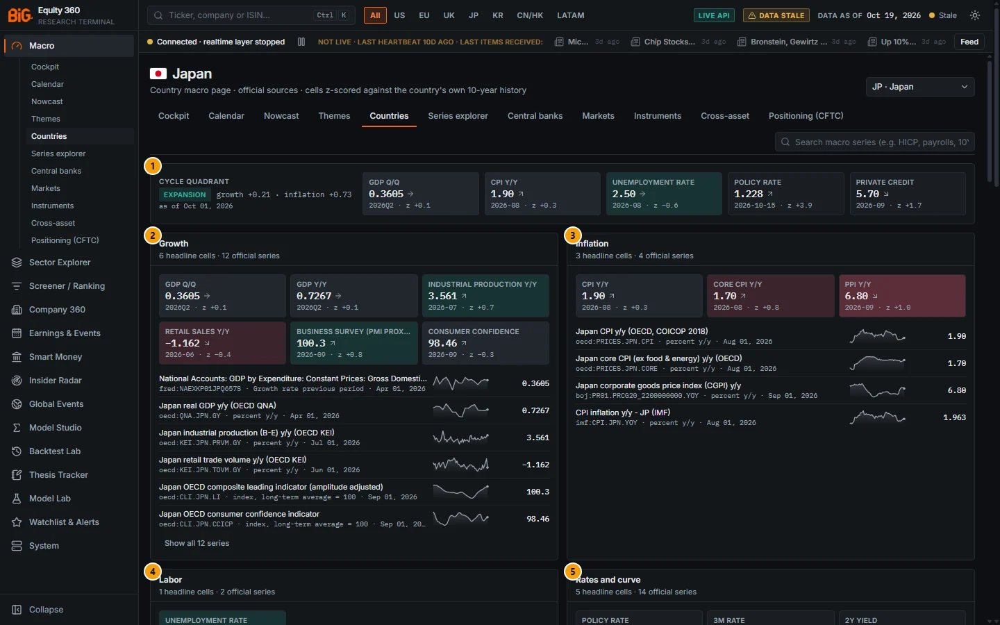

*Figure 2A.19: Japan (`/macro/country/JP`).*

| # | Panel | What it shows |
|---|---|---|
| 1 | Cycle quadrant | Expansion; growth +0.21, inflation +0.73; policy rate tile z +3.9 (neutral, grey) |
| 2 | Growth | 6 cells, 12 series (OECD QNA/KEI, FRED) |
| 3 | Inflation | 3 cells, 4 series (OECD, BoJ CGPI, IMF) |
| 4 | Labor | 1 cell, 2 series |
| 5 | Rates and curve | 5 cells, 14 series |
| 6 | Money, credit and stress | 2 cells, 4 series |
| 7 | Housing | 1 cell, 1 series |
| 8 | External | 1 cell, 2 series |
| 9 | Fiscal | 2 cells, 3 series |
| 10 | FX | 1 cell, 2 series |
| 11 | Equities vs the macro composite | Nikkei 225; correlation +0.38 over 120 months |
| 12 | Surprise index | JP surprise history |
| 13 | Recession risk | Probit, HMM regime, OECD CLI phase |
| 14 | GDP nowcast | JP model (ours) |
| 15 | Upcoming releases | Next 30 days |
| 16 | Events | GDELT coverage for JP |

### Controls

| Control | What it does |
|---|---|
| Country (top right) | Switches to another of the 24 countries |
| Cell tile (hover / click) | The same tooltip as a heatmap cell; click opens the series drawer |
| Series row (click) | Opens the series drawer. The sparkline is 5 years |
| Show all N series / Show fewer | Expands a section beyond its first 6 series (primary series first) |
| Open nowcast → | Opens `/macro/nowcast?cc=<cc>` (US, EA, GB, JP only) |
| Upcoming release row | Opens the release drawer |
| Events panel | See [8. Global events](08-global-events-news.md) |

### Methodology

- **Cells and quadrant** are computed exactly as on the [cockpit](#macro-cockpit): 10-year z, oriented colour, the cycle clock `cycle_v1`.
- **Equities vs the macro composite** puts the official equity index's y/y return (monthly, last adjusted close, from the price lake) above the cycle clock's growth and inflation momentum on a shared time axis. There is no dual axis. The subtitle gives the correlation of index y/y with growth momentum over the overlapping months. CL, CO and PE have no official-index price series in the lake.
- **Surprise index** is the country's daily index, theme "all", over the 365-day window.
- **Recession risk** shows the latest row of each method with its full label. Probability histories (NY Fed, our probit, HMM) are drawn on a 0–1 scale. The note "50% is the conventional signal level" refers to these lines.

### Data sources and refresh

The country's official series from the macro catalogue (national statistical offices, central banks, Eurostat/ECB for euro members, OECD/IMF/BIS where national APIs are unavailable), refreshed nightly. Equity indices come from the price lake. Events come from GDELT (chapter 8).

### Validation status

Descriptive page. Its model-based components (surprise index, probit, HMM, nowcast) carry the statuses given in [Macro cockpit](#macro-cockpit) and [Nowcast](#nowcast).

### Correct usage and worked example

Start at the cycle quadrant and the headline tiles, then open the sections whose tiles are coloured. In Figure 2A.18, Germany is in **Expansion** (growth +0.14, inflation +0.35, as of 1 Oct 2026). The unemployment tile is rose: 4% for August 2026 with z +1.8, high for Germany's own decade. Retail sales y/y (−0.40%, z −0.5) and consumer confidence (−14.5, z −0.9) are also rose. The page therefore shows positive momentum on surveys and IP but a weak labour market, which the Labor section's two series let you verify.

For Japan (Figure 2A.19), the policy-rate tile shows 1.228% with z +3.9 but stays grey, because rates are neutral. The z simply says Japanese rates are far above their decade average.

### Limitations and pitfalls

- Coverage varies widely: TW has 8 cells and no cycle position; HK has 12. Check the "N headline cells · M official series" subtitle.
- Euro-area members show EA monetary cells (policy rate, 3M, money supply).
- A correlation over 120 months is descriptive and is dominated by large episodes (2020). It is not a beta to trade on.
- The Upcoming releases panel shows all tiers for the next 30 days and only officially scheduled releases.

### Related mnemonics and BQL fields

- `ECST <cc>` opens a country page (two-letter code, default US). `ECST DE` opens Germany.
- `WIRP <cc>` opens the country's central bank (e.g. `WIRP DE` → ECB).
- Company-level macro exposures: [5C. Company 360: Macro](05c-company-macro-events-model.md).

---

## Series explorer

**Route:** `/macro/series` (search) and `/macro/series/:id` (e.g. `/macro/series/fred:CPIAUCSL`) · **Menu:** Macro › Series explorer · **Mnemonics:** none · **Refresh:** nightly (series ingest)

### Purpose

The series explorer shows any official macro series in the lake with full transparency: transforms, first release against latest revised values, revision statistics, the heatmap cells that use it, the same indicator in other countries, release history and provenance. It is also the bridge to modelling: **Open in Model Studio** starts a time-series study with the series as the target.

### Screenshot

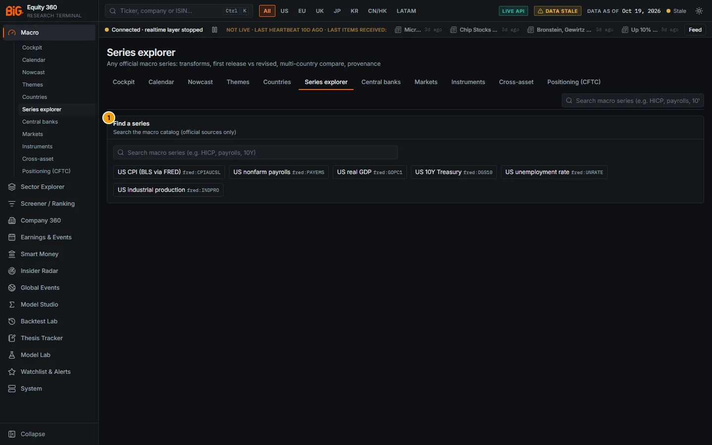

*Figure 2A.20: Series explorer without a series (`/macro/series`).*

| # | Panel | What it shows |
|---|---|---|
| 1 | Find a series | Catalogue search box ("official sources only") and six suggested US series: CPI, nonfarm payrolls, real GDP, 10Y Treasury, unemployment rate, industrial production |

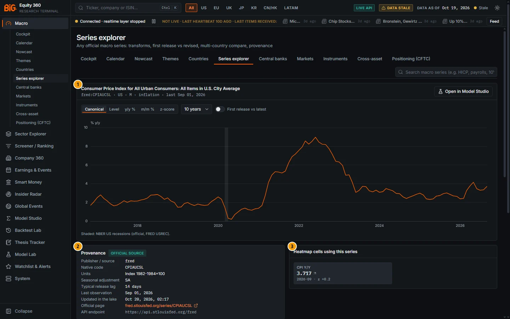

*Figure 2A.21: Series explorer for US CPI (`/macro/series/fred:CPIAUCSL`), canonical measure (% y/y), 10 years.*

| # | Panel | What it shows |
|---|---|---|
| 1 | Series title | Chart with transform, range and vintage controls; subtitle with id · country · frequency · category · last observation; **Open in Model Studio** |
| 2 | Provenance | Publisher / source, native code, units, seasonal adjustment, typical release lag, last observation, time updated in the lake, official page, API endpoint; badge **official source** or **derived** |
| 3 | Heatmap cells using this series | The cockpit cells built on this series (here: US CPI y/y 3.717, z +0.2) |
| 4 | Compare countries | The same indicator (`cpi_yoy`) across up to 4 countries |
| 5 | Release history | Per period: first released, latest vintage, number of vintages |

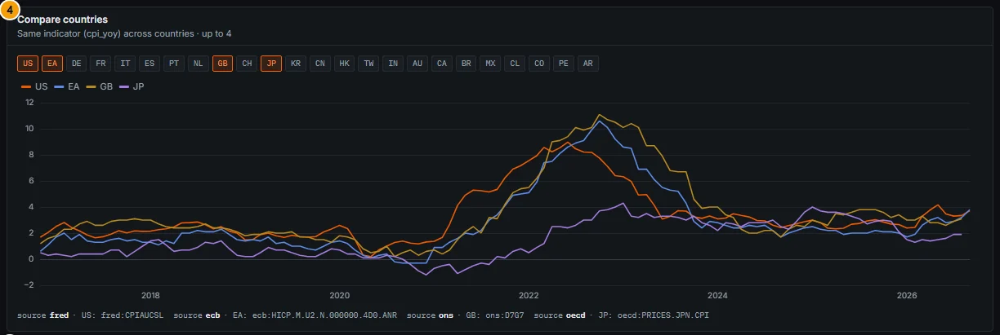

*Figure 2A.22: Compare countries for `cpi_yoy` (below the fold).*

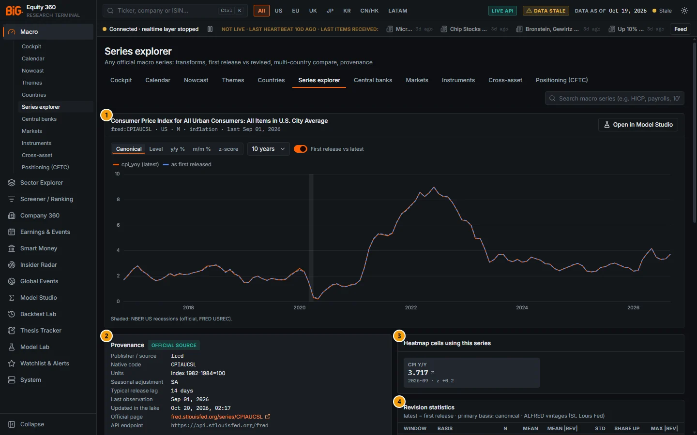

*Figure 2A.23: US CPI with **First release vs latest** on. The dashed "as first released" line is plotted under "cpi_yoy (latest)"; on the canonical y/y basis the two are almost indistinguishable.*

| # | Panel | What it shows |
|---|---|---|
| 1 | Series title | Chart with the latest line and the "as first released" overlay; the switch is on |
| 2 | Provenance | As in Figure 2A.21 |
| 3 | Heatmap cells using this series | US CPI y/y 3.717, z +0.2 |
| 4 | Revision statistics | Latest − first release by window (5y, 10y, all) on the canonical (primary) and native bases; ALFRED vintages |
| 5 | Compare countries | As in Figure 2A.22 |
| 6 | Release history | As in Figure 2A.21 |

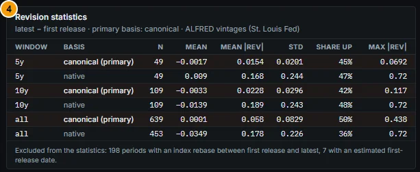

*Figure 2A.24: Revision statistics for US CPI (ALFRED vintages). On the canonical y/y basis the 10-year mean absolute revision is 0.0228 pp (max 0.117); on the native index basis it is 0.189 index points (max 0.72). 198 periods with an index rebase and 7 with an estimated first-release date are excluded.*

### Controls

| Control | What it does |
|---|---|
| Search box | At least 2 characters; up to 12 matches (title, id, frequency, last date); click to open |
| Suggested series | One-click shortcuts (search page only) |
| Transform | **Canonical** (the cell measure, e.g. % y/y for CPI) · **Level** (as published) · **y/y %** · **m/m %** · **z-score** (vs the trailing 10-year window, ≥ 24 points) |
| Range | 5 / 10 (default) / 20 years / All |
| First release vs latest | Overlays the "as first released" line (dashed) and shows **Revision statistics**. If the series has no vintages: "No vintage history (ALFRED / first-seen) for this series." If the vintage pair is on another basis, a note tells you which transform to choose |
| Open in Model Studio | Creates a new Model Studio time-series study (method ARIMA) with this series as the target `y`. Frequency is set from the series (Q/A → Q, W → W, else M), the start 20 years back, and a y/y transform is pre-applied when the series' default view is y/y. It opens the Studio builder; nothing runs until you run it |
| Country chips (Compare countries) | Up to 4 countries; a fifth drops the oldest. Default: the series' country plus US, EA, GB, JP |
| Official page link (Provenance) | Opens the publisher's page for the series |

### Methodology

- **Transforms.** y/y = % change against 12 months earlier; m/m = % change against the previous period; z = `(x − μ) / σ` over the trailing 10 years (≥ 24 points); canonical = the macro cell measure from `macro_cell_history`.
- **Vintages.** For US series with ALFRED history (CPI, GDP, payrolls, IP, retail and others), the first-release value of each period comes from ALFRED real-time rows. Elsewhere it comes from first-seen values recorded when the ingest detected a revision. The overlay is aligned by period.
- **Revision statistics.** Revision = latest − first release, per period, for windows 5y, 10y and all, on the canonical and native bases (the primary basis is highlighted). The table reports n, mean, mean |rev|, std, share revised up and max |rev|. Periods whose index was rebased between first release and latest, and periods with an estimated first-release date, are excluded and counted under the table.
- **Release history** lists, per period, the first-release date, the latest vintage date and the number of vintages.

### Data sources and refresh

The macro catalogue (`contracts/macro_catalog.yaml`): all official series in the lake, refreshed nightly by the source ingests (FRED/ALFRED, ECB, Eurostat, ONS, BoE, BoJ, BCB, Banxico, BIS, OECD, IMF, World Bank and national offices). The Provenance box shows the time of the last update in the lake. The catalogue search is warmed at API start-up, so the first search is fast.

### Validation status

Not applicable: official data. Revisions are measured, not modelled.

### Correct usage and worked example

Use **First release vs latest** before relying on any historical relationship involving revised data. A signal built on today's revised history can look better than it was in real time.

Worked example: US CPI (`fred:CPIAUCSL`, Figure 2A.21). Canonical view, 10 years: y/y inflation peaked near 9% in 2022 and stood at 3.717% for September 2026 (last observation 1 Sep 2026, updated in the lake 20 Oct 2026 02:17). Provenance: publisher FRED, native code CPIAUCSL, units Index 1982–1984 = 100, seasonally adjusted (SA), typical release lag 14 days. The cell panel shows the cockpit cell CPI y/y 3.717, z +0.2. Switch on **First release vs latest** (Figure 2A.23). Over the last 10 years (109 periods), the canonical y/y value moved by 0.0228 pp on average between first release and latest, at most 0.117 pp, and 42% of revisions were upward (Figure 2A.24). For CPI y/y, revisions are therefore negligible. The native index level is revised more (mean |rev| 0.189, max 0.72), mainly because the seasonally adjusted series gets new seasonal factors each year. Then click **Open in Model Studio** to start an ARIMA study on CPI y/y.

### Limitations and pitfalls

- Vintage depth differs: ALFRED gives full US history, while first-seen revisions elsewhere only start when the app began ingesting.
- The z-score transform uses the full revised history; it is not point-in-time.
- Compare countries relies on the series having a cell indicator. Series outside the 23 indicators have no Compare panel.
- Series from scraped sources are not in the macro search (official sources only).

### Related mnemonics and BQL fields

- None. Model Studio: [9. Model Studio](09-model-studio.md).

---

## Central banks overview

**Route:** `/macro/cb` · **Menu:** Macro › Central banks · **Mnemonics:** `WIRP`, `GC` · **Refresh:** nightly (`cb_rates`, `cb_curves_implied`, `cb_stance`, `cb_tone`, `cb_projections`, `cb_balance_sheets`)

### Purpose

This page monitors 17 central banks: the Fed, ECB, BoE, BoJ, SNB, BoC, RBA, Riksbank, Norges Bank, BCB (Brazil), Banxico, BCCh (Chile), BanRep (Colombia), BCRP (Peru), RBI, BoK and PBoC (LPR). For each it shows the official policy rate and corridor, the last move, the rate-cycle phase, the next official meeting, **what is priced in** (an approximation from official curves), the real policy rate, the gap to a Taylor rule, and the latest communication tone. It answers "who is hiking, who is cutting, and how much more does the curve imply?".

### Screenshot

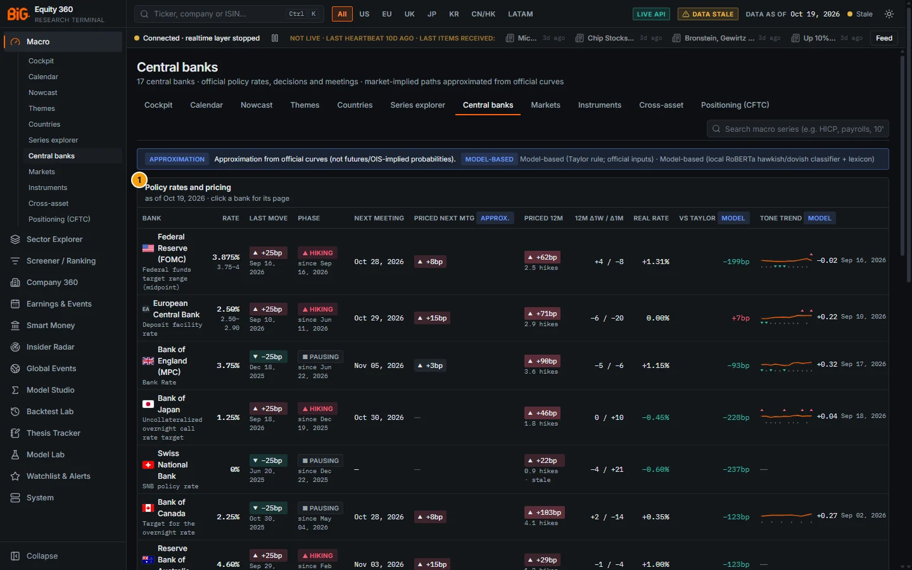

*Figure 2A.25: Central banks (`/macro/cb`), as of 19 Oct 2026.*

| # | Panel | What it shows |
|---|---|---|
| 1 | Policy rates and pricing | One row per bank: Bank (name, rate name), Rate (with corridor), Last move, Phase, Next meeting, Priced next mtg (approx.), Priced 12m, 12m Δ1w / Δ1m, Real rate, vs Taylor (model), Tone trend (model) |
| 2 | Priced over the next 12 months | Bar chart of bp priced over 12 months per bank with an official curve; rose = hikes, teal = cuts |

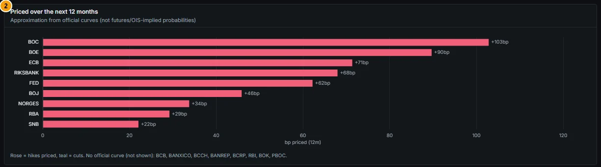

*Figure 2A.26: Priced over the next 12 months (below the fold). Banks without an official curve are listed under the chart.*

The strip above the table repeats the labels: **APPROXIMATION** "Approximation from official curves (not futures/OIS-implied probabilities)." and **MODEL-BASED** "Model-based (Taylor rule; official inputs) · Model-based (local RoBERTa hawkish/dovish classifier + lexicon)".

### Controls

| Control | What it does |
|---|---|
| Bank name / row | Opens the bank page `/macro/cb/:bank` |
| Priced next mtg (hover) | Text such as "+8bp · 0.3 hikes of 25bp" |
| Tone trend (hover) | Latest document type and date; "−1 dovish … +1 hawkish (model-based)" |
| Bar (hover / click) | Priced 12m, implied rate, policy rate and curve source; click opens the bank page |

**Reading the chips.** ▲ / ▼ / ■ show the direction (hike, cut, unchanged). Rose means tightening and teal easing; the tint deepens at 1.5 or more 25 bp moves. The Phase badge shows ▲ hiking (rose), ▼ cutting (teal) or ■ pausing (grey). A negative real rate and a negative "vs Taylor" are teal (accommodative); a positive "vs Taylor" is rose. "no official curve" or "—" means the bank has no official short-end curve.

### Methodology

#### Policy rates, decisions, rate cycle

- **Policy rate** is the bank's official rate, e.g. the Fed's target-range midpoint, the ECB deposit facility rate, the Selic target or the PBoC 1-year LPR. Each is cross-checked against the BIS policy-rate database: a 0 bp difference on all banks at build time (`docs/MACRO_V3_PLAN.md` W3.1). The **corridor** is shown as lower–upper, or as the deposit rate.
- **Decisions** are derived from official rate changes and official meeting dates, with vote splits where published (Fed statements, BoE MPC votes since 1997).
- **Rate cycle** is rule-based: hiking or cutting when the most recent rate change within the trailing **183 days** was a hike or a cut; otherwise pausing, including long holds.

#### What is priced (implied path, method `implied_v1`)

For every bank with an official curve and every curve date:

1. **Build the curve.** Bootstrap discount factors from official yields (bills as simple or bond-equivalent yields, coupon bonds as par) with log-linear interpolation, which gives piecewise-flat forwards. Alternatively use a closed-form forward curve (ECB Svensson parameters, BoE OIS instantaneous forwards).
2. **Anchor to the policy rate.** `basis = average forward over the stub [0, next decision) − current policy rate`. If the next decision is less than 10 days away, or there is no meeting calendar, the first month is used instead (the meta flags this).
3. **Implied rate per meeting** `k`, effective the day after the decision: `implied_k = average forward over [e_k, e_{k+1}) − basis`.
4. **Horizons** 3/6/12/24 months: `average forward over the last month before the horizon − basis`.
5. **Priced** = `(implied − policy rate) × 100` bp. **Moves priced** = bp / 25. **This step** = the increment from the previous meeting. **Δ1w / Δ1m** = change of the same point against 1 week and 1 month earlier.

The basis absorbs instrument spreads (bills or government bonds against the overnight rate, overnight rate against the policy rate) and is **assumed constant** along the path.

| Bank | Official curve | Resolves meetings |
|---|---|---|
| Fed | US Treasury daily par curve incl. bills + NY Fed EFFR; NY Fed ACM term premia for the adjusted path | yes |
| BoE | BoE UK OIS (SONIA) instantaneous forwards, 1–60m (closest to a true OIS path) | yes |
| ECB | ECB euro-area AAA government curve, Svensson parameters (govvies, not OIS) | yes |
| BoC | Bank of Canada T-bills 1M–1Y + benchmark bonds 2Y/3Y/5Y | yes |
| RBA | RBA bank bills 1M/3M/6M + CGS 2Y/3Y/5Y (RBA OIS series discontinued Dec 2022) | yes |
| Riksbank | Swedish T-bills 3M/6M + government bonds 2Y/5Y | yes |
| Norges Bank | T-bills 3M/6M/12M + government bonds 3Y/5Y | 3–24m horizons |
| BoJ | MoF JGB benchmark par yields 1Y–10Y (no bills) | 12/24m only |
| SNB | SNB Confederation spot yields 1Y–10Y (monthly) | 12/24m only |
| BCB, Banxico, BCCh, BanRep, BCRP, RBI, BoK, PBoC | no official machine-readable short-end curve | not available |

#### Stance

- **Real rate** = policy rate − core inflation y/y (or headline when there is no core), from official statistics.
- **vs Taylor** = policy rate − the Taylor rule with official r\*, where an r\* is published (US, Canada, euro area); otherwise policy rate − Taylor (1993). See [Central bank page](#central-bank-page) for the rules.

#### Tone

Available for **Fed, ECB, BoE, BoJ and BoC** only; the other banks show "—". The tone trend sparkline plots the last 12 scored documents on a fixed −1…+1 scale, with ▲ hike markers at the top, ▼ cut markers at the bottom and dots for holds. The number is the latest document's score. The method is described under [Central bank page](#central-bank-page).

#### Labels returned by the API

`GET /api/v1/macro/v3/central-banks` returns these `labels` (verbatim, 19 Oct 2026). The page and the bank pages display them:

| Key | Label |
|---|---|
| `implied_path` | Approximation from official curves (not futures/OIS-implied probabilities) |
| `implied_path_tp_adjusted` | Term-premium-adjusted with NY Fed ACM term premia (model-based, official NY Fed estimates) |
| `taylor_rule` | Model-based (Taylor rule; official inputs) |
| `expected_inflation` | Model-based (Cleveland Fed model for the US; our AR(1) elsewhere) |
| `tone` | Model-based (local RoBERTa hawkish/dovish classifier + lexicon) |
| `rate_cycle` | Rule-based: most recent policy-rate change within 183 days decides hiking/cutting, else pausing |
| `decisions` | Derived from official rate changes and official meeting dates |

### Data sources and refresh

| Job | Writes | Sources |
|---|---|---|
| `cb_rates` | rates, decisions, meetings, rate cycle | FRED, ECB, BoE, BoC, RBA, Riksbank, Norges Bank, BCB, BanRep, PBoC LPR; BIS WS_CBPOL cross-check |
| `cb_curves_implied` | implied paths (~2 years daily history), curves, meta | the curves in the table above |
| `cb_stance` | real rates, Taylor rules, r\* | official CPI cells, CBO potential (FRED GDPPOT), OECD Economic Outlook gaps, NY Fed LW/HLW r\*, Cleveland Fed expected inflation |
| `cb_tone` | tone | official statements and minutes (Fed, ECB, BoE, BoJ, BoC) |
| `cb_projections` | official projections | Fed SEP (FRED/ALFRED), ECB/Eurosystem staff projections (ECB MPD) |
| `cb_balance_sheets` | balance sheets | Fed H.4.1, ECB ILM, BoE IADB, BoJ accounts |

All run in the nightly DAG. Next meetings come from the official meeting calendars (shared with the [Release calendar](#release-calendar)).

### Validation status

- Policy rates: cross-checked against the BIS policy-rate database (0 bp difference at build).
- Implied paths: **approximation**, labelled on every view. They have not been validated against OIS- or futures-implied paths; no gate exists.
- Taylor rules, expected inflation and tone: **model-based**, labelled. They are benchmarks and text measures, not forecasts; no gate exists.
- Rate cycle: rule-based, labelled.

### Correct usage and worked example

Read **Priced 12m** together with **Phase** and **vs Taylor**. A bank that is hiking, with more hikes priced and a policy rate well below its Taylor benchmark, looks consistent. A bank pausing with a lot priced deserves a look at its curve and caveats.

Worked example (Fed row, 19 Oct 2026): rate **3.875%** (range 3.75–4.00). Last move **+25 bp** on 16 Sep 2026; phase **hiking** since that date; next meeting **28 Oct 2026**. **+8 bp** priced for that meeting (0.3 hikes). Priced 12m **+62 bp** (2.5 hikes of 25 bp), changed **+4 / −8 bp** over 1 week / 1 month. Real rate **+1.31%** (against core). vs Taylor **−199 bp**. Tone **−0.02** (statement of 16 Sep 2026).

Across banks, the 12-month bars show tightening priced at every bank with a curve, from BoC (+103 bp) and BoE (+90 bp) down to SNB (+22 bp, stale curve). BCB, Banxico, BCCh, BanRep, BCRP, RBI, BoK and PBoC have no official curve.

### Limitations and pitfalls

- **Not market probabilities.** Government-bond and bill curves carry term, credit, collateral and convenience premia. The constant-basis assumption fails around debt-ceiling episodes, quarter ends and when the market prices a move inside the stub. For the US, the term-premium-adjusted path reduces, but does not remove, the term-premium bias (see the Fed example below).
- The ECB, Riksbank, Norges Bank, BoC and BoJ paths use government curves, not OIS. The RBA path uses bank bills (bank credit premium). BoJ and SNB resolve only 12/24-month horizons.
- A **stale** curve (SNB, monthly publication) is flagged "· stale" in Priced 12m.
- "Real rate" uses realised inflation. The bank page also shows a real rate against model-based expected inflation.
- Tone covers 5 banks. A score is a property of the text, not a policy signal.

### Related mnemonics and BQL fields

- `WIRP` opens this page. `WIRP <country or bank>` opens a bank page (e.g. `WIRP US` → Fed, `WIRP EU` or `WIRP DE` → ECB, `WIRP UK` → BoE, `WIRP BR` → BCB). An unknown argument opens the overview with a note.
- `GC` opens this page ("policy and yield curves per bank").
- The rate-cycle phase feeds the regime-performance tables in [2B](02b-markets-cross-asset.md).

---

## Central bank page

**Route:** `/macro/cb/:bank` with `fed`, `ecb`, `boe`, `boj`, `snb`, `boc`, `rba`, `riksbank`, `norges`, `bcb`, `banxico`, `bcch`, `banrep`, `bcrp`, `rbi`, `bok`, `pboc` · **Menu:** Macro › Central banks › (bank) · **Mnemonics:** `WIRP <cc or bank>` · **Refresh:** nightly

### Purpose

The bank page holds everything about one central bank: the official rate and corridor, rate cycle, next meeting, the implied policy path from its official curve (with a term-premium-adjusted variant for the US), the curve itself (forwards or spot), official projections against the market, the decision history with votes, stance (real rates, r\*, Taylor rules), balance sheet and QT pace, and the hawkish/dovish tone of its statements. The page ends with the full method and caveats text.

### Screenshot

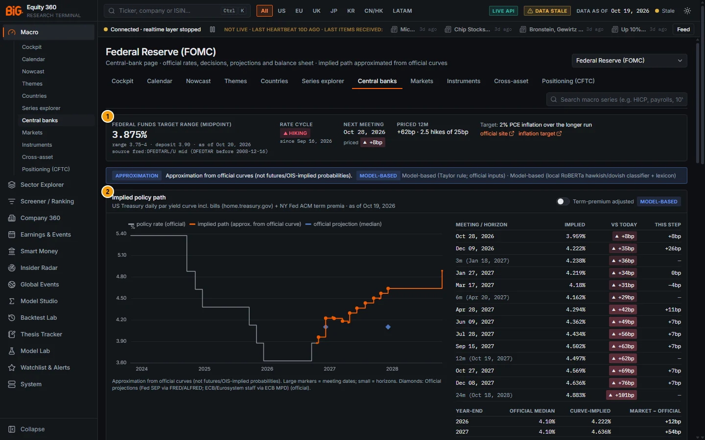

*Figure 2A.27: Federal Reserve (`/macro/cb/fed`), as of 19 Oct 2026.*

| # | Panel | What it shows |
|---|---|---|
| 1 | Federal funds target range (midpoint) | Header: rate, range, deposit (IORB), as-of, source; rate cycle; next meeting with priced change; priced 12m; inflation target with links to the official site and the target statement |
| 2 | Implied policy path | Step chart of the official policy rate (3 years) and the implied path (large markers = meetings, small = horizons), official projections as diamonds; table by meeting/horizon; official median vs curve-implied table; "How the priced rate has moved" |
| 3 | Official curve used | Forward or spot (zero) curves of the source, with snapshots latest / 1w / 1m / 3m / 6m / 1y |
| 4 | Decision history | Decision date, change, rate after, vote, basis (official meeting / unscheduled) |
| 5 | Stance | Real rates, r\*, output gap, policy − Taylor; charts of real rates against r\* and of the policy rate against three Taylor rules |
| 6 | Balance sheet | Components (4 charted), latest, 13-week change, annualised pace, 1-year change, source |
| 7 | Communication tone | Tone of each scored document over time with decision markers; list of documents with score, vote and link |
| 8 | Method and caveats | Implied-path method text, caveats, and every label |

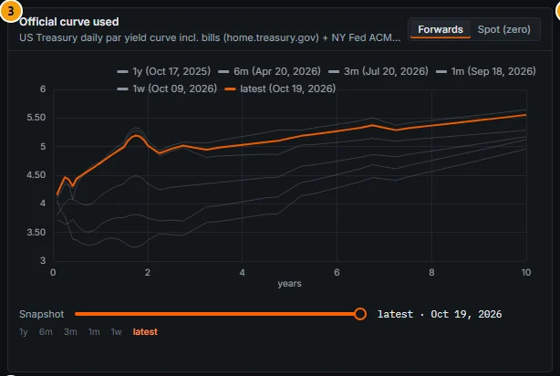

*Figure 2A.28: Official curve used: US Treasury forwards, latest (orange) against snapshots back to 1 year.*

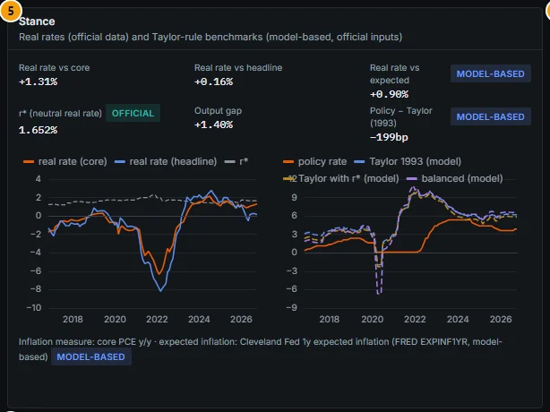

*Figure 2A.29: Fed stance: real rate +1.31% (core), +0.16% (headline), +0.90% (expected, model-based); r\* 1.652% (official, NY Fed LW); output gap +1.40%; policy − Taylor −199 bp.*

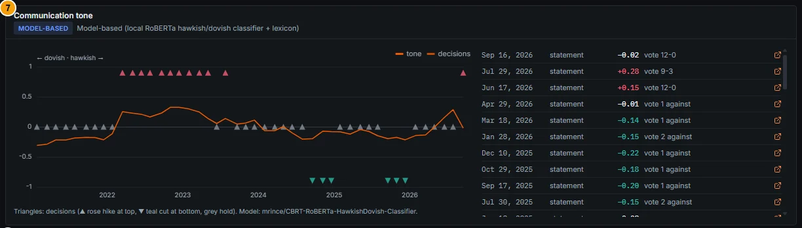

*Figure 2A.30: Fed communication tone since 2021, with hikes (rose ▲ at the top), cuts (teal ▼ at the bottom) and holds (grey).*

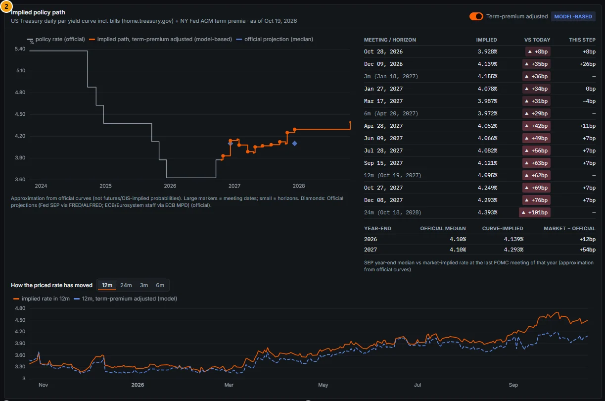

*Figure 2A.31: Fed implied policy path with **Term-premium adjusted** on (badge 2 of the Fed page). The line becomes "implied path, term-premium adjusted (model-based)": 4.095% at 12m and 4.393% at 24m. In "How the priced rate has moved" the dashed adjusted 12m history sits below the raw one, and the gap has widened since mid-2026.*

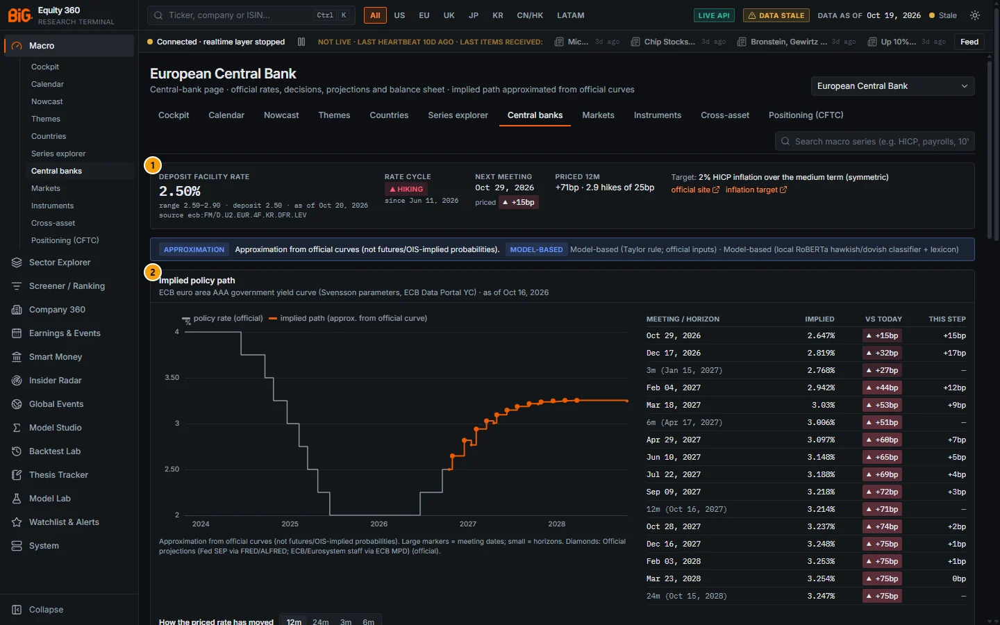

*Figure 2A.32: European Central Bank (`/macro/cb/ecb`): implied path from the ECB AAA Svensson curve, as of 16 Oct 2026.*

| # | Panel | What it shows |
|---|---|---|
| 1 | Deposit facility rate | 2.50% (range 2.50–2.90), hiking since 11 Jun 2026; next meeting 29 Oct 2026 (+15 bp priced); priced 12m +71 bp (2.9 hikes); target "2% HICP inflation over the medium term (symmetric)" |
| 2 | Implied policy path | Path to 24 months; horizon segmented control 12m / 24m / 3m / 6m for the history chart; no term-premium switch (ACM is US only) |
| 3 | Official curve used | ECB AAA Svensson forwards / spot |
| 4 | Decision history | ECB decisions |
| 5 | Stance | Real rates, HLW r\* (euro area), OECD output gap, Taylor rules |
| 6 | Balance sheet | Eurosystem (ECB ILM) |
| 7 | Communication tone | Monetary policy decision press releases |
| 8 | Method and caveats | Svensson method, govvie-curve caveat, labels |

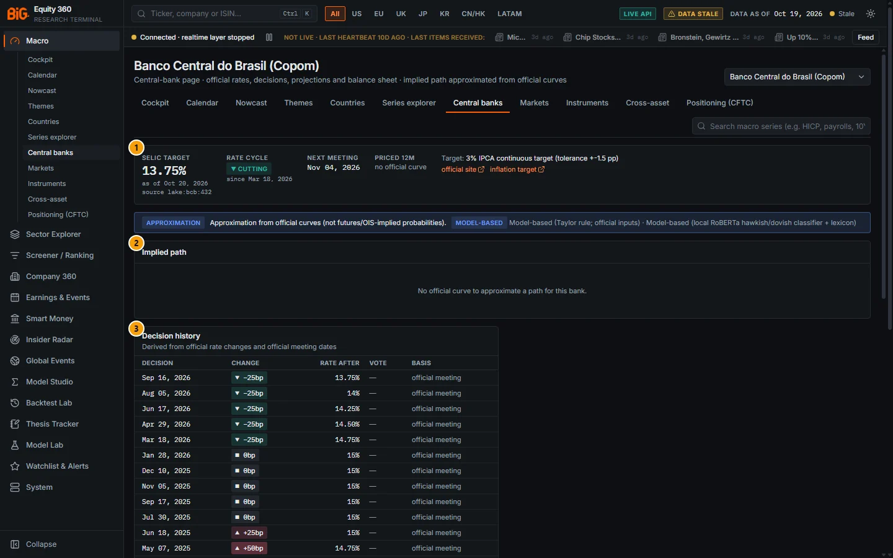

*Figure 2A.33: Banco Central do Brasil (`/macro/cb/bcb`): a bank without an official curve.*

| # | Panel | What it shows |
|---|---|---|
| 1 | Selic target | 13.75%, cutting since 18 Mar 2026; next meeting 4 Nov 2026; Priced 12m "no official curve"; target "3% IPCA continuous target (tolerance ±1.5 pp)" |
| 2 | Implied path | "No official curve to approximate a path for this bank." |
| 3 | Decision history | Copom decisions from the official Selic series and meeting dates (no votes published) |
| 4 | Stance | Real rates only (vs core +13.31%, vs headline +9.17%, vs expected +9.28%). No output gap and no r\*, so no Taylor-rule values ("—") |
| 5 | Balance sheet | "No official balance-sheet series for this bank." |
| 6 | Communication tone | "No official statements scored for this bank." |
| 7 | Method and caveats | Labels |

### Controls

| Control | What it does |
|---|---|
| Central bank (top right) | Switches bank |
| official site / inflation target links | Open the bank's official pages |
| Term-premium adjusted switch | **Fed only.** Replaces the implied path, the table values and their vs-today and step changes, the curve-implied projection comparison (including Market − official), the history chart and the header's Priced 12m and next-meeting chip with the ACM-adjusted values (badged model-based) |
| Implied path chart (hover) | Date, every line's value, change vs today ("+35bp · 1.4 hikes of 25bp") and 1w/1m change |
| Horizon (How the priced rate has moved) | 3m / 6m / 12m / 24m: history of the curve-implied rate at that fixed horizon (dashed TP-adjusted line when the switch is on) |
| Forwards / Spot (zero) | Curve kind in the Official curve used panel |
| Snapshot slider and labels | Highlights one snapshot (1y, 6m, 3m, 1m, 1w, latest); the latest stays dashed for comparison |
| Show all N decisions / Show recent only | Expands the decision table beyond 12 rows |
| Vote cell (hover) | The source of the vote (official statement URL) |
| Tone point (hover) | Date, document type, tone (model), hawkish/dovish sentence shares, vote |
| Document link icon | Opens the scored official document |

### Methodology

#### Implied path and term-premium adjustment

The path follows `implied_v1` (see [Central banks overview](#central-banks-overview)). For the Fed, the method text reads: "UST par curve bootstrapped to zero/forward rates (bills ≤ 6M as simple 365-day yields, 1Y as bond-equivalent zero, 2–10Y semiannual par); implied fed funds midpoint = average forward per inter-meeting period minus the stub basis; term-premium-adjusted path subtracts NY Fed ACM forward term premia (model-based, official NY Fed estimates)."

**Term-premium-adjusted path (US only).** For each window `[t₁, t₂]` the app subtracts the ACM forward term premium over that window, net of the term premium over the stub:

```
implied_tp = implied − (TPfwd[t₁, t₂] − TPfwd[stub])
```

It uses the latest ACM date on or before the curve date (ACM is published with a lag).

**Forwards vs spot (zero).** The forward curve is the instantaneous or short-window forward rate implied for each future date, which is what the path is built from. The spot (zero) curve is the yield to each maturity. Snapshots are kept for the latest date and 1 week, 1 month, 3, 6 and 12 months earlier.

**Official projections vs market.** The Fed SEP median (FRED/ALFRED vintages since 2015) and ECB/Eurosystem staff projections (ECB MPD) are compared with the curve-implied rate at the last meeting of each year. The table's label reads "SEP year-end median vs market-implied rate at the last FOMC meeting of that year (approximation from official curves)". BoE MPR projections are not machine-readable, so the BoE has none.

#### Stance and Taylor rules (method `stance_v1`, monthly)

`π` is the bank's target measure (US core PCE y/y; other banks core CPI, else headline), `π*` the official inflation target, and `gap` the output gap (US: CBO, `100 × (GDPC1 / GDPPOT − 1)`; others: OECD Economic Outlook, where current and next year are OECD projections).

```
Taylor 1993      = 2  + π + 0.5 (π − π*) + 0.5 gap
Taylor with r*   = r* + π + 0.5 (π − π*) + 0.5 gap      (official r* where published)
Balanced         = r*|2 + π + 0.5 (π − π*) + 1.0 gap    (r* if available, else 2)
```

- **r\*** comes from official NY Fed estimates: Laubach–Williams (US, one-sided) and Holston–Laubach–Williams (Canada, euro area). Other banks have no machine-readable r\*.
- **Expected inflation** for the US is the Cleveland Fed 1-year expected inflation (FRED EXPINF1YR, model-based by the Cleveland Fed). Elsewhere it is our AR(1) forecast of headline y/y 12 months ahead, fitted on the trailing 120 months (model-based, `ar1_12m`).
- **Real rate vs core / headline / expected** = policy rate − the respective inflation measure.
- **Policy − Taylor** uses the r\* rule when an official r\* exists, otherwise Taylor 1993 (see the pitfall below).

#### Balance sheet

Official weekly or monthly statements: Fed H.4.1 (FRED), ECB ILM, BoE IADB, BoJ accounts. **QT pace** = change against about 13 weeks earlier × 365/91. Negative means run-off and is shown in rose.

#### Communication tone (method `tone_v1`)

- **Documents.** One official document per past policy meeting since 2020: FOMC statements (with dissents parsed), ECB monetary policy decision press releases, the BoE Monetary Policy Summary and minutes, BoJ Statements on Monetary Policy, and BoC rate announcements.
- **Model.** Sentences of 40–600 characters (at most 120 per document) are classified by a local CPU model, `mrince/CBRT-RoBERTa-HawkishDovish-Classifier` (MIT licence; RoBERTa-base fine-tuned on central-bank texts; labels neutral, hawkish, dovish).
- **Score.** `tone = mean(P(hawkish) − P(dovish))` over the sentences, in [−1, +1]. The hawkish and dovish shares are the shares of sentences whose top class is hawkish or dovish.
- **Lexicon.** A transparent lexicon score (per sentence `(h − d)/(h + d)`, averaged over sentences with a match) is stored alongside and used if the model cannot be loaded.
- In the code's words, the scores "are model-based text measures, not policy signals".

### Data sources and refresh

As listed under [Central banks overview](#central-banks-overview). The implied-path history is daily over about 2 years. Tone scores only new documents each night (sentence cache).

### Validation status

| Output | Status in the app |
|---|---|
| Policy rate, decisions | official; BIS cross-check 0 bp |
| Implied path | approximation from official curves (not futures/OIS-implied probabilities); not validated against OIS/futures |
| TP-adjusted path | model-based (NY Fed ACM, official estimates) |
| Taylor rules | model-based (official inputs); benchmarks, not forecasts |
| Expected inflation | model-based (Cleveland Fed for the US; our AR(1) elsewhere) |
| r\* | official (NY Fed LW/HLW), badged official |
| Tone | model-based; not validated as a predictor of decisions |
| Rate cycle | rule-based |

### Correct usage and worked example

Compare the raw and term-premium-adjusted paths: the gap between them shows how much of the "priced" move could be term premium rather than expected policy. Then check the curve snapshots, to see whether pricing moved recently or has been stable.

Worked example: Fed, 19 Oct 2026 (Figure 2A.27, API values).

- **Anchor.** Policy rate 3.875%; stub basis +19.3 bp (anchor: stub to the next meeting).
- **Path.** 28 Oct 2026: 3.959% (+8 bp). 9 Dec 2026: 4.222% (+35 bp; this step +26 bp). 12m horizon (19 Oct 2027): 4.497% (**+62 bp, 2.5 hikes**). 24m: 4.883% (+101 bp).
- **Term-premium adjusted** (Figure 2A.31). The 12m point falls to **4.095%** (+22 bp), so about two-thirds of the raw 12-month pricing sits in the ACM term premium.
- **Projections against the curve.** SEP median 4.10% for both 2026 and 2027. Curve-implied 4.222% at the December 2026 meeting (**+12 bp** over SEP) and 4.636% at the December 2027 meeting (**+54 bp**).
- **Taylor rules.** Core PCE 3.008%, target 2%, CBO gap +1.4%, r\* 1.652% (NY Fed LW):
  - Taylor 1993 = 2 + 3.008 + 0.504 + 0.70 = **6.21%**
  - Taylor with r\* = **5.86%**
  - Balanced = **6.56%**
  - Policy − Taylor (r\*) = 3.875 − 5.864 = **−199 bp**: on these rules policy is accommodative.
- **Tone.** The 16 Sep 2026 statement (vote 12–0, a hike) scored −0.02. Earlier 2026 statements scored +0.28 (29 Jul, vote 9–3) and +0.15 (17 Jun).

### Limitations and pitfalls

- The Stance panel's key figure is labelled after the rule it uses: "Policy − Taylor (official r\*)" when an official r\* exists (Fed, BoC, ECB) and "Policy − Taylor (1993)" otherwise. In the example it is −199 bp against the r\* rule; against Taylor 1993 it would be −234 bp (both rules are plotted in the history chart).
- With **Term-premium adjusted** on, every derived figure follows the adjusted path: the **Implied** column, the chart line, the **vs today (adj.)** chips, **this step (adj.)**, **Curve-implied**, **Market − official**, the tooltip and the header's **Priced 12m · TP-adjusted** and next-meeting chip. In Figure 2A.31 (captured before this was fixed on 24 Oct 2026) the 12m row reads 4.095% next to "+62bp"; the current build shows +22 bp (4.095% against today's 3.875%), and 2026 shows +4 bp against the SEP's 4.10%. The 1-week / 1-month changes in the tooltip stay on the raw path and say so.
- The "Diamonds: Official projections …" note appears under the path chart only when at least one projection can be plotted. For the ECB on 19 Oct 2026 the projections are available but the comparison with the market is empty, so no diamonds are drawn and the note is omitted (Figure 2A.32 predates this).
- When a bank has no official r\*, the r\* figure reads "not published" without a badge (earlier builds showed "—%" with a green **official** badge, e.g. BCB).
- Taylor-rule levels depend heavily on the output gap. OECD gaps for the current and next year are projections and are revised.
- BoJ and SNB resolve only 12/24m horizons, so their **Priced next mtg** column is empty.
- Tone history starts in 2020 and covers 5 banks. Statement wording is sticky, so tone moves slowly and can lag decisions (Figure 2A.30).
- Vote splits are parsed from official texts. "1 against" style entries show the number of dissents when the full split is not stated.

### Related mnemonics and BQL fields

- `WIRP US` (Fed), `WIRP EU` or `WIRP DE` (ECB), `WIRP UK` (BoE), `WIRP JP` (BoJ), `WIRP BR` (BCB), and the bank ids themselves (`WIRP FED`, `WIRP BOC`, ...).
- No BQL fields expose central-bank data. The rate-cycle phase and macro factors feed [2B. Markets and cross-asset](02b-markets-cross-asset.md).
