# 2B. Markets and cross-asset

This chapter covers the market-facing half of the Macro menu: the morning **Markets overview**, the **Instruments** browser and instrument pages (FX, futures, indices, ETFs), the four **macro → markets** tools (Exposures, Regime performance, Scenario builder, Episode replay), the **Cross-asset dashboard** and **Positioning (CFTC)**.

All of these pages share the macro sub-navigation (Cockpit · Calendar · Nowcast · Themes · Countries · Series explorer · Central banks · Markets · Instruments · Cross-asset · Positioning (CFTC)) and the macro series search box on the right; both are described in [2A. Macro](02a-macro.md). The data date shown in the top bar (19 Oct 2026 in every screenshot of this chapter) is the snapshot date; each panel also carries its own dates, and these often differ by region and source.

| Page or tab | Route | Section |
|---|---|---|
| Markets overview | `/macro/markets` | [Markets overview](#markets-overview) |
| Instruments browser | `/macro/markets?tab=instruments` | [Instruments browser](#instruments-browser) |
| Instrument page | `/instruments/:id` | [Instrument page](#instrument-page) |
| Exposures | `/macro/markets?tab=exposures` | [Exposures](#exposures) |
| Regime performance | `/macro/markets?tab=regimes` | [Regime performance](#regime-performance) |
| Scenario builder | `/macro/markets?tab=scenarios` | [Scenario builder](#scenario-builder) |
| Episode replay | `/macro/markets?tab=episodes` | [Episode replay](#episode-replay) |
| Cross-asset dashboard | `/macro/cross-asset` | [Cross-asset dashboard](#cross-asset-dashboard) |
| Positioning overview | `/macro/positioning` | [Positioning (CFTC)](#positioning-cftc) |
| CFTC market page | `/macro/positioning/:code` | [CFTC market page](#cftc-market-page) |

> **Note:** Yahoo Finance market data (futures, indices, ETFs, futures curves, the instruments browser) is **not licensed for commercial use** (docs/OPERATIONS_ROADMAP.md, data licensing review). Treat those series as indicative until a licensed vendor feed replaces them. Official series (FRED / Fed H.15, ECB, central banks, CFTC) are labelled as such on each panel.

---

## Markets overview

**Route:** `/macro/markets` (default tab Overview; `/market` redirects here) · **Menu:** Macro › Markets › Overview · **Mnemonics:** `WEI` · **Refresh:** prices and macro in the nightly DAG (weekly profile by default: Saturday 08:00 Lisbon; daily profile Tue–Sat 01:30), cross-asset signals nightly, CFTC weekly

### Purpose

The Overview is the portfolio manager's morning view. On one screen it answers: what moved (index board, movers), how broad the move was (breadth, sector heatmap), whether risk is on or off (model-based risk gauge, cross-asset tape), what rates, credit, policy pricing and the dollar are doing, and, crucially, **how fresh each region's data is**. It was rebuilt after the 19 Oct 2026 functional audit (docs/AUDIT_2026-10-19.md §4), which found that the earlier page ignored most of its own payload and mixed dates without saying so.

The region selector in the top bar (All · US · EU · UK · JP · KR · CN/HK · LATAM) drives the whole page.

### Screenshot

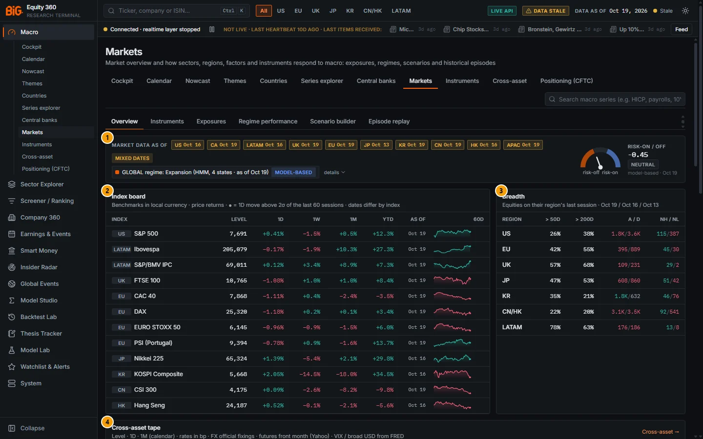

*Figure 2B.1: Markets overview (`/macro/markets`), region All, data as of 19 Oct 2026.*

| # | Panel | What it shows |
|---|---|---|
| 1 | Data dates, regime and risk appetite | One chip per region with its last equity session ("Market data as of"), a "mixed dates" badge, the macro regime chip (HMM, model-based) and the risk-on / risk-off gauge (model-based) |
| 2 | Index board | Benchmark indices in local currency: level, 1D, 1W, 1M, YTD price returns, the date of each index's last bar and a 60-session sparkline |
| 3 | Breadth | Per region: share of names above their 50-day and 200-day averages, advancers / decliners, new 52-week highs / lows |
| 4 | Cross-asset tape | Level, 1D and 1M change for rates, FX, commodities, volatility, crypto and credit |
| 5 | Sector performance | Sector × region heatmap of cap-weighted returns (or treemap), total or relative to the region's benchmark |
| 6 | Movers (1D) | Top liquid gainers and losers of the day after a server-side liquidity screen |
| 7 | Rates | A sovereign yield curve on a numeric tenor axis, current vs 1M and 1Y ago, with the policy rate as a dotted marker, plus a one-year US 2s10s sparkline |
| 8 | Credit spreads | ICE BofA option-adjusted spreads and the Moody's Baa yield spread: level, 1D and calendar 1M change, empirical percentile, one-year spark |
| 9 | Policy rate vs priced 12m | Each central bank's policy rate, next meeting and the change priced over 12 months, labelled as an approximation |
| 10 | Macro headlines | Up to six headline macro tiles per region (three with region All), as rates of change with their observation dates |

Panels 4 to 10 sit below the fold. Close-ups follow.

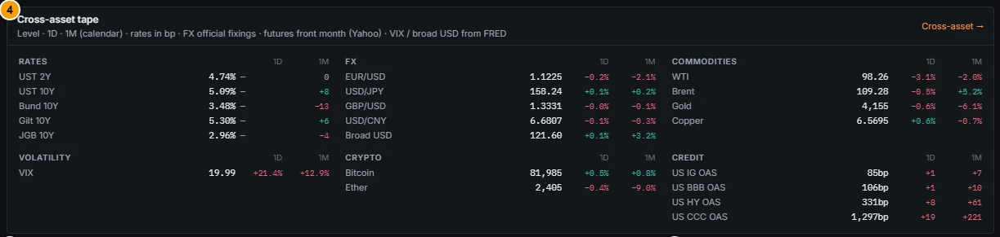

*Figure 2B.2: Cross-asset tape. Rates in per cent with changes in bp; FX, commodities and crypto in price terms with % changes; credit in bp.*

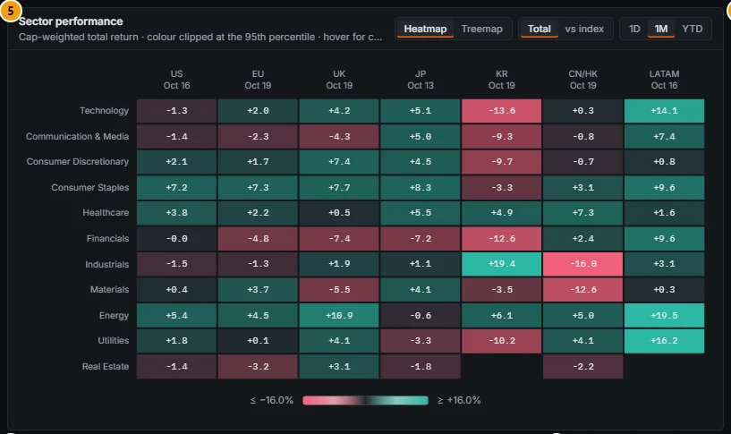

*Figure 2B.3: Sector performance, heatmap view, Total basis, 1M horizon. Each column header carries the region's data date.*

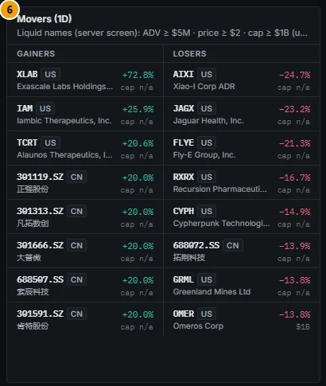

*Figure 2B.4: Movers (1D) after the server-side liquidity screen.*

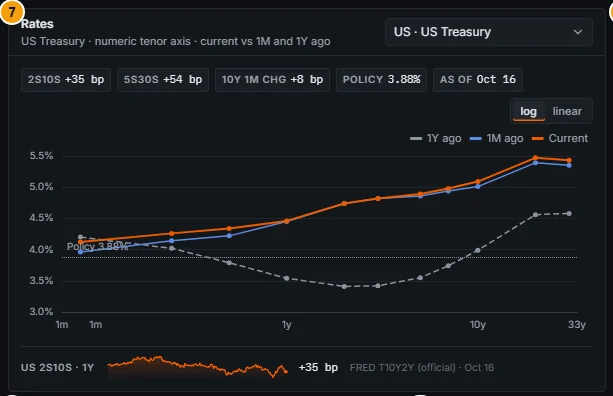

*Figure 2B.5: Rates panel, US Treasury curve on the log tenor axis, with the dotted policy-rate line at 3.88%.*

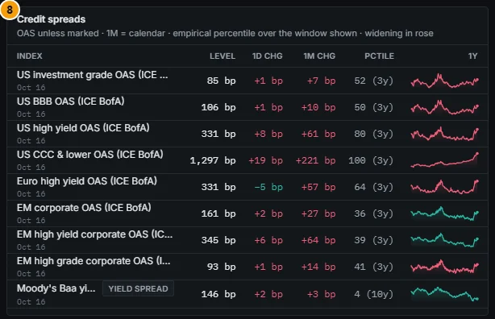

*Figure 2B.6: Credit spreads. The Baa row carries a "yield spread" badge because it is not option-adjusted.*

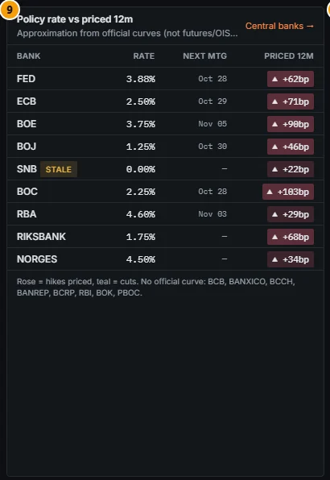

*Figure 2B.7: Policy rate vs priced 12m. Rose chips = hikes priced, teal = cuts.*

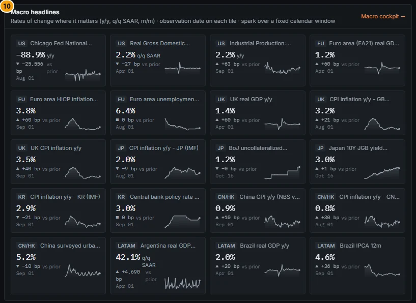

*Figure 2B.8: Macro headlines, three tiles per region with region All.*

### Controls

| Control | What it does |
|---|---|
| Region selector (top bar) | Reloads the page for one region or All; also sets the default yield curve (All and US: US Treasury; EU: Germany; UK: Gilt; JP: JGB; KR: KTB; CN/HK: China; LATAM: Brazil; other: Australia) and the number of macro tiles per region (3 for All, 6 otherwise) |
| Region date chip (hover) | Tooltip: the region's last session, how many sessions it is behind the latest region, how many weekdays before today, and the share of the region's names whose last bar is older |
| "mixed dates" badge (hover) | Appears when regions are on different sessions: cross-region 1D figures then compare different days |
| Regime chip | Opens the Macro cockpit (`/macro`) |
| details ▾ (next to the regime chip) | Popover with the HMM's posterior probability per state, the monthly regime history (hatched months have no snapshot), the model inputs (level and z vs the model fit) and a link to the cockpit |
| Risk-on / off gauge | Opens the Cross-asset dashboard (`/macro/cross-asset`) |
| ● on an index row (hover) | "1D move larger than two standard deviations of the last 60 daily moves" |
| Index name (hover) | Full name and Yahoo symbol (for example `^GSPC`) |
| A / D cell (hover) | Exact advancer and decliner counts |
| Cross-asset → | Opens the Cross-asset dashboard |
| Tape row (hover) | Source, as-of date, cockpit trend signal and realised-vol z (when known) and the definition "1D = vs previous observation · 1M = vs the value 30 calendar days earlier" |
| Tape row (click) | FX, commodity and crypto rows open the Cross-asset dashboard; VIX and Broad USD open the series explorer (`/macro/series/fred:VIXCLS`, `/macro/series/fred:DTWEXBGS`) |
| View: Heatmap / Treemap | Heatmap = sector × region grid; Treemap = one box per sector, area = market cap, colour = cap-weighted return |
| Basis: Total / vs index | Heatmap only. "vs index" = sector return minus the region's benchmark index over the same horizon |
| Horizon: 1D / 1M / YTD | Return horizon of the sector panel (default 1M) |
| Heatmap cell (hover) | Return, constituents (and how many traded on the session for 1D), market cap, data date per region; in "vs index" mode also the raw sector return, the index return and a warning when the index bar date differs |
| Mover row | Opens Company 360 for that name; hover shows close, bar date, market cap and volume z |
| Liquid / All | Shown only when the API does not screen movers itself (older APIs): Liquid keeps names with a known market cap ≥ $1bn and US price ≥ $2 |
| Yield curve (select) | Any curve with at least two market tenors; curves with only two are flagged "(2 tenors)" |
| Tenor axis: log / linear | Log spreads the short end; linear shows true distances |
| Policy chip (hover) | "Policy / overnight rate: drawn as a dotted reference line, not as a curve tenor" |
| As of chip | Turns amber when tenors carry different dates; hover shows the oldest and newest |
| Central banks → / bank code | Opens the Central banks page or one bank's page (`/macro/cb/:bank`) |
| Priced 12m chip (hover) | Text of what is priced and the curve date |
| Macro tile | Opens the series in the series explorer; hover shows the full name, transform, source and observation date |
| Macro cockpit → | Opens `/macro` |

### Methodology

#### Data dates per region

For each region the API computes the **modal last-bar date** of its equities that traded in the last 21 days (`as_of`), and the share of names whose last bar is older (`stale_share`). A chip is drawn amber ("stale") when it is more than **2 weekdays** before today's date on your computer, or when more than **25%** of the region's names have an older bar. All 1D aggregates (sector 1D, movers) only use names that are on their region's latest session.

#### Index board

- Level, 1D, 1M and YTD come from the price statistics of each benchmark index (price returns, local currency).
- 1W is computed in the browser from the 60-session spark: last close vs the last close at least 7 calendar days earlier.
- The ● flag is set when `|1D| > 2σ`, where σ is the standard deviation of the daily returns inside the 60-session spark (at least 11 returns).
- Rows are ordered by region (US, CA, LATAM, UK, EU, JP, KR, CN, HK…) then by name.

#### Breadth

Over the region's equities with a bar in the last five days: share above the 50-day and 200-day moving averages, number of names up and down on their last session, and the number of new 52-week highs and lows. The bar next to a share turns green at ≥ 60% and red at ≤ 40%.

#### Cross-asset tape

| Group | Rows | Source and definition |
|---|---|---|
| Rates | UST 2Y, UST 10Y, Bund 10Y, Gilt 10Y, JGB 10Y | Official curves of the overview payload; level in %, 1M change in bp (value on or before 30 calendar days earlier). No 1D for rates. |
| FX | EUR/USD, USD/JPY, GBP/USD, USD/CNY, Broad USD | Pairs from official fixings via the cross-asset asset detail; Broad USD = Fed broad dollar index (FRED DTWEXBGS) |
| Commodities | WTI, Brent, Gold, Copper | Yahoo continuous front month |
| Volatility | VIX | FRED VIXCLS (official copy of the CBOE close) |
| Crypto | Bitcoin, Ether | CME front-month futures (Yahoo) |
| Credit | First four OAS series (US IG, US BBB, US HY, US CCC) | ICE BofA OAS via FRED, in bp |

For prices, `1D = last / previous observation − 1` and `1M = last / value on or before (last date − 30 days) − 1`. For yields and spreads the same changes are differences in bp. Colours are inverted for VIX and credit (a rise is shown as adverse).

#### Sector performance

```
sector return = Σ (rᵢ · capᵢ) / Σ capᵢ     over names with a return and a market cap > 0
                (simple mean when no name in the cell has a market cap)
vs index      = sector return − return of the region benchmark over the same horizon
```

Benchmarks for "vs index": US `^GSPC`; EU `^STOXX50E` (else `^GDAXI`); UK `^FTSE`; JP `^N225`; KR `^KS11`; CN/HK `^HSI` (else `000300.SS`); LATAM `^BVSP`. The colour scale is **winsorised**: it is clipped at the 95th percentile of absolute values (with a floor of 0.5% for 1D and 2% for 1M / YTD), so a single outlier no longer washes out the grid; cell labels keep the true value. The treemap drops sectors with no known market cap and lists them under the chart.

#### Movers

The API screens movers server-side (API v1.30 and later): a **known** 20-day average daily value ≥ $5m, a USD price ≥ $2 and a market cap ≥ $1bn; a name with an unknown market cap (common for Japanese, Chinese and Korean listings that lack share counts) qualifies only with ADV ≥ $20m (4 × the minimum). An unknown ADV never passes. The panel shows the top eight each side.

#### Rates

The curve is drawn on a **numeric** tenor axis (years; log or linear). The O/N point of each curve is the policy or overnight rate (for the US, the effective fed funds rate EFFR, else SOFR; for euro-area countries the ECB deposit rate) and is drawn as a dotted horizontal line, not as a tenor. "1M ago" and "1Y ago" use the last value on or before 30 and 365 days before each tenor's latest date. 2s10s and 5s30s are spreads of the current curve in bp; "10Y 1M chg" is the 10-year change over one month. The sparkline under the chart is FRED T10Y2Y (10-year minus 2-year Treasury, official).

#### Credit spreads

Nine series: US IG, US BBB, US HY, US CCC & lower, Euro HY, EM corporate, EM HY corporate, EM high grade corporate (all ICE BofA OAS via FRED) and Moody's Baa yield minus the 10-year Treasury (labelled "yield spread, not OAS"). For each:

```
1D chg  = last − previous observation
1M chg  = last − value on or before (last date − 30 days)
pctile  = empirical percentile of the latest level within the last 10 years
          (or the available window, shown in brackets: "3y" for the ICE BofA series on FRED)
          = (number below + ½ · number equal) / n, needs ≥ 20 observations
spark   = fixed one-year calendar window
```

#### Policy rate vs priced 12m

Taken from the central-bank implied paths of [2A. Macro](02a-macro.md). The panel's subtitle is the app's own label: **"Approximation from official curves (not futures/OIS-implied probabilities)"**. Banks without an official curve are listed at the bottom ("No official curve: …"); a "stale" badge marks banks whose curve is out of date.

#### Macro headlines

Tiles show rates of change rather than index levels: inflation, growth, housing and trade series as y/y; quarterly growth series as q/q SAAR (`(Xₜ / Xₜ₋₁)⁴ − 1`); monthly labour counts as the m/m change; rates and series already in per cent stay as levels. The change under the value is vs the previous print (in bp for rates). The spark covers a fixed calendar window: 1 year for daily and weekly series, 5 years for monthly, 10 years for quarterly.

#### Regime chip and risk gauge

- **Regime chip.** The latest state of the Gaussian HMM regime model for the selected region's scope. If the region has no model, the chip says "No {region} model · GLOBAL regime (fallback)" with a "fallback" badge; if nothing is modelled it says "No regime model for {region}". The popover note reads: "Posterior probabilities of the model's own states (an HMM is often over-confident)."
- **Risk gauge.** The cross-asset risk composite (see [Cross-asset dashboard](#cross-asset-dashboard)); the gauge spans −2 to +2 with the neutral band from −0.5 to +0.5.

### Data sources and refresh

| Panel | Source | Cadence |
|---|---|---|
| Index board | Yahoo index bars in the price lake | Nightly price ingestion |
| Breadth, sectors, movers | Equity price lake (Polygon / yfinance) and the serving snapshot | Nightly |
| Tape: FX | Official fixings (ECB > FRED H.10 > central bank) | Nightly |
| Tape: commodities, crypto | Yahoo continuous front month | Nightly |
| Tape: VIX, Broad USD; credit spreads; 2s10s | FRED (official) | Nightly; H.15 data is known the next day |
| Yield curves | Official curves (Fed H.15, ECB, Bundesbank, BoE, MoF Japan, BoK…) | Nightly; several countries publish monthly, so tenors can carry different dates |
| Policy pricing | Central-bank implied paths (macro W3) | Nightly |
| Macro headlines | Official statistical agencies | Nightly |
| Regime chip | `macro_regimes` HMM | Weekly fit (`macro_regime_fit`), latest state nightly |
| Risk gauge | `cross_asset_signals` job | Nightly |

### Validation status

The Overview is a descriptive page built on official and market data; it has **no validation gate**. Two model-based items appear on it:

- the **regime chip** carries a "model-based" badge; it is not formally validated, and the audit (docs/AUDIT_2026-10-19.md, F07 / F08) recorded a 99.99% "Expansion" posterior from this over-confident HMM;
- the **risk gauge** is labelled "model-based"; docs/CROSS_ASSET_DEFINITIONS.md §3 lists only sanity checks (see the Cross-asset section).

The policy-pricing panel is labelled as an **approximation**.

### Correct usage and worked example

Read the page top-down, and always read the date chips first.

**Worked example (region All, 19 Oct 2026, Figure 2B.1):**

1. **Dates.** US equities are on **16 Oct** while CA, UK, EU and CN are on 19 Oct, and JP on 13 Oct; the "mixed dates" badge is on. The S&P 500 row of the index board shows "Oct 19" because the index bar is newer than the bulk of US equities, so the US breadth and US sector columns describe 16 Oct, not 19 Oct.
2. **Risk.** The gauge reads **−0.45, Neutral** (model-based, 19 Oct). It sits just inside the neutral band; the Cross-asset dashboard shows that all eight components are present and the composite fell 0.88 over one month.
3. **What moved.** KOSPI is +2.05% on the day but −14.5% on the week and −18.0% on the month; the S&P 500 is +0.41% on the day and +12.3% YTD.
4. **Credit.** US HY OAS is 331bp, +8bp on the day and +61bp on the month, at the 80th percentile of its (3-year) window: spreads are widening but are not historically extreme over that short window. The Baa yield spread (146bp) sits at the 4th percentile of 10 years.
5. **Rates and policy.** On the US Treasury curve (as of 16 Oct) 2s10s is +35bp and 5s30s +54bp; the policy marker is at 3.88%. The policy panel shows +62bp priced for the Fed over 12 months, an approximation from official curves.

### Limitations and pitfalls

- **"Today" is your computer's clock.** When you open the page days after the snapshot (as in the screenshot, captured after 19 Oct), every chip turns amber even if the snapshot is complete.
- **Cross-region 1D is not one day.** With mixed dates, comparing "1D" across regions compares different sessions.
- **Price returns only.** Index board figures exclude dividends.
- **Limit moves.** Chinese A-shares appear at +20.0% / −20.0% (daily limit) in the movers list; many Asian names show "cap n/a" because share counts are missing.
- **Short credit history.** The ICE BofA series on FRED keep only about 3 years, so their percentile describes a 3-year window, not 10 years.
- **Macro tiles inherit the transform rules.** A series whose history includes zero or negative values (a diffusion-type or zero-centred index such as the Chicago Fed National Activity Index) is now shown as a level: a growth rate of such an index is meaningless (Figure 2B.8, captured earlier, still shows CFNAI as −88.9% y/y). A volatile quarterly series (Argentina real GDP, 42.1% q/q SAAR) can still produce a misleading rate of change; open the series explorer to check the raw level.
- **VIX on the tape is FRED VIXCLS**, which can lag the Yahoo `^VIX` level shown on the instrument page by a session.
- **No USD view.** The index board is in local currency only.

### Related mnemonics and BQL fields

- Mnemonics: `WEI` (this page), `GC` (central-bank curves), `WIRP` (implied policy rates), `ECO`, `ECST` (see [14. BQL console and mnemonics](14-bql-mnemonics.md)).
- BQL fields with the same per-security inputs: `chg_pct_1d`, `chg_pct_1w`, `chg_pct_1m`, `chg_pct_ytd`, `above_50d`, `above_200d`, `adv_usd_20d`.
- Related: [Cross-asset dashboard](#cross-asset-dashboard), [2A. Macro](02a-macro.md) (cockpit, central banks, series explorer), [3. Sector Explorer](03-sector-explorer.md).

---

## Instruments browser

**Route:** `/macro/markets?tab=instruments` (also `/instruments` and `/macro/markets/instruments`, which redirect) · **Menu:** Macro › Instruments, or Macro › Markets › Instruments · **Mnemonics:** `FXIP` (alias `FX`) · **Refresh:** nightly price ingestion

### Purpose

A one-page browser of every non-equity market series in the app: FX pairs, continuous futures, cash indices (equity, volatility, yields, dollar and commodity indices) and ETFs. Use it to check a price, compare short-term moves within a group and jump to the instrument page.

### Screenshot

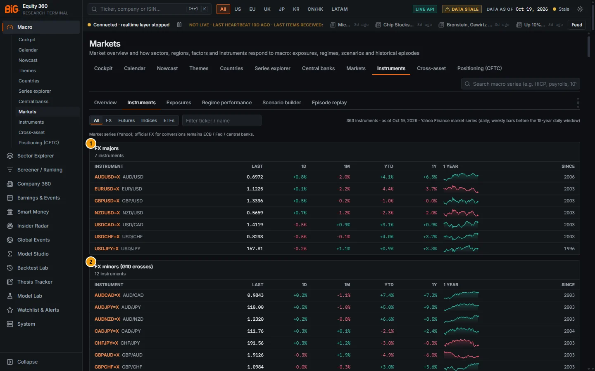

*Figure 2B.9: Instruments browser, type All, 363 instruments as of 19 Oct 2026.*

| # | Panel | What it shows |
|---|---|---|
| 1 | FX majors | 7 pairs vs USD |
| 2 | FX minors (G10 crosses) | 12 crosses |
| 3 | EUR crosses | 23 pairs |
| 4 | FX emerging markets | 35 pairs |
| 5 | Energy | 7 futures (Brent, WTI, heating oil, Henry Hub, E-mini crude, RBOB, Dutch TTF) |
| 6 | Metals | 9 futures |
| 7 | Grains & oilseeds | 8 futures |
| 8 | Softs | 6 futures |
| 9 | Livestock & dairy | 4 futures |
| 10 | Treasury futures | 4 futures (2-, 5-, 10-year notes and the bond) |
| 11 | Equity index futures | 4 futures |
| 12 | Currency futures | 3 futures |
| 13 | Crypto futures | 2 CME futures (Bitcoin, Ether) |
| 14 | Volatility | 13 indices (VIX family, VVIX, SKEW, MOVE, OVX, GVZ, India VIX, ASX VIX…) |
| 15 | Equity indices | 40 cash indices |
| 16 | US Treasury yields | 4 yield indices (13-week, 5-, 10-, 30-year) |
| 17 | Dollar & commodity indices | 2 (US Dollar Index, S&P GSCI) |
| 18 | ETFs: US equity & factors | 34 ETFs |
| 19 | ETFs: sectors & themes | 36 ETFs |
| 20 | ETFs: international & countries | 56 ETFs |
| 21 | ETFs: bonds | 21 ETFs |
| 22 | ETFs: commodities | 26 ETFs |
| 23 | ETFs: currencies | 4 ETFs |
| 24 | ETFs: crypto | 2 ETFs |
| 25 | ETFs: volatility | 1 ETF |

Every group panel has the same columns; the Energy group is shown as an example.

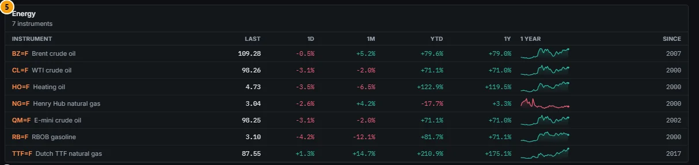

*Figure 2B.10: Energy group. The "Since" column is the first year of stored history.*

### Controls

| Control | What it does |
|---|---|
| All / FX / Futures / Indices / ETFs | Filters the groups by instrument type |
| Filter ticker / name | Free-text filter across all groups; "No instruments match." when nothing is left |
| Ticker (orange link) | Opens the [Instrument page](#instrument-page) (`/instruments/<id>`, e.g. `/instruments/IDX%3AEURUSD%3DX`) |

### Methodology

| Column | Definition |
|---|---|
| Last | Last close, with decimals adapted to the price level |
| 1D, 1M, YTD, 1Y | Price changes from the price statistics (1Y = 12-month return) |
| 1 year | Sparkline of one year of weekly closes |
| Since | Year of the first stored bar |

Names drop the "(Yahoo market rate)" and "(continuous front month)" suffixes in the table; the instrument page shows them in full.

### Data sources and refresh

The header line states the source: "Yahoo Finance market series (daily; weekly bars before the 15-year daily window)". The note under it applies to FX: **"Market series (Yahoo); official FX for conversions remains ECB / Fed / central banks."** In other words, these FX rows are market rates for display; every currency conversion in the app uses official fixings. Prices refresh with the nightly price ingestion (weekly profile: Saturday).

### Validation status

Not applicable: market data, no model.

### Correct usage and worked example

Use the type filter, then sort by eye within a group. **Example (19 Oct 2026, Figure 2B.10):** in Energy, Dutch TTF natural gas is +210.9% YTD and heating oil +122.9%, while Henry Hub is −17.7%; WTI (`CL=F`) is 98.26, −3.1% on the day and +71.1% YTD. Click `CL=F` to open its instrument page with the futures curve and carry (Figures 2B.15 to 2B.17).

### Limitations and pitfalls

- **Continuous front months include roll gaps.** A `=F` series jumps when the front contract rolls, so its returns behave like spot-price changes, not futures excess returns.
- **Yield indices are levels.** The US Treasury yield rows are yields in per cent (for example `^TNX` 5.136 on 19 Oct); their "returns" are relative changes of a yield, not investable returns. Their names now end in "(%)"; older price data, until the next price refresh rewrites the instrument names, still shows "(x10)", which never matched the stored values (already in per cent).
- **Dates differ.** Some volatility indices (OVX, GVZ, VXN, India VIX, ASX VIX) last printed on 16 Oct in this snapshot; the row does not show a date, the instrument page does.
- **Licensing.** Yahoo data is not licensed for commercial use.

### Related mnemonics and BQL fields

- `FXIP` / `FX` opens this tab (all types; pick FX with the filter). A security reference with a yellow key opens the instrument page directly: `EURUSD Curncy DES`, `SX5E Index GP`, `CL1 Comdty GP` (instrument references are resolved by `GET /bql/resolve`, API v1.37).
- Related: [Instrument page](#instrument-page), [Cross-asset dashboard](#cross-asset-dashboard).

---

## Instrument page

**Route:** `/instruments/:id` (for example `/instruments/IDX:EURUSD=X`, `/instruments/IDX:CL=F`, `/instruments/ETF:SPY`) · **Menu:** from the Instruments browser, the Cross-asset dashboard or a CFTC market page · **Mnemonics:** `DES`, `GP`, `GIP`, `TECH` with an Index / Curncy / Comdty reference; `THES` starts a cross-asset thesis · **Refresh:** nightly

### Purpose

The detail page of one FX pair, future, index or ETF: full price history, return and risk statistics, correlations with related markets, and, for instruments linked to a cross-asset asset, the carry and futures-curve panels. It is the instrument equivalent of Company 360.

### Screenshot

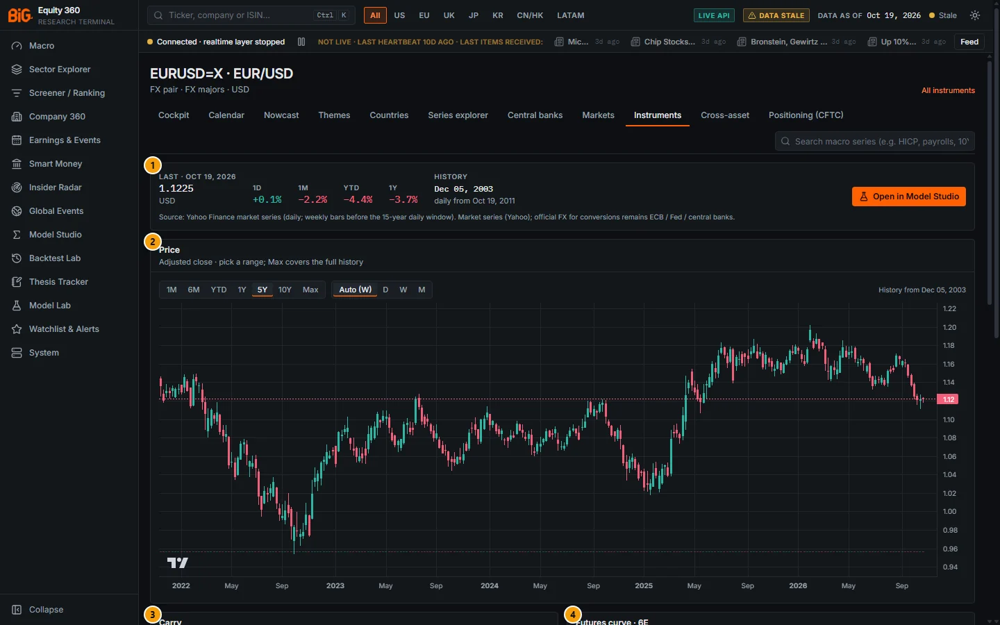

*Figure 2B.11: Instrument page for EUR/USD (`/instruments/IDX:EURUSD=X`), 5Y range, weekly bars.*

| # | Panel | What it shows |
|---|---|---|
| 1 | LAST · OCT 19, 2026 | Last price and currency, 1D / 1M / YTD / 1Y changes, history start ("daily from …"), the source line, and the action buttons |
| 2 | Price | Candlestick chart of adjusted closes with range and bar-interval selectors |
| 3 | Carry | Cross-asset carry, roll yield and curve label with their history (only for linked instruments) |
| 4 | Futures curve · 6E | Term structure of the linked futures root now vs ~1m and ~1y ago (only when a curve is stored) |
| 5 | Returns and risk | Annualised return, volatility and maximum drawdown over 1Y, 5Y, 10Y and Max |
| 6 | Correlations | Correlation of weekly log returns with up to ten related instruments over 3 and 10 years |
| 7 | Rolling 1-year volatility | 52-week volatility of weekly log returns, annualised |

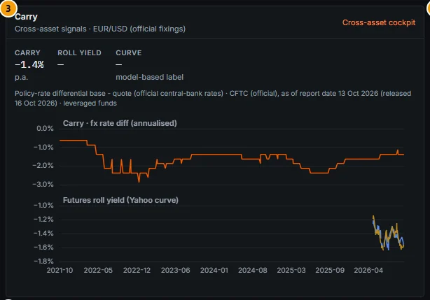

*Figure 2B.12: Carry panel for EUR/USD: policy-rate differential (ECB minus Fed) and, below, the roll yield of the 6E future.*

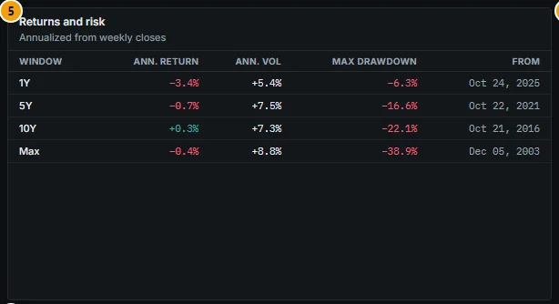

*Figure 2B.13: Returns and risk for EUR/USD.*

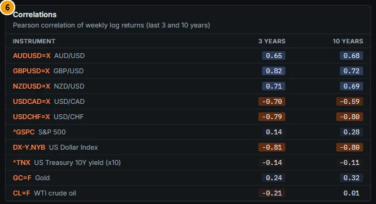

*Figure 2B.14: Correlations for EUR/USD, 3 and 10 years.*

For a commodity future the same page shows the futures roll carry and the crude-oil curve:

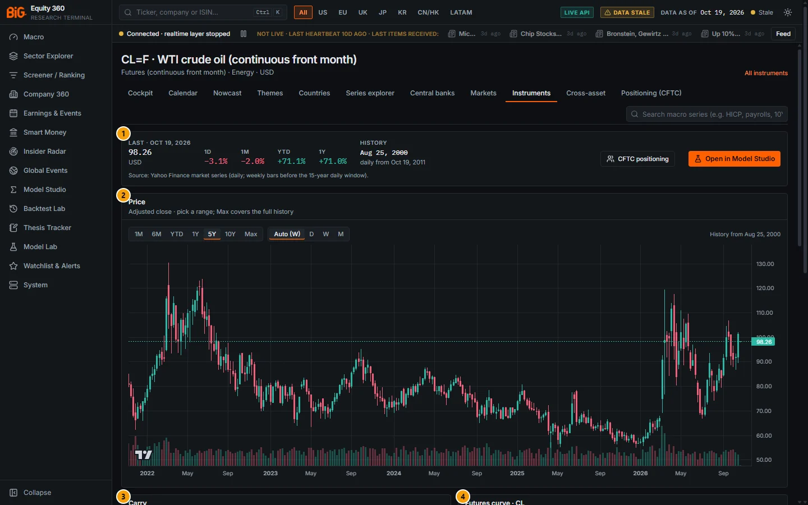

*Figure 2B.15: Instrument page for WTI crude oil (`/instruments/IDX:CL=F`). The "CFTC positioning" button appears because a CFTC market is linked.*

Badges 1 to 7 have the same meaning as in Figure 2B.11.

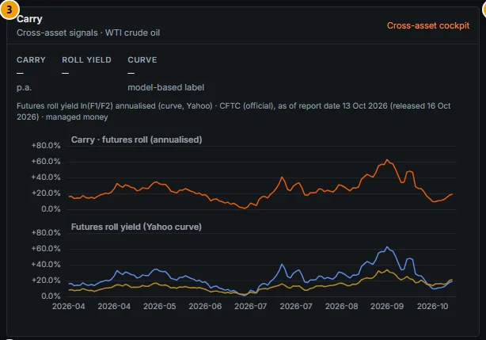

*Figure 2B.16: Carry panel for WTI: futures roll yield ln(F1/F2) annualised, front vs next and 12-month (seasonality-neutral).*

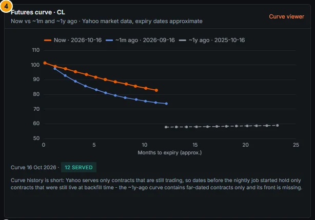

*Figure 2B.17: Futures curve · CL, 16 Oct 2026 (backwardation), vs ~1m and ~1y ago.*

An index without a linked cross-asset asset has no Carry or Futures curve panel, so the badges are renumbered:

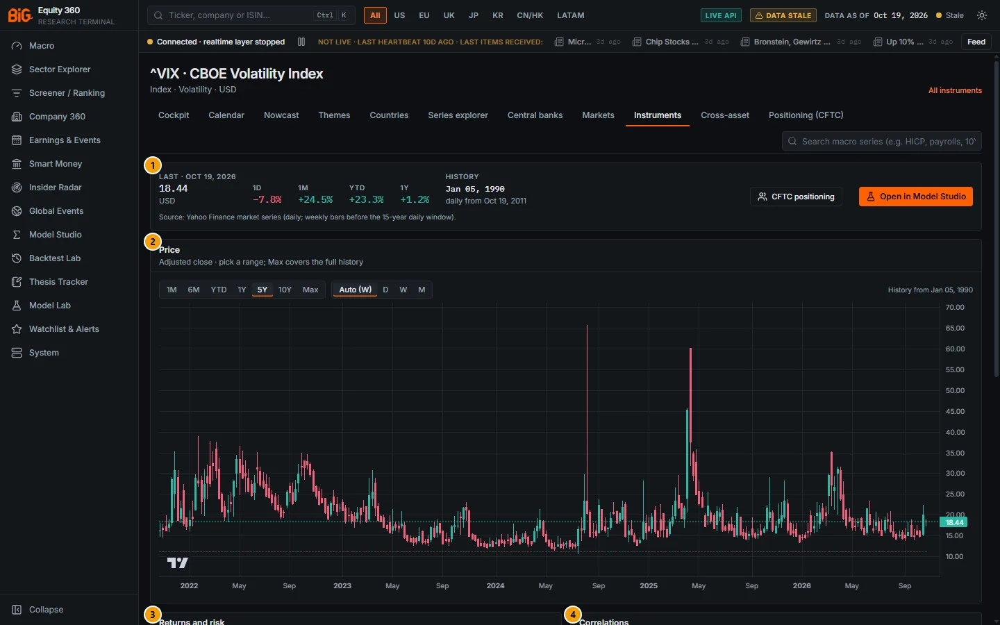

*Figure 2B.18: Instrument page for the CBOE Volatility Index (`/instruments/IDX:^VIX`), 5Y range. The "CFTC positioning" button links to the VIX futures market.*

| # | Panel | What it shows |
|---|---|---|
| 1 | LAST · OCT 19, 2026 | Last level 18.44, 1D −7.8%, 1M +24.5%, YTD +23.3%, 1Y +1.2%, history from 5 Jan 1990, daily from 19 Oct 2011 |
| 2 | Price | Candlestick chart of the index level |
| 3 | Returns and risk | Statistics with the "Level series" note (below) |
| 4 | Correlations | Correlations with related volatility indices and the anchors |
| 5 | Rolling 1-year volatility | 52-week volatility of the weekly log changes of the level |

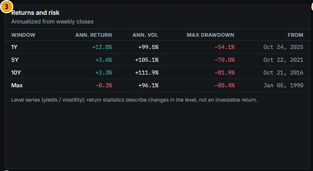

*Figure 2B.19: Returns and risk for the VIX: "Level series (yields / volatility): return statistics describe changes in the level, not an investable return."*

### Controls

| Control | What it does |
|---|---|
| All instruments | Back to the Instruments browser |
| CFTC positioning | Shown when a CFTC market is linked to the instrument (futures contract, mini / micro, the spot FX pair of a currency future such as EUR/USD → Euro FX, or a labelled price proxy); opens `/macro/positioning/:code`. The spot-pair links (EUR, GBP, JPY, CAD, CHF, MXN, BRL, ZAR) appear after the next weekly CFTC job rebuilds the market table; Figure 2B.11 predates them |
| Open in Model Studio | Opens Model Studio with a draft study: weekly log returns of this instrument, time series from 2000, ARIMA (see [9. Model Studio](09-model-studio.md)) |
| Range: 1M / 6M / YTD / 1Y / 5Y / 10Y / Max | Chart range (default 5Y); Max covers the full history |
| Interval: Auto / D / W / M | Bar interval; Auto picks one for the range (weekly for 5Y). A badge "weekly (daily capped at 10y)" appears when daily bars are not available for the whole range |
| Cross-asset cockpit (Carry panel) | Opens the Cross-asset dashboard with this asset selected |
| Curve viewer (Futures curve panel) | Opens the Cross-asset dashboard with this futures root in the curve viewer |
| Correlation ticker | Opens that instrument's page; hover a value for the number of weekly returns |

### Methodology

- **Returns and risk** (weekly closes): `ann. return = (C_end / C_start)^(1 / years) − 1`; `ann. vol = sd(weekly log returns) × √52`; `max drawdown = min(C / running peak − 1)`. A window is reported only if history starts within 30 days of its nominal start, otherwise "not enough history".
- **Correlations:** Pearson correlation of weekly log returns over the last 3 and 10 years (at least 20 common weeks). The related list is up to five instruments of the same group plus the anchors S&P 500, US Dollar Index, US 10-year yield, gold, WTI, VIX and EUR/USD (ten at most).
- **Rolling 1-year volatility:** standard deviation of the last 52 weekly log returns × √52.
- **Carry and curve:** from the cross-asset signals (definitions in the [Cross-asset dashboard](#cross-asset-dashboard) section). The "Curve" stat is the **model-based** curve-shape label.

### Data sources and refresh

Prices are Yahoo market series, daily for the last 15 years and weekly before ("daily from 19 Oct 2011" in Figure 2B.11). FX carry uses official central-bank policy rates; futures curves are Yahoo contract-month data with approximate expiry dates; positioning on the carry panel is CFTC (official), point-in-time on the release date. All refresh nightly; CFTC weekly.

### Validation status

Not applicable to prices and statistics. The curve-shape label and carry series are model-based transformations (see Cross-asset).

### Correct usage and worked example

**EUR/USD, 19 Oct 2026 (Figures 2B.11 to 2B.14):** the pair is 1.1225, −2.2% over the month and −4.4% YTD. Over one year it returned −3.4% annualised with 5.4% volatility and a −6.3% maximum drawdown; since December 2003 it returned −0.4% a year with a −38.9% maximum drawdown. Its strongest correlations are with the US Dollar Index (−0.81 over 3 years) and GBP/USD (+0.82). The carry is **−1.4% p.a.**: the "Policy-rate differential base - quote (official central-bank rates)", i.e. the ECB rate (2.50%) minus the Fed rate (3.88%), so a long EUR/USD position pays carry.

**WTI, same date (Figures 2B.15 to 2B.17):** the curve dated 16 Oct is in backwardation, from about 101 at the front to about 83 twelve months out, while one year ago only far-dated contracts near 58 are stored.

**VIX, same date (Figures 2B.18, 2B.19):** the table shows a 1Y "return" of +12.8% with 99.5% "volatility" and a −54.1% maximum drawdown. These describe changes in the index level, which cannot be held as an investment, so do not compare them with an asset's return statistics.

### Limitations and pitfalls

- **Latest carry can be blank.** When the futures curve is dated earlier than the price (WTI: curve 16 Oct, price 19 Oct), the Carry, Roll yield and Curve stats show "—" for the latest row while the history is intact.
- **Short curve history.** Yahoo serves only contracts that are still trading, so the "~1y ago" curve holds far-dated contracts only and its front is missing (panel note).
- **Level series.** For yield and volatility indices the page notes: "Level series (yields / volatility): return statistics describe changes in the level, not an investable return."
- **Roll gaps** in continuous futures distort drawdowns and returns.
- **The FX price is a Yahoo market rate**, the carry uses official policy rates and the cross-asset signals use official fixings, so the levels can differ slightly.

### Related mnemonics and BQL fields

- `EURUSD Curncy DES` or `GP`, `SX5E Index GP`, `CL1 Comdty GP`; `THES` with an instrument reference opens a new thesis with subject type cross-asset ([12. Thesis Tracker](12-thesis-tracker.md)).
- Related: [Cross-asset dashboard](#cross-asset-dashboard), [CFTC market page](#cftc-market-page), [9. Model Studio](09-model-studio.md).

---

## Exposures

**Route:** `/macro/markets?tab=exposures` · **Menu:** Macro › Markets › Exposures · **Mnemonics:** none · **Refresh:** weekly (`macro_exposures` job, Saturday under every profile's weekly DAG)

### Purpose

Shows how sectors, subsectors, regions, factor portfolios, ETFs, indices and futures have responded to official macro factors: rates, the curve, breakevens, credit spreads, the dollar, oil and the part of the equity market not explained by macro. Analysts use it to see, for example, which sectors are most rate-sensitive today, and portfolio managers to check the macro tilt implied by a sector allocation. The same betas drive the Scenario builder and Episode replay.

### Screenshot

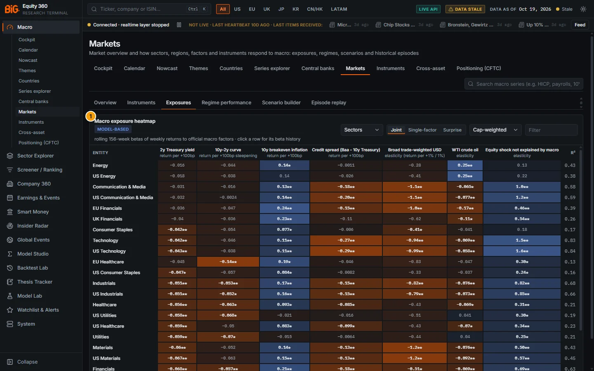

*Figure 2B.20: Macro exposure heatmap, Sectors, Joint model, Cap-weighted, as of 19 Oct 2026.*

| # | Panel | What it shows |
|---|---|---|
| 1 | Macro exposure heatmap | One row per entity, one column per factor: beta (with significance stars), colour by sign and size, and R² of the regression. "MODEL-BASED rolling 156-week betas of weekly returns to official macro factors · click a row for its beta history" |

After clicking a row, the beta history opens below the heatmap:

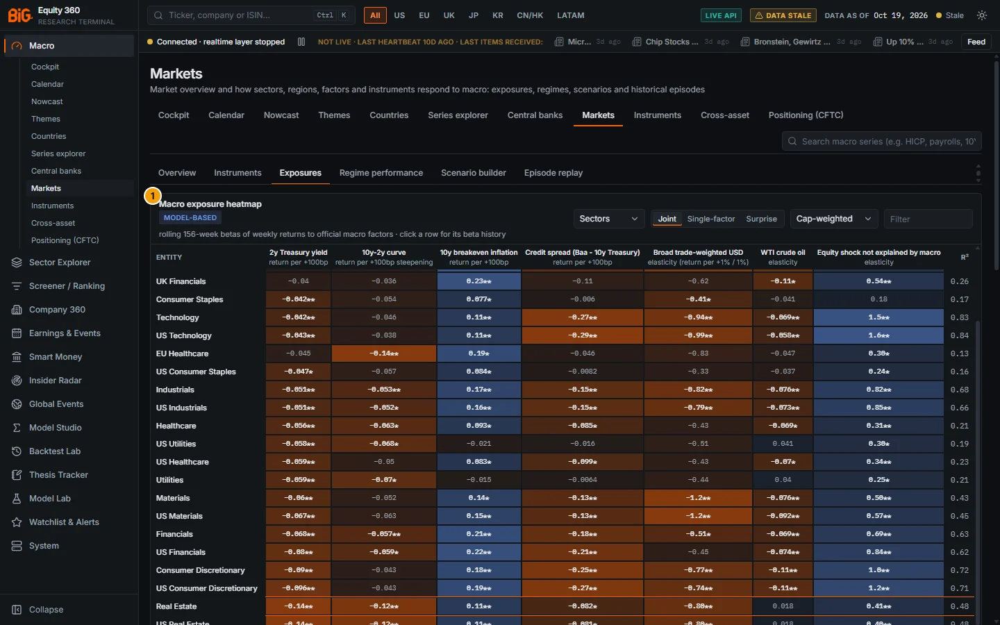

*Figure 2B.21: Exposures tab after clicking the Real Estate row.*

| # | Panel | What it shows |
|---|---|---|
| 1 | Macro exposure heatmap | As in Figure 2B.20; the selected row is outlined |
| 2 | Beta history: Real Estate | One chart per factor: point-in-time month-end betas with 90% bands (±1.645 SE), from 2011 to 2026 |

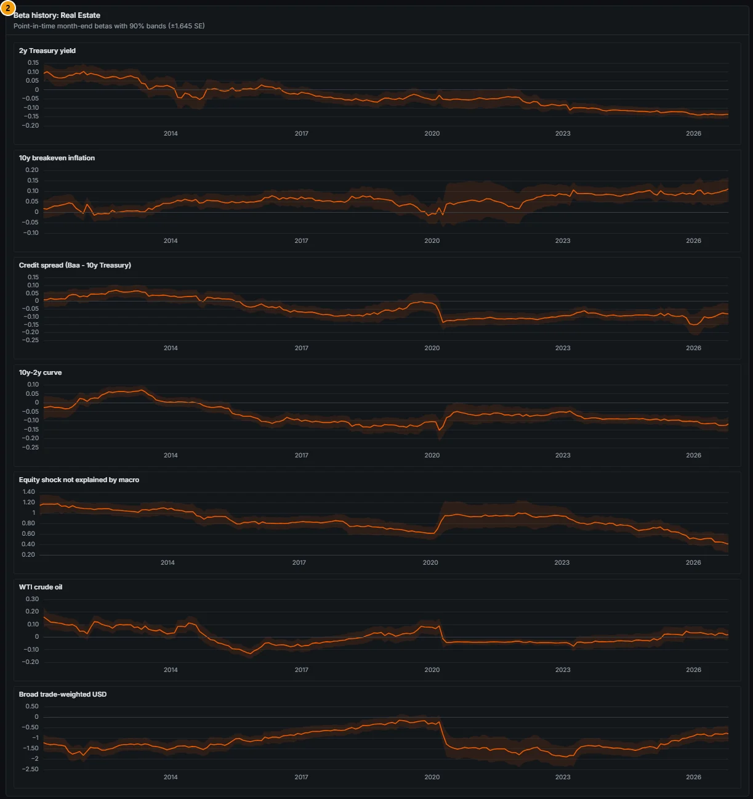

*Figure 2B.22: Beta history: Real Estate. The 2-year yield beta drifted from about +0.10 in 2011 to about −0.14 in 2026; the equity-residual beta fell from about 1.2 to about 0.4.*

### Controls

| Control | What it does |
|---|---|
| Entities | Sectors (default), Subsectors, Regions, Factors, ETFs, Indices, Futures |
| Model: Joint / Single-factor / Surprise | Which regression is shown (see Methodology) |
| Weighting: Cap-weighted / Equal-weighted | For sectors, subsectors and regions only |
| Filter | Free-text filter on name, ticker or id |
| Column header (hover) | Factor label, unit ("return per +100bp", "elasticity…") and source series |
| Cell (hover) | β to three decimals, t-statistic and "(1% sig.)", "(5% sig.)" or "(not significant)" |
| Row (click) | Opens "Beta history: {name}" below: point-in-time month-end betas with 90% bands (±1.645 SE) |

The footnote under the table states the method label, the as-of date, the frequency (weekly) and how many rows are shown out of the total.

### Methodology

The app's method label: **"Model-based: rolling weekly OLS betas (156 weeks, >= 52), Newey-West HAC(4) standard errors"**.

#### Factors (all official except the S&P 500)

| Column | Series | Unit of the beta |
|---|---|---|
| 2y Treasury yield | FRED DGS2 (Fed H.15), weekly change in pp | return per +100bp |
| 10y-2y curve | FRED T10Y2Y, change in pp | return per +100bp steepening |
| 10y breakeven inflation | FRED T10YIE, change in pp | return per +100bp |
| Credit spread (Baa - 10y Treasury) | FRED BAA10Y (Moody's), change in pp | return per +100bp |
| Broad trade-weighted USD | FRED DTWEXBGS (Federal Reserve), % change | elasticity (return per +1% / 1%) |
| WTI crude oil | FRED DCOILWTICO (EIA), % change | elasticity |
| Equity shock not explained by macro | S&P 500 orthogonalised on the macro factors | elasticity |

The credit factor uses the Moody's Baa spread rather than an ICE BofA OAS because the OAS series on FRED keep only about three years of history (code note in `app/macro/markets/factors.py`).

#### The three models

```
Joint:          rₜ = a + b′fₜ + b_u · uₜ + eₜ
                f = (Δ2y, Δcurve, Δbreakeven10y, Δcredit, USD, oil)
                u = S&P 500 return − [1 f]γ   (S&P 500 orthogonalised on f in the same window)
Single-factor:  rₜ = a + b · fₖ,ₜ + eₜ, one regression per factor
                (Δ2y, Δ10y, Δcurve, Δreal 10y, Δbreakeven, Δcredit, USD, oil, equity = CAPM beta)
Surprise:       rₜ = a + b′sₜ + b_u · u_s,ₜ + eₜ
                s = changes of the growth / inflation / labour surprise indices of the entity's home economy
                (model-based expectations), per +100 index points; u_s = equity orthogonalised on s
```

Because the equity term is orthogonalised, the macro betas of the joint model are **total effects** (they include the macro factor's effect through the equity market). In the joint model the 2-year beta holds the curve fixed, so it is the response to a **parallel** shift; the curve beta is the response to a steepening with the 2-year unchanged.

#### Estimation

- Returns: local-currency weekly total returns from the price lake; cap-weighted portfolios use lagged market caps (2010 onwards), equal-weighted portfolios equal weights.
- Window: the trailing **156 weeks** ending at each month end (and the run date); at least **52** weekly returns; missing weeks are masked per entity.
- Standard errors: Newey–West HAC with 4 lags and a small-sample factor n / (n − k).
- Significance in the grid: `**` = |t| ≥ 2.58 (1%), `*` = |t| ≥ 1.96 (5%); bold = significant, faint = not significant. Blue = positive beta, orange = negative; intensity is scaled within each column.
- Shrinkage (securities only; the heatmap shows unshrunk aggregates): empirical Bayes toward the sector median, `w = τ² / (τ² + se²)`, `β = m + w (b_raw − m)`.
- Beta history: month-end point-in-time betas from 2004 for aggregates (24 months for single securities), band `β ± 1.645 · SE`.

### Data sources and refresh

Factors come from FRED (H.15 yields, TIPS, breakevens, Baa spread, Fed broad dollar, EIA WTI) using the latest vintage per observation date; the equity factor is the S&P 500 from the price lake; surprise indices are the app's model-based surprise indices ([2A. Macro](02a-macro.md)). The `macro_factors` job runs nightly; `macro_exposures` runs weekly (about 5 to 10 minutes) and also writes the episode replay.

### Validation status

**Not formally validated** (no gate in the validation documents). The app labels the panel **MODEL-BASED**. The only diagnostic shipped is the [Episode replay](#episode-replay), which applies today's betas to past episodes and compares with realised returns.

### Correct usage and worked example

Use the joint model for a multi-factor view, the single-factor model when you want the plain sensitivity to one variable, and the surprise model to see how an entity reacts to data surprises. Look at significance before size, and at R² before trusting any beta.

**Example (Sectors, Joint, Cap-weighted, 19 Oct 2026):**

| Sector | 2y yield | Credit | USD | Oil | Equity residual | R² |
|---|---|---|---|---|---|---|
| Real Estate | −0.136 (t −9.3) | −0.082 | −0.80 | +0.02 | +0.41 | 0.48 |
| Technology | −0.042 (t −3.0) | −0.27 (t −9.9) | −0.94 | −0.069 | +1.55 | 0.83 |
| Energy | −0.016 (t −0.6) | −0.001 | −0.28 | +0.25 (t 4.6) | +0.13 | 0.43 |

Reading: the model associates a 100bp parallel **rise** in yields with a return of about −13.6% for Real Estate (strongly significant), against about −4.2% for Technology; Energy's dominant exposure is oil (+0.25 elasticity), and Technology's is the equity residual (1.55) and credit.

### Limitations and pitfalls

- **Betas describe the last three years.** They are not structural and drift; check the beta history before relying on one. Real Estate's 2-year yield beta was positive until about 2014 and has only been strongly negative since 2022 (Figure 2B.22).
- **Weekly betas scaled to 100bp** are linear extrapolations; large moves rarely happen in one week.
- **US factors for every region.** The macro factors are US series (Treasuries, Fed dollar index); for a Korean sector they measure sensitivity to US conditions, in local-currency returns.
- **Multicollinearity.** In the joint model, yields, breakevens and credit move together; individual coefficients can flip sign while their sum is stable.
- **Not a forecast** and not a trading signal.

### Related mnemonics and BQL fields

- BQL (per security, model-based, snapshot only): `macro.beta_rates` ("Beta to the 10y yield (+100bp)"), `macro.beta_usd`, `macro.beta_oil`, `macro.beta_credit`, `macro.beta_growth`, `macro.rates_down_100bp` ("Modelled impact if rates fall 100bp").
- Per company: the Macro tab of Company 360 ([5C](05c-company-macro-events-model.md#macro)); screener macro columns ([4. Screener](04-screener.md)).
- Related: [Scenario builder](#scenario-builder), [Episode replay](#episode-replay).

---

## Regime performance

**Route:** `/macro/markets?tab=regimes` · **Menu:** Macro › Markets › Regime performance · **Mnemonics:** none · **Refresh:** nightly (`regime_performance` job, after `macro_factors`)

### Purpose

Shows how sectors, subsectors, regions, factor portfolios, ETFs and indices have performed **relative to their benchmark** in each macro regime: phases of the business cycle, HMM regimes, central-bank rate cycles and US inflation buckets, with the current regime highlighted. It answers "what has historically done well in a regime like today's?", with sample sizes and t-statistics so you can judge how much history stands behind each number.

### Screenshot

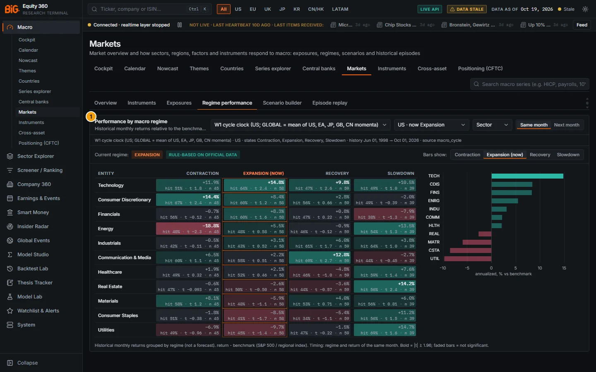

*Figure 2B.23: Performance by macro regime: W1 cycle clock, US scope (now Expansion), Sector, Same month.*

| # | Panel | What it shows |
|---|---|---|
| 1 | Performance by macro regime | Scope line (states, history, source), current-regime badge, a table of annualised relative returns per regime (with hit rate, t and n) and a bar chart for the regime picked in "Bars show" |

### Controls

| Control | What it does |
|---|---|
| Regime type | W1 cycle clock (US; GLOBAL = mean of US, EA, JP, GB, CN momenta) · Gaussian HMM regimes (model-based) · hiking / pausing / cutting (macro-w3 cb_rate_cycle) · US CPI y/y buckets |
| Scope | US or GLOBAL for the cycle and HMM; a central bank for the rate cycle (Fed, ECB, BoE, BoJ and PBoC have statistics; other banks show "(no performance data)"); US for inflation. Each option shows the current state ("US · now Expansion") |
| Entities | Sector, Subsector, Region, Factor, Etf, Index |
| Timing: Same month / Next month | Same month = regime and return of the same month; Next month = regime known at month end, return of the following month |
| Bars show | Which regime the bar chart ranks (the current one is marked "(now)") |
| Cell (hover) | Hit rate, t and n |
| Bar (hover) | Annualised mean, hit rate, t-stat and months for the chosen regime |

### Methodology

Method label: **"Historical monthly returns grouped by regime (not a forecast)"**.

```
relative return (month m) = r(m) − benchmark(m)
    benchmark = S&P 500 for global aggregates and instruments, the regional index for region aggregates
annualised     = 12 × mean of the monthly relative returns in the regime
hit rate       = share of those months with a relative return > 0
t              = mean / (sd / √n),  n = number of months (cells with n < 3 are dropped)
```

The app requests the "relative" metric (an "excess" metric over the 3-month T-bill exists in the API but is not offered in the UI). Factor long-short portfolios are self-financing, so they have no relative version. Rows are sorted by the mean in the current regime; the table shows the top 60 rows and the chart the top 25. Bold = |t| ≥ 1.96; faded bars are not significant.

| Regime type | States | Label in the app |
|---|---|---|
| Cycle clock (W1) | Expansion, Recovery, Slowdown, Contraction | "rule-based on official data" |
| HMM regimes | Expansion, Recovery, Slowdown, Contraction | "model-based regimes" |
| Rate cycle | Hiking, Pausing, Cutting | "rule-based on official data" |
| Inflation regime (US) | CPI < 2%, CPI 2–3%, CPI 3–5%, CPI > 5% | "rule-based on official data" |

Timing note from the method: "next_month = regime of the previous month (publication lags make it only approximately investable)".

### Data sources and refresh

Monthly returns of the aggregate portfolios come from the price lake (from 1995); regime states come from the macro cycle (from June 1998), the HMM model (from February 2006), the central-bank rate cycles (macro W3) and US CPI (FRED CPIAUCSL). The job runs nightly.

### Validation status

**Not formally validated.** These are historical averages, labelled "not a forecast". There is no correction for multiple testing across the many entity × regime cells, so some |t| ≥ 1.96 cells are expected by chance alone.

### Correct usage and worked example

Prefer the Next month timing when you want something closer to an investable rule, prefer cells with large n, and treat the table as a prior, not a signal.

**Example (cycle clock, US, Sector, Same month; Figure 2B.23):** the US cycle is in Expansion. In Expansion months since 1998, Technology beat the S&P 500 by **+14.8% annualised** (hit rate 64%, t 2.4, n 58), while Utilities lagged by −9.7% (t −1.4, not significant) and Consumer Staples by −8.5% (t −1.7). Energy is the clearest Contraction loser (−18.8%, t −2.3, n 45).

### Limitations and pitfalls

- **Same-month timing is not tradable**: the regime is only known after the month's data are published.
- **Few regime episodes.** n counts months, not independent episodes; 58 Expansion months may come from only a handful of cycles.
- **Regimes are revised**, and the HMM is model-based and over-confident.
- **Benchmark mismatch.** Global sectors are measured against the S&P 500.

### Related mnemonics and BQL fields

- Related: [2A. Macro](02a-macro.md) (cycle clock, regime model, central-bank rate cycles), Company 360 Macro tab ([5C](05c-company-macro-events-model.md#macro)), which shows the regime table of the company's sector.

---

## Scenario builder

**Route:** `/macro/markets?tab=scenarios` · **Menu:** Macro › Markets › Scenario builder · **Mnemonics:** none · **Refresh:** betas weekly; runs are computed on request

### Purpose

A stress tester: set instantaneous macro shocks (rates, breakevens, real yields, credit, dollar, oil, equity, data surprises) and see the model-implied impact on universes, sectors, regions, style factors, ETFs and indices, and individual securities (winners and losers, or your watchlist), each with a 90% band. Ten presets cover the usual cases; you can save your own scenarios.

### Screenshot

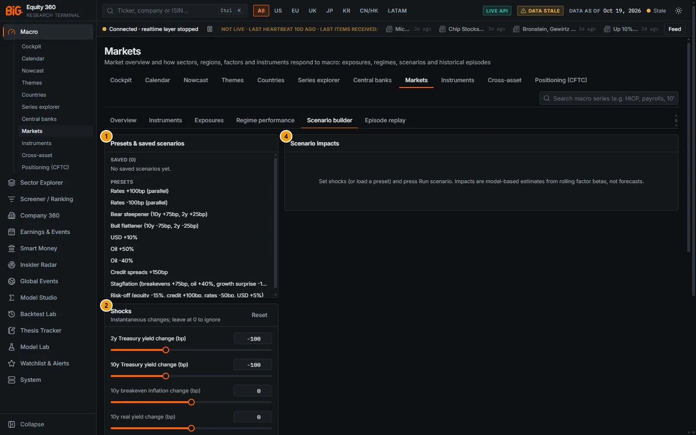

*Figure 2B.24: Scenario builder before a run (default shocks: 2y and 10y −100bp).*

| # | Panel | What it shows |
|---|---|---|
| 1 | Presets & saved scenarios | Your saved scenarios (with date and a delete icon) and the ten read-only presets |
| 2 | Shocks | One slider and number box per shock field; "Instantaneous changes; leave at 0 to ignore" |
| 3 | Run settings | Propagation mode, universe and filters, watchlist, scenario name, Run / Save buttons |
| 4 | Scenario impacts | Results after a run; before it, the note "Impacts are model-based estimates from rolling factor betas, not forecasts." |

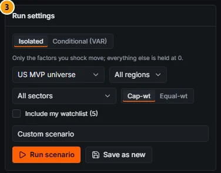

*Figure 2B.25: Run settings.*

After loading the preset "Rates -100bp (parallel)" and pressing **Run scenario**:

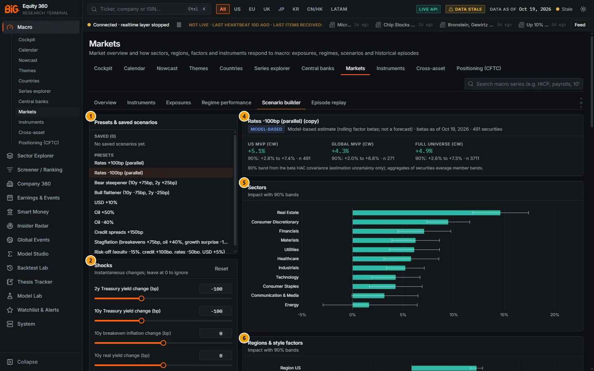

*Figure 2B.26: Scenario builder after running the preset "Rates -100bp (parallel)" (Isolated, US MVP universe, cap-weighted), betas as of 19 Oct 2026.*

| # | Panel | What it shows |
|---|---|---|
| 1 | Presets & saved scenarios | The loaded preset is highlighted |
| 2 | Shocks | 2y and 10y at −100bp, everything else 0 |
| 3 | Run settings | As in Figure 2B.25 |
| 4 | Rates -100bp (parallel) (copy) | Result header with the model-based label, the betas date, the number of securities, and one stat per universe: impact, 90% band and n |
| 5 | Sectors | Impact per sector with 90% whiskers |
| 6 | Regions & style factors | Impact per region and per factor long-short portfolio with 90% whiskers |
| 7 | Winners & losers | The 20 securities with the largest and smallest model-implied moves, with sector, region and 90% band |
| 8 | Instruments | Top and bottom 10 ETFs and indices |
| 9 | Factor vector | The shocked (first-round) and total factor moves with their units |

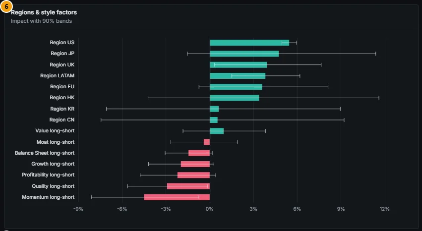

*Figure 2B.27: Regions & style factors. Several bands include zero.*

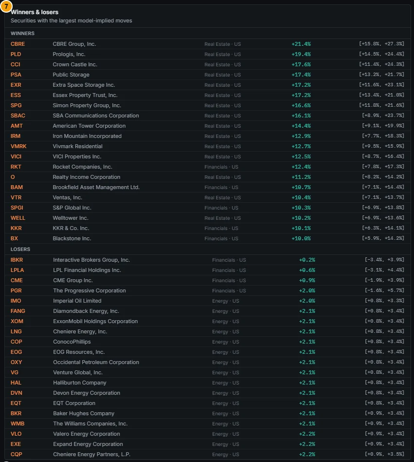

*Figure 2B.28: Winners & losers. In a pure rate cut, even the "losers" are mostly positive.*

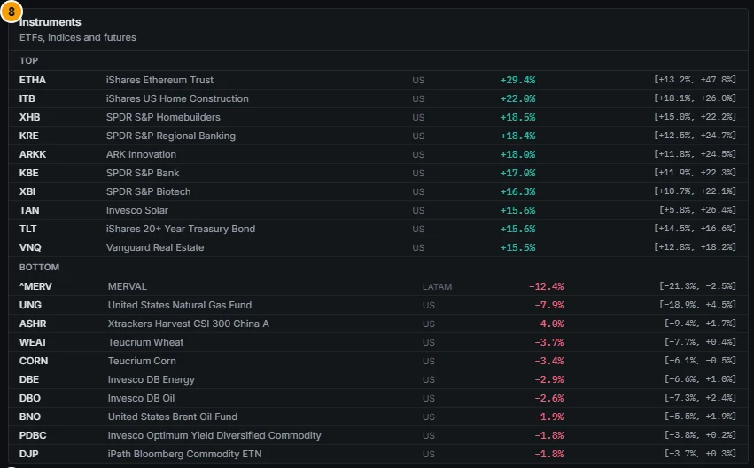

*Figure 2B.29: Instruments, top and bottom 10.*

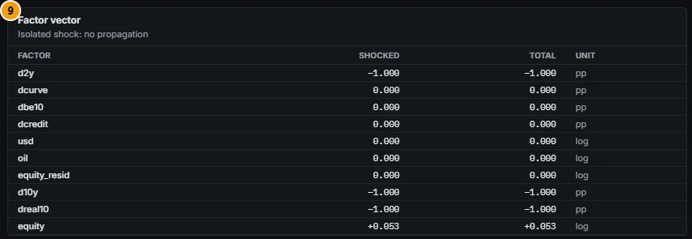

*Figure 2B.30: Factor vector, "Isolated shock: no propagation". The rows below the joint basis show the implied 10y, real 10y and S&P 500 moves.*

### Controls

| Control | What it does |
|---|---|
| Saved scenario name | Loads it (shocks, mode, horizon, name) |
| Delete icon | Deletes that saved scenario |
| Preset name | Loads the preset; the name becomes "{preset} (copy)" so saving creates a new scenario |
| Shock sliders and boxes | 2y Treasury yield change (bp, ±300) · 10y Treasury yield change (bp, ±300) · 10y breakeven inflation change (bp, ±200) · 10y real yield change (bp, ±200) · Baa-Treasury credit spread change (bp, −200 to +400) · Broad USD change (%, ±20) · WTI oil change (%, −60 to +100) · S&P 500 change (%, −40 to +30) · Growth / Inflation / Labor surprise change (points, ±200). The box accepts values outside the slider range; % shocks must be above −100 |
| Reset | Sets every shock to 0 |
| Propagation: Isolated / Conditional (VAR) | Isolated: "Only the factors you shock move; everything else is held at 0." Conditional: "Unshocked factors respond through a monthly VAR on the factor history (model-based propagation)." |
| VAR horizon | 1m, 3m, 6m or 12m (Conditional only) |
| Universe | US MVP universe, Global MVP universe, Full universe (for winners and losers) |
| Region, Sector, Subsector | Filters for winners and losers (Subsector appears once a sector is chosen) |
| Weighting: Cap-wt / Equal-wt | Weighting of the sector and region bars |
| Include my watchlist (n) | Adds the equal-weight **Watchlist: Default** aggregate tile (impact, 90% band, n) and a table of your watchlist's securities with their impacts. The aggregate uses the server watchlist; without the API only the table is shown |
| Scenario name | Name used when saving |
| Run scenario | Runs the scenario (disabled when every shock is 0) |
| Save as new / Update saved | Saves a new scenario, or updates the loaded saved scenario |
| Detach | Unlinks the loaded saved scenario so the next save creates a copy |
| Ticker in Winners & losers | Opens Company 360 |
| Bar (hover) | Impact and 90% band of that sector, region or factor |

Saved scenarios are stored locally in the app's state database; presets cannot be changed or deleted.

### Methodology

Label returned with every result: **"Model-based estimate (rolling factor betas; not a forecast)"**.

#### From shocks to factor moves (joint basis)

The joint basis is `z = (Δ2y, Δcurve, Δbreakeven, Δcredit, USD, oil, equity residual)`, with yields and spreads in percentage points and USD, oil and equity in log terms (`log(1 + pct)`).

- **Isolated** (default): unspecified factors are 0. A single 2y or 10y shock is applied as a parallel shift (curve unchanged). A 10y shock without a breakeven shock leaves breakevens unchanged, so real yields move one-for-one. A real-yield shock without a 10y shock sets `10y = real + breakeven`. An S&P 500 shock sets only the equity residual `u = equity − γ′f` (γ = the S&P 500's loading on the macro block), so an equity shock on top of macro shocks counts only the part not already explained by them.
- **Conditional (VAR)**: unspecified factors are first set to their Gaussian conditional mean given the specified ones, `E[z | A z = s] = Σ A′ (A Σ A′)⁻¹ s`, with Σ the weekly covariance of the factors over the last 10 years ("what usually moves with it"). Then a monthly VAR on the factor changes since 2006 (lag order by BIC, at most 3; Model Studio's `var_fit`) propagates the shock: the cumulative response over the chosen horizon, `Σₕ₌₀..H Ψₕ s₀`, replaces the first-round vector. The Factor vector table shows both ("Shocked" and "Total").

#### From factor moves to impacts

```
impact     = exp(b′z) − 1
90% band   = exp(b′z ± 1.645 · √(z′ C z)) − 1      C = HAC covariance of the betas (shrunk for securities)
```

Surprise shocks use the surprise model's betas and are **added** to the macro impact (the two channels can overlap). Universe and watchlist aggregates average their members' impacts and bands. The result's band note reads: "90% band from the beta HAC covariance (estimation uncertainty only); aggregates of securities average member bands".

#### Presets

Rates +100bp (parallel) · Rates −100bp (parallel) · Bear steepener (10y +75bp, 2y +25bp) · Bull flattener (10y −75bp, 2y −25bp) · USD +10% · Oil +50% · Oil −40% · Credit spreads +150bp · Stagflation (breakevens +75bp, oil +40%, 10y +50bp, growth surprise −100) · Risk-off (equity −15%, credit +100bp, rates −50bp, USD +5%). All presets run in Isolated mode.

### Data sources and refresh

The betas are the latest joint and surprise fits of the weekly `macro_exposures` job ("betas as of" in the result header); the VAR and the conditional covariance use the `macro_factors` history. Runs are computed on demand and not stored unless you save the scenario.

### Validation status

**Not formally validated.** Every result is badged **model-based** with the label above. The bands cover **estimation error only**, not idiosyncratic noise, so realised outcomes fall outside them far more often than 10% of the time (see the error column of the [Episode replay](#episode-replay)).

### Correct usage and worked example

Start from a preset, run it Isolated, then rerun in Conditional (VAR) mode to see how much of the answer depends on co-movement assumptions. Compare sectors through their bands, not their point estimates.

**Example (preset "Rates -100bp (parallel)", Isolated, US MVP universe, cap-weighted; Figure 2B.26):** both yields fall 100bp, so in the joint basis only `Δ2y = −1.00` is non-zero. The Factor vector (Figure 2B.30) also shows the implied 10y and real 10y at −1.000 and an S&P 500 move of +0.053 in log terms, the part explained by the macro block.

- **Universes:** US MVP **+5.1%** (90% band +2.8% to +7.4%, n 491), Global MVP +4.3% (+2.0% to +6.8%, n 271), Full universe +4.9% (+2.6% to +7.3%, n 3,711).
- **Sectors:** Real Estate leads at about +14.6% (band about +12% to +17%), followed by Consumer Discretionary (about +9%) and Financials (about +7%); Energy is last at under +2%, with a band that includes zero.
- **Regions and styles** (Figure 2B.27): Region US about +5%; the Momentum and Quality long-short portfolios lose (about −4.5% and −3%), and most factor and non-US region bands include zero.
- **Securities** (Figure 2B.28): the winners are US REITs and asset managers (CBRE +21.4%, band +15.8% to +27.3%; Prologis +19.4%); the "losers" are US energy names at about +2.1% and some brokers near zero.
- **Instruments** (Figure 2B.29): ETHA (Ether ETF) +29.4% with a band of +13.2% to +47.8%, homebuilders (ITB +22.0%), TLT +15.6%; at the bottom the MERVAL index −12.4% and commodity ETFs.

You can check the Real Estate figure by hand from the Exposures tab: its 2y beta is −0.136 (SE ≈ 0.015), so `exp(0.136) − 1 ≈ +14.6%` and `exp(0.136 ± 1.645 × 0.015) − 1 ≈ +11.9% to +17.3%`.

### Limitations and pitfalls

- **Instantaneous and linear.** Weekly betas are scaled to whatever shock you set; a −40% oil shock is far outside the data the betas were estimated on.
- **Bands are too narrow** for decision making (estimation error only).
- **Isolated mode is unrealistic** for large shocks: a 100bp rate move rarely comes without credit, dollar and equity moves. Use Conditional (VAR) for a co-movement-aware view and compare.
- **The "Instruments" panel** (subtitle "ETFs and indices") has no futures: futures exposures are on the Exposures page.
- **Wide bands on short histories.** Instruments with short price histories (such as ETHA) get very wide bands; read the band before the point estimate.
- **Watchlist securities without betas** (new listings, short histories) are omitted ("None of the watchlist securities has macro betas.").

### Related mnemonics and BQL fields

- BQL: `macro.rates_down_100bp` ("Modelled impact if rates fall 100bp", model-based, snapshot only).
- Related: [Exposures](#exposures), [Episode replay](#episode-replay), Company 360 Macro tab ([5C](05c-company-macro-events-model.md#macro)), [13. Watchlists and alerts](13-watchlists-alerts.md).

---

## Episode replay

**Route:** `/macro/markets?tab=episodes` · **Menu:** Macro › Markets › Episode replay · **Mnemonics:** none · **Refresh:** weekly (written by the `macro_exposures` job)

### Purpose

Replays six historical macro episodes: it takes the official factor moves over each window, applies **today's** joint betas, and compares the model-implied returns with what sectors, regions, factors, instruments and securities actually returned. It shows how well (or badly) the exposure model would have explained a known episode, which is the best available guide to how much to trust a scenario.

### Screenshot

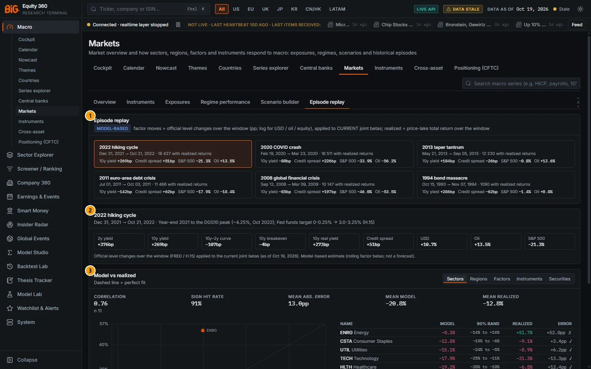

*Figure 2B.31: Episode replay, 2022 hiking cycle selected, Sectors block.*

| # | Panel | What it shows |
|---|---|---|
| 1 | Episode replay | Six episode cards (newest first): window, number of entities with realised returns, and the 10y yield, credit spread, S&P 500 and oil moves |
| 2 | 2022 hiking cycle | The selected episode's window and rationale, and the nine factor moves (2y, 10y, curve, breakeven, real yield, credit, USD, oil, S&P 500) |
| 3 | Model vs realized | Fit statistics, a scatter of model-implied vs realised returns (dashed line = perfect fit) and a table with model, 90% band, realised and error per row |

### Controls

| Control | What it does |
|---|---|
| Episode card | Selects the episode (default: 2022 hiking cycle) |
| Block: Sectors / Regions / Factors / Instruments / Securities | Which entities are compared |
| Scatter point (hover) | Model and realised return |
| Error column | Realised minus model in pp, with ✓ when the signs agree and ✗ when they do not |

### Methodology

Method line: **"factor moves = official level changes over the window (pp; log for USD / oil / equity), applied to CURRENT joint betas; realized = price-lake total return over the window"**.

| Episode | Window | Rationale (as shown in the app) |
|---|---|---|
| 1994 bond massacre | 15 Oct 1993 → 7 Nov 1994 | DGS10 trough (~5.2%) to peak (~8.0%); Fed funds 3.0% → 4.75% (H.15) |
| 2008 global financial crisis | 12 Sep 2008 → 9 Mar 2009 | Friday before the Lehman bankruptcy to the equity trough |
| 2011 euro-area debt crisis | 1 Jul 2011 → 3 Oct 2011 | Euro-area sovereign stress and the US downgrade |
| 2013 taper tantrum | 21 May 2013 → 5 Sep 2013 | Day before Bernanke's 22-May testimony to the DGS10 peak |
| 2020 COVID crash | 19 Feb 2020 → 23 Mar 2020 | S&P 500 peak to the Fed's open-ended QE announcement |
| 2022 hiking cycle | 31 Dec 2021 → 21 Oct 2022 | Year-end 2021 to the DGS10 peak; Fed funds 0–0.25% → 3.0–3.25% |

Factor moves come from FRED (DGS2, DGS10, T10YIE, DFII10, BAA10Y, DTWEXBGS, DCOILWTICO) and the S&P 500 from the price lake. Factors without data for a window (for example the broad dollar index before 2006, breakevens and TIPS before 2003) are listed under the moves and treated as 0. Statistics per block:

```
Correlation    = corr(model, realised) across the rows of the block
Sign hit rate  = share of rows where model and realised have the same sign
Mean abs. error = mean |realised − model|, in pp
```

For Securities, statistics cover all securities with betas and realised returns; the chart and table show the 20 best and 20 worst by model.

### Data sources and refresh

Official FRED series for the factor moves, the price lake for realised total returns, and the current joint betas of the weekly exposures job ("as of 19 Oct 2026" in Figure 2B.31).

### Validation status

**Not a formal validation, but the closest thing the macro → markets tools have to one.** The panel is badged **MODEL-BASED**. For the 2022 hiking cycle (Sectors, 11 rows) the app shows: **correlation 0.76, sign hit rate 91%, mean absolute error 13.0pp, mean model −20.8% vs mean realised −12.8%** (Figure 2B.31).

### Correct usage and worked example

Use it before trusting a scenario: pick the episode most like your scenario and look at the error column.

**Example (2022 hiking cycle):** the window saw 2y +376bp, 10y +269bp, curve −107bp, breakeven −4bp, real yield +273bp, credit +51bp, USD +10.7%, oil +13.5% and S&P 500 −21.3%. The model ranks sectors reasonably (correlation 0.76) but overstates the average loss by 8pp, and it misses the biggest story: **Energy**, model −0.2% vs realised **+51.7%** (error +52.0pp, ✗). The oil factor only captures the point-to-point oil move (+13.5%), not the spike inside the window, and today's betas are not 2022's betas.

### Limitations and pitfalls

- **Current betas on past episodes.** Betas estimated on the last three years are applied to 1994 or 2008; sector compositions and sensitivities were different then.
- **Point-to-point moves** ignore what happened inside the window.
- **Coverage shrinks with age**: only 1,090 entities have realised returns for 1994 against 18,427 for 2022.
- **Missing factors are set to 0**, which biases older episodes.
- Survivorship: realised returns exist only for securities with prices over the window.

### Related mnemonics and BQL fields

- Related: [Scenario builder](#scenario-builder), [Exposures](#exposures), Company 360 Macro tab ([5C](05c-company-macro-events-model.md#macro)), which shows the episode replay for one company.

---

## Cross-asset dashboard

**Route:** `/macro/cross-asset` (URL parameters `class`, `asset`, `root`) · **Menu:** Macro › Cross-asset · **Mnemonics:** `CMDTY` · **Refresh:** nightly (`futures_curve` then `cross_asset_signals`); CFTC positioning weekly

### Purpose

A cockpit of 73 assets across commodities, FX, equity indices, US Treasuries, US credit and crypto futures, scored on trend, momentum, carry, value, curve slope, realised and implied volatility and CFTC positioning, with a futures-curve viewer, the correlation regime ("is everything moving together?") and the model-based risk-on / risk-off composite. Use it for cross-asset allocation views, to spot crowded or stretched markets, and as a launch point for backtests, theses and Model Studio studies.

### Screenshot

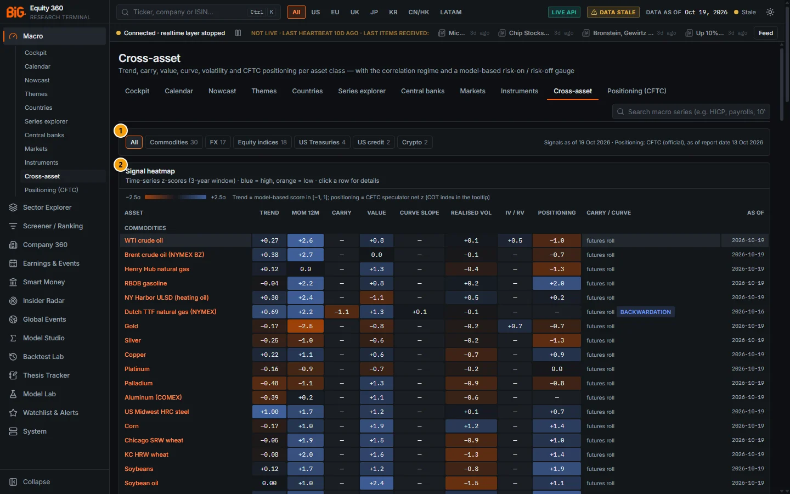

*Figure 2B.32: Cross-asset dashboard, All classes, signals as of 19 Oct 2026, positioning report of 13 Oct 2026.*

| # | Panel | What it shows |
|---|---|---|
| 1 | Asset-class filter | All · Commodities 30 · FX 17 · Equity indices 18 · US Treasuries 4 · US credit 2 · Crypto 2, and the signal and positioning dates |
| 2 | Signal heatmap | One row per asset: Trend, Mom 12m, Carry, Value, Curve slope, Realised vol, IV / RV, Positioning, carry method / curve shape, as-of date |
| 3 | Risk-on / risk-off | Gauge, composite value, regime badge, number of components, 1m change and the eight component z-scores |
| 4 | WTI crude oil (selected asset) | Key stats, methods, signal history and the action buttons |
| 5 | Futures curve viewer | Term structure now vs ~1m and ~1y ago, slope and roll-yield history, contract coverage |
| 6 | Correlation regime | First-factor share of a fixed 12-asset basket over time and the correlation matrix |
| 7 | Risk composite history | The composite since 2001 with the risk-on / risk-off zones and its eight components |

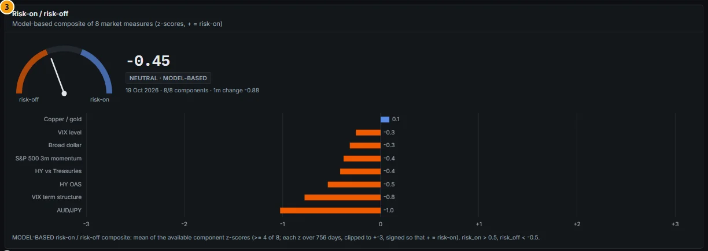

*Figure 2B.33: Risk-on / risk-off, −0.45 Neutral, 8/8 components, 1m change −0.88.*

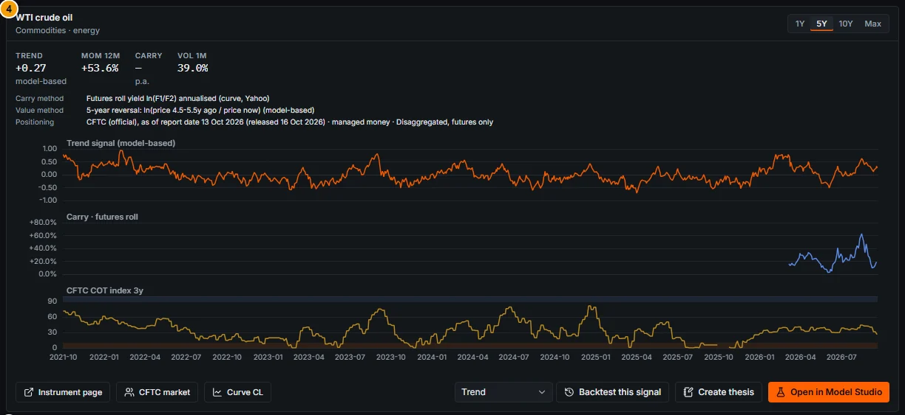

*Figure 2B.34: Selected asset (WTI crude oil), 5Y history: trend signal, futures-roll carry and CFTC COT index 3y with its extreme zones.*

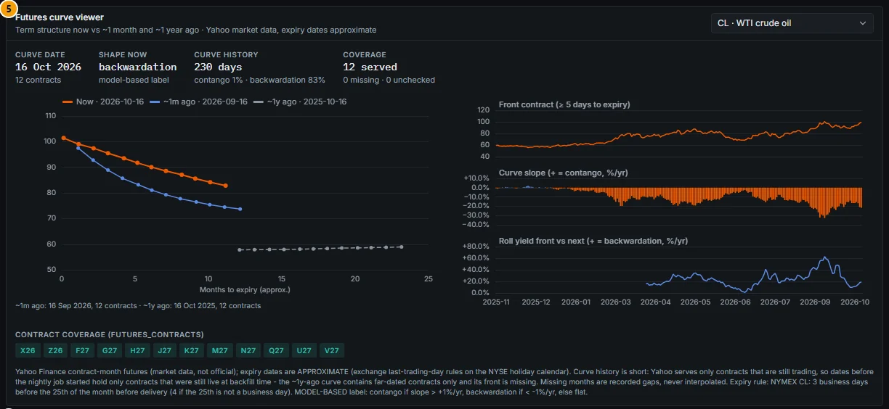

*Figure 2B.35: Futures curve viewer, CL.*

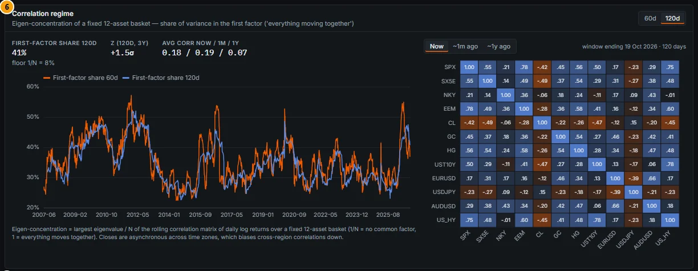

*Figure 2B.36: Correlation regime, 120-day window, matrix "Now".*

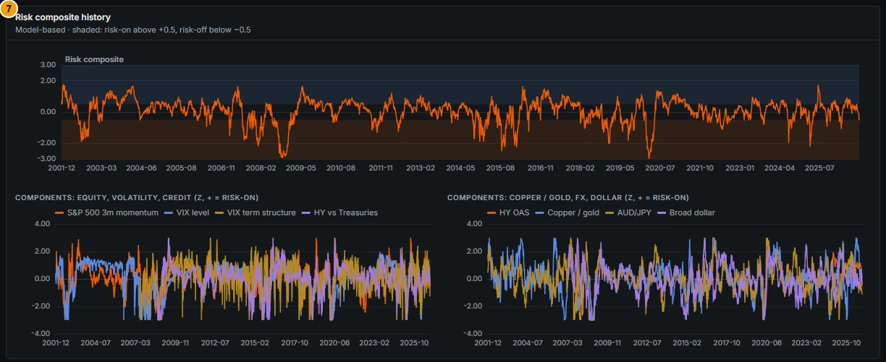

*Figure 2B.37: Risk composite history with the four-component charts below.*

With an asset-class button pressed, the heatmap keeps only that class; the other panels keep the badge numbers of Figure 2B.32, and badge 4 shows the class's first asset.

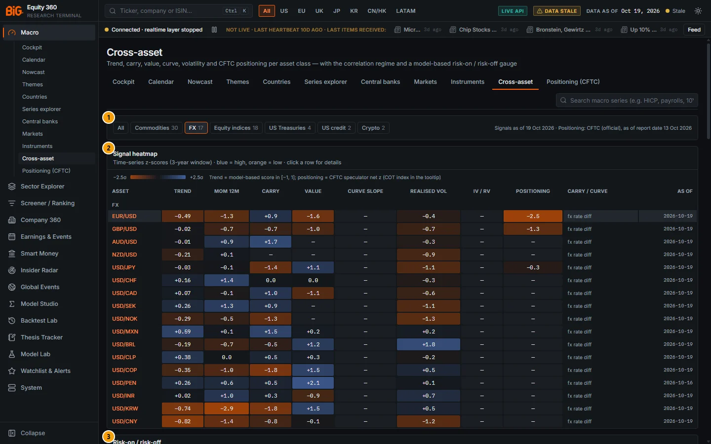

*Figure 2B.38: Cross-asset dashboard filtered on FX (`/macro/cross-asset?class=fx`). Curve slope and IV / RV are empty for FX pairs.*

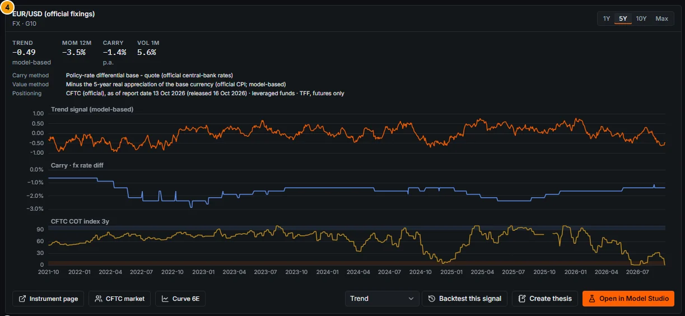

*Figure 2B.39: Selected asset EUR/USD (official fixings): fx rate diff carry, real-appreciation value method and TFF leveraged-funds positioning.*

### Controls

| Control | What it does |
|---|---|
| Asset-class buttons | Filter the heatmap (`?class=`); counts show the number of assets per class |
| Signal column header (hover) | Definition of the signal, with "(model-based)" where applicable |
| Asset name (click) | Selects the asset (`?asset=`) for panel 4 |
| Heatmap cell (hover) | Raw value, z-score, and the carry or value method; for Positioning: COT index 3y, z and the report / release dates, or "no CFTC market" |
| As of (amber) | "Latest row older than 10 days" |
| History range: 1Y / 5Y / 10Y / Max | Range of the selected asset's history |
| Instrument page | Opens the linked instrument page |
| CFTC market | Opens the CFTC market page of the linked contract |
| Curve {root} | Loads that root into the curve viewer |
| Signal to backtest | Trend, Carry, Value or CFTC COT index |
| Backtest this signal | Opens the Backtest Lab pre-filled with a cross-sectional backtest of that signal across the asset's class (see Methodology) |
| Create thesis | Starts a thesis with this asset as the subject ([12. Thesis Tracker](12-thesis-tracker.md)) |
| Open in Model Studio | Opens a draft study: weekly OLS of the asset's log return on its trend signal, carry and COT index, each lagged one week, from 2008 |
| Futures root (select) | Any root with a stored curve |
| Contract badge (hover) | Symbol, status (served, missing, unchecked, expired), first and last bar, approximate expiry |
| Window: 60d / 120d | Correlation window (default 120d) |
| Matrix date: Now / ~1m ago / ~1y ago | Which correlation matrix is shown |

### Methodology

All definitions below are quoted from docs/CROSS_ASSET_DEFINITIONS.md. "Everything labelled **MODEL-BASED** below is our own transformation, not a published statistic." Windows count rows (trading days of each asset); all returns are log returns.

#### Heatmap columns

| Column | Definition | Colour |
|---|---|---|
| Trend | **MODEL-BASED**, in [−1, 1]: mean over h ∈ {21, 63, 252} of `clip(mom_h / (σ63 · √h), −2, 2) / 2`, σ63 = 63-day std of daily log returns; needs at least 2 horizons | the score itself |
| Mom 12m | `ln(Pₜ / Pₜ₋₂₅₂)` | 3-year z-score |
| Carry | headline carry, annualised fraction; method per asset class (table below) | 3-year z-score |
| Value | value proxy (table below), labelled model-based | 3-year z-score |
| Curve slope | OLS slope of ln F on years to expiry, contracts with 5 to 400 days to expiry (at least 3); positive = contango | z-score |
| Realised vol | std of daily log returns over 21 rows × √252 | 3-year z-score |
| IV / RV | vol-index close / 100 divided by realised vol (SPX ^VIX, NDX ^VXN, DJI ^VXD, CL ^OVX, GC ^GVZ, NIFTY ^INDIAVIX, AS51 ^AXVI; UST10Y: MOVE in bp over realised bp vol of the 10y yield) | 3-year z-score |
| Positioning | CFTC speculator net position: COT index 3y in the tooltip, colour = z 3y | z of net over 156 reports |

All z-scores are time-series z-scores, `z = (x − rolling mean) / rolling std` over 756 rows (minimum 126). The colour scale runs from −2.5σ (orange) to +2.5σ (blue).

#### Carry by asset class

| Method | Assets | Definition |
|---|---|---|
| futures_roll | commodities, crypto | roll yield `ln(F1 / F2) · 365 / (T2 − T1)`, nearest two contracts with ≥ 5 days to expiry, front within 200 days; positive = backwardation |
| fx_rate_diff | FX | (policy rate base − policy rate quote) / 100, official rates; no NZD, so NZDUSD carry is null |
| bond_carry_rolldown | UST 2/5/10/30y | `(y_T − y_3m)/100 + D_mod(T, y_T) · (y_T − y_{T−1})/100`, with `D_mod = (1/y)(1 − (1 + y/2)^(−2T))` |
| equity_div_funding | equity indices | dividend yield of the tracking ETF − local policy rate / 100; HSI carry is null (no HKD bank) |
| credit_oas | US HY, US IG | OAS / 100; expected default losses are **not** deducted |

The carry panel also stores `carry_12m`, the front vs the contract about one year further out (300 to 430 days), which is seasonality-neutral for natural gas, heating oil, grains and livestock.

#### Value by asset class

| Method | Assets | Definition |
|---|---|---|
| reversal_5y | commodities, equity indices | `ln(mean P over rows t−1386 … t−1134) − ln(Pₜ)`: the price 4.5 to 5.5 years ago vs now |
| fx_real_5y | FX | minus the 5-year real appreciation of the base currency (official CPI, known 46 days after the period start); null for AUD, SEK, NOK, NZD |
| real_yield | UST 5Y / 10Y | TIPS real yield DFII5 / DFII10 (per cent) |
| oas_level | credit | OAS (per cent) |

#### Curve viewer

- Curve shape (**MODEL-BASED** label): contango if slope > +1%/yr, backwardation if < −1%/yr, otherwise flat.
- Roll yield front vs next: `ln(F1/F2)` annualised, + = backwardation.
- Snapshots: last stored curve on or before latest − 30 days (~1m) and latest − 365 days (~1y).
- Expiry dates are **approximate**: each root's exchange last-trading-day rule on the NYSE holiday calendar (for example "NYMEX CL: 3 business days before the 25th of the month before delivery").
- "Missing months are recorded gaps, never interpolated."

#### Correlation regime

The basket is fixed: SPX, SX5E, NKY, EEM, CL, GC, HG, UST10Y, EURUSD, USDJPY, AUDUSD, US_HY (N = 12; complete from August 2007), daily log returns on the union calendar (prices forward-filled up to 3 days, dates with ≥ 75% of members, windows with ≥ 80% complete rows).

```
first-factor share (w) = largest eigenvalue / N of the w-day correlation matrix   (w = 60, 120)
                         = 1/N (8%) with no common factor, 1 when everything moves together
z (120d, 3y)           = time-series z of the 120-day share over 756 days (min 252)
avg corr               = mean off-diagonal correlation (now, ~1m ago, ~1y ago)
```

#### Risk-on / risk-off composite

Label: **"MODEL-BASED risk-on / risk-off composite: mean of the available component z-scores (>= 4 of 8; each z over 756 days, clipped to +-3, signed so that + = risk-on). risk_on > 0.5, risk_off < -0.5."**

| Component (label in the app) | Measure | Sign |
|---|---|---|
| S&P 500 3m momentum | S&P 500 63-day log return | + |
| VIX level | VIX close | − |
| VIX term structure | ln(VIX / VIX3M); inversion = stress | − |
| HY vs Treasuries | 63-day change of ln(HYG / IEF), total return | + |
| HY OAS | ICE BofA US HY OAS (FRED, official; history from 2023-10) | − |
| Copper / gold | 63-day change of ln(copper / gold) front months | + |
| AUD/JPY | 63-day AUD/JPY log return (official fixings) | + |
| Broad dollar | 63-day change of the Fed broad dollar index (official) | − |

#### Backtest this signal

The Backtest Lab opens with a draft (you review and run it there): universe = the assets of the selected asset's class; signal = the chosen field; long-short terciles with inverse-volatility weights; monthly rebalancing (weekly for the CFTC COT index, which is traded **contrarian**, i.e. low COT index = long); benchmark = equal-weighted universe. The draft carries the notes "spot-like prices: futures front months include roll gaps; trend / value / z metrics are model-based". See [11. Backtest Lab](11-backtest-lab.md).

### Data sources and refresh

From the page footnote: futures curves and futures / index / ETF prices are Yahoo market data (expiry dates approximate); FX from official fixings (ECB, Fed H.10, central banks); US Treasuries are a synthetic total-return index from official H.15 CMT yields; OAS and the broad dollar from FRED; positioning from the CFTC Commitments of Traders (official), point-in-time on the release date.

Positioning uses the disaggregated futures-only report (managed money) for commodities and the TFF futures-only report (leveraged funds) for financial futures; each row takes the latest report **released** on or before its date, and reports older than 28 days are dropped. USD/JPY uses the inverted yen future (6J). The nightly `futures_curve` job stores the next listed contracts of 43 roots; `cross_asset_signals` runs after it (about 75 seconds).

### Validation status

**No validation gate.** The page states: "Trend signal, curve shape, value proxies, z-scores and the risk composite are model-based transformations, not published statistics." For the risk composite, docs/CROSS_ASSET_DEFINITIONS.md §3 records sanity checks only: **2008-10-15 gave −2.8 (risk_off), 2020-03-20 gave −2.5 (risk_off) and 2017-06-15 gave +0.3 (neutral)**. No out-of-sample test of the trend, carry, value or positioning signals is documented; use "Backtest this signal" (with the Backtest Lab's robustness checks) before acting on any of them.

### Correct usage and worked example

Read across a row (is the asset trending, carrying, cheap, stretched, crowded?), then down a column (which assets rank highest on one signal), then check the regime panels for the backdrop.

**Example (19 Oct 2026):**

1. **WTI crude oil** (Figures 2B.32, 2B.34): trend **+0.27** (model-based), 12-month momentum +53.6% (z +2.6, stretched), value z +0.8 (5-year reversal), realised vol 39.0% (z +0.1), IV / RV z +0.5, and positioning z **−1.0** with a COT index 3y of 27: managed money is not crowded long despite the rally. The curve is in backwardation (shape "backwardation", 83% of the 230 stored days in backwardation; Figure 2B.35).
2. **Risk backdrop** (Figure 2B.33): composite **−0.45, Neutral**, with AUD/JPY (−1.0) and the VIX term structure (−0.8) the largest drags and only copper / gold positive (+0.1).
3. **FX** (Figures 2B.38, 2B.39): EUR/USD has a trend of **−0.49**, 12-month momentum −3.5% (z −1.3), carry −1.4% p.a. (z +0.9), value z −1.6 and positioning z **−2.5**: leveraged funds are near the short end of their three-year range (COT index close to 0 at the end of the chart). Value is "—" for AUD/USD, NZD/USD, USD/SEK and USD/NOK because their CPI history is too short (definitions doc).
4. **Correlation regime** (Figure 2B.36): the 120-day first-factor share is **41%** (floor 8%), **z +1.5σ** above its 3-year average, and the average correlation is 0.18 now vs 0.07 a year ago: assets are moving together more than usual, so diversification across this basket is weaker.

### Limitations and pitfalls

- **Front-month prices are unadjusted across rolls**, so momentum, trend and value on futures behave like spot-price changes rather than futures excess returns (definitions doc, "Note on front-month prices").
- **Short curve history.** Yahoo serves only live contracts: CL deferred months from 2017, ES from 2021, Treasuries and livestock only a few months. Curve slope and roll-yield z-scores are therefore missing or short for many roots.
- **Blank latest carry.** When the stored curve is older than the price row (WTI on 19 Oct), the Carry and Curve slope cells are "—".
- **Positioning caveats**: Treasury leveraged-fund shorts are dominated by the cash-futures basis trade, and CME BTC / ETH leveraged funds are structurally short (basis), so their COT index is "a positioning-vs-own-history measure, not a directional view".
- **Asynchronous closes** across Asia, Europe and the US bias cross-region correlations down.
- **HY OAS history** starts only in 2023-10, so that component's z uses a short window.
- In the Risk composite history panel the two component charts are captioned with the components they actually plot (the second one includes the HY OAS component; earlier builds captioned it "copper / gold, FX, dollar").

### Related mnemonics and BQL fields

- Mnemonics: `CMDTY` (this page), `FXIP`, `COT`.
- Model Studio source `cross_asset` (field `<asset_id>:<metric>`, point-in-time on the knowledge date); Backtest Lab signal sources `cross_asset` and `cftc`.
- Related: [Instrument page](#instrument-page), [Positioning (CFTC)](#positioning-cftc), [Markets overview](#markets-overview) (risk gauge and tape), [9. Model Studio](09-model-studio.md), [11. Backtest Lab](11-backtest-lab.md), [12. Thesis Tracker](12-thesis-tracker.md).

---

## Positioning (CFTC)

**Route:** `/macro/positioning` (URL parameters `report`, `class`) · **Menu:** Macro › Positioning (CFTC) · **Mnemonics:** `COT` · **Refresh:** weekly, Friday 19:00 ET (`cftc_weekly` DAG: `cftc_cot` then `cftc_signals`) under every schedule profile

### Purpose

Shows who is long and who is short across US futures markets, from the CFTC Commitments of Traders: where each trader category's net position sits within its one- and three-year range (COT index), how unusual it is (z-score), which markets are at extremes or crowded, and where positioning and price disagree. Traders and allocators use it as a sentiment and crowding check.

### Screenshot

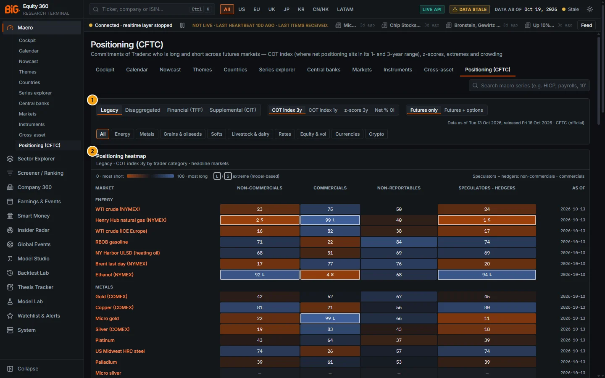

*Figure 2B.40: Positioning (CFTC), Legacy report, COT index 3y, futures only, all classes; report of Tuesday 13 Oct 2026, released Friday 16 Oct 2026.*

| # | Panel | What it shows |
|---|---|---|
| 1 | Report, metric and filter bar | Report type, metric, futures only vs futures + options, the data date line and the asset-class buttons |
| 2 | Positioning heatmap | Headline markets by asset class × trader category, coloured by the chosen metric, with L / S marks on model-based extremes |
| 3 | Crowded longs | Markets whose headline speculators have a COT index 3y ≥ 90 |
| 4 | Crowded shorts | Markets with a COT index 3y ≤ 10 |
| 5 | Positioning vs price divergences | Markets where the 13-week change in net positioning and the price return have opposite signs, each with an absolute z of at least 1 |

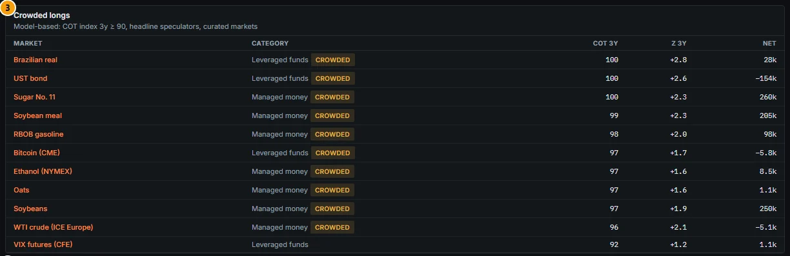

*Figure 2B.41: Crowded longs. A "crowded" badge adds |z 3y| ≥ 1.5 to the extreme.*

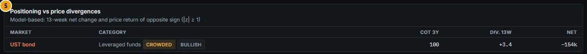

*Figure 2B.42: Positioning vs price divergences.*

The same page with the Disaggregated report selected:

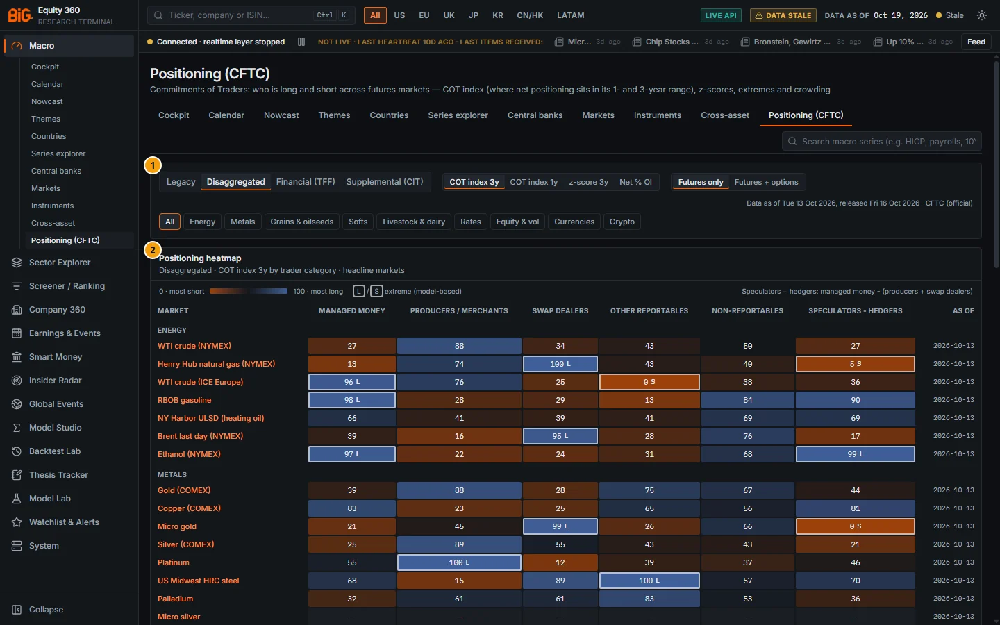

*Figure 2B.43: Positioning (CFTC), Disaggregated report (`/macro/positioning?report=disagg`): managed money, producers / merchants, swap dealers, other reportables, non-reportables and speculators − hedgers.*

| # | Panel | What it shows |
|---|---|---|
| 1 | Report, metric and filter bar | Disaggregated selected; same metric, futures-only and class controls |
| 2 | Positioning heatmap | Physical-commodity markets by disaggregated category; the speculators − hedgers column is managed money − (producers + swap dealers) |
| 3 | Crowded longs | Unchanged: the lists always use each market's headline category, whatever report is selected |
| 4 | Crowded shorts | Unchanged, as above |
| 5 | Positioning vs price divergences | Unchanged, as above |

### Controls

| Control | What it does |
|---|---|
| Report type | Legacy ("All markets: commercials vs non-commercials") · Disaggregated ("Physical commodities: producers, swap dealers, managed money") · Financial (TFF) ("Financial futures: dealers, asset managers, leveraged funds") · Supplemental (CIT) ("13 agricultural markets: commodity index traders") |
| Metric | COT index 3y · COT index 1y · z-score 3y · Net % OI |
| Futures only / Futures + options | Futures-only or combined report (CIT exists only combined) |
| Asset-class buttons | All · Energy · Metals · Grains & oilseeds · Softs · Livestock & dairy · Rates · Equity & vol · Currencies · Crypto |
| Market name | Opens the [CFTC market page](#cftc-market-page) with the same report type |
| Heatmap cell (hover) | Metric value, "long / short extreme (model-based)" and "crowded" when set |

### Methodology

The page's own definitions: "Positions as of Tuesday, published Friday 15:30 ET. COT index = position of the net (long − short) within its trailing 52- or 156-week range (0 = most short, 100 = most long)." In detail (`app/analytics/cftc_signals.py`; windows count reports, roughly weeks):

```
net            = long − short                         (spreading positions excluded)
net % OI       = net / open interest
COT index (w)  = (net − min) / (max − min) over the last w reports
                 w = 52 (1y, min 26) or 156 (3y, min 78); shown 0–100
z-score (w)    = (net − rolling mean) / rolling std over w reports
Speculators − hedgers = speculator net − hedger net:
                 Legacy: non-commercials − commercials
                 Disaggregated: managed money − (producers + swap dealers)
                 TFF: leveraged funds − dealers
                 CIT: index traders − commercials
```

**MODEL-BASED** heuristics (labelled in the app, "not CFTC data"):

| Flag | Rule |
|---|---|
| Extreme (L / S) | COT index 3y ≥ 0.9 (long) or ≤ 0.1 (short) |
| Crowded | extreme and abs(z 3y) ≥ 1.5 |
| Divergence | z of the 13-week net change and z of the 13-week log price return (156-report windows); "bullish" when positioning z ≥ +1 and price z ≤ −1, "bearish" when the reverse; "Div. 13w" = z(net change) − z(return) |

The heatmap shows **headline (curated, active) markets**; the crowded and divergence lists use the **headline speculator category** of each market's primary report (managed money for physical commodities, leveraged funds for financials, non-commercials otherwise), futures-only unless "Futures + options" is selected. Legend colours: COT index from 0 (most short, orange) to 100 (most long, blue); z from −2.5σ to +2.5σ; Net % OI from −40% to +40%.

### Data sources and refresh

CFTC Commitments of Traders via the CFTC Public Reporting Environment (official). Reports: Legacy (futures-only from 1986), Disaggregated and TFF (from June 2006), each futures-only and combined, and the Supplemental CIT report (from 2006). **Point in time:** the knowledge date is the observed publication time where available (rows loaded after the September 2022 bulk load), otherwise the scheduled release, report Tuesday + 3 days at 15:30 ET, moved to the next business day after a Wednesday–Friday federal holiday; the 2013-10 and 2018-12 to 2019-01 government shutdowns are treated conservatively (estimated release dates). The data line says "(scheduled)" when the release date is estimated. The weekly job runs on Friday at 19:00 ET.

### Validation status

COT data are official. The extremes, crowding and divergence flags are **model-based heuristics** and **not validated** as signals; the per-market event study (next section) is "indicative only".

### Correct usage and worked example

Use the COT index to locate positioning within its own history and the z-score to judge how unusual it is; read crowding as a risk flag, not as a timing signal.

**Example (report of 13 Oct 2026):** on the Disaggregated heatmap (Figure 2B.43), WTI crude (NYMEX) managed money sits at **27** and producers / merchants at **88**, the same figures as on the WTI market page; for Henry Hub, swap dealers are at a long extreme (100 L) while speculators − hedgers are at a short extreme (5 S). The Crowded longs list (Figure 2B.41) is headed by the Brazilian real, the UST bond and Sugar No. 11, all at a COT index 3y of 100. The UST bond also appears in the divergences list as **bullish** (Div. 13w +3.4): leveraged funds added to positions while the price fell. Note that its net position is **−154k contracts**: a "long extreme" means the net is at the long end of its own three-year range, not that the category is net long, and for Treasuries leveraged-fund shorts reflect the basis trade.

### Limitations and pitfalls

- **Three-day lag.** Positions are as of Tuesday and published on Friday; by then the market may have moved.
- **Category meaning differs by report.** "Non-commercials" (Legacy) and "Managed money" (Disaggregated) are not the same population; compare like with like.
- **Structural positions.** Treasury and crypto leveraged-fund shorts are basis trades; asset managers are structural real-money longs.
- **Ranges move.** A COT index of 100 can coexist with a smaller position than a year ago if the 156-week range has shifted.
- **The crowded and divergence lists ignore the report selector**: they always use each market's headline category.
- **CIT** covers 13 agricultural markets and is published combined only, so the futures-only toggle has no effect on it.

### Related mnemonics and BQL fields

- Mnemonic: `COT`.
- Model Studio source `cftc` (field `market:report_type:category:metric`); Backtest Lab signal source `cftc` and the event trigger "CFTC extreme".
- Related: [CFTC market page](#cftc-market-page), [Cross-asset dashboard](#cross-asset-dashboard) (positioning column), [7. Smart Money](07-smart-money-insiders.md) for equity positioning.

---

## CFTC market page

**Route:** `/macro/positioning/:code` (for example `/macro/positioning/067651`, WTI crude on NYMEX; optional `?report=`) · **Menu:** from the Positioning heatmap, an instrument page or the Cross-asset dashboard · **Mnemonics:** none (open via `COT`) · **Refresh:** weekly

### Purpose

The full Commitments of Traders history of one futures market: the latest positions of every trader category, net positions over time against the price, the COT index history with its extreme zones, open interest and concentration, trader counts, past extreme episodes and an event study of what prices did after extremes.

### Screenshot

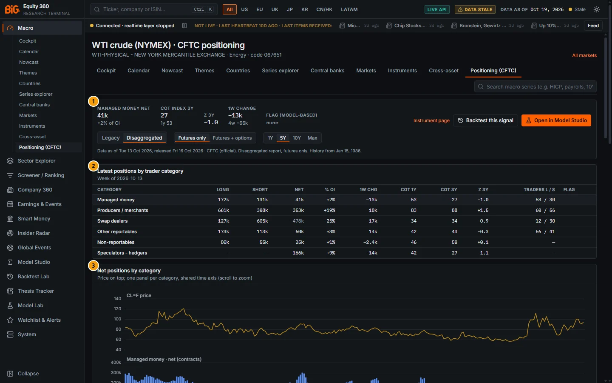

*Figure 2B.44: WTI crude (NYMEX) · CFTC positioning, code 067651, Disaggregated, futures only, 5Y range.*

| # | Panel | What it shows |
|---|---|---|
| 1 | MANAGED MONEY NET | Headline category net (and % of OI), COT index 3y (and 1y), z 3y, 1-week and 4-week change, the model-based flag, buttons, report and range selectors, and the data line |
| 2 | Latest positions by trader category | Long, short, net, % OI, 1w change, COT 1y and 3y, z 3y, trader counts and flags for each category |
| 3 | Net positions by category | The mapped price on top, then one signed-bar panel per category, on a shared time axis |
| 4 | COT index history (3y window) | Headline and speculators − hedgers COT index with shaded model-based extreme zones |
| 5 | Open interest | Open interest and the net concentration of the four largest traders, long and short |
| 6 | Number of traders | Headline category, long vs short trader counts |
| 7 | Extreme episodes | Spells with the headline COT index 3y ≥ 90 or ≤ 10 in the selected range |
| 8 | After extremes: forward returns | Model-based event study of forward returns after extremes, full history, futures-only report |

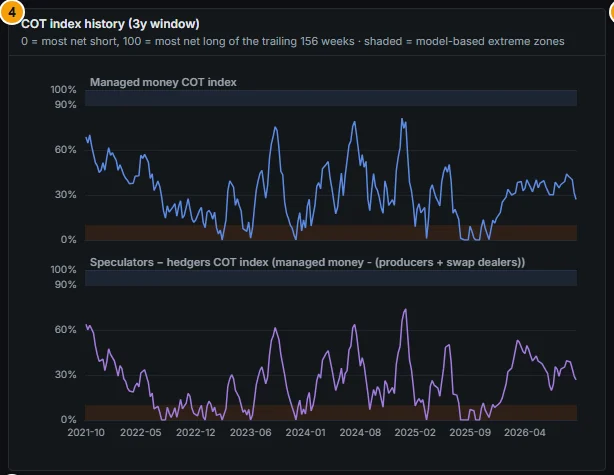

*Figure 2B.45: COT index history (3y window), managed money and speculators − hedgers.*

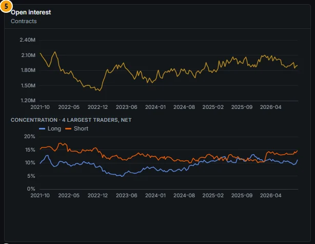

*Figure 2B.46: Open interest and concentration of the four largest traders.*

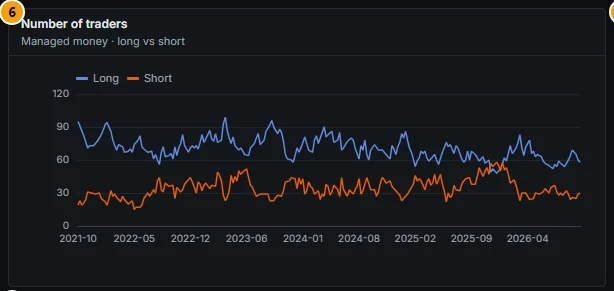

*Figure 2B.47: Number of managed-money traders, long vs short.*

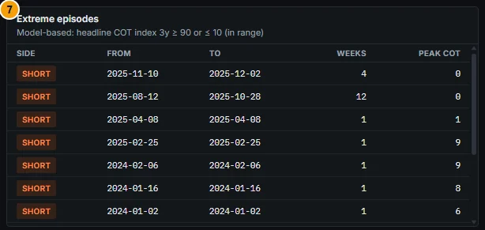

*Figure 2B.48: Extreme episodes in the 5Y range.*

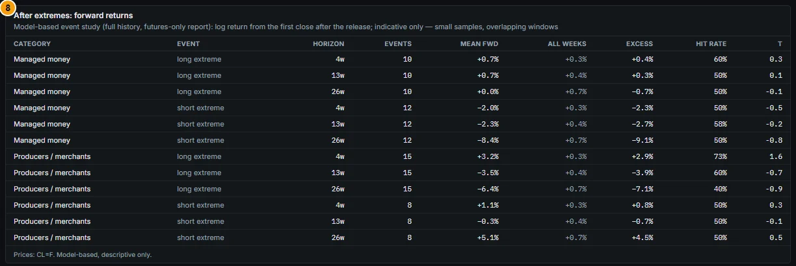

*Figure 2B.49: After extremes: forward returns, WTI (prices: CL=F).*

### Controls

| Control | What it does |
|---|---|
| All markets | Back to the Positioning overview |
| Instrument page | Opens the linked instrument page (`/instruments/IDX:CL=F`) |
| Backtest this signal | Opens the Backtest Lab with an event-driven draft: contrarian trades on COT-index extremes (enter when COT index 3y crosses ≥ 0.9 or ≤ 0.1, hold 20 days, at most 10 positions, shorts allowed, entry one day after the signal), on this commodity's root or on all assets of the class that have a CFTC join |
| Open in Model Studio | Draft study: weekly OLS of the mapped instrument's log return on the headline COT index 3y, the weekly net change and the speculators − hedgers z 3y, each lagged one week, from 2008 |
| Report type | The report families available for this market (WTI: Legacy and Disaggregated) |
| Futures only / Futures + options | Hidden for CIT |
| Range: 1Y / 5Y / 10Y / Max | History range of the charts and the Extreme episodes table (default 5Y) |
| Charts | Scroll to zoom the shared time axis; hover for values |

### Methodology

Definitions are the same as on the [Positioning (CFTC)](#positioning-cftc) page (the page footer repeats them: "COT index = (net - min) / (max - min) over the trailing 52 / 156 weekly reports; extremes (COT index 3y >= 0.9 or <= 0.1), crowding (extreme and |z 3y| >= 1.5), divergence vs price and the event study are model-based heuristics, not CFTC data.").

**Event study** (model-based, full history, futures-only report; categories: Legacy non-commercials and commercials, Disaggregated managed money and producers / merchants, TFF leveraged funds, asset managers and dealers):

```
event         = the COT index 3y crosses into ≥ 0.9 (long extreme) or ≤ 0.1 (short extreme),
                at least 13 reports after the previous event of the same side
entry         = first close strictly after the release date (point in time)
forward return = log return from the entry close to the first close ≥ entry + 7·h days, h = 4, 13, 26 weeks
All weeks     = mean forward return over every report (unconditional)
Excess        = Mean fwd − All weeks
t             = Excess / (sd of event returns / √n)
```

Prices are the adjusted closes of the mapped futures instrument, or a labelled proxy when the contract has no futures series ("Price overlay uses … as a proxy").

### Data sources and refresh

CFTC (official), weekly. The data line under the selectors reads, for WTI, "Data as of Tue 13 Oct 2026, released Fri 16 Oct 2026 · CFTC (official). Disaggregated report, futures only. History from Jan 15, 1986."

### Validation status

The event study is **model-based, descriptive only** and "indicative only — small samples, overlapping windows". For WTI managed money, no horizon reaches |t| ≥ 1 (Figure 2B.49): there is **no evidence** in this market that managed-money extremes predict prices.

### Correct usage and worked example

**WTI crude, report of 13 Oct 2026 (Figure 2B.44):** managed money is net long **41k** contracts (+2% of open interest: 172k long vs 131k short), with a COT index 3y of **27** (1y: 53) and z 3y **−1.0**; it cut 13k contracts in the week and 66k over four weeks; no model-based flag. Producers / merchants are net long 353k with a COT index 3y of 88 and swap dealers net short 478k. So speculators have been reducing longs into a +71% YTD rally, and they are in the lower third of their three-year range.

The event study (Figure 2B.49) puts this in context: after managed-money **short** extremes (12 events, 2008 to 2025), WTI's mean 26-week return was −8.4% against +0.7% in all weeks (excess −9.1%, t −0.8, hit rate 50%); after long extremes (10 events) the excess was between −0.7% and +0.4%. Neither is statistically meaningful.

### Limitations and pitfalls

- **Small samples**: 8 to 15 events per row, with overlapping 13- and 26-week windows.
- **Proxy prices** for some contracts (for example a cash index or ETF) do not match the futures' returns.
- **Report families differ by market**: WTI has no TFF report; financial futures have no Disaggregated report.
- **Combined (futures + options) positions** are delta-adjusted by the CFTC and are not directly comparable with futures-only numbers.
- **Concentration** ("4 largest traders, net") is "Not published for this report." for some report types.

### Related mnemonics and BQL fields

- Mnemonic `COT` (overview); the instrument page's "CFTC positioning" button leads here.
- Model Studio source `cftc`; Backtest Lab event trigger "CFTC extreme" ([11. Backtest Lab](11-backtest-lab.md)).
- Related: [Positioning (CFTC)](#positioning-cftc), [Cross-asset dashboard](#cross-asset-dashboard), [Instrument page](#instrument-page).

## Curve monitor

Route **Macro → Curves** (`/macro/curves`). Official government yield curves for every country with a public curve, compared side by side.

### Purpose

See where yields are, how the curves are shaped (2s10s, 5s30s), how far each country trades from the Bund and the US Treasury, how real yields and breakevens move, and how a curve evolved over decades (history slider and animation).

### Controls

- **Live strip**: delayed US yields (13-week bill, 5y, 10y, 30y) from the quotes service, refreshed every minute; "stale" when the market is open and the last quote is older than 15 minutes.
- **Benchmark yields by country**: one row per country benchmark curve with the latest 2y / 5y / 10y / 30y, the slopes, the spread vs the Bund and the UST and the 1-day / 1-week / 1-month / year-to-date changes at the selected tenor (rising yields red, falling green). Click a row to chart it.
- **Curve panel**: curve picker (country benchmarks, other official curves, EURIBOR, monthly 10y), measure (par / spot / instantaneous forward / benchmark yield, as published), comparison snapshots (1 week, 1 month, 1 year, 5 years ago) and up to three overlay countries. The x axis is the maturity on a square-root scale so the short end stays readable.
- **History slider and Animate**: one curve per month-end since the start of the series; drag the slider, type a date, or press Animate (1× / 3× / 8×). The latest curve stays as a dashed reference and the y axis is fixed over the whole history.
- **Slopes, spreads and levels**: 2s10s and 5s30s, 10y vs Bund and vs UST, 2y / 10y levels (daily up to 3 years, weekly beyond).
- **Real vs nominal**, **Money markets**, **10-year yields, rest of the world**, **Sovereign debt** (auction calendar and results, US 10y auction history, debt / GDP and deficits, TARGET balances).

### Methodology

- Curves are stored as integer basis points × 100 in the long table `yield_curves` (date, curve, tenor in months, measure).
- ECB (AAA, all issuers) and Bundesbank curves are **reconstructed from the published Svensson parameters**: spot rates continuously compounded, instantaneous forwards closed-form, par yields as continuous-coupon par yields (they reproduce the ECB's published par yields to < 0.05 bp).
- BoE curves are the Bank's own spline fits (spot and instantaneous forward, nominal / real / implied inflation / OIS); US Treasury, Fed H.15 and MoF are par yields; Spain and Portugal are average market yields by residual maturity; Canada, Australia, Sweden and Norway are benchmark / generic yields.
- Breakeven = nominal minus real at the same maturity and measure (US par, UK spot). Spreads are differences of the stored values at matching dates.

### Data sources and refresh

US Treasury (XML), Fed H.15 (via FRED), ECB Data Portal, Deutsche Bundesbank, Bank of England, MoF Japan, Banco de España, Banco de Portugal (IGCP OT yields), SNB, Bank of Canada, RBA, Riksbank, Norges Bank, ECB IRS and OECD (monthly 10y), NY Fed / ECB / BoE / BoJ / BoC money-market rates, US Treasury Fiscal Data and UK DMO (auctions), Eurostat and IMF (debt). Each curve has its own publication rule (for example US Treasury 18:00 New York on the day, ECB the next TARGET day at 12:30 Frankfurt): the startup sync fetches a curve as soon as it is due (dataset **rates.curves**, job `rates_curves`); full history comes from the filler campaign `rates_curves_history`.

### Validation status

The Svensson reconstruction is unit-tested against the ECB's and the Bundesbank's published spot, forward and par values (tests/rates/test_svensson.py); every parser is tested on recorded official files.

### Correct usage and worked example

Select **US Treasury par**, tick **1 year ago**, overlay **German Bund** and **UK gilt**: the chart shows the level and shape change of each curve; the table row gives the 10y spread vs the Bund in bp. Press **Animate** on the Bund curve to replay the 2014-2021 negative-rate era and the 2022 repricing.

### Limitations and pitfalls

- France and Italy have no keyless daily official source (Banque de France's open API has no observations, Banca d'Italia's is protected): they appear as monthly 10y convergence yields only.
- The SNB curve is published once a month with daily values; Portuguese yields arrive with a few days' lag.
- EURIBOR is EMMI's benchmark (republished by Banco de España): personal use.
- Delayed live yields are Yahoo market data, not official fixings.

### Related mnemonics and BQL fields

- BQL: `rates.gov_2y`, `rates.gov_10y`, `rates.curve_2s10s`, `rates.spread_10y_vs_bund`, `rates.spread_10y_vs_ust`, `credit.us_ig_oas`, `credit.us_hy_oas` (per security, from its domicile country).
- Related: [Credit](#credit), [Central banks overview](02a-macro.md#central-banks-overview).

## Credit

Route **Macro → Credit** (`/macro/credit`).

### Purpose

Track corporate credit spreads by rating, maturity, emerging-market sector and region, Moody's yields, bond issuance and the maturity walls of listed companies.

### Controls

History range (1Y to Max), series group (rating, maturity, sector, region, effective yields, Moody's), FIRDS currency, maturity-wall region and sector (click a sector row).

### Methodology

- Spreads are ICE BofA option-adjusted spreads and effective yields; Moody's are seasoned Aaa / Baa yields.
- Issuance: ESMA FIRDS bonds by first trading month (total issued nominal), US Treasury accepted amounts by month and security type.
- Maturity walls: contractual principal maturities tagged in the filings (US GAAP `LongTermDebtMaturitiesRepaymentsOfPrincipal…`, IFRS maturity axis), latest profile per issuer, summed in USD per region and sector. The refinancing cost is **model-based**: today's local 5y government yield plus the ICE BofA IG (interest coverage ≥ 4) or HY OAS, compared with the issuer's average cost of debt, applied to the debt due within 24 months.

### Data sources and refresh

FRED (ICE BofA, Moody's; job `macro_fred`), ESMA FIRDS (weekly job `bonds_reference`), US Treasury Fiscal Data (job `rates_auctions`), company filings (job `company_debt`), FINRA TRACE aggregates (job `credit_trace`, only with a FINRA API key).

### Validation status

Descriptive; the refinancing metrics are model-based and unvalidated.

### Correct usage and worked example

Group **By rating**: BBB vs BB shows the cost of the investment-grade cliff. In the maturity wall, a sector with a high "Due 24m" share and a low median coverage is the most exposed to higher refinancing rates.

### Limitations and pitfalls

- ICE BofA and Moody's series are copyrighted (FRED personal use); FRED keeps only 3 years of ICE history (the app archives what it has seen).
- US sector OAS are not on FRED (emerging-market financial / non-financial are shown).
- Maturity schedules are tagged mainly by US filers; IFRS issuers rarely tag them.
- FINRA's fixed-income website forbids automated use: TRACE statistics need the FINRA API.

### Related mnemonics and BQL fields

- BQL: `debt.avg_cost_of_debt`, `debt.interest_coverage`, `debt.net_debt_to_ebitda`, `debt.mat_y1` … `debt.mat_after5`, `debt.floating_share`, `debt.refi_rate_gap_bp` (model-based).
- Related: [Curve monitor](#curve-monitor), [Debt](05a-company-fundamentals.md#debt).
