# 3. Sector Explorer

The Sector Explorer is the top-down entry point for fundamental work: pick a sector, drill into a subsector, and see how the companies in it are spread on the KPIs that matter for that business model. It also lists the best and worst composite scores in the selection and the model-based peer-group anomaly panel.

## Sector Explorer

**Route:** `/sectors`, `/sectors?sector=<sector id>`, `/sectors?sector=<sector id>&sub=<subsector id>` · **Menu:** Sector Explorer · **Mnemonics:** `PEERS` (with no security loaded) · **Refresh:** nightly analytics (`ratios_kpis`, `scoring`); default weekly profile = Saturday refresh, daily profile Tue-Sat

### Purpose

The page answers three questions for a sector or subsector: how large it is and how it has moved, where a given company sits on the sector's own KPIs (net interest margin for banks, FFO for REITs, Rule of 40 for software and so on), and which names score best and worst on the composite. Analysts use it to build a peer view before opening individual companies; portfolio managers use it to see the dispersion inside a sector before allocating within it.

The KPI set changes with the business model. A bank is not judged on gross margin and a REIT is not judged on ROIC; each subsector belongs to one KPI set (28 sets in all, listed under [Methodology](#methodology)).

### Screenshot

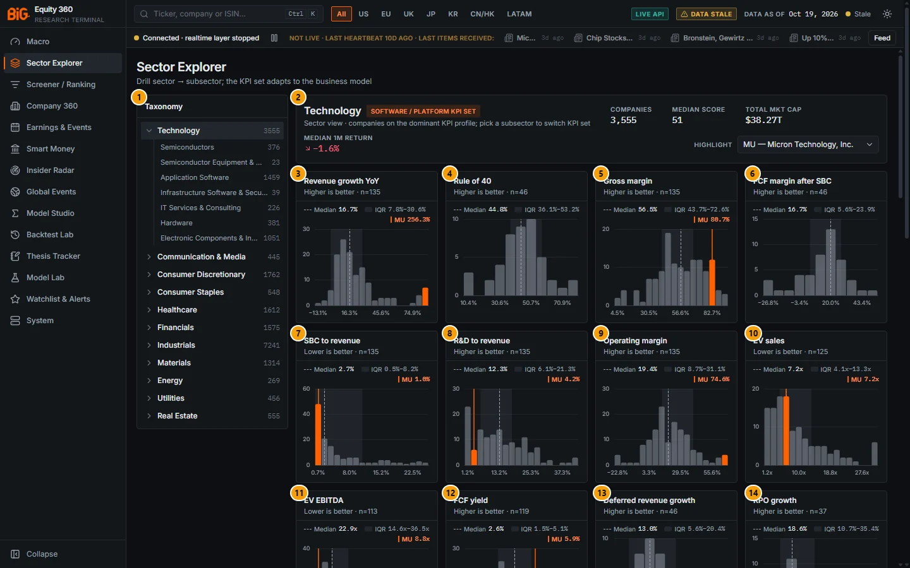

*Figure 3.1: Sector Explorer (`/sectors`, Technology sector view, region All, highlight MU), data as of 19 Oct 2026.*

| # | Panel | What it shows |
|---|---|---|
| 1 | Taxonomy | The 11 sectors with company counts for the current region; the open sector lists its subsectors with their counts |
| 2 | Technology (header) | Selection name, KPI-set badge, Companies, Median score, Total mkt cap, 1M return (cap-weighted; "Median 1M return" in the screenshots), Highlight selector |
| 3 | Revenue growth YoY | Histogram of the KPI across the selection (higher is better, n = 135) |
| 4 | Rule of 40 | Revenue growth + FCF margin, software KPI (n = 46) |
| 5 | Gross margin | Generic metric, headline for software and semis (n = 135) |
| 6 | FCF margin after SBC | (FCF − stock-based compensation) / revenue, software KPI (n = 46) |
| 7 | SBC to revenue | Stock-based compensation / revenue (lower is better, n = 135) |
| 8 | R&D to revenue | R&D intensity (n = 135) |
| 9 | Operating margin | Generic metric (n = 135) |
| 10 | EV sales | Valuation multiple (lower is better, n = 125) |
| 11 | EV EBITDA | Valuation multiple (lower is better, n = 113) |
| 12 | FCF yield | FCF / market cap (n = 119) |
| 13 | Deferred revenue growth | Software KPI (n = 46) |
| 14 | RPO growth | Remaining performance obligations growth, software KPI (n = 37) |
| 15 | Opex leverage | Revenue growth minus growth of SG&A + R&D, software KPI (n = 47) |
| 16 | DIO | Days inventory outstanding, semis / hardware headline (lower is better, n = 98) |
| 17 | ROIC | Return on invested capital (n = 118) |
| 18 | FCF margin | Free cash flow / revenue (n = 134) |
| 19 | P/E TTM | Trailing P/E (lower is better, n = 112) |
| 20 | R&D intensity (3y avg) | Semis KPI (n = 39) |
| 21 | Inventory days change | DIO change vs a year earlier, semis / hardware KPI (lower is better, n = 78) |
| 22 | Capex intensity | Capex / revenue, semis KPI; a target metric (see pitfalls) (n = 39) |
| 23 | Inventory turns | Hardware headline (n = 98) |
| 24 | DSO | Days sales outstanding, services headline (lower is better, n = 134) |
| 25 | Revenue per employee (USD) | Services KPI; empty state "No distribution" because no company has a value (n = 0) |
| 26 | Leaders | Ten highest composite scores in the selection |
| 27 | Laggards | Ten lowest composite scores in the selection |
| 28 | Peer-group joint anomaly in this selection | Model-based anomaly percentile of the peer groups in the selection (descriptive, not a trading signal) |

Panels 15 to 28 are below the fold. The three tables at the bottom of the page:

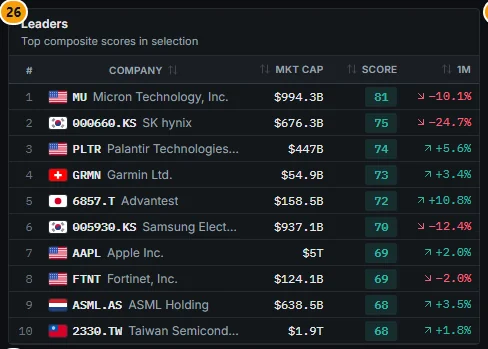

*Figure 3.2: Leaders (callout 26): MU 81, SK hynix 75, PLTR 74 … TSMC 68. Score = stored balanced composite.*

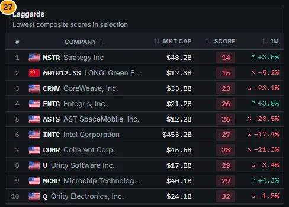

*Figure 3.3: Laggards (callout 27): MSTR 14, LONGi 15, CoreWeave 23 …*

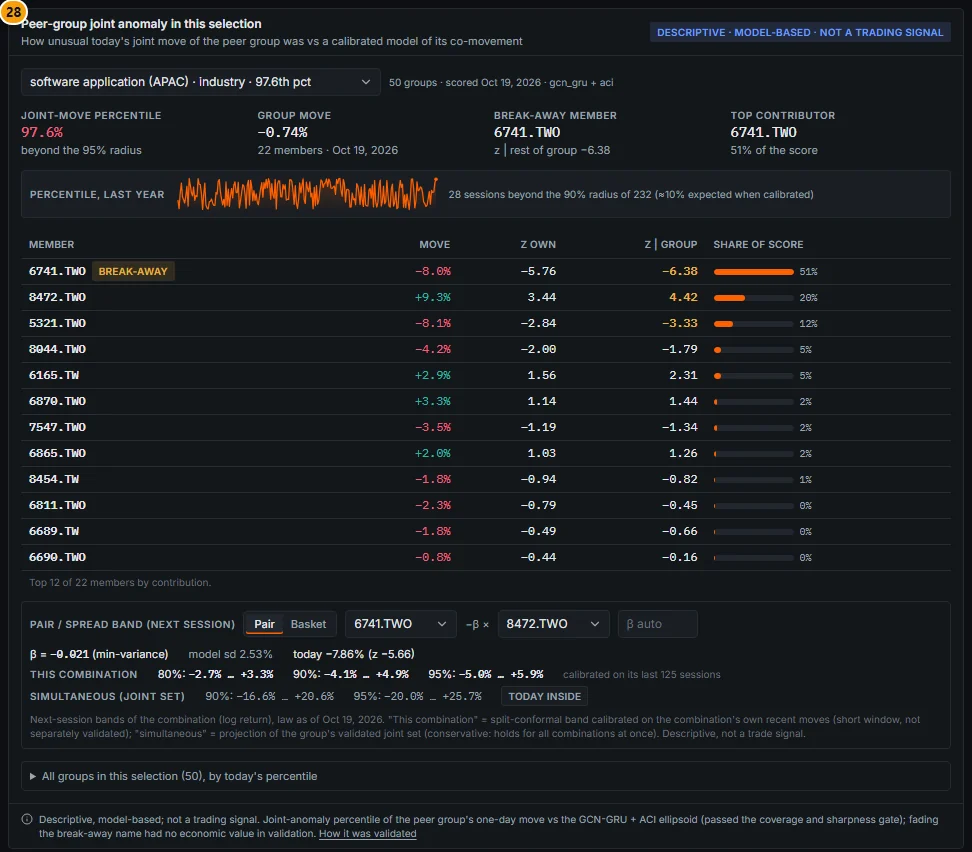

*Figure 3.4: Peer-group joint anomaly in this selection (callout 28), labelled "Descriptive · model-based · not a trading signal".*

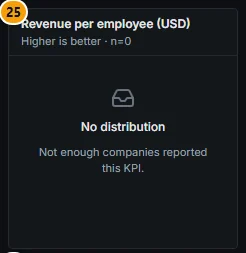

*Figure 3.5: A KPI card with no data (callout 25): "No distribution · Not enough companies reported this KPI."*

#### Subsector views

Clicking a subsector switches the cards to its KPI set. Three examples follow: a bank set, a semiconductor set and a REIT set.

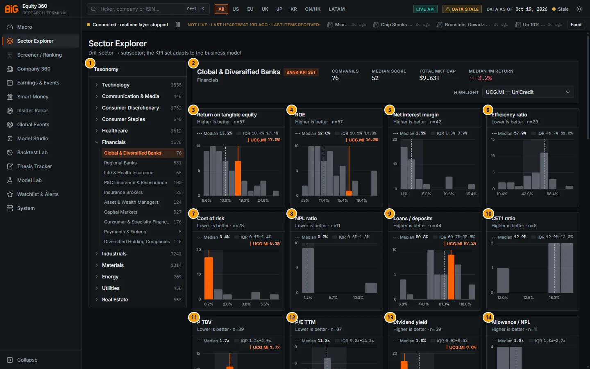

*Figure 3.6: Global & Diversified Banks (`/sectors?sector=FINS&sub=banks_global`, region All, highlight UCG.MI), data as of 19 Oct 2026.*

| # | Panel | What it shows |
|---|---|---|
| 1 | Taxonomy | Financials expanded; Global & Diversified Banks (76) selected |
| 2 | Global & Diversified Banks (header) | "Bank KPI set" badge; 76 companies, median score 52, total cap $9.63T, median 1M return −3.2%; highlight UCG.MI (UniCredit) |
| 3 | Return on tangible equity | Median 13.2%, IQR 10.4%-17.4%, UCG.MI 17.5% (n = 57) |
| 4 | ROE | Median 12.0%, UCG.MI 16.8% (n = 57) |
| 5 | Net interest margin | Median 2.5%, IQR 1.3%-3.9% (n = 42); no value for UCG.MI |
| 6 | Efficiency ratio | Lower is better; median 57.9% (n = 29) |
| 7 | Cost of risk | Lower is better; median 0.4%, UCG.MI 0.1% (n = 28) |
| 8 | NPL ratio | Lower is better; median 0.7% (n = 11) |
| 9 | Loans / deposits | Scored on distance from 85% (card subtitle "Closest to … is best"; labelled "Higher is better" in the screenshot build); median 80.8%, UCG.MI 97.2% (n = 44) |
| 10 | CET1 ratio | Median 12.9% (n = 5, anecdotal) |
| 11 | P TBV | Price / tangible book, lower is better; median 1.7x, UCG.MI 1.7x (n = 39) |
| 12 | P/E TTM | Median 11.8x (n = 37) |
| 13 | Dividend yield | Median 1.8%, UCG.MI 0.6% (n = 39) |
| 14 | Allowance / NPL | NPL coverage; median 1.8x (n = 11) |
| 15 | Fee income share | Non-interest income / total revenue (n = 45) |
| 16 | Pre-provision profit / assets | PPOP / average assets (n = 29) |
| 17 | Equity / assets | Leverage measure (n = 57) |
| 18 | Loan growth | Scored on distance from 7% (card subtitle "Closest to … is best"; labelled "Higher is better" in the screenshot build) (n = 44) |
| 19 | Deposit growth | Year-on-year deposit growth (n = 45) |
| 20 | Leaders | UniCredit 70, China Merchants Bank 69, PNC 69 … Intesa Sanpaolo 63 |
| 21 | Laggards | Lowest composites, led by Citigroup and Lloyds |
| 22 | Peer-group joint anomaly in this selection | As in Figure 3.4, for the bank peer groups |

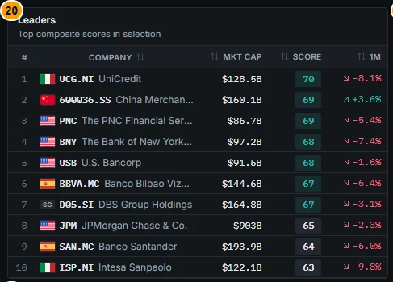

*Figure 3.7: Leaders of the global banks (callout 20). JPMorgan is eighth with 65.*

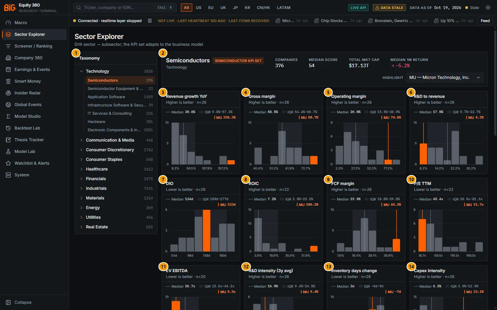

*Figure 3.8: Semiconductors (`/sectors?sector=TECH&sub=semiconductors`, region All, highlight MU), data as of 19 Oct 2026.*

| # | Panel | What it shows |
|---|---|---|
| 1 | Taxonomy | Technology expanded; Semiconductors (376) selected |
| 2 | Semiconductors (header) | "Semiconductor KPI set" badge; 376 companies, median score 54, total cap $17.13T, median 1M return −5.2%; highlight MU |
| 3 | Revenue growth YoY | Median 30.6%, MU 256.3% (n = 26) |
| 4 | Gross margin | Median 58.5%, IQR 54.4%-66.7%, MU 80.7% (n = 26) |
| 5 | Operating margin | Median 26.0%, MU 74.6% (n = 26) |
| 6 | R&D to revenue | Median 17.5%, MU 4.2% (n = 26) |
| 7 | DIO | Lower is better; median 134 days, MU 133 days (n = 26) |
| 8 | ROIC | Median 7.2%, MU 106.2% (n = 22), an outlier (see pitfalls) |
| 9 | FCF margin | Median 23.9%, MU 44.3% (n = 26) |
| 10 | P/E TTM | Lower is better; median 45.4x, MU 11.7x (n = 22) |
| 11 | EV EBITDA | Lower is better; median 26.7x, MU 8.8x (n = 20) |
| 12 | R&D intensity (3y avg) | Semis KPI; median 16.9%, MU 9.4% (n = 26) |
| 13 | Inventory days change | Semis KPI, lower is better; median +3 days, MU −7 days (n = 26) |
| 14 | Capex intensity | Semis KPI scored on distance from 10% (card subtitle "Closest to … is best"; labelled "Higher is better" in the screenshot build); median 6.3%, MU 23.1% (n = 26) |
| 15 | Leaders | MU 81, SK hynix 75, Samsung Electronics 70, TSMC 68, NVIDIA 67 … |
| 16 | Laggards | Ten lowest composites in the subsector |
| 17 | Peer-group joint anomaly in this selection | Semiconductor peer groups |

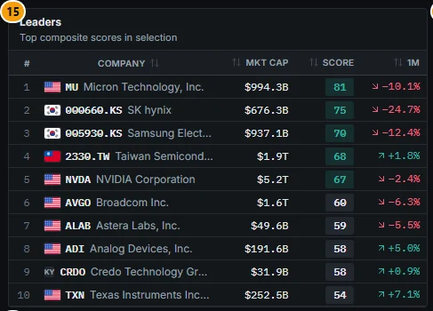

*Figure 3.9: Leaders of the Semiconductors subsector (callout 15).*

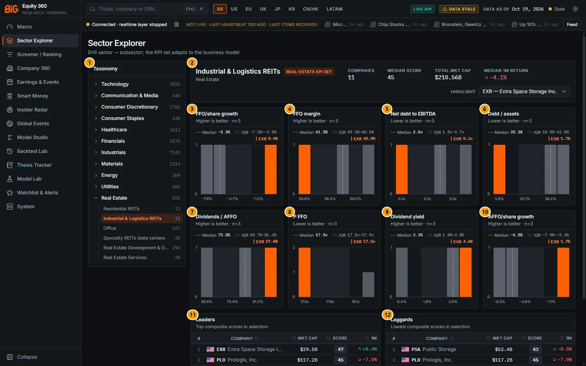

*Figure 3.10: Industrial & Logistics REITs (`/sectors?sector=REAL&sub=reit_industrial`, region All, highlight EXR), data as of 19 Oct 2026.*

| # | Panel | What it shows |
|---|---|---|
| 1 | Taxonomy | Real Estate expanded; Industrial & Logistics REITs (11) selected |
| 2 | Industrial & Logistics REITs (header) | "Real-estate KPI set" badge; 11 companies, median score 45, total cap $218.56B, median 1M return −4.1%; highlight EXR |
| 3 | FFO/share growth | Median −5.9%, EXR 0.9% (n = 3) |
| 4 | FFO margin | Median 61.5%, EXR 48.9% (n = 3) |
| 5 | Net debt to EBITDA | Lower is better; median 2.8x, EXR 0.2x (n = 3) |
| 6 | Debt / assets | Lower is better; median 35.3%, EXR 1.7% (n = 3) |
| 7 | Dividends / AFFO | Payout scored on distance from 75% (card subtitle "Closest to … is best"; labelled "Higher is better" in the screenshot build); median 75.8%, EXR 87.6% (n = 3) |
| 8 | P FFO | Price / FFO, lower is better; median 17.5x (n = 3) |
| 9 | Dividend yield | Median 3.3%, EXR 4.6% (n = 3) |
| 10 | AFFO/share growth | Median −6.5% (n = 3) |
| 11 | Leaders | Only three scored names: EXR 47, PLD 45, PSA 43 |
| 12 | Laggards | The same three names in reverse order |
| 13 | Peer-group joint anomaly in this selection | REIT peer groups (below the fold) |

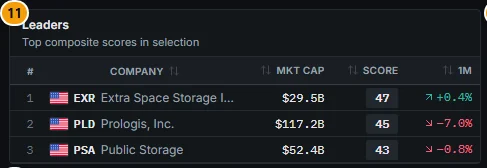

*Figure 3.11: With only three scored companies, Leaders and Laggards list the same names (callout 11).*

Figure 3.10 shows how thin some subsectors are: 11 companies, but every REIT card has n = 3. The bars are then individual companies, not a distribution; compare the values one by one.

### Controls

| Control | What it does |
|---|---|
| Region chips (top bar: All, US, EU, UK, JP, KR, CN/HK, LATAM) | Restrict every number on the page (counts, KPIs, leaders, laggards) to listings of that region. The choice is global and also applies to the Screener |
| Sector row (Taxonomy) | Opens the sector view and expands its subsectors. The URL becomes `/sectors?sector=<id>` |
| Subsector row (Taxonomy) | Opens the subsector view; the KPI set switches to that subsector's business model. The URL becomes `/sectors?sector=<id>&sub=<id>` |
| Company count (grey number) | Active securities in that node for the current region |
| KPI-set badge (header) | Shows which KPI family is displayed. Hover: "KPI definitions switch with the business model (banks use NIM/CET1, software uses NRR/Rule of 40, REITs use FFO/LTV …)" |
| Highlight | Picks one company to mark in every histogram (orange bar and solid line, value printed top right of each card). Options: the leaders and laggards, then the tickers of the first KPI. Default: the top leader. "No highlight" clears it |
| KPI card hover | Hover a bar: value range of the bin, number of companies and up to six tickers. Hover the card body: KPI name and n |
| Leaders / Laggards row | Click a row to open that company in Company 360 |
| Peer-group panel | Group selector, Pair / Basket band builder, "All groups in this selection" list and the "How it was validated" link (see [Peer-group joint anomaly](05a-company-fundamentals.md#peer-group-joint-anomaly) for the full description) |
| Retry (error state) | Re-requests the sector after "Could not load data" |

The sector and subsector ids for direct links:

| Sector | `sector=` id | Companies (All regions) |
|---|---|---|
| Technology | `TECH` | 3,555 |
| Communication & Media | `COMM` | 445 |
| Consumer Discretionary | `CDIS` | 1,762 |
| Consumer Staples | `CSTA` | 548 |
| Healthcare | `HLTH` | 1,612 |
| Financials | `FINS` | 1,575 |
| Industrials | `INDU` | 7,241 |
| Materials | `MATR` | 1,314 |
| Energy | `ENRG` | 269 |
| Utilities | `UTIL` | 456 |
| Real Estate | `REAL` | 555 |

Subsector ids are the lower-case ids in the KPI-set table below (for example `banks_global`, `semiconductors`, `reit_industrial`). Opening `/sectors` with no parameter shows the first sector of the taxonomy (Technology).

### Methodology

#### Taxonomy

Every issuer is mapped to one of 11 sectors and 79 subsectors (`contracts/sector_taxonomy.yaml`). Vendor industry labels are translated into this taxonomy; one issuer has one subsector, whichever listing you look at. Each subsector belongs to exactly one **KPI set**, and the KPI set decides three things: which sector-specific KPIs are computed for the company, which "most relevant" metrics are shown to compare it with peers, and which generic metrics are switched off (a bank has no gross margin, ROIC or inventory turns).

#### KPI sets

The 28 KPI sets (`contracts/sector_kpis.yaml`, `kpi_sets`). "Own KPIs" are computed only for companies in that set; "Headline peer metrics" are the cards shown first, in order of relevance.

| KPI set | Subsectors | Own KPIs | Headline peer metrics |
|---|---|---|---|
| software_internet | software_application, software_infrastructure, internet_platforms, video_games, payments_fintech | Rule of 40, FCF margin after SBC, deferred revenue growth, RPO growth, opex leverage | revenue growth, Rule of 40, gross margin, FCF margin after SBC, SBC / revenue, R&D / revenue, operating margin, EV/sales, EV/EBITDA, FCF yield |
| semis | semiconductors, semi_equipment | R&D intensity (3y avg), inventory days change, capex intensity | revenue growth, gross margin, operating margin, R&D / revenue, DIO, ROIC, FCF margin, P/E, EV/EBITDA |
| hardware | hardware_networking, electronic_components | inventory days change | revenue growth, gross margin, operating margin, ROIC, inventory turns, FCF margin, P/E, EV/EBITDA |
| services | it_services, business_services, consumer_services, health_providers_services, insurance_brokers, real_estate_services | revenue per employee (USD) | revenue growth, operating margin, ROIC, FCF margin, DSO, revenue per employee, P/E, EV/EBITDA |
| telecom | telecom_operators | dividend FCF coverage | EBITDA margin, capex / revenue, FCF margin, net debt incl. leases / EBITDA, dividend yield, EV/EBITDA, FCF yield |
| media | media_entertainment, advertising_publishing | none | revenue growth, operating margin, FCF margin, net debt / EBITDA, EV/EBITDA, FCF yield |
| autos_durables | autos, auto_parts, household_durables_leisure | R&D + capex / revenue | revenue growth, operating margin, ROIC, inventory turns, FCF margin, P/E, EV/EBITDA |
| homebuilders | homebuilders | inventory / equity | revenue growth, gross margin, ROE, debt / equity, BVPS CAGR 3y, P/B, P/E |
| retail | ecommerce, specialty_retail, staples_retail | inventory turns change, GMROI | revenue growth, gross margin, operating margin, inventory turns, GMROI, ROIC, cash conversion cycle, P/E, EV/EBITDA |
| consumer_brands | apparel_luxury, beverages, packaged_food, tobacco, household_personal_products | pricing power (gross margin vs 5y mean) | revenue growth, gross margin, operating margin, ROIC, FCF margin, dividend yield, P/E, EV/EBITDA |
| restaurants_leisure | restaurants, hotels_travel_leisure | none | revenue growth, operating margin, EBITDA margin, ROIC, net debt incl. leases / EBITDA, EV/EBITDA, FCF yield |
| pharma_biotech | pharma, biotech | cash runway (years), R&D share of opex | revenue growth, gross margin, operating margin, R&D / revenue, cash runway, FCF margin, P/E, EV/sales |
| medtech | medtech, life_science_tools | none | revenue growth, gross margin, operating margin, R&D / revenue, ROIC, P/E, EV/EBITDA |
| managed_care | managed_care | medical cost ratio | revenue growth, medical cost ratio, operating margin, ROE, P/E |
| banks | banks_global, banks_regional | NIM, efficiency ratio, loans / deposits, NPL ratio, allowance / NPL, cost of risk, RoTE, fee income share, PPOP / assets, equity / assets, CET1, loan growth, deposit growth | RoTE, ROE, NIM, efficiency ratio, cost of risk, NPL ratio, loans / deposits, CET1, P/TBV, P/E, dividend yield |
| consumer_finance | consumer_specialty_finance | NIM, cost of risk, assets / equity | ROE, NIM, cost of risk, assets / equity, revenue growth, P/B, P/E |
| insurance_pc | insurance_pc_reinsurance | loss ratio, expense ratio, combined ratio, investment yield, premium growth, reserves / equity | combined ratio, loss ratio, ROE, premium growth, BVPS CAGR 3y, P/B, P/E, dividend yield |
| insurance_life | insurance_life_health | benefits ratio, investment yield, assets / equity, premium growth | ROE, BVPS CAGR 3y, investment yield, assets / equity, premium growth, P/B, P/E, dividend yield |
| asset_light_fin | asset_managers, capital_markets_exchanges | opex / revenue | revenue growth, operating margin, ROE, FCF margin, P/E, dividend yield |
| holdings | diversified_holdings | none | BVPS CAGR 3y, ROE, debt / equity, P/B, P/E |
| industrials | aerospace_defense, industrial_machinery, electrical_equipment, construction_building, industrial_conglomerates | backlog (RPO) growth, backlog / revenue | revenue growth, operating margin, ROIC, FCF conversion, backlog growth, net debt / EBITDA, P/E, EV/EBITDA |
| distributors | trading_distributors, health_distribution | gross profit / op. working capital | revenue growth, gross margin, operating margin, ROIC, cash conversion cycle, P/E, EV/EBITDA |
| transport | airlines, logistics_freight, rail_marine_infra | none | revenue growth, operating margin, EBITDA margin, ROIC, net debt incl. leases / EBITDA, EV/EBITDA, FCF yield |
| materials | the seven Materials subsectors, agri_products, coal_uranium | capex / CFO (reinvestment), ROIC 5y mean | revenue growth, EBITDA margin, ROIC, net debt / EBITDA, FCF margin, EV/EBITDA, P/B, dividend yield |
| energy | integrated_oil_gas, exploration_production, refining_marketing, midstream, oilfield_services | capex / CFO, ROIC 5y mean, (dividends + buybacks) / CFO | EBITDA margin, ROIC, net debt / EBITDA, FCF yield, shareholder yield, EV/EBITDA, dividend yield |
| utilities | electric, gas, water, multi-utilities, renewable_ipp | FFO / debt (rating-agency style), PP&E growth (rate-base proxy) | ROE, net debt / EBITDA, FFO / debt, PP&E growth, dividend yield, P/E, EV/EBITDA |
| reits | reit_residential, reit_industrial, reit_office_retail, reit_specialty | FFO margin, FFO/share growth, AFFO/share growth, dividends / AFFO, debt / assets | FFO/share growth, FFO margin, net debt / EBITDA, debt / assets, dividends / AFFO, P/FFO, dividend yield |
| real_estate_dev | real_estate_development | inventory / equity, net debt / equity | ROE, net gearing, gross margin, BVPS CAGR 3y, P/B, P/E, dividend yield |

The KPI-set badge on the header groups these sets into ten labels: Software / platform (software_internet), Semiconductor (semis), Bank (banks, consumer_finance), Insurance (insurance_pc, insurance_life), Pharma (pharma_biotech), Retail (retail), Utility / telecom (telecom, utilities), Energy (energy), Real-estate (reits, real_estate_dev). Every other set shows the generic label "Industrial KPI set", even where the set is hardware, services or media.

#### Selected KPI definitions

All KPIs are evaluated per issuer on TTM rows (FY where no TTM exists), point-in-time (each value as known on its filing date). `avg(x)` is the mean of the balance at period end and one year earlier; `growth_yoy(x) = x / x₋₁ᵧ − 1`.

| KPI | Formula | Better |
|---|---|---|
| Rule of 40 | `revenue growth YoY + FCF margin` | higher |
| FCF margin after SBC | `(FCF − SBC) / revenue` | higher |
| Opex leverage | `revenue growth − growth(SG&A + R&D)` | higher |
| Inventory days change | `DIO − DIO₋₁ᵧ` | lower |
| Capex intensity (semis) | `capex / revenue` | closest to 10% |
| Pricing power | `gross margin − 5y mean gross margin` | higher |
| Cash runway (years) | `cash and ST investments / (−FCF)`, clipped 0-20 (20 when FCF ≥ 0) | higher |
| Net interest margin | `NII / avg(net loans + securities + cash)` | higher |
| Efficiency ratio | `non-interest expense / (NII + non-interest income)` | lower |
| Cost of risk | `credit-loss provisions / avg(gross loans)` | lower |
| RoTE | `net income to common / avg(tangible book)` | higher |
| Loans / deposits | `net loans / deposits` | closest to 85% |
| Loan growth | `growth_yoy(net loans)` | closest to 7% |
| Combined ratio | `(losses and LAE + underwriting expenses) / premiums earned` | lower |
| Medical cost ratio | `losses (or cost of revenue) / premiums (or revenue)` | lower |
| FFO / debt (utilities) | `(CFO − change in working capital) / total debt` | higher |
| FFO margin (REITs) | `FFO / revenue` | higher |
| Dividends / AFFO | `dividends paid / AFFO` | closest to 75% |
| Capex / CFO (reinvestment) | `capex / CFO` | closest to 50% |
| ROIC 5y mean | `mean of ROIC over the last 5 fiscal years` | higher |

"Closest to" marks a band metric: it is scored on the distance from the target, `−|x − target|`, not on its level.

#### Which cards appear

- **Subsector view:** the subsector's KPI set: first its headline peer metrics, then its own KPIs not already listed.
- **Sector view:** the cards of every KPI set present in the sector, one set after another in the contract order, with duplicates removed, **capped at 24 cards**. Each company only has values for the KPIs of its own set, so `n` varies from card to card (in Technology, Rule of 40 has n = 46 because only software and internet companies carry it).

#### Distribution chart

Each card is a histogram of the KPI over the companies in the selection (`components/charts/Distribution.tsx`):

- 6 to 18 bins (about 1.6 × √n).
- The x-axis is limited to the 10th and 90th percentiles plus 60% of their spread on each side, so a few extreme values do not flatten the chart; values beyond fall into the edge bins.
- Shaded band = interquartile range (25th to 75th percentile); dashed line = median. The legend prints the median and IQR.
- The highlighted company's bin is orange, with a solid orange line at its exact value.
- Quartiles and the median are computed over every company in the selection; the bars use the 500 largest companies by market cap (all of them in practice, since n is far below 500 on every card in Figure 3.1).
- If the API returns quantiles only, the card shows a quantile strip instead (p10, IQR, median, p90, "quantiles from API"). If no company has a value, it shows "No distribution".

#### Header statistics

| Statistic | Definition |
|---|---|
| Companies | Number of active securities in the selection and region |
| Median score | Median of the stored **balanced** composite (see [Scores and factors](04-screener.md#scores-and-factors)) |
| Total mkt cap | Sum of USD market capitalisations |
| 1M return (cap-weighted) | The **market-cap-weighted average** one-month price change (simple average where caps are missing); builds before 24 Oct 2026 labelled it "Median 1M return" |

#### How sector scores are formed

The Sector Explorer does not compute a separate "sector score". The numbers come from the company scores:

- **Leaders / Laggards**: the ten highest and ten lowest stored balanced composites in the selection (companies without a composite are excluded), with market cap and one-month return.
- **Median score**: the median of the same composite.
- Factor scores are percentiles **within sector × peer region**, so a typical sector median is close to 50 by construction (the live sector medians on 19 Oct 2026 range from 47.9 for Energy to 53.9 for Communication & Media). The composite is therefore a ranking *inside* a sector, not a judgement *between* sectors. The method is in [Scores and factors](04-screener.md#scores-and-factors).

#### Peer-group joint anomaly panel

The bottom panel lists the conformal peer groups that fall inside the selection (here 50 groups, "scored Oct 19, 2026 · gcn_gru + aci") and shows for the selected group how unusual today's joint move was against a calibrated model of the group's co-movement: joint-move percentile, group move, the break-away member and the top contributor, the last year of percentiles, a member table (move, z own, z given the group, share of score) and next-session pair / basket bands. It is the same component as on the company Peers tab; see [Peer-group joint anomaly](05a-company-fundamentals.md#peer-group-joint-anomaly). The panel is passed a region only for US, EU, UK, JP, KR and LATAM; for All and CN/HK it covers every region.

### Data sources and refresh

- **Fundamentals:** official filings where available (SEC EDGAR XBRL, ESEF, EDINET / TDnet and the other national systems) with yfinance as fallback, normalised to canonical line items, point-in-time by filing date. See [Data and coverage](01-data-and-coverage.md#coverage-by-region-and-known-gaps).
- **KPIs:** job `ratios_kpis` (nightly DAG) evaluates the generic metrics and the KPI sets on the point-in-time panels; table `sector_kpis`.
- **Prices, market cap, returns:** Polygon and yfinance, nightly.
- **Composite scores:** job `scoring` (nightly DAG), then the serving database rebuild.
- **Peer-group anomaly:** job `conformal_peer_groups` (nightly), refitted weekly.
- **Cadence:** with the default **weekly** schedule profile the nightly DAG runs inside the Saturday 08:00 Lisbon refresh; with the **daily** profile it runs Tue-Sat 01:30. The top-bar "Data as of" date applies.

### Validation status

- **KPIs and distributions:** deterministic accounting ratios and descriptive statistics, not models. Not formally validated beyond the data-quality checks; their reliability is that of the underlying filings.
- **Composite (Leaders, Laggards, Median score):** no validation gate; see [Scores and factors](04-screener.md#scores-and-factors).
- **Peer-group joint anomaly (Conformal B, GCN-GRU + ACI):** PASS as a calibrated descriptive measure: coverage 90.4% / 95.2% at the 90% / 95% targets, worst regime Covid 85.3% at 90%, about 10% sharper than an EWMA baseline. Break-away mean reversion FAILED as a trading signal (negative Sharpe). The app labels it "Descriptive · model-based · not a trading signal" (`docs/CONFORMAL_VALIDATION.md`, Verdict and section B).

### Correct usage and worked example

Work from the subsector, not the sector. The subsector view uses one KPI set, so every card describes the same kind of company, and the peer groups behind the scores are built at subsector level too.

**Example 1: Micron in Technology (Figure 3.1).** With Technology selected and MU highlighted:

1. Gross margin (callout 5): MU sits at 80.7%, far right of the sector median of 56.5% (IQR 43.7%-72.6%).
2. SBC to revenue (callout 7): 1.0% against a median of 2.7%, in the best part of a "lower is better" distribution.
3. R&D to revenue (callout 8): 4.2% against a median of 12.3%, low for Technology.
4. Rule of 40 (callout 4) carries no orange marker: MU is in the semis set, which does not compute Rule of 40.
5. Leaders (Figure 3.2): MU has the top balanced composite in the sector, 81.

For a like-for-like view open **Semiconductors** (Figure 3.8): the badge switches to "Semiconductor KPI set", and the cards become revenue growth, gross margin, operating margin, R&D / revenue, DIO, ROIC, FCF margin, P/E, EV/EBITDA, followed by R&D intensity (3y), inventory days change and capex intensity. Each card has n = 20 to 26 of the subsector's 376 securities. Against chip peers MU's gross margin (80.7% vs a median of 58.5%) is still top of the range, its P/E of 11.7x is far below the 45.4x median, and its R&D intensity (9.4% vs 16.9%) is low: a memory maker set against a peer group that includes design houses.

**Example 2: global banks (Figure 3.6, live API 19 Oct 2026).** `/sectors?sector=FINS&sub=banks_global` covers 76 securities ($9.63T, cap-weighted 1M return −3.2%, median composite 51.7, shown as 52). The KPI medians are RoTE 13.2% (IQR 10.4%-17.4%, n = 57), NIM 2.50% (n = 42), efficiency ratio 57.9% (n = 29), cost of risk 0.41% (n = 28), loans / deposits 80.8% (n = 44), P/TBV 1.66x (n = 39). With UniCredit highlighted: RoTE 17.5% and ROE 16.8% sit in the upper quartile, cost of risk 0.1% is in the best bin, loans / deposits 97.2% is above the 85% target, and P/TBV 1.7x is at the median. UniCredit leads the composite with 70 (Figure 3.7), ahead of China Merchants Bank (69.2) and PNC (68.8); Citigroup (23.1) and Lloyds (29.3) are the two lowest. CET1 has n = 5 and NPL ratio n = 11: read those two cards as anecdotal.

### Limitations and pitfalls

- **Sector view of mixed sectors.** The sector view now orders the KPI sets by the number of companies they cover, so the badge and the first cards belong to the dominant set (in **Financials**, the bank set), and the 24-card cap cuts the smallest sets. Figure 3.12 was captured before this change: the view started with the payments / fintech software metrics (Rule of 40 with n = 5, SBC / revenue …) under a "Software / platform KPI set" badge, and the bank KPIs only started at card 21. Minority sets (insurance in Financials, services in Real Estate) can still fall outside the cap: drill into the subsector for banks, insurers and REITs.
- **Coverage.** Distributions only include companies with fundamentals: in Technology (all regions) 135 of 3,555 securities have revenue growth. About 4,900 of 24,600 issuers have fundamentals (audit F25), so the full universe is mostly price-only outside the US, Japan and Europe. A small n (CET1 n = 5 for global banks) is not a peer distribution.
- **Band metrics.** Loans / deposits, capex intensity, loan growth, dividends / AFFO and capex / CFO are scored on distance from a target; their card subtitle reads "Closest to 85% is best" (and so on). The screenshots were taken when the subtitle still read "Higher is better" (for example Capex intensity, callout 22).
- **"1M return (cap-weighted)"** is a market-cap-weighted average, not a median; a few mega caps dominate it.
- **Region is global.** The region chip in the top bar also filters this page; a sector that looks thin may simply be filtered to one region.
- **Composite is sector-relative.** Do not compare sector median scores to rank sectors (see [How sector scores are formed](#how-sector-scores-are-formed)).
- **Unknown ids.** A hand-typed URL with an invalid `sector=` id shows "Could not load data" with a Retry button; use the ids in the table above or click the sector in the taxonomy.
- **Subsector names in older screenshots.** Thirteen subsector names that contain commas were cut at the first comma by the taxonomy file until 24 Oct 2026 (for example "Hotels" for Hotels, Travel, Cruise & Casinos, "Apparel" for Apparel, Footwear & Luxury, and "Specialty REITs (data centers" with the bracket left open). The full names are shown after the API restart that loads the fixed `contracts/sector_taxonomy.yaml`; the membership was always correct.
- **Outliers.** Accounting ratios can be implausible for a few names (very high ROIC from a small invested-capital base, for example); the chart clamps the axis but the value printed for the highlighted company is the raw one.
- **Peer-group panel.** Descriptive only. Fading the break-away member had no economic value in validation.

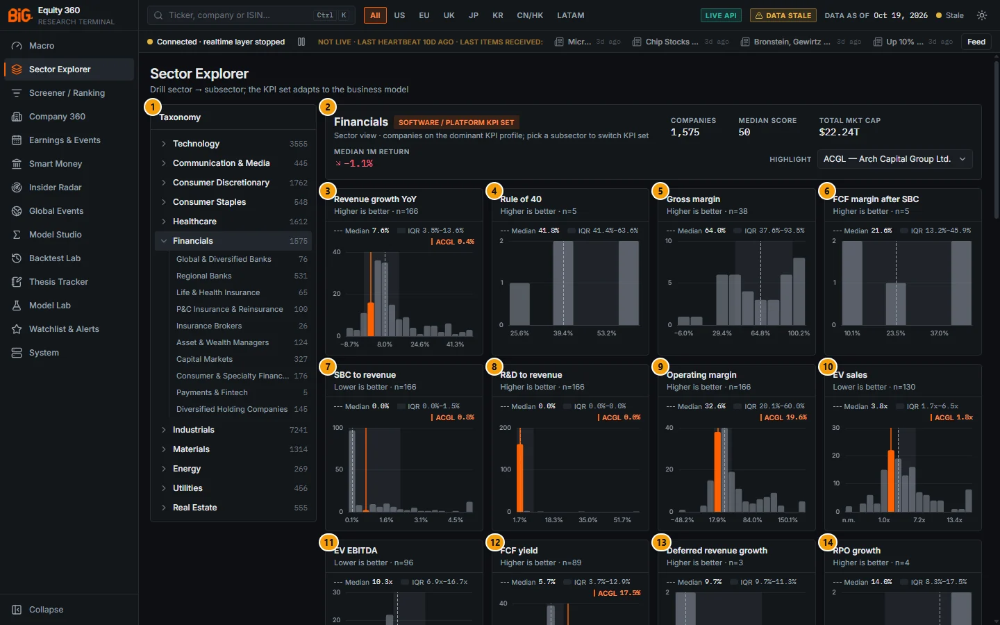

*Figure 3.12: Financials sector view (`/sectors?sector=FINS`, region All, highlight ACGL), data as of 19 Oct 2026. The first cards are software / fintech metrics with tiny n; drill into a subsector instead.*

| # | Panel | What it shows |
|---|---|---|
| 1 | Taxonomy | Financials expanded with its ten subsectors (Global & Diversified Banks 76, Regional Banks 531 … Payments & Fintech 5, Diversified Holding Companies 145) |
| 2 | Financials (header) | "Software / platform KPI set" badge; 1,575 companies, median score 50, total cap $22.24T, median 1M return −1.1%; highlight ACGL (Arch Capital) |
| 3 | Revenue growth YoY | Median 7.6%, ACGL 0.4% (n = 166) |
| 4 | Rule of 40 | Software KPI, n = 5 |
| 5 | Gross margin | n = 38 (most financials have no gross margin) |
| 6 | FCF margin after SBC | Software KPI, n = 5 |
| 7 | SBC to revenue | Median 0.0% (n = 166) |
| 8 | R&D to revenue | Median 0.0% (n = 166): uninformative for financials |
| 9 | Operating margin | Median 32.6%, ACGL 19.6% (n = 166) |
| 10 | EV sales | Median 3.8x, ACGL 1.8x (n = 130) |
| 11 | EV EBITDA | Median 10.3x (n = 96) |
| 12 | FCF yield | Median 5.7%, ACGL 17.5% (n = 89) |
| 13 | Deferred revenue growth | Software KPI, n = 3 |
| 14 | RPO growth | Software KPI, n = 4 |
| 15 | Opex leverage | Software KPI, n = 5 |
| 16 | ROIC | n = 158 |
| 17 | FCF margin | n = 147 |
| 18 | DSO | Services headline, n = 87 |
| 19 | Revenue per employee (USD) | Services KPI, n = 0 ("No distribution") |
| 20 | P/E TTM | n = 130 |
| 21 | Return on tangible equity | First bank KPI: median 13.3%, IQR 11.2%-17.9% (n = 82) |
| 22 | ROE | n = 168 |
| 23 | Net interest margin | n = 66 |
| 24 | Efficiency ratio | Lower is better, n = 47 |
| 25 | Cost of risk | Lower is better, n = 48 |
| 26 | NPL ratio | Lower is better, n = 21 (the 24-card cap stops here) |
| 27 | Leaders | Ten highest composites in Financials |
| 28 | Laggards | Ten lowest composites in Financials |
| 29 | Peer-group joint anomaly in this selection | Financial peer groups |

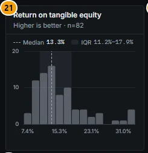

*Figure 3.13: The first bank KPI in the Financials sector view arrives at card 21 (callout 21).*

### Related mnemonics and BQL fields

- **Mnemonics:** `PEERS` with no security loaded opens the Sector Explorer; with a security it opens that company's Peers tab, as does `RV`. See [BQL and mnemonics](14-bql-mnemonics.md#command-bar-and-mnemonics).
- **BQL fields:** every sector KPI is a field `kpi.<kpi_id>` (for example `kpi.rule_of_40`, `kpi.nim`, `kpi.rote`, `kpi.combined_ratio`, `kpi.ffo_margin`); generic ratios such as `roic`, `gross_margin`; scores `composite`, `grade`, `f.<factor>`; universe functions `sector('Technology')` and `subsector(...)` in `for(...)`.
- **API:** `GET /api/v1/sectors` (tree with counts and medians), `GET /api/v1/sectors/{sector_id}?subsector_id=` (summary, KPI distributions, leaders, laggards, factor heatmap, revenue share), `GET /api/v1/sectors/{sector_id}/scatter?x=&y=`. The factor heatmap, revenue share and scatter are served but not displayed on this page.
- **Related sections:** [Scores and factors](04-screener.md#scores-and-factors), [Screener](04-screener.md#screener), [Company 360 Peers](05a-company-fundamentals.md#peers), [Data and coverage](01-data-and-coverage.md#coverage-by-region-and-known-gaps).
