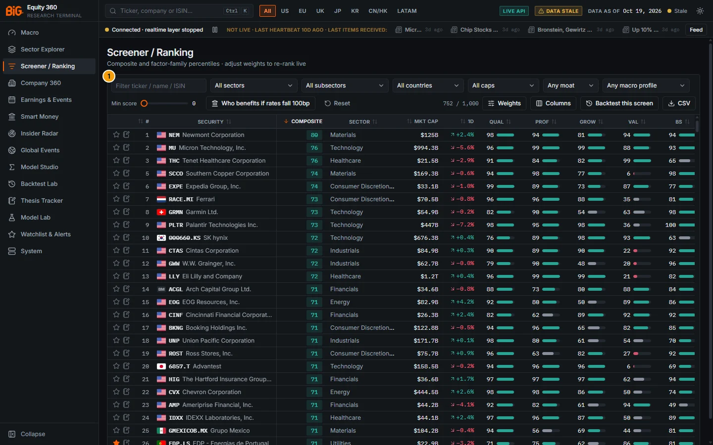
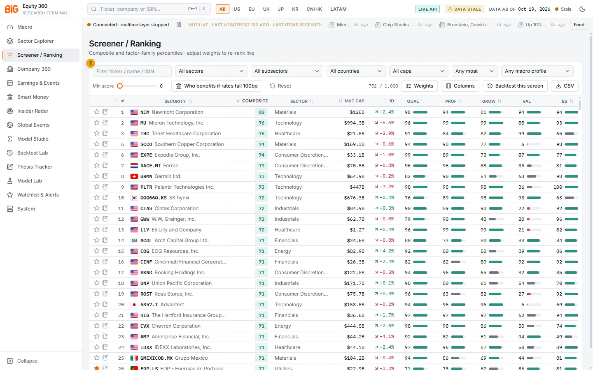
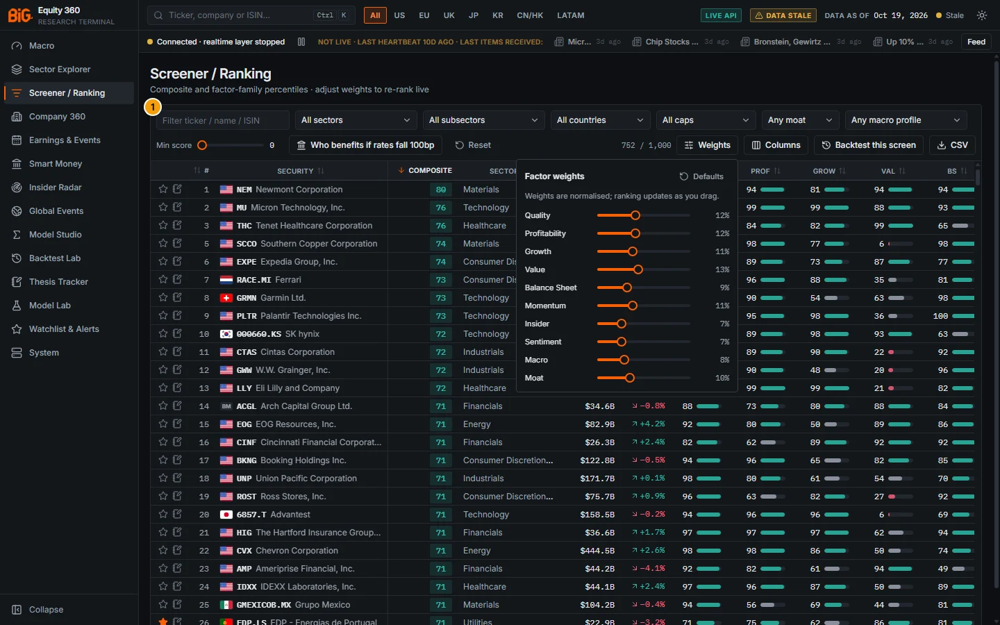
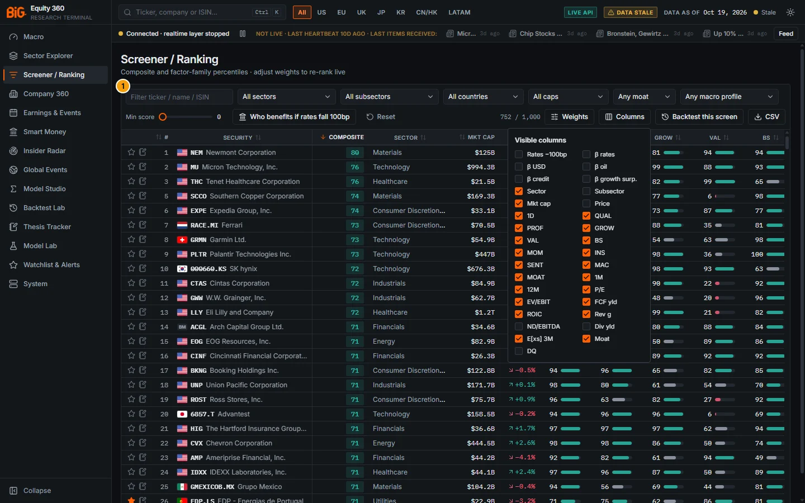
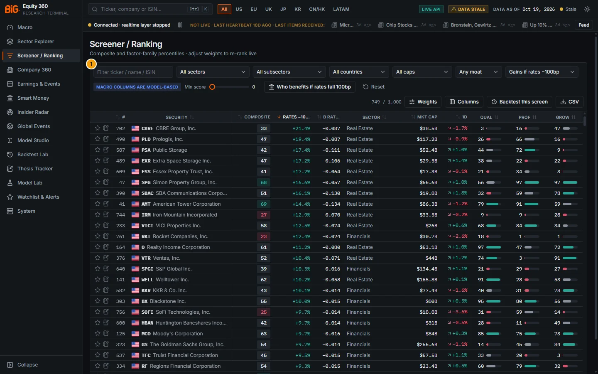
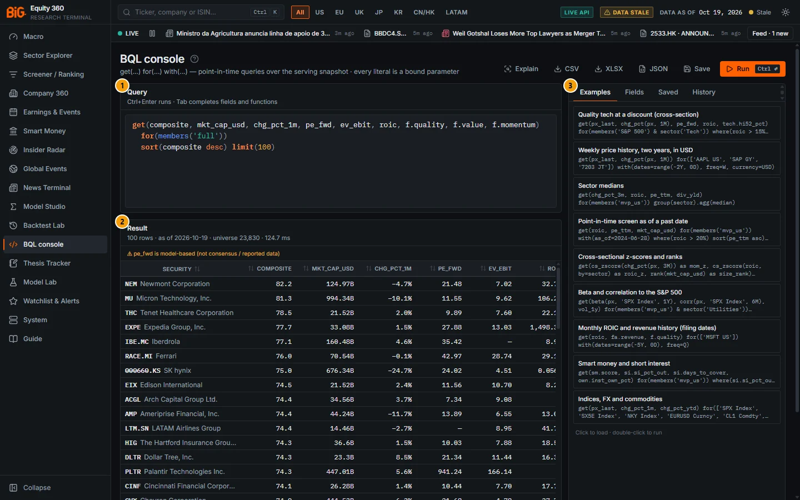

# 4. Screener and Ranking

The Screener ranks the equity universe on a composite of ten factor families and lets you re-weight the factors and watch the ranking change as you drag. This chapter describes the page and, in [Scores and factors](#scores-and-factors), the method behind every composite and factor score in the app (Screener, Sector Explorer, Company 360, BQL).

## Screener

**Route:** `/screener` · **Menu:** Screener / Ranking · **Mnemonics:** `EQS` · **Refresh:** nightly `scoring` job (default weekly profile = Saturday refresh; daily profile Tue-Sat); weights re-rank instantly in the browser

### Purpose

The Screener is the top-down ranking: it loads the 1,000 best-scoring stocks of the region, shows the composite score with its ten factor percentiles, and lets you filter by sector, subsector, country, size, moat class, minimum score and model-based macro sensitivity. The factor-weight sliders express a view ("more value, less momentum") and re-rank the list immediately. From here you can open a company, add it to the watchlist, start a thesis, export the list, backtest the screen point-in-time or open it as a BQL query.

### Screenshot



*Figure 4.1: Screener (`/screener`, region All, no filters, default weights), data as of 19 Oct 2026.*

| # | Panel | What it shows |
|---|---|---|
| 1 | Screener / Ranking | The whole working area: filter bar, action buttons and the ranked table |

The single panel has three regions:

- **Filter bar, first row:** the text filter ("Filter ticker / name / ISIN"), then All sectors, All subsectors, All countries, All caps, Any moat and Any macro profile.
- **Filter bar, second row:** the Min score slider (at 0), the "Who benefits if rates fall 100bp" preset, Reset, the counter "752 / 1,000" (rows shown / rows loaded; the current build shows all 1,000 with no filter, see below), and the Weights, Columns, Backtest this screen and CSV buttons. The current build also has an "Open as BQL" button between Backtest this screen and CSV; it was added after Figure 4.1 was captured (see [Controls](#controls) and Figure 4.6).
- **Table:** star (watchlist) and notebook (create thesis) icons, live rank, security with flag and ticker, Composite (sorted descending), Sector, Mkt cap, 1D, then the factor percentiles QUAL, PROF, GROW, VAL, BS; the remaining columns (MOM, INS, SENT, MAC, MOAT, 1M, 12M, P/E, EV/EBIT, FCF yld, ROIC, Rev g, E[xs] 3M, Moat) scroll to the right. Factor bars are teal at 67 and above, rose at 33 and below, grey in between; the Composite pill uses the same thresholds.

In Figure 4.1 Newmont leads with 80, followed by Micron and Tenet (76). Rank 4 is missing from the sequence because the build used for the screenshots hid rows with a missing factor score; the current build keeps them, flagged (see [Limitations and pitfalls](#limitations-and-pitfalls)).



*Figure 4.2: The same view in the light theme.*

| # | Panel | What it shows |
|---|---|---|
| 1 | Screener / Ranking | Same layout as Figure 4.1 |



*Figure 4.3: The Weights popover (click Weights). Ten sliders, Quality to Moat, at the defaults; the right-hand column shows each weight's share of the total (Quality 12%, Value 13%, Balance Sheet 9%, Insider and Sentiment 7% …). Defaults is at the top right.*

| # | Panel | What it shows |
|---|---|---|
| 1 | Screener / Ranking | The working area with the "Factor weights" popover open over the table: "Weights are normalised; ranking updates as you drag." |



*Figure 4.4: The Columns chooser (click Columns), in its default state. Unticked: Rates −100bp, β rates, β USD, β oil, β credit, β growth surp., Subsector, Price, ND/EBITDA, Div yld and DQ. Everything else is ticked.*

| # | Panel | What it shows |
|---|---|---|
| 1 | Screener / Ranking | The "Visible columns" list in two columns, one checkbox per optional column |



*Figure 4.5: The "Who benefits if rates fall 100bp" preset. The macro filter reads "Gains if rates −100bp", the "Macro columns are model-based" badge appears next to Min score, and the table is sorted on the Rates −100bp column (header truncated to "RATES −10…") next to β rates.*

| # | Panel | What it shows |
|---|---|---|
| 1 | Screener / Ranking | Counter 749 / 1,000. The top of the list is real estate (CBRE +21.4%, Prologis +19.4%, Public Storage +17.4%, Extra Space +17.2% …) followed by financials (Rocket, S&P Global, KKR, Blackstone …). The # column keeps the live composite rank (CBRE is 702nd) |



*Figure 4.6: "Open as BQL" from the Screener with default filters (region All, no filters, sorted on Composite): the BQL console (`/bql`) with the generated query already run, data as of 19 Oct 2026.*

| # | Panel | What it shows |
|---|---|---|
| 1 | Query | The generated query: `get(composite, mkt_cap_usd, chg_pct_1m, pe_fwd, ev_ebit, roic, f.quality, f.value, f.momentum) for(members('full')) sort(composite desc) limit(100)`. With no filters set there is no `where(...)` and no `region(...)` |
| 2 | Result | "100 rows · as of 2026-10-19 · universe 23,830 · 124.7 ms", the warning "pe_fwd is model-based (not consensus / reported data)", and the rows: Newmont 82.2, Micron 81.3, Tenet 78.5, Expedia 77.7, Iberdrola 77.1 … |
| 3 | Examples / Fields / Saved / History | The console's side panel with example queries (click to load, double-click to run) |

The result ranks on the stored balanced composite, so the scores differ from the Screener's live composite with default weights (Micron 81.3 here, 76 in Figure 4.1) and the order changes: Iberdrola, fifth here, is not among the first rows of Figure 4.1, because the screenshot build used different default weights and hid rows with a missing factor score (both changed since; see [Limitations and pitfalls](#limitations-and-pitfalls)). The console toolbar (Explain, CSV, XLSX, JSON, Save, Run) is described in [BQL console](14-bql-mnemonics.md#bql-console).

### Controls

#### Filters

All filters work in the browser on the 1,000 loaded rows and combine with AND. The region chips in the top bar (All, US, EU, UK, JP, KR, CN/HK, LATAM) decide which 1,000 rows are loaded.

| Control | What it does |
|---|---|
| Filter ticker / name / ISIN | Keeps rows whose ticker or name contains the text, or whose ISIN starts with it |
| All sectors | One sector (the list holds only sectors present in the loaded rows). Changing it clears the subsector |
| All subsectors | One subsector; the list follows the chosen sector |
| All countries | Country of listing |
| All caps | USD market-cap bucket: Mega ≥ $200bn, Large $10-200bn, Mid $2-10bn, Small $0.3-2bn, Micro < $0.3bn |
| Any moat | Wide, Narrow, None or Insufficient data (fewer than 5 years of history, or too few components) |
| Any macro profile (model-based) | Gains if rates −100bp, Loses if rates −100bp, Rate beta < 0, Rate beta > 0, USD beta > 0, Oil beta > 0, Has macro betas. Names without a macro estimate are excluded by every option |
| Min score | Slider 0-90 in steps of 5: keeps rows whose live composite (with your current weights) is at least this value |
| Show incomplete (n) | On by default. Shows the rows with one or more factors without a score; n is how many of the loaded rows are incomplete. Switch it off to see only rows with all ten factors |
| Counter `1,000 / 1,000` | Rows passing the filters / rows loaded |

#### Factor weights

| Control | What it does |
|---|---|
| Weights | Opens the factor-weight popover: "Weights are normalised; ranking updates as you drag and the top 1,000 is re-selected on the server when you stop." |
| Slider per factor (Quality … Moat) | Integer weight 0-30. The number on the right is that factor's share of the total in % |
| Defaults | Restores the default weights, which are the stored **balanced** profile: Quality 18, Profitability 12, Growth 12, Value 15, Balance Sheet 8, Momentum 12, Insider 5, Sentiment 5, Macro 5, Moat 8 |

Weights are saved in the browser (local storage) and used the next time the page loads. Weights still equal to the defaults of earlier builds (12 / 12 / 11 / 13 / 9 / 11 / 7 / 7 / 8 / 10) are moved to the new defaults once; weights you changed are kept. A factor-column header tooltip shows the factor name and its current weight ("Quality percentile (weight 18)"). While the server re-selects the rows, "re-selecting the top 1,000…" appears next to the counter.

#### Columns

| Control | What it does |
|---|---|
| Columns | Check-box list of every optional column. Hidden by default: Subsector, Price, ND/EBITDA, Div yld, DQ and the six macro columns. The star, #, Security and Composite columns are always shown and pinned on the left |
| Column header | Click to sort; click again to reverse. Composite descending is the default sort |

The columns available:

| Column | Content |
|---|---|
| # | Live rank under the current weights (over all 1,000 loaded rows, before filters) |
| Composite | Weighted composite of the factor percentiles with your weights, renormalised over the factors that have a score (as on the server). An amber "8/10" before the pill marks an incomplete row (hover: which factors have no score). No composite ("—", sorted last) when the factors with a score carry less than half of the weight |
| Grade | A-E quintile of the server composite under the weights of the last server request |
| Rates −100bp | Model-based impact of a parallel 100bp fall in rates (2y and 10y), current betas |
| β rates, β USD, β oil, β credit, β growth surp. | Model-based sensitivities: return per +100bp in the 10y yield; elasticity to the broad USD; elasticity to WTI; return per +100bp in the credit spread; per +100 points of the growth surprise index |
| Sector, Subsector | Taxonomy (see [Sector Explorer](03-sector-explorer.md#taxonomy)) |
| Mkt cap, Price, 1D | USD market cap, last price in trading currency, one-day change |
| QUAL, PROF, GROW, VAL, BS, MOM, INS, SENT, MAC, MOAT | Factor scores 0-100 with bar |
| 1M, 12M | Total return over one and twelve months |
| P/E | P/E NTM from the base-case forecast (model-based, not consensus) |
| EV/EBIT, FCF yld, ROIC, Rev g, ND/EBITDA, Div yld | Latest ratios (Rev g = revenue growth LTM) |
| E[xs] 3M | Model expected excess return over 63 trading days (ML model) |
| Moat | Wide / Narrow / None badge |
| DQ | Data quality: High (≥ 0.8), Medium (0.5-0.8 or unknown), Low |

#### Actions

| Control | What it does |
|---|---|
| Who benefits if rates fall 100bp | Resets the filters, sets the macro filter to "Gains if rates −100bp", shows the Rates −100bp and β rates columns and sorts by Rates −100bp, best first. Tooltip: "Model-based: shows the impact of a 100bp parallel fall in rates, keeps names that gain, sorted best first" |
| "macro columns are model-based" badge | Appears whenever a macro filter is active or a macro column is visible |
| Reset | Clears every filter and the sort (weights and columns are kept) |
| Backtest this screen | Sends the filters, sort and weights to the Backtest Lab, which re-evaluates the screen point-in-time at each monthly rebalance and opens a draft backtest. Fields without point-in-time history are reported (the text filter is ignored, P/E NTM becomes P/E TTM, the subsector is dropped). See [Backtest Lab](11-backtest-lab.md#backtest-entry-points) |
| Open as BQL | Opens the BQL console with the screen written as a `get / for / where / sort` query and runs it. A note appears when Min score is set: "min score uses the stored balanced composite (the Screener re-weights live)" |
| CSV | Downloads `big360-screener-YYYY-MM-DD.csv` with the filtered rows |

"Open as BQL" builds, for Technology, Large caps, Wide moat and Min score 60:

```
get(composite, mkt_cap_usd, chg_pct_1m, pe_fwd, ev_ebit, roic, f.quality, f.value, f.momentum)
  for(members('full') & sector('Technology'))
  where(mkt_cap_usd >= 10e9 and mkt_cap_usd < 200e9 and moat == 'wide' and composite >= 60)
  sort(composite desc) limit(100)
```

A region chip other than All adds `region(...)` to `for(...)`. The text filter, the macro filter and your factor weights are not carried over; the query ranks on the stored balanced composite. The console is described in [BQL and mnemonics](14-bql-mnemonics.md#bql-console).

The CSV holds: rank, id, ticker, name, isin, country, sector, subsector, market_cap_usd, composite (one decimal, empty when there is none), the ten factor scores (empty when missing), return_1m, return_12m, pe_ntm, ev_ebit, fcf_yield, roic, revenue_growth, moat_rating, data_quality, grade. Returns and ratios are decimal fractions (0.05 = 5%). `moat` is the Moat factor score and `moat_rating` the moat class (earlier builds called both `moat`). Rows follow the live rank, not the column you sorted on, and the macro columns are not exported.

#### Row actions

| Control | What it does |
|---|---|
| Row click | Opens the company in Company 360 |
| Star | Adds or removes the company from the watchlist (synced to the server). See [Watchlists and alerts](13-watchlists-alerts.md#watchlist--alerts) |
| Notebook icon | "Create thesis (thesis tracker)": opens a new thesis on the company, recording the origin "screener rank N". See [Thesis Tracker](12-thesis-tracker.md#thesis-editor) |

There is no saved-screen feature on this page. To keep a screen, use Open as BQL and save the query in the console as a screen (`members('screen:NAME')`).

### Methodology

What happens when the page loads and when you move a slider:

1. **Load.** The browser sends `POST /api/v1/screener/query` with the region, the current weights and `limit 1000`. The server computes the composite with those weights for every equity in the `full` universe, sorts descending and returns the top 1,000 with their ten factor scores and the extra columns.
2. **Re-rank.** Every slider move recomputes, for each loaded row, `Composite = Σ wᵢ · Fᵢ / Σ wᵢ` over the factors `i` that have a score (the server's rule: no composite when those carry less than half of the weight), and renumbers the live rank at once. About 0.6 s after the last slider move the page sends the new weights to the server, which re-selects the top 1,000 under them; the previous rows stay on screen meanwhile.
3. **Filter.** Text, sector, subsector, country, cap bucket, moat, min score and macro filter are applied to the re-ranked rows.

The factor scores, the server composite and their definitions are in [Scores and factors](#scores-and-factors).

The macro columns come from the weekly macro-exposure model (job `macro_exposures`): rolling regressions of weekly local-currency returns on weekly changes of official macro factors over the trailing 156 weeks (minimum 52), with Newey-West errors and empirical-Bayes shrinkage of each stock towards its sector median.

- **β rates** (and USD, oil, credit) are univariate betas.
- **β growth surp.** comes from a regression on the home economy's model-based surprise indices.
- **Rates −100bp** uses the joint model (2y, curve, breakevens, credit, USD, oil and the equity residual): impact `= exp(−β₂ᵧ) − 1` for a 100bp fall in the 2-year yield with the curve slope unchanged, that is a parallel fall in the 2y and 10y.

The method is described in [Markets and cross-asset](02b-markets-cross-asset.md#exposures).

> **Model-based:** the macro columns and filters, P/E NTM and E[xs] 3M are model outputs. The app marks the macro columns with the "macro columns are model-based" badge and column tooltips beginning "Model-based".

### Data sources and refresh

- **Factor scores and composite:** job `scoring` in the nightly DAG, after ratios / KPIs, valuation, insider signals, sentiment, the macro regime nowcast and the forecast. Inputs: official filings (yfinance fallback), Polygon / yfinance prices, Form 4 and other insider filings, news and GDELT sentiment, the weekly moat job.
- **Macro betas:** weekly DAG (`macro_exposures`).
- **E[xs] 3M:** nightly ML inference with the production model.
- **P/E NTM:** nightly forecast job (base case).
- **Cadence:** with the default weekly profile everything above runs in the Saturday 08:00 Lisbon refresh; the daily profile runs the nightly DAG Tue-Sat 01:30. The score date can trail the "Data as of" date by a session or two (Micron's scores on 19 Oct 2026 were dated 16 Oct).

### Validation status

- **Composite and factor scores:** a **descriptive**, peer-relative ranking, labelled **Descriptive** in the app (badge next to the Screener title, the Company 360 gauge and score breakdown, Leaders / Laggards and the Peers chart). No out-of-sample test on record shows predictive power: Model Studio run `SR20261012T0319222S5ZX` (factor scores → probability of a 3-month return above the cross-sectional mean, `mvp_us`, monthly from 2017, purged 5-fold) has an out-of-sample AUC of **0.490**, and the gate's own check on the 2024 scoring dates gives a rank IC of −0.003 (t −0.18) and an AUC of 0.502 (t 0.24). The app uses "signal", "predictive" or buy / sell wording only for a profile whose recorded out-of-sample gate passed (see [Validation status](#validation-status-1)); re-weighted composites are always descriptive.
- **Macro columns:** labelled model-based in the app ("macro columns are model-based" badge, column tooltips). Not formally validated as forecasts.
- **P/E NTM:** model-based base-case forecast, not consensus.
- **E[xs] 3M (ML model):** out-of-sample rank-IC about 0.035 (XGBoost): treat it as one input, not proven alpha. Backtests before 2026-10-10 use today's company list (survivorship bias) (`docs/USER_GUIDE.md` §3).
- **Momentum:** the 12-1 momentum measure that carries 35% of the Momentum factor did not pass when tested on its own in the Technicals v3 gate (IC 20d +0.011, t 1.6; FAIL) (`docs/TECHNICALS_V3_VALIDATION.md`, Verdict #1). The scoring factor itself was not separately tested.

### Correct usage and worked example

Start from a question, set the filters, then adjust the weights. Read the factor bars before the composite: two names on 72 can have opposite profiles. Open the company (row click) to see each factor's coverage and the metric-level percentiles on the [Overview](05a-company-fundamentals.md#overview) tab before acting.

**Worked example: why Micron is 81 in the Sector Explorer and 76 here.** Micron's factor scores on 19 Oct 2026 (live API) are Quality 95.5, Profitability 98.5, Growth 98.5, Value 87.6, Balance sheet 92.6, Momentum 87.6, Insider 14.2, Sentiment 18.9, Macro 59.7, Moat 58.8.

- With the **balanced profile** (the stored composite used by the Sector Explorer, Company 360 and BQL): `0.18·95.5 + 0.12·98.5 + 0.12·98.5 + 0.15·87.6 + 0.08·92.6 + 0.12·87.6 + 0.05·14.2 + 0.05·18.9 + 0.05·59.7 + 0.08·58.8 = 81.3`, grade A, global rank 2.
- With the **earlier Screener defaults** used in the screenshots (12/12/11/13/9/11/7/7/8/10): `(12·95.5 + 12·98.5 + 11·98.5 + 13·87.6 + 9·92.6 + 11·87.6 + 7·14.2 + 7·18.9 + 8·59.7 + 10·58.8) / 100 = 76.5`, shown as 76 in Figure 4.1.

Those earlier defaults gave Insider, Sentiment, Macro and Moat more weight than the balanced profile, which cost Micron about five points. Since 24 Oct 2026 **Defaults** restores the balanced profile itself (18 / 12 / 12 / 15 / 8 / 12 / 5 / 5 / 5 / 8), so the default Screener composite equals the stored composite.

**Worked example: a defensive screen.** Set All caps = Large, Any moat = Wide, raise Balance Sheet and Quality to 25, set Momentum and Sentiment to 0, and Min score to 60. The list now ranks large wide-moat companies mainly on quality and balance-sheet strength. Check the counter: if only a handful of rows remain, lower Min score rather than trusting a short list.

### Limitations and pitfalls

- **Only the top 1,000 are loaded.** The server picks them with your weights; after you change the weights the set is re-selected when the sliders stop. Narrow the region chip to load a different 1,000.
- **Incomplete rows.** A company with no score for one or more factors (for example no Growth score because it has fewer than two years of fundamentals) is ranked on the factors it has, as on the server, and flagged with "n/10". Until 24 Oct 2026 such rows were hidden (the counter read 752 / 1,000 with no filter, and the rank sequence skipped numbers, rank 4 in Figure 4.1). Use **Show incomplete** to hide them if you want like-for-like rows.
- **Two composites.** The Screener composite uses your weights; the Sector Explorer, Company 360, BQL `composite`, `grade` and Open as BQL use the stored balanced profile. With the default weights (= balanced) the two agree; after you move a slider they differ.
- **Grades.** The Grade column is the quintile of the server composite under your weights (after the re-selection). The stored balanced grade is on the API (`/companies/{id}/scores`) and in BQL (`grade`).
- **Sector-relative scores.** Factor percentiles are computed within sector × peer region, so a top-ranked bank and a top-ranked software company are each top of their own sector, not equally attractive in absolute terms.
- **Moat "Insufficient data"** is its own value now (filter and badge); young companies and those with fewer than seven years of history cannot be Wide.
- **Coverage outside US / JP / EU is thin.** Many securities in the `full` universe are price-only (audit F25: about 4,900 of 24,600 issuers have fundamentals); they cannot reach the top 1,000 without fundamental factors.
- **Model-based columns.** Macro betas, P/E NTM and E[xs] 3M are model outputs; use them as context, not targets. In Figure 4.5 the "Gains if rates −100bp" filter keeps 749 of the 752 displayed names: in this model almost every stock gains from a parallel fall in rates, so the information is in the size and ordering of the impact (real estate and financials first), not in its sign.
- **Open as BQL** sorts on the stored composite when the table is sorted on the composite, and drops the text and macro filters. A factor sort (including BS, Balance Sheet) is carried over as `sort(f.<factor> desc)`.
- **Backtest this screen** is a point-in-time re-run of the rules, not of today's list; it can hold different names than you see.

### Related mnemonics and BQL fields

- **Mnemonics:** `EQS` opens the Screener; `BQL` opens the console. See [BQL and mnemonics](14-bql-mnemonics.md#bql-console).
- **BQL fields:** `composite` (balanced, 0-100), `grade`, `rank_global`, `c.<profile>` / `grade.<profile>` / `rank_sector.<profile>` for each profile (balanced, quality_value, growth, momentum, defensive, ml_blend), `f.<factor>` with `.rank_sector` and `.chg_1m`, `moat`, `moat_score`, `dq_score`, `insider_signal`, `pe_fwd`, `ml.exp_excess_3m`, `ml.rank_pct_3m`, `macro.beta_rates`, `macro.beta_usd`, `macro.beta_oil`, `macro.beta_credit`, `macro.beta_growth`, `macro.rates_down_100bp`.
- **API:** `GET /api/v1/screener/fields`, `POST /api/v1/screener/query`, `POST /api/v1/screener/export`, `POST /api/v1/backtest/from-screen`.
- **Related sections:** [Sector Explorer](03-sector-explorer.md#sector-explorer), [Company 360 Overview](05a-company-fundamentals.md#overview), [Backtest Lab](11-backtest-lab.md#backtest-entry-points), [Watchlists and alerts](13-watchlists-alerts.md#watchlist--alerts), [Thesis Tracker](12-thesis-tracker.md#thesis-editor).

## Scores and factors

**Applies to:** Screener, Sector Explorer (Leaders, Laggards, Median score), Company 360 header and Overview (factor profile, score breakdown), BQL `composite`, `grade`, `f.*` · **Refresh:** nightly `scoring` job; monthly history for charts and BQL time series

### Purpose

Every company in the scored universe gets ten factor scores from 0 to 100 and a composite score from 0 to 100 with a grade from A to E. The scores answer one question: *how does this company compare with its closest peers, and with its own past, on each dimension?* They are relative and descriptive. This section is the reference for how they are built (`contracts/scoring.yaml`, `backend/app/analytics/scoring.py`).

### Methodology

#### Overview

```
metric value (point-in-time)
  → metric score 0-100  = blend of peer percentile, own-history score and (valuation only) size-adjusted score
  → factor score 0-100  = weighted mean of the factor's metric scores, re-percentiled within sector × peer region
  → composite 0-100     = weighted mean of the factor scores (profile or your weights)
  → grade A-E           = quintile of the composite over the scored universe
```

A score of 100 is always best: metrics where lower is better (P/E, net debt / EBITDA, cost of risk …) are flipped before ranking, and band metrics (loans / deposits, capex intensity …) are scored on `−|x − target|`.

#### Inputs and point-in-time rule

For an as-of date D, every input must have a knowledge date ≤ D.

- **Fundamentals:** the latest TTM row (FY, or half-year for semi-annual reporters, if no TTM) with period end within 400 days.
- **Valuation:** the last valuation row within 10 days of D.
- **Market metrics:** computed from adjusted closes and need at least 126 sessions of history.

The scored set of metrics for a company depends on its KPI set: the factor members (with the KPI-set overrides below), the KPI set's quality weights, the accounting block and the KPI set's headline metrics, minus the generic metrics the KPI set excludes (see [KPI sets](03-sector-explorer.md#kpi-sets)).

#### 1. Peer percentile

Each metric is ranked against peers by average rank: `percentile = (rank − 0.5) / n × 100`. The peer group is the first of these levels with at least **8** companies that have a valid value (the company included):

| Level | Peer group |
|---|---|
| 1 | subsector × peer region × size |
| 2 | subsector × peer region |
| 3 | subsector, global |
| 4 | sector × peer region |
| 5 | sector, global (used with as few as 3 if nothing else qualifies) |

- **Peer regions:** NA (US, Canada), EUROPE (UK, EU), JP, ASIA_EX_JP (Korea, other Asia-Pacific), GREATER_CHINA (China, Hong Kong), LATAM, GLOBAL (other).
- **Size buckets:** large ≥ $10bn, mid $2-10bn, small < $2bn. These are the scoring buckets, not the Screener's five cap buckets.
- **Momentum, sentiment and macro metrics:** compared across the whole peer region (falling back to global), not within subsectors.
- **Negative or missing multiples:** a P/E, EV/EBITDA, EV/sales, P/B, P/TBV or P/FFO that is ≤ 0 (negative earnings) gets the worst score, 5, instead of being dropped. The same applies to net debt / EBITDA when EBITDA is not positive.

#### 2. Own-history score

For fundamental and valuation metrics, the current value is compared with the company's own history:

```
z = (x − μ_hist) / max(σ_hist, 0.05·|μ_hist|),   clipped to ±3
self score = Φ(z) × 100
```

The history covers up to 10 years of quarter-end TTM rows (quarter-end valuation samples for multiples). It needs at least 8 observations spanning at least 5 years; otherwise there is no self score.

#### 3. Size-adjusted valuation score

For valuation metrics only (earnings yield, FCF yield, EV/EBITDA, EV/sales, P/E, P/B, P/TBV, P/FFO, dividend yield, shareholder yield), a cross-sectional regression within the peer group (at least 20 observations, else wider) asks whether the stock is cheap *for its size, quality and growth*:

```
log(multiple) = a + b·log(market cap) + c·Quality score + d·revenue CAGR 3y + residual
```

Yields are regressed without the log, and values are winsorised at 1% / 99%. The residual is direction-adjusted (cheaper than predicted = better) and turned into a percentile.

#### 4. Metric score

| Metric type | Blend |
|---|---|
| Fundamental (ratios, sector KPIs) | 70% peer + 30% own history |
| Valuation | 40% peer + 25% own history + 35% size-adjusted |
| Market, insider, sentiment, macro | 100% peer (scores already on 0-100 pass through) |

Missing components are dropped and the remaining weights renormalised (no history means 100% peer).

#### 5. Factor scores

| Factor | Members (default weights) | Overrides by KPI set | No data |
|---|---|---|---|
| Quality | 80% the KPI set's quality weights (e.g. software: Rule of 40 25%, FCF margin after SBC 20%, gross margin 15% …; banks: RoTE 25%, efficiency 20%, NIM 15% …) + 20% accounting block (Piotroski F 50%, Sloan accruals 25%, Beneish M 25%) | via the KPI set | null |
| Profitability | ROIC 25, gross profitability 20, operating margin 20, FCF margin 20, ROE 15 | banks: RoTE 40, ROE 30, PPOP / assets 30; insurers, REITs, utilities, consumer finance have their own | null |
| Growth | revenue growth 20, revenue CAGR 3y 20, EPS growth 15, EPS CAGR 3y 15, FCF / share CAGR 3y 15, gross-profit growth 10, revenue acceleration 5 | banks: BVPS CAGR 30, EPS CAGR 30, revenue 20, deposits 20; insurers: premiums and BVPS; REITs: FFO / AFFO per share | null |
| Value | FCF yield 25, earnings yield 20, EV/EBITDA 20, EV/sales 10, P/B 10, shareholder yield 10, reverse-DCF implied vs historical growth 5 | banks: earnings yield 35, P/TBV 35, dividend yield 30; REITs: P/FFO 50 …; holdings: P/B 60 | null |
| Balance sheet | net debt / EBITDA 25, interest coverage 20, Altman Z'' 20, cash / assets 15, current ratio 10, liabilities / assets 10 | banks: equity / assets 40, CET1 30, loans / deposits 30; insurers, REITs, consumer finance have their own | null |
| Momentum | 12-1 month return 35, 6-1 month 25, proximity to 52-week high 15, price vs 200-day average 15, 1-year volatility (lower better) 10 | none | null |
| Insider | rules-based insider signal 0-100 (passes through unchanged) | none | 50 |
| Sentiment | news sentiment EWM 30d 40, "Lazy Prices" filing similarity 40, GDELT tone EWM 7d 20 | none | 50 |
| Macro sensitivity | macro regime fit 70 (Σ current regime probability × the stock's return beta in that regime), absolute rate beta (lower better) 30 | none | 50 |
| Moat | moat score 0-100 (passes through unchanged) | none | null |

How a factor score is built:

- **Raw score:** the weighted mean of the available metric scores, with weights renormalised.
- **Coverage:** the weight share of members that have a real (non-imputed) value. Below **30%** the factor is null, except Insider, Sentiment and Macro, which are set to **50 (neutral) with coverage 0**.
- **Re-percentiling:** the raw score is re-ranked within **sector × peer region** (falling back to peer region, then global, when fewer than 8 companies), so factor scores are percentiles. Insider and Moat are already on a 0-100 scale and are not re-ranked.
- **Valuation confidence:** the reverse-DCF Value member is weighted by the forecast's valuation confidence and is dropped when confidence is below 40.
- **Smart money:** an optional smart-money member of the Insider factor exists but is switched off.

#### 6. Composite, profiles and grades

The stored composite is the weighted mean of the usable factor scores (coverage ≥ 30%, or a neutral 50), with weights renormalised over the factors present. A company needs at least **5** non-null factors, including at least **2** of Quality, Profitability, Value and Growth; otherwise its composite is null. The equivalent form shown on Company 360, "Composite = 50 + Σ weight × (score − 50)", gives the same number.

| Profile | Quality | Profit. | Growth | Value | Bal. sheet | Momentum | Insider | Sentiment | Macro | Moat |
|---|---|---|---|---|---|---|---|---|---|---|
| balanced (default) | 18 | 12 | 12 | 15 | 8 | 12 | 5 | 5 | 5 | 8 |
| quality_value | 25 | 15 | 5 | 25 | 10 | 5 | - | - | - | 15 |
| growth | 15 | 15 | 30 | 5 | - | 20 | - | 5 | - | 10 |
| momentum | 10 | - | 15 | - | - | 40 | 10 | 15 | 10 | - |
| defensive | 25 | 10 | - | 15 | 25 | - | - | - | 10 | 15 |
| Screener defaults | 12 | 12 | 11 | 13 | 9 | 11 | 7 | 7 | 8 | 10 |

- **ml_blend** profile: `0.5 × balanced + 0.5 × the production 3-month ML model's rank percentile`. It is available in BQL (`c.ml_blend`) and the API, not on the Screener.
- **Custom weights** (Screener, `factor_weights` in the API): the weights are normalised to sum to 1, and the composite is the weighted mean over the non-null factors. It is null when the factors present carry less than half of the requested weight.
- **Grade:** quintile of the composite over the scored universe. A = top 20%, B = next 20%, down to E = bottom 20%. With custom weights the API grades over the requested universe before filters.
- **Ranks:** `rank_global`, and `rank_sector` within sector × peer region.

#### What 50 means

50 is the middle of the peer distribution. It is also the value given to Insider, Sentiment and Macro when there is **no data** (no insider filings in the region, no news coverage, no macro betas), with coverage 0. A 50 on those three factors is therefore "neutral or unknown", not "average evidence"; check the coverage on Company 360. Quality, Profitability, Growth, Value, Balance sheet, Momentum and Moat are never filled with 50: when they lack data they are null and drop out of the composite.

### Data sources and refresh

- **Job:** `scoring` (nightly DAG). It writes `peer_scores` (every metric with its peer group key, level, count, median, peer percentile, self z, size-adjusted score and metric score), `factor_scores` (score, coverage, rank in sector, one-month change) and `composite_scores` (per profile: score, grade, ranks, coverage, data-quality score). In history mode it writes month-end scores for the last 10 years, which feed the ML models and the BQL history.
- **Upstream jobs:** `ratios_kpis`, `valuation_daily`, `insider_signals`, `sentiment_daily`, `macro_regime_nowcast` and `forecast` (nightly); `moat` and `macro_betas` (weekly); `composite_ml_blend` after ML inference.
- **Data-quality score:** the mean data-quality score of the fundamental inputs; the Screener's DQ column buckets it (High ≥ 0.8, Low < 0.5).
- **Sources and coverage:** see [Data and coverage](01-data-and-coverage.md#data-sources-by-domain).

### Validation status

- **Composite and factors: descriptive.** They are a transparent, rules-based peer ranking, not a model fitted on returns, so they carry no "model-based" label; they carry a **Descriptive** badge instead, and the API marks every composite `label: descriptive` (`/companies/{id}/overview` and `/scores` → `composite.label`, `/screener/query` → `composite_label`, `/meta/factors` → `composite_validation`). No out-of-sample test on record shows predictive power: Model Studio run `SR20261012T0319222S5ZX` (factor scores → probability of a 3-month return above the cross-sectional mean, `mvp_us`, monthly from 2017, purged 5-fold) has an out-of-sample AUC of **0.490**, and the gate's own check on the 2024 scoring dates gives a rank IC of −0.003 (t −0.18) and an AUC of 0.502 (t 0.24).
- **Out-of-sample gate (coverage v3, 2026-11).** The manual job `composite_validation` records the gate in `data/reports/composite/gate.json`. It keeps **one scoring date per calendar month** (the month's last: the nightly scores next to the month-end history would otherwise add near-duplicate, overlapping dates and overstate the t-statistic), joins it to the first ML label date on or after it (the label's return starts the next session, so nothing known on the scoring date is in it; each label date is used once) and computes, per date, the Spearman rank IC with the sector-relative 3-month excess return and the AUC for a positive excess return. A profile **passes** only when, over at least 24 scoring months, the mean rank IC is above 0 and the mean AUC is above 0.5, each with a Newey-West t of at least 2 (one-sided p < 0.025). Only a full run counts: a run on a sample, a date window or a subset of the profiles is written to `data/reports/composite/runs/` and never replaces the live gate. **Survivorship:** the stored score history applies today's MVP universe to every past month (universe membership history only starts on 2026-10-10), so the gate masks the panel by point-in-time universe membership and only scoring months on or after that start can decide a pass. With fewer than 24 such months the gate records the full-history figures as survivorship-biased and the verdict is never a pass (earliest possible pass: about January 2029, once the 24 months October 2026 to September 2028 have matured 3-month labels). A pass applies **only to the population it was tested on**: the gate records its securities and score scope (today the MVP US universe, US-listed ADRs included), and a composite outside it (an extended-scope score, a home listing in Tokyo, a mixed Screener page) stays **Descriptive**. Only then does the badge read **Validated signal** and allow signal wording; Peers and Sector Explorer, which mix regions and scopes, always show **Descriptive**; a failed or missing gate keeps **Descriptive**. Thresholds: `contracts/scoring.yaml` `composite.validation`. No profile has passed.
- **Inputs that are models:**
  - the reverse-DCF member of Value (forecast, confidence-weighted);
  - Macro regime fit and rate beta (model-based regime probabilities and betas);
  - Sentiment (FinBERT / XLM-R news sentiment, GDELT tone).
- **Insider factor:** uses the rules-based insider signal only. The insider XGBoost model showed no out-of-sample edge and is not used (`docs/USER_GUIDE.md` §6).
- **ml_blend:** the ML model behind it has an out-of-sample rank-IC of about 0.035 (XGBoost): one input, not proven alpha.
- **Moat thresholds:** calibrated on live data (2026-10-11) so that Wide stays a minority: Wide needs a score ≥ 75, ROIC > WACC in ≥ 90% of years and ≥ 7 years of history; Narrow needs a score ≥ 55 and ≥ 60% persistence. This is a classification rule, not a validated forecast.
- **12-1 momentum:** see the Screener [validation status](#validation-status): the stand-alone 12-1 momentum test failed the Technicals v3 gate.

### Correct usage and worked example

Use the scores to find where to look, then read the evidence: open the company, check coverage, the peer group used for each metric and the self-history score. A high composite built on a 50 Insider / Sentiment / Macro with zero coverage is a fundamentals-and-price ranking only.

**Worked example 1: Micron's gross margin and EV/EBITDA (live API, scores as of 16 Oct 2026).** Micron is in the semis KPI set, peer group `subsector_region_size: semiconductors | NA | large`.

- **Gross margin** 80.7%: peer percentile 97.4 (top of 19 peers, peer median 58.3%), own-history z = 2.41 so self score 99.2. Metric score `0.7 × 97.4 + 0.3 × 99.2 = 97.9`.
- **EV/EBITDA** 8.8x against a peer median of 29.7x: peer percentile 96.9 (16 peers), self score 58.0, size-adjusted score 92.5. Metric score `0.40 × 96.9 + 0.25 × 58.0 + 0.35 × 92.5 = 85.6`.
- **R&D intensity (3y)** 9.4% against a peer median of 20.5%: metric score 9.9, which pulls Quality down. Quality still ends at 95.5 after re-percentiling within Technology × NA.

**Worked example 2: peer widening for JPMorgan (live API).** JPM's peer group for most bank metrics is `subsector_region_size` (global banks × NA × large, 8-10 peers). For **NIM** fewer than 8 of those peers report the inputs, so the level widens to `subsector_global` (14 peers). JPM's NIM of 5.5% is at the 96.4th peer percentile, self score 92.2, metric score `0.7 × 96.4 + 0.3 × 92.2 = 95.1`. For **P/TBV** 2.81x the three components are 25.0 (peer), 1.7 (own history: the most expensive in its 10-year range) and 32.1 (size-adjusted), giving `0.40 × 25.0 + 0.25 × 1.7 + 0.35 × 32.1 = 21.7`. JPM's composite is 65.1 (grade A, global rank 104), with Profitability 98.1 and Growth 90.1 but Value 14.9 and Balance sheet 13.6.

### Limitations and pitfalls

- **Relative, not absolute.** Factor scores are percentiles within sector × peer region; a 90 Value in a richly valued sector can still be an expensive stock. The composite does not rank sectors against each other.
- **Small peer groups.** With 8 peers, one place in the ranking moves the percentile by about 12 points. Look at the peer count on Company 360.
- **Missing data is not penalised for most factors.** Null fundamental factors drop out and the remaining weights are renormalised; a company with only five factors can outrank one with ten.
- **Neutral 50.** For Insider, Sentiment and Macro, no data scores 50. In regions without insider filings (or before the news history starts, about August 2026) these factors carry no information.
- **History.** Factor history is monthly; growth and own-history components need at least two fiscal years and five years respectively. Survivorship: universe membership history starts on 2026-10-10.
- **Accounting outliers.** A ratio computed on a tiny denominator (ROIC above 100%, for example) still gets a top percentile; the own-history z is capped at ±3 but the peer rank is not.
- **Do not read the composite as an expected return or a buy / sell signal.** It is descriptive: no out-of-sample test shows predictive power (AUC 0.49), and no profile has passed the out-of-sample gate (see [Validation status](#validation-status-1)).

### Related mnemonics and BQL fields

- **BQL:** `composite`, `grade`, `rank_global`, `c.<profile>`, `grade.<profile>`, `rank_sector.<profile>`, `f.quality` … `f.moat` (aliases `quality_score` …), `f.<factor>.rank_sector`, `f.<factor>.chg_1m`, `moat_score`, `insider_signal`, `dq_score`, `kpi.<kpi_id>`. Scores have monthly point-in-time history; the `grade` snapshot does not.
- **API:** `GET /api/v1/companies/{security_id}/scores` (composite, factors with coverage and rank in sector, every metric with its peer group, peer count, peer percentile, self z, size-adjusted and metric score, monthly history, accounting flags).
- **Mnemonics:** `DES` (Company 360 overview with the factor profile and score breakdown), `EQS`, `PEERS`.
- **Related sections:** [Company 360 Overview](05a-company-fundamentals.md#overview), [Moat](05a-company-fundamentals.md#moat), [Sector Explorer](03-sector-explorer.md#sector-explorer), [Methodology appendix](16-methodology.md#gate-status-of-every-model).
