# 5A. Company 360: fundamentals

Company 360 is the single-company page of BiG Equity 360. This chapter covers how to open it, the header that sits above every tab, and the eight fundamental tabs: Overview, Financials, Forecast, Peers (with the peer-group joint anomaly panel), Moat, Insiders, Ownership and News & Sentiment. The Technicals tab is covered in [5B](05b-company-technicals.md#technicals). Macro, Earnings, Event risk, Network & Geo and Model are covered in [5C](05c-company-macro-events-model.md).

All worked examples use the snapshot with data as of 19 Oct 2026 (built 22 Oct 2026). Valuation outputs carry the forecast job date, 16 Oct 2026.

---

## Company 360 at a glance

**Route:** `/company/:id` · **Menu:** Company 360 · **Mnemonics:** `DES` (and the tab mnemonics listed per section) · **Refresh:** with each data refresh (weekly profile by default, daily optional)

### Purpose

Company 360 brings everything the app knows about one listed company onto one page: scores, statements, model-based valuation, peers, competitive position, insider and institutional activity, news and, on the other tabs, technicals, macro exposure, earnings, events and the ML ranking. Analysts use it to prepare a view on a name. Portfolio managers use it to check a name surfaced by the Screener, a watchlist alert or a thesis.

### Screenshot

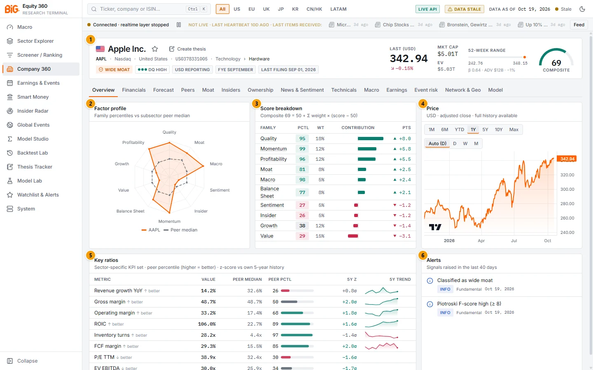

*Figure 5A.1: Company 360 for Apple (`/company/AAPL`), light theme, data as of 19 Oct 2026.*

| # | Panel | What it shows |
|---|---|---|
| 1 | Company header | Name, identifiers, badges, price, size, 52-week range and composite gauge (see [Company header](#company-header)) |
| 2 | Factor profile | Radar of the ten factor scores against the peer median |
| 3 | Score breakdown | How each factor moves the composite away from 50 |
| 4 | Price | Adjusted close with range and bar-interval controls |
| 5 | Key ratios | The sector-specific KPI set with peer percentile and self-history z-score |
| 6 | Alerts | Current flags raised for the company |

The page follows the app theme (sun / moon toggle in the top bar). The dark theme is used in the rest of this chapter.

### Controls

| Control | What it does |
|---|---|
| Opening the page | Search with **Ctrl+K** (ticker, name or ISIN), type a mnemonic such as `AAPL US Equity DES`, or click any company row in the Screener, Sector Explorer, peer tables, watchlists or alert feeds |
| `:id` in the URL | Accepts a ticker (`AAPL`, `ASML.AS`, `7203.T`, `PETR4.SA`) or an internal security id. `/company` without an id opens Microsoft (`/company/MSFT`). Index, FX and futures ids are redirected to the instrument page (`/instruments/:id`) |
| Tab strip | 14 tabs: Overview, Financials, Forecast, Peers, Moat, Insiders, Ownership, News & Sentiment, Technicals, Macro, Earnings, Event risk, Network & Geo, Model. On narrow screens the strip wraps onto a second row |
| `?tab=` deep link | Each tab has a URL id: `overview`, `financials`, `forecast`, `peers`, `moat`, `insiders`, `ownership`, `sentiment`, `technicals`, `macro`, `earnings`, `events`, `network`, `model`. Clicking a tab updates the URL (without adding a browser history entry), so the address can be shared or bookmarked. An unknown or missing value opens Overview |
| Retry | If the overview request fails, an error panel with a retry button replaces the page |
| `?` icon | Next to Create thesis in the header: opens this guide at the section of the current tab (tooltip "Guide: how this page works"). Typing `HELP` in the command bar opens the in-app guide (`/help`) |

### Methodology

The page is a front end over the company endpoints of the API (`/api/v1/companies/{security_id}/overview`, `/financials`, `/forecast`, `/peers`, `/moat`, `/insiders`, `/ownership`, `/sentiment` and others). The ticker in the URL is resolved to the internal security id first. Each tab loads its own data only when it is opened, so a slow tab never blocks the header or the Overview.

**ADR detection.** A listing is treated as an ADR when its name contains "ADR" or "ADS", or when it trades on a US venue (NYSE, Nasdaq, NYSE Arca, NYSE American, Cboe BZX, OTC Markets), the issuer is not American and no composite score exists. The app then looks up the home listing of the same issuer and shows the ADR banner described under [Company header](#company-header).

### Data sources and refresh

Every number on the page comes from the serving snapshot built at the end of the refresh pipeline. With the default **weekly** schedule profile the nightly, weekly and (when due) monthly job chains run on Saturday morning (Lisbon time). With the **daily** profile the nightly chain runs Tuesday to Saturday at 01:30 and the weekly chain on Saturday. See [Data and coverage](01-data-and-coverage.md) for sources and point-in-time rules. The data date is shown in the top bar ("Data as of").

### Validation status

Not applicable to the page as a whole. Each tab section below states the validation status of its models.

### Correct usage and worked example

Open Apple from the command bar: type `AAPL` and press Enter, or `AAPL US Equity FA` to land directly on the Financials tab (`/company/AAPL?tab=financials`). To send a colleague the valuation, copy the address while on the Forecast tab: `/company/AAPL?tab=forecast`.

### Limitations and pitfalls

- Coverage differs by market. US names have the deepest fundamentals, insider and ownership data. Several tabs show an empty or "pending" state for names outside the main coverage, which means "no data", not "nothing happened".
- Tab data are as of the snapshot, not live. The realtime layer (new-filing badge, live news) is separate and may be stopped (top-bar status).

### Related mnemonics and BQL fields

- `DES` opens Overview. `FA` and `DVD` open Financials, `EE` Forecast, `RV` and `PEERS` Peers, `HDS`, `SI` and `SMRT` Ownership, `CN` the News Terminal (or News & Sentiment when the News Terminal is not installed), `GP` and `TECH` Technicals, `ERN` Earnings, `EVTS` Event risk, `NET` Network & Geo, `THES` a new thesis. There is no mnemonic for Moat or Insiders. Full list: [BQL console and mnemonics](14-bql-mnemonics.md).
- In the BQL console, most header and tab values are queryable, for example `get(composite, grade, moat, fair_value, dcf_upside) for(['AAPL'])`.

---

## Company header

**Route:** `/company/:id` (every tab) · **Menu:** Company 360 · **Mnemonics:** `DES` · **Refresh:** with each data refresh; new-filing badge polled every 2 minutes

### Purpose

The header is the summary card that stays on top of all 14 tabs. It identifies the security, gives its size, price position and composite score at a glance, and holds the two actions you take most often from a company page: add it to the watchlist and open a thesis.

### Screenshot

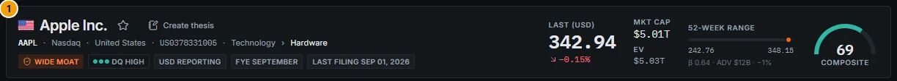

*Figure 5A.2: Company header for Apple, data as of 19 Oct 2026.*

The header has a left block (identity and badges) and a right block (market data and composite).

| Element | What it shows |
|---|---|
| Flag, name | Country flag and issuer name |
| Watchlist star | Adds or removes the company from your watchlist (filled = on the list) |
| Create thesis | Opens the Thesis Tracker with this company pre-filled as the subject |
| `?` icon | Opens the user guide at the section of the tab you are on |
| Ticker · exchange · country · ISIN · sector › subsector | Identity line. The sector name links to the Sector Explorer for that sector |
| ADR banner | Only for ADRs (see Figure 5A.3) |
| Moat badge | Wide moat, Narrow moat or No moat (see [Moat](#moat)) |
| DQ badge | Data-quality bucket with three dots: DQ high, DQ med, DQ low; hover for the definition and any notes |
| `XXX reporting` | Reporting currency of the financial statements |
| `FYE <month>` | Fiscal year-end month |
| `Last filing <date>` | Date of the most recent filing ingested for the issuer |
| New filing badge | Appears only when the realtime layer has seen new filings for the company; hover for the five latest, click to open the latest |
| Last (currency) | Last close in the trading currency, with the one-day change |
| Mkt cap, EV | Market capitalisation and enterprise value, in USD |
| 52-week range | Low and high with a marker at the current price; underneath: `β` (1-year beta), `ADV` (average daily traded value, USD, 20 days) and the distance from the 52-week high |
| Composite gauge | Composite score 0-100 (balanced profile); green from 67, red at or below 33. The **Descriptive** badge under it: a peer ranking, not a forecast (hover for the out-of-sample evidence) |

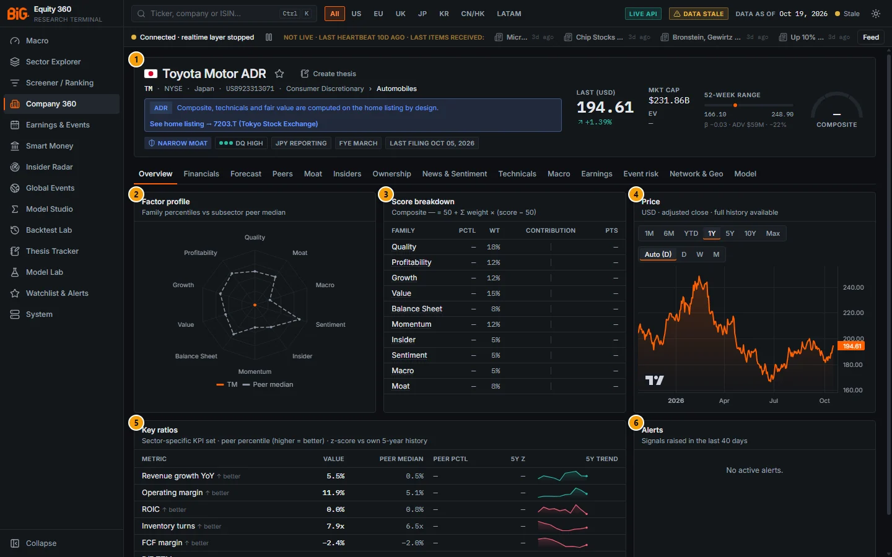

*Figure 5A.3: Toyota Motor ADR (`/company/TM`), data as of 19 Oct 2026. The banner links to the home listing 7203.T.*

| # | Panel | What it shows |
|---|---|---|
| 1 | Company header | ADR banner: "Composite, technicals and fair value are computed on the home listing by design", with the link "See home listing → 7203.T (Tokyo Stock Exchange)" |
| 2 | Factor profile | Empty radar: ADRs have no factor scores |
| 3 | Score breakdown | All families show "—" and the composite is "—" |
| 4 | Price | The ADR's own USD price history |
| 5 | Key ratios | Ratios of the issuer (shared with the home listing); peer percentiles and z-scores are not computed for the ADR |
| 6 | Alerts | "No active alerts" |

### Controls

| Control | What it does |
|---|---|
| Watchlist star | Toggles membership of your watchlist. The list is stored in this browser (it is not shared with other users) and drives the watchlist filters and alert rules (see [Watchlists and alerts](13-watchlists-alerts.md)) |
| Create thesis | Opens `/theses/new` with subject type "security", the company id and origin "company" pre-filled (see [Thesis Tracker](12-thesis-tracker.md)) |
| `?` icon (next to Create thesis) | Opens the in-app guide (`/help`) at the section for the current tab, for example this chapter's Forecast section from `?tab=forecast`. Hover: "Guide: how this page works" |
| Sector link | Opens the Sector Explorer on the company's sector |
| DQ badge hover | Shows "Data quality: high — full statements, point-in-time, reconciled" (or the medium / low text) and notes such as "stale fundamentals" |
| New filing badge | Hover lists up to five recent filings with time; click opens the latest filing in a new browser tab |
| See home listing → | On ADR pages, opens the home listing's Company 360 |
| 52-week strip hover | The small grey line has the tooltip "Beta · average daily traded value · distance from 52-week high" |

### Methodology

- **Market data.** Last close, one-day change, 52-week high and low, 20-day average dollar volume, market cap and enterprise value come from the serving snapshot (`quote` block of the overview endpoint). Market cap and EV are in USD at the snapshot FX rate.
- **Beta.** The header `β` is the **1-year beta of daily log returns against the region benchmark**. It is a different number from the beta in the cost of capital (3-year weekly regression, Blume-adjusted and shrunk to the subsector, see [Forecast](#forecast)). Apple shows β 0.64 in the header and 1.12 in the cost of capital.
- **Composite gauge.** The composite of the default ("balanced") factor profile, 0-100 (see [Overview](#overview)). The A-E grade (quintiles of the global scored universe) is not drawn on the gauge; it is shown in the Screener and available as the BQL field `grade`.
- **DQ badge.** The composite's `dq_score` (mean data-quality score of the fundamental inputs, 0-1) bucketed as high (≥ 0.8), medium (≥ 0.5) or low (< 0.5). A missing score shows as medium.
- **Moat badge.** The latest moat class. A company classified "insufficient data" shows a dashed **Moat: insufficient data** badge (earlier builds showed **No moat**); the Moat tab states "insufficient history to classify a moat".
- **Fiscal year-end** comes from the issuer reference data (month only).

### Data sources and refresh

Prices from Polygon (US) and yfinance or national sources (other markets), FX from the FX job, reference data from the identity jobs, filings from SEC EDGAR and the national filing systems. The header refreshes with each snapshot. The new-filing badge is the only live element: it polls the realtime filings feed every two minutes and listens to the streamed feed while the realtime layer runs.

### Validation status

Not applicable (reported data). The composite is a ranking, not a validated return forecast; see [Overview](#overview).

### Correct usage and worked example

Apple on 19 Oct 2026: last close 342.94 USD (−0.15%), market cap $5.01T, EV $5.03T, 52-week range 242.76-348.15 with the marker near the top (1% below the high), β 0.64, ADV $12B, composite 69. Badges: wide moat, DQ high, USD reporting, FYE September, last filing 1 Sep 2026.

Toyota is a cross-listed example. The Tokyo line 7203.T has a composite of 57 (Figure 5A.8). The NYSE ADR TM shows "—" because composite, technicals and fair value are computed on the home listing by design: use the banner link to jump to 7203.T before drawing conclusions.

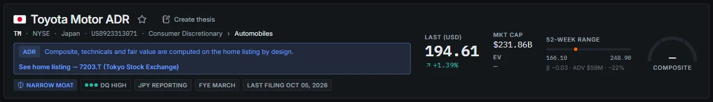

*Figure 5A.4: ADR header for Toyota Motor ADR (`/company/TM`): the info banner, the "See home listing → 7203.T (Tokyo Stock Exchange)" link, and an empty composite gauge and EV.*

The market-data values in an ADR header belong to the US line (price 194.61 USD, 52-week range 166.10-248.90, β −0.03, ADV $59M), while the moat, DQ, reporting-currency and fiscal-year badges are the issuer's.

### Limitations and pitfalls

- **Do not compare header beta with WACC beta.** They use different windows, frequencies and adjustments.
- Market cap and EV are in USD even when the price is in another currency.
- On ADR pages the factor, score and fair-value panels are intentionally empty. If the home listing is not in the universe, the banner says "Home listing not found in the universe".
- The watchlist lives in the browser profile. Clearing site data or using another machine starts with an empty list.

### Related mnemonics and BQL fields

`DES`, `THES`. BQL: `px_last`, `chg_pct_1d`, `market_cap_usd`, `beta_1y`, `composite`, `grade`, `moat`, `dq_score`.

---

## Overview

**Route:** `/company/:id?tab=overview` · **Menu:** Company 360 › Overview · **Mnemonics:** `DES` · **Refresh:** with each data refresh

### Purpose

The Overview answers "where does this company stand against its peers and its own history?". It shows the ten factor scores against the peer median, how they add up to the composite, the price, the sector-specific key ratios and any current flags. It is the first stop after the Screener and the place to see why a name ranks where it does.

### Screenshot

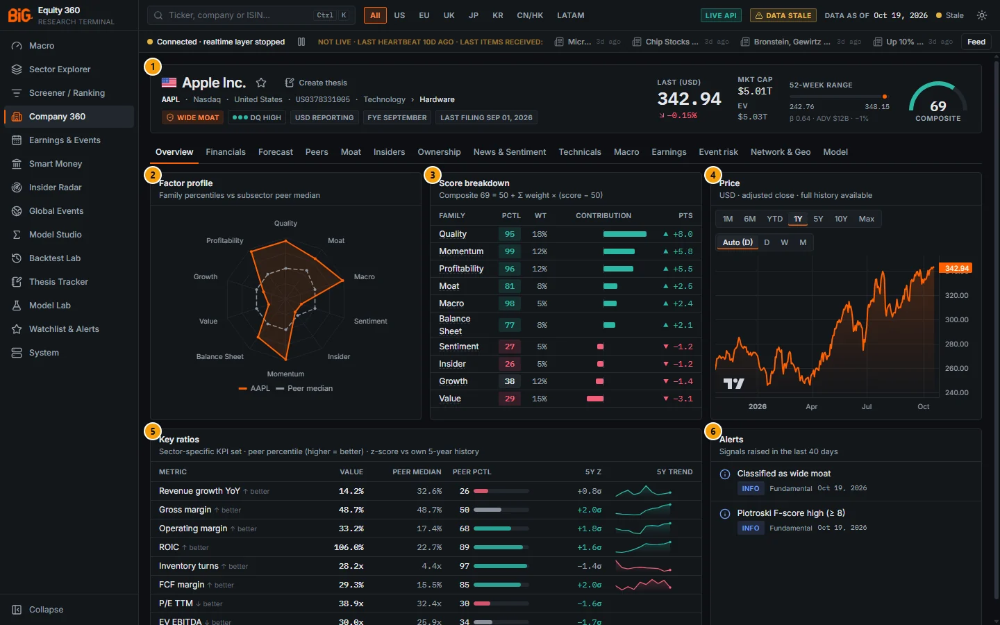

*Figure 5A.5: Overview tab for Apple (`/company/AAPL?tab=overview`), data as of 19 Oct 2026.*

| # | Panel | What it shows |
|---|---|---|
| 1 | Company header | See [Company header](#company-header) |
| 2 | Factor profile | Radar of the ten factor percentiles (orange) against the peer median (dashed) |
| 3 | Score breakdown | "Composite 69 = 50 + Σ weight × (score − 50)": percentile, weight and points contributed by each factor family, sorted by contribution |
| 4 | Price | Adjusted close as an area chart, default range 1Y, "full history available" |
| 5 | Key ratios | Sector-specific KPI set: value, peer median, peer percentile bar, 5y z and trend sparkline |
| 6 | Alerts | "Signals raised in the last 40 days": current flags with severity, category and date |

### Controls

| Control | What it does |
|---|---|
| Radar hover | Shows the company's and the peer median's value for each factor |
| Family name hover (Score breakdown) | Dotted-underlined names show a tooltip with the key-ratio metric scores that belong to that factor |
| Price range | `1M`, `6M`, `YTD`, `1Y` (default), `5Y`, `10Y`, `Max` |
| Bar interval | `Auto (D)` and `D`, `W`, `M`. Auto uses daily bars up to 1Y, weekly for 5Y and 10Y, monthly for Max. If daily bars are capped (10 years), a "weekly (daily capped at 10y)" badge appears. The right-hand note gives the first available date ("History from …") |
| Key ratios row hover | Highlights the row; the `↑ better` / `↓ better` hint after each label gives the metric's direction |
| Beneish breakdown | When a Beneish alert is raised, an expandable "Breakdown" line under the alert shows the eight indices, their contributions, the growth-neutral M-score, red flags and corroboration |

### Methodology

#### Factor scores and the composite

Every metric is scored in up to three ways and blended into a 0-100 metric score (contract `contracts/scoring.yaml`):

1. **Against peers.** Percentile within the peer group. Peer groups are tried in order, and the first with at least 8 companies with a value wins: subsector × peer region × size bucket, subsector × peer region, subsector (global), sector × peer region, sector (global). Peer regions are North America, Europe, Japan, Asia ex-Japan, Greater China, Latin America and Global.
2. **Against its own history.** A z-score of the current value against the company's own history (10-year window, at least 5 years and 8 observations), direction-adjusted so that a positive z is always "better than usual": `z = d × (x − μ_hist) / σ_hist`, with `d = +1` when higher is better and `−1` when lower is better, clipped at ±3 and turned into a score with the normal CDF.
3. **Against market cap** (valuation metrics only). Within the peer group (at least 20 names), `log(multiple)` is regressed on `log(market cap)`, the quality factor score and 3-year revenue growth; the residual percentile ("cheap versus what its size and quality justify") is the third component.

The blend weights are peer 0.70 / self 0.30 for fundamental ratios and peer 0.40 / self 0.25 / market-cap 0.35 for valuation metrics; market, insider, sentiment and macro metrics use the peer percentile only. Missing components are renormalised away.

Metric scores are averaged into ten **factor families**: Quality, Profitability, Growth, Value, Balance sheet, Momentum, Insider, Sentiment, Macro sensitivity and Moat. Each family score is then re-percentiled within peer region × sector (at least 8 names, else the peer region), so a family score is itself a percentile. A family with less than 30% coverage is null for fundamental families and set to 50 (neutral) for the others.

The **composite** is the weighted mean of the family scores with coverage ≥ 0.3, weights renormalised:

```
composite = Σ_f w_f × score_f  /  Σ_f w_f        (equivalently 50 + Σ_f w_f × (score_f − 50) when Σ w_f = 1)
balanced weights: Quality 18%, Value 15%, Profitability 12%, Growth 12%, Momentum 12%,
                  Balance sheet 8%, Moat 8%, Insider 5%, Sentiment 5%, Macro 5%
```

A composite needs at least five non-null families including at least two of Quality, Profitability, Value and Growth. Grades A-E are quintiles of the global scored universe.

#### Panels

- **Factor profile.** The orange polygon is the company's family scores. The dashed polygon is the median family score of companies in the same **sector** and region (at least 8 names, else the global sector). Because family scores are percentiles within region × sector, this median sits close to 50 for most families; it departs from 50 mainly for Insider and Moat, where many companies share the same value.
- **Score breakdown.** Each row shows the family percentile (`Pctl`), the default-profile weight (`Wt`), a bar and the points it adds or removes: `points = weight × (score − 50)`. The rows are sorted from the largest positive to the largest negative contribution, and the title restates the composite. The composite itself is the API value; small rounding differences against the sum of the rows are normal.
- **Price.** Adjusted close (splits and dividends) in the trading currency.
- **Key ratios.** The KPI set of the company's business model from `contracts/sector_kpis.yaml` (for example inventory turns for hardware, net interest margin and efficiency ratio for banks, R&D to revenue for semiconductor equipment). Columns: value; peer median of the peer group used by scoring; peer percentile (higher = better, already direction-adjusted); `5y z`, the direction-adjusted self-history z-score described above (positive = better than the company's own history); and a sparkline of the annual history.
- **Alerts.** Current flags computed for the snapshot date, each shown with the snapshot date. The flags are: insider cluster buy; CEO or CFO open-market buy; Altman Z″ below 1.1 ("distress zone", critical); Beneish screen (model-based; "Beneish screen" warning when the recalibrated, growth-neutral M-score is above −1.78 with corroborating red flags, "Beneish watch" info when only the textbook M-score is above −1.78; not applied to financials and REITs); classified as wide moat; Piotroski F-score ≥ 8; fundamentals stale (last period end more than 400 days before the price date); new 52-week high or low; ML ranking model in the top decile (3M); data-quality score below 0.6.

### Data sources and refresh

Fundamentals from SEC XBRL, EDINET / TDnet, ESEF and national filing systems, with yfinance as a fallback where no official filing is available; prices from Polygon and yfinance or national exchanges. The `scoring` job runs in the nightly chain; the moat input is weekly. The ratio history comes from `/companies/{id}/ratios` (fiscal years, up to 10).

### Validation status

- **Composite and factor scores: descriptive.** A transparent, rules-based ranking, not a model trained on returns, with **no out-of-sample edge on record** (Model Studio, factor scores → 3M outperformance: AUC 0.490). The header gauge and the Score breakdown carry a **Descriptive** badge; "signal" or buy / sell wording appears only if a profile passes the out-of-sample gate (see [Scores and factors](04-screener.md#validation-status-1)). No "model-based" label is attached because there is no estimated model; treat them as a structured description.
- **Beneish screen:** labelled **model-based** in the alert ("A statistical screen, not an accounting finding; high sales growth alone lifts the textbook score"). The 19 Oct 2026 audit (finding F15) found the textbook rule flagged 4.6% of names, mostly hyper-growth; the screen was then recalibrated to the growth-neutral version and downgraded to a warning.
- **ML top decile flag:** labelled model-based; the ML model's out-of-sample rank-IC is about 0.035 (see [Model](05c-company-macro-events-model.md#model)).

### Correct usage and worked example

**Apple (Figure 5A.5).** Composite 69, grade A, rank 43 globally and 4th in its sector. The breakdown shows the score is carried by Quality (95th percentile, +8.0 points), Momentum (99th, +5.8) and Profitability (96th, +5.5), offset by Value (29th, −3.1), Growth (38th, −1.4), Insider (26th, −1.2) and Sentiment (27th, −1.2). Key ratios are compared within "hardware networking, North America, large caps" (17 peers): revenue growth 14.2% against a peer median of 32.6% (26th percentile) but +0.8σ against Apple's own history; ROIC 106.0% against 22.7% (89th percentile, +1.6σ); P/E TTM 38.9x against 32.4x (30th percentile, −1.6σ, i.e. more expensive than Apple's own history). Alerts: "Classified as wide moat" and "Piotroski F-score high (≥ 8)".

Read it as: a high-quality, expensive large cap whose rank rests on quality and momentum rather than value.

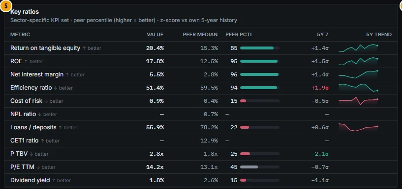

*Figure 5A.6: Key ratios for JPMorgan Chase (`/company/JPM?tab=overview`), bank KPI set, data as of 19 Oct 2026.*

**JPMorgan (bank KPI set).** The KPI set changes with the business model: return on tangible equity 20.4% (85th percentile), ROE 17.8% (95th), net interest margin 5.5% (96th), efficiency ratio 51.4% against a peer median of 59.5% (lower is better; 94th percentile), cost of risk 0.9% (15th). NPL ratio and CET1 show "—" because JPMorgan's values are not in the data. Composite 65: Quality, Profitability, Growth and Momentum lift it; Value (15th percentile, −5.3 points) and Balance sheet (14th, −2.9) hold it back.

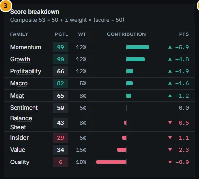

*Figure 5A.7: Score breakdown for Petrobras (`/company/PETR4.SA?tab=overview`), data as of 19 Oct 2026.*

**Petrobras.** Composite 53. Momentum (99th, +5.9) and Growth (90th, +4.8) are offset by Quality at the 6th percentile (−8.0 points). Several key ratios (EBITDA margin, net debt to EBITDA, FCF yield, EV/EBITDA) show "—" for the company: check the Financials tab before relying on the Value and Balance-sheet scores.

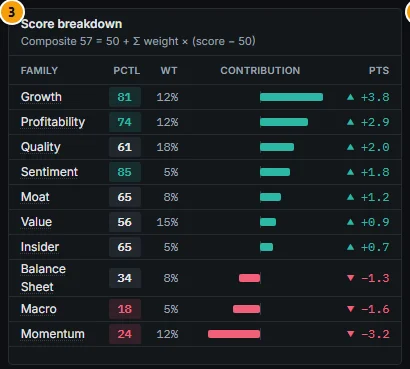

*Figure 5A.8: Score breakdown for Toyota Motor on its home listing (`/company/7203.T?tab=overview`), data as of 19 Oct 2026.*

**Toyota (7203.T).** Composite 57 with Growth (81st), Profitability (74th) and Quality (61st) positive and Momentum (24th, −3.2) and Macro (18th, −1.6) negative.

The two European examples follow the same layout: ASML (`/company/ASML.AS`, composite 68, wide moat) and SAP (`/company/SAP.DE`, composite 57, narrow moat).

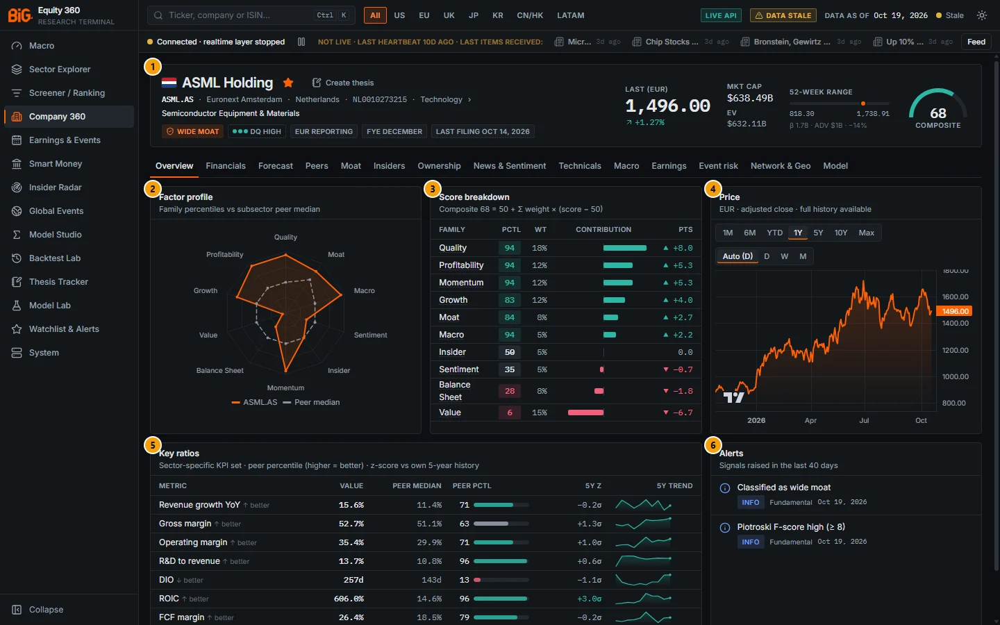

*Figure 5A.9: Overview for ASML Holding on Euronext Amsterdam (`/company/ASML.AS?tab=overview`), data as of 19 Oct 2026.*

| # | Panel | What it shows |
|---|---|---|
| 1 | Company header | EUR price, wide moat, EUR reporting, FYE December |
| 2 | Factor profile | ASML.AS against the sector peer median |
| 3 | Score breakdown | Composite 68: Quality, Profitability and Momentum at the 94th percentile; Insider 50 (neutral); Value at the 6th percentile (−6.7 points) |
| 4 | Price | EUR adjusted close |
| 5 | Key ratios | Semiconductor-equipment KPI set, scored against global subsector peers (fewer than 8 European peers) |
| 6 | Alerts | "Classified as wide moat" and "Piotroski F-score high (≥ 8)" |

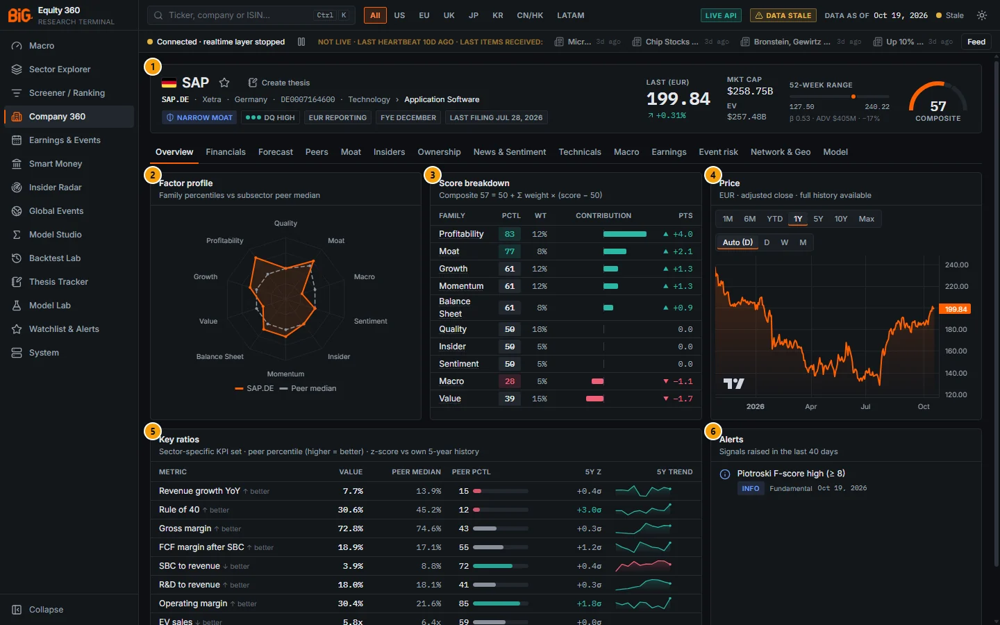

*Figure 5A.10: Overview for SAP on Xetra (`/company/SAP.DE?tab=overview`), data as of 19 Oct 2026.*

| # | Panel | What it shows |
|---|---|---|
| 1 | Company header | EUR price, narrow moat, EUR reporting |
| 2 | Factor profile | SAP.DE against the sector peer median |
| 3 | Score breakdown | Composite 57: Profitability (83rd percentile) and Moat (77th) add most; Macro (28th) and Value (39th) subtract |
| 4 | Price | EUR adjusted close |
| 5 | Key ratios | Software KPI set |
| 6 | Alerts | "Piotroski F-score high (≥ 8)" |

### Limitations and pitfalls

- **Percentiles are relative.** A 95th percentile Quality score in a weak sector is not the same as in a strong one. Check the peer group level: when a subsector × region group is too small, scoring falls back to wider groups (ASML's key ratios use global semiconductor-equipment peers).
- **The radar's dashed line is the sector × peer-region median** (the subtitle says so; earlier builds called it a subsector median), and it is close to 50 by construction for most families.
- **"5y z" uses up to 10 years of history** (5 years minimum), and its sign is direction-adjusted. A negative z on P/E means "more expensive than usual", not "lower P/E". Its colour follows that sign (teal = better than the company's own history, rose = worse, from |z| ≥ 1.5); builds before 24 Oct 2026 flipped it a second time for lower-is-better metrics, so a cheap P/E was coloured rose.
- **Score breakdown tooltips list only the key-ratio metrics** of each family, not every metric that feeds it.
- **Alerts are current-state flags.** They all carry the snapshot date; the "last 40 days" in the subtitle is not a look-back window over historical alerts.
- Implausible values usually mean a data problem, not a business fact (for example an ROIC of several hundred percent, or 0.0% for a large industrial). Check the Financials tab and the DQ badge before acting on them.
- A composite of "—" means the minimum-coverage rule failed (or the page is an ADR).

### Related mnemonics and BQL fields

`DES`, `EQS` (Screener). BQL: `composite`, `grade`, `grade.<profile>`, `f.quality`, `f.profitability`, `f.growth`, `f.value`, `f.balance_sheet`, `f.momentum`, `f.insider`, `f.sentiment`, `f.macro`, `f.moat` (each also `.rank_sector`, `.chg_1m`), `dq_score`, `roic`, `gross_margin`, `pe_ttm`, `ev_ebitda`. See [Screener and Ranking](04-screener.md) for profiles, custom weights and the full factor definitions.

---

## Financials

**Route:** `/company/:id?tab=financials` · **Menu:** Company 360 › Financials · **Mnemonics:** `FA`, `DVD` · **Refresh:** nightly chain (filings and normalisation); weekly full rebuild

### Purpose

The Financials tab shows the standardised income statement, balance sheet and cash-flow statement as filed, annual or quarterly, in the reporting currency or in USD, as values, common-size percentages or growth rates. Use it to check the numbers behind a ratio, to see the trend of a line and to export the statements.

### Screenshot

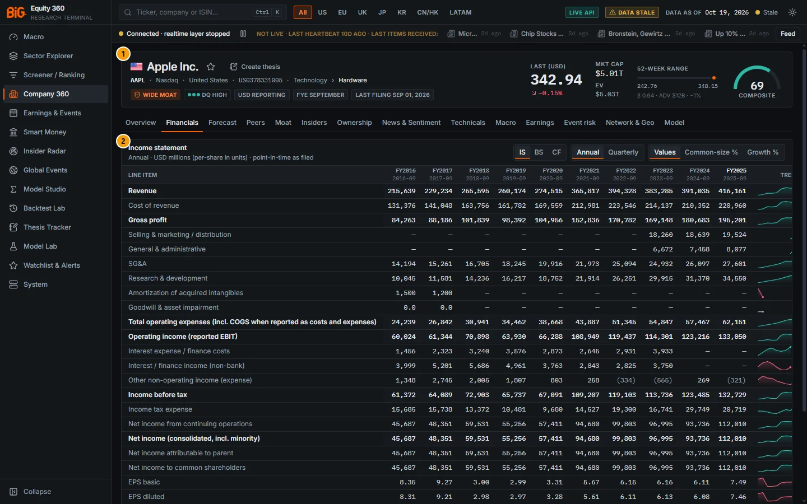

*Figure 5A.11: Financials tab for Apple (`/company/AAPL?tab=financials`), income statement, annual, data as of 19 Oct 2026.*

| # | Panel | What it shows |
|---|---|---|
| 1 | Company header | See [Company header](#company-header) |
| 2 | Income statement | "Annual · USD millions (per-share in units) · point-in-time as filed": up to ten fiscal years (FY2016-FY2025 for Apple), with the period-end month under each year and a trend sparkline per line |

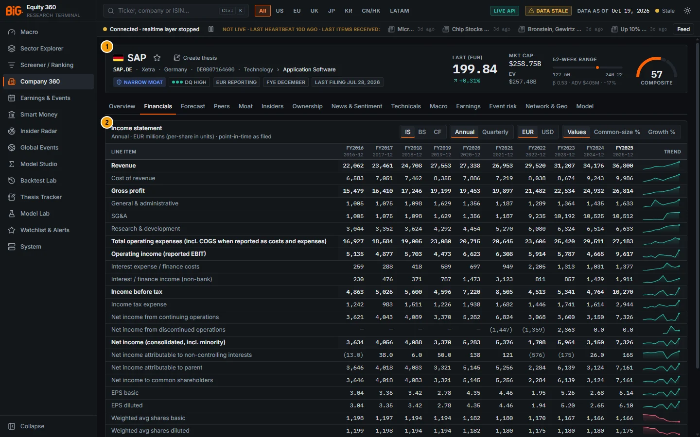

*Figure 5A.12: Financials tab for SAP (`/company/SAP.DE?tab=financials`), EUR, with the EUR / USD switch, data as of 19 Oct 2026.*

| # | Panel | What it shows |
|---|---|---|
| 1 | Company header | EUR reporting |
| 2 | Income statement | Annual, EUR millions; the `EUR` / `USD` segmented control appears because the reporting currency is not USD |

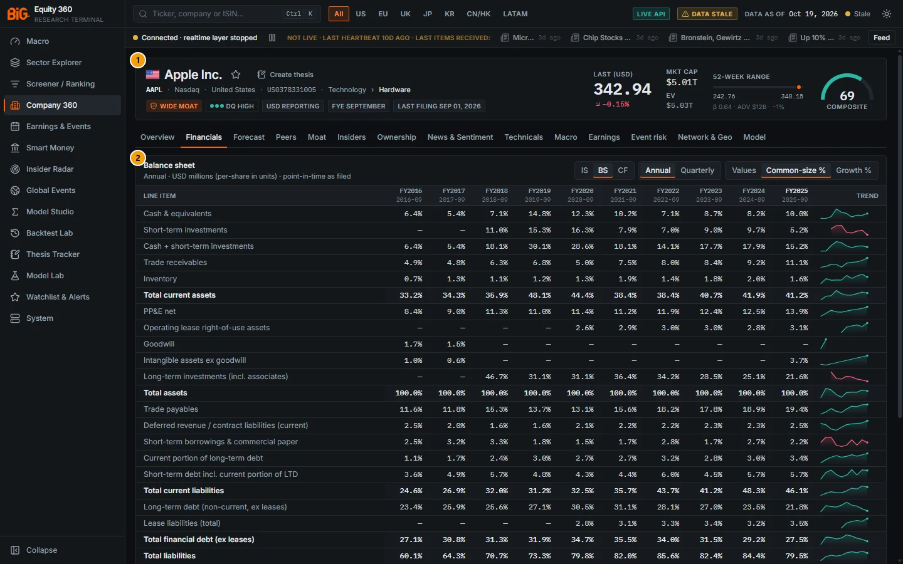

*Figure 5A.13: Balance sheet for Apple in the Common-size % view (`/company/AAPL?tab=financials`, `BS` then `Common-size %`), data as of 19 Oct 2026.*

| # | Panel | What it shows |
|---|---|---|
| 1 | Company header | See [Company header](#company-header) |
| 2 | Balance sheet | Each line as a share of total assets (total assets = 100.0% in every year): for FY2025 cash and short-term investments 15.2%, total current assets 41.2%, long-term investments 21.6%, total liabilities 79.5% |

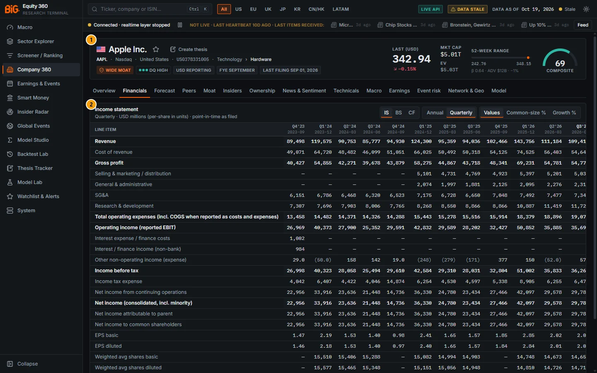

*Figure 5A.14: Income statement for Apple, Quarterly view, data as of 19 Oct 2026.*

| # | Panel | What it shows |
|---|---|---|
| 1 | Company header | See [Company header](#company-header) |
| 2 | Income statement | Twelve fiscal quarters (Q4'23 to Q3'26), labelled by fiscal quarter with the calendar period-end month underneath (Apple's fiscal Q1 ends in December) |

### Controls

| Control | What it does |
|---|---|
| `IS` / `BS` / `CF` | Income statement, balance sheet, cash-flow statement (hover shows the full name) |
| `Annual` / `Quarterly` | Fiscal years (up to 10) or fiscal quarters (up to 12) |
| Reporting currency / `USD` | Shown only for non-USD reporters. USD converts each period at that period's FX rate ("Converted at period-end FX") |
| `Values` / `Common-size %` / `Growth %` | Amounts; each currency line as a share of revenue (IS and CF) or of total assets (BS); or year-on-year growth (quarterly: same quarter of the prior year) |
| Trend sparkline | Per-line history over the displayed periods |
| `CSV` (bottom right) | Downloads the current view as `<id>-<statement>-<period>-<view>.csv` |
| Horizontal scroll | The line-item column stays pinned on the left |

### Methodology

- **Standardised line items.** Reported items are mapped to the canonical line-item dictionary (`contracts/canonical_line_items.yaml`). Lines with no value in any displayed period are hidden. Totals (revenue, gross profit, operating income, EBIT, EBITDA, pre-tax income, net income, totals, CFO, CFI, CFF, FCF) are shown in bold.
- **Point-in-time storage.** Every value is stored with its knowledge date (the filing date). Restatements are kept as new versions rather than overwriting the original. The tab shows, for each period, **the latest version known at the snapshot date**, so a restated year shows the restated number. The API can also return statements "as known on" an earlier date (`as_of` parameter), but the tab has no control for it; backtests and the BQL console use the point-in-time versions.
- **Units.** Amounts are in millions of the reporting currency (or USD); per-share lines (EPS, DPS) in units; share counts in millions. Negative values are shown in parentheses.
- **Common-size and growth** are computed in the browser from the displayed values: `line / revenue` (or `/ total assets`) for common-size, `x_t / |x_{t−k}| − x_{t−k} / |x_{t−k}|` for growth with `k = 1` year or 4 quarters (this form keeps the sign meaningful when the base is negative).
- **USD view.** Uses the per-period FX implied by the API's USD values, i.e. each period at its own period-end rate, so USD growth rates mix business growth and currency moves.

### Data sources and refresh

US: SEC XBRL (10-K, 10-Q, 20-F, 40-F). Japan: EDINET and TDnet. Europe: ESEF via filings.xbrl.org and national systems (FCA, AFM, BaFin and others); Hong Kong: HKEX; Brazil: CVM; China, Korea and Taiwan per the coverage notes in [Data and coverage](01-data-and-coverage.md). Where no official filing is available, yfinance fills the gap and the DQ badge reflects it. Filings are ingested and normalised in the nightly chain; the weekly chain runs a full rebuild.

### Validation status

Not a model. Data quality is checked by the data-quality jobs (DQ badge, System › Data Health). See [System](15-system.md).

### Correct usage and worked example

Apple, annual income statement (Figure 5A.11): revenue grew from 215,639 (FY2016, USD millions) to 416,161 (FY2025); operating income (reported EBIT) 133,050 in FY2025; diluted EPS 7.46. To see margins, switch to `Common-size %`: each line becomes a share of revenue. On the balance sheet (Figure 5A.13) the same view expresses every line as a share of total assets: Apple's total liabilities were 79.5% of assets in FY2025 against 60.1% in FY2016. The Quarterly view (Figure 5A.14) shows the seasonality of the December quarter (fiscal Q1): revenue 143,756 in Q1'26 against 102,466 in Q4'25. Note the gaps in the quarterly data: the interest lines are empty after Q4'23, and weighted share counts are missing in the fiscal Q4 columns, which come from the annual report rather than a 10-Q. To check whether a high ROIC on the Overview is genuine, open `BS` and look at total equity and debt over several years.

SAP (Figure 5A.12) reports in EUR. Switch to `USD` only when comparing with US peers in absolute size; keep EUR for trend analysis.

### Limitations and pitfalls

- **Semi-annual reporters.** Many European, UK and Australian companies publish half-year accounts only. The tab offers Annual and Quarterly; for half-year reporters the Quarterly view may be sparse or empty.
- **"Point-in-time as filed" means the latest version known**, not the first-reported number. For first-reported values use the BQL console or the Backtest Lab.
- **Mapping differences.** Lines such as "SG&A" versus "selling and marketing" depend on how the company tags its filing. A dash can mean "not reported separately". Apple, for example, shows separate selling and G&A lines only from FY2023.
- Older periods sourced from a provider rather than an official filing may have estimated knowledge dates.
- Growth in the USD view includes currency effects.

### Related mnemonics and BQL fields

`FA`, `DVD` (dividends: DPS, payout and yield rows). BQL: the `fa.*` statement fields (for example `fa.revenue`, `fa.short_term_debt`) and the ratio fields; use `with(currency=USD)` for conversion. See [BQL console](14-bql-mnemonics.md).

---

## Forecast

**Route:** `/company/:id?tab=forecast` · **Menu:** Company 360 › Forecast · **Mnemonics:** `EE` · **Refresh:** nightly chain (`forecast` job)

### Purpose

The Forecast tab gives a **model-based** five-year projection of the company's statements with bear, base and bull cases, and the resulting fair value, 12-month target, cost of capital, sensitivity grid and reverse DCF. It is not a consensus estimate: the app has no consensus data. Use it to understand what the current price implies and how sensitive a value is to its assumptions, not as a price target.

> **Model-based:** every number on this tab comes from the app's own projection and valuation models. The `EE` mnemonic is labelled "MODEL-BASED, not consensus".

### Screenshot

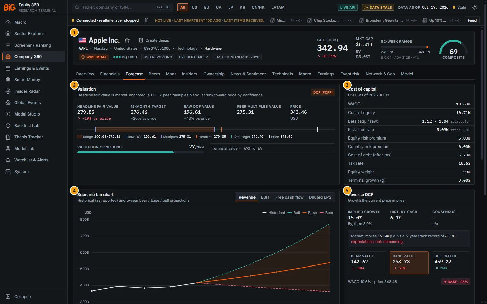

*Figure 5A.15: Forecast tab for Apple (`/company/AAPL?tab=forecast`), valuation as of 16 Oct 2026, data as of 19 Oct 2026.*

| # | Panel | What it shows |
|---|---|---|
| 1 | Company header | See [Company header](#company-header) |
| 2 | Valuation | "Headline fair value = 0.25 × bear + 0.5 × base + 0.25 × bull; each scenario a DCF × peer-multiples blend shrunk toward price by confidence, discounted with the market-implied ERP of the region" (the screenshot shows the earlier wording "Headline fair value is market-anchored: …"): headline fair value, 12-month target, raw DCF value, peer multiples value, price, the fair-value range bar, valuation confidence 0-100 with reasons, terminal-value share and flags. A badge names the model: DCF (FCFF) or Excess-return model |
| 3 | Cost of capital | WACC, cost of equity, beta (adjusted / raw, with source), risk-free rate (with series), equity and country risk premia, after-tax cost of debt, tax rate, equity weight, terminal growth |
| 4 | Scenario fan chart | Historical values (as reported) and the 5-year bear / base / bull paths with the shaded bear-bull band |
| 5 | Reverse DCF | "Growth the current price implies": implied growth, historical 5-year CAGR, consensus (always n/a), a verdict line and the bear / base / bull values |
| 6 | Projected statements | Projected lines for the chosen scenario, in millions (below the fold) |
| 7 | Assumptions | Driver inputs by scenario against the 5-year history (below the fold) |
| 8 | DCF sensitivity | Fair value per share on a WACC × terminal-growth grid (below the fold) |

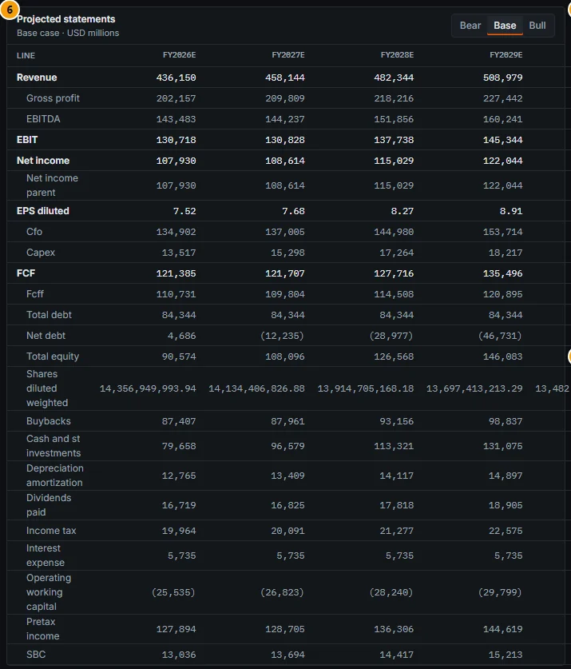

*Figure 5A.16: Projected statements, Apple, base case (panel 6).*

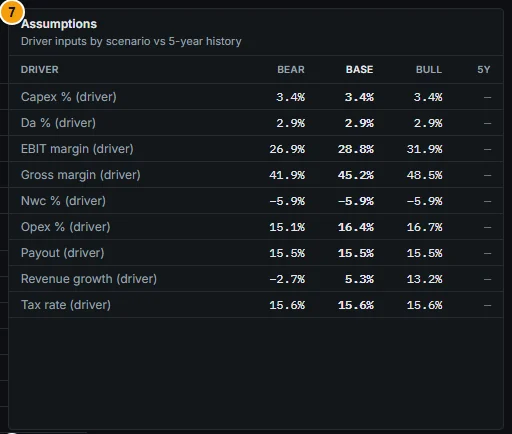

*Figure 5A.17: Assumptions by scenario, Apple (panel 7). The 5Y column is empty when the driver history is not published.*

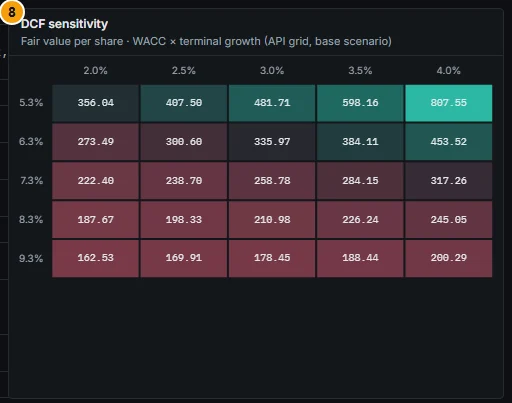

*Figure 5A.18: DCF sensitivity grid, Apple (panel 8). Rows are WACC, columns terminal growth; colour is the gap to the price.*

### Controls

| Control | What it does |
|---|---|
| Model badge hover | "Free cash flow to the firm, discounted at WACC" or "Banks / insurers: residual-income (excess return on equity) model" |
| Range bar hover | Each marker shows its label and value: Raw DCF, Multiples, Headline, 12m target, Price; the shaded block is the fair-value range (low-high) |
| Fan chart metric | `Revenue`, `EBIT`, `Free cash flow`, `Diluted EPS`. For banks the first three become `Net income`, `Residual income` and `Book value` |
| Fan chart hover | Values per year for Historical, Bull, Base, Bear |
| Projected statements scenario | `Bear` / `Base` / `Bull` |
| Sensitivity hover | "WACC x% · g y%", fair value and the gap to price |

### Methodology

The projection and valuation are computed by the nightly `forecast` job (`backend/app/analytics/forecast.py`), point-in-time at the as-of date: only fundamentals filed by that date, prices up to that date and rates known by then.

#### Non-financial companies: linked three-statement projection and FCFF DCF

Five annual years after the last reported fiscal year:

- **Revenue growth** starts at `g₁ = 0.5 × Theil-Sen trend of log revenue (up to 7 years) + 0.5 × last-3-year CAGR` (clipped to −25%…+50%) and fades linearly to `g₅ = 0.5 × subsector median 5-year CAGR + 0.5 × terminal growth`.
- **Margins** (EBITA, i.e. EBIT plus amortisation of acquired intangibles) mean-revert at no more than 2 pp a year: normally toward `0.9 × (0.6 × own 5-year median + 0.4 × last) + 0.1 × subsector median`; for cyclical subsectors (semiconductors, semi equipment, mining, oil and gas, autos, airlines and others) or volatile margins, from `0.5 × last + 0.5 × own 10-year median` toward the 10-year median; for loss-makers toward 0.8 × the median margin of profitable peers, at up to 4 pp a year.
- **Other drivers**: D&A, capex, stock-based compensation and operating working capital as a percentage of revenue (own 3-year medians, subsector fallback); normalised tax rate; interest on average debt and interest income on average cash; payout from the 3-year median. Capex reaches a growth-consistent level within three years. The balance sheet balances every year, with cash as the plug and a revolver when cash would fall below 2% of revenue.
- **Free cash flow to the firm**: `FCFF = NOPAT + D&A − capex − ΔNWC` (stock-based compensation is treated as a real cost), discounted at WACC over fractional years from the as-of date to each fiscal year-end.
- **Fade and terminal value**: a further five-year fade stage (growth to the terminal rate, margin to the long-run target, reinvestment = Δrevenue / sales-to-capital), then `TV = NOPAT × (1 − g / RONIC) / (WACC − g)` with `RONIC = max(WACC, (ROIC + WACC) / 2)`. The terminal-value share of EV is shown and flagged above 85%.
- **Equity value** = EV + cash − debt − minorities − preferred, per diluted share, converted to the trading currency (and divided by the ADR ratio for ADRs).
- **Scenarios**: bear and bull shift the growth path by ∓1.28 × 0.6 × σ(year-on-year growth) and the margin target by ∓1.28 × σ(EBIT margin), using the company's own 10-year history. Probabilities 25% / 50% / 25%.

#### Banks and insurers: excess-return model

Banks, insurers, consumer-finance companies, holdings and levered financials use a residual-income model on book value:

```
value = BV₀ + Σₜ (ROEₜ − kₑ) × BVₜ₋₁ / (1 + kₑ)ᵗ  +  RI₆ / (kₑ − g)
```

ROE fades to `0.6 × own 5-year median + 0.4 × subsector median` at up to 2 pp a year; the payout comes from history. The cost of capital is the cost of equity only ("financial (equity-only)" in the panel subtitle).

#### Headline fair value

1. **Two legs.** The model value per share (DCF or excess return) and a **peer-multiples value**: the geometric mean of the values implied by peer EV/EBITA, P/E on normalised earnings and, for loss-makers, EV/Sales (banks: P/E and P/B). Only 50% of the gap between the price and the multiples value is assumed to close.
2. **Blend in log space**: `l = w × ln(DCF / P) + (1 − w) × 0.5 × ln(Multiples / P)`, with the DCF weight `w` between 0.2 and 0.5 depending on model stability.
3. **Shrink toward the price** by a credibility factor `k = 0.4 + 0.6 × confidence / 100`: `FV_scenario = P × exp(k × l)`. Bear and bull are scaled from the base by the ratio of their DCF values (bounded 0.25×-4×).
4. **Headline** = the probability-weighted value of the three scenarios, `0.25 × bear + 0.5 × base + 0.25 × bull`. The upside is `headline / price − 1`.
5. **12-month target** = base fair value × (1 + kₑ) − expected dividends per share.
6. **Range** = the lower and higher of the raw DCF value and the multiples value. The raw legs are always shown separately.

#### Valuation confidence (0-100)

```
confidence = 100 × data quality × model stability × agreement between DCF and multiples
```

- Data quality starts from the fundamentals' DQ score and is cut for share-count or currency problems, short history (fewer than 5 years), an old fiscal year (more than 15 months) and a stale price.
- Model stability is cut when the terminal value exceeds 75-95% of EV, FCFF is negative in several years, margins are volatile, the company is a loss-maker or deep loss-maker, the subsector is cyclical, the discount rate hit its floor or first-year growth exceeds 30%.
- Agreement falls as `|ln(DCF / Multiples)|` grows (reason "dcf multiples disagree" beyond a factor of 2).
- Confidence is capped at 35 when the upside exceeds +100% or is below −90%.

Each cut adds a reason to the list under the meter (for example "model: cyclical normalized margin"). **Below 40 the fair value is indicative only.** In scoring, valuation inputs derived from the DCF are ignored when confidence is below 40 and weighted by confidence / 100 above it; the Value factor then relies on the multiples (contract `forecast_confidence`). The meter is green from 60, amber from 40, red below 40.

#### Cost of capital

From `backend/app/analytics/cost_of_capital.py`, point-in-time:

- **Risk-free rate**: the 10-year government yield of the reporting currency (for example FRED DGS10 for USD, the ECB AAA curve for EUR, MoF JGB for JPY). Where no series is available a dated fallback table is used (flag `rf fallback`). For emerging-market local yields the sovereign default spread is removed to avoid double counting with the country premium.
- **Beta**: weekly log returns against the local benchmark over 3 years (at least 52 weeks), Blume-adjusted `0.67 × β + 0.33`, clipped to 0.4-2.0, then shrunk 50% toward the subsector median. Shown as "adj. / raw".
- **Equity risk premium**: the panel shows the contract ERP of **5%** plus a country risk premium from a country table (in the examples: 0% for the US and the Netherlands, 0.7% for Japan, 3.5% for Brazil).
- **Cost of debt**: interest expense / average debt, floored at the risk-free rate plus a synthetic-rating spread and clipped to rf + 0.5%…rf + 8%, after tax. Tax: 3-year median effective rate, clipped to 0-40%.
- **WACC**: market-value equity weight, book debt; clipped to 5%…15% (upper bound widened for high-rate currencies). Cost of equity is floored at `max(rf + 0.6 × (ERP + CRP), 5%)`.
- **Terminal growth**: `min(long-run nominal GDP proxy − 0.5%, rf, 3% + EM excess)`, clipped to 0.5%…7%.

**Market-calibrated ERP in the valuation.** The valuation itself does **not** use the 5% ERP. With the default `erp_mode=implied`, the forecast job solves, for each region bucket (North America, Europe, Japan, China / Hong Kong, other) and model family (FCFF or excess return), the ERP between 1% and 10% at which the **median base-case upside of the bucket is zero** (at least 12 valued names; otherwise the region bucket, then a pooled value). The discount rates behind the fair value, the sensitivity grid and the scenario valuations therefore differ from the WACC shown in the Cost of capital panel. To value with the fixed 5% instead, run the forecast job with `--param erp_mode=fixed`.

#### Sensitivity grid and reverse DCF

- **Sensitivity**: the base-case value recomputed for WACC −2…+2 pp (1 pp steps) and terminal growth −1…+1 pp (0.5 pp steps) around the valuation's own WACC and g, then **scaled to the blended headline base value** so the centre cell equals the base fair value. Cells where WACC ≤ g + 0.5 pp are empty. Colour is the gap to the price (teal above, rose below).
- **Reverse DCF** (non-financials): the constant 5-year revenue CAGR that, at base-case margins, makes the DCF equal to the market EV (root search), then the terminal growth. It is compared with the historical 5-year revenue CAGR: more than 2 pp above reads "expectations look demanding", more than 2 pp below "expectations look undemanding". For banks the reverse calculation solves for an implied steady ROE instead, which the panel does not display.

### Data sources and refresh

Inputs: standardised fundamentals (see [Financials](#financials)), prices, FX, government yields from official sources (FRED, ECB, MoF Japan, BoE, BoC, RBA, SNB, ChinaBond and others), subsector statistics. The `forecast` job runs in the nightly chain and also writes the cost-of-capital table used by the moat job. Issuers are skipped when the last fiscal year is more than two years old, fewer than two usable years exist, or price or share count is missing ("No forecast scenarios published for this company yet").

### Validation status

**Not formally validated.** There is no backtest of the fair value or the 12-month target against realised returns. The headline is by construction anchored to the market price and calibrated so that the median company in each region is close to fair value; it is a relative, model-based valuation. Confidence is an internal quality score, not a calibrated probability. The Valuation subtitle states the scenario weights and the market-implied ERP and the `EE` mnemonic is labelled model-based, not consensus.

### Correct usage and worked example

**Apple (Figure 5A.15, valuation of 16 Oct 2026, price 343.46 USD).**

- Raw DCF value 196.61 (−43% versus price); peer multiples value 275.31; range 196.61-275.31.
- Scenario values after blending and shrinkage: bear 142.62, base 258.78, bull 459.22. Headline fair value `0.25 × 142.62 + 0.5 × 258.78 + 0.25 × 459.22 = 279.85` (−19% versus price). 12-month target 276.46 (−20%).
- Valuation confidence 77/100 with no reasons listed; terminal value 67% of EV (below the 85% flag).
- Cost of capital panel: WACC 10.63%, cost of equity 10.71%, beta 1.12 adjusted / 1.04 raw (regression), risk-free 5.09% (FRED DGS10), ERP 5.00%. The sensitivity grid, however, is centred on WACC 7.3% and g 3.0% (centre cell 258.78 = the base value): the North American implied ERP on that date was much lower than 5% (the valuation's cost of equity of 7.28% implies about 1.9%).
- Reverse DCF: the price implies 15.0% revenue growth a year for five years, then 3.0%, against a 5-year track record of 6.1%: "expectations look demanding".

Reading: the market price requires growth well above Apple's history; the model's value sits 19% below the price with good confidence. This is a statement about what the price implies under the model, not a sell recommendation.

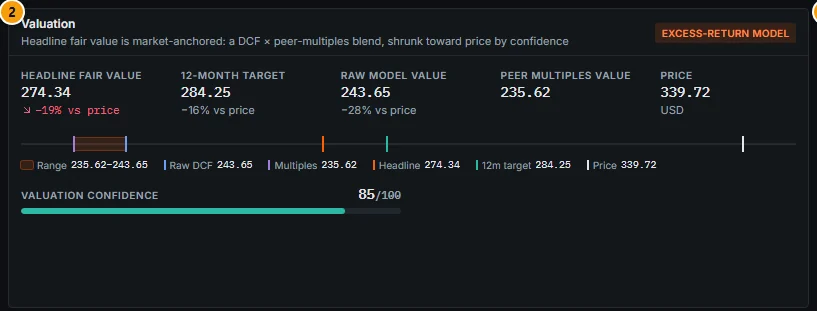

*Figure 5A.19: Valuation panel for JPMorgan Chase (`/company/JPM?tab=forecast`), excess-return model, valuation as of 16 Oct 2026.*

**JPMorgan (bank model).** The badge reads "Excess-return model" and the raw value is labelled "Raw model value": 243.65 (−28%); peer multiples (P/E and P/B) 235.62; headline 274.34 (−19% versus 339.72); 12-month target 284.25; confidence 85. The Cost of capital panel is "financial (equity-only)": WACC = cost of equity = 9.91%. The fan chart offers Net income, Residual income, Book value and Diluted EPS. The Reverse DCF shows "—" for implied growth because the bank model solves for an implied ROE that is not displayed.

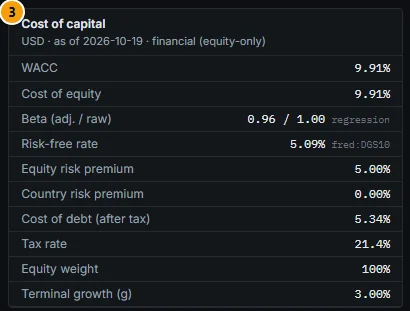

*Figure 5A.20: Cost of capital for JPMorgan Chase, equity-only.*

**Low-confidence examples.** Both ASML and Petrobras have a valuation confidence below 40, so the meter turns red and reads "Below 40 — scoring down-weights this valuation", with the reasons listed underneath.

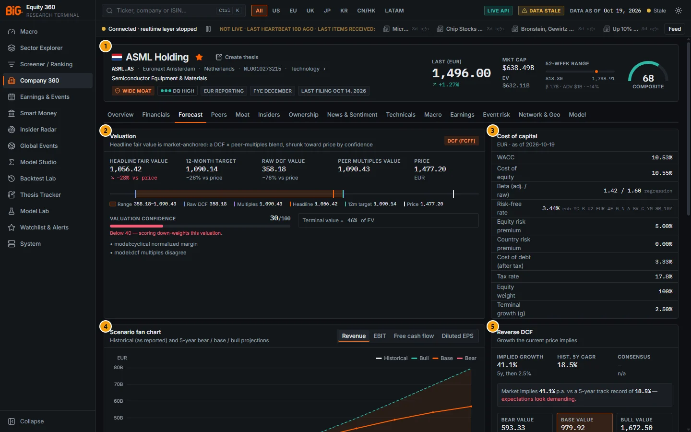

*Figure 5A.21: Forecast tab for ASML (`/company/ASML.AS?tab=forecast`), valuation as of 16 Oct 2026.*

| # | Panel | What it shows |
|---|---|---|
| 1 | Company header | ASML Holding, EUR |
| 2 | Valuation | Headline 1,056.42 EUR (−28% vs 1,477.20); 12-month target 1,090.14; raw DCF 358.18 (−76%); peer multiples 1,090.43; confidence 30/100 with reasons "model:cyclical normalized margin" and "model:dcf multiples disagree"; terminal value 46% of EV |
| 3 | Cost of capital | WACC 10.53%, beta 1.42 adj. / 1.60 raw, risk-free 3.44% (ECB AAA 10-year), ERP 5.00%, CRP 0.00%, terminal growth 2.50% |
| 4 | Scenario fan chart | Revenue paths; the bull case diverges strongly from the base |
| 5 | Reverse DCF | Implied growth 41.1% a year for 5 years, then 2.5%, against a 5-year record of 18.5%: "expectations look demanding"; bear 593.33, base 979.92, bull 1,672.50 |
| 6 | Projected statements | Base case, EUR millions (below the fold) |
| 7 | Assumptions | Drivers by scenario (below the fold) |
| 8 | DCF sensitivity | WACC × terminal-growth grid (below the fold) |

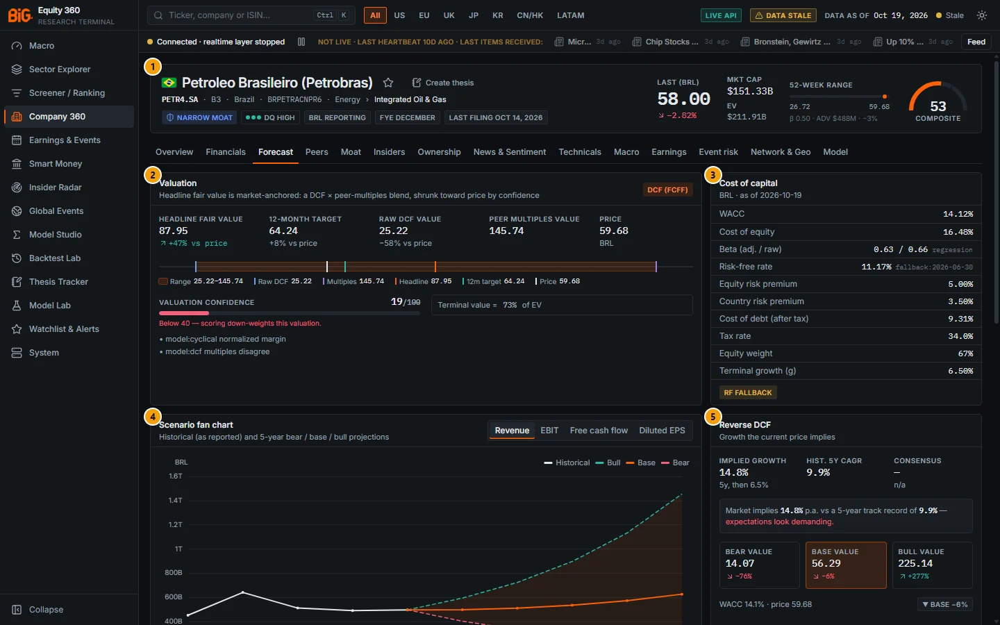

*Figure 5A.22: Forecast tab for Petrobras (`/company/PETR4.SA?tab=forecast`), valuation as of 16 Oct 2026.*

| # | Panel | What it shows |
|---|---|---|
| 1 | Company header | Petrobras, BRL |
| 2 | Valuation | Headline 87.95 BRL (+47% vs 59.68); 12-month target 64.24 (+8%); raw DCF 25.22 (−58%); peer multiples 145.74; range 25.22-145.74; confidence 19/100 with the same two reasons; terminal value 73% of EV |
| 3 | Cost of capital | WACC 14.12%, cost of equity 16.48%, risk-free 11.17% from the dated fallback table ("fallback:2026-06-30", `RF FALLBACK` flag), ERP 5.00%, CRP 3.50%, terminal growth 6.50% |
| 4 | Scenario fan chart | Revenue: a wide bear-bull band |
| 5 | Reverse DCF | Implied growth 14.8% against a 5-year record of 9.9%: "expectations look demanding"; bear 14.07 (−76%), base 56.29 (−6%), bull 225.14 (+277%) |
| 6 | Projected statements | Base case, BRL millions (below the fold) |
| 7 | Assumptions | Drivers by scenario (below the fold) |
| 8 | DCF sensitivity | WACC × terminal-growth grid (below the fold) |

Read them together. For ASML the raw DCF (358) and the multiples value (1,090) are a factor of three apart: the cyclical normalisation of margins and a high discount rate depress the DCF while peers trade on high multiples. The low confidence pulls the headline toward the multiples and the price. For Petrobras the headline of +47% looks attractive, but it is driven by a bull case at +277% while the base value is −6%. With confidence 19, a fallback risk-free rate and 73% of the value in the terminal value, the fair value is indicative only and is excluded from scoring. Note also the skew effect for Toyota (7203.T): base value 3,107 JPY (+0.4%) but bull 9,278, so the probability-weighted headline is 4,067 (+31%).

### Limitations and pitfalls

- **The headline is a probability-weighted scenario value** (`0.25 × bear + 0.5 × base + 0.25 × bull`, as the Valuation subtitle states), so a very wide bull case can lift it well above the base value (Toyota). Look at the bear / base / bull boxes, not only the headline.
- **The Cost of capital panel shows the contract cost of capital (ERP 5%)**, while the valuation discounts at the market-implied ERP; the ERP row of the panel and the Valuation subtitle say so. The Reverse DCF footer ("WACC x%") also shows the panel WACC. Use the sensitivity grid's centre row for the WACC actually used.
- **Market anchoring.** The implied ERP makes the median stock in each region fairly valued by design and the credibility shrink pulls every value toward the price. Upside is relative to the region, not an absolute statement about market level.
- **Confidence below 40**: indicative only, and excluded from scoring. The meter text says "scoring down-weights this valuation"; in fact, below 40 the DCF-derived input is dropped entirely.
- **Not consensus.** "Consensus" in the Reverse DCF is always n/a.
- **Projection mechanics are generic.** Company guidance, M&A, buyback plans and regulatory changes are not modelled. Cyclical companies are valued on normalised margins.
- Terminal value above 85% of EV means the value rests mostly on the terminal assumption.
- The Reverse DCF verdict line compares implied with historical growth even when the implied growth is missing (banks); ignore the verdict there.

### Related mnemonics and BQL fields

`EE`. BQL: `fair_value` (probability-weighted DCF × multiples fair value, model-based), `dcf_upside`, `implied_cagr` (reverse-DCF implied 5-year revenue CAGR), `coc.wacc`, `coc.cost_of_equity`, `coc.beta`, `coc.rf`, `coc.erp`, `coc.crp`, `coc.terminal_growth`, `coc.flags`. Related: [Earnings](05c-company-macro-events-model.md#earnings) for model-based revenue and EPS expectations.

---

## Peers

**Route:** `/company/:id?tab=peers` · **Menu:** Company 360 › Peers · **Mnemonics:** `RV`, `PEERS` · **Refresh:** nightly chain (scoring); peer-group anomaly nightly, model weekly

### Purpose

The Peers tab compares the company with the companies most like it on the metrics that matter for its business model. It ranks the company on each metric, plots it against peers on any two metrics, compares composite scores by size and, at the bottom, shows how unusual the latest joint move of its peer group was (see [Peer-group joint anomaly](#peer-group-joint-anomaly)).

### Screenshot

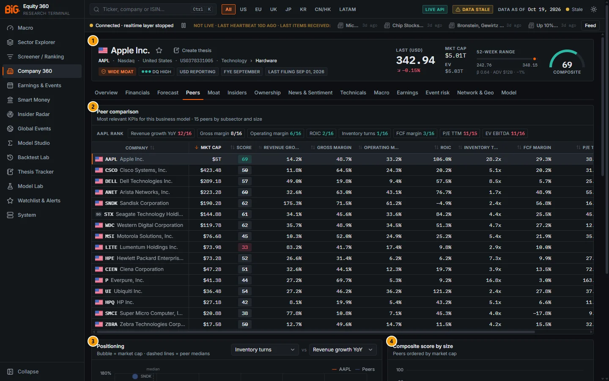

*Figure 5A.23: Peers tab for Apple (`/company/AAPL?tab=peers`), data as of 19 Oct 2026.*

| # | Panel | What it shows |
|---|---|---|
| 1 | Company header | See [Company header](#company-header) |
| 2 | Peer comparison | "Most relevant KPIs for this business model · 15 peers by subsector and size": a rank strip (`AAPL rank`) and a sortable table of market cap, composite score and each KPI |
| 3 | Positioning | Bubble chart of two chosen metrics; bubble size = market cap, dashed lines = peer medians |
| 4 | Composite score by size | Composite of each peer as bars, ordered by market cap; the company in orange |
| 5 | Peer-group joint anomaly (this company's group) | See [Peer-group joint anomaly](#peer-group-joint-anomaly) (below the fold) |

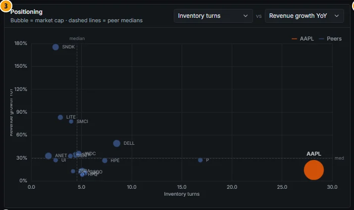

*Figure 5A.24: Positioning, Apple: inventory turns against revenue growth (panel 3).*

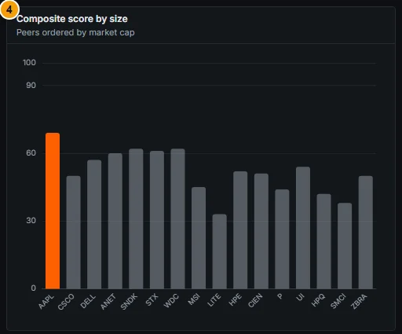

*Figure 5A.25: Composite score by size, Apple's peers (panel 4).*

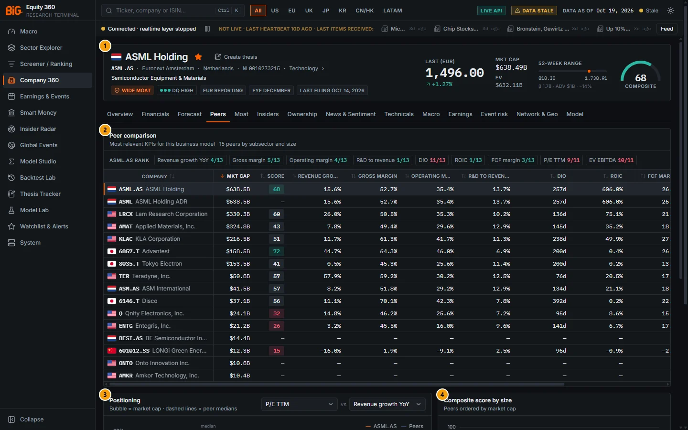

*Figure 5A.26: Peers tab for ASML (`/company/ASML.AS?tab=peers`), global semiconductor-equipment peers, data as of 19 Oct 2026.*

| # | Panel | What it shows |
|---|---|---|
| 1 | Company header | ASML Holding, Euronext Amsterdam |
| 2 | Peer comparison | Semiconductor-equipment KPIs (revenue growth, gross and operating margin, R&D to revenue, DIO, ROIC, FCF margin, P/E, EV/EBITDA) against global peers |
| 3 | Positioning | P/E TTM against revenue growth |
| 4 | Composite score by size | Peers by market cap |
| 5 | Peer-group joint anomaly | ASML's peer groups (below the fold) |

### Controls

| Control | What it does |
|---|---|
| Peer group (select, panel 2) | Appears only when a Model Studio peer set contains the company: "Subsector peers (default)" or "Peer set: (name)". With a peer set, the comparison uses the company's cluster in that set (or the whole set) |
| Rank strip | `rank/of` per metric, green in the top third and red in the bottom third, direction-aware |
| Table header click | Sorts by that column (default: market cap, descending); empty values sort last. Header hover gives the metric's formula and direction |
| Table row click | Opens that peer's Company 360 (the company's own row is highlighted and not clickable) |
| `X metric` / `Y metric` | Choose the two scatter axes from the KPI list (default: the first multiple against the first "higher is better" percentage) |
| Scatter and bar hover | Ticker, both metric values, market cap or composite |

### Methodology

- **Peer group.** The level used by scoring for this company (the most common `peer_group_level` of its metric scores): subsector × peer region × size bucket, then subsector × peer region, subsector (global), sector × region, sector (global), the first with at least 8 companies. The table shows the company plus the 15 largest peers by market cap; the peer count in the API covers the whole group. With a Model Studio peer set (`peer_set_id`), the group is the company's cluster in that set.
- **Metrics.** The `peer_metrics` list of the company's KPI set (`contracts/sector_kpis.yaml`). Defaults: revenue growth, gross margin, operating margin, ROIC, FCF margin, P/E, EV/EBITDA, FCF yield.
- **Rank.** `1 + number of displayed peers strictly better` on the metric (direction-aware), out of the peers with a value.
- **Scatter medians.** Medians of the plotted points.

### Data sources and refresh

The serving snapshot's latest metric values (from the `valuation_daily` and ratio jobs) and composite scores (`scoring`). Model Studio peer sets are user-defined (see [Model Studio](09-model-studio.md)).

### Validation status

Not a model; descriptive comparison. For the joint-anomaly panel see [Peer-group joint anomaly](#peer-group-joint-anomaly).

### Correct usage and worked example

Apple is compared within "hardware networking, North America, large caps" (19 companies in the group, 15 shown). The rank strip reads: revenue growth 12/16, gross margin 8/16, operating margin 6/16, ROIC 2/16, inventory turns 1/16, FCF margin 3/16, P/E TTM 11/15, EV/EBITDA 11/16. So Apple is among the best on capital efficiency and cash conversion, mid-pack on margins, and expensive and slower-growing than the group. In the composite-by-size chart, Apple (69) is among the highest scores of the large peers.

For ASML the subsector-region group is too small, so the comparison is global (23 semiconductor-equipment companies): Lam Research, Applied Materials, KLA, Advantest, Tokyo Electron and others.

### Limitations and pitfalls

- The subtitle always reads "by subsector and size", even when scoring had to widen the group (ASML: global subsector). The `level` is in the API response (`peer_group_key`), not on screen.
- **Cross-listings can appear as peers.** ASML's own ADR (ASML) appears in its peer table with identical fundamentals. Ignore such rows when ranking.
- Peers without data show "—" and are excluded from the rank denominator, so `of` differs by metric.
- The table is capped at the 15 largest peers; small peers may be missing from view but are in the medians.
- Sanity-check outliers: an implausible ratio (for example an ROIC of several hundred percent, or near zero for a large profitable company) usually reflects a data or unit issue.

### Related mnemonics and BQL fields

`RV`, `PEERS` (with a security: this tab; without: the Sector Explorer). BQL: the KPI fields (`roic`, `gross_margin`, `pe_ttm`, `ev_ebitda`, `kpi.*`), `composite`. See [Sector Explorer](03-sector-explorer.md).

---

## Peer-group joint anomaly

**Route:** `/company/:id?tab=peers` (bottom panel) · **Menu:** Company 360 › Peers · **Mnemonics:** `RV`, `PEERS` · **Refresh:** nightly scoring (`conformal_peer_groups`); model refit weekly (`conformal_peer_groups_fit`); group definitions rebuilt every 90 days

### Purpose

This panel answers "was the latest one-day move of this company's peer group unusual, given how these stocks normally move together?", and if so, which members drove it and which one broke away from the rest. It also gives calibrated next-session bands for a pair spread or basket of group members. It is a **descriptive, model-based** measure. It is **not a trading signal**: the badge on the panel says "descriptive · model-based · not a trading signal".

### Screenshot

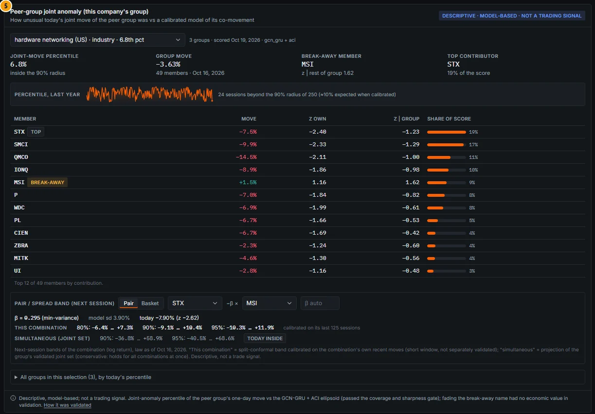

*Figure 5A.27: Peer-group joint anomaly for Apple's industry group "hardware networking (US)", scored 16 Oct 2026 (snapshot 19 Oct 2026).*

| Element | What it shows |
|---|---|
| Peer group select | The groups that contain the company, each with kind (industry or supply chain) and today's percentile; the industry group is selected first |
| Status line | Number of groups, scoring date, filter and radius ("gcn_gru + aci") |
| Joint-move percentile | Calibrated percentile of today's joint-move score, with "inside the 90% radius", "beyond the 90% radius" or "beyond the 95% radius" |
| Group move | Average one-day move of the members, number of members and date |
| Break-away member | The member whose move was least explained by the others, with its `z ∣ rest of group` |
| Top contributor | The member with the largest share of the joint score |
| Percentile, last year | Sparkline of the daily percentile and the count of sessions beyond the 90% radius ("≈10% expected when calibrated") |
| Member table | Top 12 members by contribution: move, `z own`, `z ∣ group`, share of score; badges `top` and `break-away` |
| Pair / spread band (next session) | Calibrated band for `long − β × short` or a weighted basket |
| All groups in this selection | Expandable list of every group containing the company, by today's percentile |
| Footer note | The model-based label and the link "How it was validated" |

### Controls

| Control | What it does |
|---|---|
| Peer group | Switches the detail to another group containing the company |
| All groups (expandable) | Lists the groups; click one to select it |
| Member ticker | Opens that member's page |
| Break-away / Top contributor ticker | Opens that member's page |
| `Pair` / `Basket` | Band tool mode |
| Long leg / Short leg | Pair members (defaults: the first member and the break-away member) |
| `β auto` | Hedge ratio; blank = minimum-variance β under the predicted covariance |
| Basket weights | Free text `TICKER:weight`, comma-separated (for example `AAA:0.5, BBB:0.5, CCC:-1`) |
| How it was validated | Opens the Conformal validation page (see [System](15-system.md)) |

### Methodology

From `backend/app/conformal/` and the contract description of `GET /conformal/peer-groups` and `GET /conformal/pair-band`.

- **Groups.** Each group holds 20-50 liquid names of one listing region, either an **industry** group (the most liquid names of one subsector) or a **supply-chain** group (names linked around a company in the disclosed supply-chain network). A company belongs to its industry group and to any supply-chain groups it is part of.
- **Model.** For each group a graph-native learned filter (**GCN-GRU**, shared across groups) predicts, at each close, the next session's mean vector `μ` and covariance `Σ` of the members' log returns (low rank plus diagonal). The fallback filter is an EWMA low-rank model.
- **Score.** The squared Mahalanobis distance of the realised one-day returns from that predicted law: `R = (r − μ)ᵀ Σ⁻¹ (r − μ)`.
- **Calibration.** The score is compared with the last 500 realised scores of the same group (rolling window). The **joint-move percentile** is the rank of today's score in that window. The **90% and 95% radii** are conformal quantiles adjusted online by **ACI** (adaptive conformal inference, γ = 0.005): when recent sets miss too often the radius widens, when they over-cover it narrows. "Beyond the 90% radius" means today's score exceeded the 90% radius.
- **Attribution.** `contribᵢ = rᵢ × (Σ⁻¹ r)ᵢ` splits the score exactly across members ("share of score"; negative = the member offset the others). `z own = rᵢ / √Σᵢᵢ` is the member's own standardised move. `z ∣ group = (Σ⁻¹ r)ᵢ / √(Σ⁻¹)ᵢᵢ` is the move **given all the other members**, i.e. how far it broke away from what the rest of the group implied. The **break-away member** has the largest `|z ∣ group|`; the **top contributor** the largest positive contribution. `|z ∣ group| ≥ 2.5` is highlighted.
- **Pair / spread band.** For weights `a` (pair: `+1` and `−β`), the "simultaneous (joint set)" band is `a′μ ± √(q × a′Σa)` with the group's 90% / 95% radius `q`. It is the projection of the validated joint set, so it is **conservative**: it holds for all combinations at once. "This combination" is a split-conformal band calibrated on the combination's own standardised moves over about 125 sessions (80 / 90 / 95%); it is narrower but was **not separately validated**. "Today" shows the realised combination move and its z against the band emitted at the previous close, and whether it was inside the 90% / 95% joint band. All bands are in log-return units for the next session.

### Data sources and refresh

Daily adjusted closes of the members; supply-chain links from the network data (from 2023, point-in-time). Scores are produced nightly (`conformal_peer_groups`), the GCN-GRU is refitted weekly on a block ending 520 sessions before the as-of date (`conformal_peer_groups_fit`), and group definitions are rebuilt every 90 days. Realised coverage is audited nightly (`conformal_coverage`) and shown on System › Data Health ("Conformal coverage (model-based sets)") and the Conformal validation page.

### Validation status

From `docs/CONFORMAL_VALIDATION.md`, section B and the Verdict (walk-forward, 2,955 group-years, 707,115 group-days, test years 2010-2026):

| Criterion | Result |
|---|---|
| Coverage within ±1.5 pp | **PASS**: 90.4% at the 90% target, 95.2% at 95% (GCN-GRU + ACI) |
| No regime more than 5 pp under target | **PASS**, borderline: worst is Covid (15 Feb-30 Jun 2020) at 85.3% at 90% (−4.7 pp); 2022 90.9%; VIX > 25 90.1% |
| Sharper than baselines at matched coverage | **PASS**: w_proj −10.1% versus EWMA, −9.1% versus static Ledoit-Wolf, −12.4% versus a PCA factor model, −4.7% versus GARCH-DCC |
| Economic value: break-away mean reversion | **FAIL (null)**: fading the break-away member (group beyond its 90% radius and `abs(z ∣ group) ≥ 2.5` or 3, hold 5 days, long-short, costs on) had Sharpe −0.09 / −0.15; versus a naive fade the difference was +0.3 to +2.1% a year with t ≤ 1.17, not significant |
| **Gate** | **PASS as a calibrated descriptive measure** (anomaly percentile, pair / basket bands). **Not a trading signal.** |

Per-member coverage of the projected bands is 99.9% in validation: the simultaneous pair bands are very conservative. The app shows the panel with the label "Descriptive, model-based; not a trading signal" and the API label "Coverage is marginal over history (all securities and days of the pool), not a statement about any single day".

> **Model-based:** the percentile and the bands are calibrated over history: about 10% of sessions fall beyond the 90% radius across all groups and days. That is not "a 10% chance today" for this group.

### Correct usage and worked example

**Apple, industry group "hardware networking (US)", scored 16 Oct 2026 (Figure 5A.27).** Joint-move percentile 6.8%, inside the 90% radius: although the group fell on the day (average move −3.63% over 49 members), the move was entirely ordinary given how these stocks co-move: a broad, correlated decline. The top contributor was STX (19% of the score, −7.5%, `z own` −2.40). The break-away member was MSI (+1.5% while the group fell, `z ∣ group` +1.62, below the 2.5 highlight). Over the last year, 24 of 250 sessions were beyond the 90% radius (9.6%, close to the 10% expected when calibrated). Apple belongs to two other groups: the supply-chain group "links around AAPL (US)" (27th percentile) and "links around ADSK (US)" (69th percentile).

**Pair band.** STX − β × MSI, β = 0.295 (minimum variance): model sd 3.90%; today −7.90% (z −2.62). "This combination" 90% band −9.1% … +10.4%; the simultaneous 90% band −36.8% … +58.9%, and today is inside. Read: the STX-MSI spread moved about 2.6 standard deviations, within the combination's own 90% band and far inside the conservative joint band.

**Good practice.** Use the percentile to ask "is something group-specific happening?" (for example a sector-wide shock or a single member's news). A high percentile with a single dominant contributor points to stock-specific news; a high percentile with spread-out contributions points to a group-wide re-pricing. Then check News & Sentiment and Event risk.

### Limitations and pitfalls

- **Not a trading signal.** Fading the break-away name had no economic value after costs in validation.
- **Calibrated over history**, marginal over time and groups; per-regime coverage is reported, not guaranteed. In a sudden crash (Covid) coverage fell to 85.3%.
- The "this combination" band is short-window and not separately validated; the simultaneous band is conservative.
- Group membership and the universe are current (survivorship); supply-chain edges only exist from 2023.
- The scoring date can lag the snapshot date by a session or two (16 Oct versus 19 Oct here).
- Companies that are not in a scored group see "This selection is not part of a scored peer group".
- The member table highlights the company's own row and defaults the pair's long leg to it, whether the page was opened by ticker or by internal security id (earlier builds did this only for the security id).

### Related mnemonics and BQL fields

`RV`, `PEERS`. BQL: the `cf.*` conformal fields (for the single-stock calibrated range, see [Technicals](05b-company-technicals.md#technicals)). Validation page and coverage audit: [System](15-system.md). Other peer-group views (by sector or region) are in the [Sector Explorer](03-sector-explorer.md).

---

## Moat

**Route:** `/company/:id?tab=moat` · **Menu:** Company 360 › Moat · **Mnemonics:** none · **Refresh:** weekly chain (`moat` job)

### Purpose

The Moat tab classifies the company's durable competitive advantage as **Wide**, **Narrow**, **None** or **Insufficient data**, and shows the evidence behind the rating: returns on capital against the cost of capital over up to ten years, margin level and stability, margin premium over peers, share of subsector revenue, intangibles intensity, revenue stability and customer lock-in. Use it to judge whether high returns are likely to persist.

### Screenshot

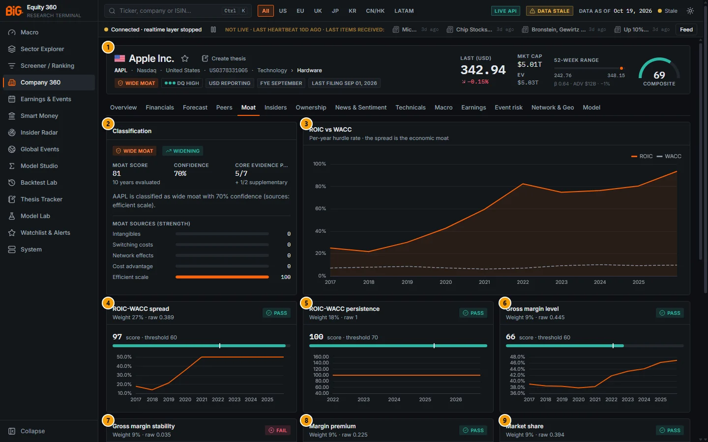

*Figure 5A.28: Moat tab for Apple (`/company/AAPL?tab=moat`), moat as of 19 Oct 2026.*

| # | Panel | What it shows |
|---|---|---|
| 1 | Company header | See [Company header](#company-header) |
| 2 | Classification | Moat badge, trend (widening / stable / narrowing), moat score, confidence, core evidence passed, summary sentence and moat sources with strength |
| 3 | ROIC vs WACC | Yearly ROIC against the per-year WACC (or hurdle) |
| 4 | ROIC-WACC spread | Component card: score, threshold 60, pass / fail, raw value, yearly history (weight 27%) |
| 5 | ROIC-WACC persistence | Share of years with ROIC above WACC (threshold 70, weight 18%) |
| 6 | Gross margin level | (threshold 60, weight 9%) |
| 7 | Gross margin stability | (threshold 60, weight 9%) |
| 8 | Margin premium | Operating margin above the subsector median (threshold 60, weight 9%) |
| 9 | Market share | Share of subsector revenue (threshold 60, weight 9%) |
| 10 | Intangibles intensity | R&D, intangible amortisation and capitalised intangibles over revenue (threshold 60, weight 9%; below the fold) |
| 11 | Revenue stability | Supplementary (threshold 60, weight 5%; below the fold) |
| 12 | Customer lock-in | Supplementary (threshold 60, weight 4%; below the fold) |
| 13 | Market share | Time series of the share of subsector revenue (below the fold) |

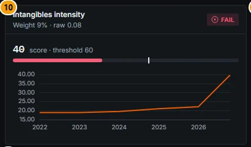

*Figure 5A.29: Intangibles intensity, Apple (panel 10): score 40, below the threshold of 60.*

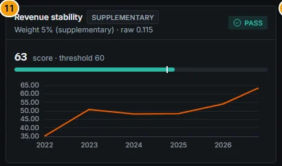

*Figure 5A.30: Revenue stability, supplementary component, Apple (panel 11).*

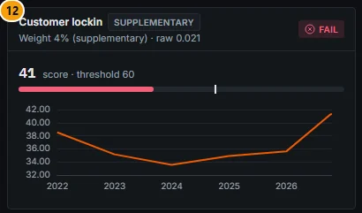

*Figure 5A.31: Customer lock-in, supplementary component, Apple (panel 12).*

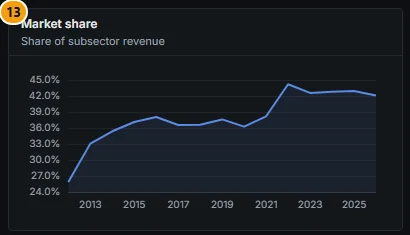

*Figure 5A.32: Share of subsector revenue over time, Apple (panel 13).*

### Controls

| Control | What it does |
|---|---|
| Chart hover | Values per year (ROIC, WACC, hurdle; component raw values) |
| `financial model` badge hover | "Financial-company variant: deposit franchise / underwriting economics replace ROIC-based components" |
| `supplementary` badge hover | "Supplementary component — lower weight, shown for context" |
| Threshold tick | The vertical tick on each score bar marks the pass threshold |

### Methodology

From `backend/app/analytics/moat.py` and `contracts/scoring.yaml` (`moat`), on the point-in-time fiscal-year panel of the last 10 years.

| Component | Weight | Score (0-100) | Pass at |
|---|---|---|---|
| ROIC-WACC spread | 0.30 | Mean of `ROIC − WACC`: 0.5 × percentile within sector + 0.5 × absolute map (−5% → 0, +15% → 100). `ROIC = EBIT × (1 − t) / average invested capital`; per-year WACC = today's WACC shifted by the change in the currency's 10-year yield | 60 |
| ROIC-WACC persistence | 0.20 | `100 × share of years with ROIC > WACC` | 70 |
| Gross margin level | 0.10 | 5-year mean gross margin: 0.5 × subsector percentile + 0.5 × absolute anchor (60% margin → 100) | 60 |
| Gross margin stability | 0.10 | −stdev of gross margin: 0.5 × subsector percentile + 0.5 × absolute anchor (0 → 100, 8 pp → 0) | 60 |
| Margin premium | 0.10 | Mean of `EBIT margin − subsector median that year`, global percentile | 60 |
| Market share | 0.10 | Revenue (USD) / total subsector revenue of the app's universe: 0.5 × subsector percentile + 0.5 × `min(100, 100 × share × n_peers / 3)` | 60 |
| Intangibles intensity | 0.10 | `(R&D + intangible amortisation + capitalised intangibles) / revenue`, 3-year mean, sector percentile | 60 |
| Revenue stability (supplementary) | 0.06 | −stdev of year-on-year revenue growth, global percentile (switching-cost proxy) | 60 |
| Customer lock-in (supplementary) | 0.04 | Deferred revenue / revenue, 3-year mean, global percentile (switching-cost proxy; null if not reported) | 60 |

The card shows each weight after renormalisation (27%, 18%, 9% … 5%, 4%). Percentile groups fall back from subsector to sector to all companies when a group has fewer than 5 members.

```
moat score = weight-renormalised mean of the available component scores
Wide         : score ≥ 75  and persistence ≥ 0.90  and ≥ 7 years
Narrow       : score ≥ 55  and persistence ≥ 0.60
None         : otherwise
Insufficient : fewer than 5 years, or component coverage < 0.6
confidence   = 0.4 × min(years / 10, 1) + 0.3 × coverage + 0.3 × (1 − normalised stdev of the yearly spreads)
```

The thresholds were raised on live data on 11 Oct 2026 (from 70 / 0.8 and 50 / 0.6) so that Wide stays a minority of the large-cap universe. **Commodity producers** (mining, energy and commodity processors) are **capped at Narrow**: a Wide result is downgraded with the reason "commodity cyclical", because a commodity boom alone should not earn a wide moat.

**Financial-company variant** (banks, insurers, consumer finance, holdings, levered broker-dealers; `financial model` badge): ROIC − WACC is replaced by ROE − cost of equity, the gross-margin components use the pre-tax margin and the margin premium uses the net margin. The card titles stay the same ("ROIC-WACC spread", "Gross margin level"), and the chart title becomes "ROIC vs hurdle" when a per-year hurdle differs from WACC.

**Sources of moat** (Intangibles, Switching costs, Network effects, Cost advantage, Efficient scale) are mapped from the component evidence with a 0-100 strength; for example scale and market share map to "Efficient scale", gross-margin stability to "Switching costs".

**Trend** compares the moat score now with up to four records earlier: more than +3 = widening, less than −3 = narrowing, otherwise stable. **Core evidence passed** counts passed core components (and, in small type, the supplementary ones).

### Data sources and refresh

Standardised fundamentals (10 years, point-in-time), cost of capital (shared with the forecast job), subsector statistics from the app's universe. The `moat` job runs in the weekly chain; the 19 Oct 2026 audit noted the moat table was then dated 9 Oct because the weekly chain had not run (finding F34). The moat score is also the input of the Moat factor in scoring.

### Validation status

**Not formally validated** against future returns or future profitability. The classification is a transparent rules-based assessment with thresholds calibrated on the cross-section of live data (to keep Wide a minority), not on outcomes. No model-based label is shown.

### Correct usage and worked example

**Apple (Figure 5A.28).** Wide moat, score 81 (81.48), 10 years evaluated, confidence 70%, trend widening, 5 of 7 core components passed plus 1 of 2 supplementary. ROIC-WACC spread score 97 (mean spread +38.9 pp), persistence 100 (ROIC above WACC every year), gross margin level 66, margin premium 93, market share 100 (39% of the subsector revenue in the universe). Failed: gross margin stability (51) and intangibles intensity (40, 8% of revenue). Source: efficient scale.

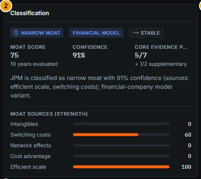

*Figure 5A.33: Moat classification for JPMorgan Chase (`/company/JPM?tab=moat`), financial-company variant.*

**JPMorgan (bank).** Narrow moat with the `financial model` badge, confidence 91%, 5 of 7 core components passed. The score is displayed as 75 but is 74.65, just below the Wide bar of 75, so the class is Narrow even though persistence is 100%. Sources: efficient scale (100) and switching costs (68). Intangibles intensity has no score for the bank (shown as Fail).

**SAP and Petrobras (API).** SAP has a score of 76.7, above the Wide bar, but ROE persistence is 0.80 (ROIC above WACC in 8 of 10 years), below the 0.90 Wide requirement: Narrow. Petrobras is Narrow with a score of 64.6, persistence 0.71 and 7 years of history; as a commodity producer it could not be Wide in any case.

Use the cards to see *why* a rating is what it is: a Wide rating carried by scale and market share is different from one carried by margin stability and lock-in.

### Limitations and pitfalls

- **Market share is the share of the subsector revenue within the app's universe**, not true market share.
- The ten-year window is shorter for many non-US issuers; fewer than 5 years gives "Insufficient data", shown as such in the header (a dashed badge), in the Screener's Moat filter and column.
- Scores near a threshold are fragile (JPMorgan 74.65 against 75). Read the confidence and the components, not only the badge.
- A missing component shows as "Fail" on its card although it is simply not scored.
- The 5Y history of each component shows the **raw** metric, while pass / fail applies to the 0-100 score.
- The weekly cadence means the rating can lag a new annual report by up to a week (or more if the weekly chain does not run).

### Related mnemonics and BQL fields

No mnemonic. BQL: `moat` (wide / narrow / none / insufficient_data), `moat_score`, `f.moat`, `roic`, `roic_mean_5y`, `coc.wacc`.

---

## Insiders

**Route:** `/company/:id?tab=insiders` · **Menu:** Company 360 › Insiders · **Mnemonics:** none (cross-company view: Insider Radar) · **Refresh:** nightly chain (`sec_form4`, national filings, `insider_signals`); models weekly

### Purpose

The Insiders tab shows what the company's directors and officers have been doing with their own shares: the full transaction ledger from Form 4 (or the national equivalent), open-market buys and sells on the price chart, cluster buying, an anomaly score per transaction and a rules-based insider score. Open-market purchases by several insiders, by the CEO or CFO, or after a drawdown are the classic signal of interest.

### Screenshot

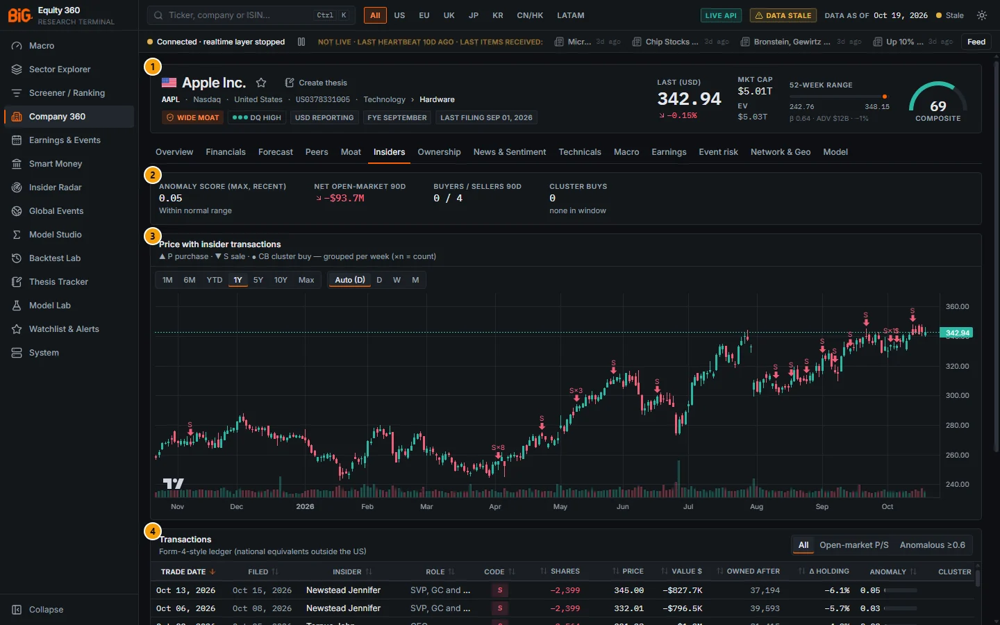

*Figure 5A.34: Insiders tab for Apple (`/company/AAPL?tab=insiders`), data as of 19 Oct 2026 (signal as of 16 Oct 2026).*

| # | Panel | What it shows |
|---|---|---|
| 1 | Company header | See [Company header](#company-header) |
| 2 | Summary stats | Anomaly score (max, recent) with "Within normal range" or "Unusual activity"; net open-market value over 90 days; buyers / sellers over 90 days; cluster buys |
| 3 | Price with insider transactions | Candles with markers: ▲ P purchase, ▼ S sale, ● CB cluster buy, grouped per week (`×n` = count) |
| 4 | Transactions | "Form-4-style ledger (national equivalents outside the US)": trade date, filed date, insider, role, code, shares, price, value, owned after, Δ holding, anomaly bar, cluster |

### Controls

| Control | What it does |
|---|---|
| Price range / Bar interval | As on the Overview price chart; default 1Y daily candles. Markers are drawn on the daily view only |
| Marker hover | Kind and count for that week |
| `All` / `Open-market P/S` / `Anomalous ≥0.6` | Filters the ledger: every transaction type; open-market purchases and sales only; transactions with an anomaly score of at least 0.6 |
| Column header click | Sorts the ledger (default: trade date, newest first) |

### Methodology

From `backend/app/analytics/insider.py` and `insider_models.py`.

- **Point in time.** A transaction is usable from its **filing date** (knowledge date), never from the trade date. Amended filings (4/A) replace the original from the amendment's filing date.
- **Ledger.** The tab loads two years of transactions of **all** types: purchases (P), sales (S), grants and awards (A), option exercises and conversions (M), tax withholding (F) and gifts (G). Sales, withholding and gifts are shown as negative share counts and values.
- **Signals use open-market trades only.** The stats, chart markers, cluster logic and scores use only **open-market buys (P) and sells (S)**; grants, exercises, withholding, gifts and derivative-table rows are excluded.
- **Per-transaction features.** USD value, role weight (CEO 3.0, Chair 2.75, CFO 2.5, President 2.25, COO 2.0, other officers 1.5, directors 1.25, 10% owners 0.75), 10b5-1 plan flag, change in holding, number of other insiders trading in the same direction within 30 days, first buy by this insider in two years, size against the insider's own past trades, the Cohen-Malloy-Pomorski **routine** flag (traded in the same calendar month in each of the three prior years), pre-filing price drawdown and run-up, volatility, liquidity and filing lag.
- **Anomaly score (0-1).** An **IsolationForest** on those features; the score is the empirical CDF of the training anomaly scores, so 1 = the most unusual transaction seen. It is unsupervised: it measures how strange a transaction is, not whether it predicts returns. The summary shows the maximum over the latest filing day in the last 90 days; "Unusual activity" from 0.75.
- **Clusters.** Open-market buys of one issuer are chained while consecutive trade dates are at most 30 days apart; a chain with at least 2 distinct insiders gets a cluster id (● CB markers, "Cluster buys" count). The **cluster-buy flag** in the insider signal (and the Overview alert) is stricter: at least 3 distinct buyers within 30 days.
- **Rules-based insider score (0-100).** Over the last 90 days each open-market trade contributes a weight that decays with a 45-day half-life:
  - buy: `role weight × (1 + 0.5 × cluster + 0.4 × first buy in 2 years + 0.4 × drawdown worse than −20%) × 0.5 if 10b5-1 × 0.6 if routine × ln(1 + value / $10k)`;
  - sell: `−role weight × 0.35 × (0.2 if 10b5-1 or routine) × (1 + 0.3 if the stock rose more than 30% in 6 months) × ln(1 + value / $10k)`;
  - `score = 50 + 50 × tanh(c / 2.5)` with `c = sign(raw) × ln(1 + |raw| / 5)`. 50 = no activity; one CEO buy of about $1M scores about 74, a large multi-insider cluster about 94, heavy selling about 10. This score is the Insider factor of the composite.
- **XGBoost model.** A gradient-boosted model of P(3-month excess return > 0) after insider filing events is trained weekly with purged, embargoed walk-forward validation. It is blended into the score (30%) only if it passes its out-of-sample promotion gate. It has not (see Validation status), so **only the rules-based score is used**.

### Data sources and refresh

SEC Form 4 (US, "full" coverage) and national regulator filings: UK (FCA), Germany (BaFin), the Netherlands (AFM), Korea (OpenDART, when its key is set), Hong Kong (HKEX) and Brazil (CVM, monthly). The API labels coverage as full for the US and partial for Korea, the EU and the UK. Form 4 is ingested nightly; `insider_signals` runs nightly; the IsolationForest and XGBoost are refitted weekly (`insider_models_fit`).

### Validation status

- **Rules-based insider score:** a transparent rule, not trained on returns; not formally validated as a stand-alone signal. Its rank-IC is computed as the benchmark in the model's walk-forward report.
- **Insider XGBoost:** **no out-of-sample edge.** The current model (version 20261020) reports, over 91 out-of-sample months and 170,131 events: 3-month AUC 0.493, pooled rank-IC −0.013, monthly rank-IC t-statistic −1.17; the promotion gate was **not passed** (`gate_passed = false`). Only the rules-based score is used in the app.
- **Anomaly score:** unsupervised descriptive measure; not validated as predictive.

### Correct usage and worked example

**Apple (Figure 5A.34, signal as of 16 Oct 2026).** Anomaly score 0.05, "Within normal range"; net open-market value over 90 days −$93.7M; 0 buyers, 4 sellers; no cluster buys. The chart shows only ▼ S markers (sales, several weeks with `S×n`). In the two-year ledger there are 248 transactions: 73 sales, 106 option exercises, 37 grants, 25 tax-withholding rows and 7 gifts, and **no** open-market purchases. The rules-based score is 26, the Insider factor value on the Overview.

Read: routine executive selling, much of it linked to vesting and plans, with nothing unusual. Selling is a weak signal; buying, especially by several insiders or after a fall, is the informative event. Use the `Open-market P/S` filter to cut out grants and exercises, and `Anomalous ≥0.6` to find the transactions worth reading in the filing.

### Limitations and pitfalls

- **The default ledger includes grants, exercises and withholding.** They are not signals; filter to `Open-market P/S`.
- The anomaly score measures unusualness, not direction or predictive value.
- Non-US coverage is partial and lags (national registers publish with different delays; CVM monthly).
- The 19 Oct 2026 audit found Form 4 data stale by about a week at that time; check System › Data Health for freshness.
- Insider XGBoost has no out-of-sample edge, so do not read `xgb_prob_up` (available in the API) as a forecast.
- Planned (10b5-1) and routine trades are down-weighted but still appear in the ledger.

### Related mnemonics and BQL fields

No company-tab mnemonic; the cross-company view is the [Insider Radar](07-smart-money-insiders.md). BQL: `insider_signal`, `f.insider`, `ins.anomaly_score`, `ins.anomaly`, `ins.cluster_buy`, `ins.cluster_buy_flag`, `sm.insider_signal`.

---

## Ownership

**Route:** `/company/:id?tab=ownership` · **Menu:** Company 360 › Ownership · **Mnemonics:** `HDS`, `SI`, `SMRT` · **Refresh:** 13F weekly; short interest weekly; EU / UK shorts and 13D / 13G nightly; smart-money score nightly

### Purpose

The Ownership tab shows who owns and who is shorting the company: institutional holders from SEC 13F filings with their latest changes, the ownership trend, short interest, insider transactions, EU / UK disclosed net short positions, 13D / 13G (activist and passive 5% holders) filings and a model-based smart-money score. Use it to judge crowding, flows and short pressure. Definitions follow `docs/SMART_MONEY.md`.

### Screenshot

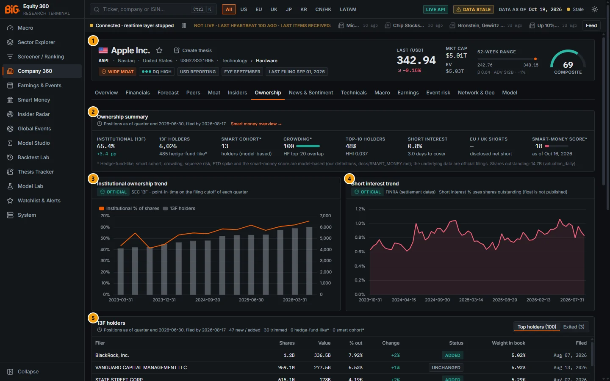

*Figure 5A.35: Ownership tab for Apple (`/company/AAPL?tab=ownership`), 13F positions as of quarter end 30 Jun 2026, filed by 17 Aug 2026.*

| # | Panel | What it shows |
|---|---|---|
| 1 | Company header | See [Company header](#company-header) |
| 2 | Ownership summary | Institutional (13F) % and change; 13F holders and hedge-fund-like*; smart cohort*; crowding*; top-10 holders and HHI; short interest and days to cover (with squeeze risk* when flagged); EU / UK shorts; smart-money score* and date. Link "Smart money overview →" |
| 3 | Institutional ownership trend | OFFICIAL, SEC 13F: institutional % of shares (line) and number of 13F holders (bars) per quarter, point-in-time on each quarter's filing cutoff |
| 4 | Short interest trend | OFFICIAL, FINRA (settlement dates): short interest as % of shares outstanding |
| 5 | 13F holders | Top holders: filer, shares, value, % out, change, status, weight in the filer's book, filed date; badges HF-like* and smart* |
| 6 | Insider timeline | OFFICIAL, Form 4 / national regulator filings: open-market buys and sells, 2 years (below the fold) |
| 7 | EU / UK net short positions | OFFICIAL, regulator registers (≥ 0.5% of capital) (below the fold) |
| 8 | 13D / 13G filings | OFFICIAL, SEC (below the fold) |
| 9 | Smart-money score history | MODEL-BASED percentile within the universe (below the fold) |

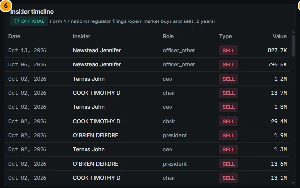

*Figure 5A.36: Insider timeline, Apple (panel 6).*

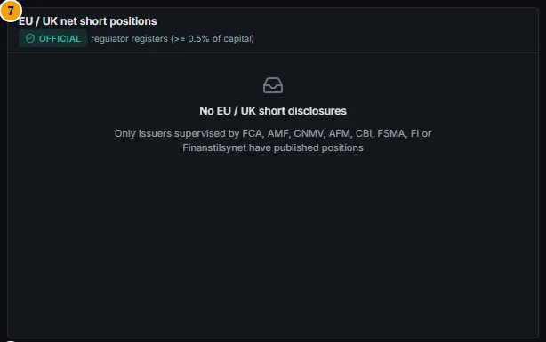

*Figure 5A.37: EU / UK net short positions, Apple (panel 7): empty, as expected for a US issuer.*

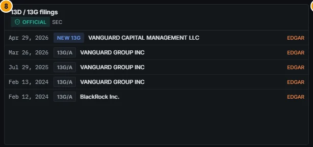

*Figure 5A.38: 13D / 13G filings, Apple (panel 8).*

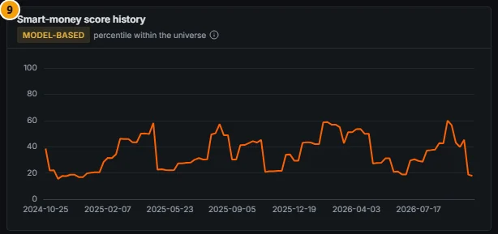

*Figure 5A.39: Smart-money score history, Apple (panel 9).*

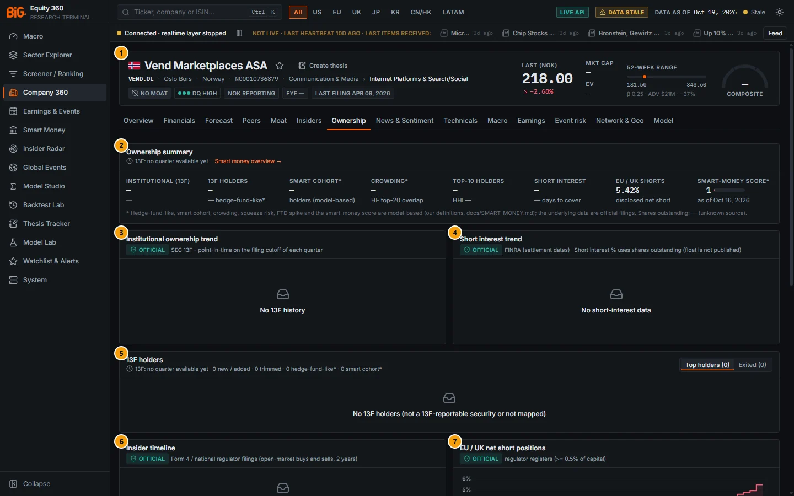

*Figure 5A.40: Ownership tab for Vend Marketplaces (`/company/VEND.OL?tab=ownership`), a Norwegian issuer, data as of 19 Oct 2026.*

| # | Panel | What it shows |
|---|---|---|
| 1 | Company header | Vend Marketplaces ASA, Oslo Børs, NOK |
| 2 | Ownership summary | "13F: no quarter available yet"; all 13F and FINRA fields empty; EU / UK shorts 5.42% disclosed net short; smart-money score at the 1st percentile as of 16 Oct 2026 |
| 3 | Institutional ownership trend | "No 13F history" |
| 4 | Short interest trend | "No short-interest data" (FINRA covers US-traded securities only) |
| 5 | 13F holders | "No 13F holders (not a 13F-reportable security or not mapped)" |
| 6 | Insider timeline | No transactions in the window |
| 7 | EU / UK net short positions | Step chart of the disclosed net short since January 2026 and the current register (Figure 5A.41) |
| 8 | 13D / 13G filings | Below the fold (empty for a non-US issuer) |
| 9 | Smart-money score history | Below the fold |

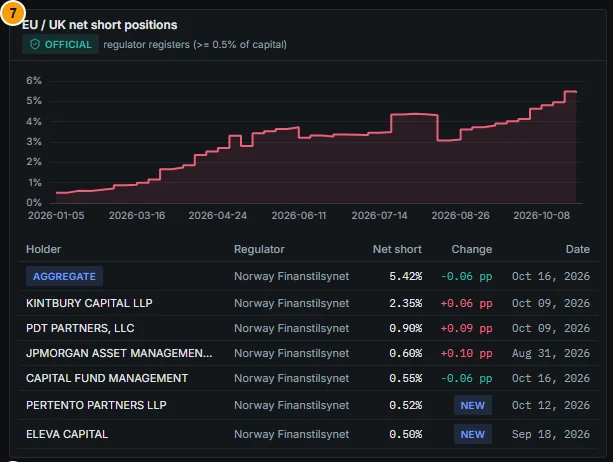

*Figure 5A.41: EU / UK net short positions for Vend Marketplaces (panel 7): the Finanstilsynet aggregate (5.42%) and the active named holders at or above 0.5%.*

### Controls

| Control | What it does |
|---|---|
| Smart money overview → | Opens `/smart-money` (see [Smart Money](07-smart-money-insiders.md)) |
| `Top holders (n)` / `Exited (n)` | 13F holders of the latest quarter, or last quarter's top holders that exited |
| Badge hover (HF-like*, smart*) | The model-based definition |
| `EDGAR` (13D / 13G) | Opens the filing on SEC EDGAR |
| Chart hover | Quarter or settlement-date values |
| Sources footer | The official sources used, with their lags |

### Methodology

- **13F point in time.** A quarter's snapshot uses only filings made by the cutoff: the filing deadline (quarter end + 45 days, next SEC business day) + 1 business day. The header states "Positions as of quarter end Q, filed by D". Restatements filed after the deadline drop out (conservative). Previous-quarter share counts are restated for splits before changes are computed.
- **Holder status**: new; added (> +1%); trimmed (< −1%); unchanged; exited. `Top-10 holders` is the share of the 13F total held by the ten largest; `HHI` is the sum of squared holder shares.
- **Hedge-fund-like filers*** (model-based): 10 to 1,000 positions, AUM ≥ $50M, ≥ 60% of the book in single stocks, and quarterly turnover ≥ 15% or option value ≥ 5% or (top-10 weight ≥ 50% and turnover ≥ 5%).
- **Crowding*** (model-based): number of hedge-fund-like filers holding the stock among their top-20 positions, as a percentile within the quarter.
- **Smart cohort*** (model-based): hedge-fund-like filers whose reported books beat the average 13F filer over the past four quarters (top decile, positive excess), selected point-in-time.
- **Short interest**: FINRA short interest / **shares outstanding** (float is not published; documented proxy), days to cover. **Squeeze risk*** (model-based): short interest ≥ 15% of shares, days to cover ≥ 5, 20-day return ≥ +10%, and shares ≤ 150M or market cap ≤ $2B.
- **Fails-to-deliver**: SEC FTD data feed the model-based **FTD spike** flag (largest daily fail ≥ 0.5% of shares outstanding, or z ≥ 3 against the previous 12 half-month files with at least 100k shares). FTD spikes are listed on the Smart Money overview; this tab lists FTD only among the sources.
- **EU / UK disclosed short %**: the regulator aggregate where published (UK FCA since 10 Jul 2026, Norway), otherwise the sum of active holder positions ≥ 0.5% (latest notification per holder, within two years); the maximum across regulators.
- **Activism**: new 13D, 13D amendment, 13G → 13D switch (the filer's previous filing on the company within three years was a 13G), new or amended 13G.
- **Smart-money score*** (model-based): z-scores within the date (winsorised at 1/99%) of 13F flow and breadth, smart-cohort flow and the insider signal, minus short-interest level and change, minus EU short level and 30-day change; grouped (institutional, smart, insider, short interest, EU short), averaged over available groups and shown as a 0-100 percentile. It is **not** part of the production composite (optional input, disabled by default).

### Data sources and refresh

All underlying data are official: SEC Form 13F data sets (quarterly, from 2023 Q1), FINRA equity short interest (twice monthly, published about 7 business days after settlement), SEC fails-to-deliver (half-monthly), SEC Schedules 13D / 13G (EDGAR indices), Form 4 and national insider filings, and the short-position registers of the FCA (UK), AMF (France), CNMV (Spain), AFM (Netherlands), CBI (Ireland), FSMA (Belgium), FI (Sweden) and Finanstilsynet (Norway). Italy (CONSOB) and Germany (BaFin, Bundesanzeiger) are not fetched (bot challenge; robots.txt). Jobs: `sec_13f` and `smart_money_13f` weekly, `finra_short_interest` weekly, `eu_short_positions` and `activist_filings` nightly, `smart_money_signals` nightly.

### Validation status

- 13F, FINRA, FTD, 13D / 13G and EU / UK registers: official data, labelled **OFFICIAL**.
- Hedge-fund-like, smart cohort, crowding, squeeze risk, FTD spike and the smart-money score: **model-based** (asterisked; "our definitions, docs/SMART_MONEY.md").
- **Smart-money score sanity check** (`docs/SMART_MONEY.md` §4, 2023-06-30 to 2026-10-16, 6,145 securities, point-in-time, non-overlapping): rank-IC of the composite −0.004 at 21 days (t −0.67) and −0.005 at 63 days (t −0.56). **None of the groups is statistically significant**; the composite has no predictive power in this short sample. Treat it as a descriptive screen, not an alpha signal. The weights were not tuned on this result.

### Correct usage and worked example

**Apple (Figure 5A.35).** Institutional ownership 65.4% of shares (+3.4 pp on the quarter), 6,026 13F holders of which 485 hedge-fund-like, 13 in the smart cohort; crowding at the 100th percentile (Apple is in the top 20 of more hedge-fund-like books than almost any stock); top-10 holders 48% (HHI 0.037). Short interest 0.8% of shares outstanding, 3.0 days to cover, no squeeze flag; no EU / UK disclosures. Smart-money score 18th percentile as of 16 Oct 2026. Holders: 47 new or added, 30 trimmed; BlackRock holds 7.92% of shares outstanding (added).

Read: widely and increasingly owned, very crowded among active managers, lightly shorted. Crowding is a risk factor in a de-risking episode rather than a signal of direction.

**Vend Marketplaces (Figures 5A.40 and 5A.41).** The opposite case: a Norwegian issuer with no 13F or FINRA data, where the short side is visible only through the regulator register. Norway's Finanstilsynet publishes an aggregate, so the summary shows 5.42% disclosed net short (the aggregate row, −0.06 pp on 16 Oct 2026). The step chart shows the disclosed short rising from about 0.5% in January 2026. Named holders at or above 0.5% include Kintbury Capital (2.35%, +0.06 pp), PDT Partners (0.90%), JPMorgan Asset Management (0.60%), Capital Fund Management (0.55%) and two new positions (Pertento Partners 0.52%, Eleva Capital 0.50%). In the Change column an increase in a short is shown in red and a decrease in green. A steady build-up of disclosed shorts across several funds, together with a smart-money score at the 1st percentile, is worth investigating; it describes positioning and is not a forecast.

### Limitations and pitfalls

- **13F lag.** Positions are as of quarter end and filed up to 45 days later; they are long positions only (no shorts, no non-13F managers).
- **CUSIP mapping gaps.** The 19 Oct 2026 audit (F29) found about 40% of 2025-26 13F rows without a mapped security; holder counts can be understated, notably for ADRs and smaller names.
- Short interest % uses shares outstanding, not float, so it understates short pressure for low-float stocks.
- EU / UK coverage excludes Italy and Germany; UK holder names are aggregated since 10 Jul 2026.
- 13F is a US filing regime: for non-US home listings, the holders shown are US managers' positions reported under 13F, typically via ADRs or US-listed lines.
- The smart-money score has no demonstrated predictive power.

### Related mnemonics and BQL fields

`HDS` (holders), `SI` (short interest), `SMRT` (smart money). BQL: `own.inst_own_pct`, `own.inst_own_chg`, `own.n_holders`, `own.n_hf_holders`, `own.crowding_pct`, `own.n_smart_holders`, `own.smart_flow_pct_out`, `shrt.short_interest_shares`, `shrt.short_pct_float`, `sm.eu_short_pct`, `sm.score_pct`, `sm.g_inst`, `sm.g_short_interest`. See [Smart Money](07-smart-money-insiders.md).

---

## News & Sentiment

**Route:** `/company/:id?tab=sentiment` · **Menu:** Company 360 › News & Sentiment · **Mnemonics:** `CN` (when the News Terminal is not installed) · **Refresh:** nightly chain (`nlp_sentiment`, `sentiment_daily`, `lazy_prices`, `gdelt_company_daily`); live news hourly

### Purpose

The News & Sentiment tab measures the tone of news about the company over time, lists the latest items with their sentiment and relevance, plots GDELT global events linked to the company, and reports the "Lazy Prices" text-change measure of its periodic filings. Use it to see whether news flow is turning, and whether a price move is accompanied by news.

### Screenshot

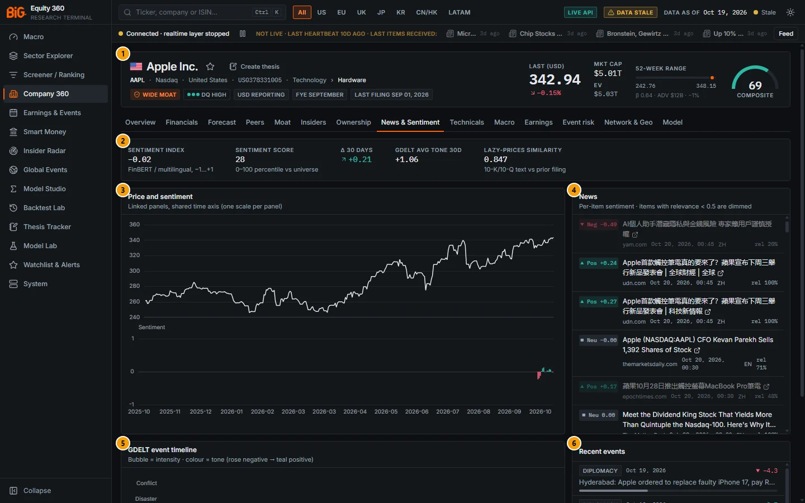

*Figure 5A.42: News & Sentiment tab for Apple (`/company/AAPL?tab=sentiment`), data as of 19 Oct 2026.*

| # | Panel | What it shows |
|---|---|---|
| 1 | Company header | See [Company header](#company-header) |
| 2 | Summary stats | Sentiment index (FinBERT / multilingual, −1…+1); sentiment score (0-100 percentile vs universe); Δ 30 days; GDELT average tone 30 days; Lazy-prices similarity (10-K/10-Q text vs prior filing) |
| 3 | Price and sentiment | Linked panels on a shared time axis: close (top) and the daily sentiment index as bars (bottom) |
| 4 | News | "Per-item sentiment · items with relevance < 0.5 are dimmed": chip, headline with link, source, time, language, relevance |
| 5 | GDELT event timeline | Events by category over time; bubble = intensity, colour = tone (rose negative → teal positive) |
| 6 | Recent events | Category, date, tone and an intensity bar for each linked GDELT event |

### Controls

| Control | What it does |
|---|---|
| Linked chart hover | Close and sentiment index for the date, on both panels |
| Headline | Opens the article at the source (new tab) |
| Dimmed item hover | "Low issuer-link confidence (relevance < 0.5)" |
| Timeline bubble hover | Headline, date, average tone, intensity |
| Scroll | The News and Recent events lists scroll inside their panels |

### Methodology

From `backend/app/nlp/` (`sentiment.py`, `aggregate.py`, `lazy_prices.py`, `gdelt_link.py`).

- **Item sentiment.** English text is scored with **FinBERT** (`ProsusAI/finbert`); other languages with **XLM-R** (`cardiffnlp/twitter-xlm-roberta-base-sentiment`). Language comes from the source metadata or a script / stop-word detector. Score = `P(positive) − P(negative)` in −1…+1. The chip shows Pos above +0.15, Neg below −0.15, otherwise Neu.
- **Relevance (0-1)** of each item to the company: ticker or company name in the title 1.0; provider ticker tag 0.85; name in the snippet 0.7; organisation mention only (GDELT GKG) 0.5 × the organisation-link confidence. Ambiguous names (Apple, Meta, Visa, Shell, Target …) need corroborating context in the title. Items linked to many companies are down-weighted (× √(3/n) when n > 3).
- **Daily index.** Each item's score blends the model (0.6), the provider's sentiment where available (0.25) and GDELT tone / 5 (0.15), then is **de-meaned per source** by that source's trailing 30-day universe mean (sources have different tone levels). Per company and day: the **relevance-weighted mean, ignoring items with relevance below 0.5** (they still count for attention, and are dimmed in the list). The **sentiment index** is the 7-day exponentially weighted mean on irregular time: days without news carry no information and only decay the weight; the index becomes empty when it is stale. Days when a source's universe-wide volume falls below 50% of its 30-day median are flagged and do not distort the attention measure.
- **Δ 30 days**: latest index minus the value about 22 data days earlier.
- **Sentiment score (0-100)**: per-date cross-sectional percentiles of the 30-day sentiment EWM (weight 0.40), the 7-day GDELT tone EWM (0.20) and the Lazy Prices percentile (0.40), renormalised over what is available; 50 = no data. It feeds the Sentiment factor of the composite.
- **GDELT.** GDELT organisation mentions are linked to issuers (exact alias, fuzzy match ≥ 92, context rules for ambiguous names; links below 0.5 confidence excluded). The timeline shows linked GDELT events of the last 200 days by category (Policy, Economic, Legal, Corporate, Diplomacy, Protest, Disaster, Conflict). "GDELT avg tone 30d" is the mean daily average tone over the last 30 days.
- **Lazy Prices** (Cohen, Malloy and Nguyen 2020). Each periodic filing is compared with the prior year's equivalent (10-K / 20-F / 40-F with the previous annual report; 10-Q with the same quarter a year earlier), section by section (full text, risk factors, MD&A, legal, business). Measures: TF-IDF cosine similarity, Jaccard, sentence edit ratio, share of new sentences, Loughran-McDonald negative and uncertainty word deltas. A filing is flagged **large change** when the risk-factor (or full) section has a similarity z-score ≤ −2 against filings of the prior 365 days or at least 35% new or rewritten sentences. The stat on the tab shows the cosine similarity of the most recent compared filing (1 = unchanged); low similarity (a low universe percentile) means an unusually large change, which in the original study preceded weaker returns.

### Data sources and refresh

News: Polygon news (US), RSS feeds, GDELT GKG headlines and the realtime news layer. GDELT events and GKG are streamed daily. Filing texts: SEC EDGAR (US only for Lazy Prices). Jobs in the nightly chain: `nlp_sentiment` (scoring new items), `gdelt_company_daily`, `lazy_prices`, `sentiment_daily`. The live news layer folds new items hourly.

### Validation status

**Not formally validated** as a return signal in the app. FinBERT and XLM-R are published pre-trained classifiers used as is; the daily index, relevance weights and the 0-100 score are transparent rules. The tab shows no model-based badge. The Lazy Prices construction follows the published study, but its predictive value has not been re-tested here.

### Correct usage and worked example

**Apple (Figure 5A.42).** Sentiment index −0.02 (neutral), Δ 30 days +0.21, sentiment score 28 (28th percentile against the universe), GDELT average tone +1.06. Lazy-prices similarity 0.847: the July 2026 10-Q compared with the same quarter a year earlier, at about the 11th percentile of similarity in the universe, i.e. a larger-than-usual rewrite. The news list mixes English and Chinese items; a Chinese headline with relevance 20% is dimmed and does not count in the index.

Read: neutral tone, a below-average sentiment score, nothing to act on alone. A combination of a falling index, rising attention and a large Lazy Prices change would deserve a read of the filing and the news.

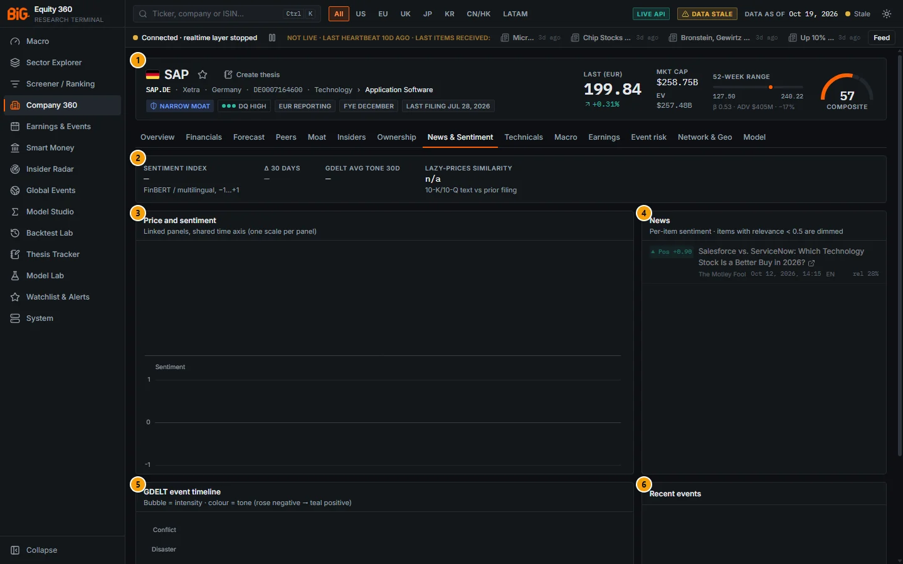

*Figure 5A.43: News & Sentiment for SAP (`/company/SAP.DE?tab=sentiment`), a non-US issuer, data as of 19 Oct 2026.*

| # | Panel | What it shows |
|---|---|---|
| 1 | Company header | SAP, Xetra, EUR |
| 2 | Summary stats | Sentiment index "—", Δ 30 days "—", GDELT average tone "—", Lazy-prices similarity "n/a"; the sentiment score tile is hidden because no score exists |
| 3 | Price and sentiment | Empty: no sentiment history in the window |
| 4 | News | One item (The Motley Fool, 12 Oct 2026, English) with relevance 28%, dimmed |
| 5 | GDELT event timeline | No linked events |
| 6 | Recent events | Empty |

**SAP (Figure 5A.43)** shows the coverage gap for a large European issuer. The only linked news item has low relevance (it is about Salesforce and ServiceNow) and is excluded from the index, so the index and Δ 30 days are empty. Lazy Prices is n/a because SAP files no 10-K or 10-Q. SAP's Sentiment factor sits at the neutral 50, which reflects missing data, not neutral news.

### Limitations and pitfalls

- **Short history.** News sentiment history starts around August 2026 and GDELT company history in October 2026. In this snapshot Apple's index has non-empty values only from 3 Oct 2026, which is why the bars sit at the right edge of the chart.
- Coverage is uneven by language and market; small and non-US names may have few items, and the index then goes stale (empty) rather than reading 0.
- Relevance is a heuristic; ambiguous company names can still mislink.
- Lazy Prices uses SEC filings only (US issuers). The stat shows the latest compared section, which is not necessarily the risk-factor section; the large-change flag itself is in BQL (`sent.lazy_prices_large_change`).
- The GDELT DOC API is degraded; the raw event files are the main GDELT source (see [Global Events](08-global-events-news.md)).
- News timestamps can be later than the snapshot date (the live layer keeps adding items).

### Related mnemonics and BQL fields

`CN` (News Terminal filtered on the ticker when installed, else this tab), `TOP`. BQL: `sentiment`, `f.sentiment`, `news_count_30d`, `sent.news_count`, `sent.news_count_z`, `sent.gdelt_tone_ewm_7d`, `sent.lazy_prices_sim`, `sent.lazy_prices_pct`, `sent.lazy_prices_large_change`. See [Global Events and News Terminal](08-global-events-news.md).

## Debt

Company 360 tab **Debt** (`/company/<id>?tab=debt`). The id may be the internal id, a ticker (`AAPL`, `7203.T`), an ISIN or a ticker without its exchange suffix when only one company uses it (`7203`); a root shared by several companies (`2317`: Hon Hai, Systena, Vedan) is not guessed: use the full ticker.

### Purpose

The issuer's debt profile from its own filings: maturity wall, cost of debt, interest coverage, leverage history, fixed vs floating, and its listed bonds.

### Controls

None: the tab shows the latest balance-sheet date and the full history of fiscal years (interim periods when fewer than two years exist).

### Methodology

- Total / short-term / long-term debt, cash, EBIT, EBITDA and interest expense come from the canonical statements (TTM flows, fiscal year otherwise).
- Average cost of debt = interest expense / average of this and last year's total debt; interest coverage = EBIT / interest expense; net debt / EBITDA is not shown when EBITDA ≤ 0.
- Maturities, fixed / floating debt and the reported weighted-average rate are the XBRL tags of the same filings (US GAAP; IFRS maturity analyses where tagged).
- The refinancing line is **model-based** (local 5y government yield + ICE BofA OAS proxy).
- Listed bonds: ESMA FIRDS by the issuer's LEI (EU / EEA venues), OpenFIGI for US TRACE bonds (coupon and maturity parsed from the FIGI description).

### Data sources and refresh

Job `company_debt` (nightly) over fundamentals and the SEC companyfacts bulk file already on disk; FIRDS weekly; OpenFIGI through the filler campaign `us_bonds_openfigi`.

### Validation status

Point-in-time by filing date (latest filed version of each period); ratios unit-tested (tests/rates/test_jobs_and_checks.py).

### Correct usage and worked example

Compare the average cost of debt with the sector figure under the KPI, then read the maturity wall: a large "< 1y" bar with coverage below 3× signals refinancing pressure.

### Limitations and pitfalls

- Many issuers (most IFRS filers) do not tag a maturity schedule: the wall is then empty with the reason shown.
- The cost of debt uses year-end balances, so it is distorted by large debt changes during the year.

### Related mnemonics and BQL fields

`debt.*` fields (see [Credit](02b-markets-cross-asset.md#credit)).
