# 5B. Company 360: Technicals

This chapter covers the **Technicals** tab of Company 360: the price chart with the calibrated range fan, the context chips, confluence zones and their levels, touch probabilities, the trade setup card with its first-passage and context-adjusted (meta) probabilities, the technical score, the evidence-based technical factors, the breakout panel and the indicators. It is the most model-heavy tab in the app. Read the [Technicals](#technicals) overview first: it explains the experimental toggle, how to read a probability that is "calibrated over history", and which outputs passed or failed their validation gate.

---

## Technicals

**Route:** `/company/:id?tab=technicals` · **Menu:** Company 360 › Technicals tab · **Mnemonics:** `TECH`, `GP`, `GIP` · **Refresh:** nightly jobs in the weekly profile (default) or daily profile; model refits weekly / monthly

### Purpose

The Technicals tab answers four practical questions about one listed security: where price has historically reacted (levels and confluence zones), how far price typically travels over the next 1 to 20 sessions (the calibrated range), what a level-based trade setup has historically delivered (first-passage probabilities, expected R), and what the documented, evidence-based technical effects say about the stock (52-week-high proximity, MAX, idiosyncratic volatility, volume-confirmed breakouts). It is used by analysts to time entries and size risk around a fundamental view, and by portfolio managers to check whether a planned stop or target is realistic.

Every probability on this tab is **model-based** and **calibrated over history**: it is the frequency with which similar situations produced the outcome in a walk-forward test, not a statement about this stock today. Outputs that failed their validation gate are hidden behind the **experimental toggle**.

### Screenshot

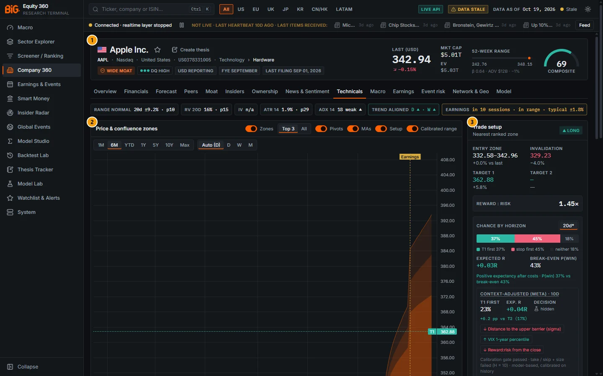

*Figure 5B.1: Technicals tab for Apple (`/company/AAPL?tab=technicals`), experimental toggle off (the default), data as of 19 Oct 2026.*

| # | Panel | What it shows |
|---|---|---|
| 1 | Apple Inc. | The Company 360 header (price, market cap, 52-week range, composite score). See [5A. Company 360: header](05a-company-fundamentals.md#company-header). |
| 2 | Price & confluence zones | Candlestick chart with confluence zones, pivots, moving averages, the trade setup lines and the calibrated range fan to 20 sessions; range strip underneath. See [Price chart and calibrated range](#price-chart-and-calibrated-range). |
| 3 | Trade setup | Bias, entry zone, invalidation, targets, reward : risk, the two-barrier "Chance by horizon" bar, expected R, break-even P(win) and the "Context-adjusted (meta)" row. See [Trade setup](#trade-setup) and [Context-adjusted (meta) row](#context-adjusted-meta-row). |
| 4 | Technical score | The heuristic 0-100 technical score with percentile sub-scores; "No out-of-sample edge" note. See [Technical score](#technical-score). |
| 5 | Technical factors (evidence-based) | Percentiles of the factors that passed their gate (52-week-high proximity, MAX, idiosyncratic volatility), each with its "rank IC" badge. See [Technical factors (evidence-based)](#technical-factors-evidence-based). |
| 6 | Breakout | State of the latest 20 / 55-session breakout and the historical evidence on volume confirmation. See [Breakout](#breakout). |
| 7 | Indicators | RSI 14, ATR 14, SMA 50, SMA 200 and the trend label. See [Indicators](#indicators). |
| 8 | Confluence zones | Table of zones, sorted by price (highest first; the subtitle says so, earlier builds claimed "ranked by strength"): rank, type, range, distance, strength, touch probability, hold-given-touch column, contributors, touches. See [Confluence zones](#confluence-zones) and [Touch probabilities](#touch-probabilities). |
| 9 | Level types · backtested hit rates | Best level key per level type for this stock, with shrunk hit rate, average reaction and number of events. See [Level types and level-type reliability](#level-types-and-level-type-reliability). |
| 10 | Level-type reliability | This stock's level keys aggregated by type (10-year backtest): bounce hit rate and edge versus a random-level control per level type. Earlier builds subtitled it "all names, out-of-sample"; the cross-sectional out-of-sample result is the note under the table. See [Level types and level-type reliability](#level-types-and-level-type-reliability). |

The row of chips directly under the tab bar (no badge) is described in [Context chips](#context-chips).

#### What the experimental toggle reveals

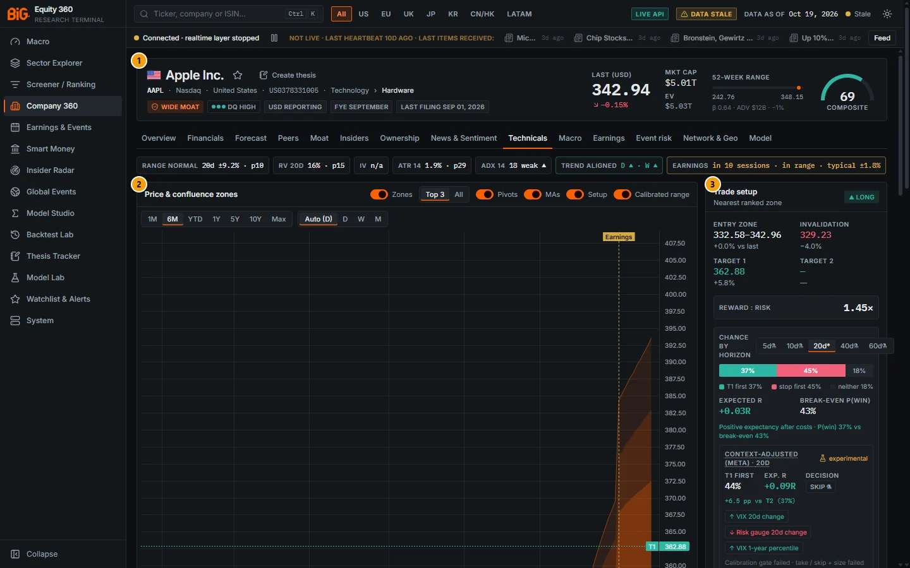

*Figure 5B.2: The same page with "show experimental (failed validation)" switched on. Callout numbers are the same as in Figure 5B.1.*

| Panel | Default (toggle off) | With the toggle on |
|---|---|---|
| Trade setup, Chance by horizon | Only the 20-session horizon (the one that passed). A note says "4 experimental horizons hidden." | Horizons 5, 10, 20, 40 and 60 sessions; failed ones carry a flask icon and the line "Experimental horizon: failed the validation gate." |
| Trade setup, Context-adjusted (meta) | The 10-session row (passed); Decision shows "hidden"; no suggested size. | The meta row follows the horizon on screen (20 or 40 sessions, labelled "experimental"); Decision shows take / skip with a flask icon; a suggested size appears for "take". |
| Confluence zones, hold-given-touch column | A flask icon in place of the probability, plus the validated edge badge ("no reliable edge" or "±x.x pp vs random"). | The calibrated P(hold given touch) in per cent, with a flask icon, next to the same edge badge. |
| Technical score | Percentile sub-scores and the "No out-of-sample edge" note. | Adds the score bucket's historical outcomes at 5 / 20 / 60 sessions, each badged "no out-of-sample edge". |
| Technical factors | hi52, MAX, IVOL only; "4 factors without a validated edge hidden." | Adds 12-1 momentum, residual momentum, 1-month reversal and industry momentum, each with a flask icon and "no reliable edge". |
| Breakout | State chip, confirmation flag and score; the line "P(follow-through) is experimental (failed validation) — hidden." | Adds "P(follow-through, 20d)" with a flask icon, the geometry baseline and the base rate. |

> **Note:** The toggle is stored per browser (local storage), not per user account, and is shared by every Technicals card and by the probability tables in the [Thesis Tracker](12-thesis-tracker.md#thesis-page). If you switch it on once, it stays on for every security until you switch it off. All screenshots in this chapter show the default view (toggle off) unless the caption says otherwise.

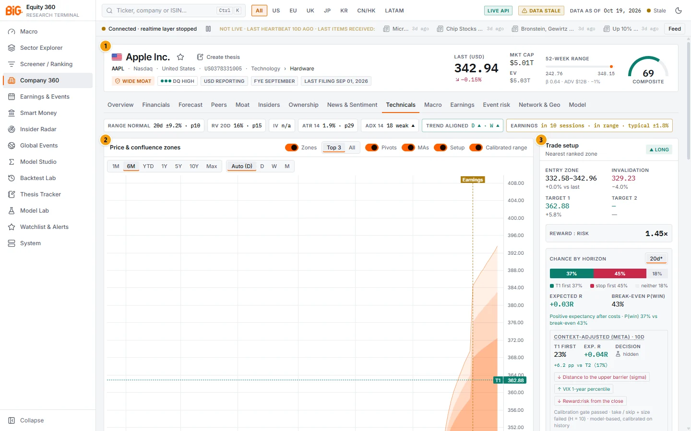

*Figure 5B.3: Light theme (`/company/AAPL?tab=technicals`), default view. Every panel, callout number and colour role is the same as in Figure 5B.1.*

### Controls

| Control | What it does |
|---|---|
| show experimental (failed validation) | Switch with a flask icon. Reveals outputs that failed their validation gate (table above). It sits inside the "calibrated on history" popovers of the Trade setup and Technical score cards and inside the info (ⓘ) popover of the Technical factors card. Off by default; persisted per browser. |
| calibrated on history (button) | Opens a popover with the model's plain-language definition, one line per horizon or output with its gate verdict ("pass" or "experimental") and summary (ECE, worst regime, Brier against baselines), the experimental switch, and the validation document name. |
| Chart switches and range strip | Zones, Top 3 / All, Pivots, MAs, Setup, Calibrated range, price range, bar interval, range level and badge horizon. See [Price chart and calibrated range](#price-chart-and-calibrated-range). |
| Touch horizon (1d / 5d / 10d / 20d) | One setting shared by the chart's zone badges and the Confluence zones table. |
| Chance by horizon (5d / 10d / 20d / 40d / 60d) | Selects the horizon of the two-barrier probabilities on the Trade setup card. An asterisk marks the setup's own horizon; a flask marks an experimental horizon. |
| Row hover (Confluence zones) | Previews that zone on the chart. |
| Hover tooltips | Every dotted-underlined label (Touch, Hold given touch, Context-adjusted (meta), factor names, context chips, probability segments) has a tooltip with its definition. |
| Create thesis (header) | Opens the Thesis Tracker editor for this security; the thesis target / stop then get the same calibrated probabilities. See [12. Thesis Tracker](12-thesis-tracker.md#thesis-editor). |

There is no export button on this tab. The same numbers are available through the API endpoints and BQL fields listed in each section.

### Methodology

The tab combines four model families. Each is described in detail in its own section; this subsection gives the common concepts.

#### Calibrated over history versus chance today

A probability such as "T1 first 37%" means: in the walk-forward test, among historical setups with the same standardised geometry and in the same pool (region, volatility regime, earnings window), the target was reached first about 37% of the time, and the model's 37% buckets realised close to 37% on average. It is a **marginal** statement over many securities and days. It is **not** "a 37% chance for Apple today": the app has no way to verify a single-day, single-stock probability, and conditions specific to today (news, a market shock) are not in the pool. This is why every popover says "calibrated on history" and the range popover says "Calibrated to 90% over history (2010–2026 walk-forward), not "90% chance today"".

#### Conformal calibration (the range fan and touch probabilities)

Conformal prediction turns any volatility forecast into a band with a guaranteed long-run hit rate, using the model's own past errors instead of a Gaussian assumption.

```
V(h)      = h · s²ₜ  (+ Jₜ if an earnings day falls in (t, t+h])      EWMA λ = 0.94, earnings days excluded
score     = y²ₕ / V(h)            yₕ = log(C₍ₜ₊ₕ₎ / Cₜ), on past origins of the same pool
q̂(α)      = the ⌈(n+1)(1 − α)⌉-th smallest of the last 500 realised scores
band      = Cₜ · exp(± √(q̂ · V(h)))     α = 0.20 / 0.10 / 0.05 for the 80 / 90 / 95% bands
```

Scores are pooled per region × sector (separate pool for origins whose window contains an earnings day), so q̂ is estimated on 15,000 or more scores per pool. The filter decides the shape (how wide relative to recent volatility), the conformal quantile decides the size. The band has **no direction call**: its centre is the last close.

#### First-passage probabilities (the trade setup)

A first-passage probability asks which of two price levels is touched first. For a long setup: does the high reach T1 before the low reaches the invalidation, within H sessions? The answer depends on the path, not only on where price ends, so it cannot be read off a terminal-price band. The app estimates it empirically: for every daily origin in the gate universe it records, for a 20 × 20 grid of barrier distances, whether the upper or lower barrier was hit first or neither. Distances are standardised by σ_H = √V(H), so one surface serves every security. A same-bar touch of both barriers counts as a loss (intrabar order is unknown).

#### Meta-labelling (the context-adjusted row)

Meta-labelling (Lopez de Prado, *Advances in Financial Machine Learning*, ch. 3-4) separates two jobs. The **primary model** proposes a trade (here: the level-based setup with direction, entry, T1 and invalidation). A **secondary (meta) model** then estimates the probability that this proposal succeeds, given context the primary model ignores. Outcomes are labelled with the **triple barrier**: win = upper barrier (T1) first, loss = lower barrier (invalidation) first, and a vertical barrier at H sessions. The meta model starts from the T2 first-passage probability (as a fixed offset) and adjusts it for market regime, VIX, peer break-aways, insider and short-interest flow, earnings proximity, squeeze, ADX and trend alignment.

#### Purged walk-forward

Every model on this tab was tested **walk-forward**: for each test period, the model is fitted only on data available before that period, with a **purge / embargo** gap at least as long as the outcome horizon, so that no training label overlaps the test period. Examples: the T2 surface for test year Y uses origin quarters before Q(Y) − 1; the zone model uses training origins before the block start − 425 days and calibrates on [start − 365 days, start − 60 days); the meta model embargoes 1.5 × H sessions (28 / 49 / 91 calendar days at H = 10 / 20 / 40). Leakage tests (causal invariance, shifted-feature peeks, label permutation) were run on every model.

#### ECE, Brier score and log-loss

- **ECE** (expected calibration error): sort the predictions into 15 quantile bins, compare the mean prediction with the realised frequency in each bin, and average the absolute gaps weighted by bin size. Reported in percentage points (pp). ECE 1.47 pp means predictions were on average about 1.5 pp away from what happened. The gates require ECE ≤ 2.5 pp.
- **Worst regime gap**: the same comparison in calibration-in-the-large within stress windows (Covid 2020 = origins 15 Feb to 30 Jun 2020, the 2022 rates shock, VIX > 25, earnings windows, each region, volatility regime and side). The gates require every regime with n ≥ 2,000 to be within 5 pp.
- **Brier score**: the mean squared difference between predicted probabilities and outcomes (0 is perfect; lower is better). **Log-loss** penalises confident mistakes more heavily. A model must beat simple baselines on both, for example the driftless Brownian formula or the naive "R:R only" rule.

A model can be well calibrated (low ECE) and still useless (no better than the baseline), or useful on average but wrong in a crash. That is why each gate has all three parts.

#### How a gate decides what you see

| Gate result | How the app shows it |
|---|---|
| PASS | Shown by default; the popover says "pass". |
| FAIL | Hidden unless the experimental toggle is on; shown with a flask icon and the word "experimental". |
| Not validated (region or universe outside the test) | Treated as experimental (meta row) or flagged "region not validated" (factors). |

Verdicts are re-read from the gate files at every weekly fit, so a re-run validation updates the display without a code change.

### Data sources and refresh

- **Prices:** split- and dividend-adjusted daily bars (open, high, low, close, volume) from the app's price store (Polygon and yfinance). All calculations use the security's own trading sessions.
- **Earnings dates:** the earnings calendar (company announcement, provider estimate or model projection, labelled) and past releases for the earnings jump term and the typical move.
- **Market context (meta model):** FRED VIX, the cross-asset risk gauge, macro cycle states (lagged two months), conformal peer groups, Form 4 insider flow, FINRA short interest and the smart-money composite.
- **Jobs (nightly DAG):** `tech_levels` → `confluence_zones` (levels, zones, setup, technical score), `conformal_envelopes` (range fan and touch curves), `technicals_probabilities` (T2 / T3 / T4 serving), `tech_meta_score`, `tech_factors`, `tech_breakouts`. **Weekly DAG:** `level_type_backtest`, `technicals_probabilities_fit`, `tech_meta_fit`. **Monthly DAG:** `tech_factor_eval` (factor monitor and P(follow-through) refit). The context chips are computed when the page is opened.
- **Schedule:** with the default weekly profile the nightly, weekly and (when due) monthly DAGs run back to back on Saturday 08:00 Lisbon; the daily profile runs the nightly DAG every night. See [1. Data and coverage](01-data-and-coverage.md#refresh-schedule).
- **As-of dates:** the zones, setup and probabilities carry the as-of date of the last nightly run (for example 16 Oct 2026), which can be one or more sessions older than the last candle on the chart. The range strip states its origin ("from the Oct 16 close").

### Validation status

| Output | Gate | Key numbers | How the app shows it | Source |
|---|---|---|---|---|
| Calibrated range fan (marginal bands, h = 1..20) | Validated by-product | Per-horizon coverage 79.6-80.0 / 89.6-90.0 / 94.6-94.9%; about 40% narrower than 2×ATR (which covers 98%) | Fan and range strip, labelled "Calibrated range" | CONFORMAL_VALIDATION A.2, A.5 |
| Joint 1/5/10/20 envelope (ellipsoid) | FAIL | Covid Feb-Jun 2020: 77-78% at 90%; w_proj +35% vs a calibrated ATR box | Not on this tab ("failed validation and is not shown") | CONFORMAL_VALIDATION Verdict |
| Next bar (H, L, C) | FAIL (sharpness) | w_proj +43% vs calibrated ATR box | Not on this tab | same |
| Touch probabilities | Validated by-product | Predicted = realised within 0.2 pp | Touch column and chart badges | CONFORMAL_VALIDATION A.4 |
| T2 P(win / loss), H = 20 | PASS | ECE 1.13 / 1.47; worst regime Covid 2020 win -4.6 / loss +4.0; Brier 0.3741 vs 0.3759 / 0.3834 | Trade setup bar, default | TECHNICALS_V2 Verdict |
| T2, H = 5 / 10 | FAIL | Covid 2020 loss +5.6 / +5.1 pp | Experimental | same |
| T2, H = 40 / 60 | FAIL | Not better than the Brownian baseline (H = 60 also ECE 2.68 / 2.73) | Experimental | same |
| Expected R filter (economic check) | Null result | +1.0%/yr at H = 20, t = 1.33 | Expected R shown as a description only | same |
| T3 P(hold given touch) | FAIL | Covid 2020 -8.7 pp | Experimental | same |
| T3 per-zone edge vs random | PASS | Bucket predicted vs realised edge within 1.9 pp | Edge badge, default | same |
| T4 score → outcomes | FAIL | Rank IC -0.003 / -0.012 / -0.014 (n.s.) | "No out-of-sample edge"; bucket stats experimental | same |
| Meta P(win), H = 10 | PASS | ECE 0.50 / 0.78; Brier meta − T2 -0.00040 [-0.00071, -0.00006] | Context-adjusted row, default | TECHNICALS_V3 Meta-labelling |
| Meta P(win), H = 20 / 40 | FAIL | Not better than T2 / the context-free model | Experimental | same |
| Meta take / skip + size | FAIL (economic check) | US meta-filtered − all -4.3%/yr (t -2.55) at H = 20 | Hidden unless experimental | same |
| Factors hi52, MAX, IVOL | PASS | 20d IC +0.023 / -0.038 / -0.044; not profitable stand-alone after costs | Shown by default, "rank IC" badge | TECHNICALS_V3 #1 |
| Factors mom, rmom, strev, indmom | FAIL | See the factor table | Experimental | same |
| Factor composite | FAIL | G6 vs v2 t 1.66; G7 economics | Not served | same |
| P(follow-through), H = 10 / 20 | FAIL | Covid 2020 +18.3 / +17.2 pp | Experimental | TECHNICALS_V3 #5 |
| Volume-confirmation edge | PASS | Geometry-adjusted +1.6 pp [+1.2, +2.0]; no tradable edge | State chip, flag and score shown | same |
| Level-type ranking | Out-of-sample caveat | Top-ranked level types beat random levels by about 1.5 pp in bounce rate | "use as an entry filter, not a standalone strategy" | Level-type reliability panel note |

### Correct usage and worked example

Use the tab in this order: (1) read the context chips (is the range compressed, is earnings inside the window?); (2) look at the fan and the range strip to see what a normal 1-20 session move is; (3) check where the confluence zones sit relative to the fan and their touch probabilities; (4) read the trade setup's 20-session first-passage bar, expected R and break-even; (5) treat the technical score as a description, and the factor percentiles as rank context. Never treat any single number as a forecast.

**Worked example: Apple (AAPL), as of the 16 Oct 2026 close (343.46 USD), default view.**

1. Context: "Range normal 20d ±9.2% · p10", "RV 20d 16% · p15", "Trend aligned D ▲ · W ▲", "Earnings in 10 sessions · in range · typical ±1.8%". The range is narrow for Apple (only about 10% of the last two years were narrower), and the next release falls inside the 20-session window, so the fan widens at the earnings marker.
2. Range strip at 90%: 1d 337.11–349.93 (±1.9%), 5d 329.45–358.06 (±4.2%), 10d 324.11–363.97 (±5.8%), 20d 307.98–383.03 (±10.9%).
3. Setup: long, entry zone 332.58–342.96, invalidation 329.23, Target 1 362.88, reward : risk 1.45× from the limit entry.
4. Chance by horizon, 20d (the setup's own horizon): T1 first 37%, stop first 45%, neither 18%; expected R +0.03R after costs; break-even P(win) 43%.
5. Context-adjusted (meta) 10d: T1 first 23%, +6.2 pp vs T2 (17%), Exp. R +0.04R; decision hidden.
6. Technical score 88 (p100), with the note that it has no out-of-sample edge; factors: 52-week-high proximity p100, MAX p98, idiosyncratic vol p98, all "rank IC" badges.

Reading: Apple is near its 52-week high in a quiet, aligned uptrend; the nearest support zone is right under the price, and historically similar 20-session setups reached T1 first in roughly 37% of cases, enough for a slightly positive expectancy only because 18% of paths resolve neither way (see [Trade setup](#trade-setup)). None of this says Apple will rise.

### Limitations and pitfalls

- **Survivorship and current classification.** All validation universes use current index membership and current sectors (documented in every validation report).
- **Gate universe.** The probability models were validated on about 650 large and liquid names (mvp US 490 + EU 90 + UK 27 + JP 40). They are served for every security with a setup; outside US / EU / UK / JP and for ETFs or indices the meta row is always experimental and the factors carry "region not validated".
- **Daily data only.** Barrier events use the day's high and low, so the order of touches within a day is unknown (both on the same bar counts as a loss); there is no intraday or options data.
- **Regime breaks.** Every model's worst case is the Feb-Jun 2020 crash: sudden shocks arrive after the forecast origin. Calibration over history does not protect a single position in a crash.
- **The toggle persists.** If numbers look different from a colleague's screen, check the experimental switch first.

### Related mnemonics and BQL fields

- Command bar: `TECH` (Technicals), `GP` (price graph, opens this tab for equities), `GIP` (daily data only: opens the price graph). On an instrument (index, FX, commodity) these open the instrument page instead. `HELP` with no argument opens this user guide (`/help`); `HELP TECH` describes the mnemonic. See [14. BQL console and mnemonics](14-bql-mnemonics.md#mnemonic-reference).
- BQL groups: `setup.*` (trade setup and score), `zone.*` (top zone), `cf.*` (conformal range), `tp.*` (calibrated score), `tech.*` (evidence-based factors), `bo.*` (breakout). There are no BQL fields for the T2 first-passage or meta probabilities; use the API endpoints `GET /api/v1/technicals/{security_id}/setup-probabilities` and `/meta-setup`.
- Related: [Peers tab (conformal peer-group panel)](05a-company-fundamentals.md#peer-group-joint-anomaly), [11. Backtest Lab](11-backtest-lab.md#experimental-signals) (experimental triggers `meta_setups`, calibrated-band breakout, source `tech_factors`), [13. Watchlists and alerts](13-watchlists-alerts.md#alert-rule-reference) (zone touch, price outside calibrated range), [15. System](15-system.md#conformal-validation) (Conformal validation page), [16. Methodology](16-methodology.md#gate-status-of-every-model).

---

## Price chart and calibrated range

**Route:** `/company/:id?tab=technicals` · **Panel:** Price & confluence zones · **Mnemonics:** `GP`, `TECH` · **Refresh:** prices nightly; fan nightly (`conformal_envelopes`)

### Purpose

The chart shows the price history with the technical structure the other panels refer to (zones, swing pivots, moving averages, the setup's entry, invalidation and targets), and extends the time axis 20 sessions into the future to draw the **calibrated range fan**: the 80 / 90 / 95% bands for every horizon from 1 to 20 sessions. It lets you see at a glance whether a target or stop lies inside a normal move or far outside it.

### Screenshot

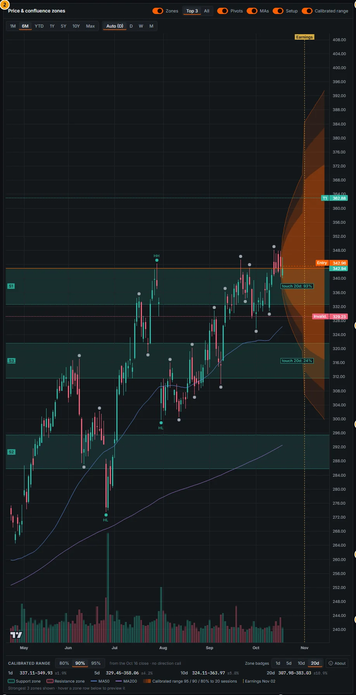

*Figure 5B.4: Price & confluence zones (callout 2), Apple, 6M daily view. Shaded fan = calibrated range 95 / 90 / 80% to 20 sessions; dashed vertical = expected earnings date (2 Nov 2026); green bands S1-S3 = the three strongest support zones; badges "touch 20d: 93%" and "touch 20d: 24%" at the right edge; price lines Entry, Invalid. and T1.*

### Controls

| Control | What it does |
|---|---|
| Zones (switch) | Shows or hides the confluence zone bands (green = support, red = resistance; opacity grows with strength; labels S1, R1 … by rank). |
| Top 3 / All | Top 3 (default) draws the three strongest zones; All draws every zone. Hovering a row of the Confluence zones table previews any zone. |
| Pivots (switch) | Swing-pivot markers. Market-structure pivots are labelled HH / HL (green) or LH / LL (red); other swing highs and lows are grey dots. |
| MAs (switch) | SMA 50 and SMA 200 lines (computed on the loaded daily bars). |
| Setup (switch) | Horizontal price lines Entry, Invalid. (dashed red), T1 and T2 (dashed green) with axis labels. |
| Calibrated range (switch) | Shows the fan, the earnings marker and the zone badges. Disabled, with the tooltip "Calibrated range not available for this security yet", when no envelope exists. |
| Price range: 1M, 6M, YTD, 1Y, 5Y, 10Y, Max | Time window; 6M by default. |
| Bar interval: Auto, D, W, M | Auto = daily up to 2 years, weekly up to 10 years, monthly for Max. Overlays (zones, pivots, setup, fan) are drawn on the daily view only; on weekly / monthly bars the header says "zones, levels, setup and the calibrated range shown on the daily view only". A "weekly (daily capped at 10y)" badge appears when the server returns weekly bars. |
| History label (right of the selectors) | "History from" a date, plus "weekly bars before" a date when part of the range predates the daily table. |
| Crosshair in the future area | Tooltip "by Nov 6: 80% 318–371 · 90% 312–378 · 95% 306–385" (the band at that date, all three levels). |
| Range strip: 80% / 90% / 95% | Level shown in the strip below the chart (90% default). Each cell is h = 1d, 5d, 10d, 20d with low–high and ± half-width in per cent; hover a cell for the target date. |
| Zone badges: 1d / 5d / 10d / 20d | Horizon of the touch badges (shared with the zones table). |
| About (popover) | Calibration details: headline "Calibrated to 90% over history (2010–2026 walk-forward), not "90% chance today"", the calibration pool (region and sector, for example US and TECH), walk-forward and last-year coverage at 1 / 5 / 10 / 20 sessions, the earnings-pool warning, the fan note and a "Validation report" link to System › Conformal validation (`/system/conformal`). |
| Volume histogram | Daily volume at the bottom of the pane, coloured by up / down day. |

> Screenshot pending: the future-area crosshair tooltip and the "About" calibration popover (`/company/AAPL?tab=technicals`, hover the fan near the 20th future session, then click About in the range strip).
<!-- PENDING-SHOT id=05-aapl-technicals-fan-tooltip route=/company/AAPL?tab=technicals actions=hover the fan area at the last future session; second capture (id 05-aapl-technicals-about, current capture shows no open popover): click "About" in the range strip so the popover is open -->

### Methodology

**Zones on the chart** are the confluence zones of the [Confluence zones](#confluence-zones) table. **Pivots** come from the levels engine (fractal swings and the ZigZag(3 ATR) market-structure pivots). **Moving averages** are simple 50- and 200-session averages of the closes on screen.

**The fan.** For each future session h = 1..20 the app draws the marginal conformal band described in the [Technicals methodology](#technicals):

```
half-width(h, α) = √(q̂ₕ(α) · V(h))          in log-price units
lower / upper    = C₀ · exp(∓ half-width)       C₀ = the envelope's origin close
V(h)             = h · s²  (+ J when an expected earnings day falls inside (0, h])
```

- **Per-horizon calibration.** Each horizon has its own pooled split-conformal radius q̂ₕ (rolling window of 500 realised scores, outcome lag h, region × sector pool, separate earnings-event pool). An older snapshot without per-h radii falls back to interpolating between the 1 / 5 / 10 / 20-session radii (the About popover says so).
- **Nested, non-narrowing envelope.** For display, the half-widths are made non-decreasing in h (running maximum) and strictly nested (80 inside 90 inside 95). Both adjustments can only widen a band; when they changed anything the About popover adds "Drawn as a non-narrowing envelope where a longer horizon came out slightly narrower (only ever wider)".
- **Marginal, not joint.** Each date's band is calibrated alone: about 90% of h-session closes ended inside the h-session 90% band. It is **not** a path band: the chance that the whole path stays inside the 90% fan for 20 sessions is lower than 90%. The joint (simultaneous) 1/5/10/20 envelope that would answer that question failed validation and is not shown.
- **No direction.** The centre (dashed) is the last close. The fan says how far, not which way.
- **Earnings.** When the expected earnings date falls inside the window, the variance includes a jump term (mean excess squared reaction-day return over the last 8 events, shrunk) and the radius comes from the event pool, so the fan steps out at the marker.
- **Future dates** are real exchange sessions from the exchange calendar (holidays skipped).

**Zone badges** are drawn for zones that lie at least partly inside the 95% band at its widest horizon, at the zone's mid-price within the fan, with the [touch probability](#touch-probabilities) at the selected horizon ("in zone" when the close is inside).

### Data sources and refresh

Prices: adjusted daily bars (the chart loads up to about two years for the default view; longer ranges are fetched on demand). Fan: `conformal_envelopes` (nightly, full universe, EWMA filter λ 0.94, plain radius), served by `GET /api/v1/conformal/envelope/{security_id}` with the `fan` and `fan_info` fields. Earnings date: the earnings calendar (`fan_info.earnings` carries the date source, for example `provider_estimate`). Coverage audit: the nightly rolling audit (`conformal_coverage`) and the walk-forward rows shown in the About popover.

### Validation status

**Validated (by-product of the conformal gate).** From `docs/CONFORMAL_VALIDATION.md`:

- **A.2 (marginal bands, target 90%):** coverage at h = 1 / 5 / 10 / 20 was 90.0 / 89.9 / 89.8 / 89.6% with widths 0.0605 / 0.1386 / 0.1979 / 0.2818 (log units), against the heuristic 2×ATR band at 98.4 / 98.1 / 98.2 / 98.2% with widths 0.1035 / 0.2314 / 0.3272 / 0.4628: "about 40% narrower than the heuristic 2×ATR band, which over-covers at 98%". They are **not sharper than a conformally calibrated ATR band**: "the gain comes from calibration, not from the filter".
- **A.5 (fan, every h = 1..20):** "Per-horizon calibration is on target at every h: 79.6-80.0 / 89.6-90.0 / 94.6-94.9%". In the Covid window the 90% band was 2-4 pp under (for example 86.0% at h = 10); with VIX > 25 slightly over at long horizons (92.3% at h = 20); the earnings pool within 0.6 pp. Worst calendar year at h = 20: 86.1% (2017).
- **Not shown:** the joint envelope (FAIL: Covid Feb-Jun 2020 77-78% at 90%; w_proj +35% vs a calibrated ATR box) and the next-bar set (FAIL on sharpness). Both stay "experimental" in Model Studio and the Backtest Lab.
- **Economic checks:** "Exiting the calibrated band is not a better breakout trigger than a naive N-day high" (FAIL). Calibrated band stops beat ATR stops (band 95% minus 3×ATR +6.2%/yr, t +3.56) but for the momentum strategy tested "any stop hurts, and no stop is best" (band 90% minus no stop -2.2%/yr, t -2.64).

### Correct usage and worked example

Use the fan to judge **distance**, not direction: a target outside the 95% band at the setup's horizon is historically rare; a stop inside the 80% band is likely to be touched by normal noise. Compare the band with the earnings marker: a window that contains earnings is wider by construction.

**Example (Apple, origin close 343.46 on 16 Oct 2026, pool US / TECH, event pool because earnings on 2 Nov fall at h = 11).** The 90% range strip reads 20d 307.98–383.03 (±10.9%). The setup's T1 (362.88, +5.7% from that close) lies inside the 10-session 90% band (324.11–363.97) and well inside the 20-session band; the invalidation (329.23, -4.1%) lies just below the 5-session 90% band (329.45–358.06) and inside the 10-session band. In words: both barriers are within normal 1-4 week moves, which is why the 20-session first-passage bar shows only 18% "neither". The About popover shows the walk-forward 90% coverage at 20 sessions and the last year's realised coverage for US names (90.0% for 1-session bands, for example).

### Limitations and pitfalls

- Coverage is **marginal over time and securities**. In a sudden crash the bands under-cover (Covid 2020: 2-4 pp under at 90%); per-regime coverage is reported, not guaranteed.
- The fan starts from the envelope's origin close. When the envelope is older than the last candle (the API flags `stale`), the fan origin is the earlier close stated in the strip.
- Do not read the 95% fan as "price will stay inside": that is a joint statement the model does not make.
- Weekly / monthly views hide all overlays.

### Related mnemonics and BQL fields

`GP`, `TECH`. BQL: `cf.qm_{1,5,10,20}_{80,90,95}` (calibrated radii), `cf.v_{1,5,10,20}` (variance), `cf.fan_v`, `cf.fan_qm_80`, `cf.fan_qm_90`, `cf.fan_qm_95` (fan arrays), `cf.band_5d_90` (half-width of the 90% 5-session band as a fraction of the close), `cf.touch_20d`, `cf.earn_in_window`, `cf.pool_key`. Alert rule `price_outside_calibrated_range` in [13. Watchlists and alerts](13-watchlists-alerts.md#alert-rule-reference); coverage audit in [15. System](15-system.md#conformal-validation).

---

## Context chips

**Route:** `/company/:id?tab=technicals` · **Panel:** chip row above the chart · **Mnemonics:** `TECH` · **Refresh:** computed when the page loads (from the latest snapshot)

### Purpose

The chips put today's volatility and trend into the stock's own historical context: is the range compressed (squeeze) or stretched (expansion), how strong is the trend, do the daily and weekly trends agree, and is an earnings release inside the next 20 sessions? They are descriptive context for reading the fan and the setup, not signals.

### Screenshot

The chips appear in Figure 5B.1 (Apple: "Range normal 20d ±9.2% · p10", "RV 20d 16% · p15", "IV n/a", "ATR 14 1.9% · p29", "ADX 14 18 weak ▲", "Trend aligned D ▲ · W ▲", "Earnings in 10 sessions · in range · typical ±1.8%").

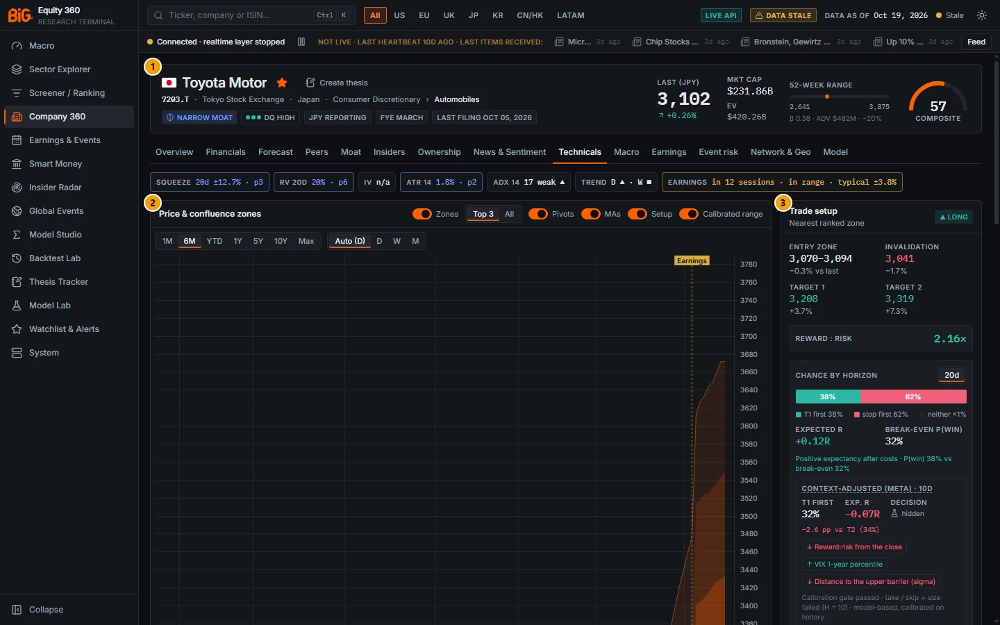

*Figure 5B.5: Toyota Motor (`/company/7203.T?tab=technicals`), default view. The chip row shows "Squeeze 20d ±12.7% · p3" and "ATR 14 1.8% · p2" (blue), "Trend D ▲ · W ■" (weekly flat) and "Earnings in 12 sessions · in range · typical ±3.8%" (amber). Callouts as in Figure 5B.1 (1 header, 2 Price & confluence zones, 3 Trade setup; 4-10 are below the fold).*

### Controls

| Chip | Value shown | Colour | Tooltip |
|---|---|---|---|
| Squeeze / Expansion / Range normal | 20-session ± half-width of the calibrated 90% range and its percentile (for example p10) | Blue = squeeze, amber = expansion | Definition, plus "Today: pNN of the last 504 sessions (n = …)". Ends "Descriptive: a squeeze is not a breakout signal." |
| RV 20d | Annualised realised volatility and percentile | Blue / amber as above | Definition |
| IV | "n/a" | Neutral | "Implied volatility: n/a - there is no per-stock option-implied volatility source (for the US only VIX-type index volatility exists)." |
| ATR 14 | ATR as % of price and percentile | Blue / amber | Definition |
| ADX 14 | ADX value, state (weak / emerging / trending / strong) and direction arrow | Green / red when trending or strong | Definition plus "+DI x / −DI y". "Strength only - it says nothing about what happens next." |
| Trend aligned / Trend mixed / Trend | Daily and weekly arrows (▲ up, ▼ down, ■ flat) | Green aligned up, red aligned down, amber mixed | Definition |
| Earnings | "in N sessions", "· in range" when inside the 20-session window, "· typical ±x%" | Amber when inside the window | Date source and method; "The calibrated range includes the earnings-event pool." |

Chips are buttons for keyboard focus; hovering or focusing shows the tooltip. There are no other controls.

### Methodology

Computed from the security's adjusted daily bars (about 3.5 years), over a lookback of 504 sessions (about two years). A percentile is the share of the lookback whose value is at or below today's (today included).

| Chip | Definition |
|---|---|
| Range width | Width of today's calibrated 20-session 90% band, `2 · √(q̂₉₀,₂₀ · V(20))`, compared with the same band on each of the last 504 sessions, using today's calibrated radius (so the percentile compares the volatility term). Squeeze ≤ 10th percentile, expansion ≥ 90th, otherwise normal. Model-based. |
| RV 20d | Standard deviation of the last 20 daily log returns × √252. |
| ATR 14 | Wilder ATR(14) / close. |
| ADX 14 | Wilder ADX(14) with +DI / −DI. Below 20 weak, 20-25 emerging, 25 or more trending, 40 or more strong. Direction = up when +DI > −DI. |
| Trend | Daily = close vs SMA 50 and the SMA 50's 10-session slope; weekly = last weekly close vs the 30-week SMA and its 4-week slope. Aligned when both point the same way, mixed when they disagree, otherwise flat. |
| Earnings | Next expected date (company, provider or model-projected, labelled); "in range" when within 20 sessions (the fan then uses the earnings-event pool). Typical move = median absolute cumulative abnormal return over [-1, +1] sessions around the stock's past releases (market model). |

### Data sources and refresh

`GET /api/v1/technicals/{security_id}/context`, computed at request time from the serving snapshot's bars, the calibrated radius (`cf_envelopes`) and the earnings tables. Refreshes whenever the snapshot is rebuilt (nightly DAG).

### Validation status

**Not formally validated** (descriptive statistics, no gate). The range-width chip uses the validated calibrated radius but the squeeze / expansion classification itself has no predictive gate, and the tooltip says so: "a squeeze is not a breakout signal". The trend and ADX chips are rule-based.

### Correct usage and worked example

Use the chips to set expectations for the fan and the setup: in a squeeze the bands are narrow and stops placed by eye tend to sit too close; with earnings "in range" the 20-session numbers include the event pool.

Example (Toyota, Figure 5B.5): "Squeeze 20d ±12.7% · p3" means today's calibrated 20-session 90% range is narrower than 97% of the last two years for Toyota, while "Earnings in 12 sessions · in range · typical ±3.8%" warns that the window includes a release whose median abnormal move was 3.8%. Apple (Figure 5B.1) shows "Range normal 20d ±9.2% · p10": the percentile rounds to 10 but is just above the 10th-percentile threshold (0.1012), so the state is normal.

### Limitations and pitfalls

- Percentiles are relative to the stock's **own** last two years, not to peers. A "normal" range for a volatile stock can be wider than an "expansion" for a utility.
- The chip's 20-session width is a context measure computed on the latest bars; it need not equal the strip's 20d band (Apple: chip ±9.2%, strip ±10.9% at 90%).
- The trend chip (daily / weekly alignment) and the setup's "trend" badge use different rules and can disagree (JPMorgan: chip "Trend mixed", setup badge "Trend sideways").
- There is no per-stock implied volatility source.

### Related mnemonics and BQL fields

`TECH`. BQL: `cf.earn_in_window`, `cf.earn_days_ahead`, `cf.sigma_d`; the chip values themselves are not BQL fields (use the API). Earnings dates and reactions: [5C. Earnings](05c-company-macro-events-model.md#earnings), [6. Earnings & Events](06-earnings-events.md#earnings--events-calendar).

---

## Confluence zones

**Route:** `/company/:id?tab=technicals` · **Panel:** Confluence zones (callout 8) · **Mnemonics:** `TECH` · **Refresh:** nightly (`tech_levels`, `confluence_zones`, `technicals_probabilities`); zone model refit weekly

### Purpose

A confluence zone is a price band where several independent technical levels coincide (for example a prior weekly low, a Camarilla pivot, a Fibonacci retracement and an anchored VWAP). The table lists every zone with its strength, the chance of touching it within the selected horizon, and the validated flag that says whether zones like it have historically held more or less often than random price bands.

### Screenshot

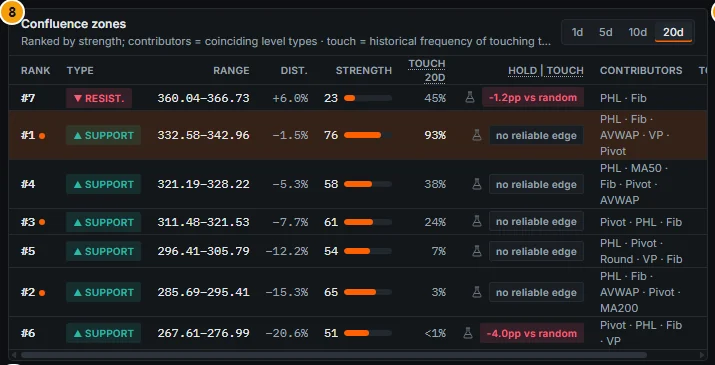

*Figure 5B.6: Confluence zones (callout 8), Apple, default view, touch horizon 20d. The highlighted row (#1) is the setup's zone; the orange dots mark the three strongest zones drawn on the chart. The hold-given-touch column shows a flask icon (experimental, hidden) and the validated edge badge.*

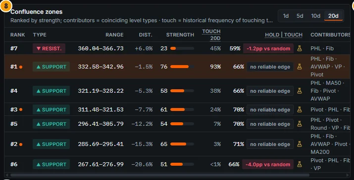

*Figure 5B.7: The same table with the experimental toggle on: the calibrated P(hold given touch) appears (66%, 59%, 70% …) with a flask icon.*

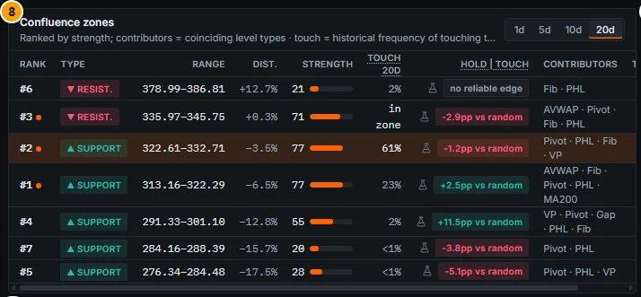

*Figure 5B.8: JPMorgan (`/company/JPM?tab=technicals`), default view (hold probabilities hidden behind the flask icon; edge badges visible). Zones with a significant edge show "+2.5pp vs random", "+11.5pp vs random" (better) or "-2.9pp vs random", "-5.1pp vs random" (worse); #3 resistance shows "in zone" in the touch column.*

### Controls

| Column / control | What it shows |
|---|---|
| Touch horizon (1d / 5d / 10d / 20d) | Horizon of the Touch column and of the chart badges. |
| Rank | Strength rank (#1 = strongest). An orange dot marks the three strongest zones (drawn on the chart by default). |
| Type | ▲ Support (below the price) or ▼ Resist. (above). |
| Range | Zone low–high in the trading currency. |
| Dist. | Distance of the zone mid-point from the last price, in per cent. |
| Strength | 0-100 with a bar (see Methodology). |
| Touch Nd | Calibrated chance of touching the zone's near edge within N sessions; "in zone" when the close is inside; "<1%" beyond the calibrated tail. Tooltip: "Historical frequency of touching the zone's near edge within N trading day(s) for similar setups … Calibrated within 0.2 pp over 2011–2026; model-based, not a forecast of direction." See [Touch probabilities](#touch-probabilities). |
| Hold given touch | Experimental P(hold given touch) (toggle on) and the validated edge badge: "+x.xpp vs random" (green), "-x.xpp vs random" (red) or "no reliable edge" (grey). Cell tooltip: P(hold given touch), the random-control probability, the edge with its walk-forward CI, P(touch) and P(touch and hold), and "EXPERIMENTAL (failed the validation gate)" where relevant. |
| Contributors | Level families present: PHL (prior period high / low, opens, period pivots, Camarilla, opening range, 52-week and all-time extremes), Fib (Fibonacci retracements and Fibonacci pivots), Pivot (swing pivots, market structure), AVWAP, VP (volume profile), Round, MA50, MA200, Gap. |
| Touches | Sum of past touches of the member levels. |
| Row hover | Previews the zone on the chart (also zones outside the top 3). |
| Row highlight | The zone the trade setup is built on (accent background). |

The column header of the hold column reads "Hold" and "touch" separated by a vertical bar (P of hold given touch). Rows are listed by price, highest first (resistance at the top, support below); the Rank column gives the strength rank.

### Methodology

#### Level families

Levels are generated point-in-time from daily bars (a level becomes usable only after the information that defines it is complete). Families:

| Family | Levels | Timeframes |
|---|---|---|
| Period OHLC | Prior period open, high, low, close, mid; current period open | D, W, M, Q, Y (current open W and above) |
| Opening range | High / low of the first bars of the period | W, M, Q, Y |
| Floor pivots | P, R1-R3, S1-S3 of the prior period | W, M, Q, Y |
| Camarilla | H3-H5, L3-L5 | W, M, Q, Y |
| Fibonacci pivots | R1-R3, S1-S3 | W, M, Q, Y |
| Swing pivots | Fractal swing highs / lows, k = 2, 3, 5, 10 bars (daily), k = 2 (weekly) | D, W |
| Market structure | ZigZag (3 ATR) pivots labelled HH / HL / LH / LL; break-of-structure (BOS) and change-of-character (CHoCH) levels | — |
| Fibonacci | 23.6 / 38.2 / 50 / 61.8 / 78.6% retracements, 127.2 / 161.8% extensions of the last ZigZag leg | — |
| Anchored VWAP | Anchored at YTD and QTD start, last swing high / low, last earnings filing, 52-week high / low | — |
| Volume profile | Point of control, value-area high / low, high-volume nodes over 6 months and 1 year | — |
| Extremes | 52-week high / low, all-time high | — |
| Round numbers | Major and minor psychological grid | — |
| Moving averages | SMA 50, SMA 200 | — |
| Gaps | Near edge of an unfilled price gap (≥ 0.25 ATR) | — |

#### Level weight

```
weight = reliability × recency × touches × timeframe × volume-node strength × role-flip
reliability = (type_rank_score / 0.5)²       from the level-type backtest; neutral 0.5 → 1.0
recency     = 0.5^(age_days / 180)            swing, structure, Fibonacci and gap levels only
touches     = 1 + 0.1 × min(touches, 5)
timeframe   = D 0.55 · W 0.8 · M 1.0 · Q 1.15 · Y 1.3
volume node = 0.5 + 0.5 × node_strength       volume-profile levels only
role flip   = 0.7 if the level was closed through (it now acts from the other side)
```

Levels at the identical price are merged (weight = max + 0.25 × (sum − max)), so one pivot seen by several swing orders is not counted six times. Level types that test clearly worse than random levels for this stock (type rank score < 0.4) are left out.

#### Zones and strength

1. Each level's distance from the close is expressed in ATR units, `x = (price − close) / ATR14`, for |x| ≤ 12.
2. A weighted Gaussian kernel density (bandwidth 0.35 ATR) is computed over x.
3. Zones are density peaks of at least 15% of the highest peak, bounded where the density falls to 50% of the peak, at the valley to a neighbouring peak, or at ±0.75 ATR from the peak.
4. Evidence `S = weight_sum × (1 + 0.2 × (distinct families − 1))`; **strength = 100 × S / (S + 20)** (S = 20 was the median zone of the first live run, giving strength 50).

Strength is a weight-of-evidence score. It is **not** a probability and it was not validated as a predictor of holding; the validated output is the edge badge below.

#### P(hold given touch) and the edge versus random (T3)

- **Touch** = the near edge is reached within 20 sessions. **Break** = a close beyond the far edge by at least 0.5σ. **Hold** = a reversal of at least 1.5σ beyond the near edge before any break, within 10 sessions of the touch (σ = the EWMA daily volatility).
- **P(hold given touch):** a HistGradientBoosting classifier with isotonic calibration, purged walk-forward (2-year test blocks 2010-2026). Inputs: the 14 level-family flags, member counts, kernel density, width and distance in σ, approach speed (5 and 20 sessions), trend and structure, RSI, distances to SMA 50 / 200, nearest volume node, prior touches and hold rate of the same band, volatility regime, VIX > 25, earnings within 20 sessions, region and side. The old strength is not an input.
- **Random control:** for every real zone, a price band of the same width shifted by ±U(0.75, 2.5) ATR, labelled by the same rule; the same pipeline trained on these bands gives P_control. **Edge = P(hold) − P_control.**
- **Per-zone flag:** the zone is placed in a walk-forward quintile of predicted edge; the flag is shown as significant only when that quintile's realised edge had a 95% confidence interval excluding zero. Quintile 5 → "holds more often than random" (green badge); quintiles 1-2 → "holds less often than random" (red); quintiles 3-4 → "no reliable edge".
- **P(touch and hold)** = P(touch within H) × P(hold given touch), in the cell tooltip.

### Data sources and refresh

Levels and zones: `tech_levels` and `confluence_zones` (nightly, every security with at least 60 bars; latest plus month-end history kept), served by `GET /api/v1/companies/{security_id}/technicals`. Zone hold model: `GET /api/v1/technicals/{security_id}/zones?horizon=N` (nightly scoring by `technicals_probabilities`, weekly refit by `technicals_probabilities_fit` on the gate universe). Touch: `GET /api/v1/conformal/touch`.

### Validation status

From `docs/TECHNICALS_V2_VALIDATION.md`:

- **T3 P(hold given touch): FAIL → experimental.** ECE 1.45 pp; better than climatology and the old strength (Brier 0.2410 vs 0.2470 / 0.2470), but the worst regime was **Covid 2020: -8.7 pp** (2020 full year -4.6): "zones broke far more often than predicted". The old strength "carries no information beyond the base rate: Brier identical to climatology".
- **T3 edge vs random (per-zone flag): PASS → production.** "Bucket predicted vs realised edge within 1.9 pp"; level features beat the random-control model (Brier -0.00045 [-0.00066, -0.00025]).
- **The honest headline:** "on average, touched confluence zones hold **less** often than random price bands with the same width, approach, trend and regime (-0.63 pp vs the control model, CI [-1.26, -0.01]; raw rate 55.5% vs 56.9%)". By predicted-edge quintile, the realised edge was:

| Quintile | Predicted edge | Realised edge | 95% CI | Shown as |
|---|---|---|---|---|
| 1 | -5.6 pp | -4.4 pp | [-5.2, -3.6] | holds less often than random |
| 2 | -1.8 | -1.3 | [-1.9, -0.7] | holds less often than random |
| 3 | -0.4 | -0.2 | [-1.0, +0.5] | no reliable edge |
| 4 | +0.6 | +0.7 | [-0.2, +1.6] | no reliable edge |
| 5 | +4.0 | +2.1 | [+1.4, +2.7] | holds more often than random |

### Correct usage and worked example

Use the edge badge as a **filter**: prefer zones flagged "holds more often than random", be wary of zones flagged "holds less often", and treat "no reliable edge" as an ordinary price band. Combine with the touch probability: a zone with a high edge that is unlikely to be touched within your horizon is irrelevant to the trade.

**Example (Apple, 20d, as of 16 Oct 2026).** Zone #1 (support 332.58–342.96, strength 76, 25 member levels from 9 families: PHL · Fib · AVWAP · VP · Pivot) has Touch 20d 93% and "no reliable edge" (experimental P(hold given touch) 66% vs control 65.6%: edge +0.4 pp, not significant). Zone #6 (support 267.61–276.99) is flagged "-4.0pp vs random": zones in its quintile held less often than random bands, but its touch probability is "<1%". Zone #7 (resistance 360.04–366.73, whose centre 362.88 is the setup's T1) shows "-1.2pp vs random" and Touch 20d 45%: historically, resistance like it tended to give way slightly more often than a random band, which is mildly favourable for a long whose target sits there.

### Limitations and pitfalls

- The badge number is the model's **point estimate for this zone**; the significance comes from its quintile. Large numbers such as "+11.5pp vs random" (JPMorgan zone #4) should be read against the validation: the top quintile realised **+2.1 pp** on average, with predicted +4.0 pp.
- High strength does not mean the zone will hold; strength was never validated as a predictor.
- In the walk-forward history the level-type reliability weights were neutral (no point-in-time history exists), while live zones use them; zone sets therefore differ slightly from the tested ones (documented deviation).
- The zone snapshot is as of the last nightly run; if the price has moved since, a zone may already contain the price even though the table shows a touch percentage.
- Rows are ordered by price, not by rank.

### Related mnemonics and BQL fields

`TECH`. BQL: `zone.side`, `zone.center`, `zone.distance_atr`, `zone.reward_risk` (top zone); `setup.support_low`, `setup.support_high`, `setup.resistance_low`, `setup.resistance_high`, `setup.dist_support_atr`, `setup.dist_resistance_atr`. Alert rule "zone touch" in [13. Watchlists and alerts](13-watchlists-alerts.md#alert-rule-reference).

---

## Touch probabilities

**Route:** `/company/:id?tab=technicals` · **Panel:** Touch column of Confluence zones; zone badges on the chart · **Mnemonics:** `TECH` · **Refresh:** nightly (`conformal_envelopes` touch curves)

### Purpose

"Will price get to this level within the next h sessions?" is a path question. The touch probability answers it with a calibrated historical frequency, for every confluence zone at 1, 5, 10 and 20 sessions, and is reused by the Thesis Tracker for targets and stops.

### Screenshot

See the Touch column in Figures 5B.6 to 5B.8 and the "touch 20d: 93%" / "touch 20d: 24%" badges in Figure 5B.4. The horizon selector is shared by both.

### Controls

| Control | What it does |
|---|---|
| 1d / 5d / 10d / 20d (zones table header and range strip) | Horizon of the Touch column and the chart badges (20d default). |
| Touch column header tooltip | Definition and validation sentence (see [Confluence zones](#confluence-zones)). |

### Methodology

For each pool (region × sector, normal or earnings-event origins) and horizon, the app stores the distribution of the **standardised running maximum** over its calibration origins:

```
M_up(h) = max over k ≤ h of log(H₍ₜ₊ₖ₎ / Cₜ) / √V(h)     (M_dn with lows for levels below)
u       = |log(level / close)| / √V(h)
P(touch within h) = share of calibration origins with M ≥ u
```

This is an empirical (conformal-style) probability of a path event, accurate to about 1/(n+1) under exchangeability. It is **not** a Gaussian probability. Zones use their near edge (support: the zone high; resistance: the zone low); a close inside the zone is shown as "in zone" (probability 1). Values at or below 0.5% are displayed "<1%" (beyond the calibrated tail). Horizons above 20 sessions (Thesis Tracker only) reuse the 20-session curve with the variance scaled by h and are flagged "extrapolated", not validated.

### Data sources and refresh

`GET /api/v1/conformal/touch?security_id=…&horizon=20` (automatic mode: the confluence zones plus the nearest still-valid technical levels), from the nightly touch curves of `conformal_envelopes`.

### Validation status

**Validated (conformal gate, §A.4).** US mvp, 2011-2026, curves calibrated on year Y−1 for test year Y. Predicted / realised P(touch):

| h | u = 0.5 | u = 1.0 | u = 1.5 | u = 2.0 | u = 2.5 | u = 3.0 |
|---|---|---|---|---|---|---|
| 1 | 0.556 / 0.557 | 0.284 / 0.286 | 0.132 / 0.133 | 0.060 / 0.061 | 0.028 / 0.028 | 0.014 / 0.014 |
| 5 | 0.583 / 0.584 | 0.297 / 0.297 | 0.137 / 0.137 | 0.061 / 0.061 | 0.028 / 0.028 | 0.015 / 0.014 |
| 20 | 0.601 / 0.600 | 0.311 / 0.311 | 0.142 / 0.142 | 0.063 / 0.063 | 0.029 / 0.029 | 0.015 / 0.015 |

"Calibration is within 0.2 pp. For comparison, a Gaussian reflection-principle formula gives P(u = 3) = 0.0027, 5× too low." Real prices have fat tails: a level three standard deviations away was touched about 1.4-1.5% of the time, not 0.27%.

### Correct usage and worked example

Read the touch probability together with the horizon of your plan. **Example (Apple, 16 Oct 2026 close 343.46):** zone #1's near edge (342.96, 0.15% below the close) has a touch probability of 75% within 1 session, 88% within 5, 91% within 10 and 93% within 20; zone #3's near edge (321.53) has 24% within 20 sessions; zone #2 (295.41, u ≈ 2.6 at 20 sessions) has 3%. So a buy order resting at zone #3 would, historically, be filled within a month in roughly one case in four.

### Limitations and pitfalls

- The probability is about touching, not holding or breaking (see [Confluence zones](#confluence-zones) for hold).
- Validation is on US names; other regions use the same method on their own pools.
- It is marginal over the pool: a stock with an imminent catalyst may behave differently from its pool.

### Related mnemonics and BQL fields

`TECH`. BQL: `cf.touch_20d` (calibrated 20-session move to the 90% band edge). Thesis targets and stops: [12. Thesis Tracker](12-thesis-tracker.md#thesis-page).

---

## Level types and level-type reliability

**Route:** `/company/:id?tab=technicals` · **Panels:** Level types · backtested hit rates (callout 9), Level-type reliability (callout 10) · **Mnemonics:** `TECH` · **Refresh:** weekly (`level_type_backtest`)

### Purpose

These two tables answer "which kinds of level does this stock actually respect?" They show, per level type, how often a touch of that type was followed by a bounce, and how that compares with touching a random price. The results feed the reliability weight of each level in the confluence zones.

### Screenshot

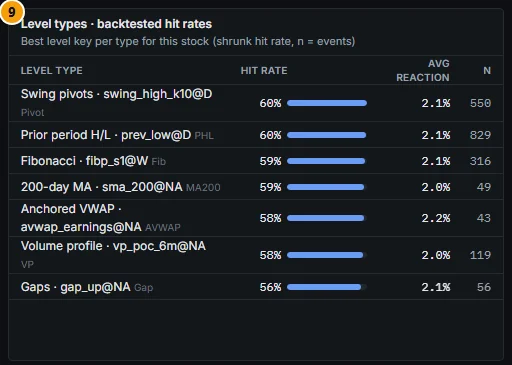

*Figure 5B.9: Level types · backtested hit rates (callout 9), Apple. One row per type with its best level key (for example "Swing pivots · swing_high_k10@D"), shrunk hit rate, average reaction and number of events.*

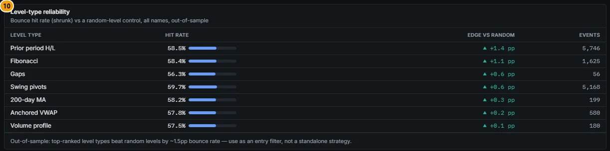

*Figure 5B.10: Level-type reliability (callout 10), Apple. Edge versus random from +1.4 pp (Prior period H/L) down to +0.1 pp (Volume profile), with the out-of-sample note underneath.*

### Controls

| Column | What it shows |
|---|---|
| Level type (callout 9) | Type label · the best-ranked level key of that type for this stock (key = type@timeframe, for example `prev_low@D`, `fibp_s1@W`, `vp_poc_6m@NA`). |
| Hit rate | Shrunk bounce rate, with a bar scaled to the highest row. |
| Avg reaction | Mean favourable excursion after a touch, in ATR converted to per cent of the price. |
| n | Number of touch events of that key. |
| Level type (callout 10) | One row per type, all keys of the type pooled. |
| Hit rate | Event-weighted shrunk bounce rate of the type. |
| Edge vs random | Hit rate minus the random-level control, in pp (▲ green positive, ▼ red negative). Rows sorted by edge. |
| Events | Total events. |
| Note | "Out-of-sample: top-ranked level types beat random levels by ~1.5pp bounce rate — use as an entry filter, not a standalone strategy." |

### Methodology

**Event study (per stock, point-in-time).** A bar is a touch event of a level when it opens more than 0.25 ATR away from the level and its range then comes within 0.25 ATR of it (support test if the open was above, resistance test if below). One test is counted once until it resolves. An event is used only when its whole outcome window is in the past.

**Outcome (10 bars, ATR = ATR14 of the previous bar).**

- **Hit / bounce:** a favourable excursion of at least 1.0 ATR before an adverse close more than 0.5 ATR beyond the level (a bar that does both counts as a break: conservative).
- **Break:** the adverse close comes first.
- **Reaction:** maximum favourable / adverse excursion in ATR.

**Random-level control.** Every level is replayed with its price shifted by ±U(0.75, 2.5) ATR (a new shift every 20 bars for moving levels); same event and outcome logic. The control's hit rate is what touching any price yields for this stock; **edge = level hit rate − control hit rate**.

**Shrinkage.** Rates are shrunk hierarchically (universe → sector × region pool → ticker) with a beta-binomial prior of 2,000-5,000 pseudo-events, because per-ticker deviations carry little information: `(hits + m · p_parent) / (n + m)`. The reliability score `logistic(edge_shrunk / 0.02)` is the `type_rank_score` used in the level weight.

**The reliability table** aggregates this stock's level keys by type, weighting by events.

### Data sources and refresh

`level_type_backtest` (weekly DAG, 10-year lookback) → `level_type_stats`; served in `GET /api/v1/companies/{security_id}/technicals` (`level_stats`, `type_reliability`).

### Validation status

**Out-of-sample caveat, not a gated model.** The panel's note and the original user guide state the result: tested out of sample, **the top-ranked level types beat randomly placed levels by about 1.5 pp in bounce rate**. Use them as an **entry filter, not a stand-alone strategy**. The Technicals v2 plan records level-type bounce edges against random levels of only "+0.3 to +1.4 pp". The prior strength of the shrinkage was chosen by internal validation (scores from events resolved before 2017 ranked the 2017-2020 out-of-sample edge best at about 3,000 pseudo-events; the 2021+ hold-out confirmed it).

### Correct usage and worked example

Use the tables to decide which contributors of a zone deserve attention. **Example (Apple):** prior period highs / lows have the largest edge (+1.4 pp on 5,746 events), Fibonacci +1.1 pp, while volume-profile levels (+0.1 pp) and anchored VWAPs (+0.2 pp) are barely different from random prices. A zone made mostly of prior-period and Fibonacci levels is therefore slightly better supported than one made of VWAP and volume nodes, but the difference is a percentage point or so of bounce rate.

### Limitations and pitfalls

- Edges are small (about 1-1.5 pp at best). A 60% hit rate looks impressive until you see that touching a random price gives about 58%.
- The "Hit rate" bar in callout 9 is scaled to the best row, which visually exaggerates small differences.
- The reliability table pools this stock's keys with heavy shrinkage toward its sector × region pool; it is not a cross-sectional study.
- Hit and break are defined in ATR on daily bars; intraday behaviour is not captured.

### Related mnemonics and BQL fields

`TECH`. No dedicated BQL fields for the level-type statistics (API only).

---

## Trade setup

**Route:** `/company/:id?tab=technicals` · **Panel:** Trade setup (callout 3) · **Mnemonics:** `TECH` · **Refresh:** setup nightly (`confluence_zones`); probabilities nightly (`technicals_probabilities`), surface refit weekly

### Purpose

The Trade setup card turns the nearest relevant zone into a concrete plan (bias, entry zone, invalidation, targets, reward : risk) and then says, from history, how such plans tended to resolve: how often T1 was reached before the invalidation within H sessions, how often the stop came first, how often neither happened, and the resulting expected R after costs. It is the main decision-support card of the tab.

### Screenshot

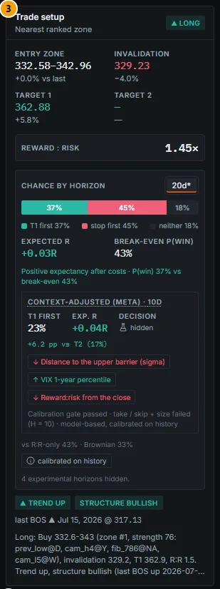

*Figure 5B.11: Trade setup (callout 3), Apple, default view. Chance by horizon shows only 20d* (the production horizon and the setup's own horizon); "4 experimental horizons hidden."*

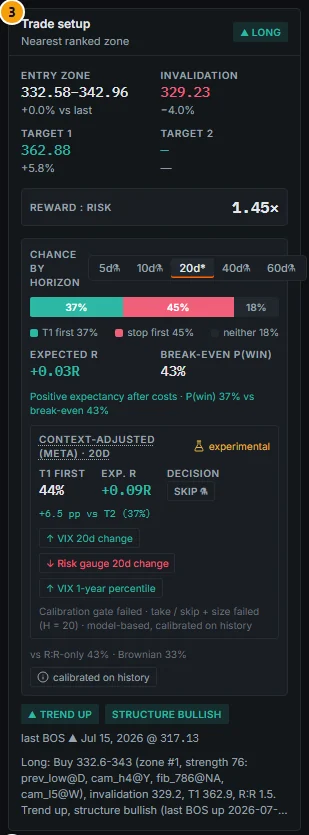

*Figure 5B.12: The same card with the experimental toggle on: horizons 5d, 10d, 40d and 60d appear with flask icons, and the meta row switches to 20 sessions (experimental).*

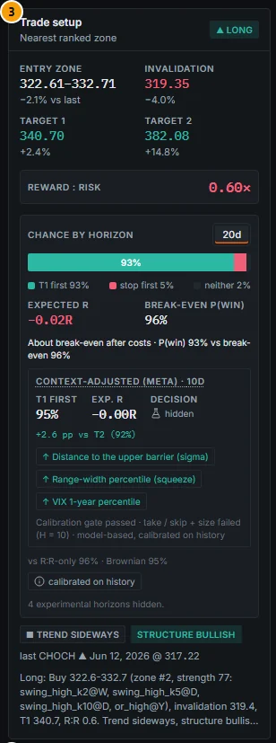

*Figure 5B.13: JPMorgan, default view. The price (339.72) is above the entry zone (322.61–332.71) and T1 (340.70) is only 0.3% above the close: at 20 sessions T1 first 93%, stop first 5%, neither 2%, but the break-even P(win) is 96% and expected R -0.02R ("About break-even after costs"); R:R from the limit entry 0.60× in red. The meta row (10d) reads 95%, +2.6 pp vs T2 (92%).*

### Controls

| Element | What it shows / does |
|---|---|
| Bias badge | ▲ LONG, ▼ SHORT or ■ NEUTRAL. |
| Entry zone / Entry | Zone low–high (or a single entry price) and the distance to the last price. |
| Invalidation | The stop level (red) and its distance from the entry. |
| Target 1 / Target 2 | Target prices (green) and distance from the entry; "—" when there is no second target. |
| Reward : risk | From the limit entry: green ≥ 2, red < 1. |
| Chance by horizon | Segmented control 5d / 10d / 20d / 40d / 60d (only 20d without the toggle). An asterisk = the setup's own horizon; a flask = experimental. |
| Probability bar | Green "T1 first", red "stop first", grey "neither"; hover a segment for "T1 first: 37.2% (within 20 sessions)". |
| Expected R | After costs; green > 0, red < 0. Hover: "After costs (0.01R round trip). Marked to market incl. the time exit: +0.07R". |
| Break-even P(win) | Hover: the R:R from the close and the break-even including costs. |
| Expectancy line | "Positive / Negative expectancy after costs" or "About break-even after costs", with "P(win) x% vs break-even y%". |
| Context-adjusted (meta) row | See [Context-adjusted (meta) row](#context-adjusted-meta-row). |
| Baselines line | "vs R:R-only x% · Brownian y%" (hover for the definition). |
| calibrated on history | Popover: definitions of the setup probabilities, expected R and break-even; pool line ("Pool US · vol low · earnings window · n = 141,388 historical origins · R:R from the close 1.30× (card: from the entry)"; "(all-region fallback)" or "distances beyond the calibrated grid (clamped)" when applicable); gate lines per horizon; the experimental switch. |
| Trend / structure badges | "▲ TREND UP", "STRUCTURE BULLISH", and "last BOS ▲ (date) @ (price)" (break of structure or change of character). |
| Note | One-line plan, for example "Long: Buy 332.6-343 (zone #1, strength 76: prev_low@D, cam_h4@Y, fib_786@NA, cam_l5@W), invalidation 329.2, T1 362.9, R:R 1.5. Trend up, structure bullish (last BOS up 2026-07-15)." |

When no horizon is visible (all failed and the toggle is off) the card shows "Setup probabilities are experimental (failed validation) — enable in the popover".

### Methodology

#### The setup

```
trend score   = share of {close > SMA200, SMA50 > SMA200, close > SMA50, SMA50 20-session slope > 0}
                → up ≥ 75%, down ≤ 25%, else sideways
structure     = ZigZag(3 ATR) market structure: bullish 100, bearish 0, range 50
direction     = 0.55 × trend score + 0.45 × structure → long ≥ 60, short ≤ 35, else neutral
```

For a long (or neutral) bias the card uses the nearest strong support zone (strength ≥ 40; otherwise the strongest support): entry = min(zone high, close), entry zone = zone low to entry, **invalidation = zone low − 0.5 ATR**, **T1 / T2 = centres of the next resistance zones above** with strength ≥ 20 (if none, T1 = entry + 3 ATR, noted "no overhead zone: 3 ATR projection"). Shorts mirror this. `R:R = (T1 − entry) / (entry − invalidation)`.

#### Two-barrier first-passage probabilities (T2)

- **Barriers from the close.** The probabilities assume a market entry at the last close, so a = log(T1 / close) / σ_H and b = log(close / invalidation) / σ_H, with σ_H = √V(H) from the conformal EWMA filter (including the earnings jump).
- **Outcomes within H sessions:** win = the high reaches T1 first; loss = the low reaches the invalidation first, or both on the same bar; neither = no barrier by H.
- **Estimator (grid, production):** for every daily origin of the gate universe (3.2 million origins × 5 horizons), the outcome at each (a, b) of a 20 × 20 log grid (0.1 to 8 σ_H), counted per region × volatility regime × earnings window; shrinkage pool → region → all regions (500 pseudo-origins); monotone smoothing; bilinear interpolation. Volatility regime = σ_d over its median of the previous 252 sessions: low < 0.85 ≤ mid ≤ 1.2 < high.
- **Setup's own horizon:** the first H in 5 / 10 / 20 / 40 / 60 at which T1 is within one σ_H of the close (|log(T1 / close)| ≤ σ_H), else 60. Marked with an asterisk.

#### Expected R and break-even

```
R:R(close)    = (T1 − close) / (close − invalidation)                       (long; mirrored for a short)
Expected R    = P(win) × R:R(close) − P(loss) × 1 − round-trip cost (in R)
E[R] (MTM)    = Expected R + P(neither) × mean R of the paths that hit neither by H
Break-even    = 1 / (1 + R:R(close))       a win-or-lose trade with this R:R breaks even
```

Costs follow the Backtest Lab cost model (commission 1 bp, ADV-bucket half spread, square-root impact on a 200k USD position, borrow for shorts). Baselines: **R:R only** = 1 / (1 + R:R) (ignores the horizon and "neither"); **Brownian** = the driftless two-barrier formula.

### Data sources and refresh

Setup: `tech_setups` (nightly). Probabilities: `GET /api/v1/technicals/{security_id}/setup-probabilities` (nightly `technicals_probabilities` for every security with a setup; surface `tech_prob_surfaces` refitted weekly on the gate universe). With `target` and `stop` parameters the same surface is evaluated at query time for custom barriers (Thesis Tracker).

### Validation status

From `docs/TECHNICALS_V2_VALIDATION.md` (gate: ECE ≤ 2.5 pp, worst regime ≤ 5 pp, better than both baselines on Brier and log-loss, leakage tests pass):

| Output | ECE win / loss (pp) | Worst regime | Better than baselines | Gate | Shown as |
|---|---|---|---|---|---|
| T2, H = 5 | 0.67 / 0.89 | Covid 2020: loss +5.6 | yes (Brier 0.4575 vs Brownian 0.4650 / R:R-only 0.6494) | FAIL | experimental |
| T2, H = 10 | 0.91 / 1.03 | Covid 2020: loss +5.1 | yes (0.4253 vs 0.4297 / 0.4801) | FAIL | experimental |
| **T2, H = 20** | 1.13 / 1.47 | Covid 2020: win -4.6 / loss +4.0 | yes (0.3741 vs 0.3759 / 0.3834; log-loss 0.617 vs 0.648 / 1.073) | **PASS** | production |
| T2, H = 40 | 1.96 / 2.14 | Covid 2020 3.9 | no (Brier 0.3485 vs Brownian 0.3482) | FAIL | experimental |
| T2, H = 60 | 2.68 / 2.73 | Covid 2020 2.8 | no (0.3453 vs 0.3429 / 0.3430) | FAIL | experimental |

- Why H = 5 / 10 fail: "the Feb-Jun 2020 crash window had 5.1-5.6 pp more stop-outs than predicted". Why 40 / 60 fail: "the grid loses its edge over the Brownian formula".
- Baselines: the naive R:R rule "is badly miscalibrated at short horizons (ECE 15.8 pp at H = 5: it ignores 'neither by H')"; the driftless Brownian formula "is 1.2-2.7 pp too pessimistic on P(win) at H ≤ 10".
- **Expected R** "is well ordered and roughly calibrated" (H = 20 deciles: predicted -0.33 … +0.085 R, realised -0.32 … +0.030 R); "the top decile is optimistic by ~0.05 R".
- **Economic check: null result.** "Filtering a simple setup-following strategy by expected R > 0 did **not** significantly improve it over taking every setup (+1.0%/yr at H = 20, t = 1.33; -0.6%/yr at H = 10, t = -0.75)." It beat the naive "R:R ≥ 1.5" rule (+5.6 / +5.8%/yr, t = 3.4 / 3.2), which was itself the worst variant. PBO 0.07; DSR about 0.99 for every configuration (does not discriminate).

### Correct usage and worked example

Use the **20-session** bar (production) to check whether a planned trade is realistic, and expected R to compare setups, not to select them mechanically (the filter added nothing significant after costs). Always compare the setup's horizon with your holding period.

**Example (Apple, 16 Oct 2026 close 343.46; setup long, entry 342.96, invalidation 329.23, T1 362.88).**

1. Card R:R from the limit entry: (362.88 − 342.96) / (342.96 − 329.23) = **1.45×**. The probabilities use the close: R:R(close) = (362.88 − 343.46) / (343.46 − 329.23) = **1.30×** (shown in the popover).
2. Setup's own horizon: T1 is 0.93 σ₂₀ away (within one σ at 20 sessions, not at 10), so **20d*** is selected.
3. Pool US · vol low · earnings window (earnings on 2 Nov is inside 20 sessions) · n = 141,388 historical origins: **T1 first 37%, stop first 45%, neither 18%**.
4. Expected R = 0.372 × 1.30 − 0.446 − 0.010 = **+0.03R** (marked-to-market +0.07R). Break-even = 1 / (1 + 1.30) = **43%**. Baselines: R:R-only 43%, Brownian 33%.

The line "Positive expectancy after costs · P(win) 37% vs break-even 43%" can look contradictory. It is not: the break-even refers to a trade that must end as a win or a loss, while here 18% of paths end neither way and contribute nothing to expected R. Among resolved paths, T1 came first 0.372 / (0.372 + 0.446) = 45% of the time, just above the 43% break-even.

### Limitations and pitfalls

- **Entry assumption.** The probabilities assume entry at the close. If the price is above the entry zone (JPMorgan, Figure 5B.13), the card's R:R from the limit entry (0.60×) and the probability's R:R from the close differ widely; the break-even (96%) then tells you that buying at market is a poor plan even though "T1 first 93%" (expected R -0.02R).
- Only H = 20 passed. Experimental horizons are shown with a flask and should not be quoted.
- The engine's backtest exits are close-based while the probability model uses intraday highs and lows ("touched", not closed through), so realised P&L and the model's win / loss events are not identical.
- The thesis tracker's conformal touch frequency of a target and the T2 "target first" probability are calibrated separately and can differ by a few pp (seen: 18% touch vs 20% target-first for one 20-session example).
- A missing T2 ("—") or a 3 ATR target means there is no overhead zone; the plan is then a projection.

### Related mnemonics and BQL fields

`TECH`. BQL: `setup.bias`, `setup.entry`, `setup.entry_low`, `setup.entry_high`, `setup.invalidation`, `setup.target1`, `setup.target2`, `setup.reward_risk`, `setup.trend`, `setup.structure_state`, `setup.last_break_kind`, `setup.last_break_date`, `setup.note`. The T2 probabilities are API-only (`/technicals/{security_id}/setup-probabilities`). Thesis target / stop probabilities: [12. Thesis Tracker](12-thesis-tracker.md#thesis-page).

---

## Context-adjusted (meta) row

**Route:** `/company/:id?tab=technicals` · **Panel:** inside Trade setup (callout 3) · **Mnemonics:** `TECH` · **Refresh:** scoring nightly (`tech_meta_score`), refit weekly (`tech_meta_fit`)

### Purpose

The meta row re-estimates the chance that the setup wins (T1 before the invalidation within H sessions) by adding market and stock context to the T2 probability. Its validated value is a **better-calibrated P(win)** at 10 sessions; it does not demonstrate that the context adds an edge, and its take / skip decision failed its economic check.

### Screenshot

The meta row is the boxed block inside the Trade setup card in Figures 5B.11 (default: "CONTEXT-ADJUSTED (META) · 10D", T1 first 23%, Exp. R +0.04R, Decision "hidden", "+6.2 pp vs T2 (17%)", three driver chips, footer "Calibration gate passed · take / skip + size failed (H = 10) · model-based, calibrated on history") and 5B.12 (toggle on: "· 20D", "experimental", T1 first 44%, Exp. R +0.09R, Decision "SKIP" with a flask icon).

### Controls

| Element | What it shows |
|---|---|
| Label "Context-adjusted (meta) · Nd" | Hover: "Context-adjusted (meta-labelling): the chance of T1 before the stop re-estimated from the T2 probability plus the context at the setup close (…). Model-based, calibrated on the 2013–2026 purged walk-forward; not a statement about this trade." |
| "experimental" (amber, flask) | The horizon failed its gate or the security is outside the validated universe. |
| T1 first | Meta P(win). |
| Exp. R | Meta expected R (hover: "Context-adjusted P(T1) x R:R - P(stop) - costs + the marked-to-market time exit"). |
| Decision | "hidden" (flask) by default; with the toggle, "take" or "skip" with a flask. |
| "+x.x pp vs T2 (y%)" | Difference from the T2 probability at the **same** horizon (hover shows the T2 value). |
| Suggested size | Only for "take" with the toggle on: "x.xx% of equity at risk · y× the median taken setup" (quarter Kelly, capped at 2% at risk per 1R). |
| Driver chips (up to 3) | ↑ raises / ↓ lowers the chance, for example "↓ Distance to the upper barrier (sigma)", "↑ VIX 1-year percentile". Hover: the feature value and its contribution in logit units versus T2. |
| Footer | Gate line: "Calibration gate passed / failed · take / skip + size passed / failed (H = N)". |

When the meta horizon is hidden the card says "Context-adjusted (meta) Nd is experimental (failed the validation gate | outside the validated universe) — turn on “show experimental” to see it."

**Which horizon is shown.** The meta row follows the Chance-by-horizon selection when that horizon exists (10 / 20 / 40) and is visible; otherwise it falls back to the first production horizon (10 sessions). By default, therefore, the bar above shows **20** sessions while the meta row shows **10**.

### Methodology

- **Primary model:** the v2 setup generator (direction, entry, T1, invalidation) with its T2 probabilities.
- **Labels (triple barrier):** win = T1 before the invalidation within H sessions (same-bar touch = loss), loss = invalidation first, vertical barrier at H (H = 10, 20, 40).
- **Features (point-in-time, 89 with extras):** T2 base (logit P(win), logit P(loss), P(neither), E[R], costs in R); geometry in σ units; setup sub-scores; technical context (squeeze percentile, ADX, ±DI, trend alignment, ATR / RV percentiles, 5 / 20-session returns); market (VIX level, 1-year percentile and 20-day change, cross-asset risk gauge and its 20-day change, macro cycle states lagged two months); peer-group break-aways; smart money (insider net buying 90 days, short interest, smart-money composite); earnings proximity; region / sector; the hi52 / MAX / IVOL and breakout features. News sentiment and event exposure are **not** used (history too short).
- **Learners:** L2-regularised logistic regression or XGBoost (chosen in-sample), both with the T2 logit as an **offset** so that "no usable context" reproduces T2; calibration identity / Platt / isotonic chosen on a held-out year; sample weights = average uniqueness (overlapping labels).
- **Purged walk-forward** per test year 2013-2026 (embargo 28 / 49 / 91 days at H = 10 / 20 / 40).
- **Decision and size:** take when meta expected R exceeds a threshold chosen on the training history; size = quarter Kelly `0.25 × E[R] / E[R²]`, capped at 2% of equity at risk.
- **Drivers:** the three largest feature contributions beyond the T2 offset (logit units).

### Data sources and refresh

`GET /api/v1/technicals/{security_id}/meta-setup?horizon=10|20|40` and the `meta` block of `/setup-probabilities`; nightly `tech_meta_score` (every T2 setup, about 20.8k securities), weekly `tech_meta_fit`. Rows outside the validated domain (ETFs, indices, regions other than US / EU / UK / JP) are always experimental.

### Validation status

From `docs/TECHNICALS_V3_VALIDATION.md`, section Meta-labelling (gate: ECE ≤ 2.5 pp; regimes within 5 pp; Brier and log-loss below T2 alone and the context-free model, with the month-block CI of Brier(meta) − Brier(T2) below 0; permutation and leakage tests; decisions additionally need a significant economic gain):

| Output | ECE win / loss | Worst regime | Brier meta / T2 / context-free | Brier meta − T2 [95% CI] | Brier meta − context-free [95% CI] | Gate |
|---|---|---|---|---|---|---|
| **Meta P(win), H = 10** | 0.50 / 0.78 | Covid 2020 win -4.1 / loss +2.5 (T2 alone: loss +5.1) | 0.16777 / 0.16817 / 0.16799 | -0.00040 [-0.00071, -0.00006] | -0.00022 [-0.00050, +0.00013] | **PASS** |
| Meta P(win), H = 20 | 0.60 / 0.85 | Covid 2020 win -4.7 / loss +2.3 | 0.16891 / 0.16900 / 0.16888 | -0.00009 [-0.00047, +0.00033] | +0.00003 [-0.00032, +0.00037] | **FAIL** (not better than T2 / context-free) |
| Meta P(win), H = 40 | 0.50 / 0.50 | Covid 2020 3.8 | 0.16951 / 0.17023 / 0.16928 | -0.00072 [-0.00125, -0.00023] | +0.00023 [-0.00022, +0.00067] | **FAIL** (the context-free model is better) |
| Take / skip + size, H = 10 / 20 / 40 | | | | | | **FAIL** (economic check) |

- **What the pass means.** "The H = 10 PASS therefore means 'a better-calibrated P(win) than T2', not 'context has a demonstrated edge'." Meta minus context-free is not significant at any horizon. With three horizons tested, "the H = 10 pass is modest evidence: its Bonferroni (98.3%) interval is [-0.00081, -0.000002], excluding 0 only barely."
- **Stress regimes.** The meta model fixes T2's calibration in stress regimes (H = 10: Covid loss gap +5.1 → +2.5 pp; 2022 +3.7 → +1.7; VIX > 25 +3.5 → +0.5).
- **Economic check: null result.** Meta-filtered minus all setups: US -4.3%/yr (t -2.55) at H = 20, -5.3% (t -2.62) at 10, -1.9% (t -1.71) at 40; meta-sized minus all US -4.2% (t -2.41). Taken setups did realise more per trade (+0.008 R vs -0.058 R for skipped ones at H = 20), but only 12-19% of setups are taken, and "in a long-only equity book over 2013-2026 lower exposure costs more than the better per-trade selection earns". PBO 0.35 over 62 configurations. "Null economic result: take / skip and the suggested size fail and are shown only as experimental."

### Correct usage and worked example

Read the meta row as a second, better-calibrated opinion on P(win) at 10 sessions, and the driver chips as an explanation of why it differs from T2. Do not use the decision or the size.

**Example (Apple, default view).** Meta 10d: T1 first **23%** against T2 10d **17%** (+6.2 pp), Exp. R **+0.04R** (T2 10d: -0.04R). Drivers: "↓ Distance to the upper barrier (sigma)" (contribution -0.20 logit), "↑ VIX 1-year percentile" (value 0.82, +0.12), "↓ Reward:risk from the close" (1.30, -0.07). Footer: "Calibration gate passed · take / skip + size failed (H = 10)". Note that the comparison is with the **10-session** T2 (17%), not with the 37% at 20 sessions shown in the bar above. With the toggle on, the 20-session meta row reads 44% vs T2 37%, but that horizon failed its gate.

**Contrast (Toyota, Figure 5B.5):** meta 10d 32% vs T2 10d 34% (-2.6 pp) and Exp. R -0.07R, while the 20-session bar above shows T1 first 38% and expected R +0.12R: at 10 sessions the context lowered the estimate. Again, compare like with like (the meta row against T2 at 10 sessions).

### Limitations and pitfalls

- The default meta horizon (10) differs from the default T2 horizon (20); always read the "vs T2 (y%)" figure.
- Context history is short for insider (from 2015-16) and short interest / smart money (from 2023); macro states use today's vintages (lagged two months), not a true real-time history.
- Survivorship (current membership) as in v2.
- Outside US / EU / UK / JP, and for ETFs and indices, the row is experimental.

### Related mnemonics and BQL fields

`TECH`. No BQL fields (API only). The Thesis Tracker's "Target before stop" panel shows the same meta table for thesis barriers ([12. Thesis Tracker](12-thesis-tracker.md#thesis-page)); the Backtest Lab has an experimental event trigger `meta_setups` (all / take / sized) ([11. Backtest Lab](11-backtest-lab.md#experimental-signals)).

---

## Technical score

**Route:** `/company/:id?tab=technicals` · **Panel:** Technical score (callout 4) · **Mnemonics:** `TECH` · **Refresh:** score nightly; percentiles nightly; bucket table refit weekly

### Purpose

The technical score summarises trend, market structure, location relative to the zones, reward : risk and momentum into one 0-100 number. The card shows it with percentile sub-scores so you can see where the stock sits among its region × sector peers, and it says plainly that the score has **no out-of-sample edge**.

### Screenshot

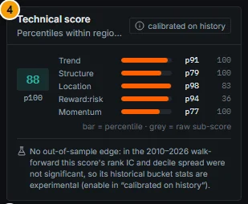

*Figure 5B.14: Technical score (callout 4), Apple, default view: score 88 (p100), percentile bars per sub-score with the raw sub-score in grey, and the "No out-of-sample edge" note.*

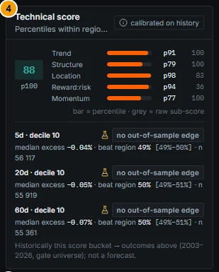

*Figure 5B.15: Toggle on: the score's decile (10) and its historical outcomes at 5 / 20 / 60 sessions, each badged "no out-of-sample edge".*

### Controls

| Element | What it shows |
|---|---|
| Score pill | Heuristic technical score 0-100. |
| pNN under the pill | Percentile of the score within region × sector (hover: "Percentile of the composite within region × sector"). |
| Sub-score rows | Trend, Structure, Location, Reward:risk, Momentum: bar = percentile within region × sector (pNN), grey number = raw sub-score (hover: "raw x (saturating 0–100) · percentile …"). |
| Subtitle | "Percentiles within region × sector (n = 549)" (number of peers). Without calibration data: "Heuristic composite (trend, structure, location, reward:risk, momentum)" and raw sub-scores only. |
| calibrated on history | Popover: definitions, "No out-of-sample edge" label, the walk-forward rank IC per horizon, gate lines and the experimental switch. |
| Bucket outcomes (toggle on) | Per horizon: "5d · decile 10", median excess return, "beat region" hit rate with CI, n, and the badge "no out-of-sample edge"; footer "Historically this score bucket → outcomes above (2003–2026, gate universe); not a forecast." |
| No out-of-sample edge note (toggle off) | "No out-of-sample edge: in the 2010–2026 walk-forward this score's rank IC and decile spread were not significant, so its historical bucket stats are experimental (enable in “calibrated on history”)." |

### Methodology

```
technical score = 25% trend + 20% structure + 35% location + 10% reward:risk + 10% momentum
trend       = 100 × share of {close > SMA200, SMA50 > SMA200, close > SMA50, SMA50 slope > 0}
structure   = 100 bullish / 50 range / 0 bearish (ZigZag 3 ATR)
location    = 50 + 50 × (a − b),  a = support strength × e^(−d_support/2),  b = resistance strength × e^(−d_resistance/2)
              (strengths as fractions, distances in ATR from the zone edge)
reward:risk = 100 × min(R:R / 4, 1)  (0 for a short bias)
momentum    = 100 − 4 × max(0, RSI − 65) − 2 × max(0, 40 − RSI), clipped to 0..100
```

The raw sub-scores saturate (structure is 0 or 100 on every origin; trend has five possible values), so the card shows each as a **percentile within region × sector** on the same date (mid-rank for ties). The bucket statistics map the score's decile to the next 5 / 20 / 60-session excess log return versus the region's equal-weight universe (median, IQR, hit rate, n, month-block bootstrap CIs).

### Data sources and refresh

Score: `tech_setups` (nightly). Percentiles and buckets: `GET /api/v1/technicals/{security_id}/score-calibration` (nightly `technicals_probabilities`; decile table refitted weekly).

### Validation status

**FAIL → experimental; the card always says "no out-of-sample edge".** From `docs/TECHNICALS_V2_VALIDATION.md` (T4):

| Horizon | Rank IC (OOS) | t (non-overlapping) | Spearman (decile, mean) | Top − bottom decile | Edge |
|---|---|---|---|---|---|
| 5 d | -0.0031 | -0.67 | -0.94 | -0.09% [-0.22, +0.03] | none |
| 20 d | -0.0117 | -0.91 | -0.84 | -0.35% [-0.72, +0.09] | none |
| 60 d | -0.0139 | -1.00 | -0.89 | -0.59% [-1.32, +0.12] | none |

"The composite technical score has **no out-of-sample edge**; if anything it is weakly mean-reverting." The percentile versions "fix the presentation but not the predictive content". The bucket mapping is accurate (hit-rate error 1.1-1.8 pp), "so the statistics are honest descriptions of history - but they are no better than the unconditional distribution". The evidence-based factor composite meant to replace it also failed its gate (see [Technical factors (evidence-based)](#technical-factors-evidence-based)), so the card keeps the heuristic score.

### Correct usage and worked example

Use the score and its percentiles as a **description** of the chart (for example, to screen for names in an uptrend near support), not as a forecast. **Example (Apple):** score 88, p100; Trend p91 (raw 100), Structure p79 (raw 100), Location p98 (raw 83), Reward:risk p94 (raw 36), Momentum p77 (raw 100). With the toggle on, decile 10 historically delivered a median excess return of -0.04% at 5 sessions, -0.05% at 20 and -0.07% at 60, beating the region 49-50% of the time (n about 56,000): no better than a coin.

### Limitations and pitfalls

- A high score is not a buy signal; historically the top decile slightly lagged.
- Raw sub-scores of 100 are common (saturation); compare percentiles.
- The score is long-side attractiveness; for a short bias the reward:risk component is 0.

### Related mnemonics and BQL fields

`TECH`. BQL: `setup.technical_score`, `setup.score_trend`, `setup.score_structure`, `setup.score_location`, `setup.score_rr`, `setup.score_momentum`; percentiles `tp.trend_pct`, `tp.structure_pct`, `tp.location_pct`, `tp.rr_pct`, `tp.momentum_pct`, `tp.technical_pct`, `tp.technical_score_pct`; bucket fields `tp.h5_*`, `tp.h20_*`, `tp.h60_*` (each with `_gate`). See also [4. Screener and Ranking](04-screener.md#scores-and-factors).

---

## Technical factors (evidence-based)

**Route:** `/company/:id?tab=technicals` · **Panel:** Technical factors (evidence-based) (callout 5) · **Mnemonics:** `TECH` · **Refresh:** nightly (`tech_factors`); validation monitor monthly (`tech_factor_eval`)

### Purpose

Instead of heuristic chart scores, this card shows the technical effects documented in the academic literature, each as a percentile against sector peers and each with **its own out-of-sample evidence on this app's data**. Three passed their gate and are shown by default as "rank edge" context; none is a profitable stand-alone strategy after costs.

### Screenshot

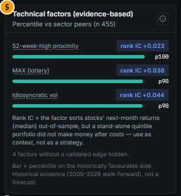

*Figure 5B.16: Technical factors (callout 5), Apple, default view: 52-week-high proximity p100 ("rank IC +0.023"), MAX (lottery) p98 ("rank IC +0.038"), Idiosyncratic vol p98 ("rank IC +0.044"); the economics note; "4 factors without a validated edge hidden."*

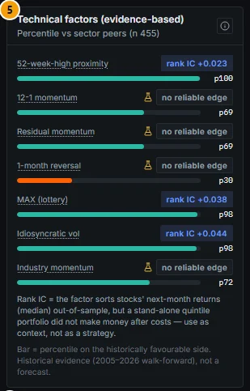

*Figure 5B.17: Toggle on: 12-1 momentum p69, Residual momentum p69, 1-month reversal p30 (orange: unfavourable side), Industry momentum p72, each with a flask and "no reliable edge".*

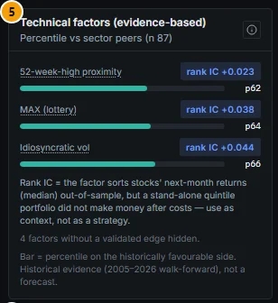

*Figure 5B.18: ASML (`/company/ASML.AS?tab=technicals`, Euronext Amsterdam), default view: percentiles against 87 sector peers in the EU region: 52-week-high proximity p62, MAX p64, idiosyncratic vol p66.*

### Controls

| Element | What it shows |
|---|---|
| Factor name (dotted) | Hover: full name, the direction the literature reports ("near the 52-week high = historically higher returns"), the out-of-sample IC at 5 / 20 / 60 sessions with t-statistics and Benjamini-Hochberg p-values, the stock's region IC, the gate verdict, the economics note and the academic reference. |
| Badge | "rank IC +0.0xx" (passed; descriptive edge, not tradable after costs) or "no reliable edge" (failed, with a flask). |
| Bar and pNN | Percentile on the **historically favourable side** (green when ≥ 50, orange below). For negative-sign factors (MAX, IVOL, reversal) this is 100 minus the raw percentile; the bar tooltip shows both. |
| Subtitle | "Percentile vs sector peers (n 455)" (or "vs region peers" for thin sectors). |
| ⓘ button | Popover: definitions, number of cells tested and the multiple-testing method, "region not validated" warning outside US / EU / UK / JP, a liquidity warning below 1M USD ADV, the experimental switch and the validation document. |
| Notes | "Rank IC = the factor sorts stocks' next-month returns (median) out-of-sample, but a stand-alone quintile portfolio did not make money after costs — use as context, not as a strategy." and "Bar = percentile on the historically favourable side. Historical evidence (2005–2026 walk-forward), not a forecast." |

### Methodology

| Factor | Definition | Sign | Reference |
|---|---|---|---|
| 52-week-high proximity (hi52) | close / max(close over 252 sessions) | + | George & Hwang (2004) |
| 12-1 momentum (mom) | log C[t−21] − log C[t−252] | + | Jegadeesh & Titman (1993) |
| Residual momentum (rmom) | Sum of residuals of months t−12..t−2 from a rolling 36-month regression on region market and sector returns, divided by their standard deviation | + | Blitz, Huij & Martens (2011) |
| 1-month reversal (strev) | log C[t] − log C[t−21] | − | Jegadeesh (1990), Lehmann (1990) |
| MAX (maxret) | Largest daily simple return over the last 21 sessions | − | Bali, Cakici & Whitelaw (2011) |
| Idiosyncratic volatility (ivol) | Annualised standard deviation of residuals of a 21-session regression on market and sector returns | − | Ang, Hodrick, Xing & Zhang (2006) |
| Industry momentum (indmom) | Region × sector equal-weight log return over 126 sessions (ranked within the region) | + | Moskowitz & Grinblatt (1999) |

Percentile = rank 0-100 of the raw value among **liquid** names (20-session ADV ≥ 1M USD, close ≥ 1 USD) of the same region × sector on the same session. **Rank IC** = Spearman correlation between the percentile and the next 20 sessions' sector-neutral log return (from the next close), averaged over weekly dates 2005-2026, pooled over US / EU / UK / JP, with Newey-West t-statistics. Definitions and signs were fixed in advance from the literature, so the whole sample is out-of-sample for each factor.

### Data sources and refresh

`tech_factors` (nightly, every price region; US / EU / UK / JP validated, other regions computed and flagged "region not validated"); `GET /api/v1/technicals/{security_id}/factors`. Monthly `tech_factor_eval` writes the validation rows and a trailing-156-week monitor IC per factor and region.

### Validation status

From `docs/TECHNICALS_V3_VALIDATION.md`, Verdict #1. Pre-registered gate: G1 pooled 20-session IC sign-aligned with Holm p < 0.05; G2 monotone deciles ≥ 0.7 and spread CI > 0; G3 aligned in ≥ 3 of 4 regions and ≥ 60% of years; G4 leakage checks; G5 no regime significantly wrong-signed.

| Factor | IC 20d (t) | Holm p | Monotone / spread | Economics (US L/S net Sharpe; long-only vs EW) | Gate |
|---|---|---|---|---|---|
| hi52 | +0.023 (2.9) | 0.017 | 0.82 / +1.3% | -0.27; -1.5%/yr (t -0.8) | **PASS** |
| mom | +0.011 (1.6) | 0.30 | 0.36 | -0.17; -0.1%/yr | FAIL (G1, G2) |
| rmom | +0.004 (1.1) | 0.56 | 0.84 | -0.28; +0.1%/yr | FAIL (G1) |
| strev | -0.015 (-3.6) | 0.002 | 0.35 | -0.66; -4.7%/yr (t -2.5) | FAIL (G2: not monotone) |
| MAX | -0.038 (-6.4) | 9e-10 | 1.00 / +2.1% | -0.35; -2.0%/yr (t -1.1) | **PASS** |
| IVOL | -0.044 (-7.5) | 6e-13 | 1.00 / +2.4% | -0.28; -0.7%/yr (t -0.4) | **PASS** |
| indmom | +0.003 (0.6) | 0.56 | 0.71 / CI incl. 0 | n/a | FAIL (G1-G3) |
| Composite (comp_wf) | +0.035 (5.3) | single test p < 1e-6 | 1.00 / +1.8% | -0.46; -1.9%/yr (t -1.1) | **FAIL** (G6 vs v2: t 1.66; G7 economics) → not served |

- "**Shown by default: hi52, MAX, IVOL** (labelled "rank edge", see the economics). Everything else is experimental."
- "No factor and no composite is profitable as a stand-alone strategy after costs." The IC is a median / rank effect on log returns; simple-return decile spreads are much smaller (hi52 +0.08%, MAX +0.23%, IVOL +0.25% per 20 sessions).
- Effects are strongest in small and micro names and weakest in large caps (hi52 large-cap IC +0.011, t 1.2: not significant). MAX and IVOL "carry the edge in calm markets … and disappear when VIX > 25".
- **Regions:** only US, EU, UK and JP were validated. Elsewhere the values are shown with "This region was not part of the validation (US / EU / UK / JP): values shown, edge not validated."

### Correct usage and worked example

Use the percentiles as cross-sectional context: "historically, stocks in this percentile had higher / lower next-month returns than their sector peers, in median". **Example (Apple, US Technology, 455 liquid peers):** 52-week-high proximity p100 (at its high), MAX aligned p98 (raw percentile 1.65: one of the least "lottery-like" names), IVOL aligned p98 (raw 2.31: very low stock-specific volatility). All three sit on the historically favourable side, but for a mega-cap the evidence is weakest (large-cap effects are small or not significant). With the toggle on, 1-month reversal shows p30 (orange): Apple's strong last month is, under the reversal effect, the unfavourable side, but that factor failed its gate.

### Limitations and pitfalls

- "Rank IC" is not a return forecast and not a trading signal; the quintile portfolios lost money after costs.
- Large caps carry the weakest evidence.
- Size buckets in the validation use dollar volume, not market cap (no point-in-time shares outside the core universe).
- Survivorship: listing coverage favours current names.

### Related mnemonics and BQL fields

`TECH`. BQL: `tech.hi52`, `tech.mom`, `tech.rmom`, `tech.strev`, `tech.maxret`, `tech.ivol`, `tech.indmom` (raw), the matching `_pct` fields (percentiles), `tech.composite` / `tech.composite_pct` (null: the composite failed), `tech.adv20_usd`, `tech.liquid`, `tech.size_bucket`, `tech.n_peers`. The Backtest Lab accepts `tech_factors` as a source ([11. Backtest Lab](11-backtest-lab.md#strategy-builder)).

---

## Breakout

**Route:** `/company/:id?tab=technicals` · **Panel:** Breakout (callout 6) · **Mnemonics:** `TECH` · **Refresh:** nightly (`tech_breakouts`); P(follow-through) refit monthly

### Purpose

The Breakout panel reports whether the stock has made a fresh 20- or 55-session high or low close in the last 20 sessions, whether that breakout was volume-confirmed, and what has happened since (active, followed through, failed). It also states the historical evidence: volume-confirmed breakouts follow through more often, but not enough to trade after costs.

### Screenshot

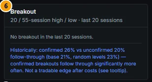

*Figure 5B.19: Breakout (callout 6), Apple: "No breakout in the last 20 sessions." and the evidence line.*

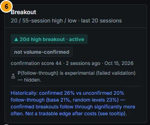

*Figure 5B.20: Toyota, default view: "▲ 20d high breakout · active", "not volume-confirmed", confirmation score 44, 2 sessions ago (15 Oct 2026); "P(follow-through) is experimental (failed validation) — hidden."*

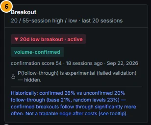

*Figure 5B.21: JPMorgan, default view: "▼ 20d low breakout · active", "volume-confirmed", score 54, 18 sessions ago (22 Sep 2026); the probability is hidden.*

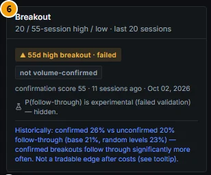

*Figure 5B.22: ASML, default view: "▲ 55d high breakout · failed" (closed back inside the level), score 55, 11 sessions ago.*


### Controls

| Element | What it shows |
|---|---|
| State chip | "▲ 20d high breakout · active / followed through / failed" (or ▼ … low); hover: definitions of breakout and confirmation. |
| Confirmation chip | "volume-confirmed" (green) or "not volume-confirmed". |
| Sub-line | "confirmation score NN · N sessions ago · (date)". |
| P(follow-through, 20d) | Toggle on only (flask): calibrated probability, with "vs geometry baseline x% · base rate y%". Toggle off: "P(follow-through) is experimental (failed validation) — hidden." |
| Evidence line | "Historically: confirmed 26% vs unconfirmed 20% follow-through (base 21%, random levels 23%) — confirmed breakouts follow through significantly more often. Not a tradable edge after costs (see tooltip)." Hover for the economic check. |

### Methodology

- **Breakout (lookback N = 20 or 55):** the close exceeds the highest high of the previous N sessions while the previous close did not, with no breakout of the same N in the previous 10 sessions; level L = that prior high (mirrored for lows).
- **Follow-through (H = 20):** the high reaches `C · exp(σ · √20)` (one 20-session σ beyond the breakout close, σ = EWMA daily volatility) **before** any close back inside the level. Failed = closed back inside first (a bar with both = fail). Active = neither yet.
- **Volume confirmation (pre-registered):** volume ≥ 1.5 × its 50-session average **and** the close in the top quarter of the day's range (bottom quarter for a down breakout).
- **Confirmation score 0-100:** fixed mean of four bounded components: relative volume (log scale), close location in the range, Chaikin money flow (20), OBV slope (20).
- **P(follow-through):** logistic regression with isotonic calibration, purged walk-forward (2-year test blocks 2008-2026), on the breakout-day return, distance beyond the level, trend, relative volume, OBV, gap, volatility ratio and other features. **Geometry baseline:** distance beyond the level, volatility regime, lookback, direction and region only. **Base rate:** all breakouts of that lookback.

### Data sources and refresh

`tech_breakouts` / `tech_breakout_state` (nightly; liquid names; events of the last 80 sessions, panel shows the latest of the last 20); `GET /api/v1/technicals/{security_id}/breakout`. The model is refitted monthly by `tech_factor_eval`.

### Validation status

From `docs/TECHNICALS_V3_VALIDATION.md`, Verdict #5 (liquid US / EU / UK / JP, 2005-2026, 1.67 million events):

| Output | H | ECE | Worst regime | Beats climatology and geometry | Gate |
|---|---|---|---|---|---|
| Calibrated P(follow-through) | 10 | 1.23 | **Covid 2020 +18.3 pp** (2020 +6.8) | yes: Brier 0.1810 vs 0.1867 / 0.1823 | **FAIL** → experimental |
| Calibrated P(follow-through) | 20 | 1.20 | **Covid 2020 +17.2 pp** (2020 +6.5) | yes: Brier 0.1603 vs 0.1651 / 0.1610 | **FAIL** → experimental |

| Effect (H = 20) | Estimate | 95% CI |
|---|---|---|
| Base rate (all breakouts) | 21.1% | [20.1, 22.0] |
| Confirmed / unconfirmed | 26.2% / 19.6% | |
| Raw difference | +6.6 pp | [+6.1, +7.2] |
| Geometry-adjusted difference | **+1.6 pp** | [+1.2, +2.0] |
| Confirmed − geometry-matched random control | **+3.5 pp** | [+2.7, +4.6] |
| Unconfirmed − its random control | +0.6 pp | [-0.1, +1.4] |
| **Volume-confirmation edge** | | **PASS** |
| Economic check (US up breakouts, costs on) | confirmed Sharpe -0.35 vs all -0.61; confirmed − random subset of the same size -1.0%/yr (t -0.6); PBO 0.12 | **no tradable edge** |

"Most of the raw +6.6 pp is geometry (confirmed breakouts close much further beyond the level …), but +1.6 pp remains within geometry strata." "Breakout trading is negative after costs (fails back inside ~70% of the time)." "The state chip and the confirmation flag / score (deterministic) are shown; the probability is hidden unless the experimental toggle is on."

### Correct usage and worked example

Use the panel as context for a level: a fresh, volume-confirmed breakout through a resistance zone is historically a little more likely to keep going than an unconfirmed one, but most breakouts fail back inside the level. **Example (Toyota, 15 Oct 2026):** a 20-session high breakout, still active two sessions later, **not** volume-confirmed (score 44); by default the probability is hidden; with the toggle on, the experimental model gave 17%, slightly below its geometry baseline (19%) and the base rate (20%). **Example (JPMorgan):** a volume-confirmed 20-session **low** breakout on 22 Sep, still active after 18 sessions (experimental P(follow-through) 29% vs geometry 28%, base 22%).

### Limitations and pitfalls

- About 70% of breakouts close back inside the level; "active" does not mean "working".
- The probability failed in the 2020 rebound (+17-18 pp): breakouts then followed through far more often than predicted.
- Only liquid names have breakout events.
- Backtest exits are close-based; the label uses intraday highs and lows.

### Related mnemonics and BQL fields

`TECH`. BQL: `bo.state`, `bo.direction`, `bo.lookback`, `bo.event_date`, `bo.sessions_since`, `bo.level`, `bo.target_20`, `bo.confirmed`, `bo.confirm_score`, `bo.relvol50`, `bo.clv`, `bo.p_follow_20`, `bo.p_geo_20`, `bo.base_rate_20`, `bo.gate`.

---

## Indicators

**Route:** `/company/:id?tab=technicals` · **Panel:** Indicators (callout 7) · **Mnemonics:** `TECH` · **Refresh:** nightly (`confluence_zones`)

### Purpose

A compact panel of the standard indicators used by the setup and the score: RSI, ATR, the 50- and 200-day moving averages and the trend label.

### Screenshot

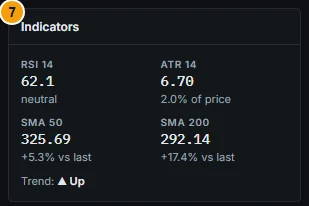

*Figure 5B.23: Indicators (callout 7), Apple: RSI 14 62.1 (neutral), ATR 14 6.70 (2.0% of price), SMA 50 325.69 (+5.3% vs last), SMA 200 292.14 (+17.4% vs last), Trend ▲ Up.*

### Controls

| Element | What it shows |
|---|---|
| RSI 14 | Wilder RSI(14); "overbought" above 70, "oversold" below 30, otherwise "neutral". |
| ATR 14 | Wilder ATR(14) in price units and as a share of the price. |
| SMA 50 / SMA 200 | Moving averages and the last price's distance from them. |
| Trend | ▲ Up / ▼ Down / ■ Sideways from the setup's trend score. |

### Methodology

RSI and ATR use Wilder smoothing over 14 sessions. SMA 50 / 200 are simple averages of the last 50 / 200 closes. Trend = up when at least 75% of {close > SMA200, SMA50 > SMA200, close > SMA50, positive 20-session SMA50 slope} hold, down when 25% or fewer, otherwise sideways.

### Data sources and refresh

`tech_setups` (nightly), via `GET /api/v1/companies/{security_id}/technicals` (`indicators`).

### Validation status

Not formally validated (standard indicator definitions, no predictive claim).

### Correct usage and worked example

Use ATR to size stops in volatility units and to read zone distances (the zones table measures distance in per cent, the zone engine in ATR). **Example (Apple):** ATR 6.70 = 2.0% of the price; the invalidation 329.23 sits 0.5 ATR below zone #1's low, and T1 is about 3 ATR above the close.

### Limitations and pitfalls

The "overbought / oversold" labels are conventional thresholds, not tested signals. The trend label here (SMA rules) can differ from the trend chip (daily / weekly alignment).

### Related mnemonics and BQL fields

`TECH`. BQL: `setup.rsi14`, `setup.atr14`, `setup.sma50`, `setup.sma200`, `setup.trend`, `setup.structure_state`.
