# 5C. Company 360: macro, earnings, events, network and model

This chapter covers the last five tabs of Company 360: **Macro**, **Earnings**, **Event risk**, **Network & Geo** and **Model**. Each one adds an outside-in view of the company: how it moves with the macro factors, how it reacts to its own results, which news and geopolitical shocks it is exposed to, who it trades with and where it earns its revenue, and what the cross-sectional ML ranker says about it.

Almost everything on these tabs is **model-based**: our own estimates from public data, not analyst consensus and not forecasts. Every panel says so with a badge, and this chapter repeats the label and the validation status for each output. The company header at the top of every tab (callout 1 in the screenshots) is described in [5A. Company 360](05a-company-fundamentals.md).

Examples use Apple (AAPL), Toyota (7203.T), SAP (SAP.DE) and Petrobras (PETR4.SA). Data is as of 19 October 2026 (snapshot built 22 October 2026), unless a panel shows an earlier "as of" date.

---

## Macro

**Route:** `/company/:id?tab=macro` · **Menu:** Company 360 › Macro · **Mnemonics:** none for this tab (open the company with `DES`, then the tab) · **Refresh:** betas weekly (`macro_exposures`), regime table nightly (`regime_performance`)

### Purpose

The Macro tab shows how sensitive the stock is to rates, the yield curve, inflation breakevens, credit spreads, the dollar, oil and the equity market, compared with its sector. It turns those sensitivities into the estimated impact of ten preset shocks (and your saved scenarios), replays six historical episodes against today's betas, and shows how the company's sector has done in each macro regime. Use it to understand what kind of macro bet you take when you own the name, and to check a thesis against a rates or oil scenario. It is a description of past co-movement, labelled "Model-based estimate (rolling factor betas; not a forecast)".

### Screenshot

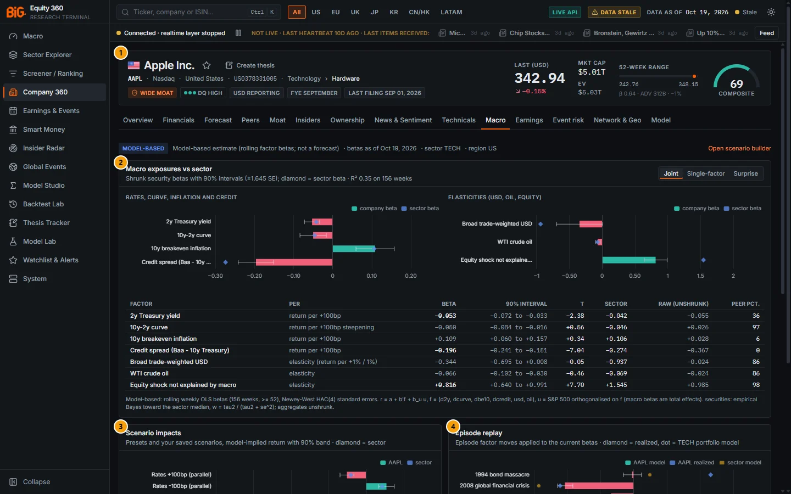

*Figure 5C.1: Macro tab for Apple (`/company/AAPL?tab=macro`), betas as of 19 Oct 2026.*

| # | Panel | What it shows |
|---|---|---|
| 1 | Company header | Name, listing, badges, last price and composite score (see [5A](05a-company-fundamentals.md)) |
| 2 | Macro exposures vs sector | Shrunk betas with 90% intervals, the sector beta (diamond), fit R², and the full beta table |
| 3 | Scenario impacts | Model-implied return for each preset and saved scenario, with a 90% band and the sector impact |
| 4 | Episode replay | Today's betas applied to six historical episodes, against the realised return of the stock and its sector |
| 5 | Sector regime performance | Mean monthly return of the sector relative to its benchmark in each macro regime (below the fold, Figure 5C.2) |

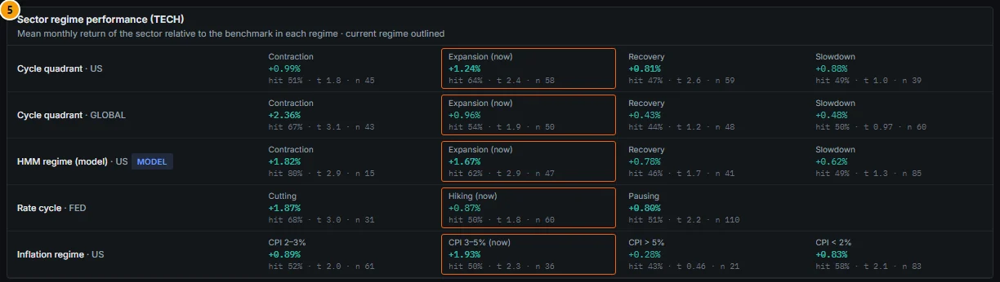

*Figure 5C.2: Sector regime performance for Technology (TECH). The current regime of each row is outlined and marked "(now)".*

### Controls

| Control | What it does |
|---|---|
| **Model** segmented control (Joint / Single-factor / Surprise) | Switches the exposure model behind the bars and the table (see Methodology). Default: Joint |
| **Open scenario builder** link (top right) | Opens the Scenario builder at `/macro/markets?tab=scenarios`, where you define and save your own shocks |
| Hover on a bar | Shows the company beta, its 90% interval and the sector beta |
| Hover on an episode name | Shows the episode window (start → end) |
| Hover on a model value in the episode table | Shows the 90% band of the model-implied return (and the sector weighting for the sector column) |

The tab has no export of its own. The same numbers are available through the macro-to-markets pages and BQL (see the last subsection).

### Methodology

#### Factors

All factor inputs come from official series (via FRED unless stated):

| Factor | Label in the app | Unit of the beta | Source |
|---|---|---|---|
| `d2y` | 2y Treasury yield | return per +100bp | Fed H.15 (DGS2) |
| `d10y` | 10y Treasury yield | return per +100bp | Fed H.15 (DGS10) |
| `dcurve` | 10y-2y curve | return per +100bp steepening | T10Y2Y |
| `dreal10` | 10y real yield (TIPS) | return per +100bp | Fed H.15 (DFII10) |
| `dbe10` | 10y breakeven inflation | return per +100bp | T10YIE |
| `dcredit` | Credit spread (Baa - 10y Treasury) | return per +100bp | Moody's via FRED (BAA10Y) |
| `usd` | Broad trade-weighted USD | elasticity (return per +1% / 1%) | Federal Reserve (DTWEXBGS) |
| `oil` | WTI crude oil | elasticity | EIA (DCOILWTICO) |
| `equity` | S&P 500 (market beta) | elasticity | price lake (^GSPC) |
| `equity_resid` | Equity shock not explained by macro | elasticity | S&P 500 orthogonalised on the macro factors |
| `surp_growth`, `surp_inflation`, `surp_labor` | Growth / Inflation / Labor surprise index | return per +100 index points | our surprise indices (model-based expectations) |

A rate beta of −0.05 means about −5% return for a +100bp move. An elasticity of −0.34 means about −0.34% for a +1% move in the dollar.

#### The three exposure models

All three are rolling weekly OLS regressions of the stock's local-currency weekly total return on weekly factor changes, over the last **156 weeks** (at least 52), with Newey-West HAC(4) standard errors. They are re-estimated at each month end.

- **Joint** (default): `r = a + b′f + b_u·u + e`, with `f = (Δ2y, Δcurve, Δbe10, Δcredit, USD, oil)` and `u` = the S&P 500 return orthogonalised on `f` in the same window. Because `u` only carries the equity move that the macro factors do not explain, the macro betas are **total effects**.
- **Single-factor** (`univariate`): one regression per factor. The `equity` row is the ordinary CAPM beta to the S&P 500.
- **Surprise**: `r = a + b′s + b_u·u_s + e`, where `s` = changes in the growth, inflation and labour surprise indices of the company's **home economy** (model-based expectations, see [2A. Macro](02a-macro.md)) and `u_s` = the equity return orthogonalised on `s`.

#### Shrinkage, intervals and the table columns

Raw security betas are noisy, so they are shrunk toward the sector by empirical Bayes:

```
β = m + w · (β_raw − m)        w = τ² / (τ² + se_raw²)        se = √w · se_raw
```

`m` is the median raw beta of the sector on the same date (the all-security median when the sector has fewer than 5 names) and `τ²` is the cross-sectional variance of the true betas (robust variance of the raw betas minus the mean squared standard error, floored at 5% of the variance). Sector, region and other aggregates are not shrunk.

| Column | Meaning |
|---|---|
| Factor, Per | Factor label and unit of the beta |
| Beta | Shrunk beta. **Bold** when the absolute t is at least 1.96 |
| 90% interval | `β ± 1.645 · se` (shrunk standard error) |
| t | t-statistic of the **raw** estimate, `β_raw / se_raw` |
| Sector | Cap-weighted sector portfolio beta (the diamond on the chart) |
| Raw (unshrunk) | `β_raw` before shrinkage |
| Peer pct. | Percentile of the shrunk beta among all securities of the same sector (0-100) |

The panel subtitle gives the R² and the number of weeks of the selected model; the footnote under the table repeats the method text served by the API.

#### Scenario impacts

Each preset is run in **isolated** mode: factors you do not shock are set to zero, and a 2y and 10y shock of the same size is a parallel shift (the curve is unchanged). Percent shocks enter in logs. With `z` the factor shock vector and `C` the shrunk HAC covariance of the stock's betas:

```
impact = exp(b′z) − 1        90% band = exp(b′z ± 1.645 · √(z′Cz)) − 1
```

Surprise shocks (in the Stagflation preset) use the Surprise model and are added to the macro impact; the two channels can overlap. The band covers **estimation error only**, not the stock's idiosyncratic noise. The ten presets are: Rates ±100bp (parallel), Bear steepener (10y +75bp, 2y +25bp), Bull flattener (10y −75bp, 2y −25bp), USD +10%, Oil +50%, Oil −40%, Credit spreads +150bp, Stagflation (breakevens +75bp, oil +40%, growth surprise −100) and Risk-off (equity −15%, credit +100bp, rates −50bp, USD +5%). Scenarios you saved in the Scenario builder appear below them, marked "(saved)". On this tab the optional VAR second-round propagation of the Scenario builder is switched off.

#### Episode replay

For each episode the factor moves are the official level changes over the window (log changes for USD, oil and equity). The model value is today's betas × those moves; "Realized" is the stock's actual return over the window, or "not listed" when its prices do not cover it. The sector columns show the same for the sector portfolio (cap-weighted where available, else equal-weighted).

| Episode | Window |
|---|---|
| 1994 bond massacre | 15 Oct 1993 → 7 Nov 1994 |
| 2008 global financial crisis | 12 Sep 2008 → 9 Mar 2009 |
| 2011 euro-area debt crisis | 1 Jul 2011 → 3 Oct 2011 |
| 2013 taper tantrum | 21 May 2013 → 5 Sep 2013 |
| 2020 COVID crash | 19 Feb 2020 → 23 Mar 2020 |
| 2022 hiking cycle | 31 Dec 2021 → 21 Oct 2022 |

#### Sector regime performance

Historical monthly returns of the company's sector (cap-weighted) **minus the benchmark** (S&P 500 for global aggregates), grouped by the regime of the same month (contemporaneous timing). Each cell shows the mean monthly relative return, the hit rate (share of months above zero), the t-statistic `t = mean / (sd / √n)` and the number of months `n`. The mean is bold when |t| ≥ 1.96.

| Row | Regime definition |
|---|---|
| Cycle quadrant · US | Cycle clock quadrant of the US (expansion, slowdown, contraction, recovery) |
| Cycle quadrant · GLOBAL | Same, on the mean of the US, euro area, Japan, UK and China momenta |
| HMM regime (model) · US | Gaussian hidden Markov model regimes (model-based, badge "model") |
| Rate cycle · FED | Hiking / pausing / cutting |
| Inflation regime · US | US CPI y/y buckets (< 2%, 2-3%, 3-5%, > 5%) |

### Data sources and refresh

- **Factors:** FRED (Fed H.15, Federal Reserve, EIA, Moody's), the S&P 500 from the price lake, and the surprise indices built from official releases. Job `macro_factors` (nightly).
- **Stock returns:** local-currency weekly total returns from the price lake (Polygon and yfinance).
- **Betas and episode replay:** job `macro_exposures`, **weekly** (about 20,000 securities plus sector, region and other aggregates). The header line shows "betas as of" the date of the latest run.
- **Regime table:** job `regime_performance`, nightly, monthly history from 1995.
- **Scenarios:** presets are built in; your saved scenarios live in the app state database.
- Under the default weekly schedule profile, all of these run in the Saturday refresh.

### Validation status

**Not formally validated.** There is no pass / fail gate for the macro exposures, scenario impacts or episode replay. Every output carries the badge **MODEL-BASED** and the label "Model-based estimate (rolling factor betas; not a forecast)". The regime table is labelled "Historical monthly returns grouped by regime (not a forecast)", and its HMM row carries a "model" badge.

The uncertainty bands cover estimation error only. The episode replay is the best available check of how well betas explain big moves, and it often shows large gaps (see the worked example). The aggregate model-versus-realised statistics are on the Episode replay page of [2B. Markets and cross-asset](02b-markets-cross-asset.md).

### Correct usage and worked example

Use the tab to answer "what macro risk am I taking?", not "what will the stock do?". Read the **Joint** model first; switch to **Single-factor** for the familiar CAPM beta and simple sensitivities, and to **Surprise** to see whether the stock reacts to data surprises in its home economy. Treat a beta as meaningful only when it is bold (|t| ≥ 1.96 on the raw estimate) and its interval does not straddle zero.

**Worked example: Apple (AAPL), betas as of 19 Oct 2026 (Figure 5C.1).** The Joint model explains R² 0.35 of Apple's weekly returns over 156 weeks.

1. The strongest macro sensitivity is to **credit spreads**: β −0.196 per +100bp (90% −0.241 to −0.151), t −7.04, against a sector beta of −0.274. Apple is less credit-sensitive than the average technology stock.
2. The **equity shock not explained by macro** has elasticity +0.816 (t +7.70; sector +1.545). Apple carries less pure equity-market risk than its sector, which is consistent with its low market beta in the header (β 0.64).
3. **Credit spreads +150bp** therefore gives `exp(−0.196 × 1.5) − 1 = −25.5%` (band −30.4% to −20.2%), against −33.7% for the sector. **Rates +100bp (parallel)** gives −5.1% (band −7.0% to −3.3%).
4. In the episode replay, the 2008 crisis is well explained (model −41.3%, realised −44.2%), but the 1994 bond massacre is not (model −0.8%, realised +46.4%): over that window Apple's return was driven by company news, not by macro.
5. In the regime table, Technology is currently in **Expansion (now)** on the US cycle quadrant, with a mean monthly relative return of +1.24% (hit 64%, t 2.4, n 58).

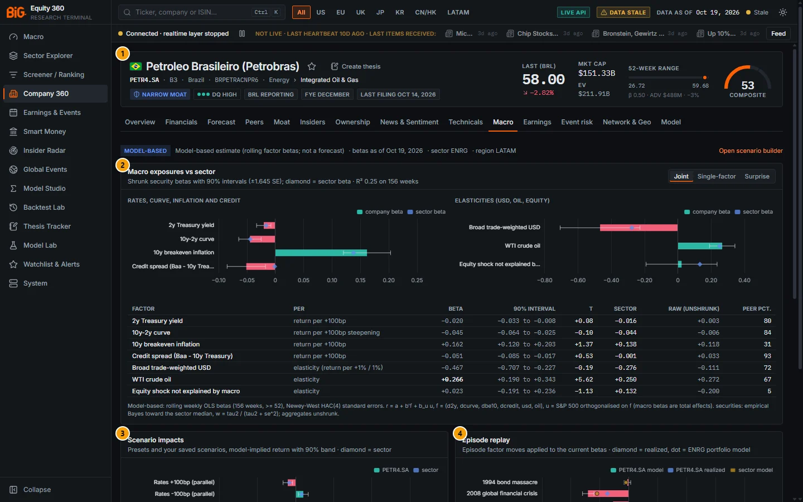

*Figure 5C.3: Macro tab for Petrobras (`/company/PETR4.SA?tab=macro`), betas as of 19 Oct 2026. The callouts are the same as in Figure 5C.1.*

**Second example: Petrobras (PETR4.SA).** The factors are US factors and the returns are in BRL. The Joint R² is 0.25. The dominant exposure is **WTI crude oil**: elasticity +0.266 (90% +0.190 to +0.343, t +5.62). **Oil +50%** gives +11.4% (band +8.0% to +14.9%) and **Oil −40%** gives −12.7%. The dollar elasticity is −0.467, but its raw t is only −0.19, so most of that number is the sector prior, not evidence from Petrobras. In the 2022 hiking cycle the model expected −7.0% while the stock returned +98.5%: oil, the real and Brazilian politics dominate, and US macro betas cannot capture them. The Surprise model uses Brazil's surprise indices and explains almost nothing (R² 0.03).

### Limitations and pitfalls

- **Not a forecast.** Betas describe the last three years of co-movement. They change with the business mix, and the replay of old episodes applies today's betas to yesterday's shocks.
- **Bold depends on the raw t, the bar on the shrunk beta.** A large shrunk beta with a small raw t (Petrobras USD above) mostly reflects the sector median. The two can even have opposite signs when the raw estimate is near zero.
- **Bands are too narrow for a single stock.** They exclude idiosyncratic risk; a realised move far outside the band is not a model failure in itself.
- **US-centric factor set.** The Joint and Single-factor models use US rates, US credit, the Fed broad dollar and WTI for every security, including non-US stocks. Local rates and local currency effects are only captured to the extent that they co-move with these factors.
- **The regime table is for the sector, with US / global / Fed regimes**, whatever the company's country. It uses contemporaneous regimes, which are only known after the month, so it is not directly investable.
- **Weekly refresh.** Betas can be up to a week old (more if a weekly run is missed; the header shows the date).
- **Minimum history.** A security with fewer than 52 weeks of prices shows "No macro exposures".

### Related mnemonics and BQL fields

- No command-bar function opens this tab directly. `DES` opens the company; `WEI` opens the Markets overview.
- BQL (snapshot only, model-based): `macro.beta_rates` (Single-factor 10y beta), `macro.beta_usd`, `macro.beta_oil`, `macro.beta_credit` (Single-factor), `macro.beta_growth` (Surprise model, growth index) and `macro.rates_down_100bp` (modelled impact of rates −100bp, from the Joint 2y beta).
- Related sections: macro exposures heatmap, regime performance, Scenario builder and Episode replay in [2B. Markets and cross-asset](02b-markets-cross-asset.md); surprise indices and the cycle clock in [2A. Macro](02a-macro.md).

---

## Earnings

**Route:** `/company/:id?tab=earnings` · **Menu:** Company 360 › Earnings · **Mnemonics:** `ERN` (also `EE` for the model-based forecast tab) · **Refresh:** nightly jobs `earnings_*` (weekly under the default profile)

### Purpose

The Earnings tab is the company's earnings file: when it reports next and how sure we are of that date, how the stock has reacted to its past releases, our **model-based** expectation of the next EPS and revenue figure, and every past release with its official time, surprise and price reaction. It also lists dividends, splits and other corporate events. Use it before a release to size the usual move, and after a release to see whether the reaction was unusual. There are **no analyst consensus estimates** in the app; every expectation is a time-series model on the company's own history.

### Screenshot

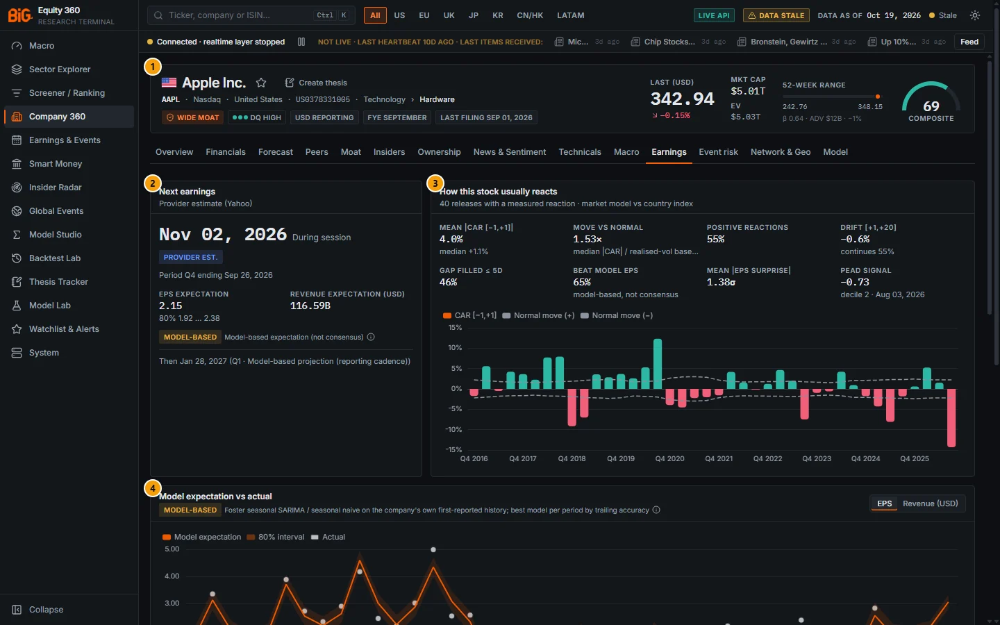

*Figure 5C.4: Earnings tab for Apple (`/company/AAPL?tab=earnings`), data as of 19 Oct 2026.*

| # | Panel | What it shows |
|---|---|---|
| 1 | Company header | See [5A](05a-company-fundamentals.md) |
| 2 | Next earnings | Next date, session, date-source badge, period, model-based EPS and revenue expectation, later dates |
| 3 | How this stock usually reacts | Eight reaction statistics and a bar chart of CAR [−1,+1] per release against the normal move |
| 4 | Model expectation vs actual | Model expectation with its 80% interval and the reported actuals, for EPS or revenue |
| 5 | Release history | One row per release: time, source, expectation, actual, surprises, CARs, move ratio, gap (Figure 5C.5) |
| 6 | Corporate events | Dividends, splits, 8-K items, proxies and exchange disclosures (Figure 5C.6) |

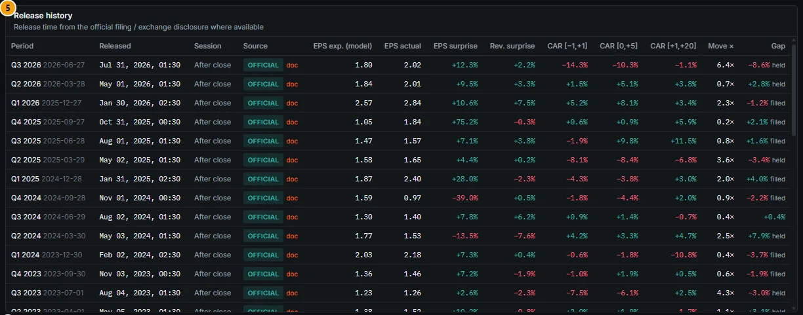

*Figure 5C.5: Release history for Apple. "OFFICIAL" = SEC 8-K Item 2.02 acceptance time; "doc" opens the filing.*

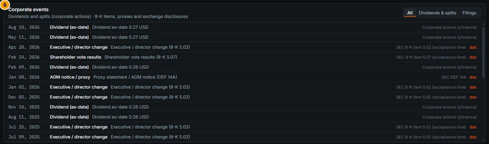

*Figure 5C.6: Corporate events for Apple, with the source of each row on the right.*

### Controls

| Control | What it does |
|---|---|
| Date-source badge (hover) | Explains what the date is based on; for a projection, also the plausible window |
| **Item** segmented control (EPS / Revenue) on panel 4 | Switches the expectation chart between diluted EPS and revenue (reporting currency) |
| Hover on the reaction chart | Period, release date, CAR [−1,+1], normal move (±) and drift [+1,+20] |
| Hover on the expectation chart | Period, model expectation, 80% interval, actual, surprise (or "pending") and the model used |
| Hover on the **Model-based** tag | States that expectations come from time-series models on the company's own reported history and are not analyst consensus |
| `*` after a period (hover) | "Period inferred from the calendar / cadence (no filing matched)" |
| Source badge in the history (hover) | The full source label, e.g. "SEC 8-K Item 2.02 (acceptance time)" |
| **doc** links | Open the filing or exchange disclosure in a new browser tab |
| **Event kind** segmented control (All / Dividends & splits / Filings) on panel 6 | Filters the corporate events list (up to 120 rows) |
| "awaiting release" badge | Shown when the next date has passed but no release has been recorded yet |

### Methodology

#### Next date and its source

Every date carries a source badge, always visible:

| Badge | Meaning |
|---|---|
| **Announced** | Company-announced date from the exchange schedule (for example the JPX schedule for Tokyo) |
| **Provider est.** | Provider estimate (Yahoo) |
| **Projection** | Model-based projection from the company's reporting cadence, with a plausible window |
| **Official** | Past release at the official time (SEC 8-K Item 2.02 acceptance time, TDnet kessan tanshin, HKEX results announcement) |
| **Filing** | Past periodic report filing (10-Q, 10-K, 20-F, 40-F or national equivalent), which may lag the first public release |
| **Provider** | Past release dated by the provider (Yahoo) |

**Projection.** The next period end follows the company's cadence (52/53-week reporters use the same period a year earlier + 364 days). The expected date is the same-period release a year earlier + 364 days (which keeps the weekday), or the period end plus the median lag of the last four releases. The window is ± max(3, 1.5 × MAD of the lags) days, capped at 21. A company-announced date overrides the projection; otherwise a Yahoo date mapped to the same period does.

**Past releases.** A dated release is assigned to the latest known fiscal period end P with 4 ≤ release − P ≤ 100 days (130 outside the US); otherwise the period is extrapolated and flagged `*`. For each period the release is the earliest official release, else the provider date, else the periodic report filing itself.

#### Price reactions

The reaction uses a **market model** against the company's country index (for example the S&P 500 for Apple, the Nikkei 225 for Toyota; ACWI as fallback), estimated by OLS on trading days [−250, −30] before the release (at least 60 observations):

```
AR_t   = r_t − (α + β · r_m,t)
CAR    = Σ AR_t over the window
BHAR   = Π(1 + r_t) − Π(1 + α + β · r_m,t)
normal move = σ_resid · √3        move ratio = |CAR[−1,+1]| / normal move
```

Day 0 is the first trading day on or after the reaction date (the next session for an after-close release). Windows: [−1,+1] (the announcement reaction), [0,+5] and [+1,+20] (post-announcement drift). Returns are split- and dividend-adjusted; a daily move above 50% is treated as a data error. There is no option-implied move in the app: the normal move is the stock's usual 3-day abnormal volatility.

**Gap** = open on day 0 ÷ previous close − 1. A gap of at least half a daily σ is "filled" if the price trades back to the previous close within six sessions (day 0 to +5), else "held".

#### Reaction statistics (panel 3)

| Statistic | Definition |
|---|---|
| Mean abs. CAR [−1,+1] | Mean absolute announcement reaction; "median" = median signed CAR |
| Move vs normal | Median of the absolute CAR [−1,+1] divided by the normal move, across releases |
| Positive reactions | Share of releases with CAR [−1,+1] > 0 |
| Drift [+1,+20] | Mean CAR [+1,+20]; "continues" = share where the drift has the same sign as the announcement reaction |
| Gap filled ≤ 5d | Share of qualifying gaps that were filled |
| Beat model EPS | Share of releases with a positive model-based EPS surprise (labelled "model-based, not consensus") |
| Mean abs. EPS surprise | Mean absolute EPS surprise in σ units (z) |
| PEAD signal | Latest post-earnings drift score, its decile and signal date (model-based) |

#### Model-based expectations and surprises

Expectations for quarterly (or half-yearly) **revenue** and **diluted EPS** come from the company's own first-reported history, point in time: for a release on date R the model is fitted on data known at R − 1 day, with EPS put on the share basis of that date.

- **Foster seasonal model:** SARIMA(1,0,0)×(0,1,0)ₛ with drift, the classic time-series earnings expectation of the SUE / PEAD literature, on EPS levels and on log revenue. Needs at least two seasons plus four observations.
- **Seasonal naive:** the same period a year earlier (EPS plus the mean seasonal change of the last eight periods; revenue times trailing seasonal growth).
- **Forecast path** (upcoming periods only): the base case of the Forecast tab for the fiscal year × the period's average share of the year.
- **Primary model:** the one with the lower mean absolute percentage error over the company's previous (up to) eight released periods, if at least four exist; else the Foster model; else seasonal naive.

The interval is the **80% interval** of the h-step forecast (for seasonal naive, from the company's own past errors). When the structured actual arrives (10-Q / 10-K XBRL or the national filing):

```
surprise % = (actual − expectation) / |expectation|        surprise z = (actual − expectation) / σ
```

The **PEAD signal** combines the standardised EPS surprise (SUE: surprise ÷ standard deviation of the previous eight surprises, at least four), the revenue surprise z and CAR [−1,+1] ÷ normal move, each capped at ±3, and averages them. It is ranked into deciles within region × signal month (at least 20 names). The signal date waits until the actual is public, so for US companies it often follows the 10-Q, not the press release.

### Data sources and refresh

- **Official release times:** SEC EDGAR submissions (8-K Item 2.02 acceptance time; 10-Q / 10-K / 20-F / 40-F as periodic reports; other 8-K items and DEF 14A as corporate events), TDnet kessan tanshin (Japan) and HKEX results announcements (Hong Kong).
- **Dates:** JPX schedule (company-announced), Yahoo (provider dates and estimates).
- **Actuals:** `fundamentals_canonical` (XBRL and national filing systems).
- **Corporate actions:** dividends and splits from yfinance, including declared future ex-dates; buybacks and forecast revisions from TDnet; HKEX announcements.
- **Jobs (nightly DAG):** `earnings_dates_fetch`, `earnings_events`, `earnings_reactions`, `earnings_expectations`, `earnings_signals`. Under the default weekly profile they run in the Saturday refresh. Reaction history starts in 2012; expectations are back-filled from 2016.

### Validation status

**Not formally validated.** There is no pass / fail gate for the expectations, the reactions or the PEAD signal.

- Expectations are labelled **Model-based** "Model-based expectation (not consensus)". The API note reads: "Expectations are model-based (Foster seasonal SARIMA / seasonal naive on the company's own first-reported quarterly series, plus the analytics forecast path), NOT analyst consensus."
- Projected dates are labelled "Model-based projection (reporting cadence)" and provider dates "Provider estimate (Yahoo)".
- The PEAD signal is labelled model-based. Its forward outcomes are stored only as **labels** for the [Backtest Lab](11-backtest-lab.md), never as inputs; no out-of-sample result is recorded in the validation documents.
- The 19 Oct 2026 audit confirmed that earnings source labels are handled point-in-time correctly.

### Correct usage and worked example

Before a release, read the **date badge** first (an Announced date is firm; a Projection is a window), then **Move vs normal** and **Mean |CAR|** to size the usual reaction. After a release, compare the move ratio of the latest row with the stock's median. Treat "beat" and "miss" as relative to a mechanical time-series model, not to what the market expected.

**Worked example: Apple (AAPL), 19 Oct 2026 (Figure 5C.4).**

1. **Next earnings:** Nov 02, 2026, "During session", badge **Provider est.** (Yahoo), fiscal Q4 ending 26 Sep 2026. Model-based EPS expectation 2.15 (80% 1.92 … 2.38) and revenue USD 116.59B. The following date, 28 Jan 2027, is a **Projection** with a plausible window of 25-31 Jan 2027.
2. **Usual reaction (40 releases):** mean |CAR [−1,+1]| 4.0% (median +1.1%), move vs normal 1.53×, positive 55%, drift [+1,+20] −0.6% (continues 55%), gaps filled 46%, beat model EPS 65%, mean |EPS surprise| 1.38σ.
3. **Latest release:** fiscal Q3 2026 (period ending 27 Jun 2026), released on 30 Jul 2026 after the close, at the SEC 8-K Item 2.02 acceptance time (badge **Official**). EPS was 2.02 against a seasonal-naive expectation of 1.80 (+12.3%, z +0.72), and revenue USD 109.4B against 107.1B (+2.2%). Yet CAR [−1,+1] was **−14.3%**, 6.4× the normal move of about 2.2%, with an opening gap of −8.6% that held. A "beat" against our model said nothing about the market's expectations.
4. **PEAD signal:** −0.73, decile 2, signal date 3 Aug 2026 (the large negative announcement reaction outweighs the positive surprises).

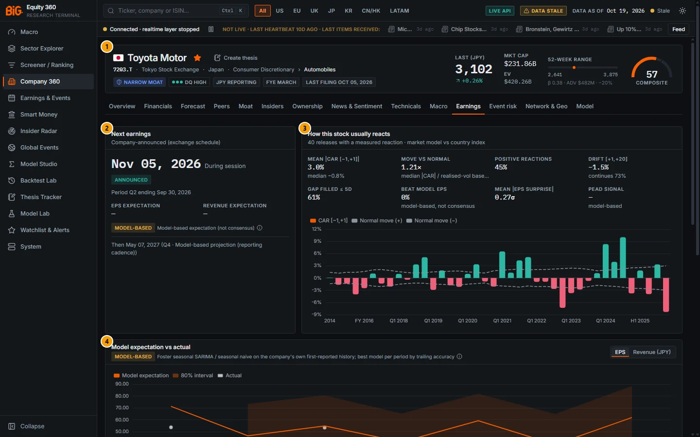

*Figure 5C.7: Earnings tab for Toyota (`/company/7203.T?tab=earnings`), data as of 19 Oct 2026. The callouts are the same as in Figure 5C.4.*

**Second example: Toyota (7203.T).** The next date is Nov 05, 2026 with the badge **Announced** (JPX schedule), for fiscal Q2 ending 30 Sep 2026. There is no EPS or revenue expectation for it (dashes): the company's quarterly series is too short or too stale for the models. Over 40 releases measured against the Nikkei 225, the mean |CAR| is 3.0%, the move vs normal 1.21× and the drift continues 73% of the time. "Beat model EPS 0%" rests on only three measured surprises (2022-2023), so ignore it. In this snapshot all of Toyota's past releases are Yahoo provider dates, so the history shows no release time and "Time n/a" for most sessions.

### Limitations and pitfalls

- **No consensus.** Beat / miss is against a time-series model on the company's own history. A company can "beat" our model and still disappoint the market (Apple, Q3 2026).
- **Surprises arrive late.** The surprise appears when the structured actual lands (XBRL 10-Q / 10-K or the national filing), which can be days or weeks after the press release.
- **Thin non-US coverage.** Official release times exist only where the filing system provides them (SEC, TDnet, HKEX) and were ingested; elsewhere the date is the provider's or the periodic filing's. Expectations need enough quarterly or half-yearly history; many non-US issuers have none (Toyota).
- **Provider dates can be wrong.** A Yahoo estimate is labelled as such; check the company's investor-relations page before acting on it. "Projection" dates are only a window.
- **Times are shown in your local time zone.** SEC times are corrected for an EDGAR quirk (fixed 2026-10-27): the submissions feed labels `acceptanceDateTime` as UTC, but many filers' files serve it 4 hours late (5 in winter); Apple's 16:30 ET 8-K of 30 Jul 2026 reads `2026-07-31T00:30:28Z`. The app now detects this per filer from EDGAR's acceptance hours (06:00-22:00 ET) and filing-date cutoffs, and prefers the true time from the real-time EDGAR feed or the filing header when known. Stored filings were corrected once (3,447 filing-index rows and 397,535 8-K news rows). Release times and sessions in the earnings tables follow at the next nightly earnings refresh.
- **EPS history is on the share basis of each forecast date.** The EPS chart is not restated across splits; Apple's 2020 four-for-one split shows as a level drop.
- **Small samples.** Reaction statistics over a few releases, and PEAD deciles in thin months, are noisy.
- **No option-implied move.** "Normal" means the stock's own realised abnormal volatility.

### Related mnemonics and BQL fields

- `ERN` opens this tab; `EE` opens the model-based Forecast tab; `EVTS` without a security opens the Earnings & Events calendar.
- BQL: `earn.*` (latest release: `earn.release_date`, `earn.date_source`, `earn.car_m1_p1`, `earn.car_0_p5`, `earn.car_p1_p20`, `earn.bhar_*`, `earn.move_ratio`, `earn.gap_pct`, `earn.gap_filled`, `earn.eps_expected`, `earn.eps_lo80`, `earn.eps_hi80`, `earn.eps_actual`, `earn.eps_surprise_pct`, `earn.eps_surprise_z`, `earn.rev_*`), `eps_surprise`, `eps_surprise_z`, `rev_surprise`, and `pead.*` (`pead.sue`, `pead.ear_z`, `pead.pead_score`, `pead.decile`, `pead.signal_date`; `pead.outcome_car_p2_p20` / `_p60` are labels for back-tests).
- Alerts: "earnings upcoming" and "earnings surprise" (|model surprise z| above a threshold) in [13. Watchlists and alerts](13-watchlists-alerts.md).
- Related sections: [6. Earnings & Events calendar and Earnings season](06-earnings-events.md); [5A. Forecast](05a-company-fundamentals.md).

---

## Event risk

**Route:** `/company/:id?tab=events` · **Menu:** Company 360 › Event risk · **Mnemonics:** `EVTS` (with a security) · **Refresh:** nightly (`event_exposure`, `event_escalation`, GDELT jobs); event-study library weekly

### Purpose

The Event risk tab measures how exposed the company is to news and geopolitical events in the countries where it earns its revenue, and what similar shocks have done to prices in the past. It also shows the GDELT news coverage labelled to the company itself, with its tone and the most salient stories. Use it to spot names whose revenue base is under unusual news pressure, and to read the news flow on the company in one place. All exposure figures are **model-based**.

### Screenshot

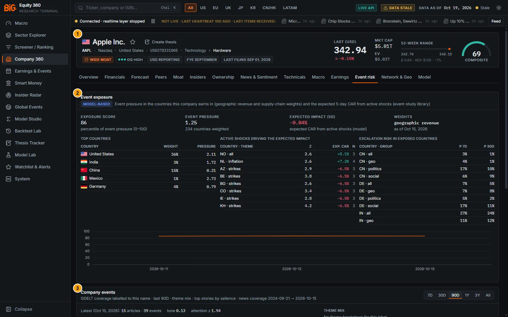

*Figure 5C.8: Event risk tab for Apple (`/company/AAPL?tab=events`), exposure as of 15 Oct 2026.*

| # | Panel | What it shows |
|---|---|---|
| 1 | Company header | See [5A](05a-company-fundamentals.md) |
| 2 | Event exposure | Exposure score, event pressure, expected 5-day impact, weights; top countries, active shocks, escalation risk; exposure score history |
| 3 | Company events | GDELT coverage of the company: articles and tone, theme mix, recent shocks and top stories (Figure 5C.9). The top stories follow the range: up to 30 days the clustered stories of the last 30 days, for longer ranges the top stories of the whole range (earlier builds always showed the last 30 days) |

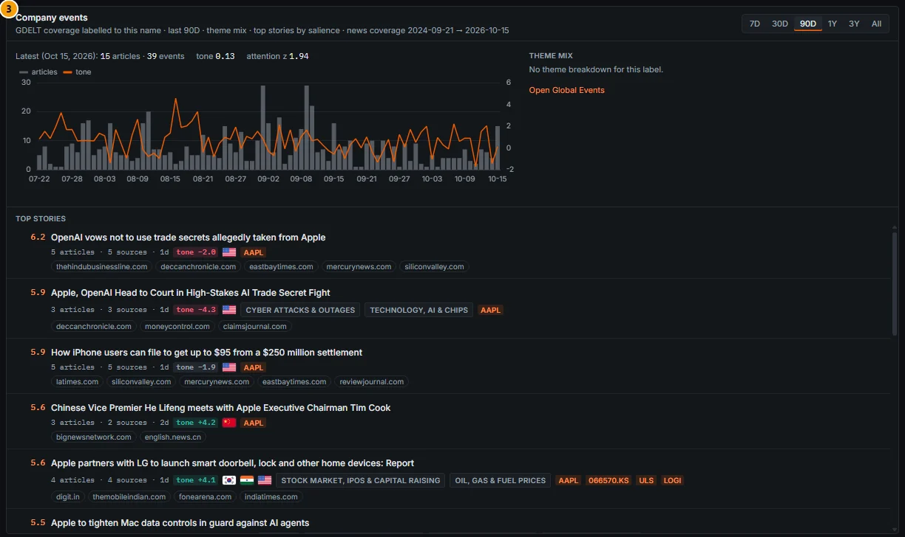

*Figure 5C.9: Company events for Apple: daily articles (bars) and tone (line) over 90 days, and the top stories by salience.*

### Controls

| Control | What it does |
|---|---|
| **Events history range** (7D / 30D / 90D / 1Y / 3Y / All) | Sets the window of the coverage chart and theme mix; ranges over a year are shown weekly. Default 90D |
| Hover on the coverage chart | Daily articles and tone |
| Click a story | Opens the story drawer with its sources, labels and links |
| **Open Global Events** link | Opens the Global Events page (`/events`) |
| Hover on the exposure history | Exposure score by date |

### Methodology

#### Country weights

The company's exposure to each country comes from its **geographic revenue** (the issuer-country exposure weights of the linkage layer; regional segments are spread over member countries by GDP). Without a disclosure, 100% goes to the home country. If the company has disclosed customers, their home countries are added with weight 0.25 × the customer's share (capped at 1), and the weights are re-normalised. The **Weights** tile names the source: "geographic revenue", "home country only", or either "+ supply chain".

#### Event pressure and exposure score

For each country, from the daily GDELT aggregates (all themes) over the last 7 days:

```
pressure_c   = mean(max(attention_z, 0)) + mean(max(−tone_z, 0))
pressure     = Σ_c w_c · pressure_c
exposure score = percentile of the company's pressure across the universe (0-100)
```

`attention_z` is the article / event count against its own history and `tone_z` the average tone against its history, so pressure rises with unusual attention and unusually negative tone. "Top countries" lists the five countries with the largest `w_c × pressure_c`.

#### Expected impact (5d)

An **active shock** is a country (× theme) day in the last 7 days with attention z ≥ 2.5 and at least 20 items, not within 10 days of the previous shock of the same kind. For each active shock the app looks up the **event-study library**: the mean CAR [0,+5] after past shocks of the same kind, trying theme × country × sector, then theme × country, then theme × sector, then theme alone (and the issuer, country-index or sector-ETF level, in that order). The library CAR is shrunk toward zero by `n / (n + 10)` for a cell with `n` past events; concurrent shocks in one country are averaged, not added; and the result is weighted by the country weight:

```
expected impact = Σ_c w_c · mean_shocks( CAR̄_cell · n / (n + 10) )
```

The "Active shocks" table shows each shock's attention z, the **unshrunk** library CAR ("Exp. CAR") and the number of past events `n` in the library cell.

#### Escalation risk

For each country × theme group (all, geo, politics, social, ...) a bivariate discrete-time **Hawkes process** (the country and its neighbours, with a day-of-week background) is fitted by EM. **P 7d / P 30d** is the Monte Carlo probability that the event count over the next 7 / 30 days exceeds the 90th percentile of the country's own historical 7 / 30-day counts. An **explosive** badge appears when the branching ratio (expected offspring per event) is above 1. The table shows the first ten rows for the exposed countries.

#### Company events panel

GDELT articles and events labelled to the issuer (organisation matching at ingest, link confidence ≥ 0.5): daily article counts, mean tone, the latest attention z, the theme mix (top eight themes by share), recent attention or tone shocks, and the top stories. Near-duplicate articles are clustered into **stories**; the salience score shown before each story is

```
salience = ln(1 + articles) + ln(1 + sources) + 0.5 · ln(1 + events) + |tone| / 5 + issuer bonus (0.5 or 1)
```

The top-stories list shows up to 15 stories linked to the company in the **last 30 days**, whatever the range selected above it.

### Data sources and refresh

- **GDELT 2.0** Events, Mentions and GKG, streamed and labelled at ingest (security, sector, country, about 40 market themes); news stories also merge Polygon and RSS items. Jobs `gdelt_*`, `events_agg` and `story_cluster` (nightly).
- **Exposure:** job `event_exposure` (nightly, universe `full`, 7-day window). **Escalation:** `event_escalation` (nightly, 2,000 Monte Carlo paths). **Event-study library:** `event_study_library` (weekly, market-model CARs for windows [0,+1], [0,+5], [−1,+5], [0,+10]).
- **Weights:** geographic revenue and customer links from the linkage layer (see [Network & Geo](#network--geo)).
- **History:** the panel subtitle shows the news coverage actually loaded (2024-09-21 → 2026-10-15 in Figure 5C.9). A deep GDELT backfill is extending history back toward 2015, newest first.

### Validation status

**Not formally validated** as a predictor. The exposure panel carries the badge **MODEL-BASED** ("Event pressure in the countries this company earns in ... and the expected 5-day CAR from active shocks (event-study library)"), and the expected impact is described as "expected CAR from active shocks (model)".

What has been checked, per the plan documents:

- **Labels:** a 60-row spot check of the GDELT pilot found security links correct 82% of the time (49/60), country 84%, theme 68% and sector about 68% (`EVENTS_V2_PLAN.md`, E5).
- **Change-point detector** (used for shocks elsewhere): calibrated to about 0.13 false alarms per 200 days with 97% detection of 1.5 sd shifts (`EVENTS_MODELS_REALTIME_PLAN.md`, C2).
- **Event-study library:** each cell has a standard error and p-value, but many cells have only a handful of events; the shrinkage `n / (n + 10)` is there for that reason.
- **Hawkes escalation probabilities:** no calibration result is recorded.

### Correct usage and worked example

Use the exposure score to rank names by **current** news pressure on their revenue base, then read the top countries and active shocks to see why. Treat the expected impact as a size check: if it is a few basis points, the shocks are either far from the company's revenue or historically weak. Use escalation probabilities to see which exposed countries could get worse, not as a forecast for the stock.

**Worked example: Apple (AAPL), exposure as of 15 Oct 2026 (Figure 5C.8).**

1. **Exposure score 86**: Apple's event pressure (1.25) is higher than that of 86% of the universe. Weights come from **geographic revenue** spread over 234 countries.
2. **Top countries:** the United States (weight 36%, pressure 2.11) drives most of it; India (3%, 1.72) and Mexico (1%, 2.73) are under high pressure but carry little weight; China (15%) is calm (0.21).
3. **Active shocks:** the largest library CARs are Norway, all themes (+8.1%, n 3), the Netherlands, inflation (+7.2%, n 4) and strikes in several countries (−6.5%, n 3). The identical −6.5% on six "strikes" rows shows that the lookup fell back to the theme-level cell. With tiny weights in these countries and shrinkage of 3/13, the **expected impact (5d) is −0.04%**: no meaningful event-driven expectation.
4. **Escalation:** India, all themes, has P 7d 27% and P 30d 24%; China, politics, 17% and 10%.
5. **Company events:** on 15 Oct 2026, 15 articles and 39 events, tone 0.13, attention z 1.94. The top story ("OpenAI vows not to use trade secrets allegedly taken from Apple", salience 6.2, 5 articles from 5 sources, tone −2.0) is company news rather than a country shock.

### Limitations and pitfalls

- **Media attention is not economic impact.** Pressure measures unusual coverage and negative tone in GDELT, which is weighted toward English-language and large-country media.
- **Exposure is only as good as the revenue geography.** Without a geographic disclosure the company is 100% home country; regional segments are spread by GDP, which can put small weights on many countries.
- **Library cells are small.** A CAR from three past events is anecdotal, even after shrinkage. Look at `n` before quoting "Exp. CAR".
- **The library mixes levels.** The fallback can use country-index or sector-ETF reactions, not the company's own.
- **Label errors.** About one in five issuer links in the pilot spot check was wrong; read the stories before drawing conclusions.
- **History is short for some uses.** Coverage starts where the loaded GDELT history starts (see the panel subtitle); exposure history on this tab only has the dates the job has run.

### Related mnemonics and BQL fields

- `EVTS` with a security opens this tab; without a security it opens the Earnings & Events calendar. `TOP` and `N` open top news.
- No BQL field exposes the company event exposure in this snapshot (`sent.*` covers news sentiment).
- Related sections: [8. Global Events](08-global-events-news.md) (escalation, GPR, contagion, event studies); news sentiment in [5A. News & Sentiment](05a-company-fundamentals.md#news--sentiment); the country weights in [Network & Geo](#network--geo).

---

## Network & Geo

**Route:** `/company/:id?tab=network` · **Menu:** Company 360 › Network & Geo · **Mnemonics:** `NET` · **Refresh:** network nightly (`supply_chain_network`); links and geography weekly / monthly

### Purpose

The Network & Geo tab maps the company's disclosed **customers and suppliers**, its **statistical neighbours** (stocks that move with it), and where it **earns its revenue**, with country risk, event and macro overlays. A shock simulator propagates a revenue shock through the supply chain. Use it to find hidden concentration (a single large customer, one dominant country), to see second-order country exposure through customers, and to trace who is hit if a company or country is shocked. Disclosed links come from filings by rules (no LLM); look-through exposure, country risk and shock propagation are **model-based**.

### Screenshot

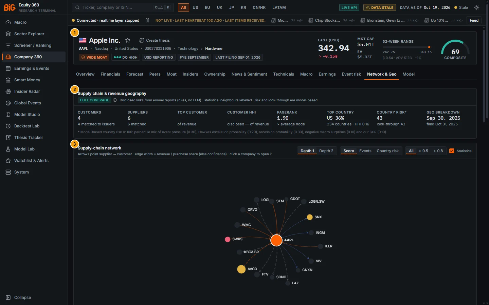

*Figure 5C.10: Network & Geo tab for Apple (`/company/AAPL?tab=network`), network as of 19 Oct 2026.*

| # | Panel | What it shows |
|---|---|---|
| 1 | Company header | See [5A](05a-company-fundamentals.md) |
| 2 | Supply chain & revenue geography | Coverage badge and eight summary tiles (customers, suppliers, concentration, centrality, top country, country risk, geography date) |
| 3 | Supply-chain network | Force-directed graph of disclosed links and statistical neighbours |
| 4 | Relationships & provenance | Customer, supplier or statistical rows with share or correlation, confidence and source (Figure 5C.11) |
| 5 | Revenue geography | World map of revenue exposure or of a country overlay (Figure 5C.12) |
| 6 | Exposure by country | Direct, second-order and look-through shares with risk, events, escalation, hotspot, recession and surprise overlays (Figure 5C.13) |
| 7 | Shock scenario | Revenue-shock propagation over the supply chain, with an optional macro overlay (Figures 5C.14 and 5C.15) |

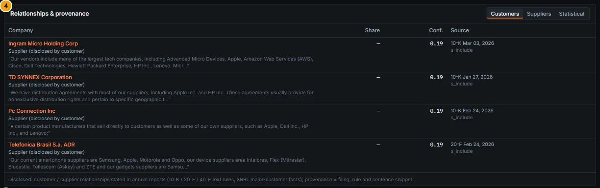

*Figure 5C.11: Relationships & provenance for Apple, Customers view: each row shows the rule, the filing and the matched sentence.*

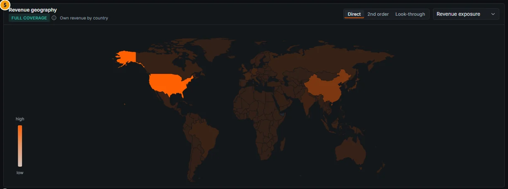

*Figure 5C.12: Revenue geography for Apple, Direct basis, Revenue exposure layer.*

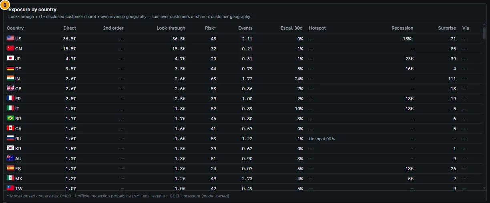

*Figure 5C.13: Exposure by country for Apple. † = official recession probability (NY Fed).*

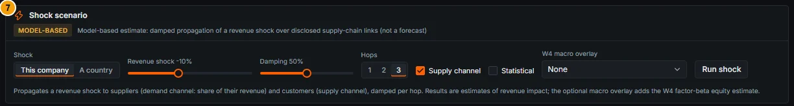

*Figure 5C.14: Shock scenario controls before a run.*

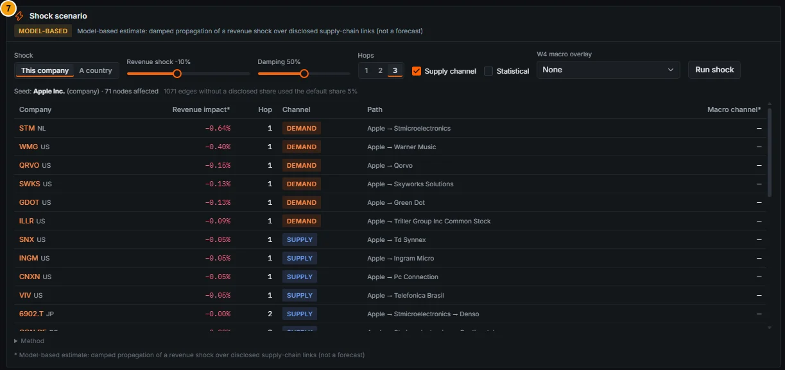

*Figure 5C.15: Shock scenario for Apple after **Run shock** with the defaults (This company, −10%, damping 50%, 3 hops, supply channel on): seed line, result table and the Method fold-out.*

### Controls

| Control | What it does |
|---|---|
| Coverage badge (hover) | Full / Partial / Sparse coverage, with the note and how the geography was obtained |
| **Depth** (Depth 1 / Depth 2) | Shows direct links only, or also the links of the company's counterparties |
| **Colour nodes by** (Score / Events / Country risk) | Colours nodes by composite score (0-100), event pressure or model-based country risk |
| **Minimum confidence** (All / ≥ 0.5 / ≥ 0.8) | Hides links below the confidence threshold |
| **Statistical neighbours** checkbox | Shows or hides the return co-movement layer (dashed). On by default |
| Graph: drag, scroll, hover, click | Drag nodes, zoom and pan; hover a node or edge for details (an edge shows its share, ρ, confidence, filing and sentence); click a listed company to open its Company 360 |
| Legend items (hover) | Explain each edge type |
| **Relation** (Customers / Suppliers / Statistical) | Switches the relationship table; click a company name to open it |
| **Exposure basis** (Direct / 2nd order / Look-through) | Changes the map and sorts the country table |
| **Map layer** select | Revenue exposure, Country risk, Event pressure, Escalation 30d or Recession prob. |
| Hover on a map country | Exposure and every overlay component |
| Hover on "Via" or "Recession" cells | The customers behind second-order exposure; the recession method |
| **Shock** (This company / A country), **Country** select | Chooses the seed of the shock (a country from the company's exposure list) |
| **Revenue shock** slider (−50% to +50%, step 5) | Size of the shock to the seed's revenue. Default −10% |
| **Damping** slider (0-100%, step 10) | Damping per hop. Default 50% |
| **Hops** (1 / 2 / 3) | Number of propagation rounds. Default 3 |
| **Supply channel** checkbox | Also propagates to customers (on by default; the demand channel is always on) |
| **Statistical** checkbox | Adds a one-hop co-movement estimate for statistical neighbours |
| **Home-country-only** checkbox (country shocks) | Also seeds companies without a geographic disclosure, at 100% home country |
| **W4 macro overlay** select | Adds the macro-beta equity estimate of a preset scenario for each affected company |
| **Run shock** button | Runs the propagation on demand; results appear below with a **Method** fold-out |

### Methodology

The definitions below follow `docs/SUPPLY_CHAIN.md`, which states: "Data sources are company filings and our own models. Everything model-based is labelled as such; statistical neighbours are never shown as disclosed relationships."

#### Disclosed links (rules only, no LLM)

Customer and supplier relationships come from annual reports, point-in-time by filing date: the XBRL `MajorCustomers` axis (SEC financial statement data sets), and customer / supplier sentences and customer tables in 10-K, 20-F and 40-F text. Each extraction rule has a prior precision, for example:

| Rule | Example | Prior |
|---|---|---|
| `c_sales_to_pct` | "Sales to Walmart Inc. accounted for 21% of net sales" | 0.95 |
| `c_name_pct` | "Samsung Electronics Co., Ltd. accounted for 11% of total net sales" | 0.90 |
| `c_largest` | "Our largest customer is PACCAR Inc." | 0.75 |
| `c_include` | "Our customers include Ford, General Motors and Stellantis" | 0.55 |
| `s_purchases_pct` | "Purchases from McKesson accounted for 40% of total purchases" | 0.90 |
| `s_sole` | "TSMC is our sole foundry" | 0.80 |
| `s_include` | "Our suppliers include BASF SE, Dow Inc." | 0.55 |

Guards reject competition sentences, combined shares ("A and B accounted for 25%"), names after a geographic preposition and generic names; weak-context matches are kept only when the name resolves exactly to one of our issuers. **Confidence** = rule prior × name-match confidence (0 for an unmatched name, drawn as a grey diamond). A supplier named by its customer becomes the edge supplier → customer ("Supplier (disclosed by customer)"); when both sides disclose the pair the type is "Disclosed by both sides". Each edge keeps its filing, rule and the matched sentence (up to 200 characters). Edges older than two years are flagged **stale** and not used for weights.

| Edge type (legend) | Meaning |
|---|---|
| Customer (disclosed by supplier) | The supplier names this customer in its annual report |
| Supplier (disclosed by customer) | The customer names this supplier in its annual report (reverse edge) |
| Disclosed by both sides | Named by the supplier and by the customer |
| Statistical neighbour (dashed) | Weekly return co-movement, not a disclosed relationship |

#### Statistical neighbours

Weekly log returns over 104 weeks (at least 52 common weeks), top ten per issuer: Pearson correlation ≥ 0.5 (`return_corr`), or the partial correlation after removing the region's equal-weight market return, ≥ 0.3. In the docs' words: "These are co-movements, not relationships."

#### Revenue geography

`company_geo_revenue` combines tagged geographic segments in SEC XBRL (US filers and 20-F / 40-F filers), IFRS geographic-axis facts from ESEF and other national filings, and rule-based parsing of ESEF segment-note tables (FY2022 onwards; confidence 0.8 when the table total reconciles within 3%, else 0.7). Regions and rest-of-world are spread over member countries by GDP. **Without a breakdown, 100% goes to the home country (flagged "home").** Japanese, Korean and Chinese filers are covered only where they file with the SEC.

#### Exposure bases

With `s_c` the disclosed revenue share of customer `c`:

```
Direct          = latest annual breakdown known at the as-of date
2nd order       = Σ_c s_c · direct_c            (sums to the disclosed customer share)
Look-through    = (1 − Σ_c s_c) · Direct + 2nd order        (sums to 1)
```

Only resolved customers with a disclosed share count for second-order exposure. Sector exposure via customers is computed the same way and shown in an extra panel when more than one sector results.

#### Summary metrics

| Tile | Definition |
|---|---|
| Customers / Suppliers | Number of disclosed counterparties, and how many are matched to listed issuers |
| Top customer | Largest disclosed customer share of revenue |
| Customer HHI | `Σ s_c²` over disclosed shares: a **lower bound**, because the undisclosed remainder is treated as diversified |
| PageRank | PageRank on the supplier → customer graph (α 0.85, weighted by confidence), × the average node |
| Top country | Largest country share, with the number of countries and the geographic HHI |
| Country risk* | Revenue-weighted model-based country risk, on direct and look-through weights |
| Geo breakdown | Period end of the geographic breakdown and its filing date, or "home only" |

#### Country risk (model-based)

Each component is a percentile across countries, combined with these weights: event pressure 0.30, Hawkes P(escalation 30d) 0.20, recession probability 0.30 (NY Fed official where available, else our yield-curve probit, else HMM; the euro-area value for members without one), negative macro surprises 0.10 and our geopolitical-risk index 0.10. Missing components are re-weighted, and the score is shrunk toward 50 by the covered weight: `50 + (raw − 50) × covered`. The "Hotspot" column shows Getis-Ord Gi* classes (hot or cold spot at 90 / 95 / 99%) from the Global Events models.

#### Shock propagation (model-based)

The shock is a fractional **revenue** change (−0.10 = −10%). Transmission from node j to node i:

- **Demand channel (upstream):** supplier j of customer c moves by `s_rev(j, c) × x_c`, where `s_rev` is the share of j's revenue that comes from c.
- **Supply channel (downstream):** customer c of supplier j moves by `γ × s_pur(j, c) × x_j`, with γ = 0.5 (partly substituted or buffered).
- Links without a disclosed share use a default share of 0.05 (flagged "assumed"); link confidence multiplies the transmission.
- **Hops:** `x(h) = δ^(h−1) · M^h · x(0)`, damping δ (default 0.5), total `x(0) + Σ x(h)` for up to three hops; each node is clipped to |seed|, so there is no amplification.
- **Country shock** of size m on country K: each company's seed is m × its direct revenue share in K (only companies with a geographic disclosure, unless Home-country-only is ticked).
- **Statistical channel:** one hop, `ρ × δ × seed`, reported separately "Statistical co-movement (not causal)".
- **Macro channel (W4 overlay):** the equity-return estimate of the chosen preset from each company's macro betas, shown next to the revenue estimate and never added to it (the units differ).

The result table lists Company, Revenue impact*, Hop, Channel (demand / supply), Path (the strongest predecessor at the first hop reached) and Macro channel*.

### Data sources and refresh

- **Filings:** SEC 10-K / 20-F / 40-F text and XBRL (EDGAR, financial statement data sets), ESEF and other national filings. Jobs `linkage_text_units` (weekly), `linkage_links` and `linkage_georev` (monthly), `linkage_esef_geo` (monthly).
- **Prices:** weekly returns for statistical neighbours, job `supply_chain_neighbours` (weekly).
- **Overlays:** GDELT event pressure and Hawkes escalation, recession probabilities (NY Fed, our models), surprise indices, our GPR index.
- **Network, metrics, exposure and country risk:** job `supply_chain_network` (nightly). Under the default weekly profile, it runs in the Saturday refresh.
- **Shock scenario:** computed on demand when you click **Run shock**; nothing is saved.

### Validation status

**Not formally validated.** There is no gate for link extraction, look-through exposure, country risk or shock propagation.

- The panel subtitle reads "Disclosed links from annual reports (rules, no LLM) · statistical neighbours labelled · risk and look-through are model-based".
- Country risk is labelled "Model-based country risk 0-100" with its weights; the shock panel carries the badge **MODEL-BASED** and the label "Model-based estimate: damped propagation of a revenue shock over disclosed supply-chain links (not a forecast)".
- The rule priors (0.55-0.95) are prior precisions assigned per rule, not measured accuracy.
- Statistical neighbours are labelled "NOT disclosed relationships".

### Correct usage and worked example

Start with the **coverage badge**. With Full coverage, read the concentration tiles and the relationship table (open the sentence snippets: they are the evidence). With Sparse coverage, treat the tab as a home-country view plus a co-movement list. Use **Look-through** to see where your revenue really ends up when big customers are disclosed with shares, and the **shock** to rank second-round victims, not to forecast revenue.

**Worked example: Apple (AAPL), 19 Oct 2026 (Figures 5C.10 to 5C.13).**

1. **Coverage: Full.** Geography from tagged XBRL segment facts for the fiscal year ending 30 Sep 2025, filed 31 Oct 2025. Top country US 36% of 234 countries (HHI 0.16); country risk 43 on both bases; PageRank 1.90× the average node.
2. **Suppliers 6** (companies that name Apple as a customer). STMicroelectronics' 20-F states that Apple was **17.7% of its revenue** (rule `c_name_pct`, confidence 0.36) and Warner Music Group's 10-K gives 11%. Qorvo, Skyworks and Green Dot call Apple their largest customer. Broadcom's 10-K for fiscal 2023 gave 20% (rule `c_sales_to_pct`, confidence 0.38), but that filing is more than two years old, so the edge is **stale** (dashed) and excluded from weights and from the shock.
3. **Customers 4** (companies that name Apple among their suppliers): Ingram Micro, TD SYNNEX, PC Connection and Telefônica Brasil, all by the list rule `s_include` (confidence 0.19). None discloses a share, so the "Top customer" and "Customer HHI" tiles are empty and the **2nd-order column is empty: look-through equals direct**.
4. **Exposure by country:** US 36.5% (risk 45, recession 13%† from the NY Fed), China 15.5% (risk 32, surprise index −85), Japan 4.7%, Germany 3.5%, India 2.6% (risk 63, escalation 24% in 30 days).
5. **Statistical neighbours:** Logitech (ρ 0.56), Sonos (0.53), Fortive (0.51) and others: co-movement, not trade.
6. **Shock (Figure 5C.15):** with the defaults (Apple's revenue −10%, damping 50%, 3 hops), the seed line reads "Apple Inc. (company) · 71 nodes affected", with the note that 1,071 edges without a disclosed share used the default share of 5%. The largest hits are first-hop suppliers on the **demand** channel: STMicroelectronics −0.64% (−10% × 0.177 share × 0.36 confidence) and Warner Music −0.40%. Qorvo (−0.15%), Skyworks and Green Dot (−0.13% each) and Triller (−0.09%) have no disclosed share, so they use the assumed 5%. The four distributors (TD SYNNEX, Ingram Micro, PC Connection, Telefônica Brasil) are hit on the **supply** channel at −0.05% each (γ 0.5 × 5% × 0.19). Second-hop effects, such as Denso via STMicroelectronics, round to −0.00%. Broadcom does not appear because its edge is stale. The Macro channel column shows "—" because no W4 overlay was selected.

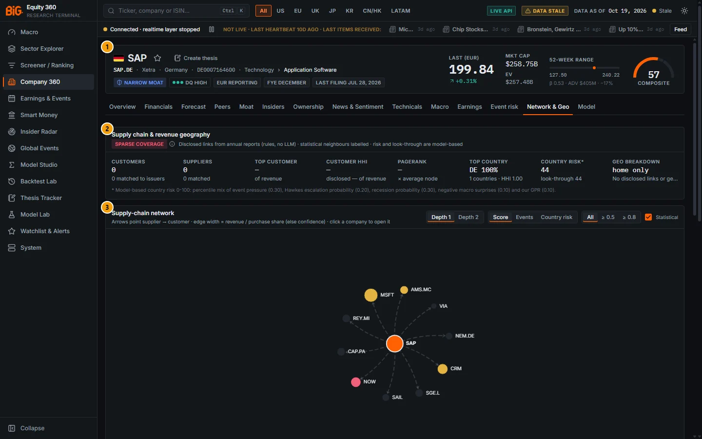

*Figure 5C.16: Network & Geo tab for SAP (`/company/SAP.DE?tab=network`). The callouts are the same as in Figure 5C.10.*

**Second example: SAP (SAP.DE).** Coverage is **Sparse**: "No disclosed links or geographic revenue: home country and statistical neighbours only". The tiles show 0 customers, 0 suppliers, Germany 100% (geo breakdown "home only") and country risk 44. The graph contains only the ten statistical neighbours, led by Nemetschek (ρ 0.68), Sage Group (0.63) and Microsoft (0.63). SAP's worldwide revenue base is not reflected here, so its event exposure and country risk are those of Germany alone.

### Limitations and pitfalls

- **Coverage is uneven.** Disclosure-based links are mostly US 10-K / 20-F filers; European geography needs tagged ESEF facts or a parsable segment table (FY2022+). Many large non-US companies (SAP, Petrobras) fall back to home country 100%.
- **Disclosed shares are rare.** Only "10% customer" style disclosures give shares; list mentions ("our customers include ...") have no share and low confidence. Second-order and look-through exposure only move when shares exist.
- **HHI is a lower bound** and the "Top customer" tile only covers disclosed customers.
- **Statistical neighbours are not suppliers or customers.** A correlation of 0.6 can come from a common factor (Apple and Lazard, for instance).
- **Name matching errors.** Unmatched counterparties (diamonds) cannot be opened; a fuzzy match can be wrong. Read the snippet.
- **Shock results are first-order revenue arithmetic,** not price forecasts. Default shares (0.05) for links without a share can dominate small results.
- **Staleness.** Links more than two years old are dashed ("stale") and excluded from weights; the geography date is the latest annual report known.

### Related mnemonics and BQL fields

- `NET` with a security opens this tab; without a security it opens contagion & spillovers in Global Events.
- No BQL field exposes the supply-chain metrics in this snapshot.
- Related sections: watchlist exposure map in [13. Watchlists and alerts](13-watchlists-alerts.md); escalation, hotspots and GPR in [8. Global Events](08-global-events-news.md); the W4 macro scenarios in [2B. Markets and cross-asset](02b-markets-cross-asset.md); the event exposure that uses the same weights in [Event risk](#event-risk).

---

## Model

**Route:** `/company/:id?tab=model` · **Menu:** Company 360 › Model · **Mnemonics:** none for this tab (`MDL` opens Model Lab) · **Refresh:** predictions nightly (`ml_predict`); retraining weekly (`ml_train_xgb`, `ml_ensemble`)

### Purpose

The Model tab shows where the cross-sectional machine-learning ranker places the stock: its predicted percentile of 3-month (63-day) excess return, the expected excess return of that percentile, a heuristic confidence, and the features that pushed the score up or down (SHAP). Use it as **one input** among the scores, valuation and technicals. The production model's out-of-sample rank-IC is about **0.035**: a real but small edge on average across hundreds of names, and not proven alpha for any single stock.

### Screenshot

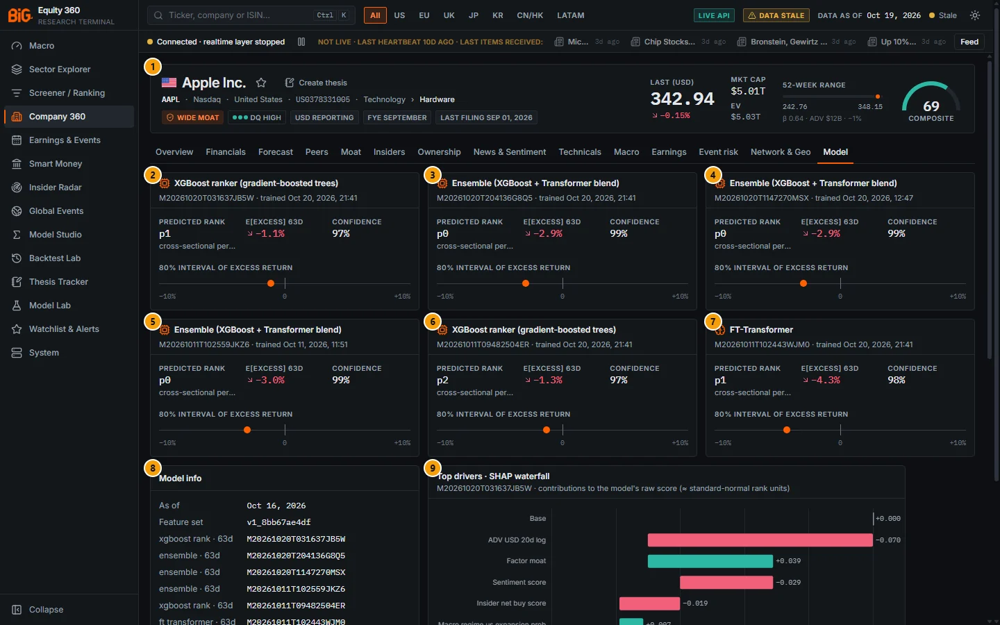

*Figure 5C.17: Model tab for Apple (`/company/AAPL?tab=model`), predictions as of 16 Oct 2026.*

| # | Panel | What it shows |
|---|---|---|
| 1 | Company header | See [5A](05a-company-fundamentals.md) |
| 2 | XGBoost ranker (gradient-boosted trees), run M20261020T031637JB5W | The **production** model: predicted rank, E[excess] 63d, confidence, 80% interval bar |
| 3 | Ensemble (XGBoost + Transformer blend), run M20261020T204136G8Q5 | Comparison model, not production (see Validation status) |
| 4 | Ensemble, run M20261020T1147270MSX | Earlier ensemble run, comparison only |
| 5 | Ensemble, run M20261011T102559JKZ6 | Earlier ensemble run, comparison only |
| 6 | XGBoost ranker, run M20261011T09482504ER | Previous XGBoost run, comparison only |
| 7 | FT-Transformer, run M20261011T102443WJM0 | Demoted Transformer, comparison only |
| 8 | Model info | Prediction date, feature set, run id per model, target, validation scheme, agreement badges |
| 9 | Top drivers · SHAP waterfall | Top ten feature contributions of the production model, in model-score units |
| 10 | Predicted rank history | Weekly predicted percentile of the production model (below the fold, Figure 5C.18) |

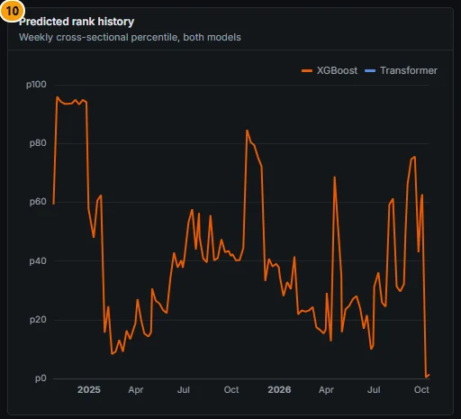

*Figure 5C.18: Predicted rank history of the production model for Apple (weekly percentile).*

### Controls

| Control | What it does |
|---|---|
| Hover on a SHAP bar | Feature, SHAP contribution, feature value and feature family; on the last bar, the sum of the top contributions |
| Hover on the rank-history chart | Date and predicted percentile |
| Header ADR banner, "See home listing" | On an ADR page (for example TM), links to the home listing (7203.T), where scores, technicals and the model live |

The tab has no inputs of its own. Model Lab ([10. Model Lab](10-model-lab.md)) has the run-level metrics, folds and feature importance.

### Methodology

#### Target and features

- **Label:** the forward return from the close of the first trading day after the prediction date to h trading days later on the stock's own calendar (21 / 63 / 126 days for 1M / 3M / 6M), **minus the equal-weighted mean forward return of its sector and region** in the training universe. The model learns the cross-sectional rank of that excess return on each date.
- **Features:** point-in-time factor scores (quality, value, moat, profitability, ...), price, volatility and liquidity features, insider and sentiment scores, and macro regime probabilities, on a weekly and month-end grid (feature set `v1_8bb67ae4df` in Figure 5C.17).
- **Universe:** trained on the `mvp_us` and `mvp_global` universes.

The Model info panel describes the target as "63-day forward return in excess of the sector × region mean (fwd_excess_sector), cross-sectionally ranked", matching the training code (earlier builds read "vs regional benchmark").

#### Models

- **XGBoost ranker** (production for 1M, 3M and 6M): gradient-boosted trees on the rank label, with TreeSHAP explanations.
- **FT-Transformer:** a feature-tokenised Transformer. Demoted (see Validation status).
- **Ensemble:** the average of the XGBoost and Transformer percentiles.

**Validation scheme:** expanding walk-forward folds (24-month test blocks) with a **purge** equal to the label horizon plus a 10-day **embargo** between training and test, and point-in-time features. A label-permutation leakage test is required before any non-XGBoost model may become production.

#### What each card shows

The tab shows the **3M (63-day)** horizon: the production model first, then the other runs that have predictions for the stock.

| Item | Definition |
|---|---|
| Predicted rank | Cross-sectional percentile of the model score on the prediction date (p0 = lowest predicted excess return) |
| E[excess] 63d | Mean out-of-sample excess return of the prediction's decile for that run |
| Confidence | `clip(t_rankIC / 3, 0, 1) × abs(2 · rank − 1)`: the run's rank-IC t-statistic (capped) times how far the rank is from the median. A heuristic, **not a probability** |
| 80% interval of excess return | 10th to 90th percentile of the decile's out-of-sample returns, drawn on a −10% to +10% axis; the dot is E[excess] |
| Agreement badge | "high" when the first two cards are within 15 percentile points; the gap badge shows the difference |

#### SHAP waterfall

Contributions come from TreeSHAP on the production XGBoost run and are in **model-score units** ("contributions to the model's raw score (≈ standard-normal rank units)"): positive values push the stock up the ranking. The chart starts from a base of 0 and adds the ten largest contributions; the last bar ("Score") is **the sum of those ten**, not the model's full score.

#### Rank history

The chart plots the weekly predicted percentile of the **production** model only, under its family name (XGBoost here). The Transformer line stays empty when the production model is XGBoost.

### Data sources and refresh

- **Features:** job `ml_features` (nightly) from the serving snapshot (scores, prices, insider, sentiment, macro regimes).
- **Predictions:** job `ml_predict` (nightly) re-scores the latest feature date with the latest completed run of each model type, so several runs appear side by side.
- **Training:** `ml_labels`, `ml_train_xgb` and `ml_ensemble` weekly; `ml_train_transformer` is manual. The cards show each run's training time.
- Under the default weekly profile, these run in the Saturday refresh. The prediction date (16 Oct 2026 for AAPL) can trail the data date.

### Validation status

> **Model-based:** out-of-sample rank-IC about 0.035 (XGBoost). Treat the ML score as one input, not proven alpha.

- **Production XGBoost runs of 20 Oct 2026** (Model Lab, walk-forward out-of-sample): 3M rank-IC mean 0.0349 (t 12.2, hit rate 68%), 1M 0.0352 (t 11.7); 6M 0.021. The 3M long-short decile spread is 12.0% annualised (Sharpe 1.18), before trading costs. These are averages across the universe; an IC of 0.035 explains very little of any one stock's return.
- **Transformer: failed.** "The 3M FT-Transformer FAILS the label-permutation test (IC +0.06–0.09 on shuffled labels ...). Demoted. XGBoost (passes) is production for 1M/3M/6M" (`docs/PHASE3_TODO.md`). No Transformer or ensemble run is recorded as passing the test, so none can be promoted.
- **Ensemble and Transformer metrics are not credible.** Their Model Lab rank-ICs (0.10-0.14, hit rates above 90%) are consistent with the leakage found in the Transformer, which the ensemble averages in. Their cards carry a red **DEMOTED · failed leakage test** badge, are dimmed, and show "not credible" in place of the confidence; the production XGBoost card carries a green **production** badge.
- **Survivorship bias.** Before 2026-10-10 the training labels and back-tests use **today's company list** applied retroactively, and names that delisted before ingestion are missing. This flatters the historical metrics.

### Correct usage and worked example

Read the card with the **production** badge (XGBoost) and ignore the demoted cards. Use the predicted rank together with the composite score and valuation: a low rank is a reason to look for what the model sees (in the SHAP drivers), not a sell signal. Check the rank history: a percentile that jumps week to week carries little information.

**Worked example: Apple (AAPL), predictions as of 16 Oct 2026 (Figure 5C.17).**

1. **Production XGBoost (3M):** predicted rank **p1** (1.4th percentile), E[excess] 63d **−1.1%**, confidence 97%. The 97% only says that the rank is extreme and the model's IC is statistically significant; it is not a 97% chance of underperforming.
2. **Interval:** in this snapshot the decile's interval has no width; the card now says "80% interval of excess return · not available (zero width in this snapshot)" and draws only the dot. This is not certainty.
3. **SHAP drivers:** ADV USD 20d log −0.070 (Apple's very high liquidity pushes it down the ranking), Factor moat +0.039, Sentiment score −0.029, Insider net buy score −0.019, then smaller macro-regime, profitability, volatility and momentum terms. The ten contributions sum to −0.083.
4. **Rank history:** the 3M percentile was p63 on 2 Oct, p0.4 on 9 Oct and p1 on 16 Oct 2026. Moves this large in two weeks are a reason for caution.
5. The other cards (ensembles at p0, FT-Transformer at p1, E[excess] −2.9% to −4.3%, "confidence" 98-99%) agree in direction but rest on models that failed or never passed the leakage test.

For an ADR such as Toyota's TM, the header banner reads "Composite, technicals and fair value are computed on the home listing by design" with a link to 7203.T; use the home listing's Model tab, where the model has predictions (Toyota 7203.T: production rank p25, E[excess] −0.8% on 16 Oct 2026).

### Limitations and pitfalls

- **Small edge.** A rank-IC of 0.035 is useful in a diversified portfolio of many names, not for a single-stock call.
- **Survivorship.** Back-tests before 2026-10-10 are survivorship-biased and look better than reality.
- **Only the 3M horizon is shown.** 1M and 6M predictions exist (BQL fields below, Model Lab) but are not on this tab.
- **Confidence is a heuristic.** It rises with the extremity of the rank; it is not calibrated.
- **E[excess] is a decile average** from the run's own out-of-sample history, not a stock-specific forecast.
- **SHAP is in score units**, not in percent of return, and the waterfall's last bar is the sum of the top ten contributions only.
- **Feature values are not shown** ("—" in the tooltip) in this snapshot.
- **ADRs.** ADR pages do not carry their own model output: the tab shows "No model output for this listing" (earlier builds failed to render); follow the header link to the home listing.
- **Coverage.** Securities outside the training universes may have no prediction.

### Related mnemonics and BQL fields

- `MDL` opens Model Lab (model registry and monitoring).
- BQL (production model, snapshot only, model-based): `ml.rank_pct_1m`, `ml.rank_pct_3m`, `ml.rank_pct_6m`, `ml.decile_*` (10 = best), `ml.score_*` and `ml.exp_excess_*` (OOS decile mean).
- Alerts: the `model_decile` rule type in [13. Watchlists and alerts](13-watchlists-alerts.md).
- Related sections: [10. Model Lab](10-model-lab.md), [9. Model Studio](09-model-studio.md), [11. Backtest Lab](11-backtest-lab.md), the composite score in [5A. Overview](05a-company-fundamentals.md), and the model gate summary in [16. Methodology](16-methodology.md).
