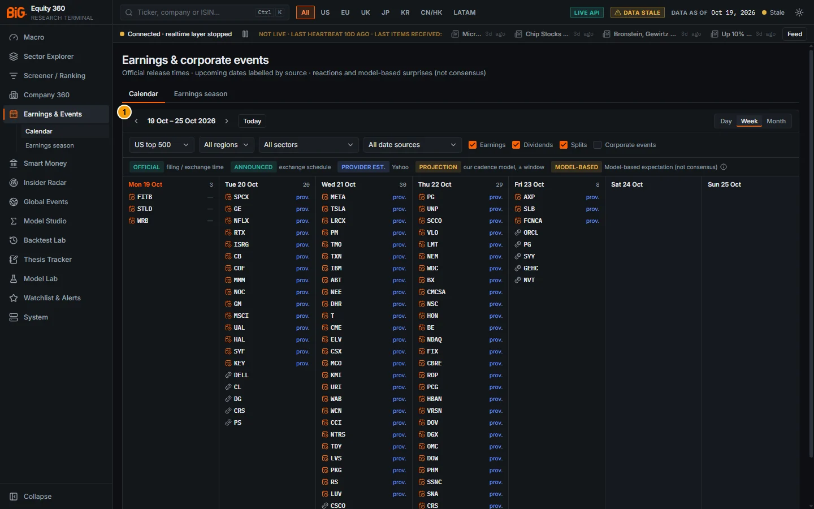
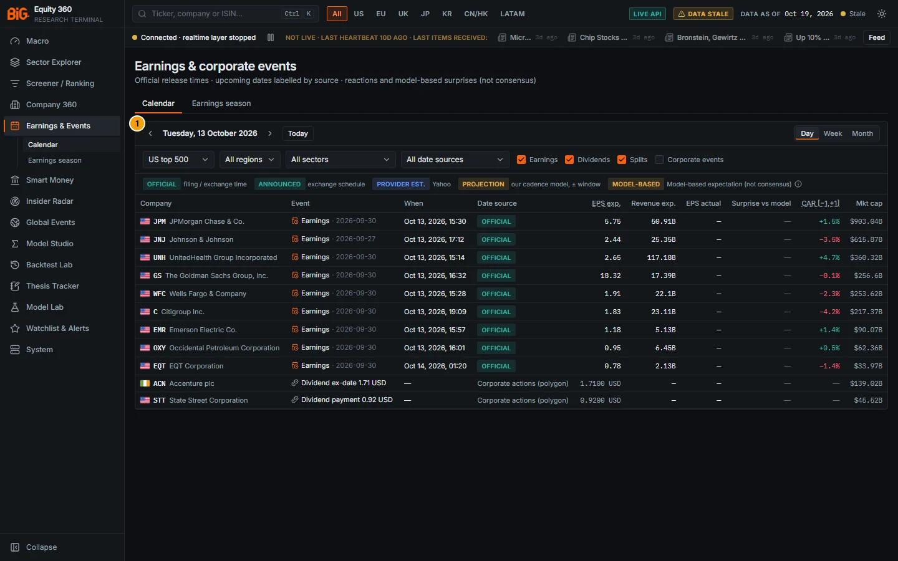
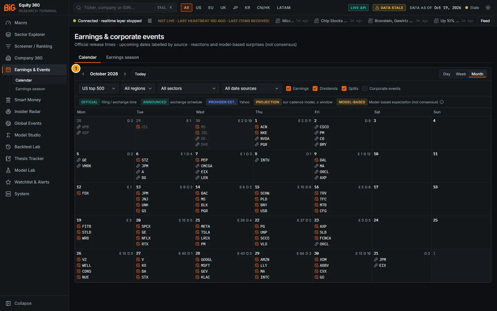
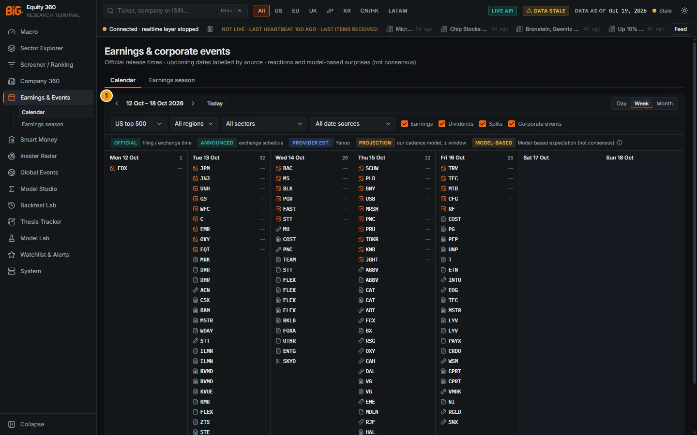
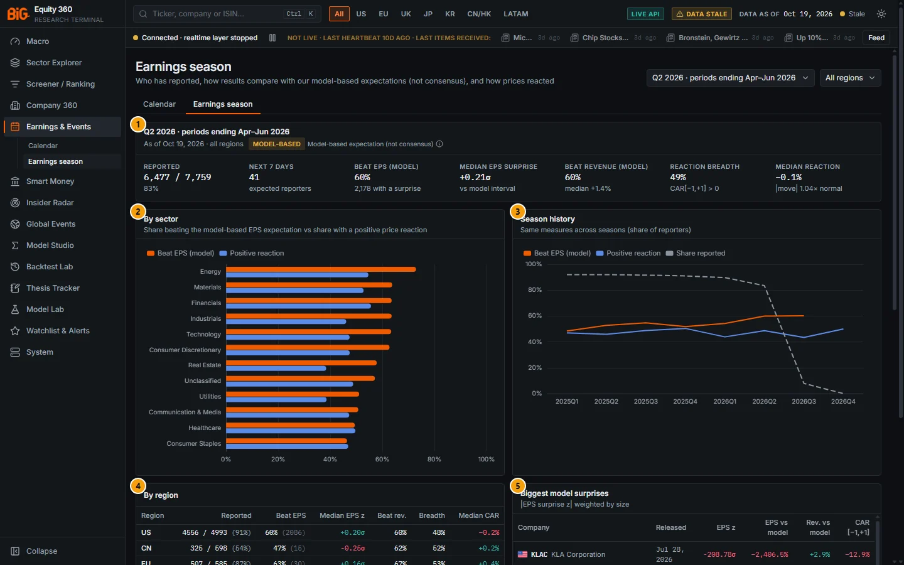
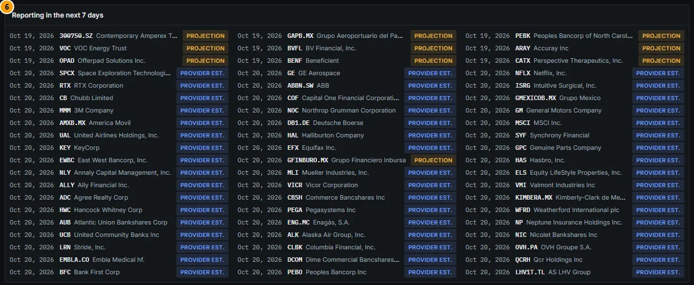

# 6. Earnings and events calendar

This chapter covers the two pages under **Earnings & Events** in the menu: the calendar of earnings releases and corporate events, and the earnings-season dashboard. Both pages use the same data. Release dates and times come from official filings where they exist, and every date shows its source. Revenue and EPS expectations are **model-based, not analyst consensus**: the app has no consensus feed.

For one company's earnings history (past reactions, expectation versus actual, the next date and the post-earnings drift signal), use the Company 360 [Earnings](05c-company-macro-events-model.md#earnings) tab. Every company link on these two pages opens that tab.

---

## Earnings & Events calendar

**Route:** `/earnings` · **Menu:** Earnings & Events › Calendar · **Mnemonics:** `EVTS` (with no security loaded; with a security loaded, `EVTS` opens its Event risk tab) · **Refresh:** nightly jobs `earnings_dates_fetch`, `earnings_events`, `earnings_reactions`, `earnings_expectations`, `earnings_signals`, run under the active schedule profile (weekly by default, daily as an option)

### Purpose

The calendar shows what is reported or happening, when, and where each date comes from. It lists earnings releases (upcoming and already released), dividends, splits and other corporate events (SEC 8-K items, AGMs, buybacks, guidance revisions) in a day, week or month grid. Analysts use it to plan the reporting week, to check whether a holding reports before a decision date, and to see at a glance which releases surprised our model and how the price reacted.

### Screenshot



*Figure 6.1: Earnings & corporate events calendar (`/earnings`), week view of 19–25 Oct 2026, US top 500, data as of 19 Oct 2026.*

| # | Panel | What it shows |
|---|---|---|
| 1 | Calendar (19 Oct – 25 Oct 2026) | The whole calendar panel: date navigation and view switch, the filter bar, the date-source legend and the grid of events (here the week view). |

What the figure shows:

- **Mon 19 Oct** is highlighted because it is the data as-of date. FITB, STLD and WRB had released, and they show a dash because no model surprise exists yet.
- From Tue 20 Oct onwards, US releases carry a blue **prov.** tag: the date is a Yahoo provider estimate.
- The items with a coin icon (DELL, CL, DG and others) are dividend events.
- Saturday and Sunday are shaded.

**Day view.** The day view replaces the grid with a table of every event that day.



*Figure 6.2: Day view (`/earnings?view=day&date=2026-10-13`), Tuesday 13 Oct 2026, US top 500, data as of 19 Oct 2026.*

| # | Panel | What it shows |
|---|---|---|
| 1 | Calendar (Tuesday, 13 October 2026) | The day table: nine bank and industrial releases with **OFFICIAL** badges (SEC 8-K Item 2.02 acceptance times), their model-based EPS and revenue expectations and CAR [−1,+1], followed by two dividend rows (Accenture ex-date 1.71 USD, State Street payment 0.92 USD). EPS actual and Surprise vs model are still empty: the 10-Q actuals had not arrived. |

In the table, the dividend rows show the dividend amount in the EPS exp. column and the source "Corporate actions (polygon)" as their date source. Timestamps in the **When** column are shown in your computer's time zone. In the figure, JPM's 8-K acceptance at 14:30 UTC appears as 15:30.

**Month view.** The month view shows one cell per day with event counts.



*Figure 6.3: Month view (`/earnings?view=month&date=2026-10-01`), October 2026, US top 500.*

| # | Panel | What it shows |
|---|---|---|
| 1 | Calendar (October 2026) | Month grid, Monday to Sunday. Each cell shows the day number, the counts **E** (earnings) and **D** (dividends) and the first four tickers. Days outside the month (28–30 Sep, 1 Nov) are dimmed. The heaviest days are Wed 28 Oct (E 40, D 5) and Thu 29 Oct (E 64, D 3). |

**Corporate events.** Ticking the Corporate events checkbox adds SEC 8-K items and other corporate events to the grid.



*Figure 6.4: Week of 12–18 Oct 2026 with all four event types ticked (`/earnings?types=earnings,dividend,split,corporate&date=2026-10-12`), US top 500.*

| # | Panel | What it shows |
|---|---|---|
| 1 | Calendar (12 Oct – 18 Oct 2026) | Earnings (calendar icon, listed first) followed by corporate events with a document icon. Examples are 8-K items such as MRK and DHR (5.02 executive change, 8.01 other material event). Dividends have a coin icon; the SKYD 2:1 split on Wed 14 Oct has a scissors icon. Day counts rise to 32 on Tue 13 and Thu 15 Oct. A company can appear several times when it filed several 8-K items. |

### Controls

Every control writes its value into the page URL (`view`, `date`, `universe`, `region`, `sector`, `src`, `types`), so a filtered view can be bookmarked or sent to a colleague.

| Control | What it does |
|---|---|
| Section tabs **Calendar** / **Earnings season** | Switch between this page and the [Earnings season](#earnings-season) dashboard. |
| **‹** / **›** (Previous / Next) | Move back or forward by one day (skipping weekends), one week or one month, depending on the view. |
| **Today** | Returns to the current date (the browser's date, not the data as-of date). |
| **Day / Week / Month** | Calendar view. Week is the default. |
| **Universe** select | US top 500 (default), Global MVP, Europe broad, Full universe, or **My watchlist** (the companies starred on Company 360). With an empty watchlist the page shows "Your watchlist is empty". |
| **Region** select | All regions, US, EU, UK, JP, KR, CN, HK, LATAM, APAC, CA. |
| **Sector** select | All sectors or one of the 11 sectors (Consumer Discretionary … Utilities). |
| **Date source** select | All date sources; Official (released); Company-announced; Provider (Yahoo); Model-based projection. Applies to earnings items only. |
| **Earnings / Dividends / Splits / Corporate events** checkboxes | Event types shown. The first three are ticked by default. Corporate events (8-K items, AGMs, buybacks and others) is off by default. Unticking all four leaves Earnings on. |
| Legend row | Explains the date-source badges: **OFFICIAL** filing / exchange time, **ANNOUNCED** exchange schedule, **PROVIDER EST.** Yahoo, **PROJECTION** our cadence model, ± window, and the **MODEL-BASED** tag (hover: how the expectations are built). |
| Day header (week view) | Shows the number of events that day. Click it to open the day view. Each day lists up to 30 events (earnings first, then by market cap); **+N more** opens the day view. |
| Event chip (week view) | Hover for the company name, event, session, date source with its window, the EPS model expectation with its 80% interval, the surprise versus the model, and the dividend amount. Click the ticker to open Company 360 › Earnings. |
| Chip tags | **prov.** (blue) = provider-estimated date; **proj.** (amber) = model-based projected date; a signed % on released items = EPS surprise versus the model; a dash = released, no surprise yet. |
| Month cell | Day number, counts **E n** (earnings) and **D n** (dividends), the first four tickers. Click a cell to open the day view. |
| Day table | Columns Company, Event, When, Date source, EPS exp., Revenue exp., EPS actual, Surprise vs model, CAR [−1,+1], Mkt cap. Hover **EPS exp.** for "Model-based expectation (not consensus), 80% interval" and a value for its interval. Hover **CAR [−1,+1]** for "Cumulative abnormal return over days -1..+1 (market model vs country index)". |
| Date-source badge (day table) | Hover for the full label and, for projections, the plausible window (for example "Plausible window 2026-10-09 → 2026-10-29"). An amber **awaiting** badge means the projected or provider date has passed but the release is not in the data yet. |
| Truncation banner | "Showing the first N of M events — narrow the filters." appears when the API caps the list (3,000 items per request). |

**Date-source badges.** Earnings dates carry one of six badges:

| Badge | Meaning (tooltip text) | Used for |
|---|---|---|
| **Official** | Official earnings release (filing / exchange disclosure time) | Released: SEC 8-K Item 2.02 acceptance time, TDnet kessan tanshin, HKEX results announcement |
| **Filing** | Official periodic report filing (may lag the first public release) | Released, when only the 10-Q / 10-K / 20-F or national report is known |
| **Provider** | Provider date (Yahoo) | Released, dated by Yahoo only |
| **Announced** | Company-announced (exchange schedule) | Upcoming, from the JPX schedule |
| **Provider est.** | Provider estimate (Yahoo) | Upcoming, Yahoo date |
| **Projection** | Model-based projection (reporting cadence) | Upcoming, our own estimate with a ± window |

The **When** column shows the exact timestamp when one exists (official release time), otherwise the session: Before open, During session, After close or Time n/a.

**Corporate events.** The calendar groups non-earnings items as follows:

| Group (checkbox) | Event types | Source |
|---|---|---|
| Dividends | Dividend ex-date, dividend payment, special dividend, stock dividend (amount and currency shown) | Corporate actions feed (labelled, e.g. "Corporate actions (polygon)") |
| Splits | Split (ratio, e.g. "Split 2.0:1"), spin-off, rights issue | Corporate actions feed |
| Corporate events | 8-K Item 1.01 material definitive agreement; 2.01 acquisition / disposition completed; 2.03 direct financial obligation; 3.02 unregistered equity sale; 5.02 executive / director change; 5.07 shareholder vote results; 8.01 other material event; DEF 14A proxy / AGM notice | SEC EDGAR, labelled "SEC 8-K Item x.xx (acceptance time)" |
| Corporate events | Share buyback, guidance revision | TDnet disclosures (Japan) |
| Corporate events | AGM results, share buyback, board meeting, general meeting | HKEXnews announcements (Hong Kong) |

### Methodology

**Release dates and periods.** The job `earnings_events` builds one row per issuer and fiscal period:

- For each period, the release is the earliest official release (SEC 8-K Item 2.02 acceptance time, TDnet tanshin, HKEX results). If there is none, it is the provider date. If there is neither, it is the periodic report filing.
- A dated release is assigned to the latest known fiscal period end *P* with 4 ≤ *D* − *P* ≤ 100 days (130 days outside the US). Otherwise *P* is extrapolated from the issuer's reporting cadence and flagged as inferred.
- The session is classified against the listing's local regular trading hours. It can be pre-market, intraday or post-market, or unknown when no time exists.

**Upcoming dates: precedence.** For the next periods, the date with the highest precedence wins:

1. A company-announced date (JPX schedule) is labelled **Announced**.
2. Otherwise a Yahoo date mapped to the same period is labelled **Provider est.**
3. Otherwise our **model-based projection** from the reporting cadence:

```
expected date = same-period release a year earlier + 364 days   (keeps the weekday)
                or period end + median lag of the last 4 releases (if no prior-year release,
                or if the year-earlier rule is > 30 days off the median lag)
window        = ± max(3, 1.5 × MAD of the last 8 lags) days, capped at 21 days
```

**Model-based expectations** (job `earnings_expectations`). These are point-in-time forecasts of quarterly (or half-yearly) diluted EPS and revenue, built only from the company's own first-reported history:

- `sarima`: Foster (1977) seasonal model SARIMA(1,0,0)×(0,1,0)ₛ with drift, estimated by conditional least squares on seasonal differences. The 80% and 95% intervals come from the forecast variance. Revenue is modelled in logs when all values are positive.
- `seasonal_naive`: the same period a year earlier plus the mean seasonal change (EPS), or times the trailing seasonal growth (revenue). σ comes from the issuer's own past errors.
- `forecast_path` (upcoming periods only): the analytics forecast for the fiscal year multiplied by the period's average share of the year over the last 3 years.
- **Primary model**: the one with the lower mean absolute % error over the issuer's previous ≤ 8 released targets (at least 4 needed). Otherwise `sarima`, then `seasonal_naive`.
- **Point in time**: for a release on date *R*, the model is fitted at origin *R* − 1 day on values known by then. EPS is put on the share basis at the origin (splits applied). Q4 is derived as FY − 9M when needed and flagged.

**Surprise** (shown when the structured actual arrives):

```
surprise      = actual − expectation
surprise %    = (actual − expectation) / |expectation|
surprise z    = (actual − expectation) / σ
```

**Price reaction** (job `earnings_reactions`). The method is a market-model event study, the same one Model Studio uses:

- *r*ᵢ = *a* + *b*·*r*ₘ + *e*, estimated by OLS on trading days [−250, −30] around day 0 (at least 60 observations). *r*ₘ is the issuer's country index (ACWI as fallback).
- Day 0 is the first trading day on or after the reaction date (the next session for after-close releases).
- `CAR [−1,+1]` is the sum of abnormal returns over days −1 to +1. The Company 360 tab also shows [0,+5], [+1,+20] and BHAR.

### Data sources and refresh

| Data | Source | Notes |
|---|---|---|
| US release times | SEC EDGAR submissions: 8-K Item 2.02 acceptance timestamps; 10-Q / 10-K / 20-F / 40-F filings | Nightly re-request of companies that filed in the last 4 days |
| Japan | TDnet kessan tanshin (release time); JPX announcement schedule (company-announced upcoming dates) | |
| Hong Kong | HKEX results announcements (release time); HKEXnews announcements (corporate events) | |
| Other regions | Periodic report filings (EDINET, DART, CVM, ESEF via filings.xbrl.org, FCA NSM, CNINFO / exchange) | Report filing dates may lag the first public release |
| Upcoming provider dates | Yahoo earnings dates (dates only, no estimates) | Fetched for US top 500, Global MVP and Europe broad; re-fetched after 7 days or near a known date |
| Dividends, splits | Corporate actions feed, including declared future ex-dates | |
| Expectations, surprises | Our model on fundamentals (XBRL for the US, national filings elsewhere) | Model-based, not consensus |
| Reactions | Daily prices (adjusted close) and country indices | |

All five earnings jobs run in the nightly DAG. Under the default **weekly** profile the nightly DAG runs on Saturday at 08:00 (Lisbon), followed by the weekly DAG. Under the **daily** profile it runs Tuesday to Saturday at 01:30 (Lisbon).

### Validation status

**Not formally validated.** No accuracy gate exists for the date projections, the expectation models or the reaction statistics.

- The app labels upcoming dates by source. The expectations and surprises carry the badge **MODEL-BASED** with the text "Model-based expectation (not consensus)".
- The tag's tooltip reads: "Expectations come from time-series models on the company's own reported history (Foster seasonal SARIMA, seasonal naive, analytics forecast path). They are not analyst consensus."
- The primary model is chosen per issuer by its own trailing error, as described in Methodology. This is a model-selection rule, not a validation of the forecast against consensus or against outcomes.

### Correct usage and worked example

Use the calendar to answer three questions:

- When does a name report?
- How reliable is that date?
- Did the last release beat *our model*, and how did the price react?

Treat **Projection** dates as a window, not a date. Treat a model surprise as "different from the company's own seasonal pattern", not as "beat the Street".

**Worked example: JPMorgan, week of 12–18 Oct 2026 (US top 500), data as of 19 Oct 2026.**

1. Click **‹** once from the 19–25 Oct week, then click the **Tue 13 Oct** header to open the day view (Figure 6.2).
2. JPM's row shows **Official**: the source is "SEC 8-K Item 2.02 (acceptance time)", timestamp 13 Oct 2026 14:30:38 UTC (shown as 15:30 in a Lisbon browser), session *During session*.
3. **EPS exp.** shows 5.75. Hovering gives the 80% interval 4.45 … 7.04. This is our seasonal model's expectation for the quarter ending 30 Sep 2026, not consensus.
4. **EPS actual** and **Surprise vs model** show a dash. The 8-K press release is in, but the structured EPS actual arrives with the 10-Q XBRL, which can be days later. The surprise appears then.
5. **CAR [−1,+1]** is +1.5%: over the three sessions around the release, JPM did 1.5 percentage points better than its market model against the US index predicted.
6. Click JPM to open Company 360 › Earnings and compare this reaction with JPM's usual move (the "move vs normal" ratio).

**Projection example.** In Global MVP, Contemporary Amperex (300750.SZ) shows **Projection** on 19 Oct 2026. Hovering the badge shows "Plausible window 2026-10-09 → 2026-10-29": the cadence model expects the Q3 release somewhere in that 21-day window. Disco (6146.T) on 22 Oct 2026 shows **Announced** because JPX published the company's schedule.

### Limitations and pitfalls

- **No consensus.** "Surprise vs model" is not comparable with the beat / miss figures in the press. A company can beat consensus and miss our model, or the reverse.
- **US dates are provider estimates.** There is no company-announced source for the US, so upcoming US dates show **Provider est.** (Yahoo) even when the company has confirmed the date (audit item F42).
- **Acceptance time is not press-release time.** The 8-K acceptance time can come later than the press release. A bank that publishes before the open can appear as *During session* (JPM above: 14:30 UTC).
- **Surprises lag the release.** The EPS and revenue actuals come from structured filings (10-Q / 10-K XBRL or the national filing). Until they arrive, a released item shows a dash.
- **Overdue projections.** An **awaiting** badge (or the tooltip "Projected date passed - release not in the data yet") means our expected date has passed. Either the release was late, or our data has not captured it yet.
- **Coverage.** Yahoo dates are fetched only for US top 500, Global MVP and Europe broad. Other names rely on projections. Outside the US, Japan and Hong Kong, past releases are often dated by the periodic report filing (badge **Filing**), which can lag the first announcement.
- **Buybacks.** Share buybacks appear as their own event type only for Japan (TDnet) and Hong Kong (HKEX). In the US they appear only inside 8-K Item 8.01 "Other material event", or not at all.
- **Data quality.** At the 19 Oct 2026 audit the Yahoo date fetch had timed out and some provider rows carried a sentinel date (audit items F14 and F26). Check the freshness chip before relying on far-future dates.
- **Browser date.** **Today** uses your computer's date, which can differ from the data as-of date shown in the top bar.

### Related mnemonics and BQL fields

- Mnemonics: `EVTS` (calendar; with a security loaded it opens Company 360 › Event risk); `ERN` (Company 360 › Earnings: history, reactions, model surprises); `EE` (Company 360 › Forecast, model-based estimates).
- BQL fields (latest release per security; expectations model-based, not consensus):
  - Release: `earn.release_date`, `earn.session`, `earn.date_source`.
  - Expectation and actual: `earn.eps_expected`, `earn.eps_lo80`, `earn.eps_hi80`, `earn.eps_actual`.
  - Surprises: `earn.eps_surprise_pct`, `earn.eps_surprise_z`, `earn.rev_surprise_pct`.
  - Reaction: `earn.car_m1_p1`, `earn.car_0_p5`, `earn.car_p1_p20`, `earn.move_ratio`, `earn.gap_filled`, `earn.drift_continuation`.
  - Post-earnings drift: `pead.sue`, `pead.pead_score`, `pead.decile`.
- Alerts: "earnings upcoming" (watchlist names reporting within N days, source label in the message) and "earnings surprise" (|model surprise z| above a threshold). See [Watchlists and alerts](13-watchlists-alerts.md).
- Related sections: [Company 360 Earnings](05c-company-macro-events-model.md#earnings), [Company 360 Event risk](05c-company-macro-events-model.md#event-risk), [Earnings season](#earnings-season), [BQL and mnemonics](14-bql-mnemonics.md).

---

## Earnings season

**Route:** `/earnings/season` · **Menu:** Earnings & Events › Earnings season · **Mnemonics:** none (open from the menu or the Calendar / Earnings season tabs) · **Refresh:** nightly job `earnings_signals`, after `earnings_reactions` and `earnings_expectations`

### Purpose

The earnings-season dashboard summarises a reporting season in one screen:

- how many companies have reported;
- what share beat **our model-based expectation** for EPS and revenue;
- whether prices reacted positively.

Results are broken down by region and sector and compared with earlier seasons. Use it to judge whether a season is going better or worse than usual, and which sectors or regions stand out. The beats are measured against a model, not against consensus.

### Screenshot



*Figure 6.5: Earnings season (`/earnings/season`), season Q2 2026 (periods ending Apr–Jun 2026), all regions, data as of 19 Oct 2026.*

| # | Panel | What it shows |
|---|---|---|
| 1 | Season summary (Q2 2026 · periods ending Apr–Jun 2026) | Seven headline numbers: Reported, Next 7 days, Beat EPS (model), Median EPS surprise, Beat revenue (model), Reaction breadth, Median reaction. Tagged **MODEL-BASED** "Model-based expectation (not consensus)". |
| 2 | By sector | Bars per sector: share beating the model-based EPS expectation (orange) and share with a positive price reaction (blue). Sectors are sorted by beat rate. |
| 3 | Season history | Lines across the last eight seasons: Beat EPS (model), Positive reaction, Share reported (dashed). |
| 4 | By region | Table per region: Reported, Beat EPS (with the number of surprises), Median EPS z, Beat rev., Breadth, Median CAR. |
| 5 | Biggest model surprises | Up to 30 releases ranked by the absolute EPS surprise z weighted by size: Company, Released, EPS z, EPS vs model, Rev. vs model, CAR [−1,+1]. |
| 6 | Reporting in the next 7 days | Companies expected to report in the next seven days, each with its date-source badge (Projection, Provider est., Announced). |

Panel 6 is below the fold in the main image:



*Figure 6.6: "Reporting in the next 7 days", 19–20 Oct 2026. Chinese, Mexican and smaller US names carry **Projection**; most US names carry **Provider est.***

### Controls

| Control | What it does |
|---|---|
| **Season** select | Seasons available in the data, labelled e.g. "Q2 2026 · periods ending Apr–Jun 2026". The default is the most recent season with at least 25% reported. |
| **Region** select | All regions, US, EU, UK, JP, KR, CN, HK, LATAM, APAC. Changes the summary, the sector bars, the history lines, the biggest surprises and the next-7-days list. The **By region** table always shows every region. |
| Section tabs | **Calendar** / **Earnings season**. |
| **MODEL-BASED** tag | Hover: how the expectations are built (not consensus). |
| Chart tooltips | Hover a sector bar for Beat EPS (model), Positive reaction and Reported n / N. Hover the history chart for the three shares per season. |
| Company links | Open Company 360 › Earnings. |
| Date-source badges | Hover for the full label and, for projections, the window. |

When the earnings jobs have not produced season aggregates yet, the page shows a pending state ("The earnings jobs have not produced season aggregates yet.").

### Methodology

**Season** = the calendar quarter of the fiscal **period end**. For example, 2026Q3 is periods ending Jul–Sep 2026, whatever the company's fiscal labels. The job computes the current season, the quarter in progress and the previous seasons, per region × sector with "all" roll-ups.

| Measure | Definition |
|---|---|
| Expected (N) | Issuers that reported this season, or reported the same quarter a year earlier, or have a calendar row for the season |
| Reported (n) | Releases of the season with release date ≤ as-of date; share reported = n / N |
| Next 7 days | Expected issuers with a calendar date in the next seven days |
| Beat EPS (model) | Share of reporters with a primary EPS surprise where actual > model expectation; "with a surprise" = how many have one |
| Median EPS surprise | Median of `z = (actual − expectation) / σ` (shown in σ, "vs model interval") |
| Beat revenue (model) | Same for revenue; sub-line = median revenue surprise % |
| Reaction breadth | Share of reporters with `CAR[−1,+1] > 0` |
| Median reaction | Median `CAR[−1,+1]`; the "move" sub-line = median of abs(CAR[−1,+1]) / normal 3-day move |
| Normal move | Realised-volatility baseline = residual σ of the market model × √3 (there is no option-implied move) |
| Biggest surprises rank | `abs(EPS surprise z) × ln(1 + market cap / $100M)` |

### Data sources and refresh

The page uses the same sources as the [calendar](#data-sources-and-refresh): official release times and filings, Yahoo and JPX dates, our model-based expectations, and market-model reactions. The aggregates are rebuilt nightly by `earnings_signals`, which also computes the post-earnings drift (PEAD) signal used in the Backtest Lab.

### Validation status

**Not formally validated.** The beat rates and surprises are descriptive statistics against a **model-based** expectation, labelled in the app with the **MODEL-BASED** tag "Model-based expectation (not consensus)". No study in the project documents tests whether the season aggregates predict anything.

### Correct usage and worked example

Compare a season with its own history (panel 3) and across regions. Do not compare the beat rate with consensus beat rates published elsewhere. Read beat rates together with their counts. A rate based on a handful of surprises (shown in brackets in the region table) means little.

**Worked example: Q2 2026 (periods ending Apr–Jun 2026), all regions, as of 19 Oct 2026.**

1. **Reported:** 6,477 of 7,759 expected issuers (83%).
2. **Beat EPS (model):** 60%, but only 2,178 reporters have an EPS surprise. The others have no structured actual or no usable model.
3. **Median EPS surprise:** +0.21σ. **Beat revenue (model):** 60%, median revenue surprise +1.4%.
4. **Reaction breadth** is 49% and the **median reaction** is −0.1%, with a typical move of 1.04× normal. Results ran slightly ahead of the model, but prices did not reward them on balance.
5. **By region:** the US accounts for 4,556 of 4,993 reported (91%), a 60% beat rate on 2,086 surprises and 48% breadth. Japan shows a 100% beat rate, but on only 3 surprises; disregard it.
6. **Season history:** the Q2 2026 beat rate (60%) is the highest of the eight seasons shown (48–60%), while breadth stays in its usual 44–50% range.

### Limitations and pitfalls

- **Model, not consensus.** A 60% "beat" means 60% of reporters came in above *our* seasonal time-series expectation. It says nothing about analyst expectations.
- **Small denominators.** Outside the US the number of reporters with a surprise is small: 3 in Japan, 15 in China, 30 in the EU for Q2 2026. Rates there are noisy. Korea has none.
- **Extreme z-scores.** The ranking of biggest surprises is driven by z = surprise / σ. A very small σ, an expectation near zero, a derived Q4 (FY − 9M) or a share-basis change can produce extreme values, for example KLA at −208.78σ (−2,406.5%) in Q2 2026. Check such rows on Company 360 › Earnings before drawing conclusions.
- **The current season is incomplete.** Early in a season the share reported is low; the default season is therefore the latest one with at least 25% reported. In the figure, Q3 2026 stood at about 8% on 19 Oct 2026.
- **Season = calendar quarter of the period end.** A company with a June fiscal year-end reports its fiscal Q4 in the "Q2" season.
- **Unclassified sector.** Issuers without a sector are grouped as "Unclassified" (1,108 reporters in Q2 2026).

### Related mnemonics and BQL fields

- Mnemonics: none opens this page directly. `EVTS` opens the calendar and `ERN` a company's earnings history.
- BQL fields: per-security release fields `earn.*` and the drift signal `pead.*` (see the [calendar](#related-mnemonics-and-bql-fields)). Season aggregates are not exposed as BQL fields.
- Related sections: [Earnings & Events calendar](#earnings--events-calendar), [Company 360 Earnings](05c-company-macro-events-model.md#earnings), [Backtest Lab](11-backtest-lab.md) (the PEAD signal), [Methodology appendix](16-methodology.md).
