# 7. Smart Money and Insider Radar

This chapter covers the **Smart Money** pages (overview, EU / UK short register, activism, sectors) and the **Insider Radar**. They show who is buying, selling, shorting and crowding, using official disclosures: SEC Form 13F, FINRA short interest, SEC fails-to-deliver, SEC Schedules 13D / 13G, the EU / UK net short-position registers, CFTC Commitments of Traders, and insider filings (SEC Form 4 and national equivalents).

The underlying data are official. Several classifications built on top of them are **our own definitions and are labelled model-based** in the app: hedge-fund-like, smart cohort, crowding, squeeze risk, FTD spike and the combined smart-money score. The definitions below are quoted from `docs/SMART_MONEY.md` and the API labels.

For a single company, the same data appear on the Company 360 [Ownership](05a-company-fundamentals.md#ownership) tab (13F holders, short-interest trend, EU shorts, activism, score history) and the [Insiders](05a-company-fundamentals.md#insiders) tab. Company links on the Smart Money pages open the Ownership tab; rows in the Insider Radar open the Insiders tab.

> **Model-based:** the app's footnote reads "Hedge-fund-like, smart cohort, crowding, squeeze risk, FTD spike and the smart-money score are model-based (our definitions, docs/SMART_MONEY.md); the underlying data are official filings".

---

## Smart Money overview

**Route:** `/smart-money` · **Menu:** Smart Money › Overview · **Mnemonics:** `SMRT`, `HDS`, `SI` (with no security loaded; with a security loaded they open Company 360 › Ownership) · **Refresh:** nightly `smart_money_signals`, `eu_short_positions`, `activist_filings`, `insider_signals`; weekly `sec_13f`, `smart_money_13f`, `finra_short_interest`; CFTC weekly

### Purpose

The overview is a one-page screen of institutional and short-side activity across the coverage universe:

- the largest 13F accumulations and distributions;
- what the best-performing hedge-fund-like managers bought;
- the most crowded and the most shorted names, and possible short squeezes;
- fails-to-deliver spikes and futures positioning;
- the combined smart-money score, the latest activist 13D filings and the latest EU / UK short positions.

Use it to generate ideas and to check positioning around a name. It is a **descriptive** screen. The combined score has shown no predictive power so far (see [Validation status](#validation-status)).

### Screenshot

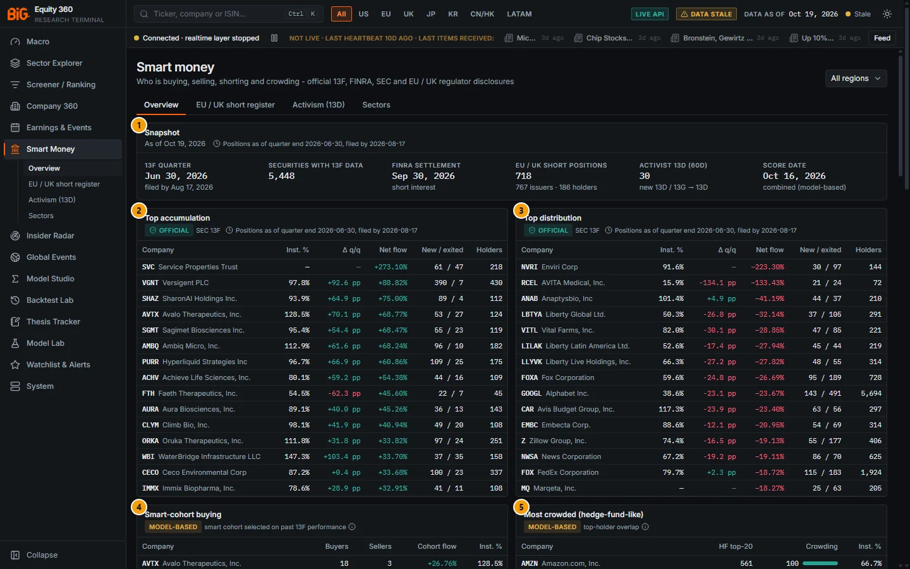

*Figure 7.1: Smart money overview (`/smart-money`), all regions, data as of 19 Oct 2026. 13F positions as of quarter end 30 Jun 2026, filed by 17 Aug 2026.*

| # | Panel | What it shows |
|---|---|---|
| 1 | Snapshot | As-of date and the 13F lag note. Six figures: 13F quarter (filed by), securities with 13F data, FINRA settlement date, EU / UK short positions (issuers, holders), activist 13D in the last 60 days, score date. |
| 2 | Top accumulation | **OFFICIAL** SEC 13F. The 15 largest net 13F inflows as % of shares outstanding: Inst. %, Δ q/q, Net flow, New / exited holders, Holders. |
| 3 | Top distribution | Same columns, the 15 largest net 13F outflows. |
| 4 | Smart-cohort buying | **MODEL-BASED** "smart cohort selected on past 13F performance". Buyers, Sellers, Cohort flow, Inst. %. |
| 5 | Most crowded (hedge-fund-like) | **MODEL-BASED** "top-holder overlap". HF top-20 count, Crowding percentile bar, Inst. %. |
| 6 | Most shorted | **OFFICIAL** FINRA short interest; "Short interest % uses shares outstanding (float is not published)". SI % out, Days to cover, Δ SI, z 1y. |
| 7 | Squeeze watch | **MODEL-BASED** "high SI + rising price + low float". SI % out, DTC, 20d ret., Risk bar, **SQUEEZE RISK** flag. |
| 8 | Short-interest risers | **OFFICIAL** FINRA. Largest rises in short interest since the previous settlement. |
| 9 | Fails-to-deliver spikes | **MODEL-BASED** SEC FTD data. FTD % out, SI % out. |
| 10 | Futures positioning (CFTC) | **OFFICIAL** CFTC COT. Leveraged funds (TFF) in six equity-index futures: Net % OI, COT 3y index, report date; link **all markets →**. |
| 11 | Combined score - top | **MODEL-BASED** "13F flows · smart cohort · insiders · short interest · EU shorts". Score, Pctl, SI % out, EU short. |
| 12 | Combined score - bottom | **MODEL-BASED** "lowest scores". Same columns. |
| 13 | Activist feed | **OFFICIAL** SEC 13D / 13G. New 13D and 13G → 13D switches in the last 60 days: date, event badge, filer → subject, **EDGAR** link; **full feed →**. |
| 14 | EU / UK short-seller register | **OFFICIAL** FCA · AMF · CNMV · AFM · CBI · FSMA · FI · Finanstilsynet. Latest named net short positions: Holder, Issuer (regulator), Net short, Change, Date; **register →**. |

Panels 6 to 14 are below the fold. The close-ups below show the ones that need explanation.

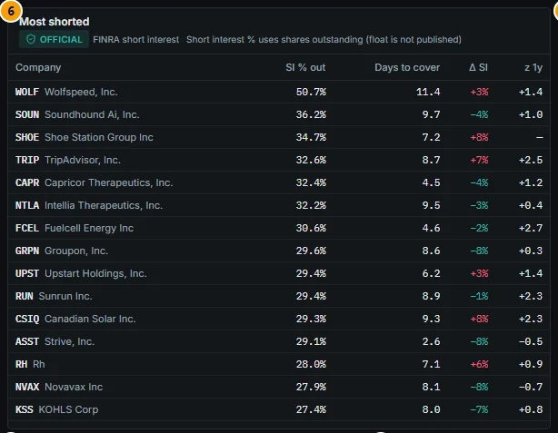

*Figure 7.2: Most shorted (FINRA settlement 30 Sep 2026). Wolfspeed (WOLF) leads at 50.7% of shares outstanding with 11.4 days to cover.*

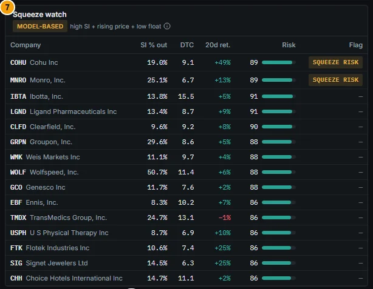

*Figure 7.3: Squeeze watch. Only COHU and MNRO meet all four conditions of the squeeze-risk flag; the others are ranked by the risk score alone.*

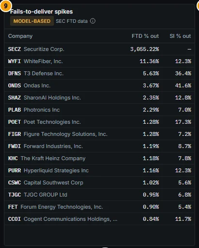

*Figure 7.4: Fails-to-deliver spikes. The first row (3,055.22% of shares outstanding) is a share-count error, not a real fail (see Limitations).*

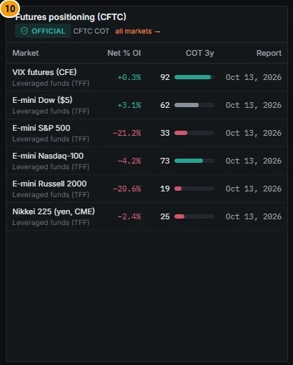

*Figure 7.5: Futures positioning (CFTC), leveraged funds, report of 13 Oct 2026.*

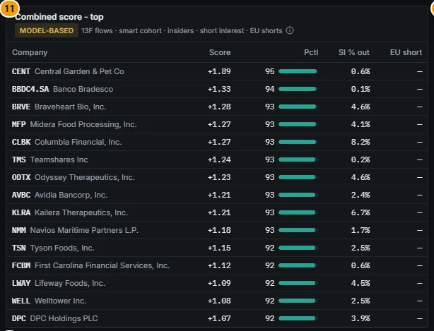

*Figure 7.6: Combined score - top (score date 16 Oct 2026).*

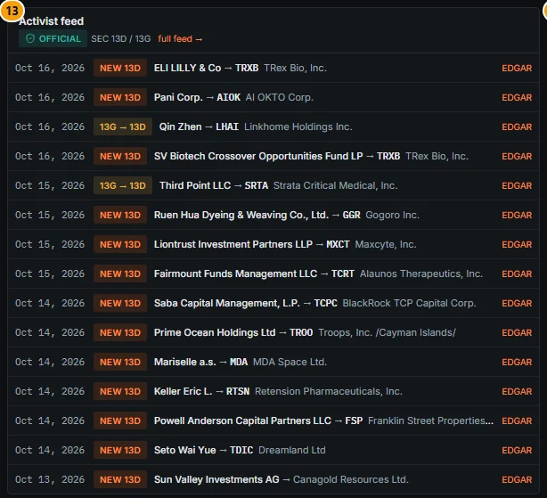

*Figure 7.7: Activist feed, new 13D and 13G → 13D switches in the 60 days to 19 Oct 2026.*

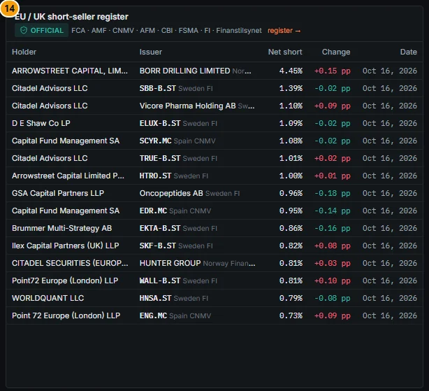

*Figure 7.8: Latest named EU / UK net short positions on the overview. An increase in a short position is shown in red.*

### Controls

| Control | What it does |
|---|---|
| **Region** select | All regions, US, EU, UK, JP, KR, CN, HK, LATAM, APAC. Filters the security lists (panels 2–9, 11 and 12) and is kept in the URL (`?region=`). The CFTC, activist and EU register panels are not filtered. |
| Section tabs | **Overview**, **EU / UK short register**, **Activism (13D)**, **Sectors**. |
| Lag note (clock icon) | "Positions as of quarter end Q, filed by D". Hover: "13F filings report quarter-end long positions and are due 45 days after the quarter. We use only filings made by the cutoff (point-in-time)." |
| **MODEL-BASED** tags | Hover for the exact definition (hedge-fund-like, smart cohort, crowding, squeeze, FTD spike, score; quoted in Methodology). |
| **OFFICIAL** tags | Name the official source of the panel. |
| Column headers with a tooltip | Inst. % ("13F long shares / shares outstanding"), Δ q/q (percentage points), Net flow ("13F net share flow / shares outstanding"), Buyers / Sellers (smart-cohort filers that opened or added / trimmed or exited), HF top-20, SI % out, Δ SI, Risk, FTD % out, Score, EU short. |
| Company links | Open Company 360 › Ownership. |
| **EDGAR** links | Open the filing on sec.gov in a new tab. |
| **full feed →** / **register →** | Open [Activism (13D)](#activism-13d) and the [EU / UK short register](#eu--uk-short-register). |
| **all markets →** and market names | Open Positioning (CFTC) and the market's page. |
| Sources footer | Each official source with a hover note, e.g. FINRA "Twice-monthly settlement dates, published about 7 business days later". |

Sign colours never stand alone: every change carries its sign in the text. For short interest and EU shorts the colours are inverted (a rise is red).

### Methodology

**Lists.** The security lists keep listings with a market cap of at least $300M (the fails-to-deliver list has no market-cap filter).

- The flow lists (accumulation, distribution, smart-cohort buying) need at least 20 13F holders in both quarters and an institutional ownership of at most 150%.
- Accumulation and distribution are sorted by `flow_pct_out`. Smart-cohort buying is sorted by buyers minus sellers, then cohort flow. Most crowded is sorted by `hf_top20_count`.

**13F point-in-time** (quoted from `docs/SMART_MONEY.md`):

> "A quarter's snapshot uses only rows filed on or before the cutoff = filing deadline (period end + 45 days, next SEC business day; Presidents' Day aware) + 1 business day (EDGAR dates after-hours filings next day) or the run date while filings still arrive (`is_complete = false`); `knowledge_date = cutoff`. The UI shows "positions as of quarter end Q, filed by D"."

Example: quarter end 30 Jun 2026 + 45 days = Fri 14 Aug 2026, plus one business day gives the cutoff Mon 17 Aug 2026 shown in the figure. Previous-quarter share counts are re-expressed on the current share basis (split-adjusted) before changes are computed.

| Measure | Definition |
|---|---|
| Inst. % | 13F long shares / shares outstanding |
| Holder changes | Among filers that filed both quarters: new, added (> +1%), trimmed (< −1%), unchanged, exited |
| Net flow | `net_flow_shares` = sum of share changes; shown as % of shares outstanding |
| Breadth | `(new + added − trimmed − exited) / positions compared` |
| Hedge-fund-like (model-based) | "10-1,000 positions, AUM >= $50M, >= 60% single stocks, and quarterly turnover >= 15% or options >= 5% of value or (top-10 weight >= 50% and turnover >= 5%)". Turnover = min(buys, sells) / mean AUM, with buys / sells = abs(share change) × price, so price moves are not turnover. Index-like books (> 1,000 positions) never qualify. |
| Crowding (model-based) | "number of hedge-fund-like filers holding the stock among their top-20 positions (percentile)": `hf_top20_count`, `crowding_pct` = its percentile within the quarter |
| Smart cohort (model-based) | "hedge-fund-like filers whose reported books beat the average 13F filer over the past 4 quarters (top decile, positive excess), selected point-in-time". Each book is held for the next quarter (value weights, coverage ≥ 50% of AUM); excess = return minus the equal-weight mean of all filers; `smart_score` = mean excess of books q−4 … q−1 (at least 3). Cohort flows = cohort members' share changes q−1 → q. |
| SI % out | Short interest / shares **outstanding** ("float is not published"); null if unknown or > 150% |
| Days to cover | FINRA days to cover |
| Δ SI | `si_chg_pct`: change versus the previous settlement |
| z 1y | `si_z_1y`: z-score of shares short versus the previous 24 settlements (at least 8) |
| Squeeze risk flag (model-based) | "short interest >= 15% of shares outstanding, days to cover >= 5, 20-day return >= +10%, shares <= 150M or market cap <= $2B" |
| Risk (squeeze score) | Mean percentile (within the settlement date) of SI %, days to cover, 20-day return and small share count; shown 0–100 |
| FTD spike (model-based) | "daily fails >= 0.5% of shares outstanding, or z >= 3 vs the previous 12 files with >= 100k shares". FTD % out = largest daily fail / shares outstanding |
| Activism | new 13D, 13D amendment, 13G → 13D switch (the filer's previous filing on the subject within 3 years was a 13G), new / amended 13G |
| EU / UK disclosed short % | Regulator aggregate when published (FCA since 2026-07, Norway), else the sum of active holder positions (latest notification per holder ≥ 0.5%, within 2 years); maximum across regulators |

**Combined smart-money score** (model-based; `docs/SMART_MONEY.md` §2):

- Inputs, all known on the score date, are winsorised at 1% / 99% and z-scored within the date: 13F flow and breadth, smart-cohort flow, the insider signal, short-interest level and change, and EU short level and 30-day change.
- Each input is signed so that higher = more bullish: short interest and EU shorts enter negatively.
- The inputs are averaged into five groups: inst, smart, insider, short_interest, eu_short.

```
score     = mean of the available group z-scores
score_pct = percentile of score within the date (0..100)
```

The top and bottom lists require at least two groups. The score is "forward-label-free". It is an optional input to the scoring Insider family behind `contracts/scoring.yaml optional_inputs.smart_money.enabled` (default **false**; production scores unchanged).

**Futures positioning.** For six equity-index futures (VIX, E-mini Dow, E-mini S&P 500, E-mini Nasdaq-100, E-mini Russell 2000, Nikkei 225 yen), the panel shows the CFTC TFF leveraged-funds net position as % of open interest and its 3-year COT index. See [Positioning (CFTC)](02b-markets-cross-asset.md#positioning-cftc) for the method.

### Data sources and refresh

| Source | Cadence and lag | History in the app |
|---|---|---|
| SEC Form 13F data sets | Quarterly; "Quarter-end long positions of managers with > $100M; filed up to 45 days after the quarter". Job `sec_13f` weekly, analytics `smart_money_13f` weekly | 2023Q1 … 2026Q2 (14 quarters) |
| FINRA equity short interest | "Twice-monthly settlement dates, published about 7 business days later". Job `finra_short_interest` weekly | 2023-01 … 2026-09 |
| SEC fails-to-deliver | Half-month files | 2022-09 … |
| SEC Schedules 13D / 13G | EDGAR full and daily index; job `activist_filings` nightly | 2022-01 … |
| EU / UK net short positions | Regulator files; job `eu_short_positions` nightly | see [EU / UK short register](#eu--uk-short-register) |
| Insider signal | Job `insider_signals` nightly (see [Insider Radar](#insider-radar)) | |
| CFTC COT | Weekly, Tuesday positions, released Friday | |

The combined score is computed by `smart_money_signals` (nightly; scores dated weekly on Fridays plus the run date). Under the default weekly profile these jobs run on Saturday morning (Lisbon), and the CFTC job runs on Friday evening. On 19 Oct 2026 the latest 13F quarter was 30 Jun 2026 (cutoff 17 Aug 2026), the latest FINRA settlement was 30 Sep 2026 and the score date was 16 Oct 2026.

### Validation status

The combined score was checked once for predictive power. The result is negative. From `docs/SMART_MONEY.md` §4 (2026-10-19, report `data/logs/reports/smart_money_ic_20261016.json`): Spearman rank IC against forward returns, point-in-time and purged, non-overlapping signal dates, 6,145 securities, 2023-06-30 … 2026-10-16:

| Column | IC 21d (t, n dates) | IC 63d (t, n dates) |
|---|---|---|
| score (composite) | −0.004 (−0.67, 33) | −0.005 (−0.56, 11) |
| g_inst (13F flow + breadth) | −0.015 (−1.30, 31) | −0.023 (−1.15, 10) |
| g_smart (smart-cohort flow) | −0.002 (−0.23, 27) | −0.019 (−1.16, 9) |
| g_insider | +0.014 (+0.79, 32) | +0.024 (+1.09, 11) |
| g_short_interest (low SI = bullish) | +0.016 (+1.39, 32) | +0.015 (+0.67, 10) |
| g_eu_short (low disclosed short = bullish) | +0.003 (+0.18, 31) | +0.011 (+0.42, 9) |

> "None is statistically significant; the composite has no predictive power in this short sample (the 13F history starts 2023Q1 and the smart cohort needs 4 quarters of track record). The short-interest and insider groups have the expected sign; lagged 13F flows are slightly contrarian (consistent with crowding / the 45-day lag). Treat the score as a descriptive screen, not an alpha signal; the backtesting lab can re-test it with longer history. The weights were NOT tuned on this result (no data snooping)."

In the app the score, smart cohort, crowding, squeeze and FTD-spike panels carry the **MODEL-BASED** tag. The 13F, FINRA, 13D / 13G, EU register and CFTC panels carry **OFFICIAL**: they show reported data, not a model.

### Correct usage and worked example

Use the overview to find names worth a closer look, then open Company 360 › Ownership. Always read 13F numbers with their lag: on 19 Oct 2026 they describe positions at 30 Jun 2026, more than three months earlier. Read short interest with its settlement date.

**Worked example: squeeze watch, FINRA settlement 30 Sep 2026.**

1. Scroll to **Squeeze watch** (Figure 7.3). Cohu (COHU) shows SI 19.0% of shares outstanding, DTC 9.1, 20-day return +49%, risk 89 and the **SQUEEZE RISK** badge. It meets all four conditions: SI ≥ 15%, DTC ≥ 5, return ≥ +10% and the low-float test.
2. Ibotta (IBTA) has a higher risk score (91) but no badge. Its SI (13.8%) is below 15% and its 20-day return (+5%) is below +10%. The risk score ranks names; only the flag applies the rule.
3. Wolfspeed (WOLF) has the highest SI in the universe (50.7%, DTC 11.4, Figure 7.2), but its 20-day return is only +6%, so it is not flagged.
4. The FINRA data are as of 30 Sep 2026 and were published about 7 business days later. The 15 Oct settlement was not yet in the snapshot on 19 Oct.
5. Open COHU (click the ticker) to see the short-interest trend and holders on the Ownership tab before acting.

**Crowding example.** In **Most crowded**, Amazon (AMZN) is held among the top-20 positions of 561 hedge-fund-like filers (crowding percentile 100). This describes how concentrated the hedge-fund-like ownership is. It does not mean the stock will fall.

### Limitations and pitfalls

- **13F lag and scope.** The 45-day lag means positions can be stale by up to 4.5 months. 13F covers long US-listed equity and options positions of managers with more than $100M only: no shorts, no non-US listings, no cash.
- **Implausible ratios.** Ratios to shares outstanding depend on the share count.
  - A stale or wrong count produces values above 100% (Inst. % 128.5% for AVTX) or absurd flows (SVC +273% net flow).
  - In the FTD list, Securitize (SECZ) shows 3,055.22%.
  - Treat such rows as data errors.
- **Spin-offs and IPOs.** New listings show huge "accumulation" because every holder is new (VGNT: 390 new holders). The 20-holder filter removes only the smallest cases.
- **Short interest uses shares outstanding**, not free float, so SI % understates the short share of the float. FINRA symbols are not all mapped to securities: about 4,100 securities have a short-interest row. `docs/PHASE3_TODO.md` records low symbol-resolution coverage.
- **EU coverage gaps.** Germany (BaFin) and Italy (CONSOB) are not ingested, so German and Italian shorts are missing. Since 10 Jul 2026 the UK publishes aggregates only (no holder names).
- **Activist 13D (60d) count** is the true 60-day count (API v1.39.0 `activist_count_60d`); the feed under it still lists at most 30 items. Builds before 24 Oct 2026 counted the capped feed.
- **Model-based labels.** Hedge-fund-like and smart cohort are transparent rules on 13F books, not knowledge of a manager's strategy. The smart cohort needs four quarters of history, and the 13F history starts in 2023Q1.
- **The score is not alpha.** See Validation status.

### Related mnemonics and BQL fields

- Mnemonics: `SMRT` (smart money), `HDS` (holders), `SI` (short interest); all open this page without a security and Company 360 › Ownership with one.
- BQL fields:
  - 13F: `own.inst_own_pct`, `own.inst_own_chg`, `own.flow_pct_out`, `own.breadth`, `own.n_new`, `own.n_exited`, `own.hhi`, `own.hf_top20_count`, `own.crowding_pct`, `own.smart_buyers`, `own.smart_sellers`, `own.smart_flow_pct_out`.
  - Short interest and FTD: `si.si_pct_out`, `si.days_to_cover`, `si.si_chg_pct`, `si.si_z_1y`, `si.squeeze_score`, `si.squeeze_flag`, `si.ftd_pct_out`, `si.ftd_spike`.
  - Combined score: `sm.score`, `sm.score_pct`, `sm.g_inst`, `sm.g_smart`, `sm.g_insider`, `sm.g_short_interest`, `sm.g_eu_short`, `sm.eu_short_pct`.
- Alerts: "activist 13D", "short-interest spike", "EU short position" (see [Watchlists and alerts](13-watchlists-alerts.md)).
- Related sections: [Company 360 Ownership](05a-company-fundamentals.md#ownership), [Positioning (CFTC)](02b-markets-cross-asset.md#positioning-cftc), [Backtest Lab](11-backtest-lab.md), [BQL and mnemonics](14-bql-mnemonics.md).

---

## EU / UK short register

**Route:** `/smart-money/eu-shorts` · **Menu:** Smart Money › EU / UK short register · **Mnemonics:** none (tab of Smart Money; `SMRT` opens the overview) · **Refresh:** nightly job `eu_short_positions`

### Purpose

The register lists the net short positions at or above 0.5% of issued capital that the European and UK regulators publish. It names the short seller where the regulator does. Use it to see who is short a European stock, how a holder's positions have changed, and which funds run the most disclosed shorts.

### Screenshot

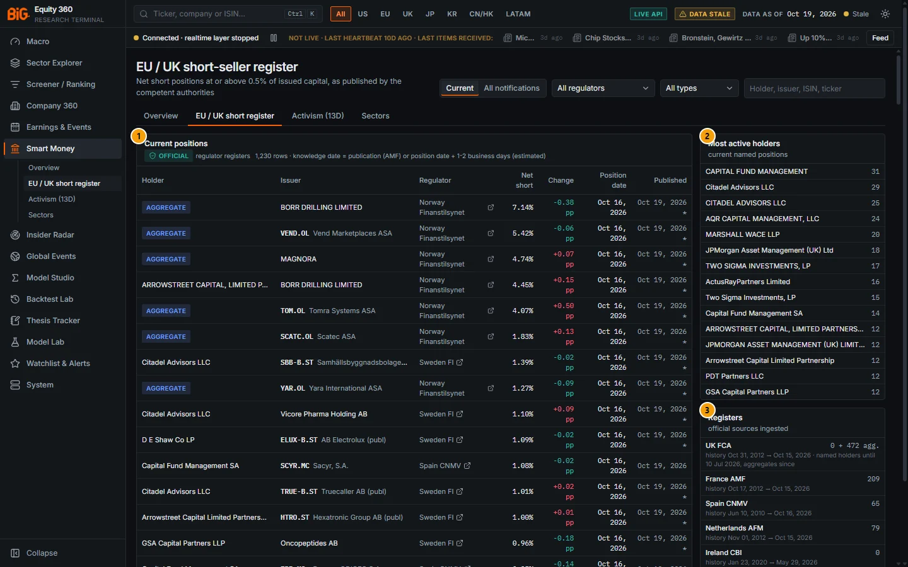

*Figure 7.9: EU / UK short-seller register (`/smart-money/eu-shorts`), Current mode, all regulators, data as of 19 Oct 2026.*

| # | Panel | What it shows |
|---|---|---|
| 1 | Current positions | **OFFICIAL** regulator registers; "1,230 rows · knowledge date = publication (AMF) or position date + 1-2 business days (estimated)". Holder (or **AGGREGATE** badge), Issuer, Regulator (link to the source), Net short, Change, Position date, Published. |
| 2 | Most active holders | "current named positions": the 15 holders with the most current named positions, with their count. |
| 3 | Registers | "official sources ingested": per regulator the number of current named positions (+ aggregates) and the history range. The UK FCA line notes "named holders until 10 Jul 2026, aggregates since". |
| 4 | Not ingested | "and why": registers that could not be ingested (below the fold, Figure 7.10). |

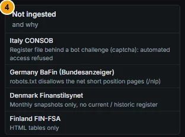

*Figure 7.10: Registers not ingested and the reasons: Italy CONSOB, Germany BaFin (Bundesanzeiger), Denmark Finanstilsynet, Finland FIN-FSA.*

**All notifications, one holder.** The figure below shows the register in All notifications mode, filtered on one holder.

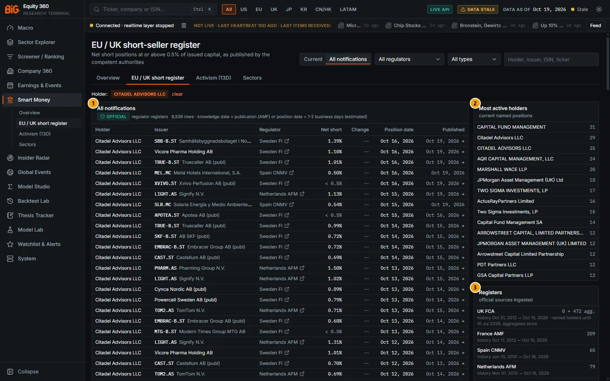

*Figure 7.11: All notifications filtered on the holder Citadel Advisors LLC (`/smart-money/eu-shorts?mode=history&holder=Citadel%20Advisors%20LLC`), data as of 19 Oct 2026.*

| # | Panel | What it shows |
|---|---|---|
| 1 | All notifications | The holder's full notification history across regulators, newest first: 8,536 rows (Sweden FI, Spain CNMV, Netherlands AFM and others). Rows showing "< 0.5%" are closing notifications. The Change column is empty in this mode. |
| 2 | Most active holders | Unchanged by the filter: it always ranks current named positions. |
| 3 | Registers | Unchanged by the filter: the ingested registers and their history ranges. |
| 4 | Not ingested | Below the fold, as in Figure 7.10. |

The **Holder:** chip above the table shows the active holder filter; **clear** removes it. The filter matches the holder name regardless of case, so "Citadel Advisors LLC" and "CITADEL ADVISORS LLC" are one holder; other spellings (for example without "LLC") are still separate.

### Controls

| Control | What it does |
|---|---|
| **Current** / **All notifications** | Register mode. *Current*: each holder's latest notification per issuer that is still ≥ 0.5% and less than two years old, plus the latest regulator aggregates. *All notifications*: every notification ever published (about 240,000 rows), without the Change column. |
| **Regulator** select | All regulators, UK FCA, France AMF, Spain CNMV, Netherlands AFM, Ireland CBI, Belgium FSMA, Sweden FI, Norway Finanstilsynet. |
| **Type** select | All types, **Named holders** (individual positions), **Aggregates** (regulator totals per issuer, no names). |
| Search box (Holder, issuer, ISIN, ticker) | Press Enter to apply. Holder and issuer match on a substring; ISIN must match exactly; a ticker matches with or without its exchange suffix and share-class letter (`SBB`, `SBB-B` and `SBB-B.ST` all find the same issuer). |
| Holder name (table or Most active holders) | Click to filter the register on that holder (case-insensitive). A **Holder:** chip appears with **clear**. |
| Issuer link | Opens Company 360 › Ownership when the ISIN maps to a covered security; otherwise the issuer name is plain text (hover for the ISIN). |
| Regulator link | Opens the regulator's source file or page in a new tab. |
| **AGGREGATE** badge | Hover: "Regulator-published aggregate net short position of the issuer (no holder names)". |
| Net short **< 0.5%** | The holder's position fell below the publication threshold (the closing notification). |
| Change | Current mode only: change versus the holder's previous notification in percentage points; **new** when there is no earlier notification. A rise is red (more short). |
| Published (with an asterisk) | Publication date. The asterisk marks an estimated publication date (position date + 1–2 business days). |
| **← previous** / **next →** | Pages of 200 rows. |

Filters are kept in the URL (`mode`, `regulator`, `type`, `q`, `holder`, `page`).

### Methodology

The register shows the regulator files as published, with these processing rules (from `docs/SMART_MONEY.md` §1 and §2):

- **Threshold.** Net short positions at or above 0.5% of issued capital are published by the regulators. A notification of "<0,5" (Sweden) or below 0.5% closes a position.
- **Current register.** For each regulator, holder and issuer, the latest notification is kept if it is still ≥ 0.5% and its position date is within two years; regulator aggregates are added.
  - A regulator whose last named notification is more than 30 days older than its aggregates is treated as aggregate-only.
  - This is the UK case: "since 10 Jul 2026 the FCA publishes **aggregated** net short positions per issuer only (no holder names). The frozen named-holder history stays searchable ("All notifications"); the current register shows FCA aggregates only".
- **Knowledge dates** (point-in-time). Position date + 2 business days (estimated) for FCA, CNMV, AFM, CBI and FSMA; + 1 business day for Sweden FI and Norway; the observed publication date for AMF. All are capped by the file publication date and the download date, and never before the position date.
- **Disclosed short % per issuer** (used in the smart-money score and the sector table): the regulator aggregate when the regulator publishes one, else the sum of active named positions; maximum across regulators.

### Data sources and refresh

| Regulator | Format | History | Current named / aggregates (19 Oct 2026) |
|---|---|---|---|
| UK FCA | xlsx (individual, frozen 10 Jul 2026) + aggregate CSVs | named 2012-11 … 2026-07-10; aggregates since 2026-07 | 0 / 472 |
| France AMF | CSV via data.gouv.fr (holder LEI, publication dates) | since 2012-11 | 209 / 0 |
| Spain CNMV | xls (Current, Series, Previous sheets) | since 2010 | 65 / 0 |
| Netherlands AFM | CSV (current + historic) | since 2012 | 79 / 0 |
| Ireland CBI | xlsx (Current / Historical) | since 2020 in the app; last update 2026-05 | 0 / 0 |
| Belgium FSMA | CSV, current only (history accumulates nightly) | since 2023-06 | 14 / 0 |
| Sweden FI | ODS (current + historic) | since 2010 | 262 / 0 |
| Norway Finanstilsynet | Open JSON API (aggregates and active holders) | last 2 years | 89 / 40 |

**Not ingested.** The reasons are listed on the page and in `docs/SMART_MONEY.md`:

- Italy CONSOB: the register file is behind a bot challenge (captcha), so automated access is refused.
- Germany BaFin: positions are published only in the Bundesanzeiger, whose robots.txt disallows the net short-position pages (`/nlp`).
- Denmark: monthly snapshots only, with no current or historic register.
- Finland: HTML tables only.

The job `eu_short_positions` downloads the full files every night, one request per file, respecting each site's robots.txt and crawl delay.

### Validation status

**Not applicable: official data.** The register reproduces regulator disclosures and carries the **OFFICIAL** tag. Only the knowledge dates are estimated (marked with an asterisk). The EU short inputs to the smart-money score had no significant rank IC (g_eu_short IC 21d +0.003, t +0.18; see [Smart Money overview](#validation-status)).

### Correct usage and worked example

Use **Current** to see who is short now and **All notifications** to follow a holder's history. Search by ticker or ISIN to see every disclosed short in one issuer.

**Worked example: SBB (Samhällsbyggnadsbolaget i Norden), as of 19 Oct 2026.**

1. Type `SBB-B.ST` in the search box and press Enter. Eight current named positions appear, all reported to Sweden FI.
2. The largest is Samlyn Capital LLC at 3.18% (position date 25 Sep 2026, down from 3.25%). It is followed by Brooklands Fund Management at 2.69% (badge **new**, first notified 1 Oct 2026) and Arrowstreet Capital at 1.40%.
3. Citadel Advisors LLC holds 1.39% (16 Oct 2026, change −0.02 pp from 1.41%). The **Published** date 19 Oct 2026 carries an asterisk: estimated as position date + 1 business day, rounded to the next file.
4. Together the named holders disclose about 12.0% of issued capital. Positions below 0.5% are not public, so the true total short interest is higher.
5. Click **Citadel Advisors LLC** to filter on the holder and see its other positions. Then switch to **All notifications** to see its full history in SBB.

### Limitations and pitfalls

- **Only positions ≥ 0.5% are public.** The disclosed total is a lower bound on the short interest.
- **No name normalisation across regulators.** The same fund can appear under several spellings ("Citadel Advisors LLC" and "CITADEL ADVISORS LLC"; "CAPITAL FUND MANAGEMENT" and "Capital Fund Management SA"). The Most active holders list counts them separately.
- **UK names stop on 10 Jul 2026.** After that date the UK shows aggregates per issuer only. Named UK history remains searchable in All notifications.
- **Germany and Italy are missing.** DAX and FTSE MIB names show no disclosed shorts in the app even when positions exist.
- **Stale "current" positions.** A position stays current until the holder files a change or it is two years old. An old notification (for example January 2026) may already have been reduced below the threshold without a record in the file.
- **Unmapped issuers.** Many issuers (small caps, non-covered listings) do not map to a security and have no Company 360 link.
- **Estimated publication dates** (asterisk) are approximations for point-in-time use.

### Related mnemonics and BQL fields

- Mnemonics: `SI` opens Smart Money (no security) or Company 360 › Ownership (with a security), which shows the company's EU / UK positions.
- BQL fields: `sm.eu_short_pct`, `sm.eu_short_chg_30d`, `sm.eu_short_holders`, `sm.z_eu_level`, `sm.z_eu_chg`, `sm.g_eu_short`.
- Alerts: "EU short position" (new or increased position published), see [Watchlists and alerts](13-watchlists-alerts.md).
- Related sections: [Smart Money overview](#smart-money-overview), [Company 360 Ownership](05a-company-fundamentals.md#ownership).

---

## Activism (13D)

**Route:** `/smart-money/activism` · **Menu:** Smart Money › Activism (13D) · **Mnemonics:** none (tab of Smart Money) · **Refresh:** nightly job `activist_filings`, events built by `smart_money_signals`

### Purpose

The activism feed lists SEC Schedule 13D and 13G filings: beneficial owners crossing 5% of a US-registered company. A 13D signals active or control intent, while a 13G is passive. The most informative events are a **new 13D** and a **13G → 13D switch**, where a holder that was passive declares active intent. Use the page to follow activist campaigns and to see which filers are most active.

### Screenshot

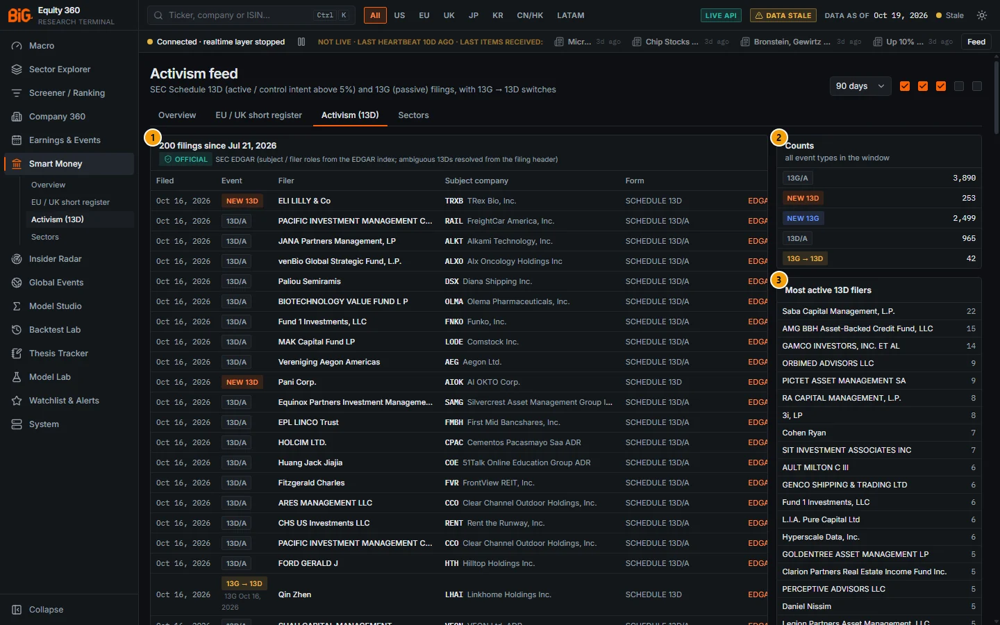

*Figure 7.12: Activism feed (`/smart-money/activism`), 90-day window, default event types, data as of 19 Oct 2026.*

| # | Panel | What it shows |
|---|---|---|
| 1 | 200 filings since Jul 21, 2026 | **OFFICIAL** "SEC EDGAR (subject / filer roles from the EDGAR index; ambiguous 13Ds resolved from the filing header)". Filed, Event badge, Filer, Subject company, Form, **EDGAR** link. |
| 2 | Counts | "all event types in the window": counts per event type (13G/A 3,890; New 13D 253; New 13G 2,499; 13D/A 965; 13G → 13D 42). |
| 3 | Most active 13D filers | Filers with the most 13D filings in the window (e.g. Saba Capital Management 22). |

### Controls

| Control | What it does |
|---|---|
| **Window** select | 30 days, 90 days (default), 180 days, 1 year, 3 years. |
| Event-type checkboxes (top right) | Five unlabelled checkboxes, in this order: **New 13D**, **13G → 13D**, **13D/A**, **New 13G**, **13G/A**. The first three are ticked by default. Screen readers announce the names; the boxes have no visible text. Unticking all restores the default. |
| Event badges | New 13D (orange), 13G → 13D (amber), 13D/A, New 13G (blue), 13G/A. A switch row also shows the date of the filer's previous 13G (e.g. "13G Oct 16, 2026"). |
| **+n** after a filer | The filing has n further joint filers. |
| **inferred** badge (Form column) | Hover: "Subject / filer roles inferred (no ticker match and no filing-header check)". |
| Subject company link | Opens Company 360 › Ownership when the subject is a covered security. |
| **EDGAR** | Opens the filing on sec.gov. |

The window and the ticked types are kept in the URL (`days`, `types`).

### Methodology

The event types are defined as follows (quoted from `docs/SMART_MONEY.md`):

> "**Activism**: new 13D, 13D amendment, 13G -> 13D switch (filer's previous filing on the subject within 3 years was a 13G), new / amended 13G."

Subject and filer are taken from the EDGAR master index (quarterly full index and daily index files). When the index does not tell which party is the subject, the job reads the filing header; up to 400 headers are fetched per run. The list is sorted by filing date, newest first, and shows at most 200 filings. The Counts and Most active 13D filers panels cover the whole window.

### Data sources and refresh

SEC EDGAR Schedules 13D and 13G, history since January 2022 (backfilled from the quarterly full index). The job `activist_filings` runs nightly after the EDGAR daily index; activist events are rebuilt by `smart_money_signals`.

### Validation status

**Not applicable: official filings.** The feed reproduces SEC filings with the **OFFICIAL** tag. Roles resolved by name only are marked **inferred**. No study in the project measures returns after 13D events.

### Correct usage and worked example

Tick only **New 13D** and **13G → 13D** to see fresh activist intent; add **13D/A** to follow campaigns already under way. Read the filing on EDGAR for the stated purpose (Item 4 of the 13D) before drawing conclusions.

**Worked example: Third Point and Strata Critical Medical, 15 Oct 2026.**

1. Untick **13D/A** (the third checkbox) so only new 13Ds and switches remain.
2. The row of 15 Oct 2026 shows **13G → 13D**: Third Point LLC → SRTA (Strata Critical Medical, Inc.), Form SCHEDULE 13D. The filer's previous filing on the company was a 13G on 14 Nov 2025, so a holder that had been passive for eleven months now declares active intent.
3. Click **EDGAR** to read the 13D. Click **SRTA** to see the 13F holders and short interest on Company 360 › Ownership.

### Limitations and pitfalls

- **Panel title count is capped.** The title ("200 filings since …") counts the rows returned, at most 200. Use the **Counts** panel for the true numbers (in the figure, 965 13D amendments alone).
- **Unlabelled checkboxes.** The event-type checkboxes show no text. Use the order given in Controls.
- **Same-day switches.** A 13G and a 13D filed on the same day by the same filer appear as a switch (Qin Zhen → LHAI on 16 Oct 2026, previous 13G the same day). Check the filing history on EDGAR.
- **US filings only.** Schedules 13D / 13G exist only for SEC-registered companies. European large-holder notifications are not included.
- **Filers are not normalised.** Individuals and funds appear as filed, so related entities count separately in Most active 13D filers.

### Related mnemonics and BQL fields

- Mnemonics: `SMRT` (overview, with the activist feed of the last 60 days). With a security loaded, `HDS` / `SMRT` open Company 360 › Ownership, which lists the company's 13D / 13G events.
- BQL fields: none for individual filings.
- Alerts: "activist 13D" (new 13D or 13G → 13D switch on a watched name; amendments optional), see [Watchlists and alerts](13-watchlists-alerts.md).
- Related sections: [Smart Money overview](#smart-money-overview), [Company 360 Ownership](05a-company-fundamentals.md#ownership).

---

## Smart-money sectors

**Route:** `/smart-money/sectors` · **Menu:** Smart Money › Sectors · **Mnemonics:** none (tab of Smart Money) · **Refresh:** with the serving snapshot after `smart_money_13f` (weekly), `finra_short_interest` (weekly), `eu_short_positions` and `smart_money_signals` (nightly)

### Purpose

The sector page aggregates the smart-money measures by sector, optionally within one region:

- institutional ownership and its quarterly change;
- 13F breadth and smart-cohort activity;
- crowding, short interest and squeeze flags;
- disclosed EU / UK shorts and the average combined score.

Use it to see where institutions are adding, where short sellers are concentrated, and which sectors are crowded.

### Screenshot

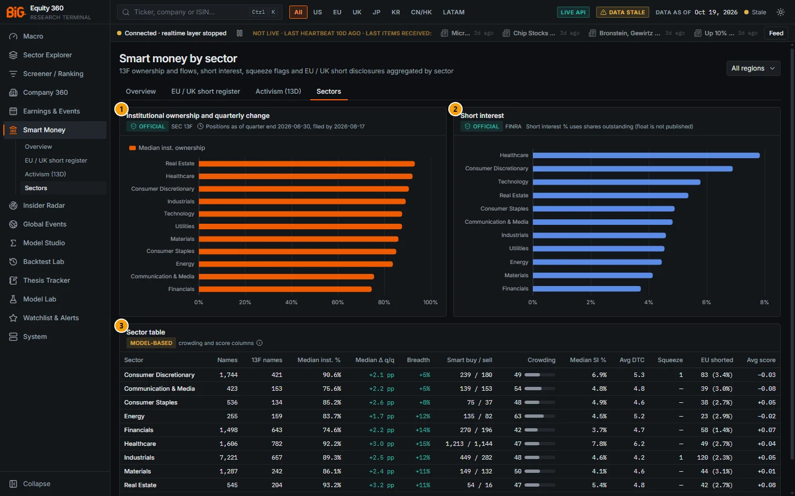

*Figure 7.13: Smart money by sector (`/smart-money/sectors`), all regions, data as of 19 Oct 2026; 13F positions as of quarter end 30 Jun 2026, filed by 17 Aug 2026.*

| # | Panel | What it shows |
|---|---|---|
| 1 | Institutional ownership and quarterly change | **OFFICIAL** SEC 13F with the lag note. Bars of median institutional ownership per sector (hover adds the median change q/q and the number of 13F names). |
| 2 | Short interest | **OFFICIAL** FINRA; "Short interest % uses shares outstanding (float is not published)". Bars of median SI % per sector (hover adds average days to cover and squeeze flags). |
| 3 | Sector table | **MODEL-BASED** "crowding and score columns". Sector, Names, 13F names, Median inst. %, Median Δ q/q, Breadth, Smart buy / sell, Crowding, Median SI %, Avg DTC, Squeeze, EU shorted, Avg score. |

### Controls

| Control | What it does |
|---|---|
| **Region** select | All regions, or one of APAC, CA, CN, EU, HK, JP, KR, LATAM, UK, US. Kept in the URL (`?region=`). |
| Section tabs | Overview, EU / UK short register, Activism (13D), Sectors. |
| Chart tooltips | Hover a bar for the sector's figures. |
| Lag note and **MODEL-BASED** tag | Hover for the 13F lag and the crowding / score definitions. |

### Methodology

All securities of the sector (and region) are counted in **Names**; the other columns use the securities that have the data.

| Column | Definition |
|---|---|
| 13F names | Securities with a 13F ownership row in the latest quarter |
| Median inst. % / Median Δ q/q | Median institutional ownership and its change (percentage points) |
| Breadth | Mean of `(new + added − trimmed − exited) / positions compared` |
| Smart buy / sell | Sum over the sector's securities of smart-cohort filers buying / selling (filer-security pairs) |
| Crowding | Mean crowding percentile (model-based) |
| Median SI % / Avg DTC | FINRA short interest (settlements of the last 45 days) |
| Squeeze | Number of securities with the squeeze-risk flag (model-based) |
| EU shorted | Securities with a disclosed EU / UK short (count and average %) |
| Avg score | Mean combined smart-money score (scores of the last 14 days; model-based) |

Definitions of each measure are in [Smart Money overview › Methodology](#methodology).

### Data sources and refresh

The page uses the same sources as the [overview](#data-sources-and-refresh): SEC 13F (weekly), FINRA short interest (weekly), EU / UK registers and the combined score (nightly).

### Validation status

**Not formally validated: descriptive aggregates.** The crowding and score columns are labelled **MODEL-BASED** in the app. The combined score has no significant predictive power ([overview validation](#validation-status)).

### Correct usage and worked example

Compare sectors with each other in the same snapshot, and read the 13F columns as of the quarter end shown in the lag note.

**Worked example: Healthcare, all regions, 13F quarter 30 Jun 2026.**

1. Healthcare has 1,606 names, of which 782 have 13F data.
2. Median institutional ownership is 92.2%, up a median +3.0 pp on the quarter, with breadth +15%: more holders opened or added than trimmed or exited.
3. Smart-cohort filers made 1,213 buys against 1,144 sells, roughly balanced.
4. Healthcare has the highest median short interest of all sectors (7.8% of shares outstanding, average 6.2 days to cover) and the tallest bar in the Short interest chart.
5. 49 Healthcare securities have a disclosed EU / UK short (average 2.7%). The average combined score is +0.04, close to neutral.

### Limitations and pitfalls

- **Coverage is mostly US.** 13F and FINRA cover US-listed securities: about 4,000 of 19,000 names have 13F or short-interest data. Non-US sectors rely mostly on EU shorts and the score.
- **Medians of ratios to shares outstanding** inherit the share-count errors described in the [overview pitfalls](#limitations-and-pitfalls).
- **Smart buy / sell counts are pairs**, not distinct filers or names.
- **Sector "Unclassified"** collects securities without a sector.

### Related mnemonics and BQL fields

- Mnemonics: none opens this tab directly; `SMRT` opens the overview.
- BQL fields: the per-security fields `own.*`, `si.*`, `sm.*` listed under the [overview](#related-mnemonics-and-bql-fields), which can be grouped by sector in the BQL console.
- Related sections: [Sector Explorer](03-sector-explorer.md), [Smart Money overview](#smart-money-overview).

---

## Insider Radar

**Route:** `/insiders` · **Menu:** Insider Radar · **Mnemonics:** none (type "insider" in the command palette to find the page) · **Refresh:** nightly insider ingestion jobs and `insider_signals`; weekly `insider_models_fit`

### Purpose

The Insider Radar lists unusual insider dealings across markets: open-market purchases and sales by directors and officers, cluster buys (several insiders buying within weeks), and CEO / CFO purchases. Each trade has an anomaly score that shows how unusual it is. Use it to find insider activity worth a closer look and open the company's Insiders tab for the full history.

### Screenshot

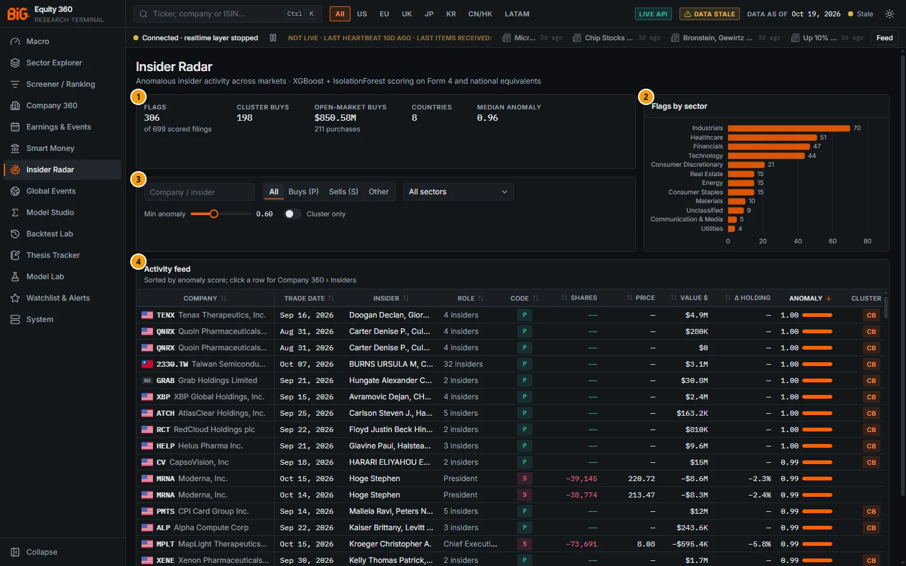

*Figure 7.14: Insider Radar (`/insiders`), all regions, minimum anomaly 0.60, data as of 19 Oct 2026.*

| # | Panel | What it shows |
|---|---|---|
| 1 | Flags (summary) | **Flags** 306 of 699 scored filings; **Cluster buys** 198; **Open-market buys** $850.58M in 211 purchases; **Countries** 8; **Median anomaly** 0.96. All figures follow the filters. |
| 2 | Flags by sector | Bar chart: number of flagged rows per sector (Industrials 70, Healthcare 51, Financials 47 …). |
| 3 | Filters | Company / insider search, transaction-code switch, sector select, minimum-anomaly slider, cluster-only switch. |
| 4 | Activity feed | "Sorted by anomaly score; click a row for Company 360 › Insiders". Company, Trade date, Insider, Role, Code, Shares, Price, Value $, Δ holding, Anomaly, Cluster, Mkt cap, Why flagged. |

### Controls

| Control | What it does |
|---|---|
| Top-bar region buttons (All, US, EU, UK, JP, KR, CN/HK, LATAM) | The page follows the global region filter in the top bar. |
| **Company / insider** search | Filters by ticker, company name or insider name as you type. |
| **All / Buys (P) / Sells (S) / Other** | Transaction code. *Other* = grants (A), option exercises (M), tax withholding (F), gifts (G). |
| **Sector** select | All sectors or one sector. |
| **Min anomaly** slider | 0.40 to 0.95 in steps of 0.05; default 0.60. Rows below the threshold are hidden. |
| **Cluster only** switch | Show only rows that are part of a cluster buy. |
| Column headers | Click to sort (the feed starts sorted by Anomaly, descending). The Company column stays pinned when scrolling sideways. |
| **Code** badge | Hover for the meaning, e.g. "P — Open-market purchase", "S — Open-market sale". |
| **Anomaly** cell | Score 0–1 with a bar (accent ≥ 0.75, amber ≥ 0.5). Hover for the features behind it: role weight, insiders same direction (30d), cluster size, first buy in 2 years, routine trader, size vs own history, drawdown before (1y), return before (6m), value (USD). |
| **CB** badge | Part of a cluster buy; hover for the cluster id. |
| **Why flagged** | The reason for the row: "Cluster buy: n insiders date → date ($ value)", "C-suite open-market purchase", or the transaction type and value with the issuer's rules-based insider score ("open market purchase · $1.2M · rules-based insider score 74"). The insider XGBoost probability is no longer used as a reason (it failed its gate; see Validation status). |
| Row click | Opens Company 360 › Insiders for the company. |

### Methodology

**What the page loads.** The radar combines three API calls:

- The 500 most recent insider filings of the last 90 days worth at least $50,000, of any transaction type.
- Cluster buys of the last 90 days. A cluster is a run of open-market purchases of one security where consecutive buys are at most 30 days apart and at least 2 distinct insiders buy. A cluster without a transaction in the 500 filings appears as one summary row: role "n insiders", source "Cluster", value = cluster total.
- The 200 strongest bullish insider signals.

**Open-market trades only for scoring.** The signal pipeline uses open-market buys (code P) and sells (code S) only: "grants/exercises/tax withholding/gifts (A/M/F/G/...) and derivative-table rows are excluded". The feed itself also lists other codes (filter **Other**). Those rows have no per-trade anomaly score, and the radar shows the security's insider signal instead (see Limitations).

**Point in time.** "an insider transaction is usable from its filing date (knowledge_date), never from the trade date". Amended filings (4/A) replace the original from the amendment's date.

**Anomaly score** (per transaction). An IsolationForest is fitted weekly on per-transaction features:

- direction (buy or sell), log USD value, value relative to average daily volume, size versus the insider's own past trades;
- role weight (CEO > Chair > CFO > President > COO > other officers > directors > 10% owners);
- the 10b5-1 plan flag, the change in the insider's holding, the filing lag;
- the number of distinct insiders trading in the same direction within 30 days, first buy in two years;
- the Cohen-Malloy-Pomorski "routine" flag (same calendar month in each of the 3 prior years);
- returns over 1, 3 and 6 months, the 1-year drawdown and the 3-month volatility before the filing.

The score is the empirical CDF of the training anomaly scores, 0..1, with 1 = most anomalous. It is unsupervised: it measures how *unusual* a trade is, not whether it predicts returns.

**Rules-based insider score** (0–100, 50 = no activity). This score feeds the Insider factor and the smart-money score; BQL exposes it as `ins.signal_score`. For each issuer, the open-market trades filed in the last 90 days are weighted with a 45-day half-life:

```
buy weight  = role weight × (1 + 0.5·[≥ 3 insiders buying within 30 d] + 0.4·[first buy in 2 y] + 0.4·[1-y drawdown < −20%])
              × 0.5 if under a 10b5-1 plan × 0.6 if routine × ln(1 + value / $10k)
sell weight = role weight × 0.35 × (0.2 if 10b5-1 or routine) × (1 + 0.3·[6-m return > 30%]) × ln(1 + value / $10k)
raw         = Σ decayed buy weights − Σ decayed sell weights
score       = 50 + 50 · tanh( sign(raw) · ln(1 + |raw| / 5) / 2.5 )
```

The issuer signal's **cluster buy** flag needs at least 3 distinct buyers within 30 days. The **CB** badge in the feed marks any cluster of at least 2 insiders. The **C-suite buy** flag is an open-market purchase by the CEO or CFO.

### Data sources and refresh

| Market | Source | Notes |
|---|---|---|
| United States | SEC Forms 3 / 4 / 5 (+ amendments) | Job `sec_form4`, nightly |
| United Kingdom | FCA National Storage Mechanism: director / PDMR dealing notices (RNS "DSH", MAR art. 19) | Job `fca_nsm`, nightly; parsed from notice text |
| Germany | BaFin directors' dealings database (MAR art. 19) | Job `eu_pdmr_bafin`, nightly (archived nightly because the portal keeps a limited window) |
| Netherlands | AFM register "Transacties leidinggevenden MAR 19" | Job `eu_pdmr_afm`, nightly |
| Hong Kong | HKEX Disclosure of Interests (director / substantial-shareholder dealings) | Job `hkex_filings`, nightly |
| Brazil | CVM VLMO monthly consolidated insider positions / trades | Monthly data |
| Korea | FSS OpenDART executive and major-holder filings | Needs the `OPENDART_APIKEY` key; skipped without it |
| France | AMF BDIF directors' dealings | Metadata only (who / when); no transactions yet |

Signals are recomputed nightly by `insider_signals`; the IsolationForest and the XGBoost model are refitted weekly by `insider_models_fit`.

### Validation status

> **Model-based:** "Insider XGBoost model: shows no out-of-sample edge, so only the rules-based insider score is used." (`docs/USER_GUIDE.md` §6)

The supervised XGBoost model predicts the 3-month excess return versus the sector ETF after an insider filing day. It is trained walk-forward with purging and an embargo. Its promotion gate is "OOS monthly rank-IC Newey-West t > 2 and AUC > 0.52"; when the gate fails, "the model probability is reported but NOT blended into signal_score".

The current fit (version v20261020T034351, events 2016-01 … 2026-07, 91 test months) **fails** the gate:

| Out-of-sample, 3 months | AUC | Monthly rank IC (mean) | NW t-stat |
|---|---|---|---|
| XGBoost, all events | 0.493 | −0.015 | −1.17 |
| XGBoost, buy events | 0.492 | +0.030 | +1.75 |
| Rules-based score (benchmark), all events | n/a | +0.010 | +1.38 |

The rules-based score is used because it is transparent, not because it passed a gate: its own benchmark IC is not significant either. The IsolationForest anomaly score is unsupervised and has no validation gate. It ranks how unusual a trade is.

> **Note:** the page subtitle reads "rules-based insider score + IsolationForest anomaly score (unsupervised) … the insider XGBoost model failed its out-of-sample gate and is not used", and **Why flagged** no longer shows the XGBoost "P(outperform)". Builds before 24 Oct 2026 (and the screenshots) still read "XGBoost + IsolationForest scoring" and could show that probability; treat it as uninformative.

### Correct usage and worked example

Start from **Buys (P)** with **Cluster only** on: open-market purchases by several insiders are the classic signal of the insider literature. Then check the role (CEO / CFO), the size against the insider's own history, and whether the trade was under a 10b5-1 plan. Treat sells with caution: most are planned or for diversification.

**Worked example: Tenax Therapeutics (TENX), as of 19 Oct 2026.**

1. The first row of the feed (Figure 7.14) is TENX: trade date 16 Sep 2026, Insider "Doogan Declan, Gior…", Role "4 insiders", Code **P**, Value $4.9M, Anomaly 1.00, **CB**.
2. **Why flagged** reads "Cluster buy: 4 insiders 2026-08-20 → 2026-09-16 ($4.9M)". Four insiders (Declan Doogan, Christopher Thomas Giordano, Thomas R. Staab II, Daniel Schneeberger) bought in the open market within four weeks.
3. Clicking the row opens Company 360 › Insiders, with the anomaly score, 90-day net buying, buyers and sellers, cluster buys and the trades on the price chart. The issuer signal has both the cluster-buy and the C-suite-buy flags set, with 4 buyers and 0 sellers in 90 days. Its rules-based insider score (BQL `ins.signal_score`) is 82.6 out of 100, where 50 = no activity.
4. For contrast, Moderna (MRNA) also scores 0.99: two sales of about 39,000 shares each by the President (−$8.6M and −$8.3M, Δ holding −2.3%). The anomaly tooltip shows a size 3.7× the insider's usual trade and a 6-month return before the sale of +306%. The filing is marked as a 10b5-1 plan sale. The trade is unusual, but planned selling after a strong run carries little information.

### Limitations and pitfalls

- **The feed covers a short window.** The radar loads the 500 most recent filings worth at least $50,000. On 19 Oct 2026 these covered only filings of 15–16 Oct 2026, almost all US. Older dealings appear only as cluster summary rows. Use Company 360 › Insiders, or a single region in the top bar, for a longer history.
- **Anomaly ≠ signal.** The anomaly score ranks how unusual a trade is against all trades, and large trades are unusual by construction: the median flagged row scores 0.96. The minimum-anomaly slider therefore filters little.
- **Rows without a per-trade score.** Grants, option exercises, tax withholding and gifts, and cluster summary rows, show the security-level score instead: the issuer's anomaly score or its rules-based signal / 100. Rows with no score at all are never hidden by the slider.
- **Summary counts include cluster rows.** "Open-market buys" adds the totals of cluster summary rows, so it is not a count of single filings.
- **Coverage.** Korea needs an OpenDART key and France has no transactions. The UK depends on parsing free-text notices. Brazil is monthly and consolidated. Values in local currency are converted to USD; a missing price gives "$0" or "—".
- **10b5-1 and routine trades** are down-weighted in the rules-based score but can still score high on anomaly.
- **Older builds** showed "Insider model P(outperform)" in Why flagged; it came from the XGBoost model that failed its gate (see Validation status) and has been removed.

### Related mnemonics and BQL fields

- Mnemonics: none opens the radar; open it from the menu or the command palette. For one company use Company 360 › Insiders (`HDS` opens Ownership, which includes the insider timeline).
- BQL fields:
  - Activity: `ins.net_buy_value_usd_90d`, `ins.net_buy_mcap_bps_90d`, `ins.n_buyers_90d`, `ins.n_sellers_90d`.
  - Flags: `ins.cluster_buy`, `ins.c_suite_buy`, `ins.cluster_buy_flag`, `ins.c_suite_buy_flag`.
  - Opportunistic value: `ins.opportunistic_buy_value_usd_90d`.
  - Scores: `ins.anomaly_score`, `ins.anomaly`, `ins.signal_score`, `ins.xgb_prob_up` (failed its gate, not used in the score).
- Alerts: "insider buy" (see [Watchlists and alerts](13-watchlists-alerts.md)).
- Related sections: [Company 360 Insiders](05a-company-fundamentals.md#insiders), [Screener › Insider factor](04-screener.md), [Smart Money overview](#smart-money-overview) (the insider group of the combined score), [Methodology appendix](16-methodology.md).
