# 8. Global events and news

This chapter covers two pages that track what is happening in the world and in the news:

- **Global Events** (`/events`) turns the GDELT event and article stream into labelled, compact coverage by country, sector, company and market theme. It adds model-based layers for escalation risk, a geopolitical-risk index, contagion between markets and an event-study library.
- **News Terminal** (`/news`, `/news/top`) is a keyboard-first live headline terminal that groups articles into stories and offers watchlist and story-velocity alerts.

> **Note:** Every page header has a **?** button next to the title that opens the matching section of this guide.

---

## Global Events

**Route:** `/events` (tabs `?tab=overview`, `risk`, `contagion`, `studies`) · **Menu:** Global Events · **Mnemonics:** `NET` (no security: Contagion & spillovers tab) · **Refresh:** nightly (labelled coverage, shocks, hotspots, change points, escalation, GPR, connectedness); weekly (spillovers, impulse responses, event-study library)

### Purpose

Global Events answers three questions: *where is the world's news attention right now, and on which themes*; *is a situation escalating or spreading to other markets*; and *how have markets historically reacted to similar shocks*. It is used by macro and country analysts for situational awareness, by sector analysts to see which themes are hitting their names, and by anyone preparing an event study in Model Studio. Every number on the page is either a count from labelled news coverage (descriptive) or the output of a statistical model, which carries a **MODEL-BASED** badge.

### Screenshot

The page opens on the Overview tab. Figure 8.1 in [Overview](#overview) shows the full page; the page-level elements are:

- **Header:** the title, the subtitle "Labelled GDELT coverage (41 themes) and clustered news stories by country, sector and company · model-based risk, contagion and event-study layers", and the line **News coverage: 2024-09-21 → 2026-10-15 · 738 days with labelled coverage (backfill in progress adds older history)**. This line tells you how much history the page can use; it grows as the historical backfill continues.
- **Tabs:** Overview, Escalation & GPR, Contagion & spillovers, Event studies. The selected tab is kept in the URL (`?tab=risk`), so a link opens the same tab.

### Controls

| Control | What it does |
|---|---|
| **?** (next to the title) | Opens this section of the user guide. |
| Tabs | Switch between [Overview](#overview), [Escalation & GPR](#escalation--gpr), [Contagion & spillovers](#contagion--spillovers) and [Event studies](#event-studies). The URL parameter `tab` follows the selection. |
| `?country=XX` in the URL | Pre-selects a country (ISO2) for the Overview story list, as when you click a country on the map. |

The controls of each panel are described in the tab sections.

### Methodology

**Labelling, then forgetting.** Every 15-minute GDELT 2.0 file (Events, Mentions and GKG articles) is streamed into memory, parsed and **kept only if it gets at least one label**; the raw files are never written to disk. The labels are:

- **Securities / issuers:** organisation names and the page title are matched to issuers through the app's alias table (23.7k aliases for 19.1k issuers), with context and block-list rules. Only links with confidence ≥ 0.5 are kept.
- **Country:** ISO2 from the action geography, the actors and the article locations (GDELT FIPS codes converted to ISO2), or **GLOBAL** when no country applies.
- **Sector:** from the linked issuers, plus a theme → sector map (for example oil and gas → Energy).
- **Market theme:** 41 market-relevant themes in 11 groups, stored as a bitmask:

| Group | Themes |
|---|---|
| macro | Inflation & prices; Rates & central banks; Fiscal policy & taxes; Sovereign debt & IMF; Currencies & FX; Growth, recession & outlook; Jobs & labour market |
| geo | Trade & tariffs; Sanctions & embargoes; Armed conflict & military; Terrorism; Geopolitical tension & diplomacy |
| politics | Elections & politics; Coups & regime change |
| social | Strikes & labour action; Protests & civil unrest |
| corporate | M&A & deals; Earnings & guidance; Bankruptcy & default; Litigation & legal; Fraud, corruption & scandals; Product recalls & safety |
| markets | Stock market, IPOs & capital raising; Banking & financial stress; Crypto & digital assets |
| policy | Regulation & antitrust; Nationalization & state intervention; Foreign investment & industrial policy |
| tech | Cyber attacks & outages; Technology, AI & chips |
| risk | Natural disasters & extreme weather; Climate & energy transition; Pandemics & epidemics; Supply chain & shipping |
| sector | Healthcare & pharma; Housing & real estate; Aviation & transport disruption |
| commodities | Oil, gas & fuel prices; Power & utilities; Metals & mining; Agriculture & food |

**Storage tiers.** Daily aggregates per country, sector and issuer × theme (counts, tone, Goldstein scale, mentions, attention z) are kept forever. Labelled event and article rows are kept in full for 180 days, then only the salient ones. **Stories** compress the news: near-duplicate headlines are clustered (MinHash, Jaccard ≥ 0.6 within a 72-hour linking window) into one row per story with its canonical headline, first and last seen times, article and source counts, mean tone, labels and up to three representative URLs. Sentiment (FinBERT for English, XLM-R for other languages) is computed once per story.

**Attention z and tone z.** For each label × theme × day:

```
attention_z = (ln(1 + events + articles) − mean₉₀) / sd₉₀
tone_z      = (tone − mean₉₀) / sd₉₀
```

where mean₉₀ and sd₉₀ are taken over the label's previous 90 daily observations (at least 10 required; the current day is excluded). A **shock** is a day with attention z ≥ 2 or |tone z| ≥ 2.

### Data sources and refresh

- **GDELT 2.0** Events, Mentions and GKG (open data, data.gdeltproject.org), pulled nightly by `gdelt_stream`; the weekly profile catches up to 10 days at a time.
- **Other news** (Polygon, RSS, GDELT DOC titles) through `news_ingest`, merged into the same story layer by `story_cluster`; SEC 8-K and exchange announcements as corporate news by `news_filings`.
- **Model jobs:** nightly `event_hotspots`, `event_changepoints`, `event_escalation`, `event_gpr`, `event_connectedness`, `event_exposure`; weekly `event_spillovers`, `event_irf`, `event_study_library`.
- **Linkage data** for spatial weights: Natural Earth borders and distances, IMF and UN Comtrade trade, OECD ICIO input-output, BIS banking claims, SEC geographic revenue segments.
- **Coverage:** labelled history from 2024-09-21 at the time of writing. The deep backfill continues newest-first towards 2015-02-19 (the start of GDELT 2.0), so older history appears over time without any action from you.

### Validation status

The labelling pipeline was spot-checked on the 90-day pilot (EVENTS_V2_PLAN E5): **security links 82% correct (49 of 60), country 84%, theme 68%, sector about 68%**. This is a precision spot check, not a statistical gate. The validation of each model layer is given in its tab section.

### Correct usage and worked example

Start on Overview to see where attention is concentrated, open the stories behind it, then move to Escalation & GPR or Contagion & spillovers only if you need a model view of persistence or spread. Use Event studies to put a number on how markets reacted to similar shocks in the past, and send the dates to Model Studio when you want a proper study on your own entity. A walk-through for each tab follows in its section.

### Limitations and pitfalls

- Coverage measures **media attention**, not the importance of an event. Large, English-language and US news systems dominate GDELT.
- One label in three (themes) and one in six (security links) is wrong in the spot check, so treat a single story's labels as indicative.
- The z-scores need 90 days of history. Near the start of the coverage window, or for thinly covered labels, they are missing ("n/a").
- **Licensing:** GDELT is open. Headlines and URLs are kept for research display only; article text is never stored.

### Related mnemonics and BQL fields

- Command bar: `NET` with no security opens the [Contagion & spillovers](#contagion--spillovers) tab; with a company it opens Company 360 › Network & Geo. See [Mnemonic reference](14-bql-mnemonics.md#mnemonic-reference).
- BQL: `attention_z` (GDELT media attention z of a security, snapshot only), `sent.news_count_z`, `sent.gdelt_tone_ewm_7d`, `sent.sentiment_ewm_7d` (see [Field dictionary](14-bql-mnemonics.md#field-dictionary)).
- Company and country event panels: [Company 360 › Event risk](05c-company-macro-events-model.md#event-risk) and the country pages in [Macro › Countries](02a-macro.md#countries).

---

## Overview

**Route:** `/events?tab=overview` · **Menu:** Global Events › Overview · **Refresh:** nightly

### Purpose

The Overview tab is the situational-awareness view: a world map of event intensity and tone by country with a time slider, a feed of attention and tone shocks with model-based change points, the top stories ranked by salience, and a country × theme heatmap. Clicking a country on the map or the heatmap filters the story list, so you can go from "Russia is lit up" to the headlines behind it in one click.

### Screenshot

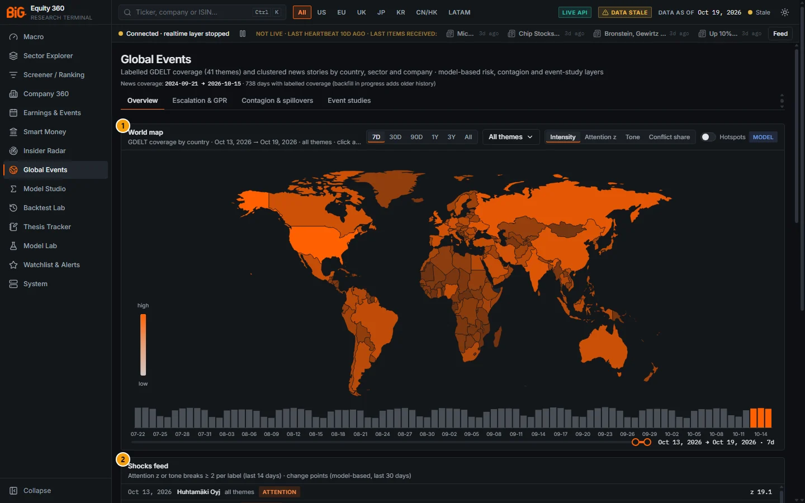

*Figure 8.1: Global Events, Overview tab (`/events?tab=overview`), window 13-19 Oct 2026, data as of 19 Oct 2026.*

| # | Panel | What it shows |
|---|---|---|
| 1 | World map | GDELT coverage by country for the selected window: intensity, attention z, tone or conflict share, with an optional hotspot overlay and a time slider of daily article counts. |
| 2 | Shocks feed | Labels with attention z or tone breaks ≥ 2 in the last 14 days, then model-based change points of the last 30 days. |
| 3 | What's moving | Top stories by salience in the window, with filters for country, sector, ticker, theme, tone and minimum sources. |
| 4 | Country × theme heatmap | Maximum daily attention z per country and theme in the window (or relative attention when z is not available). |

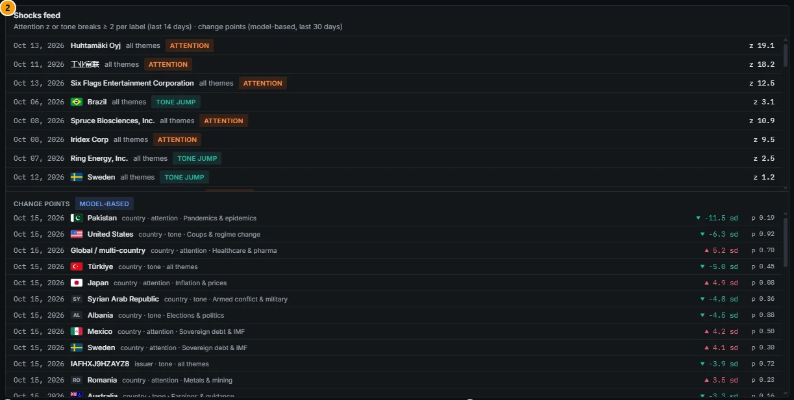

*Figure 8.2: Shocks feed (top) and change points (bottom).*

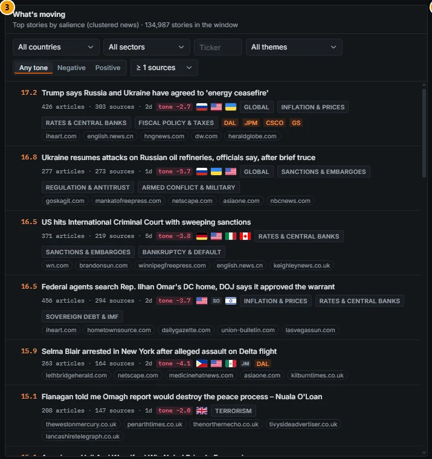

*Figure 8.3: What's moving, 7-day window; 134,987 stories in the window.*

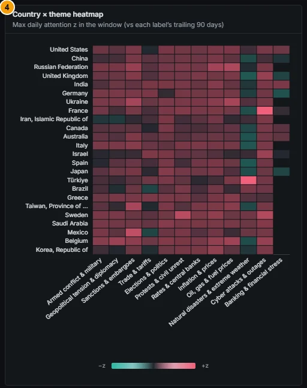

*Figure 8.4: Country × theme heatmap (maximum daily attention z vs each label's trailing 90 days).*

### Controls

#### World map (panel 1)

| Control | What it does |
|---|---|
| History range `7D` `30D` `90D` `1Y` `3Y` `All` | Sets the map window (ending on the snapshot's as-of date) and the span of the time slider (at least 90 days). Ranges above one year use weekly bars. `All` starts at the first covered date (maximum 2,600 days). |
| Themes (multi-select, "All themes") | Restricts the map, the story list and the heatmap to up to 12 themes, grouped by taxonomy group. "All themes" clears the selection. With one theme selected, the story list and hotspot overlay use it; with two or more, the heatmap shows them as columns. |
| Map metric `Intensity` `Attention z` `Tone` `Conflict share` | Chooses what colours the countries (see Methodology). |
| Hotspots switch (MODEL badge) | Overlays Getis-Ord Gi* hot and cold spots (fill colour, 90 / 95 / 99%) and emerging-hotspot markers. A caption gives the theme, measure, week, global Moran's I with its p-value and the spatial weights used. |
| Click a country | Filters What's moving to that country; click it again to clear. Drag to pan and scroll to zoom (1× to 8×). |
| Hover a country | Tooltip with intensity, maximum attention z, tone, conflict share and events / articles; with the overlay on, also the Gi* class and z, the LISA quadrant and p-value, and the emerging-hotspot class. |
| Time slider (two thumbs) | Selects a custom window inside the slider span; the bar chart above it highlights the selected days. Releasing a thumb applies the window to the map, the stories and the heatmap. The text on the right shows the dates and the number of days. |

When attention z is selected but not yet available for the window, a "no data" badge explains that the z baseline needs 90 days of history.

#### Shocks feed (panel 2)

The upper list shows up to 50 shocks of the last 14 days: date, flag, label name (country, sector or company), theme, a kind badge (**ATTENTION**, **TONE DROP**, **TONE JUMP**) and a z value. The lower list (**CHANGE POINTS**, MODEL-BASED) shows up to 40 change points of the last 30 days: date, label, label type, stream (attention or tone), theme, the shift in standard deviations of the previous regime (▲ up, ▼ down, ■ flat) and the change-point probability `p`. Both lists scroll.

#### What's moving (panel 3)

| Control | What it does |
|---|---|
| Country | All countries, GLOBAL, or one country. Kept in sync with the map click. |
| Sector | All sectors or one of the 11 sectors. |
| Ticker | A security id or ticker; only stories linked to it are shown. |
| Theme | All themes (or "Map theme" when one theme is selected on the map) or one theme. |
| Tone `Any tone` `Negative` `Positive` | Negative = mean tone ≤ −2; Positive = mean tone ≥ +2. |
| Minimum sources `≥ 1` `3` `10` `25` `50` | Hides stories carried by fewer distinct sources (applied in the browser to the 60 stories fetched). |
| Story headline | Opens the **story drawer** (below). |
| Ticker chips | Open the linked company's Company 360 on the Event risk tab. Hover for the name and link relevance. |

Each row shows the salience score (left), the headline, articles · sources · days, a tone chip (rose ≤ −2, teal ≥ +2, grey otherwise), up to four country flags, three theme badges, up to four linked tickers and up to five source domains. The list shows the top 25 rows.

#### Story drawer

Clicking a headline opens a side drawer with: the article, source and GDELT event counts; the tone chip and, when available, the story sentiment marked "(model)"; first and last seen times; an **Articles per hour** chart; **Linked securities** with their relevance (each opens Company 360 › Event risk); **Sources** (domains with article counts); **Languages**; **Labels** (country codes link to the country macro page, plus sector and theme badges); and **Representative articles** (up to three external links). Close it with the × button or Esc.

#### Country × theme heatmap (panel 4)

The rows are the 24 countries with the most articles in the window (GLOBAL excluded); the columns are the themes selected on the map when two or more are selected, otherwise 12 default themes (armed conflict, geopolitical tension, sanctions, trade, elections, protests, rates and central banks, inflation, oil and gas, natural disasters, cyber, banking stress). Hover a cell for the value and the article count; click a cell to filter the story list to that country. A **z pending** badge appears when the heatmap falls back to relative attention.

#### Companies affected and label panels

Stories carry their linked securities, so the ticker chips in What's moving and the drawer's Linked securities list are the page's "companies affected" view. For a single company or country, the same data is presented as a **label event panel**: Company 360 › Event risk (title "Company events") and each country macro page (title "Events") show a coverage and tone chart, the theme mix, recent shocks and the top 15 stories for that label, with its own range selector (`7D` to `All`, default 90D) and an **Open Global Events** link. See [Company 360 › Event risk](05c-company-macro-events-model.md#event-risk).

### Methodology

**Map metrics** (country rows of the daily aggregates over the window, all themes or the selected ones):

```
intensity      = ln(1 + events + articles) / max over countries of ln(1 + events + articles)   (0-100%)
attention z    = maximum daily attention_z in the window
tone           = mean GDELT tone (article tone, else event tone), weighted by items
conflict share = events with CAMEO quad class 3-4 (verbal or material conflict) / all events
```

**Hotspot overlay** (MODEL). Weekly, per theme and measure (attention, tone or intensity; the conflict-share metric uses attention), the job `event_hotspots` computes on the country map with queen-contiguity weights (islands linked to their nearest neighbour):

- global **Moran's I** and local **LISA** with 499 permutations (quadrants HH / LL / HL / LH kept at p < 0.05);
- **Getis-Ord Gi\*** z-scores, classed as hot or cold spots at 90%, 95% and 99% (p < 0.10, 0.05, 0.01);
- ESRI-style **emerging-hotspot** classes over the weekly history (new, consecutive, intensifying, persistent, diminishing, sporadic, oscillating, historical), using a Mann-Kendall trend test at p < 0.05. Markers on the map use one symbol per class, rose for hot and blue for cold.

**Shocks feed.** Label-days in the last 14 days with attention z ≥ 2 or |tone z| ≥ 2 and at least 20 items (5 for a company). The kind is *attention* when attention z ≥ 2 and at least as large as |tone z|, otherwise *tone drop* or *tone jump*. Sorted by the larger of attention z and |tone z|.

**Change points** (MODEL-BASED). Bayesian online change-point detection (Adams and MacKay 2007) on the daily attention and tone streams of each country, sector and the 300 most-covered issuers, per theme, over the last 365 days. The model is Gaussian with unknown mean and variance (Normal-Gamma prior) and a constant hazard of 1/100 (an expected regime length of 100 days). A change point is reported with its probability, the shift in standard deviations of the previous regime and its direction (|shift| < 0.5 sd is "flat").

**Salience** of a story (model-free):

```
salience = ln(1 + articles) + ln(1 + sources) + 0.5 · ln(1 + GDELT events) + |tone| / 5 + link bonus
link bonus = 1.0 if a security link has relevance ≥ 80, 0.5 for any weaker link, else 0
```

**Heatmap.** Each cell is the maximum daily attention z of that country and theme in the window. When no z exists for the window, the cell is the **relative attention** `log₂( (country's theme articles / all theme articles) / (country's articles / all articles) )`, so positive means the country is over-represented in that theme.

### Data sources and refresh

Daily aggregates and stories from the nightly GDELT and news jobs (see [Global Events](#global-events)); hotspots and change points nightly. The default 7D window ends on the snapshot's as-of date (19 Oct 2026 on the screenshot, window 13-19 Oct), which can be a few days after the last covered GDELT day (15 Oct 2026 in the coverage line), so the last days of a window may be partial.

### Validation status

- Map, shocks, stories, salience and heatmap are **descriptive** (counts and z-scores); no validation gate applies. Label precision: see the spot check under [Global Events](#global-events).
- **Change points** (MODEL-BASED): calibrated on the detector's own tests at about **0.13 false alarms per 200 days and 97% detection of 1.5 sd shifts** (EVENTS_MODELS_REALTIME_PLAN C2). Not validated as a predictor of market moves.
- **Hotspots** (MODEL): permutation inference re-implemented to match the reference `esda` library; a statistical description of spatial clustering, not a forecast. No gate.

### Correct usage and worked example

Use the map to find where attention is unusual, not where it is large: the United States always has the highest intensity, so switch to **Attention z** to see what is abnormal for each country.

*Worked example (7D window, 13-19 Oct 2026).* On **Intensity** the United States is at 100% (158,069 events and 90,865 articles). Switching to **Attention z** shows the Russian Federation at 1.66 against 0.93 for the United States, with a tone of −2.86 and a conflict share of 37%. Clicking Russia filters What's moving; the top story overall that week is "Trump says Russia and Ukraine have agreed to 'energy ceasefire'" with salience 17.2 (426 articles, 303 sources, 2 days, tone −2.7). Its drawer lists the linked countries (RU, US, UA, GLOBAL) and the representative articles. The same story also carries the tickers DAL, JPM, CSCO and GS: these come from the issuer linker and should be checked against the articles before you treat them as affected companies.

### Limitations and pitfalls

- **Intensity is relative to the largest country in the window**, so it changes when you change the window or the themes; compare countries within one view only.
- In the shocks feed, the number on the right is the **attention z when it exists, even on a tone row**; the tone z is shown only when attention z is missing.
- Change-point arrows are coloured by direction only (▲ rose, ▼ teal). A ▼ on a *tone* stream is a deterioration even though it is teal.
- Small companies produce very large attention z from a handful of articles (for example z 19.1 for Huhtamäki on 13 Oct 2026 from 4 events and 4 articles). The feed requires at least 5 items for a company, which is still few.
- Theme labels are broad: a single story can carry 10 or more themes (the ceasefire story above has 19), so theme filters and heatmap cells over-count multi-topic stories.
- Ticker links are the weakest label in the spot check after themes; a story linking JPM or GS to a ceasefire headline is usually a mention, not an exposure.
- The minimum-sources filter is applied to the 60 stories fetched, so it can return fewer than 25 rows.

### Related mnemonics and BQL fields

- `EVTS AAPL` (or `AAPL EVTS`) opens the company's Event risk tab with its label panel; see [Mnemonic reference](14-bql-mnemonics.md#mnemonic-reference).
- BQL: `attention_z`, `sent.news_count_z`, `sent.gdelt_tone_ewm_7d`.

---

## Escalation & GPR

**Route:** `/events?tab=risk` · **Menu:** Global Events › Escalation & GPR · **Refresh:** nightly (`event_escalation`, `event_gpr`; published GPR downloaded weekly)

### Purpose

This tab holds two model-based risk views. **Escalation probabilities** ask whether the recent burst of events in a country and theme group is likely to continue above its usual level in the next 7 or 30 days. The **geopolitical risk index (GPR)** gives a daily, country-level index of geopolitical coverage, compared with the published Caldara-Iacoviello index. Both are for monitoring and for ranking where to look; neither is a trading signal.

### Screenshot

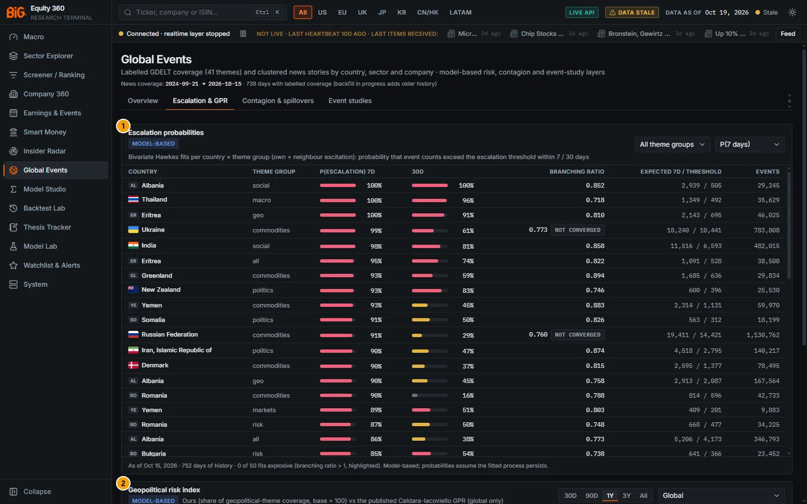

*Figure 8.5: Escalation & GPR tab (`/events?tab=risk`), as of 15 Oct 2026.*

| # | Panel | What it shows |
|---|---|---|
| 1 | Escalation probabilities | Bivariate Hawkes fits per country × theme group: P(escalation) within 7 and 30 days, branching ratio, expected 7-day count vs threshold, total events. |
| 2 | Geopolitical risk index | Our daily GPR (daily and 7-day average) against the published Caldara-Iacoviello GPR, with correlations and the countries with the highest 7-day GPR. |

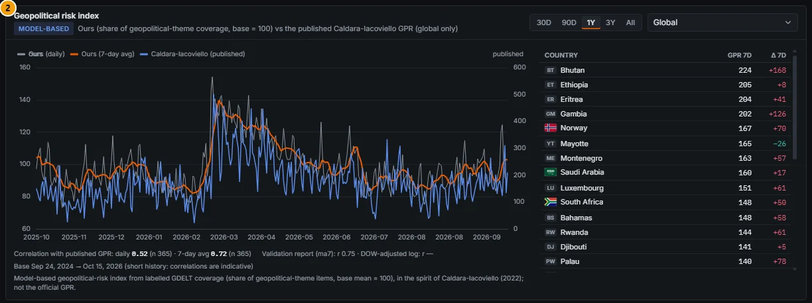

*Figure 8.6: Geopolitical risk index, Global, 1Y range.*

### Controls

| Control | What it does |
|---|---|
| Theme group (Escalation) | All theme groups (also lists the fits on all themes together, group "all"), or one group: commodities, corporate, geo, macro, markets, policy, politics, risk, sector, social, tech. |
| Sort (Escalation) | `P(7 days)` (default), `P(30 days)`, `Branching ratio`, `Expected 7d`. The table shows the top 50 fits with at least 100 events. |
| **explosive** badge | Shown when the branching ratio is above 1; hover: "Raw branching ratio > 1: the self-exciting fit is explosive (non-stationary), so the probabilities are not reliable." The row is highlighted. |
| **not converged** badge | The estimation did not converge; read the row with extra caution. |
| GPR history range `30D` `90D` `1Y` `3Y` `All` | Chart window (default 1Y). |
| Country (GPR) | Global (default) or a country from the top-30 list. Clicking a row of the country table does the same. |
| Chart legend | Toggle *Ours (daily)*, *Ours (7-day avg)* and *Caldara-Iacoviello (published)*. |

The footer of the escalation table gives the as-of date, the days of history and the number of explosive fits. Under the GPR chart, the panel shows the correlation of our index with the published one for the visible window (daily and 7-day average, with n), the latest validation-report figures, the base period and the full model label.

### Methodology

#### Escalation (bivariate Hawkes process)

For each country and theme group, daily event counts are modelled as a self-exciting process with a second series for the country's neighbours:

```
λ_k(t) = μ_k · s_k(day of week) + Σ_j α_kj · Σ_{l≥1} g(l) · N_j(t − l)
g(l)   = (1 − e^(−β)) · e^(−β(l − 1))
```

- `μ` is the background rate with a day-of-week factor (the weekly news cycle).
- `α_kj` is the expected number of type-k events triggered by one type-j event (own country and neighbours). The **branching ratio** is the spectral radius of the α matrix: below 1 the process is stable; above 1 it is explosive.
- Estimation by EM on the latent branching structure, with β chosen by profile likelihood on a grid.
- **Escalation probability:** 2,000 Monte-Carlo continuations of the fitted process from today's state, with negative-binomial over-dispersion. The **threshold** is the 90th percentile of the country's own historical rolling 7-day (30-day) counts. P(escalation 7d) is the share of paths whose next-7-day count exceeds the threshold; likewise for 30 days. **Expected 7d** is the mean path.

#### Geopolitical risk index

```
share_t = items with geopolitical themes / all labelled items (events + articles of the country-day)
GPR_t   = 100 · share_t / mean(share over the base window)
```

- Geopolitical themes: *threats* (geopolitical tension, sanctions, trade and tariffs) and *acts* (armed conflict, terrorism, coups and regime change); both sub-indices are also computed.
- Base window: calendar 2021 when covered; until then, all days covered so far (currently 24 Sep 2024 → 15 Oct 2026).
- The table shows the 7-day average (GPR 7D) and its change over 7 days (Δ 7D).
- The published Caldara-Iacoviello daily (GPRD) and monthly country (GPRC) indices are downloaded weekly as the reference.

### Data sources and refresh

Labelled GDELT daily aggregates (country × theme); neighbours from the Natural Earth contiguity weights. Published GPR from matteoiacoviello.com (cached, refreshed weekly). Both models rerun nightly after `events_agg`.

### Validation status

- **Escalation probabilities: not formally validated.** There is no out-of-sample calibration test of the 7- and 30-day probabilities. The app labels the panel **MODEL-BASED** and states in its footer: "Model-based; probabilities assume the fitted process persists." Explosive fits are flagged and should be disregarded.
- **GPR: model-based, compared with the published index; no pass / fail gate.** The panel's label reads: "Model-based geopolitical-risk index from labelled GDELT coverage (share of geopolitical-theme items, base mean = 100), in the spirit of Caldara-Iacoviello (2022); not the official GPR." The validation report of 20 Oct 2026 (window 24 Sep 2024 → 15 Oct 2026, 735 days) gives:

| Comparison | Result |
|---|---|
| Daily global level vs GPRD | Pearson 0.323, Spearman 0.188 (n 735) |
| 7-day average vs GPRD | Pearson 0.747, Spearman 0.562 (n 729) |
| Threats / acts sub-indices | Pearson 0.320 / 0.376 |
| Monthly cross-section of 44 countries vs GPRC | Spearman 0.83 to 0.92 each month (23 months) |
| Monthly time series per country vs GPRC | median Pearson 0.56; from −0.03 (Hong Kong) to 0.90 (Denmark) |

In short: our index ranks countries much like the published one and tracks its weekly swings reasonably, but day-to-day values are noisy and some countries (Japan 0.18, China 0.21, Hong Kong −0.03) track poorly. The panel itself warns "short history: correlations are indicative".

### Correct usage and worked example

Read the escalation table as a ranked watch-list of *where coverage is running hot relative to its own history*, then check the stories on the Overview tab. Compare **Expected 7d** with the **threshold** before reading the probability.

*Worked example (as of 15 Oct 2026, theme group geo).* Eritrea shows P(escalation 7d) 99.7% (displayed 100%), P(30d) 90.7%, branching ratio 0.810, expected 7-day count 2,143 against a threshold of 695, from 46,025 events. The fitted process expects about three times its own 90th-percentile weekly count, so almost every simulated path crosses the threshold: the model says the recent burst is large and self-sustaining, not that a conflict will escalate. Probabilities near 100% with expected counts far above the threshold (Albania social: 2,939 vs 505 on the screenshot) usually reflect a recent spike in coverage of a small country.

For GPR, select **Global** and **1Y**: on 15 Oct 2026 our 7-day average is 102.9 (daily 90.8), and over the visible year the correlation with the published index is 0.52 daily and 0.72 for the 7-day average (n 365). The marked jump in early March 2026 appears in both series.

### Limitations and pitfalls

- Escalation probabilities are **not calibrated over history** and must not be read as "X% chance of escalation". They describe the fitted counting process of news coverage.
- The threshold is relative to each country's own history, so small countries with low baselines dominate the top of the table.
- Fits marked *not converged* (for example Ukraine and Russia commodities on the screenshot) or *explosive* are unreliable.
- GPR is a share of coverage: a quiet news day elsewhere raises it; translation and source coverage changes in GDELT move it.
- The country table is led by small countries with volatile shares (Bhutan 224 with +168 in a week); use the 7-day average and a longer range before drawing conclusions.
- The published index is global only on a daily basis; country lines have no daily reference.

### Related mnemonics and BQL fields

No mnemonic opens this tab directly; type `Global Events` in the command bar or use the menu. There are no BQL fields for escalation or GPR.

---

## Contagion & spillovers

**Route:** `/events?tab=contagion` · **Menu:** Global Events › Contagion & spillovers · **Mnemonics:** `NET` (no security) · **Refresh:** connectedness nightly; spillovers and impulse responses weekly

### Purpose

This tab measures how shocks travel between markets. The **contagion network** shows which equity markets or sectors transmit volatility and returns to others. **Spatial spillovers** estimate whether news attention in neighbouring countries moves a country's market beyond the effect of its own news. **Impulse responses** trace the response of returns or volatility to a news-attention shock over 10 days. It is used by cross-asset and country strategists to judge whether a local event is likely to stay local.

### Screenshot

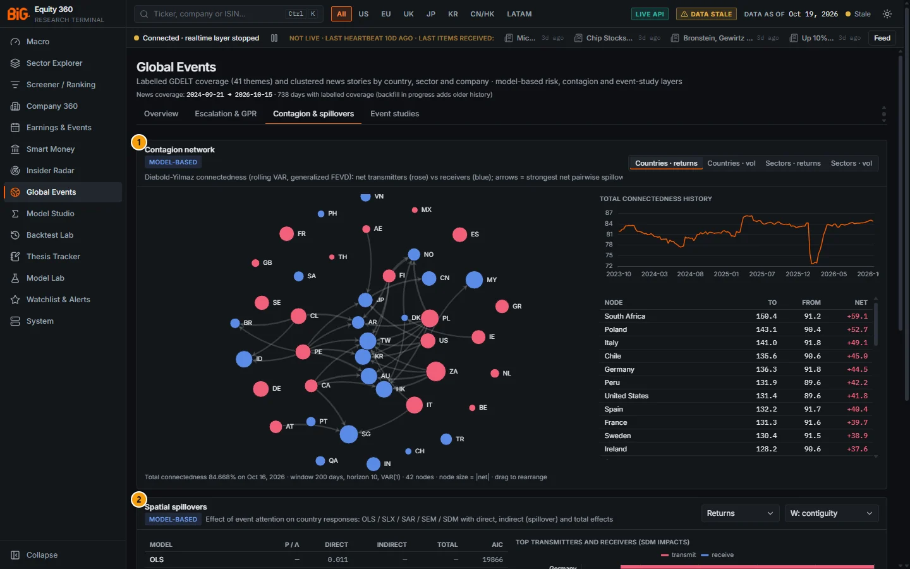

*Figure 8.7: Contagion & spillovers tab (`/events?tab=contagion`), countries · returns, 16 Oct 2026.*

| # | Panel | What it shows |
|---|---|---|
| 1 | Contagion network | Diebold-Yilmaz connectedness network: net transmitters (rose) and receivers (blue), arrows for the strongest net pairwise spillovers, total connectedness history and a To / From / Net table. |
| 2 | Spatial spillovers | OLS / SLX / SAR / SEM / SDM panel models of event attention on country responses: direct, indirect (spillover) and total effects, diagnostics, and top transmitters and receivers. |
| 3 | Impulse responses | Response of returns or volatility to a 1-sd event-attention shock: own and spatial components with 95% bands. |

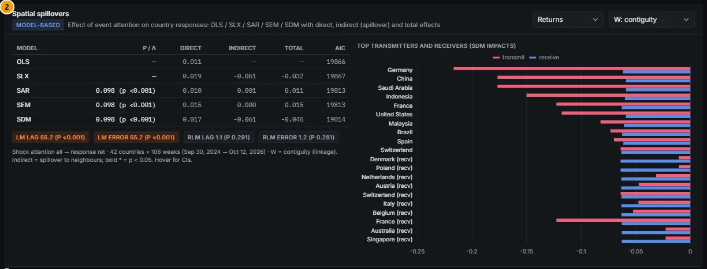

*Figure 8.8: Spatial spillovers, response returns, W contiguity.*

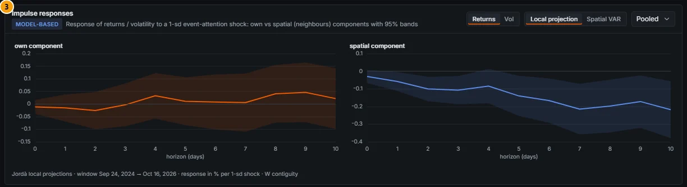

*Figure 8.9: Impulse responses, returns, local projection, pooled.*

### Controls

| Control | What it does |
|---|---|
| Universe `Countries · returns` `Countries · vol` `Sectors · returns` `Sectors · vol` | Network data set: 42 country equity indices or 11 US sector ETFs, on daily returns or on range-based volatility. |
| Network | Drag nodes to rearrange, scroll to zoom; hover a node for to / from / net, hover an arrow for the net pairwise spillover in percentage points. Node size is proportional to the absolute net value. |
| Response (spillovers) | Returns, Volatility or Macro surprise. |
| Weights (spillovers) | `W: contiguity` or `W: inverse distance` (the spatial weight matrix). |
| Effect cells | Bold with * when p < 0.05; hover for the confidence interval and p-value. |
| Response `Returns` `Vol` (impulse responses) | Which response to show. |
| Model `Local projection` `Spatial VAR` | Panel local projections or a pooled spatial VAR(1). |
| Scope | Pooled (all countries) or one of the eight largest markets (spatial VAR). |

### Methodology

**Connectedness (Diebold-Yilmaz).** A rolling VAR(1) with ridge shrinkage (0.05) on a 200-day window, moved forward 5 days at a time from 2012, with a 10-day horizon generalised forecast-error variance decomposition. For each market:

```
to others   = share of other markets' forecast-error variance due to this market's shocks
from others = share of this market's variance due to other markets
net         = to − from      (> 0: transmitter, < 0: receiver)
total       = average off-diagonal share (%), shown as "Total connectedness"
```

Volatility uses the Parkinson high-low range estimator. Arrows are the strongest net pairwise spillovers.

**Spatial spillovers.** A country × week panel (daily when the data allow) with two-way fixed effects. The shock is event attention (all themes); the response is the country index return, its range volatility or the change in its macro surprise index. Models:

- **OLS-FE** (no spatial term), **SLX** (adds neighbours' shock W·x), **SAR** (spatial lag of the response, ρ), **SEM** (spatial error, λ), **SDM** (SAR plus W·x), estimated by maximum likelihood.
- Direct, indirect (spillover to neighbours) and total effects by the LeSage-Pace decomposition, with Monte-Carlo inference (500 draws).
- Lagrange-multiplier diagnostics: LM lag, LM error and their robust versions.
- The bar chart gives each country's transmit and receive spillover from the SDM impacts.

**Impulse responses.** Jordà panel local projections of returns or volatility on the own shock and the spatially lagged shock, with Driscoll-Kraay standard errors, for horizons 0 to 10 days; or a pooled spatial VAR(1) with simulation bands (300 draws). Responses are in % per 1-sd attention shock.

### Data sources and refresh

Daily index and sector ETF prices from the price history (country indices from 2012); weekly country attention from the labelled GDELT aggregates; spatial weights (contiguity, inverse distance) from the linkage data (Natural Earth). Connectedness is updated nightly after prices; spillovers and impulse responses weekly.

### Validation status

**Not formally validated; MODEL-BASED.** These are in-sample econometric estimates with standard inference (p-values, confidence bands, LM tests); the panel badges read MODEL-BASED. The estimators were checked to reproduce reference libraries (spreg ML lag for the spatial models, esda for Moran / LISA), which is a correctness check, not evidence of predictive value. No out-of-sample test of spillover forecasts exists.

### Correct usage and worked example

Use connectedness to judge the *regime* (high total connectedness means diversification across markets is weak) and to see who leads; use spillovers and impulse responses to ask whether news attention spreads.

*Worked example (countries · returns, 16 Oct 2026).* Total connectedness is 84.67% (window 200 days, horizon 10, VAR(1), 42 nodes), close to the top of its range since 2023 apart from a brief fall to about 72% around the start of 2026. The largest net transmitters are South Africa (+59.1: to 150.4, from 91.2), Poland (+52.7) and Italy (+49.1); the largest receivers are Singapore (−54.6), Malaysia (−50.9) and Taiwan (−50.2). In the spillover panel (returns, contiguity, 42 countries × 106 weeks), the spatial parameter is 0.098 (p < 0.001) in SAR, SEM and SDM; the direct effect of attention is small (0.010 to 0.019) and the SDM indirect effect is −0.061. LM lag and LM error are both 55.2 (p < 0.001) but the robust versions are not significant (1.1 and 1.2), so the data cannot tell a spatial-lag model from a spatial-error model. The impulse responses show an own component close to zero at every horizon, and a spatial component drifting to about −0.2% by days 7 to 10 with a band mostly below zero.

### Limitations and pitfalls

- Connectedness in returns is high almost everywhere in a global sell-off; a high total is a description of co-movement, not causality.
- Node colours depend on the sign of net, so a market near zero can flip between transmitter and receiver from one window to the next.
- Spillover models are estimated on about two years of attention data; effects are small and sensitive to the weight matrix. Compare contiguity with inverse distance before relying on a sign.
- Responses are for country indices and US sector ETFs only, not individual companies.
- Asian markets close before European news arrives, so daily return linkages partly reflect time zones.

### Related mnemonics and BQL fields

- `NET` with no security opens this tab; `AAPL NET` opens Company 360 › Network & Geo. See [Mnemonic reference](14-bql-mnemonics.md#mnemonic-reference).
- The same spatial methods are available in Model Studio (spatial lag, spatial error, spatial Durbin, Moran / LISA, connectedness, local projection): see [Model Studio](09-model-studio.md#model-studio).

---

## Event studies

**Route:** `/events?tab=studies` · **Menu:** Global Events › Event studies · **Refresh:** weekly (`event_study_library`)

### Purpose

The event-study library records how markets moved after past labelled news shocks, by theme × country × sector, at three levels (country index, sector ETF, individual issuers). It provides an "expected reaction" reference for a new shock of the same kind. The second panel sends the shock dates of any country, sector or company to Model Studio as a ready-made event study, so you can run your own analysis on your own entity.

### Screenshot

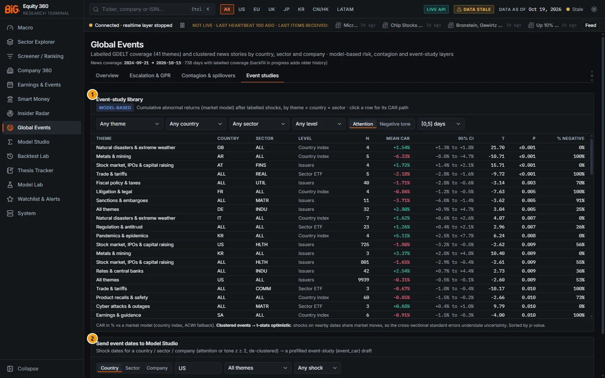

*Figure 8.10: Event studies tab (`/events?tab=studies`), attention shocks, window [0,5].*

| # | Panel | What it shows |
|---|---|---|
| 1 | Event-study library | Cells of mean cumulative abnormal return (CAR) after shocks, with n, 95% CI, t, p and the share of negative CARs, sorted by p-value. Click a row for its CAR path. |
| 2 | Send event dates to Model Studio | The de-clustered shock dates of a chosen country, sector or company, with a **Send to Model Studio** button that opens a prefilled event study. |

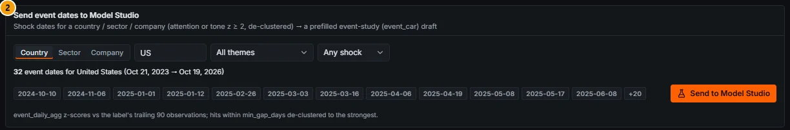

*Figure 8.11: Send event dates to Model Studio, United States, all themes, any shock.*

### Controls

#### Event-study library

| Control | What it does |
|---|---|
| Theme | Any theme, "All-theme shocks" (shocks on total coverage) or one theme. |
| Country | Any country, "Pooled (ALL)" or one country. |
| Sector | Any sector, "Pooled (ALL)" or one sector. |
| Level | Any level, Country index, Sector ETF or Issuers. |
| Shock kind `Attention` `Negative tone` | Which shock definition the cells use. |
| Window `[-1,5]` `[0,1]` `[0,5]` `[0,10]` days | The CAR window in trading days around the shock. |
| Click a row | Opens a **CAR path** panel below the table for that cell. |

The table shows up to 100 cells with at least 3 events. The **CAR path** panel joins the stored windows [0,1], [0,5] and [0,10] into a line with a 95% band, shows [−1,5] as a separate diamond at day 5, labels each point with its number of events, and gives the shock dates covered and the benchmark.

#### Send event dates to Model Studio

| Control | What it does |
|---|---|
| Label type `Country` `Sector` `Company` | Switches the entity type (defaults: US, TECH, AAPL). |
| Entity | ISO2 code, sector, or security id / ticker. |
| Theme | All themes or one theme. |
| Shock kind | Any shock, Attention, Tone drop, Tone jump. |
| Date badges | The first 12 event dates; "+N" for the rest. |
| **Send to Model Studio** | Opens Model Studio's builder with a new event-study draft (disabled when there are no dates). |

### Methodology

**Library.** For each labelled shock (attention or negative-tone z ≥ 2 on the label's daily aggregate), the abnormal return is measured with a market model and cumulated over the window:

- **Country index** level: country × theme shocks, country index against ACWI.
- **Sector ETF** level: sector × theme shocks, the US sector SPDR ETF against SPY.
- **Issuers** level: issuer shocks, the primary security against its country index (ACWI fallback); the theme is the issuer's dominant article theme that day, plus "all".

Per cell: number of events, mean and median CAR (%), standard error, 95% CI, t-statistic, p-value, mean buy-and-hold abnormal return and the share of negative CARs. The footer warns: "**Clustered events → t-stats optimistic**: shocks on nearby dates share market moves, so the cross-sectional standard errors understate uncertainty."

**Event dates for Model Studio.** Days on which the label's attention z (or tone z) reaches 2 against its trailing 90 observations, over the last 1,095 days; hits within 5 days of each other are de-clustered to the strongest, up to 200 dates. The app's caption reads: "event_daily_agg z-scores vs the label's trailing 90 observations; hits within min_gap_days de-clustered to the strongest."

**The draft sent to Model Studio** is an `event_car` study named "Event study · ‹label› · ‹theme› (‹kind›)": daily panel, market model, estimation window [−250, −30], event window [−5, +10], daily total return as the dependent variable, entity level country, sector or security, universe mvp_global primary listings (for a company: restricted to the company's sector, so its sector peers form the equal-weight market), starting on 1 January two years before the first event.

### Data sources and refresh

Shocks from the labelled GDELT daily aggregates; returns from the price history (country indices, US sector SPDRs, ACWI and SPY, issuer primary listings). The library is rebuilt weekly; event dates are read live from the serving snapshot.

### Validation status

**Not formally validated; MODEL-BASED.** The cells are historical in-sample averages with conventional t-tests. Two facts limit their weight:

- Of the first 2,000 cells for attention shocks at [0,5], **1,468 have fewer than 10 events**, and only **115 have p < 0.05**, about what chance alone would produce at a 5% threshold across that many cells.
- Shocks cluster in time, so the t-statistics are optimistic, as the panel states.

The library is also the source of the News Terminal's "impact estimate", which is labelled "Model-based: historical average reaction of similar labelled events (event-study library), not a forecast".

### Correct usage and worked example

Filter to the theme, country or sector you care about, prefer cells with many events, check that the CI excludes zero *and* that the share of negative CARs agrees with the sign, then open the CAR path.

*Worked example.* The top cell for attention shocks at [0,5] is Natural disasters & extreme weather · GB · Country index: n = 4, mean CAR +1.54%, 95% CI +1.3% to +1.8%, t 21.70, p < 0.001, 0% negative. Four events are far too few, and the very tight interval comes from four similar values, not from robustness; treat it as an anecdote. A more informative cell is All themes · US · Issuers: n = 9,939, mean CAR −0.31% (CI −0.5% to −0.1%, p 0.009, 53% negative), a small average drift after attention shocks to US companies.

*Sending dates.* With Country, US, All themes, Any shock, the panel lists **32 event dates** between 21 Oct 2023 and 19 Oct 2026, the first being 2024-10-10. **Send to Model Studio** opens the builder with "Event study · United States · all themes (any)", start 2022-01-01, ready to run. See [Model Studio](09-model-studio.md#model-studio).

### Limitations and pitfalls

- Sorting by p-value across thousands of cells guarantees impressive-looking rows at the top; this is multiple testing, not discovery.
- History starts in late 2024 (coverage from 21 Sep 2024 and a 90-day z baseline), so most cells have few events. The library deepens as the GDELT backfill adds earlier years.
- Sector ETF cells use US sector ETFs even for non-US shocks.
- The CAR path joins three stored windows; it is not a daily path.
- When there are no dates, the Send panel explains that the z baseline needs 90 days of history.

### Related mnemonics and BQL fields

- Model Studio method `event_car`: see [Model Studio](09-model-studio.md#model-studio).
- Post-earnings event studies are covered separately in [Earnings & Events](06-earnings-events.md#earnings--events-calendar) and the BQL fields `earn.car_0_p5`, `pead.ear`.

---

## News Terminal

**Route:** `/news` (Live) and `/news/top` (Top stories; also `/news?view=top`) · **Menu:** News Terminal › Live / Top stories · **Mnemonics:** `N`, `TOP`, `CN` (with a ticker) · **Refresh:** live over server-sent events (target under 60 s from publication), hourly fold into the intraday store

### Purpose

The News Terminal is a fast, keyboard-first headline screen for the working day. It merges official sources (central banks, statistics offices, regulators, exchanges), publisher RSS headlines, Polygon news and GDELT's 15-minute web articles into one live list, groups near-duplicates into stories, colours them by model-based sentiment and lets you filter by ticker, watchlist, country, sector, theme, source tier and language. The detail pane shows the story's timeline, the price move of linked securities since first publication, related filings and GDELT events, and a model-based impact estimate. Alerts can notify you of watchlist news or a sudden burst of articles on a story.

### Screenshot

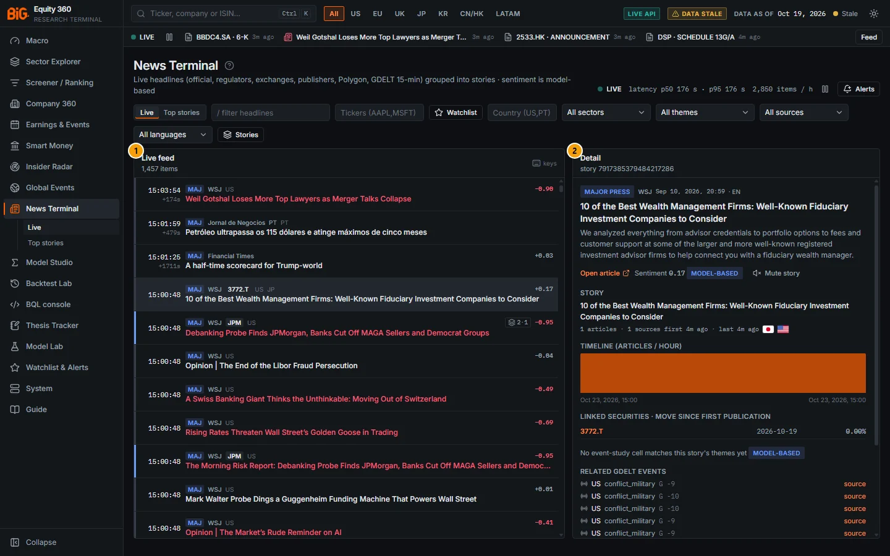

*Figure 8.12: News Terminal, Live view (`/news`), 23 Oct 2026 around 15:00, the fourth item selected with `j`.*

| # | Panel | What it shows |
|---|---|---|
| 1 | Live feed | The live list (1,457 items loaded): time first seen and latency, tier badge, publisher, tickers, countries, story size, sentiment and headline coloured by sentiment. |
| 2 | Detail | The selected item (WSJ, major press) and its story: timeline, linked securities with the move since first publication, impact estimate (here "No event-study cell matches this story's themes yet") and related GDELT events. |

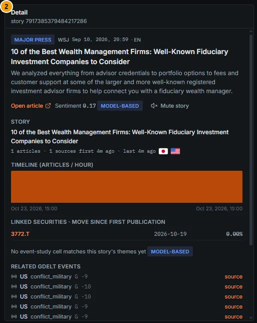

*Figure 8.13: Detail pane: item, story, timeline, linked security 3772.T, impact estimate and related GDELT events.*

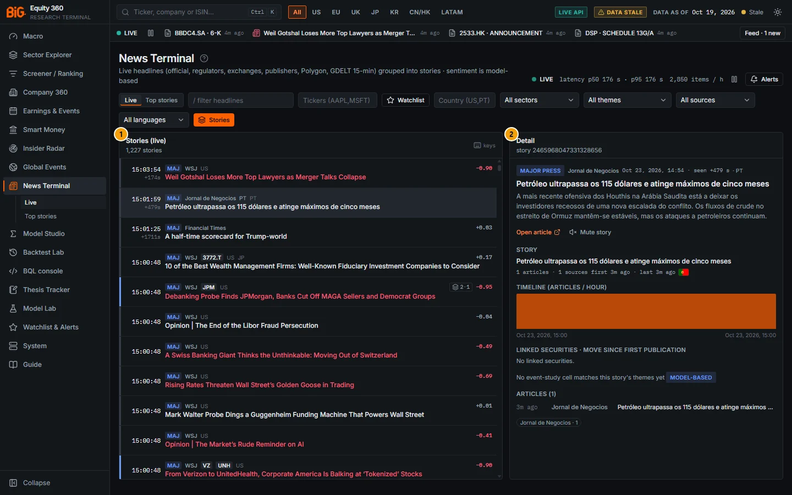

*Figure 8.14: Live view grouped by story (**Stories** on, 1,227 stories) with a Portuguese-language story open after `Enter`.*

| # | Panel | What it shows |
|---|---|---|
| 1 | Stories (live) | One row per story, headed by its newest item; the `n·sources` chip shows the story size. |
| 2 | Detail | The selected story (Jornal de Negócios, seen +479 s after publication): snippet, story counts, timeline, linked securities ("No linked securities"), impact estimate and the member articles. |

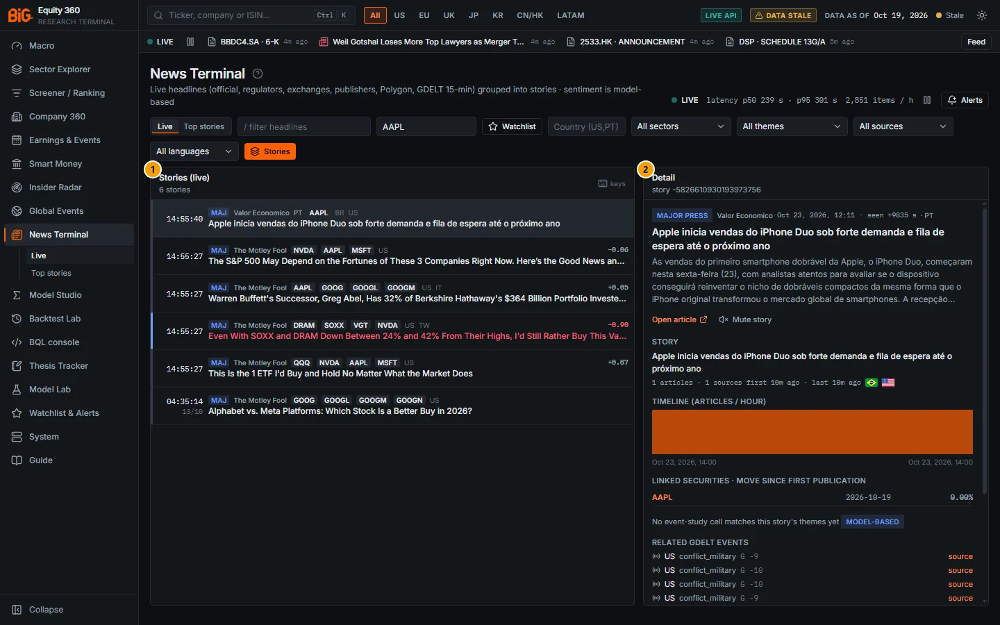

*Figure 8.15: Live view filtered on the ticker AAPL (`/news?ticker=AAPL`) and grouped by story: 6 stories.*

| # | Panel | What it shows |
|---|---|---|
| 1 | Stories (live) | The six stories linked to AAPL, with all their tickers (NVDA, MSFT, GOOG, ...). |
| 2 | Detail | The Valor Econômico story on the iPhone Duo: AAPL linked, base date 2026-10-19, move 0.00%. |

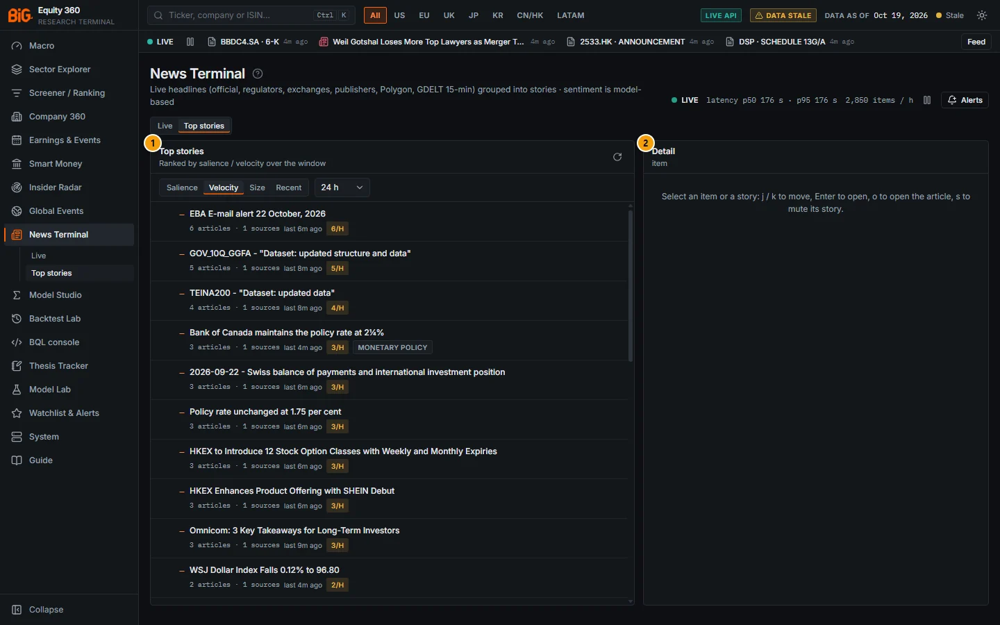

*Figure 8.16: Top stories view (`/news/top`), Sort = Velocity, window 24 h; nothing selected yet.*

| # | Panel | What it shows |
|---|---|---|
| 1 | Top stories | Stories ranked by velocity: articles · sources, last article time and the velocity badge (6/H, 5/H, ...). |
| 2 | Detail | Empty until a story is picked: "Select an item or a story: j / k to move, Enter to open, o to open the article, s to mute its story." |

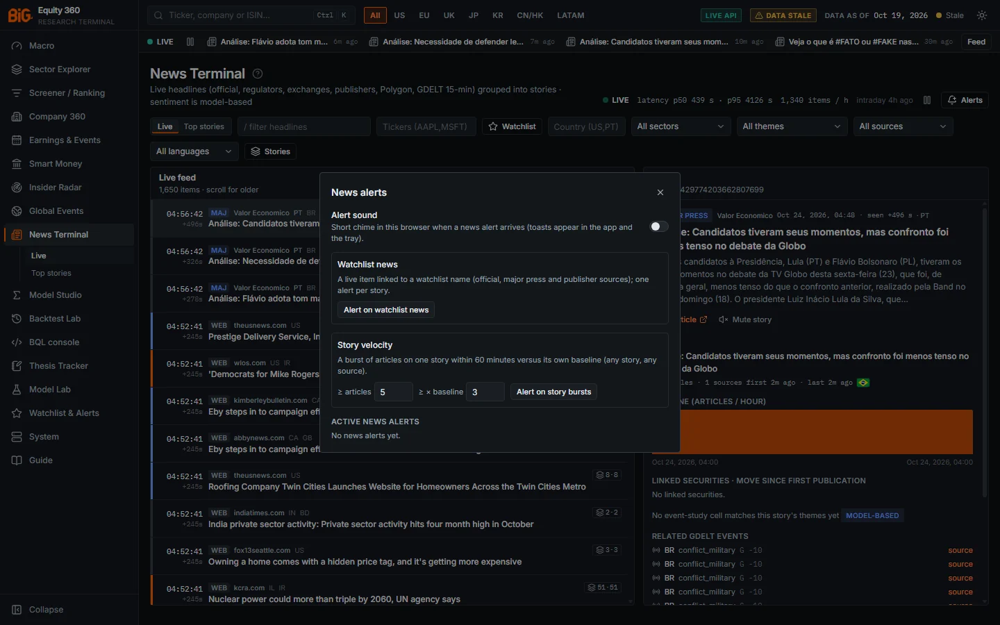

*Figure 8.17: News alerts dialog (**Alerts** in the header), 24 Oct 2026: alert sound, Watchlist news, Story velocity (defaults 5 articles, 3× baseline) and "No news alerts yet". The dialog covers the panel badges.*

The layout has three areas:

| Area | What it shows |
|---|---|
| Page header | Title, subtitle "Live headlines (official, regulators, exchanges, publishers, Polygon, GDELT 15-min) grouped into stories · sentiment is model-based", the live state, publication-to-bus latency (p50 / p95), items per hour, the intraday store age, a pause button and **Alerts**. |
| List panel (left) | **Live feed** (or **Stories (live)** when grouped), or **Top stories** in the Top view. |
| Detail panel (right) | The selected item and its story. |

### Controls

#### Header

| Control | What it does |
|---|---|
| **?** (next to the title) | Opens this section of the user guide. |
| Live state | **LIVE** (green, pulsing), **Connected · service stopped** (the stream is open but the realtime service is not running), **Connecting…**, **Reconnecting…**, **Disconnected · retrying**, **Paused** or **Off**. |
| latency p50 / p95 | Hover: "Publish -> bus latency (news.item first seen - source publication time) over recent items". |
| items / h | Items received in the last hour, all sources. |
| intraday ‹age› | When the hourly intraday store was last built. |
| Pause / Resume | Pauses the live stream; on resume, missed items are replayed from the last event id. |
| **Alerts** | Opens the [News alerts](#news-alerts) dialog. |

#### Filters (Live view)

| Control | What it does |
|---|---|
| View `Live` `Top stories` | Switches between `/news` and `/news/top`. |
| "/ filter headlines" | Free-text filter on headlines (sent to the server). |
| Tickers (AAPL,MSFT) | Comma- or space-separated tickers; applied on Enter or when you leave the box. |
| **Watchlist** | Shows only items linked to names on your watchlist (matched by security id or ticker). Shortcut `w`. |
| Country (US,PT) | ISO2 codes, applied when you leave the box. |
| Sector, Theme | One sector or one of the 41 themes. |
| Source tier | All sources; Official; Official + major; No GDELT web; GDELT web only. |
| Language | All languages, or EN, PT, ES, FR, DE, IT, JA, ZH, KO, RU, AR. |
| **Stories** | Groups items by story (one row per story, the newest item as head). Shortcut `g`. |
| "N muted · unmute" | Appears when stories are muted; restores them. |
| "N new" | Count of unread arrivals; click to mark all as read. |
| keys | Hover for the shortcut summary: "j / k move · / filter · w watchlist · o open · s mute story · g group · Enter detail". |

Filters can be set from the URL: `ticker` (or `tickers`), `country`, `sector`, `theme`, `tier`, `lang`, `q`, `watchlist=1` and `view=top`. The command `AAPL US CN` opens `/news?ticker=AAPL`.

#### Keyboard shortcuts

These work when the focus is not in a text box (they are ignored with Ctrl, Alt or Cmd held):

| Key | Action |
|---|---|
| `j` or `↓` | Select the next item. |
| `k` or `↑` | Select the previous item. |
| `/` | Focus the headline filter (on this page `/` does not open the command bar; use `Ctrl K`). |
| `Esc` | Leave a text box (returns the keys to the list). |
| `w` | Toggle watchlist-only. |
| `o` | Open the selected item's article in a new tab. |
| `s` | Mute the selected item's story (hidden until you unmute). |
| `g` | Toggle grouping by story. |
| `Enter` | Move the focus to the detail pane and scroll it into view. |

Selecting an item marks it as read.

#### List rows

Each row is 54 px high and shows:

- a **salience bar** at the left edge (none, grey, blue or orange for increasing salience);
- the **time first seen** (local, 24-hour clock), with the date when not today or, for recent items, the latency `+Ns` since publication;
- the **tier badge**: OFF (official), MAJ (major press), PUB (publisher), WEB (GDELT web);
- publisher, language when not English, up to four tickers and two countries;
- the **story size** `n·sources` (articles · distinct sources) when the story has more than one article;
- the **sentiment** score (hover: "Sentiment … (model-based: ‹model›)");
- an **unread dot**; new arrivals flash for 3 seconds;
- the headline, in bold when unread and coloured teal / rose when the sentiment is positive / negative.

The list is virtualised: only the visible rows are drawn, and older rows load as you scroll (up to 6,000 from the server; the live buffer keeps 8,000).

#### Top stories view

| Control | What it does |
|---|---|
| Sort `Salience` `Velocity` `Size` `Recent` | Salience (score, then articles); Velocity (articles in the last hour, then the ratio to the story's baseline); Size (articles, then sources); Recent (last article time). |
| Window `6 h` `24 h` `3 d` `7 d` | Stories with an article in the window (up to 150 listed, refreshed every minute). |
| Refresh (circular arrow) | Reloads the top stories from the server and clears the selected story. |
| Story row | Salience, headline, articles · sources, "last ‹time› ago", a velocity badge `N/h`, up to three tickers and two themes. Click to show it in the detail pane. |

#### Detail pane

With nothing selected, the pane reads: "Select an item or a story: j / k to move, Enter to open, o to open the article, s to mute its story." For a selected item it shows:

- **Item:** tier badge, publisher, publication time, "seen +N s" (hover: first seen by the live path minus source publication time), language, headline (coloured by sentiment), the ≤ 300-character snippet, **Open article**, the sentiment with a *model-based* badge, and **Mute story**.
- **Story:** headline; articles and sources (live counts); first and last seen; a velocity badge `N/h · R×` (hover: "articles in the last 60 min vs the story's own baseline"); flags, themes and the story sentiment.
- **Timeline (articles / hour):** the last 48 hours of the story.
- **Linked securities · move since first publication:** each linked security with the close before first publication (base date) and the move to the latest close; the ticker opens Company 360.
- **Impact estimate** (model-based): the mean CAR over [0,5] days of the closest event-study cell, its CI, n and p (the library stores CARs in percent, so "−1.37%" is shown as such; builds before 24 Oct 2026 multiplied it by 100 again and showed "−137.00%"), with the matched theme, country, sector and level and the label "Model-based: historical average reaction of similar labelled events (event-study library), not a forecast". When nothing matches: "No event-study cell matches this story's themes yet".
- **Related filings** (form type, title, age) and **Related GDELT events** (country, themes, Goldstein scale, source link), when any.
- **Articles (N):** up to 60 member articles, newest first, with age, publisher and link, then the top source domains.

#### News alerts

The **Alerts** button opens a dialog with:

| Control | What it does |
|---|---|
| Alert sound | A short chime in this browser when a news alert arrives (toasts appear in the app and the tray). Turning it on plays the chime once. |
| **Alert on watchlist news** | Creates a `watchlist_news` rule on your server watchlist: a live item from official, major press or publisher sources (tiers 1-3) linked to a watchlist name; one alert per story. |
| ≥ articles, ≥ × baseline, **Alert on story bursts** | Creates a `story_velocity` rule (defaults 5 articles in 60 minutes, 3× the story's baseline, at least 2 sources) for any story from any source. |
| Active news alerts | Lists the news rules (on / off, description) with a delete button. |

Rules are evaluated live by the realtime service, not by the nightly alert job. Other alert types are in [Watchlists and alerts](13-watchlists-alerts.md#watchlist--alerts).

### Methodology

**Pipeline per item** (the news desk consumer):

1. **Normalise:** URL hash, headline, a snippet of at most 300 characters, publisher, language, publication time and *first seen* time.
2. **Dedupe:** the same URL seen in the window is not published again; near-duplicate headlines are grouped, not dropped.
3. **Link:** provider tickers when present, otherwise the headline linker (the Global Events alias table with context rules).
4. **Label:** countries, sectors, the 41 themes and the source tier.
5. **Sentiment:** FinBERT for English headlines (batched and cached); other languages are scored with XLM-R in the hourly job.
6. **Story attach:** MinHash-LSH (Jaccard ≥ 0.6 on cleaned headline tokens) against stories of the last 72 hours; the story id is the same one the nightly lake uses.
7. **Publish** `news.item` and, for stories with at least two members or an official source, `news.story` on the realtime bus; the page receives them over the SSE stream `/api/v1/live/stream` (topics `news.item`, `news.story`).

GDELT web articles join stories but appear as items only when they are issuer-linked, strongly toned (|tone| ≥ 4) or part of a multi-source story, so the list is not flooded with about 100,000 web articles a day.

**Source tiers:** 1 Official (central banks, statistics offices, regulators, exchanges), 2 Major press (wire and major financial press, including Polygon), 3 Publisher, 4 GDELT web.

**Live salience** (list bar and Top stories):

```
salience = ln(1 + articles) + ln(1 + sources) + |sentiment| + min(1, |tone| / 10)
           + tier bonus (1.0 official, 0.6 major press, 0.3 publisher, 0 web) + 0.8 if issuer-linked
bar: grey ≥ 1.8, blue ≥ 3, orange ≥ 4.5
```

**Velocity:** articles in the last 60 minutes, and its ratio to the story's own baseline rate (floored at 0.5 per hour).

**Sentiment colour:** a headline is teal above +0.2 and rose below −0.2 (FinBERT score; GDELT tone ÷ 10 when there is no score).

**Move since publication:** last close ÷ the last close *before* the story's first publication − 1, from the serving snapshot.

**Hourly compaction (N3).** Every hour at :10 UTC the `hourly` job folds the hot store into partial-day lake files (stories, members, labels), hourly event and sentiment aggregates (`event_hourly_agg`, `sentiment_hourly`) and an intraday DuckDB for the last 7 days that the API hot-swaps without a snapshot rebuild; a daily finalise step re-clusters the day and applies retention. The page reads three layers merged by key, newest first: the realtime bus (last 72 hours), the intraday store (last 7 days) and the nightly snapshot (older stories).

### Data sources and refresh

- **Curated RSS / Atom feeds** (`config/news_feeds.yaml`), each verified for terms, robots.txt and RSS intent, polled every 60-120 s (statistics offices every 5 minutes) with conditional requests and per-host politeness. Only the headline, a ≤ 300-character snippet, URL, publisher, time and language are stored, never article text. Verified feeds at the time of writing:
  - central banks (tier 1): Federal Reserve, ECB, Bank of England, Bank of Japan, Bank of Canada, RBA, SNB, Riksbank, Norges Bank, Banco Central do Brasil;
  - statistics offices (tier 1): BLS, Eurostat, ONS, Statistics Canada;
  - regulators (tier 1): SEC, CFTC, FCA, ESMA, EBA; exchanges (tier 1): JPX, HKEX;
  - major financial press (tier 2): Bloomberg, Financial Times, WSJ, MarketWatch, Nikkei Asia, SCMP; European and LatAm business press (tier 2): Handelsblatt, Expansión, ECO, Jornal de Negócios, Valor Econômico;
  - other publishers (tier 3): BBC, The Guardian.
- **Rejected feeds** are kept in the file with the reason: for example Reuters (public RSS discontinued in 2020), AP (no public RSS), CNBC (robots.txt disallows), Les Echos (503 / 403), Banco de Portugal (403), BEA and Destatis (robots.txt), INSEE and INE Portugal (errors at verification).
- **Polygon** news (plan permitting) and **GDELT** 15-minute files, polled every minute.
- **Targets:** end-to-end p95 under 60 s for RSS and under 3 minutes for GDELT; first paint under 1 s and live updates rendered in under 100 ms (checked by the QA smoke suite). At the time of the screenshots the header showed latency p50 176 s / p95 176 s with 2,850 items per hour (23 Oct, 15:00) and p50 439 s / p95 4,126 s with 1,340 items per hour (24 Oct, 04:56), so the 60-second target was not met on that machine.
- The realtime service runs as the fourth child of the app's supervisor (RAM cap 1.5 GB, restarted on crash), with a tray toggle **Live news on/off**. Its health (latency per source, items per hour, last poll, failures) is on [Data Health › Live news](15-system.md#data-health).

### Validation status

- **Sentiment:** FinBERT / XLM-R scores are **model-based** and labelled so on every row and in the detail pane; they are not validated as a predictor of returns in this app.
- **Impact estimate:** **model-based**, labelled "historical average reaction of similar labelled events (event-study library), not a forecast"; see [Event studies](#event-studies) for the library's limits.
- **Linking and story grouping:** the same alias table and clustering rule as Global Events (spot check: security links 82%, theme 68%). The live headline linker has no separate published spot check.
- **Latency and rendering budgets** are performance targets, not model validation.

### Correct usage and worked example

Keep the terminal open on a second screen with **Official + major** and your **Watchlist** filter, use `j` / `k` to scan and `Enter` to read the story, and mute recurring stories with `s`. Use **Top stories › Velocity** to catch stories that are accelerating.

*Worked example (23 Oct 2026, Figure 8.15).* Type `AAPL US CN` in the command bar (Ctrl+K): the terminal opens as `/news?ticker=AAPL`, filtered on Apple. Press `g` to group by story: six stories are linked to AAPL, most of them Motley Fool articles that mention several tickers. Press `j` to select the first story, "Apple inicia vendas do iPhone Duo sob forte demanda e fila de espera até o próximo ano" (Valor Econômico, published 12:11, seen +9,835 s, that is almost three hours later), and `Enter` to read it. It has 1 article from 1 source, so it is not yet confirmed by other outlets. The linked-securities row shows AAPL with base date 2026-10-19 and a move of 0.00%: the snapshot's last close is 19 Oct, before the article, so no reaction can be measured yet. No event-study cell matches its themes, so there is no impact estimate. When a cell does match, check its n and p: an impact cell with n < 10 is an anecdote. Then open **Alerts › Alert on story bursts** with the defaults (5 articles in 60 minutes, 3× baseline): a new story needs at least 5 articles within the hour before it fires, because the baseline is floored at 0.5 per hour.

### Limitations and pitfalls

- **Licensing:** RSS headlines, GDELT and Common Crawl are suitable for personal research. Use inside the bank needs licensed news (Dow Jones / Factiva, LSEG, Bloomberg), as noted in `docs/it/DATA_LICENSING.md`. Article pages are never scraped and full text is never stored.
- Several major wires (Reuters, AP, CNBC) have no usable public RSS, so first reports often arrive via GDELT web articles or later publisher feeds.
- MarketWatch publication dates were found unreliable at verification; latency figures for undated or estimated entries are excluded.
- Non-English headlines get sentiment only after the hourly job (XLM-R), so they appear uncoloured for up to an hour.
- The move since publication uses daily closes from the snapshot, not intraday prices, and starts from the close *before* the first article.
- Muted stories are stored in this browser only (last 500), as are the read marks of the current session.
- Story groups can merge unrelated headlines that share most words, or split one event into several stories when wording differs.
- **Move since publication is 0.00% until the snapshot has a close after the article.** The snapshot is rebuilt by the weekly or daily refresh, so for today's news the move is usually blank or zero (Figure 8.15).
- Old feed entries that a publisher re-lists appear as new: in Figure 8.12 a WSJ article dated 10 Sep 2026 was first seen on 23 Oct. Check the publication date in the detail pane.
- Ticker links come from the headline linker and can be wrong: the same WSJ headline about "Wealth Management Firms" is linked to 3772.T (a Japanese company whose name contains "Wealth Management").
- **Related GDELT events** are matched by the story's countries and themes only; for a story without themes they are simply recent events in the same country (the US armed-conflict events in Figure 8.13 are unrelated to the headline).
- Top stories by **Velocity** are often single-source official feeds (statistics datasets, EBA e-mails in Figure 8.16). The story-velocity alert requires at least 2 sources, so these do not fire it.

### Related mnemonics and BQL fields

- `N` opens the Live view, `TOP` the Top stories view, `<ticker> CN` the Live view filtered on the ticker (on a two-token input, `CN` is the Canadian market code: type `RY CN CN` or `AAPL US CN`). See [Mnemonic reference](14-bql-mnemonics.md#mnemonic-reference).
- BQL: `sent.sentiment_ewm_7d`, `sent.news_count`, `sent.news_count_z` (daily sentiment and attention per security).
- Company-level news history: [Company 360 › News & Sentiment](05a-company-fundamentals.md#news--sentiment).
