# 9. Model Studio

Model Studio is the app's econometrics and machine-learning workbench. You build a point-in-time dataset from any table in the data lake (prices, valuation, factor scores, fundamentals, ratios, macro series, CFTC positioning, cross-asset signals, insider, sentiment, smart-money and technical signals), pick one of 37 estimation methods, run it, and read the coefficients, tests, diagnostics, forecasts or clusters in a set of result tabs. Every run is pinned to a data snapshot, a specification hash and a random seed, can be saved as a study, compared with other runs, re-run on a schedule with drift alerts, and exported as a standalone Python script.

Model Studio is a research tool. It does not produce validated signals by itself: a regression coefficient or a high in-sample R² in Model Studio is a finding to be tested, not an edge. The chapter explains each part of the page, the methods and their formulas, and the guardrails that stop the most common mistakes (look-ahead, too few observations, collinearity, overlapping cross-validation folds).

> **Note:** screenshots that show saved studies and completed runs (figure captions mention the "test copy") were captured from a test copy of the app seeded with example content on 23 Oct 2026, on the same data snapshot. The red **WORKER OFF** chip in their top bar comes from that test copy, not from your installation.

The nightly ML ranking models (XGBoost, Transformer) are monitored in the **ML monitor** tab, which is the same view as the [Model Lab](10-model-lab.md#model-lab) page. Strategy simulation with costs and overfitting controls lives in the [Backtest Lab](11-backtest-lab.md#backtest-lab).

---

## Model Studio

**Route:** `/studio` · **Menu:** Model Studio · **Mnemonics:** none (open from the sidebar or the command palette) · **Refresh:** on demand (your runs); scheduled studies re-run weekly or monthly via the `studio_scheduled` job

### Purpose

Model Studio answers ad-hoc quantitative questions without writing code: "how sensitive are bank returns to the 10-year yield, with lags?", "do our factor scores carry a premium in the cross-section?", "what does a VAR say about the response of industrial production to a rates shock?", "which companies cluster together on profitability and valuation?". Analysts use it to test a hypothesis before writing it into a thesis; the owner uses it to prototype models before they become nightly jobs. Results can be saved, compared, scheduled, exported to Python, turned into a thesis, and (for panel ML runs) sent to the Backtest Lab as a signal.

### Screenshot

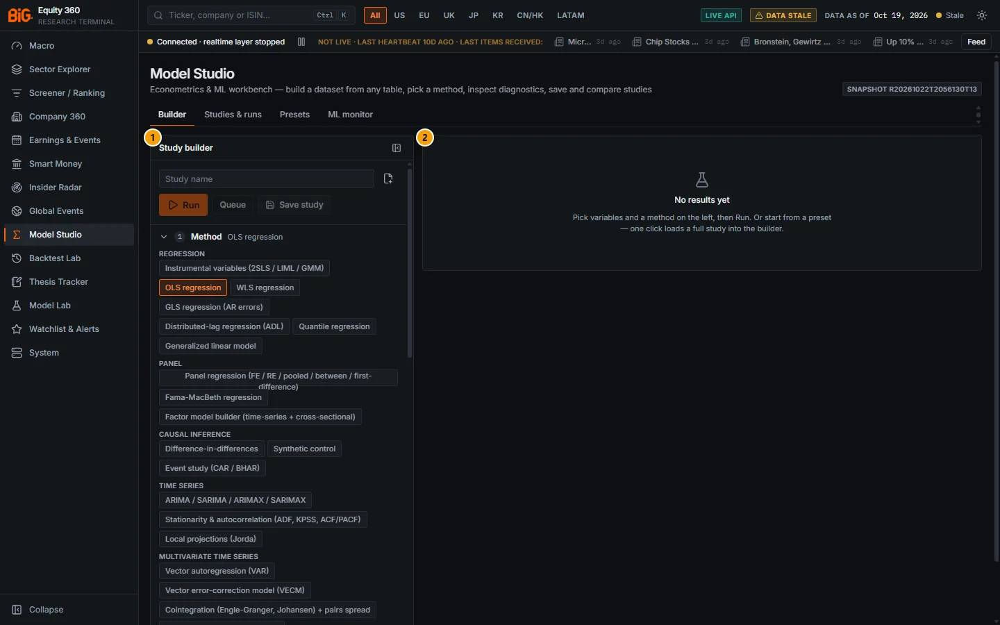

*Figure 9.1: Model Studio (`/studio`), Builder tab with an empty draft, snapshot R20261022T2056130T13, data as of 19 Oct 2026.*

| # | Panel | What it shows |
|---|---|---|
| 1 | Study builder | The left-hand builder: study name, **Run** / **Queue** / **Save study** buttons, then five numbered sections (1 Method, 2 Dataset, 3 Variables, 4 Parameters, 5 Preview). The figure shows section 1 open with the method families. |
| 2 | Results pane | The results of the selected run. With no run selected it shows "No results yet: Pick variables and a method on the left, then Run. Or start from a preset — one click loads a full study into the builder." |

### Controls

| Control | What it does |
|---|---|
| Tabs **Builder** / **Studies & runs** / **Presets** / **ML monitor** | Switch between the builder with its results pane, the list of saved studies and runs ([Studies & runs](#studies--runs)), the preset library ([Presets](#presets)) and the nightly ML monitor ([ML monitor](#ml-monitor)). The last tab you used is remembered in the browser. |
| **SNAPSHOT** badge (top right) | The serving snapshot every run is pinned to (hover: "Data snapshot every run is pinned to"). Two runs on the same spec, snapshot and seed give the same numbers. |
| Hide builder (icon at the top right of the builder panel) | Collapses the builder so the results use the full width. **Show builder** brings it back. |
| Toasts | "Run complete", "Run queued on the worker" (with the time estimate), "Run failed", "Run rejected", "Run finished: ‹name›" for queued runs that complete while you are elsewhere in the app. |

The builder draft, the selected run, the runs being watched and the runs ticked for comparison are stored in the browser (local storage key `big360.studio`), so they survive a page reload.

### Methodology

A study has three parts:

1. **Dataset specification**: shape (time series, panel or cross-section), frequency (D/W/M/Q), dates, entity filter, entity level and a list of variables, each with a source, a field, aggregations and a chain of transforms. The dataset engine builds it point-in-time from the Parquet lake (see [Builder](#builder), Methodology).
2. **Method and parameters**: one of the 37 registered methods ([Methods catalogue](#methods-catalogue)) with its parameter form, a seed (default 42) and a timeout (default 600 s).
3. **Run**: the engine estimates the cost. Runs estimated under **2 seconds** execute inline in the API and come back finished ("sync"); longer runs are queued on the background worker ("async", job `studio_run`) and polled. Every run is stored under `data/modeling/runs/<run_id>/` with its spec, status, result and a reproducibility block (spec hash, snapshot id, seed, library versions, timings).

### Data sources and refresh

Model Studio reads the same lake as the rest of the app, read-only, at the current serving snapshot. Nothing is downloaded when you run a study. A source is only as fresh as the nightly / weekly job that fills it (see [Refresh schedule](01-data-and-coverage.md#refresh-schedule)). Built datasets are cached under `data/modeling/cache/` by a hash of the spec, the snapshot id and the engine version, so a repeated run on the same snapshot reuses the cached dataset ("cached" in the preview and in the Data tab).

### Validation status

Model Studio is a tool, not a model, so it has no validation gate of its own. The statistical tests it reports (Breusch–Pagan, Ljung–Box, Hausman, GRS, Diebold–Mariano and so on) are standard textbook tests; they are labelled pass / fail or reject / do-not-reject by fixed rules, not by a validated model. One method carries a validation verdict: the filtered conformal ellipsoid is **experimental** in Model Studio (see [Methods catalogue](#methods-catalogue), Validation status). The ML models shown in the ML monitor tab have their own status, described in [Model Lab](10-model-lab.md#validation-status).

### Correct usage and worked example

Start from a preset, inspect it, then change one thing at a time.

1. Open **Presets** and click **Load & run** on "GARCH: S&P 500 volatility and 1-day VaR".
2. The study runs on the worker or inline (the live run history shows this preset finishing in 769 ms on 6,734 daily observations, AIC 17,927).
3. Read the **Summary** tab, then the **Volatility** tab (conditional volatility and the VaR backtest), then **Diagnostics** (Ljung–Box on squared standardised residuals, Kupiec test).
4. Change one parameter in **4 · Parameters** (for example `vol` from `gjr` to `egarch`), run again, then tick both runs in **Studies & runs** and press **Compare**.

### Limitations and pitfalls

- A significant coefficient is not a trading signal. Most studies are in-sample fits; only the out-of-sample evaluation blocks (rolling-origin, purged cross-validation, leaderboard) say anything about forecasting ability, and even those are subject to multiple testing if you try many variants.
- The universe history starts on 2026-10-10 (survivorship): panels before that date use today's member list. See [Survivorship](17-good-practice.md#survivorship).
- Some sources are short: news sentiment starts in October 2025, technical setups are stored for the latest date only, smart-money signals start in mid-2023. The variable picker shows each variable's first and last date.
- Bayesian (PyMC) and deep sequence models (LSTM / TFT) listed in the original plan were not built.

### Related mnemonics and BQL fields

No command-bar mnemonic opens Model Studio. Related: [BQL console](14-bql-mnemonics.md#bql-console) (expressions usable as a Studio variable source, see [BQL query variable source](#bql-query-variable-source)), [Backtest Lab](11-backtest-lab.md#backtest-lab), [Model Lab](10-model-lab.md#model-lab), [Purged and embargoed cross-validation](16-methodology.md#purged-and-embargoed-cross-validation), [Multiple testing](16-methodology.md#multiple-testing).

---

## Builder

**Route:** `/studio` (tab **Builder**) · **Menu:** Model Studio › Builder · **Mnemonics:** none · **Refresh:** on demand

### Purpose

The builder turns a question into a study specification: which method, on which data shape, over which dates and entities, with which variables and transforms, and with which parameters. It validates the draft as you type and lists any problem that blocks a run.

### Screenshot

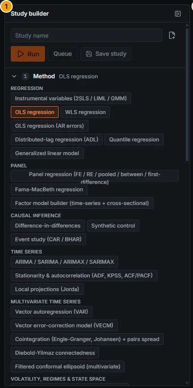

*Figure 9.2: Study builder close-up (callout 1 of Figure 9.1): run bar and section 1 · Method with the method families.*

> Screenshot pending: builder with a loaded preset showing sections 2 · Dataset, 3 · Variables (two variable cards with a lag of t−1 and a transform chip) and 4 · Parameters open (route `/studio`, Presets › "Sector returns vs lagged rates" › Load).

<!-- PENDING-SHOT id=09-studio-builder-sections route=/studio actions=Presets tab > "Sector returns vs lagged rates (distributed lag OLS, HAC)" > Load; expand sections 2, 3, 4 and 5 (Preview dataset) -->

### Controls

#### Run bar

| Control | What it does |
|---|---|
| **Study name** | Free text; used as the run name, the saved study name and the export file name. |
| New empty study (icon) | Clears the draft (method OLS, time series, monthly, start 2005-01-01, seed 42, timeout 600 s). |
| **Run** (or **Run leaderboard** for the leaderboard method) | Submits the study in "auto" mode: inline if the estimate is under 2 s, otherwise queued on the worker. Disabled while the draft has problems. |
| **Queue** | Hover: "Queue on the background worker even if it would be quick". Use it for runs you want to leave running. |
| **Save study** / **Save** / **Save as new** | Saves the draft as a study (name defaults to "Untitled study"). Once a draft is opened from a saved study, **Save** updates it and **Save as new** creates a copy; a **saved study** badge appears. |
| Problems list (amber bullets) | Lists every blocking problem, for example "Add at least one variable", "OLS regression needs exactly one target (y)", "Variable names must be unique", "IV needs at least as many instruments as endogenous regressors", "x: a regressor uses future data (lead / forward transform) — look-ahead", "Set “Treatment” in Parameters". |

#### 1 · Method

| Control | What it does |
|---|---|
| Method chips, grouped by family | Regression, Panel, Causal inference, Time series, Multivariate time series, Volatility, regimes & state space, Machine learning, Clustering & factors, Spatial. Hover a chip for the method description. Picking a method keeps your variables and re-maps their roles (for example, unsupervised methods turn y and x into features). |
| Description and badges | The method description, the data shapes it accepts (the current one highlighted) and **needs y** or **unsupervised**. |

#### 2 · Dataset

| Control | What it does |
|---|---|
| **Data shape** | **Time series** (one row per date: entities pooled or macro series), **Panel** (entity × date), **Cross-section** (one row per entity at a date). |
| **Start** / **End** | Date window. End empty = latest data. |
| **Frequency** | Daily, Weekly (Fridays), Monthly (month ends), Quarterly (quarter ends). |
| **Entity level** | Security, Sector (aggregated), Region (aggregated), Country (aggregated). Aggregated levels average (or sum) the securities of each group per date. |
| **Macro alignment** | **Auto**, **Point-in-time (as published)** or **Reference period**. See Methodology. |
| **Entities** box | Universe (Any, `mvp_us`, `mvp_global`, `full`, `watch`, `eu_broad`), **Primary listings only** switch (on by default), **Sectors** and **Regions** toggles, **Securities** search (ticker or name; chips with a remove cross). Greyed out with "(macro-only study: not used)" when every variable is a macro series in a time-series study. |

#### 3 · Variables

| Control | What it does |
|---|---|
| **Add variable** / **Close catalog** | Opens the variable picker. |
| Picker search | "Search variables (e.g. 10y yield, roic, hicp)". Matches titles and field ids. |
| **Source table** select | All sources, or one source with its number of variables (see Data sources). Choosing **BQL query** adds an expression row (see [BQL query variable source](#bql-query-variable-source)). |
| **Frequency** select | Any frequency, daily, weekly, monthly, quarterly, annual. |
| Variable row | Country flag (macro), title, `source:field`, native frequency, units, first → last date, number of observations, number of entities, and a **PIT** badge when the source is knowledge-dated (sampled as published). |
| Add buttons on each row | **+ y**, **+ x**, and for IV methods **+ endog** / **+ instrument**; for unsupervised methods **+ add**. Adding a second y turns it into an x. A toast confirms "Added ‹field› as ‹role›". |
| **Load more** | Shows 40 more variables. |

Each added variable becomes a **variable card**:

| Control | What it does |
|---|---|
| Name field | The column name in the dataset (letters, digits, underscore; red border when invalid). Spaces become underscores. |
| **Role** select | Target (y), Regressor (x), Weights, Feature (or "System variable" for VAR-type methods), Endogenous (IV), Instrument (IV), Not used. The card border is orange for y and blue for IV roles. |
| Move up / Move down / Remove | Reorder or delete. Order matters for VAR ordering (Cholesky) and for methods that read "the first x". |
| `source:field — title` line | Where the variable comes from. |
| **lag** spinner (− / +) | Sets the net lag: `t` = same period, `t−1` = one period back, `t+1` = one period ahead (amber, "lead"). |
| **Transforms** chips and **+ transform** select | The transform chain applied after resampling. Click a chip to edit its parameters (k, window, min periods, quantiles, threshold, factor, scope); the cross removes it. |
| Amber note "Look-ahead: a regressor uses future values. Only targets may lead." | Shown when an x uses `lead`, `fwd_sum` or `fwd_compound`. The run is blocked. |
| **Aggregation & entity pooling** (expander; dot when customised) | **time agg.** (default, last, first, mean, sum, min, max, median, count), **pool entities** (none, mean, median, sum, count, min, max), **Before resampling** transform chain (applied per entity on the native frequency), the variable's own entity filter (with **clear**), and for `factor_ls` variables **long-short quantiles** (2–10, "top minus bottom, sorted on the previous period's score over the entity filter"). |

#### Transforms

| Transform | Definition (as the catalogue documents it) |
|---|---|
| lag | `x[t−k]` (k periods back, per entity) |
| lead | `x[t+k]`. LOOK-AHEAD: allowed only as a target |
| diff | `x[t] − x[t−k]` |
| log | `ln(x)`, null for x ≤ 0 |
| log diff | `ln(x[t]) − ln(x[t−k])` |
| % change | `x[t]/x[t−k] − 1` |
| rolling mean / std / sum / min / max | trailing statistic over `window` periods |
| rolling z | `(x − trailing mean) / trailing std` over `window` |
| drawdown | `x / trailing max(x, window) − 1` (use on a price level) |
| winsorize | clip to [lower, upper] quantiles; scope cross-section (per date, panel default), whole sample or per entity |
| clip | clip to [lower, upper] in absolute values |
| standardize | z-score; scope cross-section, whole sample or per entity |
| cs-rank | cross-sectional percentile rank 0..1 per date |
| cs-z | cross-sectional z-score per date |
| cs-demean | minus the cross-sectional mean per date |
| fwd sum (target) | sum of x over t+1..t+k. LOOK-AHEAD (targets only) |
| fwd compound (target) | `∏(1+x) − 1` over t+1..t+k (forward return from periodic returns). LOOK-AHEAD (targets only) |
| binarize | 1 if x > threshold else 0 |
| scale / abs / square / negate | `x·factor`, `|x|`, `x²`, `−x` |

#### 4 · Parameters

The form is generated from the method's parameter schema. Required inputs come first and are marked `*`; a dot marks a value changed from its default; hover a dotted-underlined label for its description. Only changed values are sent. **Defaults** resets the form. Under the form, **Seed** and **Timeout (s)** (minimum 5) apply to every method.

Special editors:

| Editor | Used by | What it does |
|---|---|---|
| Treatment editor | Difference-in-differences | Segmented **Entities** (treated tickers), **Attribute** (Sector, Region or Country ISO-2 with toggles), **Variable** (a 0/1 column of the dataset) or **Events** (explicit entity / date pairs for staggered adoption). Entities and Attribute modes take one **Treatment date**. |
| Events editor | Event study (CAR / BHAR) | Rows of entity + date. "Set the date first, then add entities (Enter)." |
| Order tuples | ARIMA | `order` as p, d, q and `seasonal_order` as P, D, Q, s. |
| Lists | Quantile regression (`quantiles`, e.g. 0.1, 0.5, 0.9), GARCH (`var_levels`), distributed lag (`lag_overrides` as `var=4, other=2`) | Comma-separated values. |
| Variable pickers | Parameters such as `panel_variable`, `pivot_var`, `offset`, `market`, `event_column`, `factor_scores` | Chips or a select of your dataset's variable names. |
| Nested object | `cv` of the ML methods | Folds, scheme (auto, expanding, purged_kfold, kfold), purge, embargo. |
| **Candidates editor** | Model leaderboard | Checkboxes for Historical mean (benchmark), OLS, Logit, Ridge, Lasso, ElasticNet (alpha by inner CV), Random forest, Gradient boosting (HistGradientBoosting), XGBoost and ARIMA(X) (time series only); each ticked candidate gets an editable name. Footer: "N selected · every candidate is scored on the same cross-validation splits; Diebold–Mariano tests compare each with the best." |

#### 5 · Preview

| Control | What it does |
|---|---|
| **Preview dataset** / **Refresh preview** | Builds the dataset only (no model) and shows rows, entities, periods, date range and build time ("cached" when reused). "Builder changed since this preview" warns when the preview is stale. "Add a variable first" when empty. |
| Dataset warnings (amber) | Coverage and alignment notes from the engine (for example stale values dropped, empty variables). |
| **Coverage** / **Summary** / **Rows (n)** | Per-variable coverage bar (green ≥ 80%, amber ≥ 50%, red below) with first / last date and a "future" tag for look-ahead columns; summary statistics (n, mean, std, min, median, max); the first 50 rows. |

### Methodology

#### Point-in-time dataset construction

The dataset engine (`backend/app/modeling/_core.py`, embedded verbatim in exported scripts) builds the frame in this order:

1. **Grid.** Period ends at the dataset frequency: D = trading days in the data (or Monday–Friday), W = Fridays, M = month ends, Q = quarter ends. Only buckets up to the data end are kept, so there is no partial last period.
2. **Entities.** The entity filter is resolved to securities (universe, sectors, regions, tickers, primary listings). With `pit_universe` on (the default), an (entity, date) row is kept only while the entity is a member of the universe, but see the survivorship caveat below.
3. **Event-dated sources** (prices, valuation, factor and composite scores, sentiment, insider, technicals, smart money, technical factors) are aggregated into each bucket (default `last`; `sum` for volumes) and forward-filled per entity for at most D 5 / W 2 / M 1 / Q 1 buckets.
4. **Knowledge-dated sources** (ratios, fundamentals, macro in point-in-time alignment, CFTC, cross-asset signals) are sampled as-of: the value at grid date D is the latest period whose `knowledge_date ≤ D`. A restated or revised number only appears from the date it became known.
5. **Macro alignment.** **Point-in-time** samples macro series as published (with their release lag). **Reference period** indexes them by observation period at the latest vintage, which is what a pure macro time-series model wants (for example an ARIMA on CPI). **Auto** uses reference period when every variable is a macro series and point-in-time otherwise. Mixing equities with reference-period macro data would leak information that was not yet published, which is why Auto switches.
6. **Transforms.** `pre_transforms` run per entity before cross-entity aggregation; `transforms` run after. Time-series transforms run on the complete entity × grid frame; cross-sectional transforms (cs-rank, cs-z, cs-demean, cross-section winsorize / standardize) only use universe members at each date.
7. **Entity pooling.** In a time-series dataset built from securities, each variable is pooled across entities per date (`entity_agg`, default mean). Sector / region / country entity levels aggregate the same way.

Limits: 1 to 60 variables, 3,000 entities and 5,000,000 rows by default.

#### Guardrails

Before fitting, the engine rejects the study (HTTP 422, shown as "Guardrail: ‹code›") when:

| Code | Rule |
|---|---|
| `lookahead` | an x, weight or interaction uses `lead`, `fwd_sum` or `fwd_compound` |
| `too_few_obs` | fewer than k + 2 complete observations for k parameters |
| `singular` | the design matrix is rank-deficient (lists the collinear columns) |
| `bad_shape`, `missing_y`, `missing_x`, `too_many_x`, `weights_unsupported` | the method does not accept this data shape or number of variables |
| `unknown_column`, `dataset`, `invalid_spec` | a referenced column does not exist or the specification is invalid |

Non-blocking warnings appear above the result tabs: `few obs per param` (observations per parameter), `near singular` (condition number above 30 on standardised regressors), `high vif` (VIF above 10), `nonstationary` (ADF / KPSS suggest unit roots in y and x: spurious-regression risk), `oos worse than naive`, and method-specific ones.

### Data sources and refresh

The live catalogue (`GET /api/v1/studio/catalog/datasets`, snapshot R20261022T2056130T13) lists 15 sources:

| Source | Table | Native frequency | PIT rule | Coverage (first → last) |
|---|---|---|---|---|
| Daily prices & returns | `prices_daily` | D | event-dated | 1927-12-30 → 2026-10-20, 24,943 securities |
| Daily valuation multiples | `valuation_daily` | D | event-dated (price × PIT fundamentals) | 2010-01-01 → 2026-10-16 |
| Factor scores (0-100) | `factor_scores` | M | event-dated | 2016-10-31 → 2026-10-16 |
| Composite scores by profile | `composite_scores` | M | event-dated | 2016-10-31 → 2026-10-16 |
| News sentiment (daily) | `sentiment_daily` | D | event-dated | 2025-10-09 → 2026-10-16 |
| Insider signals | `insider_signals` | D | event-dated | 2017-01-31 → 2026-10-16 |
| Technical setups | `tech_setups` | D | latest date only | 2026-10-16 only |
| Financial ratios | `ratios` | Q | knowledge-dated (TTM) | 1993-12-31 → 2026-09-30 |
| Fundamentals line items | `fundamentals_wide` | Q | knowledge-dated (TTM, USD) | 1993-12-31 → 2026-09-30 |
| Long-short factor returns (`factor_ls`) | `factor_scores` | M | built from the previous period's score | 2016-10-31 → 2026-10-16 |
| Macro series (vintage-aware) | `macro_observations` | M | knowledge-dated | 1854-12-01 → 2026-10-22, 1,062 series |
| CFTC positioning | `cftc_signals` | W | knowledge-dated | 1986-01-15 → 2026-10-13 |
| Cross-asset signals | `cross_asset_signals` | D | knowledge-dated; trend / curve shape / value / z model-based | 2000-01-01 → 2026-10-20 |
| Smart-money signals | `smart_money_signals` | W | event-dated; score model-based | 2023-06-30 → 2026-10-16 |
| Technical factors | `tech_factors` | D | event-dated | 2004-01-01 → 2026-10-19 |

Benchmarks, ETFs, indices, futures and FX pairs (363 instruments, for example `IDX:^GSPC`, `ETF:SPY`) are usable as `prices` entities through the securities search. The BQL source is described in [BQL query variable source](#bql-query-variable-source).

### Validation status

Not formally validated: the builder is an input tool. The look-ahead guardrail and the point-in-time sampling are covered by the engine's tests (`tests/modeling`).

### Correct usage and worked example

Building "financials' monthly returns on rate changes" by hand:

1. Method **Distributed-lag regression (ADL)**; Dataset: Time series, Monthly, start 2005-01-01, universe `mvp_us`, sector Financials.
2. Add `prices:ret` as **y**; set **pool entities** to mean (the default) so the series is the equal-weighted sector return.
3. Add the US 10-year Treasury yield from the macro source as **x**, with transform **diff** (k = 1). Leave the lag at `t`: the method adds lags 0..3 itself (parameter `lags`).
4. Open **5 · Preview**: check that both columns cover the whole window and that no column is tagged "future".
5. Set `cov_type` to HAC in Parameters and **Run**. The preset "Sector returns vs lagged rates" is this study ready-made.

### Limitations and pitfalls

- **Macro alignment matters.** For a regression of equity returns on macro data use point-in-time (or Auto, which picks it). Reference-period alignment with equity returns uses data before it was published.
- **Lags are per period of the dataset frequency.** `t−1` on a monthly dataset is one month.
- **Forward-fill limits.** A quarterly fundamental sampled on a daily grid is carried forward as-of, but an event-dated value is only carried 5 days on a daily grid; sparse event sources then show gaps.
- **Survivorship.** Universe membership history starts on 2026-10-10, so earlier dates use today's members.
- The missing-value policy (`ffill_limit`, `fill`, `drop`), dummies and interactions are part of the dataset specification but are not exposed in the builder; they can be set in presets and appear in the exported JSON.

### Related mnemonics and BQL fields

[Point-in-time rules](01-data-and-coverage.md#point-in-time-rules), [Point-in-time data](16-methodology.md#point-in-time-data), [Field dictionary](14-bql-mnemonics.md#field-dictionary).

---

## Methods catalogue

**Route:** `/studio` (Builder › 1 · Method) · **API:** `GET /api/v1/studio/catalog/methods` · **Refresh:** fixed in code (`backend/app/modeling/methods/*`)

### Purpose

The catalogue lists every estimation method registered in the backend, with its accepted data shapes, its outputs and its diagnostics. This section is the reference for what each method estimates, its key parameters and its main assumptions.

### Controls

Methods are chosen in section **1 · Method** of the builder. Parameters are set in **4 · Parameters** (see [Builder](#builder)).

### Methodology

#### Catalogue

Defaults are in brackets. "ts" = time series, "pn" = panel, "cs" = cross-section.

| Method (title in the app) | Family | What it estimates | Key parameters | Diagnostics | Assumptions / pitfalls |
|---|---|---|---|---|---|
| OLS regression | Regression | Linear coefficients, fit statistics; rolling-origin OOS for ts | `cov_type` [HC1]: nonrobust, HC0–HC3, HAC, cluster; `hac_maxlags`; `cluster_by`; `rolling_eval` | Breusch–Pagan, White, Durbin–Watson, Ljung–Box, Jarque–Bera, VIF, condition number, ADF/KPSS screen | Use HAC on overlapping or autocorrelated data; spurious regression on non-stationary levels |
| WLS regression | Regression | Weighted least squares | as OLS; a variable with role Weights | as OLS | Weights must be positive (e.g. inverse variance) |
| GLS regression (AR errors) | Regression | Feasible GLS with AR(p) errors (GLSAR, iterated) | `ar_order` [1], `max_iter` | as OLS | Time series only |
| Distributed-lag regression (ADL) | Regression | Lag profile, long-run multiplier (sum of lags) with SE, joint F per lag block | `lags` [3], `lag_overrides`, `y_lags` [0], `cov_type` [HAC] | as OLS + lag-block F | Collinear lags: read the joint F and the multiplier, not single lags |
| Quantile regression | Regression | Conditional quantiles (Koenker–Bassett), coefficient process | `quantiles` [0.1, 0.25, 0.5, 0.75, 0.9] | pseudo R² (Koenker–Machado), OLS comparison | Crossing quantiles possible in small samples |
| Generalized linear model | Regression | Gaussian, binomial (logit / probit), Poisson, gamma, negative binomial; exp(coef), AME | `family` [gaussian], `link`, `offset`, `cov_type` [HC1] | deviance, Pearson χ², overdispersion, AUC / Brier / log-loss (binomial), VIF | Poisson with overdispersion understates SEs: check dispersion, use negative binomial |
| Instrumental variables (2SLS / LIML / GMM) | Regression | IV coefficients for endogenous regressors | `estimator` [2sls], `cov_type` [robust]; roles endog / instrument | first-stage F / partial R², Sargan / Hansen J, Wu–Hausman | Weak instruments (first-stage F < 10) bias toward OLS |
| Panel regression (FE / RE / pooled / between / first-difference) | Panel | Within / between / overall R², effects | `estimator` [fe], `entity_effects` [on], `time_effects`, `cov_type` [clustered]: kernel = Driscoll–Kraay; `hausman` [on] | Hausman FE vs RE, F poolability, VIF | Time-invariant regressors drop out under FE |
| Fama-MacBeth regression | Panel | Risk premia λ (time means of cross-sectional slopes), NW SEs | `nw_lags` [⌊4(T/100)^(2/9)⌋], `min_obs` | Newey–West t, λ autocorrelation, share of positive λ | Errors-in-variables if betas are estimated; needs many dates |
| Factor model builder | Panel | Long-short factor returns, alphas / betas of test assets, GRS, second-pass premia | `factor_scores`, `quantiles` [5], `include_market` [on], `test_assets` [portfolios] | GRS F-test, alpha t, factor Sharpe | Factors sorted on last period's score; equal weight |
| Difference-in-differences | Causal | ATT: 2×2, TWFE, event study (leads / lags), staggered (Callaway–Sant'Anna) | `design` [event_study], `treatment`, `leads` [6], `lags` [12], `control` [never], `bootstrap` [199] | joint pre-trend Wald test, treated / control counts | Parallel trends; TWFE is biased with staggered, heterogeneous effects: use `staggered` |
| Synthetic control | Causal | Treated minus synthetic path, donor weights | `treated`, `treatment_date`, `donors`, `placebo` [on], `max_donors` [60] | pre-period RMSPE, placebo rank p-value | Poor pre-fit invalidates the effect |
| Event study (CAR / BHAR) | Causal | AAR, CAAR path, per-event CAR and BHAR | `events` or `event_column`, `model` [market], `est_window` [−250, −30], `event_window` [−5, 5] | cross-sectional t, Patell Z | Clustered event dates make t-statistics overconfident |
| ARIMA / SARIMA / ARIMAX / SARIMAX | Time series | ARMA coefficients, forecast with intervals, OOS vs baselines | `order` [1,0,0], `seasonal_order`, `auto`, `criterion` [aic], `forecast_steps` [12], `exog_future` [last], `eval_folds` [24] | Ljung–Box, Jarque–Bera, heteroskedasticity, ADF / KPSS of y, residual ACF | ARIMAX forecasts need future regressor values |
| Stationarity & autocorrelation | Time series | ADF and KPSS in levels and differences, ACF / PACF, suggested d | `regression` [c], `max_diff` [1], `nlags` [24] | ADF, KPSS | Low power near unit root; read both tests |
| Local projections (Jorda) | Time series | Impulse responses by direct regression at each horizon | `horizon` [12], `y_lags` [2], `cumulative` [on], `fe` [entity], `spatial` | IRF bands (Driscoll–Kraay) | The first x is the shock; needs an identified shock |
| Vector autoregression (VAR) | Multivariate | Coefficients, IRFs, FEVD, Granger matrix, forecast | `maxlags` [8], `ic` [bic], `irf_periods` [24], `orthogonalized` [on] | stability roots, Portmanteau, normality | Cholesky IRFs depend on variable order |
| Vector error-correction model (VECM) | Multivariate | Johansen rank, β (cointegrating vectors), α (loadings), forecast | `k_ar_diff` [1], `det_order` [0], `rank` | Johansen trace / max-eigenvalue | Series must be I(1) |
| Cointegration + pairs spread | Multivariate | Engle–Granger and Johansen tests, hedge ratio, spread z-scores, half-life | `z_window` [60], `entry_z` [2.0] | Engle–Granger, Johansen trace, ADF on spread | In-sample hedge ratio; cointegration breaks |
| Diebold-Yilmaz connectedness | Multivariate | Total, to / from / net and pairwise connectedness (generalised FEVD) | `lags` [1], `horizon` [10], `window`, `step` [5] | none | Sensitive to lag and horizon choice |
| Filtered conformal ellipsoid (multivariate) | Multivariate | Calibrated joint 1−α set for the next observation, anomaly scores, projection bands | `filter` [ewma], `alpha` [0.1], `window` [250], `aci_gamma` [0.005] | binomial coverage test, per-coordinate projection coverage | **Experimental.** Coverage is marginal over time, not a statement about one date |
| GARCH volatility (GARCH / EGARCH / GJR) | Volatility | Conditional volatility, persistence, half-life, VaR, volatility forecast | `vol` [garch], `p`/`q` [1/1], `dist` [t], `horizon` [10], `var_levels` [0.01, 0.05] | Ljung–Box on squared std. residuals, Kupiec POF, Jarque–Bera | y only (no x); returns scaled by 100 |
| Markov-switching regression / AR | Volatility | Regime means / variances, smoothed probabilities, transition matrix, durations | `k_regimes` [2], `model` [regression], `switching_variance` [on], `search_reps` [10] | expected durations, classification certainty | Local optima; labels of regimes are arbitrary |
| State space: unobserved components | Volatility | Smoothed level / trend / seasonal with bands, forecast | `level` [local level], `seasonal`, `forecast_steps` [12] | Ljung–Box, Jarque–Bera, heteroskedasticity | Component choice drives the result |
| Time-varying beta (Kalman filter) | Volatility | Random-walk α and β paths with bands vs static OLS | `add_constant` [on], `alpha` [0.05]; 1–5 x | Ljung–Box on one-step errors, share of β variation | Smoothed paths use the whole sample (not real-time) |
| Regularized regression (Lasso / Ridge / ElasticNet) | Machine learning | Penalised coefficients, coefficient paths, CV curve, OOS vs OLS | `model` [elasticnet], `l1_ratio` [0.5], `n_alphas` [50], `selection` [min] or 1se, `cv` | OOS R² vs OLS, selected features, CV folds | Standardised features; selection is unstable with correlated x |
| Tree ensemble (random forest / gradient boosting) | Machine learning | OOS metrics, impurity and permutation importance, SHAP, partial dependence | `model` [hgb]: rf, hgb, xgb; `task` [auto]; `n_estimators` [300]; `learning_rate` [0.05]; `min_samples_leaf` [20]; `cv`; `shap` [on] | OOS AUC / RMSE / rank IC, train vs OOS gap | Importance is not causality; use expanding CV for a backtestable signal |
| Model leaderboard | Machine learning | Ranking of candidates on identical folds, DM tests vs the best | `candidates`, `task` [auto], `metric` (rmse, mae, auc, logloss), `cv` | Diebold–Mariano | Many candidates = multiple testing |
| Double / debiased ML (DML) | Causal | Effect θ of a treatment D on y with flexible controls x: partially linear (PLR) or interactive (IRM, binary D: ATE / ATT) | `treatment`, `model` [plr], `learner_y` / `learner_d` [lasso]: rf, xgb, lgbm; `crossfit` (purged K-fold on date blocks), `n_rep` [1], `trim` [0.01], `cluster` [auto = entity], `compare_learners` | nuisance R² / AUC out of fold, overlap (IRM), learner sensitivity, naive OLS | No unobserved confounders; overlap; the treatment must not be caused by y |
| Propensity scores: IPW, AIPW and matching | Causal | ATE / ATT of a 0/1 treatment by normalized IPW, doubly robust AIPW and nearest-neighbour matching on the logit score | `treatment`, `estimator` [all], `estimand` [ate], `ps_model` [logit]: lasso, rf, xgb, lgbm; `outcome_model` [ols]; `caliper` [0.2 SD]; `k_neighbors` [1] | balance table (SMD raw / weighted / matched, variance ratio), love plot, overlap plot, effective sample size, propensity AUC | Selection on observables; extreme weights when overlap is poor |
| Regression discontinuity (sharp / fuzzy) | Causal | Jump in y at a cutoff of a running variable (fuzzy: Wald ratio = local LATE) | `running`, `cutoff` [0], `design` [sharp], `treatment` (fuzzy), `bandwidth` [ik]: cct, fixed; `kernel` [triangular]; `placebo` [on] | McCrary density test, covariate continuity, placebo cutoffs, bandwidth sensitivity, first-stage F | Local to the cutoff; sorting around the cutoff invalidates it |
| Coefficient stability (Oster δ) | Causal | β of a variable of interest as controls are added one at a time; Oster β* and the δ that drives β to 0 | `treatment`, `r_max_mult` [1.3], `r_max`, `delta` [1] | identified set [β̃, β*], AET ratio | Approximation of Oster's estimator; controls in the order given |
| LightGBM (gradient boosting) | Machine learning | OOS metrics, gain / split importance, TreeSHAP, learning curve | `n_estimators` [500], `learning_rate` [0.05], `num_leaves` [31], `early_stopping` [on, time-ordered validation block], `cv` | DM test vs a linear baseline, best round per fold | Early stopping uses only the training fold |
| Hyper-parameter tuning (Optuna) | Machine learning | Best configuration of lgbm / xgb / rf / hgb / elasticnet by seeded TPE on purged walk-forward CV, judged on an untouched hold-out | `model` [lgbm], `n_trials` [30], `timeout_s` [120], `holdout_frac` [0.2], `cv` [4 folds] | DM tuned vs default and vs linear, CV-to-hold-out gap | A timeout can change the number of trials between runs |
| Stacking ensemble | Machine learning | Meta-learner on inner out-of-fold base predictions | `bases` [ols, ridge, rf, lgbm], `meta` [nnls], `inner_folds` [3], `cv` | DM stack vs best base and vs equal weights, meta weights | Gains over the best base are usually small |
| Learning to rank (LambdaRank) | Machine learning | Cross-sectional ranking by date (panels) | `n_grades` [5], `ndcg_k` [10], `n_estimators` [300], `cv` | rank IC, NDCG@k, top-minus-bottom spread vs pointwise LightGBM and OLS; DM on per-date IC | Scores are ranks, not return forecasts |
| Neural network: MLP | Neural networks | Feed-forward net for regression / classification | `hidden` [32, 16], `dropout` [0.1], `lr` [0.001], `max_epochs` [200], `patience` [15], `n_seeds` [3], `cv` | training / validation curves, DM vs OLS / logit (mandatory), permutation importance | Rarely beats linear models on noisy financial targets |
| Neural network: small GRU / LSTM | Neural networks | Recurrent net on look-back windows of x (and y lagged by the target horizon), per entity on panels | `cell` [gru], `window` [12], `hidden_size` [16], `include_y_lags` [on], `cv` | DM vs ridge on the same window (mandatory), curves | Needs long histories; windows skip gaps in rows |
| Autoencoder factors | Neural networks | k non-linear latent factors of the x columns | `n_factors` [3], `hidden` [32], `activation` [tanh], `holdout_frac` [0.2] | hold-out reconstruction R² vs PCA with the same k, DM test (mandatory) | Factors are not unique (rotation, sign) |
| K-means clustering | Clustering & factors | Clusters, centroids, profiles, PCA view; k by silhouette | `k` or `k_min`..`k_max` [2..10], `standardize` [on], `layout` [rows] or pivot, `impute` [drop] | silhouette, Calinski–Harabasz, Davies–Bouldin | Assumes round, similar-size clusters |
| Hierarchical (agglomerative) clustering | Clustering & factors | Dendrogram, cut by k, distance or best silhouette | `linkage` [ward], `metric` [euclidean], `n_clusters`, `distance_threshold`, `k_max` [10] | cophenetic correlation, silhouette | Ward needs euclidean distances |
| Principal component analysis | Clustering & factors | Explained variance, loadings, scores, score time series | `n_components`, `standardize` [on] | components for 80% / 90% variance | Signs of components are arbitrary |
| Gaussian mixture clustering | Clustering & factors | Soft clusters, k by BIC | `k_min`..`k_max` [1..8], `covariance_type` [full] | BIC, mean max membership probability, silhouette | Full covariance needs many rows per cluster |
| Density clustering (HDBSCAN / DBSCAN) | Clustering & factors | Clusters of any shape plus noise (cluster −1) | `algorithm` [hdbscan], `min_cluster_size` [10], `min_samples` [5], `eps` [0.5] | noise share, silhouette (non-noise) | Many points can end up as noise |
| Spatial lag model (SAR) | Spatial | ρ, β, direct / indirect / total effects across countries | `w_kind` [contiguity]: distance, kNN, trade, input-output, banking; `k` [5]; `fe` [entity]; `effects_draws` [500] | LM lag / error (robust), Moran's I of residuals | Country panels; W choice drives spillovers |
| Spatial error model (SEM) | Spatial | λ (spatially correlated errors), β | as SAR | as SAR | as SAR |
| Spatial Durbin model (SDM) | Spatial | ρ, β, θ (spatially lagged x), effects with simulation inference | as SAR | as SAR | as SAR |
| Spatial autocorrelation (Moran's I, LISA, Getis-Ord Gi*) | Spatial | Global Moran's I, LISA clusters HH / LL / HL / LH, hot / cold spots | `period` [latest], `permutations` [999] | permutation inference | y only; descriptive |

#### Regression family

```
OLS            β̂ = (X'X)⁻¹ X'y
HC1            V̂ = n/(n−k) · (X'X)⁻¹ X' diag(ê²) X (X'X)⁻¹
Newey–West     Ŝ = Γ̂₀ + Σ_{l=1..L} (1 − l/(L+1)) (Γ̂_l + Γ̂_l'),   L = ⌊4 (n/100)^(2/9)⌋ by default
Cluster        V̂ = (X'X)⁻¹ [Σ_g X_g' ê_g ê_g' X_g] (X'X)⁻¹      (entity, date or both)
ADL            y_t = α + Σ_{j=0..L} β_j x_{t−j} + Σ_{k=1..p} φ_k y_{t−k} + ε_t
               long-run multiplier = Σ β_j,  SE = √(1' V̂_β 1)
Quantile       β̂(τ) = argmin Σ ρ_τ(y_i − x_i'β),  ρ_τ(u) = u (τ − 1{u < 0})
GLM            g(E[y|x]) = x'β;  logit P = 1/(1 + e^(−x'β));  Poisson E[y] = exp(x'β + offset)
               exp(β) = odds ratio (logit) or incidence-rate ratio (Poisson);  AME = mean_i ∂E[y_i]/∂x
2SLS           β̂ = (X' P_Z X)⁻¹ X' P_Z y,  P_Z = Z (Z'Z)⁻¹ Z'
```

The coefficient table shows estimate (with stars: \*\*\* p < 0.01, \*\* p < 0.05, \* p < 0.1, unadjusted), standard error, t or z, p-value, a Benjamini–Hochberg adjusted p-value when there are several tests, the 1−α interval, and where relevant exp(coef), the average marginal effect and VIF (amber above 10).

#### Panel family

```
Fixed effects    y_it = α_i + λ_t + x_it'β + ε_it        (within transformation)
Hausman          H = (b_FE − b_RE)' [V_FE − V_RE]⁻¹ (b_FE − b_RE) ~ χ²_k
Fama–MacBeth     at each date t:  r_{i,t+1} = γ_0t + γ_t' z_it + e_it
                 λ̂ = (1/T) Σ_t γ̂_t,   t(λ̂) = λ̂ / (σ̂_NW(γ̂) / √T)
GRS              GRS = (T/N) · (T−N−L)/(T−L−1) · α̂' Σ̂⁻¹ α̂ / (1 + μ̄' Ω̂⁻¹ μ̄) ~ F(N, T−N−L)
```

Driscoll–Kraay standard errors (`cov_type = kernel`) are robust to both cross-sectional and serial correlation, which is the usual situation in return panels.

#### Causal family

```
2×2 DiD          ATT = (Ȳ_T,post − Ȳ_T,pre) − (Ȳ_C,post − Ȳ_C,pre)
Event study      y_it = α_i + λ_t + Σ_{k ≠ −1} δ_k 1{t − g_i = k} + ε_it     (reference period −1)
                 pre-trend test: H0 δ_k = 0 for all k < −1 (joint Wald)
Callaway–Sant'Anna  ATT(g,t) = E[Y_t − Y_{g−1} | G = g] − E[Y_t − Y_{g−1} | control],
                 control = never treated or not yet treated; aggregated overall and by event time; entity bootstrap
Synthetic control   w* = argmin ‖Y₁,pre − Y₀,pre w‖  s.t. w ≥ 0, Σ w = 1;   gap_t = Y₁t − Σ_j w_j Y_jt
                 p-value = rank of post/pre RMSPE ratio among in-space placebos
CAR              AR_it = R_it − (α̂_i + β̂_i R_mt)   (market model on [−250, −30])
                 CAR_i = Σ_{t ∈ window} AR_it;  CAAR = mean_i CAR_i;  BHAR = ∏(1+R_it) − ∏(1+R_mt)
```

#### Time-series and multivariate family

```
SARIMAX          φ(L) Φ(L^s) (1−L)^d (1−L^s)^D y_t = c + β'x_t + θ(L) Θ(L^s) ε_t
                 order search: minimum AIC / BIC / AICc over a bounded grid (max_models 64)
OOS evaluation   rolling origin, horizon h, folds n; RMSE relative to naive (no change), random walk + drift,
                 seasonal naive and historical mean; "RMSE vs naive" < 1 = beats the no-change forecast
VAR(p)           Y_t = c + Σ_{j=1..p} A_j Y_{t−j} + u_t;  p by AIC / BIC;  stable if all roots lie outside the unit circle
VECM             ΔY_t = α β' Y_{t−1} + Σ_j Γ_j ΔY_{t−j} + u_t;  rank r by Johansen trace / max-eigenvalue
Pairs            y_t = a + b x_t + e_t;  spread s_t = y_t − b̂ x_t;  z_t = (s_t − mean) / sd  (full sample and rolling)
                 half-life = −ln 2 / ln φ̂  from  s_t = c + φ s_{t−1} + η_t
Local projection y_{t+h} − y_{t−1} = α_h + β_h shock_t + controls + ε_{t+h};  IRF = {β_h}
Connectedness    total = 100 · Σ_{i≠j} θ̃_ij(H) / N   (generalised FEVD, rows normalised)
```

#### Volatility, regimes and state space

```
GARCH(1,1)       σ²_t = ω + α ε²_{t−1} + β σ²_{t−1};   persistence α + β;  half-life = ln 0.5 / ln(α + β)
GJR              σ²_t = ω + (α + γ 1{ε_{t−1} < 0}) ε²_{t−1} + β σ²_{t−1}
VaR              VaR_q = μ + σ̂_{t+1} F⁻¹(q),  backtested in-sample with Kupiec's proportion-of-failures test
Markov switching y_t = μ_{S_t} + x_t'β_{S_t} + ε_t,  ε_t ~ N(0, σ²_{S_t}),  P(S_t = j | S_{t−1} = i) = p_ij
                 expected duration of regime i = 1 / (1 − p_ii);  smoothed probabilities P(S_t | all data)
Kalman beta      y_t = α_t + β_t x_t + ε_t,   β_t = β_{t−1} + η_t   (variances by MLE, Kalman smoother)
UCM              y_t = μ_t + γ_t + ε_t,   μ_t = μ_{t−1} + ν_{t−1} + η_t
```

#### Machine learning

```
ElasticNet       β̂ = argmin (1/2n) ‖y − Xβ‖² + α [ρ ‖β‖₁ + (1−ρ)/2 ‖β‖²₂]     (ρ = l1_ratio; Lasso ρ = 1, Ridge ρ = 0)
                 α chosen by CV: minimum MSE ("min") or the largest α within one SE of it ("1se")
SHAP             f(x) = E[f] + Σ_j φ_j(x);  importance = mean_i |φ_j(x_i)|
Permutation imp. increase of the held-out loss when feature j is shuffled
Diebold–Mariano  d_t = L(e_A,t) − L(e_B,t);  DM = d̄ / √(LRV̂(d)/T)
```

**Cross-validation** for regularised regression, tree ensembles and the leaderboard is time-aware (`backend/app/modeling/_ml.py`):

- `expanding` (default for time series): walk-forward on blocks of unique dates; the training set is every date before the test block minus `purge` periods.
- `purged_kfold` (default for panels): contiguous date blocks as test sets; the training set excludes `purge` periods before and `embargo` periods after each test block (López de Prado).
- `kfold` (default for cross-sections): shuffled K-fold on rows.
- `purge` defaults to the target's forward horizon (the k of a `lead` / `fwd_*` transform), at least 1 period. Default 5 folds.

Only `expanding` gives predictions that never used later data for training, which is why the **Backtest this signal** button warns when another scheme was used. See [Purged and embargoed cross-validation](16-methodology.md#purged-and-embargoed-cross-validation).

#### Studio v2: controls, causal, advanced ML and neural networks

These eleven methods (Studio v2 S2) follow the same rules as the rest of the Studio: the point-in-time dataset, the look-ahead guardrail (the treatment, running variable and every x must be known at the row's date), and time-aware cross-validation from `cv_splits` (expanding walk-forward for time series, purged K-fold on date blocks for panels, shuffled K-fold only for cross-sections).

- **DML.** Every nuisance model (E[y|x], E[D|x], and for IRM E[y|x, D] and P(D = 1|x)) is fitted on the other folds and predicts only its own fold (cross-fitting). PLR regresses the y residual on the D residual (Robinson); IRM uses the doubly robust score. Standard errors come from the score and are clustered by entity on panels. With shuffled folds, `n_rep` repeats the split and takes the median (Chernozhukov et al. 2018).
- **Propensity scores.** The score is cross-fitted. IPW uses normalized (Hájek) weights. AIPW adds cross-fitted outcome regressions. Matching uses the k nearest controls on the logit score, with replacement, inside a caliper, and gives an ATT with an Abadie–Imbens-style variance. The balance table reports standardized mean differences (pooled raw SD in the denominator) before and after adjustment. Read |SMD| < 0.1 as balanced.
- **Regression discontinuity.** Local-linear fits with a triangular kernel on each side. The bandwidth is the Imbens–Kalyanaraman (2012) plug-in. The "robust bias-corrected" row is the CCT (2014) estimator with a pilot bandwidth equal to h: a local-quadratic estimate and its SE. With `bandwidth = cct` that row is the headline, but the bandwidth is still the IK one, not the full CCT selector. The fuzzy design divides the jump in y by the jump in take-up, with a delta-method SE.
- **Coefficient stability.** Controls enter one at a time in the order of the x list. Oster's β* = β̃ − δ (β̇ − β̃)(R_max − R̃)/(R̃ − Ṙ), with R_max = min(1, 1.3 R̃) by default. The δ for β = 0 says how strong selection on unobservables would have to be, relative to the controls, to explain the effect away. |δ| > 1 is the usual "robust" reading.
- **LightGBM, Optuna, stacking, LambdaRank.**
  - Early stopping and inner tuning use only training-fold data. The validation block is the last 20% of the fold's dates, after a purge gap.
  - Optuna never sees the final hold-out (the last 20% of dates). Its CV loss is optimistic by construction, and the result reports that gap.
  - Stacking fits the meta-learner on inner out-of-fold predictions.
  - LambdaRank groups rows by date. Its labels are y quantile grades within the date.
- **Neural networks (torch, CPU).**
  - Threads are capped by the shared Studio budget (`BIG360_STUDIO_NJOBS`, at most 4).
  - Kernels are deterministic and seeds are fixed (seed, seed + 1, …, averaged).
  - Each training fold is split in time for early stopping. Features and y are standardized on the fitting rows only.
  - The RNN uses y lagged by max(1, target horizon) rows, so no label overlaps the target.
- **Mandatory baseline.** Every ML and neural result has a Diebold–Mariano test against a linear baseline on the same folds:
  - OLS / logit for LightGBM and the MLP
  - ridge on the same flattened window for the RNN
  - PCA with the same k for the autoencoder
  - the best base model and the equal-weight average for stacking

  When the model does not significantly beat its baseline, the result says so in `summary.verdict`, with a warning or info. Treat its extra complexity as unproven.

#### Studio v2: probabilistic models, guided builder, compare and registry

These five methods (Studio v2 S3, family *probabilistic*) forecast a whole predictive distribution, not just a point. They use the same point-in-time dataset, look-ahead guardrail and time-aware CV as every other method, and each one is judged out of fold against a **linear-Gaussian baseline** (OLS mean plus the training residual sd, refitted in each training fold) by a Diebold–Mariano test on the CRPS. `summary.beats_baseline` and `summary.verdict` give the answer.

- **Bayesian ridge / ARD** (`bayes_ridge`). Linear regression with Gaussian priors whose precisions are set by evidence maximization. Bayesian ridge shares one weight precision across features. ARD gives each feature its own precision and prunes irrelevant ones (large λ_j). Coefficient intervals are credible intervals, so no p-values are shown.
- **Gaussian process** (`gp_regression`). Kernel RBF / Matérn 3/2 / Matérn 5/2 / rational quadratic, plus white noise. Hyper-parameters come from the marginal likelihood inside each training fold. It costs O(n³) time and O(n²) memory, so runs with more than `max_n` training rows are **refused** (default 2,000, hard cap 3,000).
- **Quantile GBM** (`quantile_gbm`). One LightGBM model per quantile level (pinball objective). Crossing quantiles are removed by monotone rearrangement. CRPS is approximated by 2 × the mean pinball loss over the levels.
- **NGBoost** (`ngboost`). Natural-gradient boosting of the location and log-scale of a Normal. Early stopping uses the last 15 % of each training fold. Feature importance is reported separately for the mean and for the scale.
- **Hierarchical partial pooling** (`hier_pool`). Varying intercepts and slopes by group (default `sector_id`): β_g ~ N(μ, diag(τ²)). There are two estimators:
  - *empirical Bayes*: EM on the marginal likelihood;
  - *Gibbs* (numpy, conjugate): a blocked sampler where μ is drawn with the β integrated out; τ has a half-Cauchy prior (Makalic–Schmidt mixture); 4 chains; split R-hat and Geyer ESS. R-hat ≥ 1.01 or ESS < 400 raises a warning.

  Out of fold it is compared with complete pooling (one OLS) and no pooling (OLS per group).
- **Scores and plots.**
  - PIT histogram, with a χ² uniformity test: a U shape means overconfident, a hump means intervals too wide.
  - Calibration curve: nominal against empirical coverage of central intervals.
  - CRPS, plus pinball at 5/25/50/75/95 %.
  - Coverage of the 90 % interval.
- **Conformal option on every CV regressor.** Set `cv.conformal_alpha` (for example 0.1 for 90 %). It works on ridge / lasso, trees, LightGBM, MLP, GRU, stacking and the five methods above. Each test fold is calibrated only on out-of-fold scores from rows in its own training set; walk-forward CV therefore uses only earlier folds. The quantile is the ⌈(n + 1)(1 − α)⌉-th score (`_conformal.conformal_quantile`). The score type depends on the model:
  - absolute residuals for point models;
  - residuals divided by the predictive sd for Gaussian models;
  - CQR (Romano et al. 2019) for quantile GBM.

**Guided builder.** You state the question in structured form: goal (effect / predict / rank / uncertainty / heterogeneity / regime), outcome, optional driver, controls, horizon, frequency and universe. Fixed rules then choose:
- the dataset kind, from the outcome's entity;
- the forward transform of the target, from the horizon;
- the default controls:
  - panels: size = log market cap, value = value score, momentum 12-1, gross profitability, IVOL, plus sector dummies;
  - macro series: Δ10Y, ΔBaa spread, ΔVIX;
- the method:
  - effect → DML (panels) or distributed-lag OLS with HAC (time series);
  - predict → LightGBM (panels) or ridge (time series);
  - rank → LambdaRank;
  - uncertainty → quantile GBM, or a GP when there are ≤ 1,500 rows;
  - heterogeneity → hierarchical pooling;
- a purged CV with purge = embargo = horizon.

No language model is involved. The **linter** (`POST /studio/lint`) also runs before every builder run. Error-severity issues need an explicit "run anyway"; look-ahead is always rejected by the engine. It checks for:
- look-ahead regressors;
- macro `period` alignment;
- the target duplicated in the features;
- a CV purge shorter than the target horizon;
- shuffled K-fold on dated data;
- full-sample standardization;
- hand-picked ticker lists, `pit_universe = false`, and universe history that starts after the study start (survivorship);
- tiny samples, few periods, and overlapping horizons;
- the GP size cap.

**Compare runs.** `POST /studio/compare` reads each run's out-of-fold file (`oos_eval.parquet`: date, entity, y, prediction, fold) and aligns runs on shared (date, entity) rows. It reports:
- **Diebold–Mariano** on the per-date mean squared error (HAC), which is robust to cross-sectional correlation;
- **Clark–West** (MSPE-adjusted, one-sided) when the benchmark's regressors are a strict subset of the run's on the same target and dataset (nested models);
- an **equity curve**:
  - panels: equal-weight top minus bottom quintile of the prediction each date;
  - time series: sign(prediction) × y;
- Sharpe and mean rank IC.

**Model Registry.** **Promote** turns a completed run into version *n* of a named model. It records the run, the StudySpec and its spec hash, the data snapshot, the dataset key, the owner, the stage (candidate / production / archived), the metrics and a monitoring baseline (feature deciles, prediction deciles, last date, headline OOS metric).

**Monitor** computes three things:
- the expanding OOS metric: rank IC for panels, R²_oos and RMSE otherwise;
- the PSI of each feature and of the predictions, comparing the current window (rows after the baseline end, or else the last 20 % of dates) with the baseline deciles: 0.10 = watch, 0.25 = drift;
- the breaches.

With `monitor = weekly | monthly`, the weekly `studio_scheduled` job re-runs the promoted spec with an open end date and evaluates it. A breach (a PSI above the threshold, or the metric below `metric_floor`) appends an event to the model's `studio_drift` alert.

**Recipes.** The Presets tab has 42 research recipes on real catalog fields, grouped by question (factors, events, macro, forecasting, risk). Examples: value / momentum / QMJ Fama–MacBeth, DML momentum with size / value / industry controls, PEAD with an SUE proxy, insider cluster buys, rate shocks → banks (local projections), credit-spread regimes (Markov switching), HY OAS → cyclicals, a recession logit, an equity-premium GP / Bayesian ridge, conditional VaR by quantile GBM, value and momentum by sector (partial pooling), and an earnings-revision LTR. Each recipe has a one-paragraph method note, its expected outputs and the runtime measured on the real lake. Recipes on security panels use today's universe constituents, because membership history starts in 2026-10, so the linter flags survivorship bias for earlier years. The revision LTR uses a fundamental proxy (the 3-month change in point-in-time TTM EPS growth), because analyst-consensus revisions are not in the Studio catalog.

#### Clustering and factors

```
K-means          minimise Σ_c Σ_{x ∈ c} ‖x − μ_c‖²;  k by best silhouette s = (b − a) / max(a, b)
Hierarchical     linkage ward / average / complete / single on euclidean, 1 − correlation or cosine distance
GMM              k by BIC = −2 ln L + p ln n;  soft membership P(c | x)
HDBSCAN          density clusters on mutual-reachability distance; points in no dense region = noise (−1)
PCA              eigen-decomposition of the (standardised) covariance; share_k = λ_k / Σ λ
```

`layout = rows` clusters each row (entity) on its features; `layout = pivot` turns one variable's dates into features, for example clustering sectors by their return series with correlation distance.

#### Spatial

```
SAR   y = ρ W y + X β + ε            SEM   y = X β + u,  u = λ W u + e            SDM   y = ρ W y + X β + W X θ + ε
Effects  S(W) = (I − ρ W)⁻¹ (β I + θ W);  direct = mean of the diagonal, total = mean row sum, indirect = total − direct
Moran's I = (N / S₀) · z'W z / z'z
```

W is built from the linkage tables by `w_kind` (contiguity, distance, k nearest neighbours, trade, input-output, banking) as of `w_as_of`.

#### Filtered conformal ellipsoid

```
score     s_t = (y_t − μ̂_t)' Σ̂_t⁻¹ (y_t − μ̂_t)       (μ̂, Σ̂ from a frozen filter: EWMA, static shrinkage, or EWMA vol + static correlation)
radius    q_t = the ⌈(1−α)(n+1)⌉-th smallest of the last `window` realised scores
ACI       α_{t+1} = α_t + γ (α − 1{y_t outside the set})
band      μ̂_j ± √(q_t Σ̂_jj)   (projection of the ellipsoid on coordinate j)
```

### Validation status

> **Experimental:** the filtered conformal ellipsoid. `docs/CONFORMAL_VALIDATION.md` (Verdict) states that the joint envelope "A stays out of the main UI. It remains 'experimental' in Model Studio and the Backtest Lab": application A failed its gate (Covid February–June 2020 coverage 77–78% at a 90% target; projection width +35% against a calibrated ATR box). The Model Studio method applies the same construction to any multivariate selection and inherits that status. The builder does not show an experimental badge on the chip; the result carries a "model based" note: "coverage is marginal over time ('calibrated to X% over the test period'), never a statement about one date".

Every other method is a standard estimator from statsmodels, linearmodels, arch, scikit-learn, xgboost, shap or scipy and is **not formally validated** on our data as a model; the verdicts in the Tests tables are fixed-rule readings of textbook tests.

### Correct usage and worked example

Pick the method by question, not by habit:

| Question | Method |
|---|---|
| Does x move y, controlling for z? | OLS (HAC errors for time series, clustered for panels) |
| Does it work across many stocks? | Panel FE (Driscoll–Kraay) or Fama–MacBeth |
| What happened after an event? | Event study (CAR) or DiD |
| What will the series do next? | ARIMA / SARIMAX, compare with the baselines in the Out-of-sample block |
| How do shocks propagate? | VAR (IRF / FEVD) or local projections |
| Which variables predict out of sample? | Regularised regression, tree ensemble, leaderboard |
| Which names belong together? | K-means, hierarchical, GMM, HDBSCAN |

### Limitations and pitfalls

- Clustering, PCA and Markov switching labels (cluster 0, PC1, regime 1) are arbitrary; read the profiles.
- Smoothed state-space and Markov probabilities use the whole sample; they are not what you would have seen in real time.
- The leaderboard and the coefficient table's many p-values are subject to multiple testing; use the adjusted p-values.

### Related mnemonics and BQL fields

[Conformal prediction](16-methodology.md#conformal-prediction), [Event studies and abnormal returns](16-methodology.md#event-studies-and-abnormal-returns), [Gate status of every model](16-methodology.md#gate-status-of-every-model).

---

## Presets

**Route:** `/studio` (tab **Presets**) · **API:** `GET /api/v1/studio/presets` · **Refresh:** fixed (`backend/app/modeling/presets/*.json`)

### Purpose

Presets are complete, ready-to-run studies covering every method family on real data. They are the fastest way to see what a method produces and a template to adapt.

### Screenshot

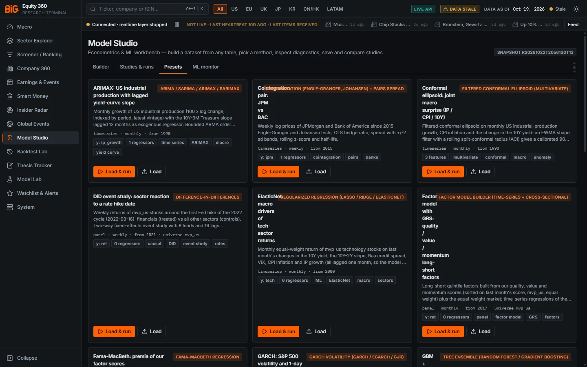

*Figure 9.3: Presets tab (`/studio`), first six of 22 preset cards.*

Each card shows the preset title, the method badge, a three-line description, the dataset summary (shape · frequency · start year · universe), the target `y:`, the number of regressors or features and up to four tags.

### Controls

| Control | What it does |
|---|---|
| **Load & run** | Loads the study into the builder and runs it immediately. |
| **Load** | Loads the study into the builder only (toast "Preset loaded into the builder"). Change it, then run or save it. |

### Methodology

The live API returns 22 presets:

| Preset | Method | What it does |
|---|---|---|
| ARIMAX: US industrial production with lagged yield-curve slope | ARIMA | Monthly US IP growth with the 10Y–3M slope lagged 12 months as exogenous regressor; ARMA order searched by BIC; 12-month forecast using known future regressor values. |
| Cointegration pair: JPM vs BAC | Cointegration | Weekly log prices since 2015: Engle–Granger and Johansen tests, hedge ratio, ±2 sd spread bands, rolling z-score (52 weeks), half-life. |
| Conformal ellipsoid: joint macro surprise (IP / CPI / 10Y) | Conformal ellipsoid (**experimental**) | Calibrated 90% joint set for next month's US IP growth, CPI inflation and 10Y change; months outside it are joint macro anomalies. |
| DiD event study: sector reaction to a rate hike date | Difference-in-differences | Weekly `mvp_us` returns around 2022-03-16: financials treated vs other sectors; TWFE event study, 8 leads, 16 lags, pre-trend test. |
| ElasticNet: macro drivers of tech-sector returns | Regularized regression | Monthly tech-sector return on last month's changes in 10Y, 10Y–2Y, Baa spread, VIX, CPI, IP; penalty by expanding-window CV. |
| Factor model with GRS: quality / value / momentum long-short factors | Factor model builder | Quintile long-short factors from our scores plus the market; time-series regressions of 15 score portfolios; GRS test; second-pass premia. |
| Fama-MacBeth: premia of our factor scores | Fama-MacBeth | Monthly `mvp_us` cross-sections: next-month return on standardised quality, value, momentum, growth and profitability scores. |
| GARCH: S&P 500 volatility and 1-day VaR | GARCH | Daily `IDX:^GSPC` returns since 2000: GJR-GARCH(1,1) with Student-t errors, 10-day volatility band, 1-day VaR at 1% / 5% with Kupiec backtest. |
| GBM + SHAP: 3M outperformance from factor scores | Tree ensemble | HistGradientBoosting classifier of "next 3-month return beats the cross-sectional mean"; purged K-fold (3-month purge); SHAP and PDP. |
| GMM regimes of US macro states | Gaussian mixture | Monthly US macro state since 1990 (IP, CPI, 10Y–3M, Baa, unemployment change); states chosen by BIC with soft probabilities. |
| HDBSCAN of global companies | Density clustering | `mvp_global` companies on profitability, growth, leverage and valuation ratios; dense peer clusters and outliers as noise. |
| Hierarchical clustering of sectors by return correlation | Hierarchical | Equal-weighted monthly sector returns since 2012; average linkage on 1 − correlation; dendrogram and best-silhouette cut. |
| Kalman time-varying beta: AAPL vs S&P 500 | Time-varying beta | Weekly AAPL return on `IDX:^GSPC` since 2005 with random-walk alpha and beta vs the static OLS beta. |
| K-means peer discovery: MVP companies on profitability/growth/valuation ratios | K-means | Latest PIT TTM ratios of `mvp_us`, winsorised and standardised; k by silhouette over 3..10. |
| Leaderboard: OLS / ElasticNet / GBM / ARIMAX for US IP growth | Leaderboard | One-month-ahead IP growth from its own lags, the lagged slope and Baa spread; five candidates on identical expanding folds, ranked by OOS RMSE with Diebold–Mariano tests. |
| Logit: probability of 3M outperformance from factor scores | GLM (binomial) | Monthly `mvp_us` panel; y = 1 if the next-3-month return beats the cross-sectional mean; date-clustered errors. |
| Markov switching: US market regimes | Markov switching | Monthly S&P 500 return since 1960 with two regimes in mean and variance; smoothed probabilities, transition matrix, durations. |
| PCA of global yield curves | PCA | Monthly changes of the US curve (3M–30Y) and nine other 10Y yields since 1992; PC1 is the global level factor. |
| Poisson: insider cluster-buy counts vs drawdown | GLM (Poisson) | Monthly count of `mvp_us` companies with an insider cluster buy on last month's average drawdown and 3-month return; HAC errors; dispersion check. |
| SARIMA: EA HICP monthly | ARIMA | Euro-area HICP inflation (ECB) with a seasonal ARIMA (s = 12), order by AIC, 24-month fan, rolling-origin evaluation. |
| Sector returns vs lagged rates (distributed lag OLS, HAC) | Distributed lag | Monthly US financials return on current and three lagged changes in the 10Y yield and 10Y–2Y slope; joint F-tests, long-run multipliers. |
| VAR: rates / inflation / IP impulse responses | VAR | Monthly US IP growth, CPI inflation and 10Y change since 1990; lag by BIC; Cholesky IRFs over 24 months (ordering IP → inflation → rates). |

The research-recipe library with about 40 presets grouped by question, a recipe search and "Save as my preset", planned in `docs/ROADMAP_V3_PLAN.md` section S, is not built yet: the app serves the 22 presets above.

### Data sources and refresh

Presets reference sources and series ids, not data; they run on the current snapshot.

### Validation status

Not formally validated. Presets demonstrate methods; their results are not validated findings. The conformal ellipsoid preset is experimental (see [Methods catalogue](#methods-catalogue)).

### Correct usage and worked example

Load "PCA of global yield curves" with **Load & run**. In the PCA tab, the explained-variance table states how many components explain at least 80% of the variance; the loadings heatmap shows PC1 loading with the same sign on every yield (a global level factor). The live run history shows this study on 416 monthly observations.

### Limitations and pitfalls

- Presets with `mvp_us` panels start in 2016–2017 because factor-score history starts on 2016-10-31.
- Presets whose description says "latest vintage" (ARIMAX, SARIMA) use reference-period macro alignment: fine for a macro forecast, not for an equity strategy.

### Related mnemonics and BQL fields

[Methods catalogue](#methods-catalogue), [Results](#results).

---

## Studies & runs

**Route:** `/studio` (tab **Studies & runs**) · **Refresh:** live list; scheduled studies re-run weekly or monthly (job `studio_scheduled`, weekly DAG)

### Purpose

This tab keeps your saved studies, the history of every run (yours and scheduled ones), the comparison of runs, and the peer sets saved from clustering runs.

### Screenshot

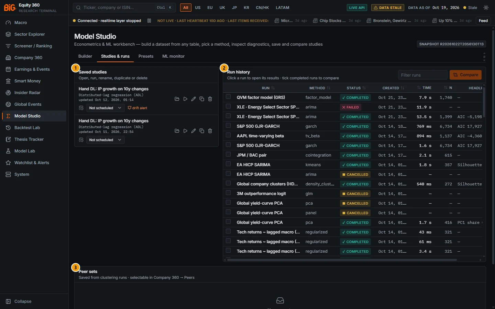

*Figure 9.4: Studies & runs (`/studio`): two saved studies, the run history and the empty peer-set panel.*

| # | Panel | What it shows |
|---|---|---|
| 1 | Saved studies | "Open, run, rename, duplicate or delete". Each row: name, method, last update, "from preset", last run id, and the schedule row. The first study shows a **drift alert** link. |
| 2 | Run history | "Click a run to open its results · tick completed runs to compare". Columns: checkbox, Run, Method, Status (completed, failed, cancelled, queued, running), Created, Time, n, Headline (the first available of adjusted R², R², pseudo R², AUC, silhouette, PC1 share, OOS relative RMSE, AIC). |
| 3 | Peer sets | "Saved from clustering runs · selectable in Company 360 → Peers". Empty: "No peer sets. Run a security-level clustering (k-means, GMM, HDBSCAN…) and use “Save as peer set”." |

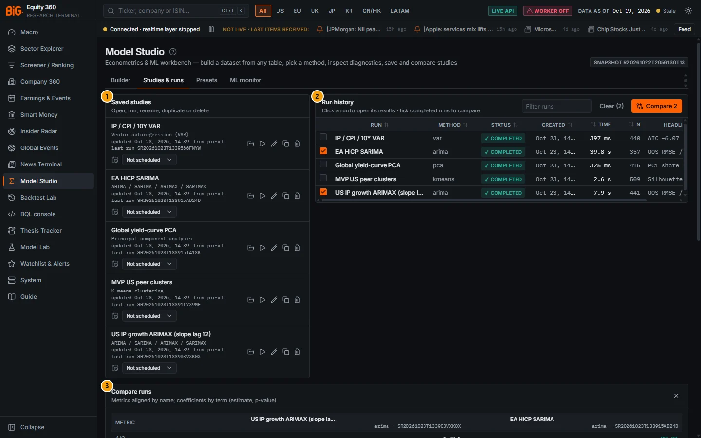

*Figure 9.5: Studies & runs on the test copy: five saved studies loaded from presets, the run history with two ARIMA runs ticked and the **Compare runs** panel open.*

| # | Panel | What it shows |
|---|---|---|
| 1 | Saved studies | Five studies created from presets ("from preset"), each with its last run id and the schedule select (here "Not scheduled"). |
| 2 | Run history | Five completed runs; "US IP growth ARIMAX (slope lag 12)" and "EA HICP SARIMA" are ticked, so the header shows **Clear (2)** and **Compare 2**. Headline column: AIC, OOS RMSE, PC1 share, silhouette. |
| 3 | Compare runs | "Metrics aligned by name; coefficients by term (estimate, p-value)": one column per run with its method and run id. |
| 4 | Peer sets | Below the fold. |

### Controls

| Control | What it does |
|---|---|
| Study name (link) / **Open in builder** (folder icon) | Loads the study and its last run into the builder. |
| **Run now** (play icon) | Opens the study and runs it ("auto" mode). |
| **Rename** (pencil) | Inline rename with **Save** / cancel. |
| **Duplicate** | Creates "‹name› (copy)". |
| **Delete** (bin) → **Delete?** | Two-step delete. |
| Schedule select | **Not scheduled**, **Re-run weekly**, **Re-run monthly**. Scheduling creates a `studio_drift` alert rule; "Schedule removed" deletes it. |
| **drift alert at N % worse** | The relative degradation that triggers the alert (default 20%). |
| "last scheduled run" / **drift alert** link | When the study last re-ran; the link opens [Watchlist & Alerts](13-watchlists-alerts.md). |
| **Filter runs** | Filters the history by name, method or run id. |
| Row click | Opens that run in the Builder tab's results pane. |
| Checkboxes, **Clear (n)**, **Compare n** | Tick up to six completed runs; **Compare** needs at least two. |
| Peer set **run** / delete | Opens the source clustering run or deletes the peer set. |

### Methodology

**Run modes.** "auto" runs inline when the estimated cost is under 2 seconds, otherwise it is queued on the worker. **Queue** forces the worker. Queued runs show "Queued on the worker" or "Running" with the elapsed time, the estimate, a progress bar capped at 95% and **Cancel run**. A run that stops sending heartbeats for 180 s beyond its timeout is marked failed ("run stopped without a result (worker died or was killed)").

**Run watcher.** An app-wide watcher polls every queued run every 2 seconds, wherever you are in the app, and raises a toast when it finishes ("Run finished: ‹name›", with "check the warnings" when there are non-info warnings), fails or is cancelled. If no run is open in the results pane, the finished run opens there.

**Compare** (`POST /studio/compare`) aligns metrics by name and coefficients by term. In the metrics table the best value per row is green (lower is better for AIC, BIC, RMSE, MAE, MAPE, Brier, log-loss, deviance, inertia, Davies–Bouldin; counts such as n_obs or k are not ranked). The coefficient table shows each estimate with its p-value, bold when p < 0.05. The footnote warns: "Only meaningful when runs share the same target and sample."

**Scheduled re-runs and drift** (`backend/app/modeling/scheduled.py`). A weekly study is due 6 days after its last scheduled run, a monthly one after 27 days. After the re-run, the job compares the result with the previous completed run of the study:

- **Metric drift:** relative change `(new − old) / |old|` worse than the threshold in the bad direction. Higher-is-better metrics include R², adjusted R², within R², pseudo R², AUC, OOS R², silhouette, OOS rank IC, accuracy; lower-is-better include OOS RMSE / MAE, in-sample RMSE, Brier, OOS log-loss, OOS relative RMSE.
- **Coefficient shift:** `|β_new − β_old| > 3 × max(SE_old, SE_new)` for a term present in both runs.

When either fires, a `studio_drift` event is appended to the study's alert ("Study '‹name›' drifted: …").

### Data sources and refresh

Studies and run metadata live in `app_state` (`studies`, `study_runs`); run artefacts under `data/modeling/runs/`. The list shows the 100 most recent runs.

### Validation status

Not applicable (workflow).

### Correct usage and worked example

In Figure 9.4 the run history contains two runs of "S&P 500 GJR-GARCH" with the same n (6,734) and AIC (17,927): same spec, same snapshot, same numbers. Tick both and **Compare** to confirm that every metric matches; a difference would mean the spec or snapshot changed (check the spec hash in the Data & reproducibility tab).

### Limitations and pitfalls

- Compare only what is comparable: same target, same sample. Comparing R² across different targets is meaningless.
- A drift alert on a scheduled study is a prompt to look, not a verdict: new data can legitimately change a coefficient.

### Related mnemonics and BQL fields

[Watchlists and alerts](13-watchlists-alerts.md), [Peers](05a-company-fundamentals.md#peers) (peer sets).

---

## Results

**Route:** `/studio` (Builder tab, results pane) · **API:** `GET /api/v1/studio/runs/{run_id}`

### Purpose

The results pane shows one run: its header with actions, the warnings, and a set of tabs that depends on what the method produced.

### Screenshot

All result figures come from the test copy (runs of 23 Oct 2026 on snapshot R20261022T2056130T13). In each figure callout 1 is the study builder with the study loaded and callout 2 the results pane.

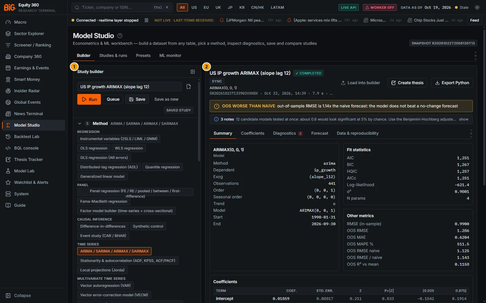

*Figure 9.6: "US IP growth ARIMAX (slope lag 12)", Summary tab (test copy).*

| # | Panel | What it shows |
|---|---|---|
| 1 | Study builder | The saved study (badge **SAVED STUDY**, buttons **Save** / **Save as new**). |
| 2 | Results pane | Header (✓ COMPLETED, **SYNC**, ARIMAX(0, 0, 1), run id, 7.9 s), the amber warning "OOS WORSE THAN NAIVE out-of-sample RMSE is 1.14x the naive forecast: the model does not beat a no-change forecast", "3 notes" (the first: "12 candidate models tested at once: about 0.6 would look significant at 5% by chance. Use the Benjamini-Hochberg adjusted…"), the tabs and the Summary: Model card (dependent `ip_growth`, exog `slope_l12`, 441 observations, order (0, 0, 1), 1990-01-31 → 2026-09-30), Fit statistics (AIC 1,251, BIC 1,267, σ² 0.9801) and Other metrics (OOS RMSE 1.286 vs naive 1.125, OOS RMSE / naive 1.143, OOS R² vs mean 0.1158). |

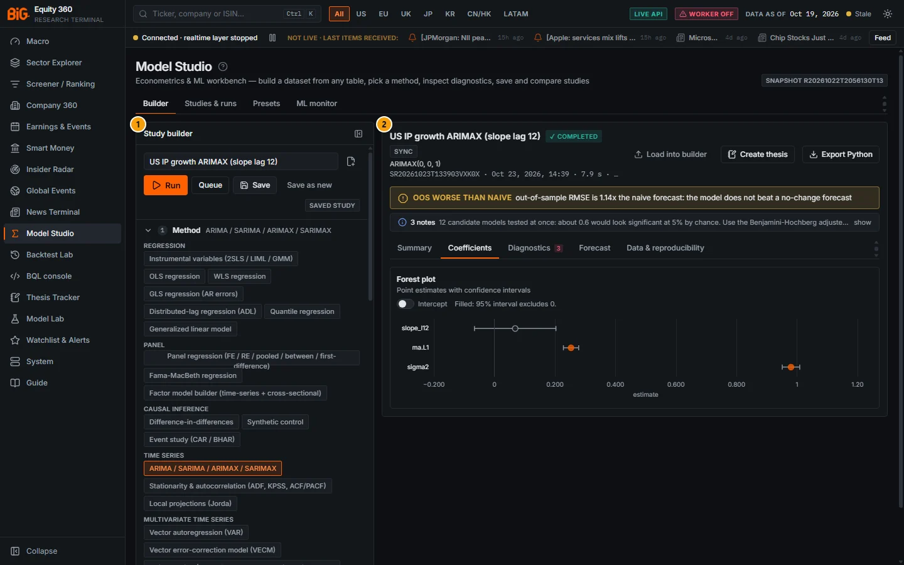

*Figure 9.7: Coefficients tab: forest plot of `slope_l12`, `ma.L1` and `sigma2` (filled marker = 95% interval excludes 0; the Intercept switch adds the constant).*

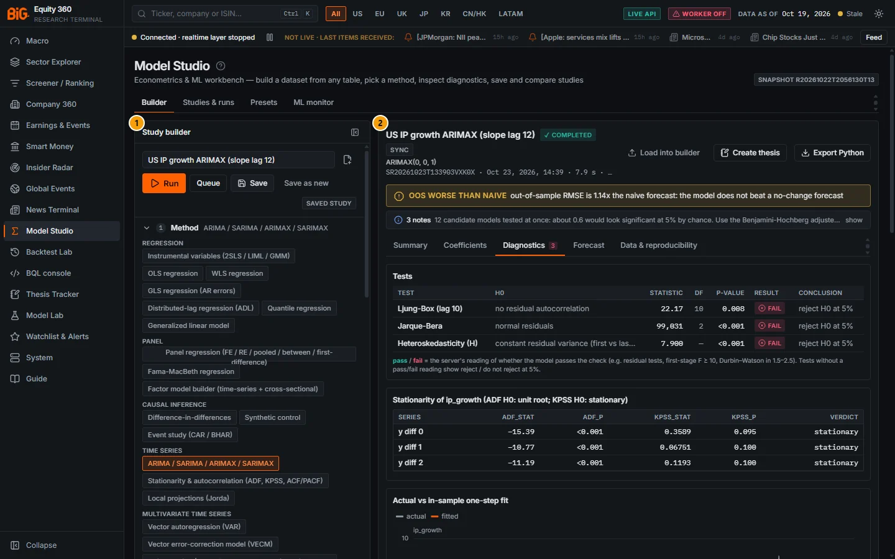

*Figure 9.8: Diagnostics tab (badge 3 = three failed tests): Ljung–Box (lag 10) p 0.008, Jarque–Bera p < 0.001 and heteroskedasticity (H) p < 0.001 all FAIL; the stationarity table finds `ip_growth` stationary in levels (ADF −15.39, KPSS 0.3589).*

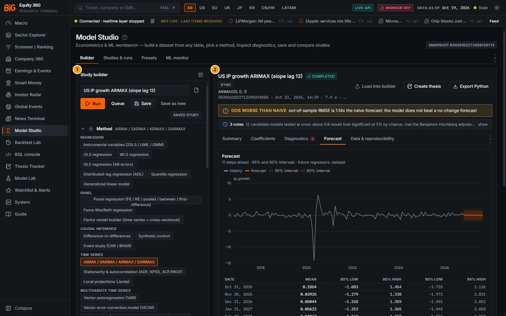

*Figure 9.9: Forecast tab: "11 steps ahead · 95% and 80% intervals · future regressors: dataset", fan chart and the forecast table (Oct 2026 mean 0.1854, 80% −1.083 to 1.454).*

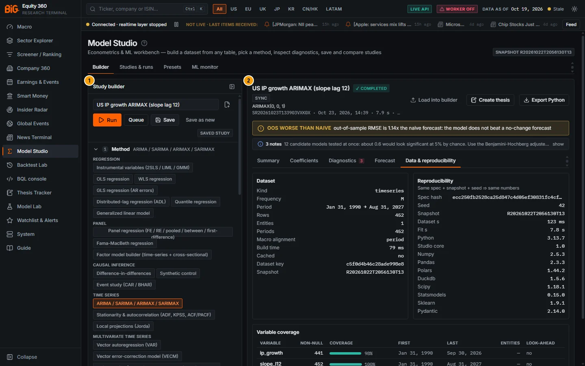

*Figure 9.10: Data & reproducibility: dataset (time series, monthly, 452 rows, macro alignment `period`), reproducibility (spec hash, seed 42, snapshot, timings, library versions) and variable coverage (`slope_l12` runs to Aug 2027 because a 12-month lag of a known series is known a year ahead).*

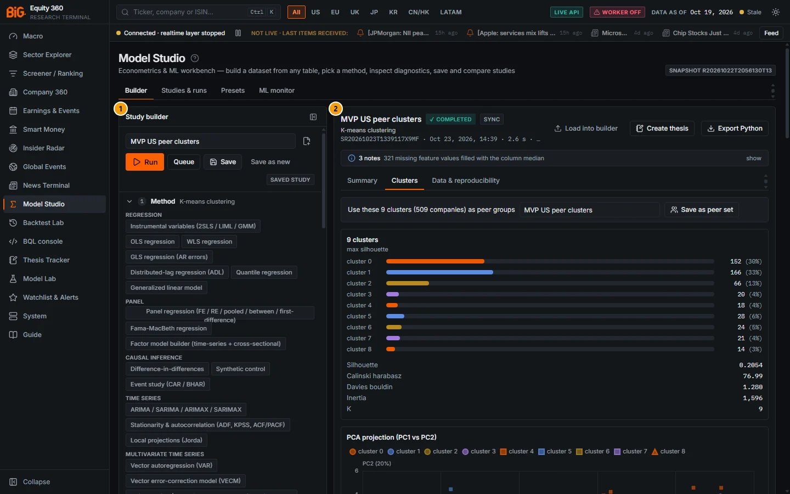

*Figure 9.11: "MVP US peer clusters" (k-means), Clusters tab: the "Use these 9 clusters (509 companies) as peer groups" bar with **Save as peer set**, cluster sizes chosen by maximum silhouette (silhouette 0.2054, Calinski–Harabasz 76.99, Davies–Bouldin 1.280), the PCA projection below. The note "321 missing feature values filled with the column median" comes from `impute = median`.*

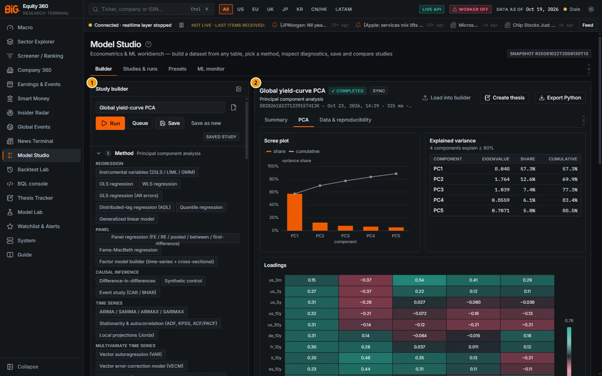

*Figure 9.12: "Global yield-curve PCA", PCA tab: scree plot, explained variance (PC1 57.3%, four components explain ≥ 80%) and the loadings heatmap (PC1 loads positively on every yield).*

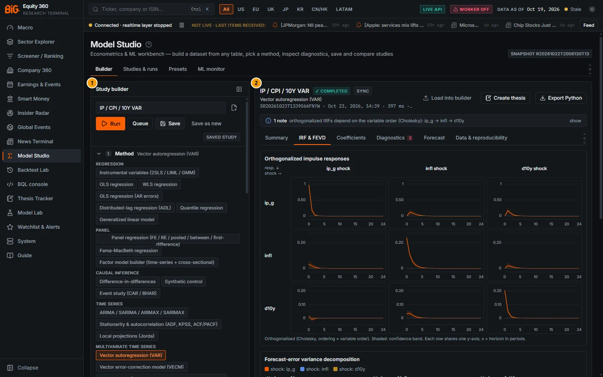

*Figure 9.13: "IP / CPI / 10Y VAR", IRF & FEVD tab: 3 × 3 grid of orthogonalised impulse responses (rows = responses, columns = shocks, 24 periods) with the note "orthogonalized IRFs depend on the variable order (Cholesky): ip_g → infl → d10y"; the FEVD starts below.*

### Controls

#### Run header

| Control | What it does |
|---|---|
| Title, status badge, mode badge | Run name, status (✓ completed, ✕ failed, ■ cancelled, … queued, ◔ running) and **sync** or **async**. |
| Sub-lines | Method title; run id · finish time · duration · n · first 10 characters of the spec hash. |
| **Load into builder** | Hover: "Replace the builder contents with this run's study". |
| **Backtest this signal** | Only for completed **panel** runs of the tree ensemble or regularised regression: opens the [Backtest Lab](11-backtest-lab.md#backtest-entry-points) with this run's out-of-fold predictions as the signal (source `studio_run`). Hover: "Use walk-forward CV (scheme expanding) - other schemes are flagged look-ahead." |
| **Create thesis** | Opens the thesis editor linked to this run ([Thesis Tracker](12-thesis-tracker.md)). |
| **Export Python** | Downloads `<study_name>_<run_id>.py` ([Export to Python](#export-to-python)). |
| Pending view | "Queued on the worker" / "Running", elapsed time, estimate, progress bar, "Long runs execute on the background worker. You can keep editing, switch tabs or leave the page — you will get a notification when it finishes.", **Cancel run**. |
| Failed view | "Run failed — ‹code›" and the error message. |
| Guardrail banner | "Guardrail: ‹code›" with the HTTP status, or "Study rejected"; **Dismiss**. |

#### Warnings

Serious warnings (severity warn or error) appear as red or amber banners with the warning code in capitals and the message. Informational notes and dataset notes are folded into "N notes · show / hide".

#### Result tabs

Only the tabs with content appear. Their order is fixed:

| Tab | When it appears | What it shows |
|---|---|---|
| **Summary** | always | **Model** card (method, dependent variable, sample, covariance type and other specification items), **Fit statistics**, **Other metrics**, the coefficient table, **Key tests** (specification, identification, inference and cointegration tests such as Hausman, first-stage F, Johansen, Patell, with their conclusion), **Tests at a glance** (up to 16 verdict badges with p-values and a **Diagnostics →** link) and, for ARIMA, the order-search table. |
| Method tab (label varies) | methods with special outputs | **Treatment effect** (DiD: pre-trend badge "no evidence against parallel trends" or "pre-treatment effects are not zero: parallel trends is doubtful", ATT, 2×2 means, event path, group-time ATT heatmap), **Event study** (CAAR path, AAR, events), **Synthetic control** (treated vs synthetic, gaps, donor weights bar), **IRF & FEVD** (VAR: IRF grid, FEVD, lag selection, Granger matrix), **Cointegration** (VECM: Johansen, β, α, error-correction term), **Spread** (pairs: spread with z bands, z-score, legs), **Volatility** (GARCH: conditional volatility, VaR backtest), **Regimes** (Markov: regime cards with expected duration and share of time, probability chart, transition matrix), **Components** (state space), **Beta paths** (Kalman), **Premia** (Fama–MacBeth λ series), **Regularization path** (coefficient paths, CV curve, selected features as ▲ / ▼ badges with the standardised size, unselected struck through), **Explainability** (tree ensembles: feature importance with permutation vs impurity, SHAP beeswarm, partial dependence, CV folds), **Factors** (factor model: cumulative factor returns, beta heatmap, alphas, the GRS line "F … · p … · conclusion", second-pass premia), **Leaderboard** (ranked table with the best highlighted, cumulative loss difference, CV folds). Other methods with path plots get a tab named **Paths**. |
| **Coefficients** | coefficients or coefficient plots exist | Forest plot (point estimates with intervals; not for quantile regression), lag-profile charts and the lag-block table ("Long-run multiplier = sum of the lag coefficients; F tests all lags of a variable jointly."), the quantile coefficient process, pseudo R² by quantile. |
| **Diagnostics** | tests or diagnostic plots exist; a red count badge shows failed tests | Full **Tests** table grouped by test group (Test, H0, Statistic, df, p-value, Result, Conclusion), stationarity and first-stage tables, and the plots: fitted vs actual, residuals vs fitted, QQ, residual ACF, residual histogram, residuals over time, ACF of y, ROC and calibration (binomial). |
| **Forecast** (or **Out-of-sample**) | forecast or OOS evaluation exists | Forecast fan with 80% and 1−α bands (variable switch for VAR / VECM), table of the first 12 steps; for GARCH a "Volatility forecast (sigma)" with the next-period VaR. **Out-of-sample evaluation** card: scheme, initial train, horizon, folds, purge; "RMSE vs naive" (green below 1, "beats the no-change forecast"), "OOS R² vs historical mean", a metrics table per forecaster (Model, OLS (unpenalized), Naive (no change), Random walk + drift, Historical mean, Seasonal naive) with RMSE, MAE, MAPE %, OOS R², correlation, AUC, log-loss, Brier, accuracy, "RMSE vs model" and a **best** badge, and the OOS chart. |
| **Clusters** | clustering methods | "Use these k clusters (n companies) as peer groups" bar with a name and **Save as peer set** (security-level clusterings only); cluster sizes (and noise count); soft-clustering note with the average membership probability; PCA scatter coloured by cluster (faded markers = uncertain members for GMM); dendrogram with **use this cut** for hierarchical runs (copies `distance_threshold` into the builder); BIC, elbow and silhouette curves; correlation and profile heatmaps; **Cluster profiles** (most distinctive features as mean z-scores ▲ / ▼ and dominant sectors); **Members** table (cluster, member with a Company 360 link, sector, distance to centre, membership probability) with a filter and a cluster select. |
| **PCA** | PCA | Scree plot, explained-variance table ("N components explain ≥ 80%"), loadings heatmap, biplot, scores scatter, score time series, loadings table. |
| **Other output** | outputs not routed elsewhere | Remaining plots and tables. |
| **Data & reproducibility** | always | **Dataset** card (kind, frequency, period, rows, entities, periods, macro alignment, build time, cached, dataset key, snapshot), **Reproducibility** card ("Same spec + snapshot + seed ⇒ same numbers": spec hash, seed, snapshot, timings, library versions), **Variable coverage** (non-null count, coverage bar, first / last date, entities, "uses future" badge) and **Study spec (JSON)** ("Show the exact request body"). |

### Methodology

**Test verdicts.** "pass / fail = the server's reading of whether the model passes the check (e.g. residual tests, first-stage F ≥ 10, Durbin–Watson in 1.5–2.5). Tests without a pass/fail reading show reject / do not reject at 5%." The badges read **pass**, **fail**, **reject H0**, **do not reject** and **info**.

**Coefficient significance.** Stars use unadjusted p-values; bold marks significance at the run's α (default 0.05). Where several coefficients are tested, the "p adj." column gives Benjamini–Hochberg adjusted p-values, which control the false discovery rate.

**Peer sets.** Saving a security-level clustering as a peer set (`POST /studio/runs/{run_id}/peer-set`) stores its membership; Company 360 › Peers can then compare a company with its cluster instead of its sub-sector.

### Data sources and refresh

The result is read from `data/modeling/runs/<run_id>/result.json`; it does not change after the run.

### Validation status

Not applicable; see the method's entry in the [Methods catalogue](#methods-catalogue).

### Correct usage and worked example

Figures 9.6 to 9.10 show this reading on the ARIMAX preset: the model's out-of-sample RMSE is 1.14 times that of the no-change forecast and all three residual tests fail, so despite a sensible lagged-slope coefficient the study gives no usable forecast. For a time-series regression, read in this order: Summary (sign and size of the coefficients, covariance type), Diagnostics (fail count: residual autocorrelation means the standard errors are wrong unless HAC was used), Out-of-sample ("RMSE vs naive" above 1 means the model does not beat a no-change forecast, which also raises the `oos worse than naive` warning), then Data & reproducibility (coverage and look-ahead flags).

### Limitations and pitfalls

- In-sample fit statistics (R², AIC) reward complexity; prefer the out-of-sample blocks.
- SHAP and permutation importance explain the fitted model, not the economy.
- The **Save as peer set** bar only appears for security-level clusterings with sector information.

### Related mnemonics and BQL fields

[Calibration metrics](16-methodology.md#calibration-metrics), [Rank IC and factor evaluation](16-methodology.md#rank-ic-and-factor-evaluation).

---

## Export to Python

**Route:** `/studio` (run header › **Export Python**) · **API:** `GET /api/v1/studio/runs/{run_id}/export.py`

### Purpose

The export turns a completed run into a standalone script that rebuilds the same dataset and refits the same model outside the app, for audit, peer review or further work in a notebook.

### Controls

| Control | What it does |
|---|---|
| **Export Python** (completed runs only) | Downloads `<study_name>_<run_id>.py`; toast "Python script downloaded". Runs that are not completed return HTTP 409 "only completed runs export". |

### Methodology

The script (`backend/app/modeling/export.py`):

- embeds verbatim the dataset engine (`_core.py`), the point-in-time as-of helper and the method cores (`_algos.py`, `_ml.py`, `_conformal.py`, `_spatial.py`);
- has a header with the run id, title, method, creation time, snapshot id, spec hash and seed;
- rebuilds the dataset read-only from the Parquet lake under `--data-dir` (default: the run's data directory), or loads the exact dataset saved with the run with `--from-artifact`;
- refits with plain statsmodels / scikit-learn calls, with the orders or k chosen by the run's search fixed in the script;
- prints a summary and a final `RESULT_JSON {...}` line with the key estimates, so a reproduction can be checked mechanically.

Requirements: duckdb, polars, numpy, pandas, scipy, statsmodels, scikit-learn.

### Validation status

The plan records that the scripts reproduce the presets exactly (`docs/MODEL_STUDIO_PLAN.md`, A3).

### Limitations and pitfalls

- Variables from the **BQL query** source cannot be rebuilt by the script: the BQL engine needs the backend and the serving snapshot. Use `--from-artifact` for such runs.
- The script reads the lake as it is when you run it; to reproduce the original numbers exactly use the same snapshot or `--from-artifact`.

### Related mnemonics and BQL fields

[Backtest Lab export](11-backtest-lab.md#export-to-python).

---

## ML monitor

**Route:** `/studio` (tab **ML monitor**) · **Menu:** Model Studio › ML monitor (same content as Model Lab, `/models`) · **Refresh:** weekly ML retraining

### Purpose

The ML monitor tab embeds the nightly ML monitor so that you can check the production ranking model while working in Model Studio. It shows exactly the same panels as the [Model Lab](10-model-lab.md#model-lab) page, under the line "Nightly ML monitor — walk-forward evaluation of the XGBoost baseline and the multi-factor Transformer."

### Screenshot

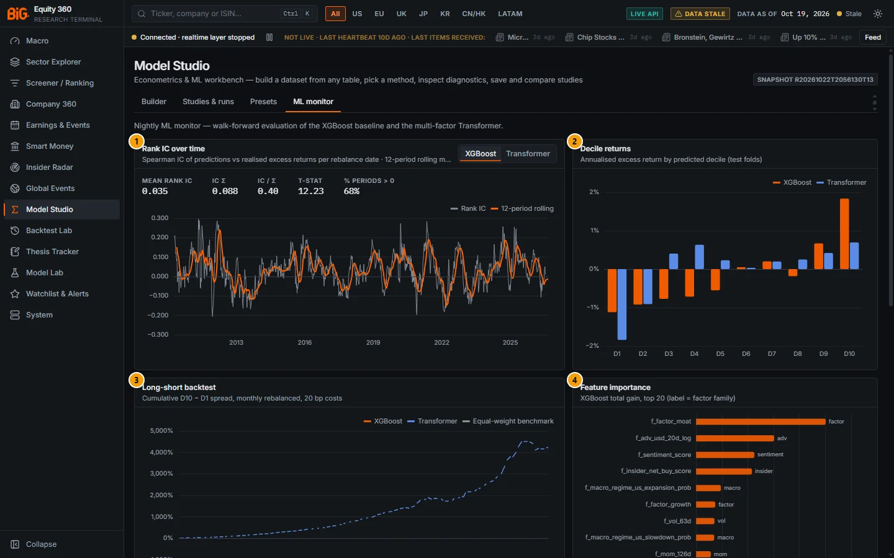

*Figure 9.14: ML monitor tab (`/studio`), XGBoost selected, data as of 19 Oct 2026.*

| # | Panel | What it shows |
|---|---|---|
| 1 | Rank IC over time | Spearman IC per rebalance date with a 12-period rolling mean and the summary statistics. |
| 2 | Decile returns | Excess return by predicted decile for XGBoost and the Transformer. |
| 3 | Long-short backtest | Cumulative D10 − D1 spread with the equal-weight benchmark. |
| 4 | Feature importance | XGBoost total gain, top 20, labelled by factor family. |
| 5 | Walk-forward folds | Train / test windows per fold with rank IC and Sharpe. |
| 6 | Training runs | Every ranking-model run; `prod` marks the promoted model. |

### Controls

As in [Model Lab](10-model-lab.md#controls).

### Methodology

See [Model Lab](10-model-lab.md#methodology).

### Validation status

> **Caution:** only XGBoost is production. Its out-of-sample rank IC is about 0.035: treat the ML score as one input, not proven alpha. The Transformer and the ensemble are comparison models; the 3M FT-Transformer failed the label-permutation leakage test (`docs/PHASE3_TODO.md`). Details in [Model Lab › Validation status](10-model-lab.md#validation-status).

### Related mnemonics and BQL fields

`MDL` opens Model Lab. See [Model Lab](10-model-lab.md#related-mnemonics-and-bql-fields).

---

## Open in Model Studio entry points

**Route:** several pages → `/studio` · **Refresh:** not applicable

### Purpose

Other pages can open Model Studio with a draft already filled in, so that a series or a set of event dates you are looking at becomes a study in one click. The draft replaces the current builder content, clears the selected run and opens the Builder tab; nothing runs until you press **Run**.

### Controls

| Page | Button | Draft it creates |
|---|---|---|
| Macro › [Series explorer](02a-macro.md#series-explorer) and the macro series drawer | **Open in Model Studio** (hover: "New Model Studio study with this series as the target") | Time series, the series' own frequency, start 20 years back, macro alignment **Reference period**, method **ARIMA**, the series as y (with a 12 / 4 / 52-period % change × 100 when the series is shown year on year). |
| [Global Events › Event studies](08-global-events-news.md#event-studies), panel "Send event dates to Model Studio" | **Send to Model Studio** | An **Event study (CAR / BHAR)** draft over the shock dates of a country, sector or company (attention or tone z ≥ 2, de-clustered), filtered by theme and shock kind (any, attention, tone drop, tone jump). Disabled with "No event dates for this label". |
| [Instrument page](02b-markets-cross-asset.md#instrument-page) | **Open in Model Studio** | Weekly log returns of the instrument since 2000, **ARIMA**. |
| [Cross-asset dashboard](02b-markets-cross-asset.md#cross-asset-dashboard) | **Open in Model Studio** | Weekly **OLS** of the asset's log return on its lagged cross-asset signals (source `cross_asset`: trend, carry, positioning where available), since 2008. |
| [CFTC market page](02b-markets-cross-asset.md#cftc-market-page) | **Open in Model Studio** | Weekly **OLS** of the mapped instrument's log return on CFTC positioning (source `cftc`, regressors lagged one week), since 2008. |

### Correct usage and worked example

From the Global Events event-studies page, choose Country `US`, theme "All themes", shock kind "Any shock" and press **Send to Model Studio**. The builder opens with an event-study draft whose events are the listed dates. Before running, check the event list in Parameters and the estimation window (default −250 to −30 days); the panel notes that the z baseline needs 90 days of history (data from 2026-07-14), so few dates exist before mid-October 2026 unless the 2020 backfill has landed.

### Limitations and pitfalls

- The draft overwrites the current builder content without asking. Save your study first.
- Drafts are starting points: check the alignment, lags and dates before drawing conclusions.

### Related mnemonics and BQL fields

[Backtest entry points](11-backtest-lab.md#backtest-entry-points) (the reverse direction: "Backtest this signal").

---

## BQL query variable source

**Route:** `/studio` (Builder › 3 · Variables › Add variable › Source table **BQL query**) · **Roadmap item:** v3 B1

### Purpose

The BQL source turns any BQL-lite expression into a dataset column, evaluated point-in-time at every date of the dataset. It brings the query language of the [BQL console](14-bql-mnemonics.md#bql-console) (cross-sectional z-scores, ranks, changes over windows, dictionary fields) into Model Studio without building each transform by hand.

### Controls

| Control | What it does |
|---|---|
| Source table **BQL query** | Lists the dictionary fields that have point-in-time history (field = the BQL mnemonic) and shows an expression row. |
| Expression row | "BQL expression — evaluated point-in-time at every dataset date on the serving snapshot (cross-sectional functions run over the dataset's securities)". Default `cs_zscore(chg_pct(px, 3M))`; placeholder `cs_zscore(roic) - cs_zscore(pe_ttm)`. Add buttons **+ y** / **+ x** (or **+ add**). |

### Methodology

For each grid date D the expression sees only data known at D. Cross-sectional functions such as `cs_zscore` or `rank` run over the dataset's entities at each date. Security-level panels and cross-sections use the dataset's entity filter (an `options.universe` BQL universe overrides it); time-series datasets aggregate the panel across entities per date (`entity_agg`, default mean). Non-BQL variables are built by the dataset engine and joined on (entity, date).

### Data sources and refresh

The serving snapshot (not the raw lake).

### Validation status

Not formally validated.

> **Note:** on the live snapshot used for this guide (R20261022T2056130T13) the BQL source does not appear in the source list: the catalogue lists 15 sources without "BQL query". It is offered only when the BQL field dictionary loads (roadmap v3 B1 "go live" step: rebuild the app and restart the API). If you do not see it, use the [BQL console](14-bql-mnemonics.md#bql-console) to explore and build the equivalent transforms in the builder.

### Limitations and pitfalls

- BQL variables are not reproducible by the exported script (see [Export to Python](#export-to-python)).
- Expressions are evaluated on the serving snapshot, which holds a shorter history for some fields than the lake.

### Related mnemonics and BQL fields

`BQL` opens the console. [BQL language reference](14-bql-mnemonics.md#bql-language-reference), [Field dictionary](14-bql-mnemonics.md#field-dictionary), [BQL elsewhere in the app](14-bql-mnemonics.md#bql-elsewhere-in-the-app).
