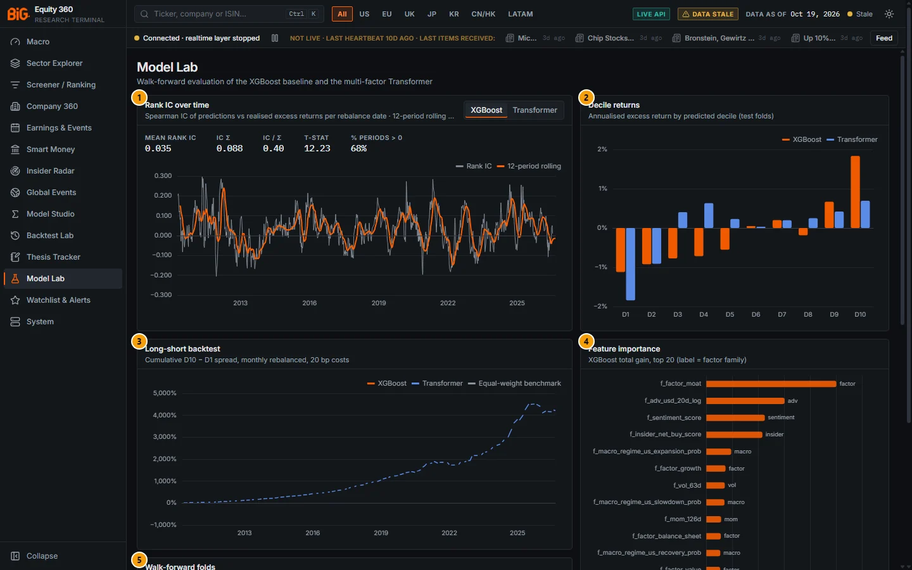
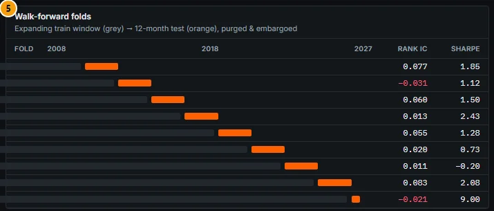
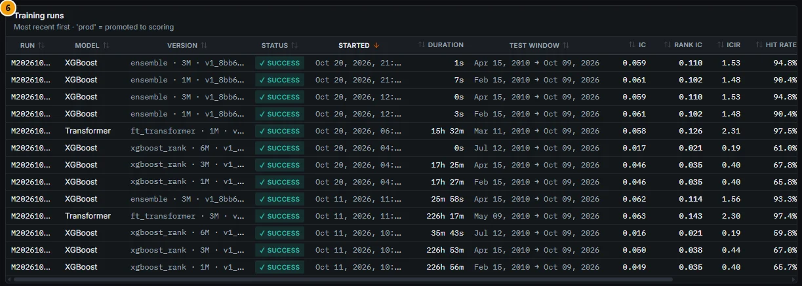
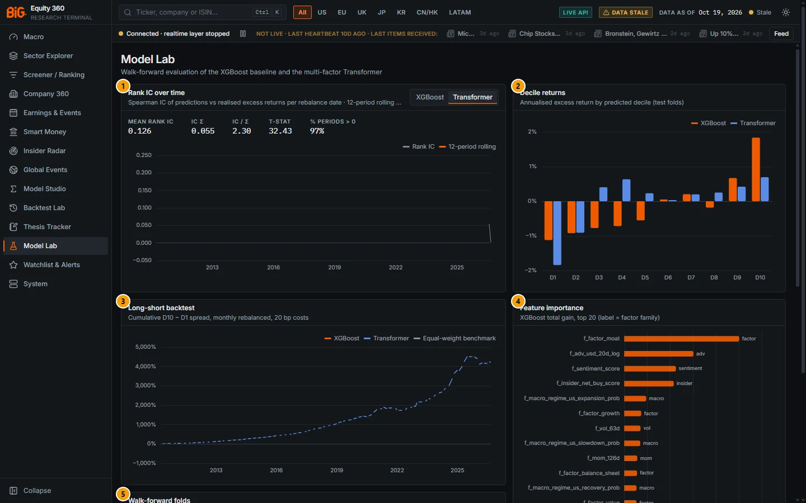

# 10. Model Lab

Model Lab monitors the machine-learning models that rank stocks by expected excess return: the production XGBoost model and the comparison models (the multi-factor FT-Transformer and the rank-average ensemble). It shows how well each model's walk-forward, out-of-sample predictions ranked stocks over time, how returns line up by predicted decile, the fold-by-fold results, the features that drive the XGBoost model, and the registry of training runs with the production flag.

The predictions feed the ML score on Company 360 ([Model](05c-company-macro-events-model.md#model) tab), the Screener's ML fields and the Backtest Lab's `ml` signal source. Read this chapter before relying on any of them: the measured out-of-sample edge is small, and only XGBoost is production.

The same page is embedded in Model Studio as the [ML monitor](09-model-studio.md#ml-monitor) tab.

---

## Model Lab

**Route:** `/models` · **Menu:** Model Lab · **Mnemonics:** `MDL` · **Refresh:** weekly (jobs `ml_labels`, `ml_train_xgb`, `ml_ensemble`); the Transformer is retrained by hand only (`ml_train_transformer`, manual since 2026-10-20)

### Purpose

Model Lab is the governance view of the ML ranking models. Portfolio managers use it to judge how much weight the ML score deserves (answer: little, see Validation status); the owner uses it to check each weekly retraining (did the rank IC hold up, did a fold turn negative, which run is in production). It also shows why the Transformer is not in production even though its headline numbers look better.

### Screenshot



*Figure 10.1: Model Lab (`/models`), XGBoost selected in the Rank IC panel, data as of 19 Oct 2026.*

| # | Panel | What it shows |
|---|---|---|
| 1 | Rank IC over time | "Spearman IC of out-of-sample predictions vs realised excess returns per rebalance date · 12-period rolling mean". With **Transformer (demoted)** selected, a red **DEMOTED · failed leakage test** note sits above the chart: "Not evidence of skill: the FT-Transformer failed the label-permutation leakage test …". Statistic tiles (here for XGBoost): MEAN RANK IC 0.035, IC σ 0.088, IC / σ 0.40, T-STAT 12.23, % PERIODS > 0 68%. Grey line = rank IC per date, orange = 12-period rolling mean. |
| 2 | Decile returns | "Mean excess return per label horizon by predicted decile, out-of-sample test folds (not annualised)": one bar per decile D1…D10 for XGBoost (orange) and the Transformer (blue), each series named with its horizon, the Transformer marked "(demoted)", and a DEMOTED badge on the panel. |
| 3 | Long-short backtest | "Cumulative D10 − D1 spread, compounded over non-overlapping horizon-length windows, gross of trading costs": XGBoost, Transformer (demoted) and the equal-weight benchmark (dashed). |
| 4 | Feature importance | "XGBoost total gain, top 20 (label = factor family)". Here `f_factor_moat` leads, then `f_adv_usd_20d_log`, `f_sentiment_score`, `f_insider_net_buy_score` and the US macro-regime probabilities. |
| 5 | Walk-forward folds | "XGBoost 3M · expanding train window (grey) → 24-month test folds (orange; the last may be partial), purged & embargoed" (the fold length is read from the folds), one row per fold with its rank IC and Sharpe. Below the fold in the main image. |
| 6 | Training runs | "Most recent first · 'prod' = promoted to scoring", with a **Leakage gate** column: green "leakage test passed" (XGBoost) or red "DEMOTED · failed leakage test" (FT-Transformer, ensemble; hover for the reason). Below the fold in the main image. |



*Figure 10.2: Walk-forward folds (callout 5) of the XGBoost 3M production run: nine folds, rank IC from −0.031 to 0.083; the last fold is a partial window (2026-04-15 → 2026-10-09).*



*Figure 10.3: Training runs (callout 6): ensemble, FT-Transformer and XGBoost runs of 11 and 20 Oct 2026 with test windows, IC, rank IC, ICIR and hit rate.*



*Figure 10.4: The same page with **Transformer** selected: MEAN RANK IC 0.126, IC σ 0.055, IC / σ 2.30, T-STAT 32.43, % PERIODS > 0 97%. These figures come from a model that is not production; see Validation status.*

### Controls

| Control | What it does |
|---|---|
| **XGBoost 3M** / **Transformer (demoted)** (Rank IC panel; the horizon is that of the run shown) | Switches the Rank IC chart and its five statistic tiles between the two model families; the demoted family shows the leakage warning above the chart. The other panels always show both models (decile returns, long-short) or XGBoost only (feature importance, folds). |
| Chart hover | Rank IC and rolling mean per date; decile values; cumulative spread per date; feature name with its family and gain share. |
| Fold bar hover | "Train ‹start› → ‹end› · Test ‹start› → ‹end›". |
| Training runs table | Sortable columns: Run, Model, Version, Status, Started (default sort, newest first), Duration, Test window, IC, Rank IC, ICIR, Hit rate, D10−D1 ann., Features. A **prod** badge marks the promoted run. |

There is no promote or retrain button on the page. Promotion is done by the weekly production gate or by hand through `POST /api/v1/models/runs/{id}/promote`; retraining through the scheduled jobs or `POST /api/v1/models/train`.

### Methodology

#### Which runs the charts show

The page reads the training-run registry (`GET /api/v1/models/runs`) and, for the charts, the run detail (`GET /api/v1/models/runs/{id}`) of one run per family:

- **XGBoost family** (model types `xgboost_rank` and `ensemble`): the production run if one exists, otherwise the most recent completed run. On 19 Oct 2026 this is the **3M** XGBoost production run `M20261020T031637JB5W`.
- **Transformer family** (model types `ft_transformer`, `cs_attention`): the production run if one exists, otherwise the most recent completed run. No Transformer is production, so the charts show the most recent run, the **1M** FT-Transformer `M20261020T050950HN87` of 20 Oct 2026.

The two families can therefore be on different horizons (3M vs 1M here). In the Training runs table the Model column names each type (XGBoost, FT-Transformer, Ensemble); earlier builds labelled ensemble rows "XGBoost".

#### Labels and features

- **Rebalance grid:** the last trading day of every ISO week plus every month end (S&P 500 calendar). XGBoost trains on the full weekly + month-end grid; the Transformer on month ends only.
- **Label:** forward return from close(D+1) to close(D+1+h), h = 21 / 63 / 126 trading days for 1M / 3M / 6M, on the security's own calendar. `fwd_excess_sector` subtracts the equal-weighted mean forward return of the training universe in the same (date, horizon, sector, region) bucket; `rank_label` is its cross-sectional percentile. Labels are written to their own table so a feature pipeline can never read them.
- **Features:** 31 live features from `feature_registry.yaml`, cross-sectionally rank-Gaussianised: price momentum (21d, 63d, 126d, 12m, 12m−1m), 5-day reversal, realised volatility (21d, 63d), liquidity (log 20-day dollar volume), US macro-regime HMM probabilities (expansion, slowdown, contraction, recovery, stagflation, recession), rolling macro betas (market, 10Y, 2s10s, credit spread, USD, oil), our fundamental factor scores (value, quality, growth, profitability, balance sheet, moat), technical confluence, insider and sentiment scores. Fundamental, insider and sentiment features are lagged one day.
- **Universe:** `mvp_us` + `mvp_global`.

#### Walk-forward cross-validation

Expanding window: 5 years of initial training history, then out-of-sample test folds of **24 months** stepped by 24 months (nine folds from 2010 to October 2026; the last one partial). Between training and test there is a **purge** equal to the label horizon (about 1.4 × h calendar days) plus a 10-day **embargo**, so no training label window overlaps the test period. Hyperparameters are fixed modest defaults (XGBoost: 300 trees, depth 4, learning rate 0.05, subsample 0.8), not searched across folds, to avoid fitting them to walk-forward noise. A static guard (`assert_no_label_leakage`) checks on every training call that the feature columns are exactly the registry's live features and that none has a label-like name.

#### Metrics

```
IC_t       = Pearson corr(score_i,t , fwd_excess_sector_i,t)        over names at date t (≥ 5 names)
Rank IC_t  = Spearman corr(score_i,t , fwd_excess_sector_i,t)
Mean rank IC (tile)  = mean_t Rank IC_t
IC σ                 = sd_t Rank IC_t
IC / σ  (ICIR)       = mean / sd
t-stat (tile)        = mean / sd · √n   (n = number of dates); the run registry stores a Newey–West t instead
% periods > 0 (Hit rate) = share of dates with Rank IC_t > 0
```

- **Decile returns:** at each date the model's own scores are cut into deciles; the bar is the mean `fwd_excess_sector` of each decile over all test dates, i.e. the average sector-relative excess return over the label horizon.
- **Long-short series:** the D10 − D1 difference of those decile means per date. Because the label windows of consecutive weekly dates overlap, the stored series keeps only dates at least one horizon apart (non-overlapping subsample) and compounds them geometrically: `cum_t = ∏(1 + LS_s) − 1`. **D10−D1 ann.** in the runs table = mean LS × periods per year (12 / 4 / 2 for 1M / 3M / 6M); the long-short Sharpe = mean / sd × √(periods per year). The stored evaluation does not deduct trading costs.
- **Feature importance:** XGBoost total gain per feature as a share of the total, top 20.
- **Turnover:** average week-over-week share of top-decile names that changed.

#### Ensemble and production gate

The `ml_ensemble` job blends the latest XGBoost and Transformer predictions by averaging their rank percentiles on common (month-end) dates and evaluates the blend the same way. The production gate picks, per horizon, the model type with the highest OOS rank IC, but a non-XGBoost model (Transformer or ensemble) is eligible only when its run notes record a passed label-permutation leakage check (`[LEAKAGE_CHECK] passed`): train on labels shuffled within each date and require |rank IC| < 0.01 on the real test fold. XGBoost is always eligible. Production runs are consumed by the nightly scoring and by `ml_predictions`.

### Data sources and refresh

| Item | Source / job | Cadence |
|---|---|---|
| Labels | `ml_labels` from `prices_daily` | weekly |
| Features | `ml_features` from prices, factor scores, insider, sentiment, macro regimes, macro betas, technicals | with the nightly / weekly pipeline |
| XGBoost training (1M, 3M, 6M) | `ml_train_xgb` | weekly |
| FT-Transformer training | `ml_train_transformer` | manual only since 2026-10-20 ("DEMOTED (failed label-permutation leakage test)") |
| Ensemble and gate | `ml_ensemble` | weekly |
| Run registry, evaluation series | `model_runs`, `model_eval_series` | written by the jobs |

The test windows in Figure 10.3 run from February–July 2010 to 9 Oct 2026.

### Validation status

> **Caution:** the production model is **XGBoost** (`xgboost_rank`, production for 1M, 3M and 6M). Its out-of-sample rank IC is about **0.035** (3M production run: mean rank IC 0.035, ICIR 0.40, hit rate 68%; 1M run: 0.035; 6M run: 0.021). Treat the ML score as **one input, not proven alpha**. Backtests and evaluation dates before **2026-10-10** use today's company list (survivorship bias), which flatters them.

> **Caution:** the **Transformer and the ensemble are comparison models, not production.** `docs/PHASE3_TODO.md` records: "ML leakage audit: the 3M FT-Transformer FAILS the label-permutation test (IC +0.06–0.09 on shuffled labels; `row + lag1 + lag2` in FTTransformerCS.row_repr). Demoted. XGBoost (passes) is production for 1M/3M/6M." Trained on shuffled labels, the 3M Transformer still reached an out-of-sample rank IC of +0.06 to +0.09 against the true labels, which a model without a defect cannot do. The architecture fix ("gate or concat the lag path", then a new permutation test) is still open. The Backtest Lab's `ml` source states the same: "options.model_type=ft_transformer is DEMOTED (failed the label-permutation test)".

What this means on the page:

- The Transformer's tiles (mean rank IC 0.126, t-stat 32.43, 97% of periods positive) and its long-short line are **not evidence of skill**. Numbers this high on monthly stock ranking are implausible and were the reason for the audit; the run shown (1M, 20 Oct) uses the same architecture as the 3M run that failed, and no passed leakage check is recorded for it.
- The **ensemble** rows (rank IC 0.102–0.114) blend XGBoost with Transformer predictions (the 3M ensemble of 20 Oct uses the 3M Transformer run that failed the test), so they inherit the same problem.
- Only the XGBoost numbers describe the model that feeds the app.

See also [Gate status of every model](16-methodology.md#gate-status-of-every-model) and [Rank IC and factor evaluation](16-methodology.md#rank-ic-and-factor-evaluation).

### Correct usage and worked example

Reading the XGBoost 3M production run (Figure 10.1 and 10.2):

1. **Size of the edge.** Mean rank IC 0.035 with IC σ 0.088: the average cross-sectional correlation between score and subsequent sector-relative return is small and noisy; in about a third of the weeks it is negative (68% positive).
2. **Stability.** The folds range from −0.031 (2012–2014) to 0.083 (2024–2026); 2022–2024 is close to zero (0.011, long-short Sharpe −0.20). An edge that disappears for two years is not something to size a position on.
3. **Monotonicity.** The decile bars rise from about −1.1% (D1) to about +1.8% (D10) per 3-month horizon, but not monotonically (D8 is below D7). Most of the spread sits in the extreme deciles.
4. **Drivers.** The top features are the moat score, liquidity and sentiment, not a single dominant signal.

Use the ML score as a tie-breaker inside a fundamental process, alongside the factor scores, not as a stand-alone ranking. The partial last fold (Sharpe 9.00 over six months) is too short to mean anything.

### Limitations and pitfalls

- **Survivorship.** Universe membership history starts on 2026-10-10. Names that left the universe earlier, and delisted names not in the price history (most of the non-US universe comes from yfinance, which drops delisted tickers), are missing; this biases the evaluation upward.
- **Short histories for some features.** The technical confluence feature comes from a latest-snapshot table and is effectively null in historical training rows; sentiment starts in late 2025.
- **Overlapping labels.** Weekly rebalances with 3-month labels make consecutive rank ICs strongly autocorrelated; the naive t-stat in the tile overstates significance (the run registry stores a Newey–West t).
- **Different horizons on one chart.** The two families may be shown on different horizons (3M XGBoost vs 1M Transformer on 19 Oct 2026).
- **Panel labels.** The long-short series is compounded over non-overlapping horizon-length windows (quarterly for 3M) without cost deduction, and the decile bars are mean returns per label horizon; the subtitles say so (the screenshots show the earlier labels "Annualised …", "monthly rebalanced, 20 bp costs" and "12-month test").
- **Display gaps.** When the two families have different date grids, the chart lines can break into isolated points (the Transformer rank-IC chart in Figure 10.4 is almost empty; the XGBoost long-short line is hard to see in Figure 10.1).
- **Insider XGBoost** (`insider_xgb`) runs also exist in the registry but are not shown here; that model shows no out-of-sample edge, so only the rules-based insider score is used in the app.

### Related mnemonics and BQL fields

- `MDL` (Model registry) opens this page.
- Screener and BQL fields: `ml_rank_pct_1m`, `ml_decile_1m`, `ml_expected_excess_1m` and the 3M / 6M equivalents (see the [Field dictionary](14-bql-mnemonics.md#field-dictionary)).
- [Company 360 › Model](05c-company-macro-events-model.md#model), [Backtest Lab](11-backtest-lab.md#backtest-lab) (preset "ML 3M top decile (walk-forward OOS)"), [Purged and embargoed cross-validation](16-methodology.md#purged-and-embargoed-cross-validation).
