# 11. Backtest Lab

The Backtest Lab tests whether a signal or a screen would have made money, point-in-time and net of realistic costs, and how much of the result could be luck. You define a strategy as universe → signal → construction → costs → period, run it, and read performance, risk, attribution, trades and a robustness block with the deflated Sharpe ratio, the probability of backtest overfitting, a label-permutation test and a stale-signal check. Every strategy keeps a multiple-testing counter, every run keeps a mandatory out-of-sample holdout, and every run can be exported as a standalone Python script.

> **Note:** screenshots with saved strategies and completed runs (captions mention the "test copy") were captured from a test copy of the app seeded with example content on 23 Oct 2026, on the same data snapshot. The red **WORKER OFF** chip in their top bar comes from that test copy.

A backtest here is evidence about the past under stated assumptions. Read the survivorship banner at the top of the page before trusting any number before 2024–2026, and read the Robustness tab before trusting any Sharpe ratio.

---

## Backtest Lab

**Route:** `/backtest` · **Menu:** Backtest Lab · **Mnemonics:** `PORT` (alias `BT`) · **Refresh:** on demand; paper strategies re-run weekly (job `backtest_scheduled`)

### Purpose

Analysts use the Backtest Lab to check a screen ("Backtest this screen"), a factor or ML signal, a cross-asset or CFTC signal, or an event rule (insider cluster buys, earnings surprises) before building a thesis around it. Portfolio managers use it to see the cost drag, turnover and drawdowns of an idea, and to run a strategy weekly on paper with drift alerts. The robustness block is there to tell you when a good-looking backtest is likely noise.

### Screenshot

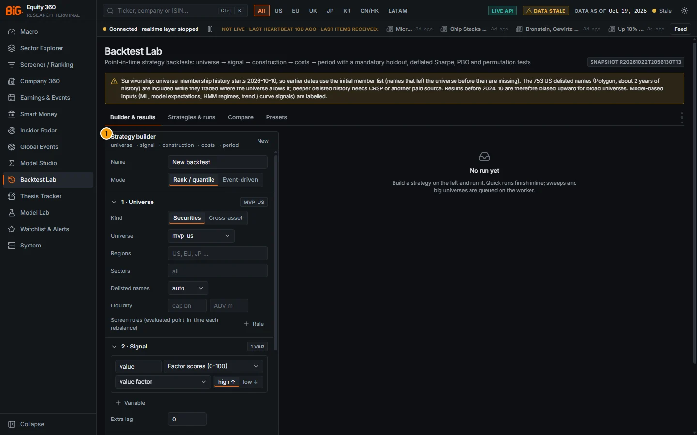

*Figure 11.1: Backtest Lab (`/backtest`), Builder & results tab with the default strategy and no run, snapshot R20261022T2056130T13, data as of 19 Oct 2026.*

| # | Panel | What it shows |
|---|---|---|
| 1 | Strategy builder | "universe → signal → construction → costs → period": name, mode, then the numbered sections (1 · Universe, 2 · Signal, 3 · Construction, 4 · Costs, 5 · Period & holdout, 6 · Robustness) and the run buttons at the bottom. The default draft is a long-only value strategy on `mvp_us`. |

The empty results pane reads "No run yet: Build a strategy on the left and run it. Quick runs finish inline; sweeps and big universes are queued on the worker."

### Controls

| Control | What it does |
|---|---|
| Survivorship banner (amber) | "Survivorship: universe_membership history starts 2026-10-10, so earlier dates use the initial member list (names that left the universe before then are missing). The 753 US delisted names (Polygon, about 2 years of history) are included while they traded where the universe allows it; deeper delisted history needs CRSP or another paid source. Results before 2024-10 are therefore biased upward for broad universes. Model-based inputs (ML, model expectations, HMM regimes, trend / curve signals) are labelled." |
| **SNAPSHOT** badge | The snapshot the catalogue was measured on. |
| Tabs **Builder & results** / **Strategies & runs** / **Compare** / **Presets** | See [Strategy builder](#strategy-builder), [Results](#results), [Strategies & runs](#strategies--runs), [Compare](#compare), [Presets](#presets). |

The draft, its origin, the open strategy, the selected run, the runs ticked for comparison and the active tab are kept in the browser (key `big360.backtest.v1`).

### Methodology

**Timing convention (no look-ahead).** The signal row dated t uses only information known at the close of t (the panel builder guarantees it). Trades execute at the close of the `execution_lag_days`-th trading day strictly after t (default 1, the same convention as the ML labels: close(D+1)); the new weights earn returns from the following day. Positions drift with prices between rebalances. Returns are simple daily returns in the base currency: USD by default (adjusted close × official `usd_per_unit`), or local currency. A delisted name is closed at its last price.

**Run engine.** A run estimated under **4 seconds** (cached panel, small robustness settings) executes inline; longer runs (sweeps, big universes) are queued on the worker (job `backtest_run`). Each run is stored under `data/backtest/runs/<run_id>/` with its spec, plan, status, result, spec hash and snapshot id. Point-in-time panels are cached under `data/cache/backtest/` (bounded, least recently used).

**Holdout.** Every run splits its period into an in-sample window and a mandatory out-of-sample holdout: from **Holdout start** if set, else the last 30% of the period (`oos_fraction`, 10–60%). The holdout is never used for parameter selection; the deflated Sharpe is computed on the in-sample window.

### Data sources and refresh

Signals, screens and prices come from the Parquet lake and the serving snapshot, read-only, as known at each rebalance date. The catalogue (`GET /api/v1/backtest/catalog`) measures every source's point-in-time coverage on the current snapshot (see [Strategy builder](#strategy-builder), Data sources). Benchmarks: SPY (total return), ACWI, VEA, EEM, IWM, QQQ, VGK, EWJ, the S&P 500 price index, universe equal weight or none. Risk-free rate: the 3-month T-bill (`macro_factors` cash) or zero.

### Validation status

The engine has correctness tests (look-ahead, permutation ≈ 0, toy portfolios, costs, known DSR / PBO values; `docs/ROADMAP_V2_PLAN.md` item 4.8) and the exported scripts reproduce runs. The engine is not a validated model: the Robustness tab is how you judge each strategy. Several signals carry their own validation status; see [Experimental signals](#experimental-signals) and [Strategy builder](#strategy-builder), Validation status.

### Correct usage and worked example

1. Open **Presets** and click **Open** on "US value long-short (quintiles, monthly)", then **Run backtest**.
2. Read the Performance tab, then go straight to **Robustness**: the verdict badge and the DSR tell you whether the Sharpe ratio is distinguishable from luck.
3. If you change parameters, save the strategy first (**Save**) so that every variant counts toward its multiple-testing counter, and prefer a **parameter sweep** over repeated manual runs.
4. Look at the holdout column last, and as few times as possible.

The worked example of the [Results](#results) section uses this preset.

### Limitations and pitfalls

- **Survivorship.** Before 2026-10-10 the universe is today's member list; only 753 US delisted names with about two years of history are added. Results before 2024-10 are biased upward for broad universes.
- **Short histories.** Factor scores start in October 2016, news sentiment in October 2025, technical setups and event exposure have only their latest dates (not backtestable).
- **Execution.** Trades fill at the close with modelled costs; there is no intraday fill model, no market-impact feedback on prices and no capacity limit beyond the impact term.
- **Licensing.** Several price sources (yfinance and others) are not licensed for bank production use; see [Licensing](17-good-practice.md#licensing).

### Related mnemonics and BQL fields

`PORT` / `BT` open the page. Related: [Screener](04-screener.md#screener) (Backtest this screen), [Model Studio](09-model-studio.md#model-studio), [Multiple testing](16-methodology.md#multiple-testing), [Survivorship](17-good-practice.md#survivorship).

---

## Strategy builder

**Route:** `/backtest` (tab **Builder & results**) · **API:** `GET /api/v1/backtest/catalog`, `POST /api/v1/backtest/validate`, `POST /api/v1/backtest/runs`

### Purpose

The builder defines a strategy in five or six collapsible sections. In **Rank / quantile** mode it builds portfolios from a cross-sectional ranking on a calendar; in **Event-driven** mode it enters positions on events and exits on time, stop or target.

### Screenshot

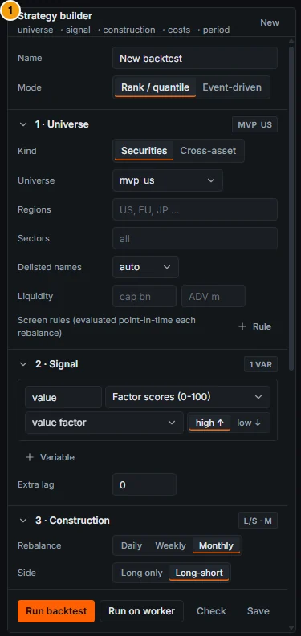

*Figure 11.2: Strategy builder (callout 1 of Figure 11.1): name, mode, 1 · Universe and 2 · Signal.*

> Screenshot pending: builder scrolled to 3 · Construction, 4 · Costs (expanded), 5 · Period & holdout and 6 · Robustness with a two-parameter sweep (route `/backtest`).

<!-- PENDING-SHOT id=11-backtest-builder-lower route=/backtest actions=scroll the builder; expand 4 Costs and 6 Robustness; add sweep construction.quantiles = 3, 5, 10 -->

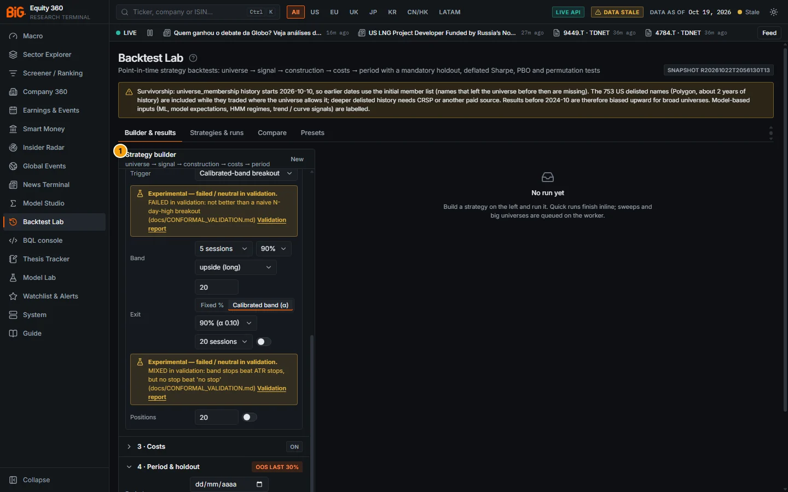

*Figure 11.3: Strategy builder (callout 1) in Event-driven mode with the trigger "Calibrated-band breakout" (band 5 sessions, 90%, upside (long), hold 20) and the exit **Calibrated band (α)** (90%, 20 sessions): both carry the amber "Experimental — failed / neutral in validation." note with a **Validation report** link.*

### Controls

#### Header and run buttons

| Control | What it does |
|---|---|
| **New** | Resets to the default spec. |
| Origin notes | When the draft came from an entry point, its notes are listed under the title (for example "signal = out-of-fold predictions of run SR… (CV scheme expanding)" or "dropped (no point-in-time history): …"). |
| **Name** | Strategy name. |
| **Mode** | **Rank / quantile** ("quantile portfolios rebalanced on a calendar") or **Event-driven** ("enter on an event, exit on time / stop / target"). |
| **Run backtest** | Runs in "auto" mode (inline under 4 s, else on the worker). |
| **Run on worker** | Hover: "Queue on the worker (long sweeps / big universes)". |
| **Check** | Hover: "Check the spec and estimate the run time". Toast "Spec OK · sync / async (≈ N s)" with the benchmark, the number of sweep configurations, whether delisted names are included, and warnings. |
| **Save** | Hover: "Save as a strategy (multiple-testing counter, paper schedule)". Opens a name field; afterwards runs of this draft count toward the strategy's counter (toast "runs now count toward its multiple-testing counter"). |

#### 1 · Universe

| Control | What it does |
|---|---|
| **Kind** | **Securities** or **Cross-asset** (commodity, FX, equity-index, rates, credit and crypto assets of the cross-asset registry). Switching resets the signal and benchmark. |
| **Universe** | `mvp_us`, `mvp_global`, `full`, `eu_broad` or "none (filters only)". Hover: "Point-in-time membership (history starts 2026-10-10; earlier dates use the initial list)". |
| **Regions** / **Sectors** | Comma-separated lists (e.g. `US, EU, JP`; sector ids). |
| **Delisted names** | auto, include, exclude. Hover: "Inactive US names (Polygon, ~2 years) while they traded". Auto = on for `full` and region-only universes, off for the curated `mvp_*` lists. |
| **Liquidity** | Minimum market cap (USD bn) and minimum 20-day ADV (USD m), both point-in-time. |
| **Screen rules** | **+ Rule**: field, operator (≥, >, ≤, <, =, ≠, in, has value) and value, "evaluated point-in-time each rebalance". 61 screen fields (factor and composite scores, valuation multiples, price changes and momentum, volatility, beta, ADV, insider, sentiment, ML rank / decile / expected excess, revenue growth, net debt / EBITDA, sector, region, country, size bucket) plus any ratio metric id. |
| Cross-asset: **Asset classes** / **Assets** | Class checkboxes and a comma-separated asset list (CL, GC, SPX, EURUSD …). |

#### 2 · Signal (and event)

| Control | What it does |
|---|---|
| Variable card | Name, **Signal source**, **Signal field** (labelled "(model)" when model-based), direction **high ↑** / **low ↓**, and a **Weight** when there are several variables. For `studio_run` the field is a Studio run id (`SR…`); for `bql` an expression. |
| **+ Variable** | Up to 12 variables. |
| **Combine** | **z blend** (weighted sum of cross-sectional z-scores), **rank blend** (weighted sum of percentile ranks) or **formula** (formula-engine syntax over the variable names, e.g. `0.5*value + 0.5*mom - abs(vol)`; panel functions such as lag or growth are not allowed). |
| **Extra lag** | "Lag the signal by n rebalance periods (on top of the t+1 execution)", 0–24. |

In Event-driven mode a box below the signal holds the event settings:

| Control | What it does |
|---|---|
| **Trigger** | Event rule (see the trigger table). Experimental triggers show an amber note. |
| Trigger parameters | Surprise field and threshold; COT thresholds and contrarian / with-the-crowd mode; macro-surprise threshold z, country, theme and target instruments; maximum distance in ATR; signal threshold; band horizon, level and direction; break-away \|z\| and signal source; meta-setup horizon, mode, source and direction. |
| **Exit** | **Hold days**; stop / target mode **Fixed %** (stop loss %, take profit %) or **Calibrated band (α)** (band level 80 / 90 / 95%, band horizon 1 / 5 / 10 / 20 sessions, "Also take profit at the opposite band edge"). Hover: "Stop / target: fixed fractions, or the EXPERIMENTAL calibrated band (stop at the band edge emitted on the event date)". |
| **Positions** | **Max positions** and **Allow shorts**. |

#### 3 · Construction (rank mode)

| Control | What it does |
|---|---|
| **Rebalance** | Daily, Weekly, Monthly. |
| **Side** | Long only, or Long-short (top minus bottom). |
| **Selection** | Quantiles (2–20; the top quantile is held long, the bottom short), Top N, or All (signal-weighted). |
| **Weighting** | Equal, Market cap, Signal, Inverse volatility, Risk parity (ERC). Volatility uses a 63-day lookback. |
| **Neutralize** | None, Sector (Asset class for cross-asset), Country. |
| **Limits** | Max weight per name (%) and max one-way turnover per rebalance (%). |
| **Holding** | Holding periods K ("Overlapping tranches: each rebalance re-forms 1/K of the book (Jegadeesh-Titman)") and the execution lag in days (default 1). |
| **Regime filter** / **Invest in** | "Go to cash (or half) when the macro regime known at t is not in the selected states (model-based states labelled)". Regimes offered: cycle quadrant (US, GLOBAL), HMM regime (US, GLOBAL; model-based), inflation regime (US), rate cycle (Fed, ECB). The builder applies the cash action. |

#### 4 · Costs (3 · Costs in event mode)

| Control | What it does |
|---|---|
| **Costs** switch | Apply trading costs (on by default; the badge turns amber "off"). |
| **Commission bp** | Per unit traded, default 1 bp. |
| **Spread** | **ADV buckets** (hover: "Half-spread by 20-day ADV bucket (≥1bn 1bp · ≥100m 3bp · ≥20m 8bp · ≥5m 20bp · else 50bp) or fixed") or **Fixed** (default 5 bp). |
| **Impact** | "Square-root impact: coef × daily vol × √(trade / ADV), with the capital below": coefficient (default 0.1) and capital (default USD 10 m). |
| **Borrow bp/yr** | General collateral (default 50) and hard to borrow (default 300, applied when ADV < USD 5 m). |
| **FX** | Base currency **USD (official FX)** or **Local currency**, and the FX conversion cost on non-USD trades (default 2 bp). |

#### 5 · Period & holdout (4 · in event mode)

| Control | What it does |
|---|---|
| **Period** | Start and end dates. |
| **Holdout start** | "Mandatory out-of-sample holdout: never used for parameter selection". Empty = the last **Holdout fraction %** (default 30%). The section badge shows "OOS ‹date›" or "OOS last 30%". |
| **Benchmark** | auto (SPY for US, ACWI for global, assets equal weight for cross-asset) or one of the listed benchmarks. |
| **Risk-free** | 3m T-bill or zero. |

#### 6 · Robustness (5 · in event mode)

| Control | What it does |
|---|---|
| **Permutations** | Label-permutation runs, 0–200 (default 20). Hover: "Label permutation test: the signal shuffled across names within each date (should give ~0 Sharpe)". |
| **Stale-signal check** | On by default. |
| **Factor attribution** | On by default. |
| **Parameter sweep (walk-forward)** | **+ Parameter** (up to 4): `construction.quantiles`, `top_n`, `weighting`, `holding_periods`, `rebalance`, `side`, `neutralize`, `max_weight`, `signal.lag_periods`, `event.hold_days`, `event.stop_loss`, `event.take_profit`, `costs.commission_bps`, each with comma-separated values. At most 64 combinations. Hover: "Every combination is simulated; selection uses the in-sample window only (walk-forward), PBO via CSCV, all configurations count as trials for the deflated Sharpe". The badge shows the number of configurations. |
| **WF / CSCV** | With a sweep: walk-forward folds (2–12, default 4) and CSCV blocks (4–16, default 10). |

### Methodology

#### Signal sources

| Source (title in the app) | Universe | Point-in-time rule (catalogue text) | Coverage on the live snapshot |
|---|---|---|---|
| Factor scores (0-100) | securities | monthly point-in-time history (scoring job, knowledge-dated inputs) | 2016-10-31 → 2026-10-16 |
| Composite scores by profile | securities | monthly point-in-time history | 2016-10-31 → 2026-10-16 |
| ML predictions (XGBoost, walk-forward OOS) | securities | expanding walk-forward out-of-sample predictions (purged, embargoed); production model xgboost_rank; ft_transformer is DEMOTED (failed the label-permutation test). Model-based | 2010-02-19 → 2026-10-16 |
| Technical score and components | securities | stored for the latest as-of date only | latest date only, **not backtestable** |
| Technical factors (evidence-based) | securities | daily, bars ≤ t; percentiles within region × sector among liquid names; gate per factor in TECHNICALS_V3_VALIDATION | 2004-01-01 → 2026-10-19 |
| Insider signals | securities | Form 4 filing dates (knowledge-dated) | 2017-01-31 → 2026-10-16 |
| News sentiment / attention | securities | daily, FinBERT / GDELT tone (model-based) | 2025-10-09 → 2026-10-16 |
| Geopolitical / event exposure | securities | snapshot as-of dates (model-based) | three dates, **not backtestable** |
| Earnings PEAD / model surprise | securities | known on signal date; surprises vs model-based expectations (SARIMA), not consensus | 2016-01-07 → 2026-10-13 |
| Valuation multiples (daily) | securities | price × PIT fundamentals | 2010-01-01 → 2026-10-16 |
| Financial ratios (point-in-time) | securities | as of knowledge date (filing date); any ratio metric id | 1994-04-30 → 2026-10-20 |
| Price-derived | both | daily adjusted prints on or before the rebalance date | 1927-12-30 → 2026-10-20 |
| Model Studio run (out-of-fold predictions) | securities | field = Studio run id of a panel tree_ensemble / regularized run; use expanding CV, other schemes are flagged LOOK-AHEAD. Model-based | per run |
| Cross-asset signals | assets | as of knowledge date; trend / curve shape / value / z metrics model-based | 2000-01-01 → 2026-10-20 |
| CFTC positioning via cross-asset join | assets | official CFTC COT, latest report released on or before t (stale > 28 days → null) | 2000-01-01 → 2026-10-20 |
| BQL expression | securities | evaluated point-in-time per rebalance (BQL-lite) | not in the live catalogue (see below) |

Signal transforms use the Model Studio transform set; look-ahead transforms (`lead`, `fwd_*`) are rejected in backtest signals. The builder does not expose a transform editor; transforms come from presets or entry points.

> **Note:** the **BQL expression** signal source (roadmap v3 B1) is implemented but not offered by the live catalogue of 19 Oct 2026 (snapshot R20261022T2056130T13), which lists the 15 sources above it. It appears after the B1 go-live step (rebuild the app and restart the API). Then: choose source "BQL expression (cross-sectional, point-in-time per rebalance)" and type an expression such as `cs_zscore(chg_pct(px, 3M)) - cs_zscore(pe_ttm)`; see the [BQL language reference](14-bql-mnemonics.md#bql-language-reference).

#### Event triggers

| Trigger | Universe | Rule | Label |
|---|---|---|---|
| Insider cluster buy | securities | first insider-signals snapshot with a cluster buy per name; long | |
| Earnings model surprise | securities | \|field\| ≥ threshold (default 2.0) on the signal date, field SUE, PEAD score, announcement-return z or revenue z; direction = sign (shorts need **Allow shorts**) | model-based (not consensus) |
| CFTC positioning extreme | assets | 3-year COT index crossing above high (0.9) / below low (0.1); contrarian fades the crowd | |
| Macro surprise | both | \|signed z\| vs model-based expectations ≥ threshold (1.5): trade the target instruments | model-based |
| Confluence-zone touch | securities | price inside / within x ATR (0.25) of the top-ranked zone: long at support, short at resistance | model-based; latest date only, not backtestable |
| Signal threshold crossing | both | the combined signal crossing the threshold at a rebalance date | |
| Calibrated-band breakout (experimental) | securities | the h-session move leaves the marginal conformal band emitted h sessions earlier | **experimental**, failed validation |
| Peer break-away fade (experimental) | securities | fade the member with \|z_cond\| ≥ z on days the peer group's joint score exceeded its 90% radius | **experimental**, failed validation |
| Meta-labelled setups (Technicals v3) | securities | the v2 weekly trade setups (target T1, stop at the invalidation): all, only those the meta-labelling model takes, or taken and sized by its quarter-Kelly fraction | **experimental** in the catalogue; see [Experimental signals](#experimental-signals) |

Events enter at the close after `entry_lag_days` (default 1) and exit on the first of: hold days, stop, target. Each position gets an equal share of the book up to **Max positions**.

#### Portfolio construction

At each rebalance date the eligible names (universe member, screen rules passed, liquidity limits met, signal not null, at least 5 names) are ranked by the combined signal. Quantile selection holds the top quantile long and, for long-short, the bottom quantile short; gross exposure defaults to 1 long-only and 2 long-short (100/100). Neutralisation ranks within each sector or country. Weighting schemes: equal; market cap; signal; inverse volatility `w_i ∝ 1/σ_i`; risk parity (equal risk contribution) on the 63-day covariance. Weights are capped at **Max weight**, and the one-way turnover per rebalance at **Max turnover**. With K holding periods, each rebalance replaces 1/K of the book (overlapping tranches).

#### Cost model

For a trade of `Δw_i` (fraction of NAV) in name i:

```
unit_i   = (commission + half_spread(ADV_i) + 1{non-base currency} · fx) / 10⁴
         + impact_coef · σ_i,daily · √( |Δw_i| · capital · NAV / ADV_i )
cost_i   = |Δw_i| · min(unit_i, max_cost_bps / 10⁴)                              (max_cost_bps = 1000)
borrow_i = w_i,short · (ADV_i < 5 m ? htb_bps : borrow_bps) / 10⁴ / 252        (per day held short)
half_spread(ADV) = 1 bp (≥ 1 bn) · 3 bp (≥ 100 m) · 8 bp (≥ 20 m) · 20 bp (≥ 5 m) · 50 bp (otherwise)
```

ADV is the 20-day average dollar volume; σ is the daily volatility. An ADV below $1 counts as unknown (worst spread bucket, participation 1), and no trade costs more than 10% of the amount traded; trades that hit the cap are counted in a run warning ("N trades hit the 1000 bp per-trade cost cap … consider a min ADV screen"). A NAV can never turn negative: if it reaches zero the book is closed, later returns are 0 and the run warns "NAV fell to zero on ‹date›". The equity curve shows the strategy net of costs and a dashed "Gross of costs" line.

*Why the cap (engine 1.1, 24 Oct 2026).* The test-copy "ML 3M top decile" run reported CAGR −100% and a maximum drawdown of −42,983,631%. The cause was a name whose 20 trading days had zero volume: the rolling average left a floating-point residue of about 5 × 10⁻¹² USD as its ADV, the square-root impact term became about 10⁹, and a single 3% trade cost thousands of times the NAV, which then turned negative and compounded. The panel builder now rounds such residues to 0 (panel 1.1), the engine treats sub-dollar ADV as unknown and caps the per-trade cost, and NAV ruin is absorbing. A regression test replays the case.

#### Metrics

```
Sharpe   = mean(r − r_f) / sd(r − r_f) · √252            (daily, excess of the 3m T-bill)
Sortino  = mean(r − r_f) / downside sd · √252
CAGR     = NAV_end^(1/years) − 1;   Calmar = CAGR / |max drawdown|
Beta, alpha (ann.)  from the regression of strategy on benchmark returns
Information ratio = annualised excess return over the benchmark / tracking error
Hit rate (days) = share of days with a positive return;  Positive months = share of months > 0
```

Metrics are shown for the full period, the in-sample window and the holdout.

### Data sources and refresh

See the source and trigger tables; coverage is measured on the current snapshot. Screen fields without point-in-time history (DCF fair value, forecasts, zones, KPIs, data quality, short interest) are dropped from backtested screens with a warning.

### Validation status

Signals carry the validation status of the model behind them:

- **ML predictions:** XGBoost OOS rank IC about 0.035, one input, not proven alpha; the Transformer is demoted (failed the label-permutation test). See [Model Lab](10-model-lab.md#validation-status).
- **Technical factors:** hi52, MAX and IVOL passed as a "rank edge" (descriptive; not profitable stand-alone after costs); momentum, residual momentum, reversal and industry momentum failed and are experimental; the composite failed (`docs/TECHNICALS_V3_VALIDATION.md` #1).
- **Earnings surprises, macro surprises, HMM regimes, sentiment, cross-asset trend / value / z metrics:** model-based.
- **Conformal triggers and band stops, meta setups:** experimental ([Experimental signals](#experimental-signals)).

### Correct usage and worked example

Building "quality plus momentum, long-only, sector-neutral" by hand: universe `mvp_us`; signal variables `quality` (Factor scores) and `mom` (Price-derived `mom_12_1`), Combine **z blend**; construction Monthly, Long only, Quintiles 5, Equal, Neutralize Sector, Max weight 5%; costs on; holdout last 30%; Robustness: permutations 20, a sweep on `construction.quantiles` = 3, 5, 10. Press **Check** first: the toast reports whether the run will be sync or async and its estimated time. This is the "Quality + momentum" preset plus a sweep.

### Limitations and pitfalls

- Fields marked "(model)" are model outputs; a backtest of a model-based signal tests the model too.
- A screen built in the Screener may lose fields that have no history ("dropped (no point-in-time history): …" in the origin notes).
- Event triggers on latest-only tables (confluence touch) have no history to backtest.

### Related mnemonics and BQL fields

[Screener](04-screener.md#screener), [Scores and factors](04-screener.md#scores-and-factors), [Technical factors (evidence-based)](05b-company-technicals.md#technical-factors-evidence-based), [Positioning (CFTC)](02b-markets-cross-asset.md#positioning-cftc).

---

## Results

**Route:** `/backtest` (Builder & results, right-hand pane) · **API:** `GET /api/v1/backtest/runs/{run_id}`, `/holdings`, `/trades`

### Purpose

The results pane shows one completed run in five tabs: Performance, Risk, Attribution (or Events for event-driven runs), Trades & holdings and Robustness.

### Screenshot

The figures show the "US value long-short (quintiles, monthly)" preset run on the test copy (run `BR20261023T133814A3986`, spec hash A1D0FE78, 2016-11-01 → 2026-10-09, holdout from 2023-10-16).

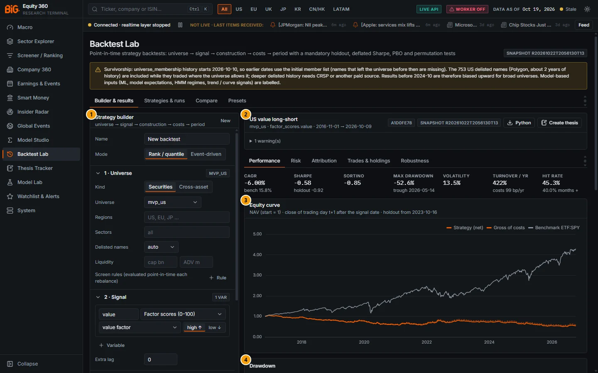

*Figure 11.4: Performance tab of the US value long-short run.*

| # | Panel | What it shows |
|---|---|---|
| 1 | Strategy builder | The draft (left). |
| 2 | Run header | "US value long-short · mvp_us · factor_scores.value · 2016-11-01 → 2026-10-09", spec hash and snapshot badges, **Python** and **Create thesis** buttons, "1 warning(s)". |
| 3 | Equity curve | "NAV (start = 1) · close of trading day t+1 after the signal date · holdout from 2023-10-16": strategy net, gross of costs (dashed), benchmark ETF:SPY. |
| 4 | Drawdown | Strategy and benchmark drawdowns. |
| 5 | Metrics | "net of costs · Sharpe / Sortino on excess of the 3m T-bill": Full, In-sample, Holdout (OOS). Below the fold. |
| 6 | Monthly returns | Year × month grid of net returns (%). Below the fold. |

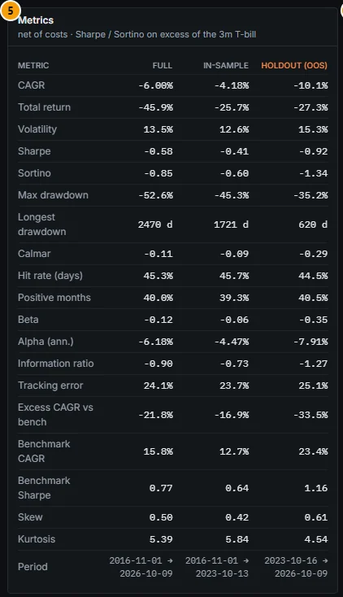

*Figure 11.5: Metrics table (callout 5): full period, in-sample and holdout.*

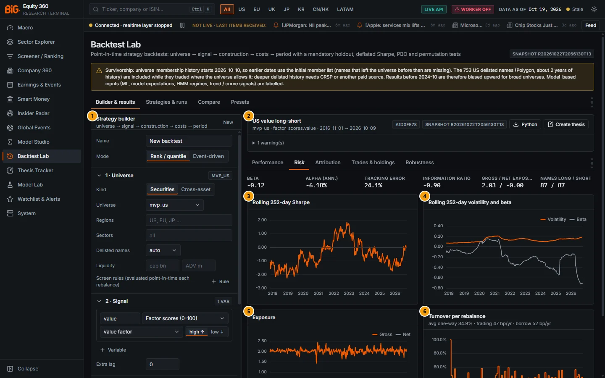

*Figure 11.6: Risk tab.*

| # | Panel | What it shows |
|---|---|---|
| 1 | Strategy builder | The draft. |
| 2 | Run header | As in Figure 11.4. |
| 3 | Rolling 252-day Sharpe | One-year rolling Sharpe ratio. |
| 4 | Rolling 252-day volatility and beta | Rolling volatility and beta to the benchmark. |
| 5 | Exposure | Gross and net exposure over time. |
| 6 | Turnover per rebalance | One-way turnover per rebalance; subtitle "avg one-way 34.9% · trading 47 bp/yr · borrow 52 bp/yr". |

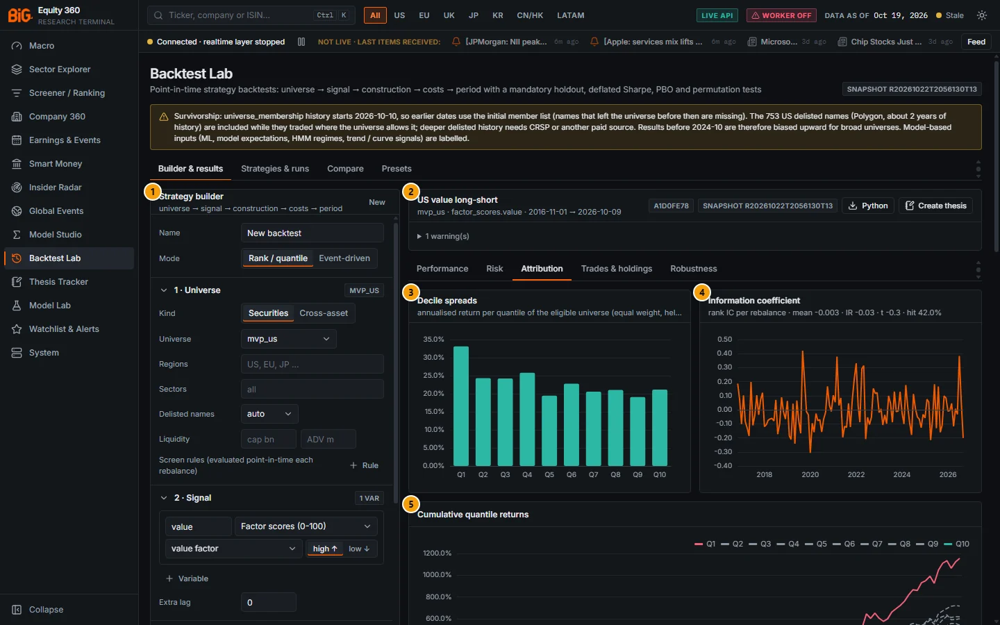

*Figure 11.7: Attribution tab.*

| # | Panel | What it shows |
|---|---|---|
| 1 | Strategy builder | The draft. |
| 2 | Run header | As in Figure 11.4. |
| 3 | Decile spreads | Annualised return per signal quantile of the eligible universe (equal weight, held to the next rebalance), with the top − bottom spread and its t. |
| 4 | Information coefficient | Rank IC per rebalance: "mean -0.003 · IR -0.03 · t -0.3 · hit 42.0%". |
| 5 | Cumulative quantile returns | Q1…Q10 cumulative returns (Q10 and Q1 solid, the others dashed). |
| 6 | Style attribution | Market / size / value / momentum proxies (below the fold, Figure 11.8). |
| 7 | Our factors | Long-short tercile returns of our factor scores plus the market (below the fold). |
| 8 | Average book exposures | Weighted cross-sectional z-score of the holdings (long − short) per factor (below the fold). |
| 9 | Regime breakdown | Monthly returns grouped by macro regime (below the fold, Figure 11.9). |

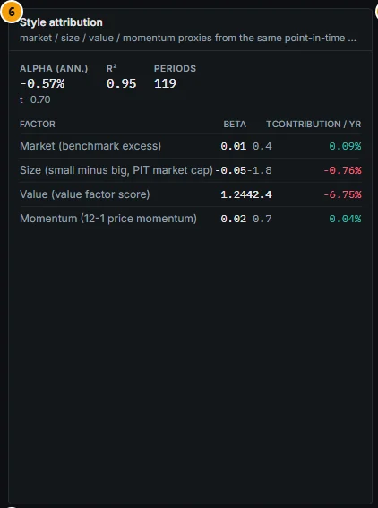

*Figure 11.8: Style attribution (callout 6): value beta 1.24 (t 42.4), alpha −0.57% a year (t −0.70), R² 0.95 over 119 periods.*

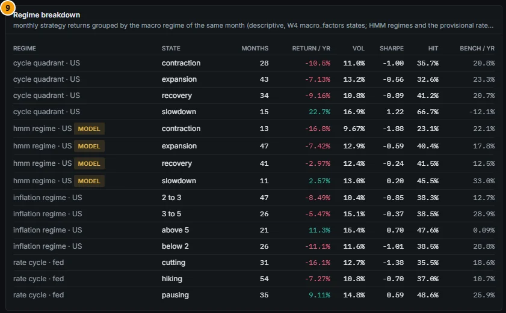

*Figure 11.9: Regime breakdown (callout 9): cycle quadrant, HMM regime (labelled MODEL), inflation regime and Fed rate cycle.*

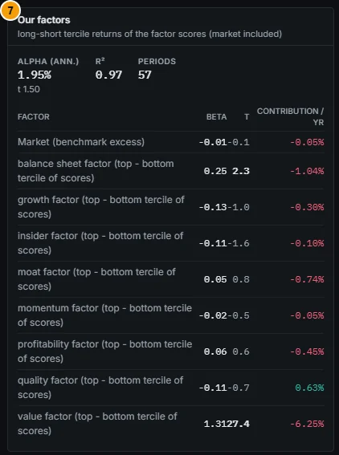

*Figure 11.10: Our factors (callout 7).*

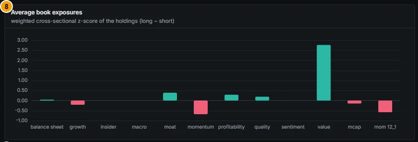

*Figure 11.11: Average book exposures (callout 8).*

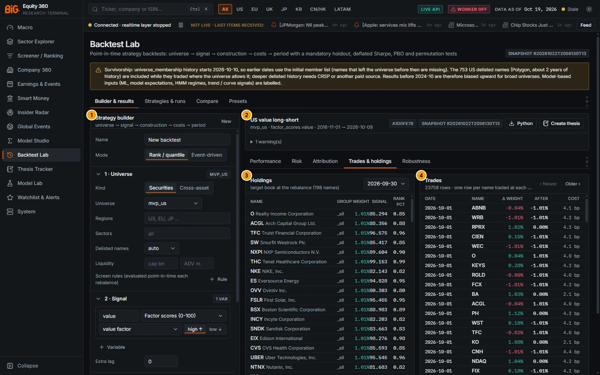

*Figure 11.12: Trades & holdings tab.*

| # | Panel | What it shows |
|---|---|---|
| 1 | Strategy builder | The draft. |
| 2 | Run header | As in Figure 11.4. |
| 3 | Holdings | "target book at the rebalance (198 names)" for the selected date (2026-09-30): name, group, weight, signal, rank percentile. |
| 4 | Trades | "23758 rows · one row per name traded at each rebalance": date, name, Δ weight, weight after, cost in bp. |

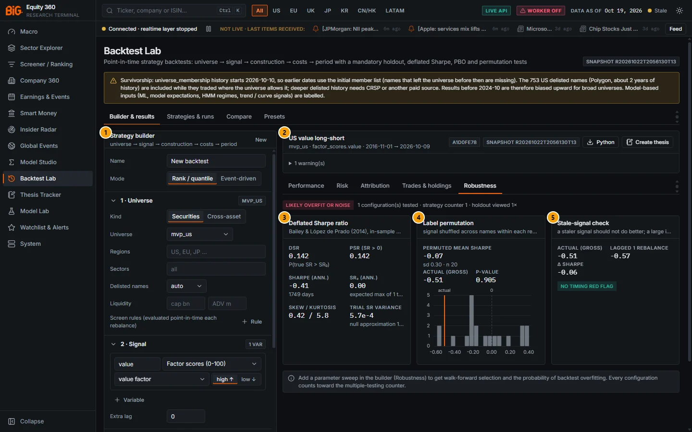

*Figure 11.13: Robustness tab with the verdict "LIKELY OVERFIT OR NOISE".*

| # | Panel | What it shows |
|---|---|---|
| 1 | Strategy builder | The draft. |
| 2 | Run header | As in Figure 11.4. |
| 3 | Deflated Sharpe ratio | DSR, PSR, annualised Sharpe and number of days, SR₀ (expected maximum of the trials), skew / kurtosis, trial Sharpe variance and its source. |
| 4 | Label permutation | Permuted mean Sharpe, actual gross Sharpe, p-value and the histogram of permuted Sharpes with the actual marked. |
| 5 | Stale-signal check | Actual vs one-rebalance-lagged Sharpe and the flag. |

> Screenshot pending: Robustness tab of a run with a parameter sweep, showing the Parameter sweep table, PBO (CSCV) histogram, Walk-forward NAV with fold lines and the Holdout of the in-sample choice (route `/backtest`).

<!-- PENDING-SHOT id=11t-backtest-result--robustness-sweep route=/backtest actions=Preset Quality + momentum; 6 Robustness: sweep construction.quantiles=3,5,10 and construction.weighting=equal,inverse_vol; Run on worker; Robustness tab, scroll -->

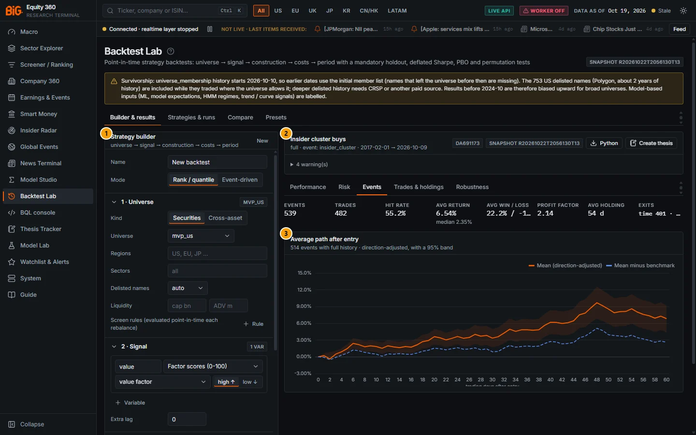

*Figure 11.14: Events tab of the "Insider cluster buys (60-day hold)" preset run (test copy, `full` universe, 2017-02-01 → 2026-10-09).*

| # | Panel | What it shows |
|---|---|---|
| 1 | Strategy builder | The draft. |
| 2 | Run header | "Insider cluster buys · full · event: insider_cluster · 2017-02-01 → 2026-10-09", spec hash DA691173, "4 warning(s)". Tiles: 539 events, 482 trades, hit rate 55.2%, average return 6.54% (median 2.35%), average win 22.2%, profit factor 2.14, average holding 54 days, exits mostly by time. |
| 3 | Average path after entry | "514 events with full history · direction-adjusted, with a 95% band": the mean path (orange) peaks near +10% around day 48; the mean minus benchmark (dashed blue) stays near +3 to +5%. |


*Figure 11.15: Robustness tab of the same run: DSR 0.960 but placebo events give a mean Sharpe of 0.58 against an actual 0.70 (p 0.381), so the badge reads "LIKELY OVERFIT OR NOISE".*

| # | Panel | What it shows |
|---|---|---|
| 1 | Strategy builder | The draft. |
| 2 | Run header | As in the previous figure. |
| 3 | Deflated Sharpe ratio | DSR 0.960, PSR 0.960, Sharpe 0.64 over 1,770 in-sample days, SR₀ 0.00 (one trial), skew 2.03, kurtosis 37.4. |
| 4 | Label permutation | "placebo events: same dates, random names from the universe (gross of costs)": permuted mean 0.58 (sd 0.25, n 20), actual 0.70, p-value 0.381. |
| 5 | Stale-signal check | Actual 0.70, lagged +5 trading days 0.68, Δ −0.02: no timing red flag. |

### Controls

| Control | What it does |
|---|---|
| Run header badges | Spec hash (first 8 characters) and snapshot. |
| **Python** | "Export a standalone Python script that reproduces this run" ([Export to Python](#export-to-python)). |
| **Create thesis** | "Create a thesis linked to this backtest run (pick the subject in the editor)". |
| Experimental note | "Experimental — failed / neutral in validation. Conformal triggers / band stops were not promoted after validation: …" with a **Validation report** link, when the run used them. |
| Notes | The survivorship caveat for cross-asset runs and "Model-based inputs: …" when model-based sources were used. |
| **N warning(s)** | Expandable list of run warnings (dropped screen rules, look-ahead in fitting, short history, ignored regime filter, experimental inputs). |
| Tabs | **Performance**, **Risk**, **Attribution** (rank mode) or **Events** (event mode), **Trades & holdings**, **Robustness**. |
| Holdings **Rebalance date** | Select any rebalance date (latest first). |
| Trades **‹ Newer** / **Older ›** | Pages of 200 rows. |

#### Performance tab

Tiles: CAGR (with the benchmark's), Sharpe (with the holdout's), Sortino, Max drawdown (with the trough date), Volatility, Turnover / yr (with the cost drag in bp a year), Hit rate (with the share of positive months). Then the equity curve, the drawdown chart, the **Metrics** table (CAGR, total return, volatility, Sharpe, Sortino, max drawdown, longest drawdown in days, Calmar, hit rate, positive months, beta, alpha, information ratio, tracking error, excess CAGR vs benchmark, benchmark CAGR and Sharpe, skew, kurtosis, period; hover a metric for its definition) and the **Monthly returns** grid (green / red cells, bold yearly total).

#### Risk tab

Tiles: beta, alpha (annualised), tracking error, information ratio, gross / net exposure, average names long / short. Charts: rolling 252-day Sharpe, rolling volatility and beta, gross and net exposure, one-way turnover per rebalance (with trading and borrow cost in bp a year).

#### Attribution tab (rank mode)

Decile (or quantile) spreads, the information coefficient per rebalance, cumulative quantile returns, **Style attribution**, **Our factors** (alpha, R², periods and a table of factor, beta, t, contribution per year; |t| ≥ 2 in bold), **Average book exposures** and the **Regime breakdown** table (regime, state, months, return per year, volatility, Sharpe, hit rate, benchmark return; model-based regimes carry a **model** badge).

#### Events tab (event mode)

Tiles: events, trades, hit rate, average and median return, average win / loss, profit factor, average holding days, exit reasons (time, stop, target, open). Chart: "Average path after entry": mean direction-adjusted cumulative return over the days after entry with a 95% band and the excess path.

#### Trades & holdings tab

Holdings at any rebalance and the trade list. Event runs list round trips (name, entry, exit, direction, return, exit reason).

#### Robustness tab

See [Robustness statistics](#robustness-statistics).

### Methodology

- **Quantile spreads and IC.** At each rebalance the eligible universe is cut into quantiles of the signal (10 by default); each quantile is held equal-weighted to the next rebalance. The tab shows the annualised return per quantile, the top − bottom spread with its t-statistic, and the rank IC per rebalance (Spearman correlation of signal and next-period return) with mean, IR, t and hit rate.
- **Attribution.** "Time-series regression of strategy excess returns per rebalance period on long-short factor returns built from the same point-in-time panel (equal-weight terciles); Newey-West t-stats". Style factors: market (benchmark excess), size (small minus big on PIT market cap), value (value factor score), momentum (12−1 price momentum). "Our factors": top − bottom tercile returns of each factor score, plus the market. Contribution per year = beta × mean factor return, annualised.
- **Regime breakdown.** "Monthly strategy returns grouped by the macro regime of the same month (descriptive, W4 macro_factors states; HMM regimes and the provisional rate-cycle rule are model-based)". It is descriptive: the regime of a month is known only at the end of it.

### Data sources and refresh

The result is stored with the run and does not change; holdings and trades are paged from the run directory.

### Validation status

Not applicable (reporting).

### Correct usage and worked example

The US value long-short preset (Figures 11.4–11.13):

1. **Performance.** CAGR −6.00% a year against +15.8% for SPY; Sharpe −0.58 (holdout −0.92); maximum drawdown −52.6% (trough 2026-05-14); turnover 422% a year with a cost drag of 99 bp a year.
2. **Risk.** Beta −0.12, gross / net exposure 2.03 / −0.00 (a dollar-neutral 100/100 book), 87 names long and 87 short on average; trading costs 47 bp and borrow 52 bp a year.
3. **Attribution.** The style regression explains the strategy almost entirely by the value factor (beta 1.24, t 42.4, R² 0.95, alpha −0.57% a year with t −0.70): this is a pure value bet, and value lost money over 2016–2026 in US large caps. The rank IC is −0.003 (t −0.3). The regime table shows the only positive states are the US cycle "slowdown" (+22.7% a year over 15 months) and inflation above 5% (+11.3%).
4. **Robustness.** DSR 0.142, permutation p-value 0.905, verdict "likely overfit or noise". The stale-signal check shows no timing problem (−0.51 vs −0.57 lagged).

Conclusion: the backtest gives no evidence of a value premium in `mvp_us` over this period, and the holdout is worse than the in-sample window.

### Limitations and pitfalls

- The monthly-returns grid and the metrics use the net series; the gross line shows how much costs matter.
- The regime breakdown is descriptive and the HMM states are model-based.
- A run that warns "NAV fell to zero" or reports many cost-capped trades is dominated by illiquid names: add a min ADV screen. The test-copy "ML 3M top decile" run in Figures 11.16–11.17 (CAGR −100.0%, maximum drawdown −42,983,631%) was produced by the engine fault described under [Cost model](#cost-model), fixed on 24 Oct 2026; re-run such strategies (the cache keys include the engine and panel versions, so a re-run rebuilds them).

### Related mnemonics and BQL fields

[Rank IC and factor evaluation](16-methodology.md#rank-ic-and-factor-evaluation), [Regime performance](02b-markets-cross-asset.md#regime-performance).

---

## Robustness statistics

**Route:** `/backtest` (results › **Robustness**)

### Purpose

The Robustness tab answers "could this result be luck or a mistake?" with five tools: the deflated Sharpe ratio, a label-permutation test, a stale-signal check and, when a parameter sweep is defined, walk-forward selection and the probability of backtest overfitting. A verdict badge summarises them, next to the number of configurations tested, the strategy's multiple-testing counter and the number of holdout views.

### Controls

| Control | What it does |
|---|---|
| Verdict badge | **survives the overfitting checks** (green), **inconclusive: treat with caution** (amber), **likely overfit or noise** (red) or **not enough information**. |
| Counter line | "N configuration(s) tested · strategy counter N · holdout viewed N×". |
| Panels | Deflated Sharpe ratio; Label permutation (histogram); Stale-signal check (badge "no timing red flag" or "staler signal does better: check timing"); with a sweep: Parameter sweep table (IS Sharpe, IS CAGR, OOS Sharpe; the in-sample best highlighted), Probability of backtest overfitting (CSCV) with the logit histogram, Walk-forward NAV with one line per fold, Holdout of the in-sample choice. Without a sweep: "Add a parameter sweep in the builder (Robustness) to get walk-forward selection and the probability of backtest overfitting. Every configuration counts toward the multiple-testing counter." |

### Methodology

#### Probabilistic and deflated Sharpe ratio

On the **in-sample** window, with the per-period Sharpe ratio SR̂, n observations, skewness γ₃ and kurtosis γ₄ (not excess):

```
PSR(SR*) = Φ( (SR̂ − SR*) · √(n − 1) / √(1 − γ₃ SR̂ + (γ₄ − 1)/4 · SR̂²) )
SR₀      = √V[SR] · ( (1 − γ) Φ⁻¹(1 − 1/N) + γ Φ⁻¹(1 − 1/(N e)) ),   γ = 0.5772 (Euler–Mascheroni)
DSR      = PSR(SR₀)        PSR shown in the tab = PSR(0)
```

N = configurations in this run's sweep (at least 1) + the trials recorded for the same saved strategy under other spec hashes. V[SR] = the variance of the recorded trial Sharpe ratios (sweep and previous trials) when there are at least two; otherwise the null approximation 1/T ("null approximation 1/T (fewer than 2 recorded trials)"). DSR is the probability that the true Sharpe exceeds what the best of N unskilled trials would show (Bailey & López de Prado 2014).

#### Label permutation

The signal is shuffled across names within each rebalance date and the strategy re-simulated gross of costs (default 20 times). The permuted mean should be about 0 and the actual Sharpe in the right tail. `p = (1 + #{permuted Sharpe ≥ actual}) / (1 + n)`. Event mode uses placebo events: the same dates with random names.

#### Stale-signal check

The signal is lagged one more rebalance (event mode: entry 5 more days later) and re-simulated gross of costs. If the staler signal does better by more than two standard errors of an annualised Sharpe (`2 · √(252 / T)`), the result is flagged: a signal that improves when older usually has a timing error.

#### Parameter sweep, walk-forward and holdout

Every configuration of the grid (at most 64) is simulated net of costs. On the in-sample window:

- **Walk-forward:** the window is split into `wf_folds + 1` equal segments; for each segment f ≥ 1 the configuration with the best Sharpe on the data before it is chosen and its returns on the segment kept; the stitched returns form the walk-forward NAV. Needs an in-sample window longer than 40 × folds days.
- **Holdout of the in-sample choice:** the configuration with the best in-sample Sharpe, measured on the holdout.

#### Probability of backtest overfitting (CSCV)

The in-sample returns of the N configurations are split into S blocks (even, default 10). For each of the C(S, S/2) ways of choosing half the blocks as in-sample:

```
n*  = configuration with the best in-sample Sharpe
ω   = rank of n* among the N configurations on the other half / (N + 1)
λ   = ln(ω / (1 − ω))
PBO = share of combinations with λ ≤ 0   (the in-sample winner ranks at or below the median out of sample)
```

The panel also shows P(OOS loss) (share of combinations where the winner loses money out of sample) and the IS → OOS slope (regression of the winner's out-of-sample Sharpe on its in-sample Sharpe; near or below zero means in-sample performance does not carry over). Needs an in-sample window longer than 20 × blocks days (Bailey, Borwein, López de Prado and Zhu 2017).

#### Verdict thresholds

```
survives the overfitting checks : DSR ≥ 0.95 and PBO < 0.2 and permutation p ≤ 0.05   (each when available)
likely overfit or noise         : DSR < 0.5 or PBO > 0.5 or permutation p > 0.2
inconclusive                    : otherwise
```

#### Multiple-testing counter

A saved strategy records one trial entry per distinct spec hash, with n = the size of its sweep grid and its trial Sharpe ratios (up to 64 per entry). The **strategy counter** (Trials column) is the sum of n over all entries; it feeds the N of the deflated Sharpe of the next runs. **OOS views** counts the completed runs that computed holdout metrics; it turns amber above 5 ("each look at the holdout erodes its independence"). Unsaved drafts have no counter: their DSR uses only the current sweep.

#### Paired comparisons

The Compare tab shows runs side by side but does not run a paired test. The validation documents compare strategies by **paired daily-return differences** (annualised difference with its t-statistic), for example in `docs/CONFORMAL_VALIDATION.md`: calibrated band stops minus 2×ATR stops +6.7% a year (t +2.69), band 90% minus no stop −2.2% (t −2.64); and in `docs/TECHNICALS_V3_VALIDATION.md`: meta-filtered minus all setups, US H = 20, −4.3% (t −2.55). To make that comparison yourself, export both runs to Python and difference their daily return series.

### Validation status

The DSR and PBO implementations are tested against known values (`docs/ROADMAP_V2_PLAN.md` 4.8). In the validation studies the DSR "does not discriminate" when the trial Sharpe variance is small (about 0.99 for every breakout configuration in `docs/CONFORMAL_VALIDATION.md`; 0.79–0.96 for the meta configurations): a high DSR alone is not enough.

### Correct usage and worked example

In Figure 11.13 the US value long-short run shows DSR 0.142 = PSR 0.142 (one trial, so SR₀ = 0.00), an in-sample Sharpe of −0.41 over 1,749 days, a trial Sharpe variance 5.7e−4 from the null approximation, a permuted mean Sharpe of −0.07 (sd 0.30, n 20) against an actual gross Sharpe of −0.51 (p 0.905), and no timing flag. The red badge comes from DSR < 0.5 and p > 0.2. The insider cluster-buy run (Figure 11.15) shows the opposite case: a DSR of 0.960 looks reassuring, but placebo events on the same dates with random names earn a Sharpe of 0.58 against the actual 0.70 (p 0.381), so most of the return comes from when the events happened (market exposure), not from which names were bought; the badge is red because p > 0.2. For the "Quality + momentum" preset the Runs table shows DSR 0.98 with one trial; before believing it, add a sweep (each configuration raises N) and check PBO.

### Limitations and pitfalls

- With one trial and no recorded history, the DSR equals the PSR against zero: it is not deflated for the variants you tried by hand in unsaved drafts. Save the strategy.
- Permutations are gross of costs and keep the dates, so they test the cross-sectional information of the signal, not market timing.
- Looking at the holdout repeatedly and then changing the strategy turns the holdout into in-sample data; the OOS-views counter records this, it cannot undo it.

### Related mnemonics and BQL fields

[Multiple testing](16-methodology.md#multiple-testing), [Multiple testing when screening](17-good-practice.md#multiple-testing-when-screening).

---

## Experimental signals

**Route:** `/backtest` (builder › Event trigger / Exit)

### Purpose

Three conformal and meta-labelling tools are offered for research only. The builder and the results mark them with the amber note "Experimental — failed / neutral in validation." and a **Validation report** link to the [Conformal validation](15-system.md#conformal-validation) page.

### Controls

| Tool | Where | Label in the app (catalogue text) |
|---|---|---|
| **Calibrated-band breakout (experimental)** | Event trigger | "FAILED in validation: not better than a naive N-day-high breakout (docs/CONFORMAL_VALIDATION.md)" |
| **Peer break-away fade (experimental)** | Event trigger | "FAILED in validation: negative Sharpe after costs, null vs a naive fade (docs/CONFORMAL_VALIDATION.md)" |
| **Calibrated band (α)** stop / target mode | Exit | "MIXED in validation: band stops beat ATR stops, but no stop beat 'no stop' (docs/CONFORMAL_VALIDATION.md)"; the builder note reads "Band stops beat ATR stops, but no stop beat 'no stop' in validation." |
| **Meta-labelled setups (Technicals v3)** | Event trigger | "see docs/TECHNICALS_V3_VALIDATION.md (Meta-labelling): the run notes carry the current gate verdict". Flagged experimental in the catalogue. |

Run warnings repeat the status: "stop mode calibrated band: EXPERIMENTAL - band stops beat ATR stops but no stop beat 'no stop' …" and "event trigger ‹id›: EXPERIMENTAL - failed in validation …".

### Methodology

- **Calibrated-band breakout:** enters when the h-session move leaves the marginal conformal band emitted h sessions earlier (walk-forward EWMA band on the panel prices); long, or both directions with shorts.
- **Peer break-away fade:** on days a peer group's joint score exceeds its 90% radius, fades the member with |z_cond| ≥ z (default 2.5), using the GCN-GRU walk-forward signals 2010–2026 or the live table.
- **Calibrated band stop:** per trade, the stop sits at the lower (long) edge of the calibrated band of the chosen level and horizon emitted on the event date; optionally the target at the opposite edge.
- **Meta setups:** the v2 weekly trade setups (target T1, stop at the invalidation); **all setups**, **meta: take only** (setups the meta-labelling model takes) or **meta: take + Kelly size** (taken and sized by a quarter-Kelly fraction); horizon 10 / 20 / 40 sessions; source walk-forward 2013–2026 or the live table.

### Validation status

> **Experimental:** results of the validation studies, Backtest Lab engine with costs on.
> - **Breakout on exit of the calibrated band: FAIL.** Not better than a naive N-day-high breakout: band h = 5 minus 20-day high −1.4% a year (t −0.66); band h = 20 minus 20-day high −5.6% (t −2.32); joint band −11.3% (t −3.23); PBO 0.54 (`docs/CONFORMAL_VALIDATION.md`, Economic value (i)).
> - **Band stops: MIXED.** Better than ATR stops (band 90% minus 2×ATR +6.7% a year, t +2.69), but no stop beat "no stop" (band 90% minus no stop −2.2%, t −2.64) on 12−1 momentum (same document, (ii)).
> - **Peer break-away mean reversion: FAIL (null).** Sharpe −0.09 (z ≥ 2.5) and −0.15 (z ≥ 3); break-away minus naive fade +0.3 to +2.1% a year, t ≤ 1.17; PBO 0.47 (same document, (iii)). The peer-group ellipsoid itself passed as a calibrated descriptive measure, not as a trading signal.
> - **Meta-labelling:** P(win) at H = 10 PASSED (a better-calibrated P(win) than T2; context edge not demonstrated); H = 20 and 40 FAILED; **take / skip and the suggested size FAILED the economic check**: meta-filtered minus all setups, US H = 20, −4.3% a year (t −2.55); meta-sized −4.2% (t −2.41); PBO 0.35 over 62 configurations (`docs/TECHNICALS_V3_VALIDATION.md`, Meta-labelling). The only positive comparison was long + short (+8.0% a year, t 2.89) because the model mostly skips short setups in a rising market.
> - **T2 E[R] > 0 setup filter:** null economic result after costs (`docs/TECHNICALS_V2_VALIDATION.md`, Economic check).

Use these triggers to reproduce or extend the validation work, not to build a strategy.

### Limitations and pitfalls

- The conformal joint envelope (application A) failed its gate and is not in the main UI; the marginal single-horizon bands used by the breakout trigger are validated as calibrated bands, not as a breakout signal.
- A good-looking run of an experimental trigger is still subject to the multiple-testing counter and the robustness checks.

### Related mnemonics and BQL fields

[Conformal prediction](16-methodology.md#conformal-prediction), [Meta-labelling](16-methodology.md#meta-labelling), [Context-adjusted (meta) row](05b-company-technicals.md#context-adjusted-meta-row), [Peer-group joint anomaly](05a-company-fundamentals.md#peer-group-joint-anomaly).

---

## Strategies & runs

**Route:** `/backtest` (tab **Strategies & runs**) · **API:** `GET /api/v1/backtest/strategies`, `GET /api/v1/backtest/runs`

### Purpose

Saved strategies carry the multiple-testing counter, the holdout-view counter and the weekly paper schedule; the runs table lists every run with its headline statistics and lets you pick runs to compare.

### Screenshot

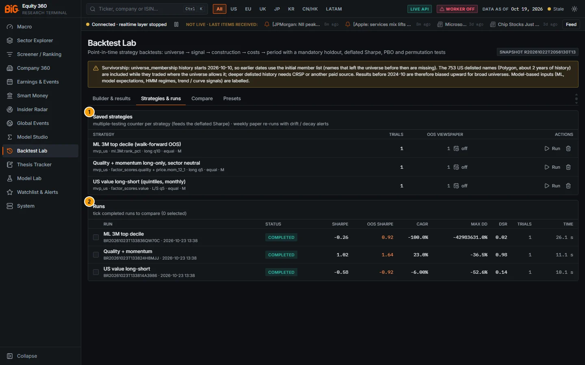

*Figure 11.16: Strategies & runs (`/backtest`) on the test copy: three saved strategies and their runs.*

| # | Panel | What it shows |
|---|---|---|
| 1 | Saved strategies | "multiple-testing counter per strategy (feeds the deflated Sharpe) · weekly paper re-runs with drift / decay alerts". Columns: Strategy (name and spec summary), Trials, OOS views, Paper, Actions. |
| 2 | Runs | "tick completed runs to compare (N selected)". Columns: checkbox, Run (name, run id, time, **paper** badge for scheduled runs), Status, Sharpe, OOS Sharpe, CAGR, Max DD, DSR, Trials, Time. |

> **Caution:** the "ML 3M top decile" row in Figure 11.16 shows impossible values (CAGR −100.0%, Max DD −42,983,631%): that run was produced before the cost-model fix of 24 Oct 2026 (see [Cost model](#cost-model)) and is invalid; re-run it. The two other rows are normal: "Quality + momentum" Sharpe 1.02, OOS Sharpe 1.64, CAGR 23.0%, Max DD −36.5%, DSR 0.98; "US value long-short" Sharpe −0.58, OOS −0.92, CAGR −6.00%, Max DD −52.6%, DSR 0.14.

### Controls

| Control | What it does |
|---|---|
| Strategy name | Opens the strategy in the builder with its last run. |
| **Trials** / **OOS views** | The multiple-testing and holdout-view counters (amber above 5 views). |
| **Paper** button (**off** / **weekly**) | Hover: "Re-run weekly on the latest data and alert on drift / decay". Toast "Weekly paper re-runs on (drift alerts in Watchlist & Alerts)" or "Paper schedule off". |
| **Run** | Runs the saved strategy now (it counts as a trial). |
| Delete (bin) | Deletes the strategy. |
| Run name | Opens the run in the Builder & results tab. |
| Checkboxes, **Compare N** | Tick up to six completed runs, then compare. |

### Methodology

See [Robustness statistics](#robustness-statistics) (counters) and [Paper strategies and drift alerts](#paper-strategies-and-drift-alerts).

### Data sources and refresh

`app_state` tables `backtest_strategies` and `backtest_runs`; run artefacts under `data/backtest/runs/`.

### Validation status

Not applicable.

### Limitations and pitfalls

- Deleting a strategy deletes its counters; re-creating it starts from zero trials, which flatters the next DSR.
- Runs of unsaved drafts do not increase any counter.

### Related mnemonics and BQL fields

[Watchlists and alerts](13-watchlists-alerts.md).

---

## Compare

**Route:** `/backtest` (tab **Compare**) · **API:** `POST /api/v1/backtest/compare`

### Purpose

Compare puts the equity curves and every metric of up to six completed runs side by side.

### Screenshot

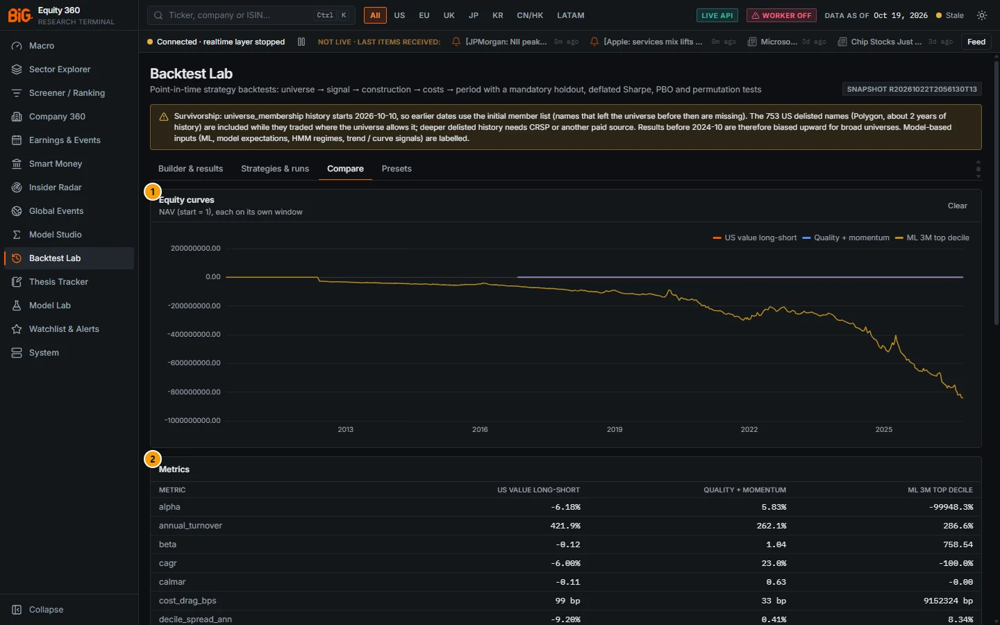

*Figure 11.17: Compare (`/backtest`) of three runs on the test copy.*

| # | Panel | What it shows |
|---|---|---|
| 1 | Equity curves | "NAV (start = 1), each on its own window", one line per run; **Clear** removes the selection. |
| 2 | Metrics | One row per metric (alpha, annual turnover, beta, CAGR, Calmar, cost drag, decile spread …), one column per run. |

> **Caution:** the y-axis of Figure 11.17 is distorted by the invalid "ML 3M top decile" run (NAV down to about −1 billion), which flattens the two valid curves. Compare valid runs only.

With nothing ticked the tab shows "Nothing to compare: Tick completed runs in Strategies & runs."

### Controls

| Control | What it does |
|---|---|
| **Clear** | Empties the comparison. |
| Chart hover | NAV of each run per date. |

### Methodology

Metrics are the flat metric set of each run (percentages for CAGR, volatility, drawdown, returns, hit rates, alpha, spreads and turnover; basis points for `*_bps` metrics). Each curve is plotted on its own window, so runs over different periods are not aligned. No paired test is run (see [Robustness statistics](#robustness-statistics), Paired comparisons).

### Limitations and pitfalls

- Runs on different universes, periods or cost settings are not comparable on Sharpe or CAGR alone.

### Related mnemonics and BQL fields

[Strategies & runs](#strategies--runs).

---

## Presets

**Route:** `/backtest` (tab **Presets**) · **API:** `GET /api/v1/backtest/catalog` (`presets`)

### Purpose

Nine ready-made strategies covering the main signal families. **Open** loads one into the builder (origin "preset · ‹title›"); nothing runs until you press **Run backtest**.

### Screenshot

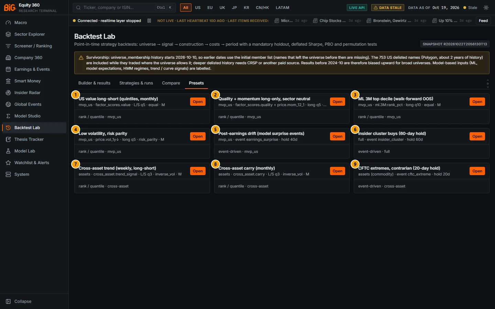

*Figure 11.18: Backtest presets (`/backtest`).*

| # | Preset | Specification (card subtitle) | One line |
|---|---|---|---|
| 1 | US value long-short (quintiles, monthly) | mvp_us · factor_scores.value · L/S q5 · equal · M | Top minus bottom quintile of the value factor score, monthly. |
| 2 | Quality + momentum long-only, sector neutral | mvp_us · factor_scores.quality + price.mom_12_1 · long q5 · equal · M | z blend of quality and 12−1 momentum, top quintile, sector-neutral, 5% weight cap. |
| 3 | ML 3M top decile (walk-forward OOS) | mvp_us · ml.3M:rank_pct · long q10 · equal · M | Top decile of the 3M ML rank (walk-forward OOS predictions), three overlapping monthly tranches; model-based. |
| 4 | Low volatility, risk parity | mvp_us · price.vol_1y↓ · long q5 · risk_parity · M | Lowest-volatility quintile with equal-risk-contribution weights. |
| 5 | Post-earnings drift (model surprise events) | mvp_us · event earnings_surprise · hold 40d | Enter on \|SUE\| ≥ 2 vs model-based expectations (not consensus), hold 40 days, up to 40 positions, shorts allowed. |
| 6 | Insider cluster buys (60-day hold) | full · event insider_cluster · hold 60d | Long on insider cluster buys, hold 60 days, 20% stop, up to 30 positions. |
| 7 | Cross-asset trend (weekly, long-short) | assets · cross_asset.trend_signal · L/S q3 · inverse_vol · W | Long top tercile, short bottom tercile of the model-based trend signal, inverse-volatility weights, weekly. |
| 8 | Cross-asset carry (monthly) | assets · cross_asset.carry · L/S q3 · inverse_vol · M | Tercile long-short on carry, inverse-volatility weights, monthly. |
| 9 | CFTC extremes, contrarian (20-day hold) | assets (commodity) · event cftc_extreme · hold 20d | Fade 3-year COT-index extremes (above 0.9 / below 0.1) in commodities, hold 20 days, up to 10 positions, shorts allowed. |

### Validation status

Presets are examples, not validated strategies. The ML preset uses the XGBoost walk-forward predictions (OOS rank IC about 0.035, see [Model Lab](10-model-lab.md#validation-status)).

### Limitations and pitfalls

- Each **Open** + run of a preset is a new unsaved draft: save it to track trials.

### Related mnemonics and BQL fields

[Strategy builder](#strategy-builder).

---

## Paper strategies and drift alerts

**Route:** `/backtest` (Strategies & runs › **Paper**) and [Watchlist & Alerts](13-watchlists-alerts.md) · **Refresh:** weekly (job `backtest_scheduled`)

### Purpose

A saved strategy switched to **weekly** is re-run every week on the latest data as a paper portfolio. The job compares each new run with the previous completed run and raises a `backtest_drift` alert when the strategy decays.

### Methodology

A strategy is due 6 days after its last scheduled run. Its scheduled runs carry the **paper** badge and count as trials. Drift rules (`backend/app/backtest/scheduled.py`, default threshold 30%):

- **Metric drift:** full-period Sharpe or CAGR falls by more than the threshold (relative), or the maximum drawdown deepens by more than the threshold.
- **Live decay:** over the days added since the previous run, `z = (ln(1 + R_new) − n · ln(1 + μ_d)) / (σ_d · √n)` with μ_d and σ_d the previous run's daily mean (from its CAGR) and volatility; z < −2 fires ("live decay: … over N new days (z … vs the backtest)").
- **Drawdown breach:** the current drawdown is deeper than the previous run's worst drawdown.
- **Holdings drift** (informational): one-way turnover between the two runs' latest books.

Switching the schedule on creates a `backtest_drift` alert rule (parameters: strategy id, name, schedule, threshold); switching it off deletes the rule. Events appear in Watchlist & Alerts as "Paper strategy '‹name›': …".

### Controls

The **Paper** button in [Strategies & runs](#strategies--runs). The drift threshold is not editable on this page (default 30%).

### Validation status

Not applicable (monitoring).

### Limitations and pitfalls

- The weekly re-run uses the whole history again; with a revised snapshot the backtest itself can change, not only the new days.
- A paper portfolio has no fills, slippage or capacity beyond the cost model.

### Related mnemonics and BQL fields

[Watchlists and alerts](13-watchlists-alerts.md), [Studies & runs](09-model-studio.md#studies--runs) (the Model Studio equivalent, `studio_drift`).

---

## Backtest entry points

**Route:** several pages → `/backtest` · **API:** `POST /api/v1/backtest/from-screen`

### Purpose

Other pages open the builder with a draft and an origin note, so you can test what you are looking at.

### Controls

| Page | Button | Draft it creates |
|---|---|---|
| [Screener](04-screener.md#screener) | **Backtest this screen** (hover: "Backtest this screen: the filters and ranking re-evaluated point-in-time at each monthly rebalance (Backtest Lab)") | The screener's filters become point-in-time screen rules and its ranking the signal, monthly rebalance. Origin "from the Screener (rules evaluated point-in-time)"; fields without history are listed as "dropped (no point-in-time history): …"; sub-sector filters are dropped. |
| Model Studio run header | **Backtest this signal** (panel tree-ensemble or regularised-regression runs) | Source `studio_run` with the run's out-of-fold predictions, long-short quintiles, the run's universe. Notes: "signal = out-of-fold predictions of run SR… (CV scheme …)" and, for non-expanding schemes, "non walk-forward CV trains on future data: the backtest will flag LOOK-AHEAD IN FITTING". |
| [Cross-asset dashboard](02b-markets-cross-asset.md#cross-asset-dashboard) | **Signal to backtest** (Trend, Carry, Value, CFTC COT index) + **Backtest this signal** | Long-short of the chosen signal across the asset's class, inverse-volatility weights. Notes: "spot-like prices: futures front months include roll gaps; trend / value / z metrics are model-based". |
| [CFTC market page](02b-markets-cross-asset.md#cftc-market-page) | **Backtest this signal** (hover: "event-driven strategy on COT-index extremes") | Event strategy fading COT-index extremes for the mapped asset or asset class ("contrarian: fade COT-index extremes (official CFTC positioning)"). |

### Correct usage and worked example

In the Screener, filter `mvp_us` on quality ≥ 70 and sort by value, then press **Backtest this screen**. Read the origin notes before running: any filter listed as dropped is not in the backtest, so the backtest tests a different screen from the one on screen.

### Limitations and pitfalls

- A Studio signal trained with purged K-fold or K-fold uses later data to predict earlier dates; the backtest flags it as look-ahead in fitting. Only `expanding` CV gives a point-in-time signal.

### Related mnemonics and BQL fields

[Open in Model Studio entry points](09-model-studio.md#open-in-model-studio-entry-points).

---

## Export to Python

**Route:** `/backtest` (results header › **Python**) · **API:** `GET /api/v1/backtest/runs/{run_id}/export.py`

### Purpose

The export produces `backtest_<run_id>.py`, a standalone script that rebuilds the point-in-time panel from the lake and re-simulates the strategy, for audit and independent review.

### Methodology

The script (`backend/app/backtest/export.py`) embeds verbatim the point-in-time as-of helper, the Model Studio dataset engine, the formula engine, the backtest engine core (`_engine.py`) and the panel builder (`_panel.py`), plus the run's normalised spec and panel plan. Its header records the run id, name, creation time, snapshot, spec hash, plan key and seed. It reads the lake read-only under `--data-dir` (default: the run's data directory), re-simulates the strategy, prints the headline metrics and ends with a `RESULT_JSON {...}` line so the reproduction can be checked mechanically. Requirements: duckdb, polars, numpy. Toast: "Script exported — standalone: rebuilds the panel from the lake and re-simulates".

### Validation status

Export reproduction is part of the backtest test suite (`docs/ROADMAP_V2_PLAN.md` 4.8).

### Limitations and pitfalls

- Signals from the BQL source and Studio runs depend on the backend (BQL engine, Studio run artefacts) and are not rebuilt from the lake alone.
- Re-running on a later lake gives the numbers of that data; reproduce on the same snapshot for identical results.

### Related mnemonics and BQL fields

[Model Studio export](09-model-studio.md#export-to-python).
