# 12. Thesis Tracker

The Thesis Tracker is the app's decision log. A thesis records what you believe about a security, a sector, a country, a macro theme or a cross-asset market, how you will know you are wrong, and what you plan to do about price (entry band, target, stop). The app then holds you to it: it generates alert rules from the thesis, re-evaluates an **automatic status** every night, measures performance against a benchmark and a sector benchmark, schedules reviews, keeps a dated journal and, when you close the thesis, records the outcome and a post-mortem template. Closed theses feed hit-rate statistics.

The tracker has three pages: the **board** (`/theses`), the **thesis page** (`/theses/:id`) and the **editor** (`/theses/new`, `/theses/:id/edit`).

> **Note:** The screenshots in this chapter come from a separate test instance seeded with example theses (Apple long, ASML idea, JPMorgan short, Toyota closed, a US country thesis and Petrobras). Prices are from the snapshot with data as of 19 Oct 2026; the theses were created on 23 Oct 2026. The examples illustrate the mechanics; they are not research views.

> **Model-based:** The automatic status, the KPI medians, the event-shock z-scores, the scenario impact and every probability on the thesis page are model-based. The touch and target-before-stop panels show frequencies **calibrated over history**, not the probability that the thesis is right.

---

## Thesis board

**Route:** `/theses` · **Menu:** Thesis Tracker · **Mnemonics:** `THES` (global) · **Refresh:** on every change; automatic status nightly (`thesis_eval`)

### Purpose

The board is a kanban of every thesis in three columns, **Idea**, **Active** and **Closed**, with a statistics strip on top. It answers "what am I tracking, what is at risk, which reviews are due, and how have my closed theses done?". Portfolio managers use it as the weekly agenda; analysts use it to move ideas into active positions and to close them with an outcome.

### Screenshot

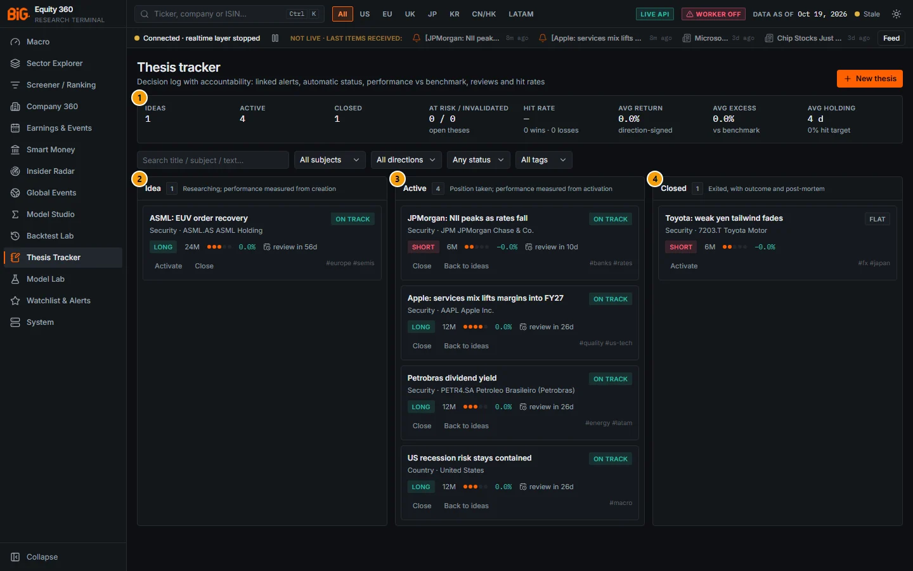

*Figure 12.1: Thesis board (`/theses`), test instance, data as of 19 Oct 2026.*

| # | Panel | What it shows |
|---|---|---|
| 1 | Statistics strip | Ideas 1, Active 4, Closed 1; at risk / invalidated 0 / 0 among open theses; hit rate "—" (no win or loss yet); average return and excess 0.0%; average holding 4 days, 0% hit target. |
| 2 | Idea column | "Researching; performance measured from creation". One card: ASML EUV order recovery (long, 24M, conviction 3, review in 56 days). |
| 3 | Active column | "Position taken; performance measured from activation". JPMorgan (short), Apple, Petrobras (long, security) and the US recession thesis (country). |
| 4 | Closed column | "Exited, with outcome and post-mortem". Toyota (short, 6M) closed **FLAT**. |

### Controls

| Control | What it does |
|---|---|
| **New thesis** | Opens the empty editor (`/theses/new`). |
| Search title / subject / text... | Free-text filter over the title, subject label, subject id and thesis text. |
| All subjects | Filter by subject type: Security, Sector, Country, Macro theme, Cross-asset. |
| All directions | Long, Short or Neutral. |
| Any status | Automatic status: Invalidated, At risk, On track, Unknown. |
| All tags | Appears once any thesis has tags; filters on one tag (`#quality`). |
| Clear filters | Appears when a filter is set; resets all of them. Filters live in the URL, so a filtered board can be bookmarked. |
| Card title | Opens the thesis page. |
| Drag a card to another column | Moves the thesis (same rules as the buttons below). A move that is not allowed shows a toast, for example "A closed thesis cannot move to idea". |
| **Activate** / **Close** / **Back to ideas** (card buttons) | Idea → Active or Closed; Active → Closed or Idea; Closed → Active. **Close** opens the close dialog. |
| Close dialog: **Reason** | Target hit, Stopped out, Thesis invalidated, Time stop / horizon over, Thesis changed, Other (default). |
| Close dialog: **Outcome** | "From the return" (default), Win, Loss or Flat. |
| Close dialog: **Close thesis** / **Cancel** | Closes the thesis. The dialog explains: "The exit price, the performance since inception and a post-mortem template are recorded; linked alert rules are disabled." |

Each card shows the title, subject type and label, the automatic status badge (open theses) or the outcome badge (closed theses), the direction badge, the horizon, five conviction dots, the direction-signed return since inception (closes), the review countdown ("review in 26d" or, in amber, "review 3d overdue"), the most serious status reason (an invalid or risk message) and the tags. Inside a column, open theses are sorted riskiest first (invalidated, at risk, on track, unknown), then most recently updated; closed theses by close date.

When there are no theses the board shows "No theses yet" with a **New thesis** button and the reminder that theses can be created from Company 360, the Screener, Model Studio, the Cross-asset dashboard or the Backtest Lab (see [Thesis editor](#thesis-editor)).

### Methodology

**Statistics strip.** Counts are over all theses; "At risk / invalidated" counts open theses by their stored automatic status. The performance figures use **closed theses only**:

| Figure | Definition |
|---|---|
| Hit rate | `wins / (wins + losses)`. Flat outcomes are excluded from both, so one flat close leaves the hit rate at "—". |
| Wins · losses | Outcomes chosen in the close dialog or, with "From the return", derived from the direction-signed return: win if `> +0.5%`, loss if `< −0.5%`, flat in between. |
| Avg return | Mean direction-signed thesis return at close (see [Thesis page](#thesis-page), Methodology). |
| Avg excess | Mean excess return versus the benchmark at close. |
| Avg holding | Mean days from inception to close; the sub-line is the share of closed theses whose close reason is "Target hit". |

The return of a closed thesis is taken from the performance stored in its close snapshot; if that is missing, from `sign × (exit price / inception price − 1)` on unadjusted closes.

**Hit rates by group.** `GET /api/v1/theses/stats` also returns the same statistics by direction, by conviction, by subject type and by close reason, plus the stopped-out rate (close reason "Stopped out" or "Thesis invalidated"). The board shows only the overall row; the breakdown is available from the API only.

**Card return.** Direction-signed (`+` when the thesis is right): `sign × (last close / inception price − 1)`, with sign `−1` for shorts and `+1` for longs and neutral theses. On a closed thesis the exit price replaces the last close. Both prices are unadjusted closes, so the card can differ from the Performance panel, which uses adjusted closes (see [Thesis page](#thesis-page)).

**Moves and what they record.**

| Move | Effect |
|---|---|
| Created as idea | Inception date = the data as-of date of the snapshot, inception price = its close. A "creation" snapshot and a journal entry are written. |
| Idea → Active | Inception is **reset** to the current as-of date and close ("performance measured from activation"); an "activation" snapshot is taken. |
| Active → Idea | Status change only; inception is kept. |
| → Closed | Exit price = latest close; close reason recorded (default Other); outcome = your choice or derived from the return; a "close" snapshot with the performance summary; a post-mortem template written into the thesis if none exists; next review cleared; every linked alert rule disabled. |
| Closed → Active | Exit price, close reason and outcome cleared; inception kept; linked rules re-enabled; the review cadence restarts from today. |

Every move is logged in the journal as a "status change" entry.

### Data sources and refresh

Theses, journal, reviews and snapshots live in the local application state (`app_state`), not in the market-data snapshot. Prices, scores and KPIs come from the current serving snapshot. The stored automatic status is refreshed by the nightly `thesis_eval` job (after `alerts_eval`), on every save and by **Evaluate** on the thesis page. Under the default weekly schedule profile the nightly DAG runs inside the Saturday 08:00 (Lisbon) refresh; under the daily profile, Tuesday to Saturday at 01:30 (see [Refresh schedule](01-data-and-coverage.md#refresh-schedule)).

### Validation status

Not formally validated: the hit-rate statistics are a descriptive record of your own decisions, and the automatic status is a set of rules (see [Thesis page](#thesis-page)). The status badge carries the tooltip "Automatic status (model-based rules on the latest data)".

### Correct usage and worked example

Use the board as the weekly agenda: filter **Any status › At risk**, then work through overdue reviews (amber "review ... overdue"). Move an idea to **Active** only when you have taken the position, because activation resets the inception price used for performance.

*Example (Figure 12.1).* The Toyota short was closed on 23 Oct 2026 with reason "Thesis changed" and outcome derived from the return. The direction-signed return over four days was −0.0%, inside the ±0.5% flat band, so the outcome is **FLAT**. Because flat outcomes count neither as a win nor as a loss, the hit rate shows "—" with "0 wins · 0 losses", while Avg holding shows 4 days and "0% hit target" (the close reason was not "Target hit").

### Limitations and pitfalls

- The statistics are only as honest as the closes: choosing "Win" in the dialog overrides the return-based outcome. Prefer "From the return" and explain exceptions in the post-mortem.
- Hit rates on a handful of closed theses are noise. The by-group breakdown is API-only.
- Moving a thesis Active → Idea → Active resets the inception on the second activation, which can flatter or hurt the recorded performance. Use **Back to ideas** only for genuine mistakes.
- The board is per installation: theses are stored in this PC's application state, not shared between users.

### Related mnemonics and BQL fields

`THES` without a security opens the board; with a security (`AAPL US THES`) or a cross-asset id it opens the editor pre-filled (see [14. BQL console and mnemonics](14-bql-mnemonics.md)). No BQL fields expose theses. API: `GET /api/v1/theses`, `GET /api/v1/theses/stats`, `PATCH /api/v1/theses/{id}` (moves).

---

## Thesis page

**Route:** `/theses/:id` · **Menu:** Thesis Tracker › card · **Mnemonics:** `THES` (board) · **Refresh:** live status on each view; stored status nightly (`thesis_eval`), on save and on **Evaluate**

### Purpose

The thesis page is the single place to follow one thesis: price against the plan, automatic status with its reasons, the historical chance of touching the target or stop, KPIs, performance against the benchmarks, the thesis text, catalysts, invalidation conditions, the journal, reviews and snapshots, linked evidence, the linked macro scenario and the alert rules generated from the thesis. It is also where you close a thesis, write the post-mortem and export the record.

### Screenshot

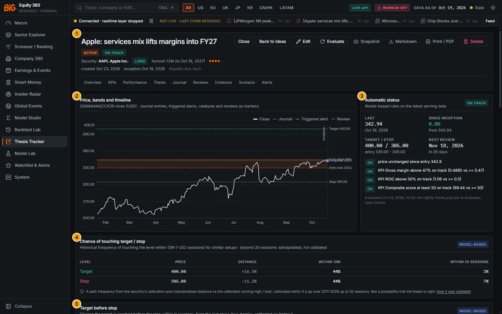

*Figure 12.2: Thesis page for "Apple: services mix lifts margins into FY27" (`/theses/:id`), test instance, data as of 19 Oct 2026. Panels 6 to 16 are below the fold and shown as close-ups further down.*

| # | Panel | What it shows |
|---|---|---|
| 1 | Summary header | Title, ACTIVE and ON TRACK badges, subject (AAPL Apple Inc.), LONG, horizon 12M (to 19 Oct 2027), conviction 4/5, created 23 Oct 2026, inception 19 Oct 2026, tags; action buttons; section links. |
| 2 | Price, bands and timeline | AAPL close (USD) with target 400, entry band 330-345, stop 305, the inception line and the journal / alert / review markers. |
| 3 | Automatic status | Last 342.94 (19 Oct 2026), since inception 0.0%, target / stop 400.00 / 305.00, next review 18 Nov 2026 (in 26 days), and the reasons (all OK). |
| 4 | Chance of touching target / stop | Touch frequency within the horizon (12M, ~252 sessions) and within 20 sessions. |
| 5 | Target before stop | Two-barrier probabilities (T2) at H = 20 and the context-adjusted (meta) row at H = 10. |
| 6 | KPI tracker | Each KPI's live value, healthy condition, role and state. |
| 7 | Performance since inception | Thesis return, excess versus benchmark and sector, max drawdown, rebased chart. |
| 8 | Thesis | The thesis text (Markdown) and key drivers; post-mortem when closed. |
| 9 | Catalysts | Dated catalysts with kind and an "in N d" badge within two weeks. |
| 10 | Invalidation conditions | Each condition with its kind and level or date. |
| 11 | Links | Benchmark, sector benchmark, linked Studio / Backtest ids and the origin. |
| 12 | Journal | New-note form and the dated entries. |
| 13 | Reviews & accountability | Review form, review list and snapshot table. |
| 14 | Linked evidence | Filings, news stories, event shocks, earnings and macro surprises. |
| 15 | Scenario impact (W4) | Model-based impact of the linked macro scenario on the subject. |
| 16 | Linked alerts | The 19 rules generated from the thesis and recent triggered alerts. |

### Controls

#### Header

| Control | What it does |
|---|---|
| Status badge (idea / active / closed) | Board column. |
| Automatic status badge | Stored status from the last evaluation (On track, At risk, Invalidated, Unknown). On a closed thesis the outcome badge (win / loss / flat) replaces it. |
| Subject link | Opens Company 360 (security), the Sector Explorer (sector), the country page (country), the theme page for growth / inflation / labour themes (macro theme) or the Cross-asset dashboard. |
| `?` | Opens this chapter in the in-app Help. |
| **Activate** / **Close** / **Back to ideas** | Same moves as on the board. **Close** opens the close dialog (reason, outcome). |
| **Edit** | Opens the editor (`/theses/:id/edit`). |
| **Evaluate** | "Run the nightly evaluator now (stores the status, fires due alerts)". A toast reports the status and the number of alert events fired. |
| **Snapshot** | "Capture a snapshot (price, benchmarks, score, KPIs)": adds a *manual* row to the snapshot table. |
| **Markdown** | Downloads the thesis as a `.md` file (see [Export](#export-and-print)). |
| **Print / PDF** | "Print / save as PDF (light theme)": switches to the light theme, opens the browser print dialog and restores the theme afterwards. Buttons, forms and section links are hidden in print. |
| **Delete** | Asks "Delete ... with its journal, reviews, snapshots and linked alert rules?" and returns to the board. |
| Section links | Overview, KPIs, Performance, Thesis, Journal, Reviews, Evidence, Scenario, Alerts: jump within the page. |

#### Price, bands and timeline

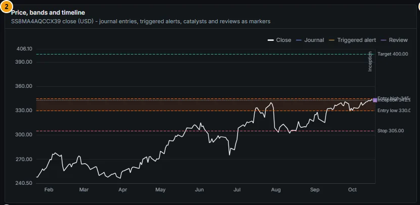

*Figure 12.3: Price, bands and timeline for the Apple thesis.*

The chart plots the **unadjusted** daily close of the price instrument (the unit of the bands) from about nine months before creation to today (weekly bars when the span exceeds three years; for a closed thesis, up to 30 days after the close). Dashed horizontal lines mark the target (green), entry high and entry low (accent, with the band shaded) and the stop (red); a dotted line marks the inception price, and dotted vertical lines mark inception and close. Markers: circle = journal entry, triangle = triggered alert, diamond = catalyst, square = review; several markers of one kind on one day are stacked into one symbol, and the tooltip lists them. Future catalysts are listed in the Catalysts panel, not plotted. The legend shows only the marker kinds present. The y-axis always includes every band, so a distant target is never clipped.

Subjects without a price instrument (a macro theme without a proxy) show "No price instrument" and a hint to set a proxy such as `ETF:TIP` in the editor; without one there are no bands, no price alerts and no performance.

#### Automatic status

The panel re-evaluates the thesis **live** on the current snapshot every time you open the page (the badge in the panel header), while the header badge shows the **stored** status of the last evaluation; the two can differ until the next evaluation. It shows Last (close and date), Since inception (direction-signed, from the inception price), Target / stop (with the entry band) and Next review (with "in N days" or "N days overdue"), then the list of reasons, each with a level badge: **ok** (green), **info** (blue), **risk** (amber) or **invalid** (red). The footer gives the time of the last stored evaluation: "the nightly thesis_eval job re-evaluates open theses".

On a closed thesis this panel is replaced by **Outcome** ("Recorded at close (performance from the close snapshot)"): close reason and date, exit / inception price, thesis return with days held, return versus the benchmark, and the status at close with its non-ok reasons.

#### Chance of touching target / stop

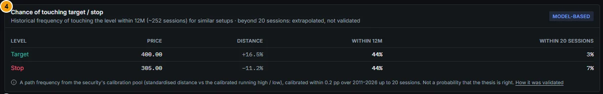

*Figure 12.4: Chance of touching target / stop (Apple thesis).*

Shown for security subjects that are not closed. Columns: Level (Target, Stop), Price, Distance from the last close, **Within** followed by the horizon (e.g. **Within 12M**) and **Within 20 sessions** (the validated horizon). The subtitle gives the horizon in sessions (1M = 21, 3M = 63, 6M = 126, 12M and longer = 252) and, beyond 20 sessions, "extrapolated, not validated". The badge reads **MODEL-BASED** and the note under the table states: "Not a probability that the thesis is right." Without a target or stop the panel asks you to set one; when the security has no calibration it says "Touch calibration is not available for this security yet."

#### Target before stop

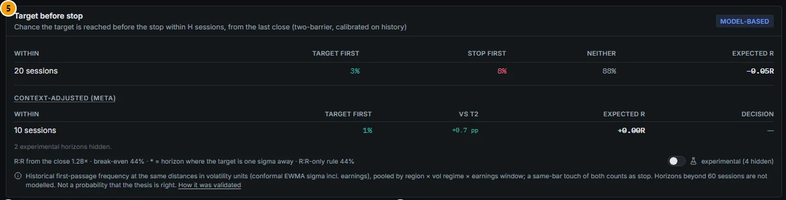

*Figure 12.5: Target before stop (Apple thesis), experimental outputs hidden.*

Shown for security subjects that are not closed and have both a target and a stop on opposite sides of the last close (otherwise: "Target and stop must lie on opposite sides of the last close for this view."). The table gives, per horizon H in sessions, **Target first**, **Stop first**, **Neither** and **Expected R** (`P(target) × R:R − P(stop) − costs`). By default only H = 20 is shown; an asterisk marks the horizon where the target is one sigma away.

Below it, the **Context-adjusted (meta)** table (hover the dotted title for its definition) gives Target first, the change versus T2 in percentage points, Expected R and the take / skip Decision. By default only H = 10 is shown and Decision shows "—"; "2 experimental horizons hidden" refers to H = 20 and 40.

The footer shows the R:R from the close, the break-even probability, the R:R-only rule and the switch **Show experimental outputs** ("experimental (4 hidden)"), shared with the Technicals tab. Turning it on adds T2 at 5, 10, 40 and 60 sessions, meta at 20 and 40, and the take / skip decision, each marked experimental.

#### KPI tracker

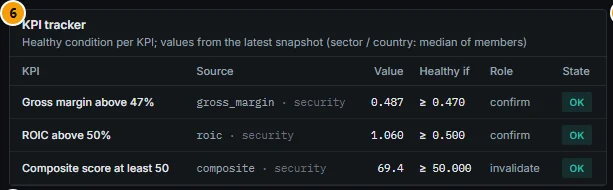

*Figure 12.6: KPI tracker (Apple thesis).*

One row per KPI: label, **Source** (field id, formula, "cross-asset" or "macro cell" followed by the reference, plus the basis: *security*, *median of members*, *cross-asset latest*, *macro cell (latest)*), **Value**, **Healthy if** (the condition, e.g. "≥ 0.470"), **Role** (confirm, invalidate, watch) and **State**:

| State | Meaning |
|---|---|
| OK (green) | The healthy condition holds. |
| Breached (amber) | Condition fails on a *confirm* KPI: the status turns at risk. |
| Invalidates (red) | Condition fails on an *invalidate* KPI: the status turns invalidated. |
| Watch (blue) | Condition fails on a *watch* KPI: information only. |
| No data | No value in the snapshot. |
| Error | The KPI could not be computed; hover for the message (e.g. unknown field). |

With no KPIs the panel says "Add KPIs in the editor: each becomes a linked alert and feeds the status."

#### Performance since inception

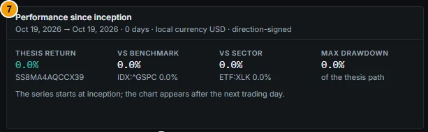

*Figure 12.7: Performance since inception (Apple thesis, created on the as-of date, so 0 days).*

The subtitle gives the period, the number of days, the currency basis ("local currency USD" or "in USD (official FX)") and "direction-signed". Stats: **Thesis return** (price instrument id below), **vs benchmark** (benchmark id and its own return), **vs sector** (sector benchmark id and return, or "none"), **Max drawdown** "of the thesis path". The chart rebases the subject (solid), the benchmark (dashed) and the sector benchmark to 100 at inception; it appears from the first trading day after inception ("The series starts at inception; the chart appears after the next trading day.").

#### Thesis, catalysts, invalidation conditions and links

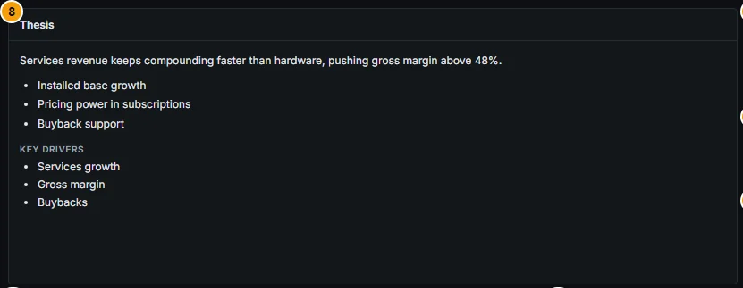

*Figure 12.8: Thesis text and key drivers.*

The **Thesis** panel renders the thesis text (Markdown subset) and the key drivers. On a closed thesis it adds **Post-mortem** with an **Edit** button (Markdown text area, **Save** / **Cancel**).

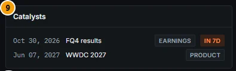

*Figure 12.9: Catalysts, sorted by date; undated ones last.*

Each catalyst shows its date ("undated" if none), label and kind badge; an accent badge "in N d" appears when the date is within 14 days.

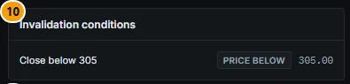

*Figure 12.10: Invalidation conditions.*

Each condition shows its label, kind badge (price below, price above, kpi, date, manual) and level or date. With none, the panel reminds you that the stop still invalidates.

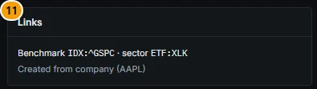

*Figure 12.11: Links.*

**Links** lists the benchmark and sector benchmark ids, links to the Studio study or run and the Backtest strategy or run when set, and the origin ("Created from company (AAPL)").

#### Journal

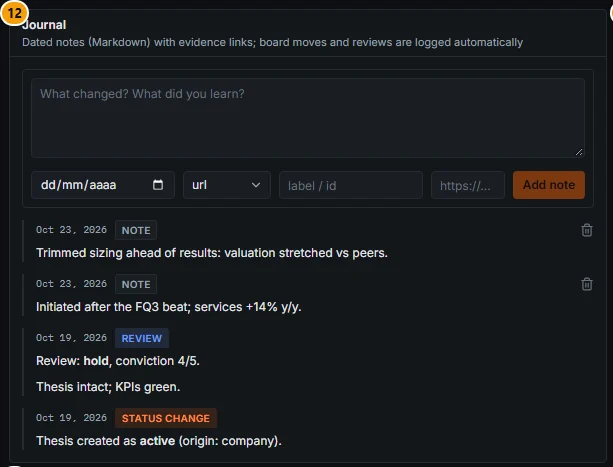

*Figure 12.12: Journal ("Dated notes (Markdown) with evidence links; board moves and reviews are logged automatically").*

| Control | What it does |
|---|---|
| Note text area | "What changed? What did you learn?" (Markdown). |
| Date | Entry date (default today). |
| Link kind | url, filing, story, event, alert, earnings, study, backtest. |
| label / id, https://... | Optional evidence link: a label or id, and a URL. |
| **Add note** | Saves the entry (enabled when the text is not empty). |
| Bin icon | Deletes a *note* (asks for confirmation). Automatic entries (status change, review) cannot be deleted here. |

Entries are newest first, with a kind badge: NOTE, REVIEW, STATUS CHANGE (also catalyst, alert, post-mortem when written through the API). Links with an `http(s)` URL open in a new tab.

#### Reviews and snapshots

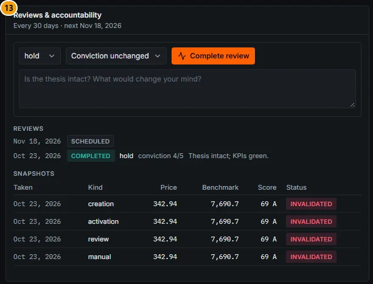

*Figure 12.13: Reviews & accountability ("Every 30 days · next Nov 18, 2026").*

| Control | What it does |
|---|---|
| Decision | hold (default), add, trim, close, none. Recorded only; choosing "close" does not close the thesis. |
| Conviction after | "Conviction unchanged" or 1/5 to 5/5; a value updates the thesis conviction. |
| Notes | "Is the thesis intact? What would change your mind?" (Markdown). |
| **Complete review** | Completes the scheduled review (or records an unscheduled one), captures a *review* snapshot, writes a journal entry and schedules the next review `cadence` days after the snapshot's as-of date. |

The form is hidden on closed theses. **Reviews** lists scheduled and completed reviews (date, status badge, decision, conviction, notes). **Snapshots** is the accountability table: date taken, kind (*creation*, *activation*, *review*, *manual*, *close*), price, benchmark level, composite score with grade (column **Score (descriptive)**: a peer ranking at the time, not a forecast), and the automatic status **at the time of the snapshot**. A snapshot is never rewritten, so its status can differ from today's (in Figure 12.13 the four snapshots were taken while an earlier version of the composite-score KPI was breached).

#### Linked evidence

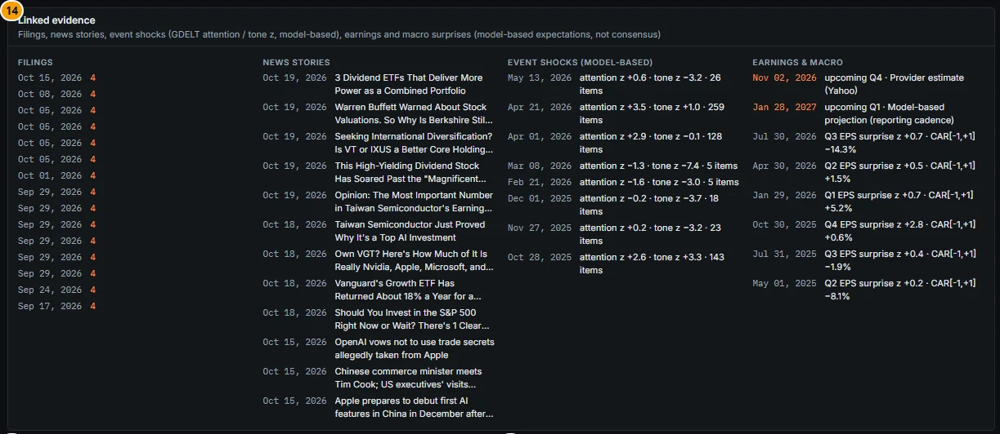

*Figure 12.14: Linked evidence ("Filings, news stories, event shocks (GDELT attention / tone z, model-based), earnings and macro surprises (model-based expectations, not consensus)").*

Four columns over the thesis life, and at least the last 365 days:

| Column | Content |
|---|---|
| Filings | Up to 15 filings of the issuer (date, form type, link). Security subjects only. |
| News stories | Up to 12 story clusters linked to the issuer (date, title, link). Security subjects only. |
| Event shocks (model-based) | Days when the GDELT attention z ≥ 2.5 or the absolute tone z ≥ 2.5 for the issuer, country or sector, with the item count. When there are none the column says so. |
| Earnings & macro | Upcoming earnings dates with their source label (accent), past releases with the model-based EPS surprise z and CAR[−1,+1], and, for country and macro-theme subjects, macro surprises with an absolute z of 1.5 or more. |

#### Scenario impact (W4)

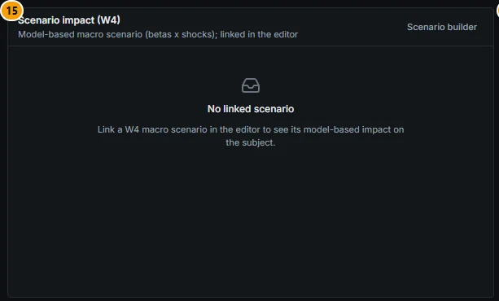

*Figure 12.15: Scenario impact (W4), no scenario linked.*

When a macro scenario is linked in the editor, the panel runs it and shows the model-based impact on the subject with its 90% band, the universe aggregates and the model label. For a country subject the closest region is used as a proxy (for example "Region EU (proxy for DE)"); for a sector, the sector row; for macro and cross-asset subjects, the price instrument when it is among the top or bottom instruments. **Scenario builder** opens `/macro/markets?tab=scenarios` (see [Scenario builder](02b-markets-cross-asset.md#scenario-builder)).

#### Linked alerts

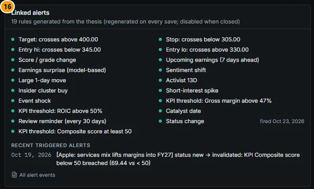

*Figure 12.16: Linked alerts ("19 rules generated from the thesis (regenerated on every save; disabled when closed)").*

Each rule shows a green dot when enabled, a readable label (for example "Target: crosses above 400.00", "KPI threshold: ROIC above 50%", "Review reminder (every 30 days)") and "fired" with the date when it has fired. **Recent triggered alerts** lists up to 20 events with their data date; empty: "None yet. Price and data rules are evaluated nightly (alerts_eval, thesis_eval)." **All alert events** opens the [Watchlist & Alerts](13-watchlists-alerts.md#watchlist--alerts) page. Rule definitions are in [Alert rule reference](13-watchlists-alerts.md#alert-rule-reference).

#### Export and print

**Markdown** downloads a `.md` file named after the title with: title line (direction, subject, horizon, conviction, status, automatic status), dates and thesis id, the thesis text, key drivers, price plan (instrument, entry band, target, stop, inception and last price), catalysts, KPIs with their current value and state, invalidation conditions, automatic-status reasons, performance, linked analysis ids, linked alert rules, triggered alerts (up to 50), reviews, the snapshot table, the full journal and the post-mortem. It ends with "Exported from BiG Equity 360. Automatic status, KPI medians and z-scores are model-based; prices from the serving snapshot." PDF output is the browser's print-to-PDF of the page in the light theme; there is no server-side PDF.

### Methodology

#### Automatic status

`thesis_eval` (and every save, **Evaluate** and each view of the status panel) evaluates the thesis on the latest serving snapshot. The reference price is the inception price, else the middle of the entry band. Direction sign: `s = +1` long, `−1` short; price rules are skipped for neutral theses. Each rule adds a reason:

| Level | Code | Rule |
|---|---|---|
| invalid | stop_hit | `s × (price − stop) ≤ 0`: the close is at or beyond the stop. |
| invalid | invalidation | An invalidation condition is met: price below / above its level, the linked KPI breached, or a manual condition marked triggered. |
| invalid | kpi_breach | An *invalidate* KPI fails its healthy condition. |
| risk | near_stop | Price is within a third of the distance from the reference price to the stop. |
| risk | adverse_move | No stop set and the price has moved 10% or more against the thesis. |
| risk | kpi_breach | A *confirm* KPI fails its healthy condition. |
| risk | deadline | A deadline condition's date has passed and it is not marked triggered ("confirm or mark it"). |
| risk | score_change | The balanced composite score fell 15 points or more since the activation (else creation) snapshot; for a short, rose 15 or more. |
| risk | horizon_passed | Active thesis past its horizon date ("review the time stop"). |
| info | target_reached | Price at or beyond the target ("consider closing or raising the target"). |
| info | price_against | Price against the thesis since entry (less than the adverse-move threshold, or with a stop set). |
| info | in_entry_band | An idea whose price is inside the entry band. |
| info | kpi_breach | A *watch* KPI fails. |
| info | kpi_error / kpi_missing | A KPI cannot be computed or has no data. |
| info | review_overdue | More than 7 days past the next review date. |
| ok | price_in_favour / price_unchanged | Price in favour since entry, or unchanged (within ±0.05%). |
| ok | kpi_ok | A KPI meets its healthy condition. |

The status is **Invalidated** if any reason is invalid; else **At risk** if any is risk; else **Unknown** if there is no price and no KPI value ("no price instrument and no KPI values to evaluate"); else **On track**. Info reasons never change the status.

Horizon dates: inception plus 30 (1M), 91 (3M), 182 (6M), 365 (12M), 730 (24M) or 1,095 days (36M+).

#### KPI values

A KPI threshold is the **healthy** condition (e.g. `gross_margin ≥ 0.47`); a breach is that condition failing. Operators: `>`, `≥`, `<`, `≤`, `between` (inclusive). Values come from the serving snapshot:

| Kind | Value |
|---|---|
| Metric | A numeric screener field id (`GET /api/v1/screener/fields`), plus `composite` (balanced composite score) and `rank`. Security subject: the security's value; sector or country subject: the **median** across primary listings of the sector or country. |
| Formula | An expression of the formula engine over screener field ids (e.g. `roic - 0.08`), evaluated on the same values (medians for sector / country). |
| Cross-asset | `<asset_id>:<signal>` (or `<signal>` for the thesis's own asset) from the cross-asset latest table. |
| Macro cell | `<CC>:<indicator>` from the latest macro heatmap cell on or before the as-of date. |

#### Performance

```
start = inception date (as-of date at creation, or at activation from idea)
end   = close date for a closed thesis, else the snapshot as-of date
r_X   = adjusted close at end / adjusted close at start − 1     (X = subject, benchmark, sector)
thesis return       = s × r_subject              (s = −1 short, +1 long or neutral)
excess vs benchmark = s × (r_subject − r_benchmark)
excess vs sector    = s × (r_subject − r_sector)
max drawdown        = worst peak-to-trough of the path 1 + s × (P_t / P_start − 1)
```

Each series is anchored on the last bar on or before the start date. If the subject, benchmark and sector benchmark trade in one currency the comparison is in that currency (basis *local*); otherwise all three are converted to USD with the official FX rate of each day (basis *usd*, "in USD (official FX)"). Prices are adjusted closes (splits and dividends) from the serving snapshot.

Default benchmarks: a security uses its region's benchmark index (`IDX:^GSPC` for the US and Canada, `IDX:^STOXX50E` for the EU, `IDX:^FTSE` for the UK, `IDX:^N225` for Japan, `IDX:^BVSP` for Latin America) and the US sector ETF of its sector (`ETF:XLK` for technology; none for sectors without one); a country uses its main index as the price instrument and a world ETF (`ETF:ACWI`, else `ETF:VT`, else the S&P 500) as the benchmark; a sector uses its sector ETF as the price instrument; a cross-asset subject uses its instrument. All can be overridden in the editor.

#### Touch and target-before-stop panels

- **Touch** (Conformal technicals): the share of calibration origins in the security's pool whose standardised running high (or low) reached the level's standardised distance within h sessions. The same curves as the [Touch probabilities](05b-company-technicals.md#touch-probabilities) on the Technicals tab, evaluated at the thesis target and stop. Beyond 20 sessions the 20-session curve is reused with the variance scaled by h: an extrapolation, labelled as such.
- **Target before stop** (Technicals v2 T2): two-barrier first-passage frequencies at the same distances in volatility units (conformal EWMA sigma including earnings), pooled by region × vol regime × earnings window; a same-bar touch of both counts as stop. The same surface as the [Trade setup](05b-company-technicals.md#trade-setup) card, computed at query time at the thesis barriers, from the last close. Horizons beyond 60 sessions are not modelled.
- **Context-adjusted (meta)** (Technicals v3 #2): a secondary model that re-estimates the T2 probability from the market and stock context; see [Context-adjusted (meta) row](05b-company-technicals.md#context-adjusted-meta-row) and [Meta-labelling](16-methodology.md#meta-labelling).

#### Evaluation and linked events

`thesis_eval` runs every open thesis, stores the status and reasons, and appends `thesis_*` alert events: a KPI that newly breaches, the status newly turning at risk or invalidated, a review due, a dated non-earnings catalyst within 3 days, a CFTC positioning extreme (cross-asset subjects) and an events-v2 shock. Events are idempotent per rule, target and data date, so running **Evaluate** and the nightly job on the same snapshot does not duplicate them. The other linked rules (prices, scores, earnings, smart money, macro) are evaluated by `alerts_eval`. Details in [Alert rule reference](13-watchlists-alerts.md#alert-rule-reference).

### Data sources and refresh

| Element | Source | Refresh |
|---|---|---|
| Prices, benchmarks, scores, KPI metrics | Serving snapshot (Polygon / yfinance prices, official FX, screener fields) | Nightly DAG (weekly profile: Saturday) |
| Automatic status (stored) | `thesis_eval` | Nightly after `alerts_eval`, on save, on **Evaluate** |
| Automatic status (panel) | Live evaluation | Each page view |
| Touch frequencies | `conformal_envelopes` touch curves (`GET /api/v1/conformal/touch`) | Nightly |
| Target before stop, meta | T2 surface (weekly refit) and meta model (`GET /api/v1/technicals/{id}/setup-probabilities` with the thesis target, stop and direction) | Query time on the weekly-refitted models |
| Evidence | SEC / company filings, events-v2 stories and GDELT aggregates, earnings events and calendar, macro surprises | Nightly; GDELT up to 10 days per weekly run |
| Scenario | W4 macro exposures | Weekly |
| Journal, reviews, snapshots, rules | Local application state | Immediate |

### Validation status

| Output | Status | Source |
|---|---|---|
| Touch frequency, h ≤ 20 sessions | **Validated**: "predicted equals realised within 0.2 pp at every distance and horizon" (US mvp, 2011-2026). The panel note says "calibrated within 0.2 pp over 2011–2026 up to 20 sessions". | `docs/CONFORMAL_VALIDATION.md` §A.4 |
| Touch frequency, h > 20 (thesis horizons 1M+) | **Extrapolated, not validated** (labelled in the subtitle). | same, and the panel |
| T2 target-before-stop, H = 20 | **PASS → production** (ECE 1.13 / 1.47 pp; worst regime Covid 2020 win −4.6 / loss +4.0 pp; better than both baselines). | `docs/TECHNICALS_V2_VALIDATION.md` Verdict |
| T2, H = 5, 10, 40, 60 | **FAIL → experimental**, hidden by default (H = 5 / 10: "the Feb-Jun 2020 crash window had 5.1-5.6 pp more stop-outs than predicted"; H = 40 / 60 lose their edge over the Brownian formula). | same |
| Expected R | Well ordered and roughly calibrated; the economic check (filtering setups by E[R] > 0) is a **null result**. | same |
| Meta P(target first), H = 10 | **PASS** (default row): "a better-calibrated P(win) than T2, not 'context has a demonstrated edge'". | `docs/TECHNICALS_V3_VALIDATION.md`, Meta-labelling |
| Meta, H = 20 and 40 | **FAIL → experimental**. | same |
| Meta take / skip and size | **FAIL** (economic check) → hidden unless experimental is on. | same |
| Automatic status, KPI states, hit rates | Not formally validated: deterministic rules on snapshot data, labelled "model-based rules". | code (`app.theses.evaluate`) |
| Event shocks, earnings and macro surprises | Model-based z-scores and model-based expectations (not consensus). | panel subtitles |
| Scenario impact | Model-based (betas × shocks). | panel subtitle |

### Correct usage and worked example

Read the page top-down once a week: status reasons first, then KPIs, then the probabilities, then the journal. Treat the probabilities as a sanity check on the plan, not as a forecast: if the stop is touched far more often than the target within the validated 20-session window, the plan is asymmetric against you in volatility terms whatever your view.

*Example 1, Apple long (Figure 12.2 and 12.5).* Last close 342.94 on 19 Oct 2026; target 400 (+16.5%), stop 305 (−11.2%), entry band 330-345. The touch panel gives 3% (target) and 7% (stop) **within 20 sessions** (validated) and 44% for each **within 12M** (extrapolated, not validated). T2 at H = 20 gives target first 3%, stop first 8%, neither 88%, Expected R −0.05R, with R:R from the close 1.28× and a break-even of 44%. The context-adjusted row at H = 10 gives 1% (+0.7 pp versus T2). Reading: over the next month the most likely outcome by far is that neither level is reached, and a stop-out is somewhat more frequent than a target hit, so the setup has no short-term edge after costs. The thesis is a 12-month fundamental view; the right action is to rely on the KPIs (gross margin 0.487 ≥ 0.47, ROIC 1.06 ≥ 0.5, composite 69.4 ≥ 50, all OK) and the review cadence, not to expect the price plan to resolve soon.

*Example 2, JPMorgan short.* Last 339.72; target 300 (−11.7%), stop 365 (+7.4%). Within 20 sessions the touch panel gives target 2% and stop 11%; T2 gives target first 3%, stop first 17%, neither 79%, Expected R −0.12R (R:R 1.73×, break-even 37%). The stop is close in volatility units, so the plan is exposed to a squeeze. The touch (2%) and target-first (3%) figures for the target differ slightly because they are calibrated separately on different pools, a known limitation ("seen: 18% touch vs 20% target-first for one 20-session example").

*Example 3, closing.* For Toyota (short, 7203.T, JPY) the benchmark is the Nikkei 225 and the sector benchmark a US ETF, so performance is computed in USD with official FX. Closed after four days with reason "Thesis changed": exit 3,102.00 / inception 3,102.00, thesis return −0.0%, outcome FLAT, status at close ON TRACK; the post-mortem records "The BoJ path changed; closed flat."

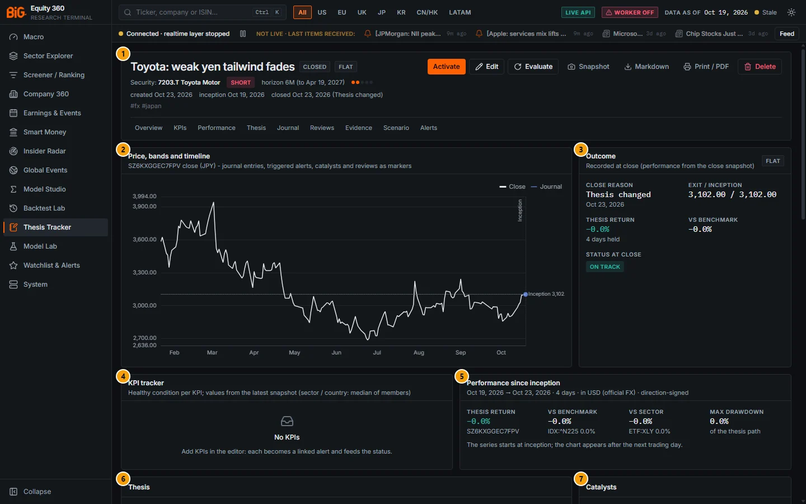

*Figure 12.17: A closed thesis (`/theses/:id`, Toyota short), test instance, data as of 19 Oct 2026.*

| # | Panel | What it shows |
|---|---|---|
| 1 | Summary header | CLOSED and FLAT badges, SHORT, horizon 6M, closed 23 Oct 2026 (Thesis changed); **Activate** replaces Close / Back to ideas. |
| 2 | Price, bands and timeline | 7203.T close (JPY) with the inception line at 3,102 and a journal marker. |
| 3 | Outcome | Close reason, exit / inception 3,102.00 / 3,102.00, thesis return −0.0% (4 days held), vs benchmark −0.0%, status at close ON TRACK. |
| 4 | KPI tracker | "No KPIs". |
| 5 | Performance since inception | 19 → 23 Oct 2026, 4 days, in USD (official FX); benchmark IDX:^N225, sector ETF:XLY. |
| 6 | Thesis | Thesis text and the post-mortem with **Edit**. |
| 7 | Catalysts | Catalysts of the thesis. |
| 8 | Invalidation conditions | As for an open thesis. |
| 9 | Links | Benchmarks and origin. |
| 10 | Journal | Notes and the status changes. |
| 11 | Reviews & accountability | "Every 30 days · next —": no review form and no next review once closed; the snapshot table includes the *close* snapshot. |
| 12 | Linked evidence | As for an open thesis. |
| 13 | Scenario impact (W4) | As for an open thesis. |
| 14 | Linked alerts | 10 rules, all disabled (grey dots) while closed. |

The touch and target-before-stop panels are not shown on a closed thesis.

### Limitations and pitfalls

- **Not a probability that the thesis is right.** Touch and target-before-stop frequencies describe price paths of similar setups; they know nothing about your fundamental view.
- **Thesis horizons exceed the validated window.** Only the 20-session column and T2 at H = 20 (and meta at H = 10) are validated; the "Within 12M" touch figure is an extrapolation.
- **Two estimators, two numbers.** The touch frequency of the target and the T2 "target first" are calibrated separately and can differ by a few points.
- **Unadjusted versus adjusted.** The chart, the bands, the card return and the status rules use unadjusted closes; the Performance panel uses adjusted closes. After a dividend or split the two can differ; after a split the bands must be edited by hand.
- **Sector and country KPIs are medians** of primary listings, not index-weighted values. Coverage outside the US is thinner, so a median can rest on few names.
- **Snapshot statuses are historical.** They record the status at capture and are never recomputed.
- **Editing a rule-generating field deletes that rule's history.** When a target, KPI or other parameter changes, the old rule and its fired events are deleted and a new rule is created; unchanged rules keep their history.
- **Survivorship and coverage** caveats of the underlying models apply (current mvp membership in the technicals validation; EU / JP earnings dates only from about 2014-2015).
- The scenario panel for a country uses a regional proxy, not the country itself.

### Related mnemonics and BQL fields

`THES` (board, or editor pre-filled from a security or cross-asset context). No BQL fields expose thesis data; the touch and setup figures have Technicals counterparts (`cf.touch_20d`, see [Touch probabilities](05b-company-technicals.md#touch-probabilities)). API: `GET /api/v1/theses/{id}` and its `/status`, `/performance`, `/timeline`, `/evidence`, `/journal`, `/reviews`, `/export.md` sub-paths; `POST .../evaluate`, `.../snapshots`, `.../reviews`, `.../journal`. Related: [Trade setup](05b-company-technicals.md#trade-setup), [First-passage probabilities](16-methodology.md#first-passage-probabilities), [Conformal prediction](16-methodology.md#conformal-prediction), [Checklist for an investment decision](17-good-practice.md#checklist-for-an-investment-decision).

---

## Thesis editor

**Route:** `/theses/new`, `/theses/:id/edit` · **Menu:** Thesis Tracker › New thesis, or **Edit** on a thesis · **Mnemonics:** `THES` with a security or cross-asset id · **Refresh:** saving regenerates the linked rules and re-evaluates the status immediately

### Purpose

The editor captures the whole plan in one form: subject, view, thesis text, KPIs, catalysts, invalidation conditions, price plan, benchmarks, links to other analysis, review cadence and tags. "Saving regenerates the linked alert rules and re-evaluates the automatic status."

### Screenshot

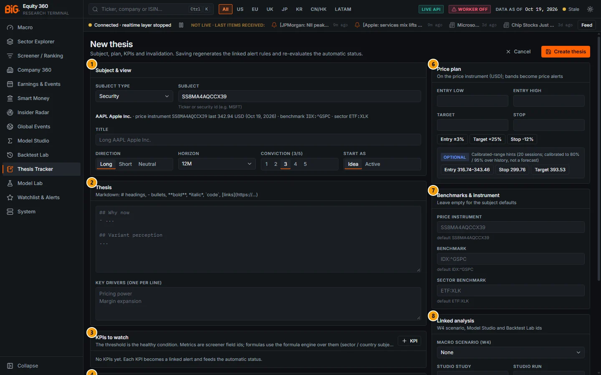

*Figure 12.18: New thesis (`/theses/new?subject_type=security&subject_id=...`), opened from Company 360 for Apple, test instance, data as of 19 Oct 2026.*

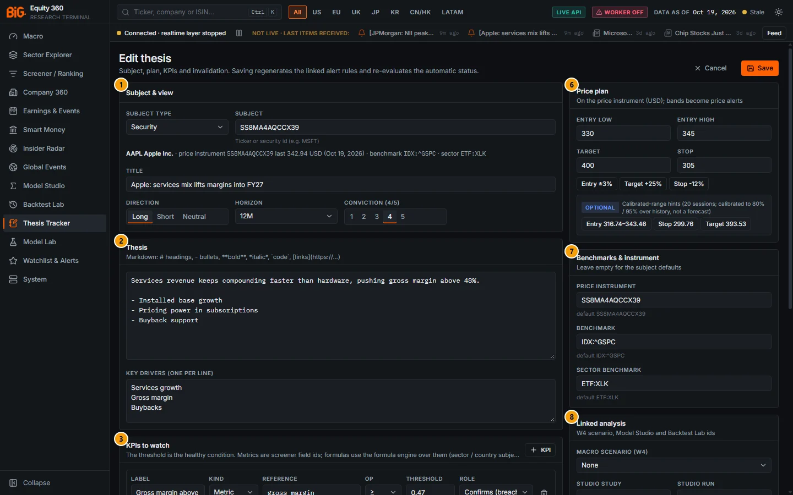

*Figure 12.19: Edit thesis (`/theses/:id/edit`) for the Apple thesis.*

The badges are the same in both figures:

| # | Panel | What it shows |
|---|---|---|
| 1 | Subject & view | Subject type and subject, the resolved subject line, title, direction, horizon, conviction and (new thesis only) Start as. |
| 2 | Thesis | Thesis text (Markdown) and key drivers. |
| 3 | KPIs to watch | One row per KPI (label, kind, reference or formula, operator, threshold, role). |
| 4 | Catalysts | Suggested earnings dates and the catalyst rows. |
| 5 | Invalidation conditions | One row per condition. |
| 6 | Price plan | Entry low / high, target, stop, quick-fill buttons and the calibrated-range hints. |
| 7 | Benchmarks & instrument | Price instrument, benchmark, sector benchmark (defaults shown). |
| 8 | Linked analysis | Macro scenario (W4), Studio study / run, Backtest strategy / run. |
| 9 | Housekeeping | Review cadence and tags. |

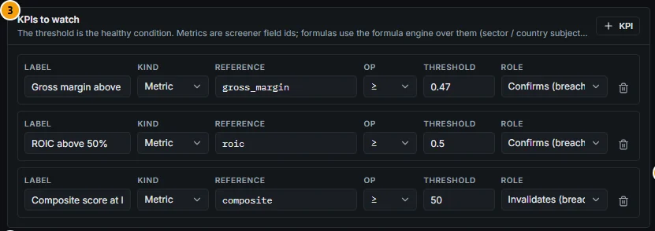

*Figure 12.20: KPIs to watch (Apple thesis).*

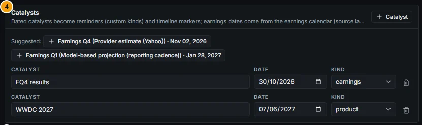

*Figure 12.21: Catalysts, with suggestions from the earnings calendar.*

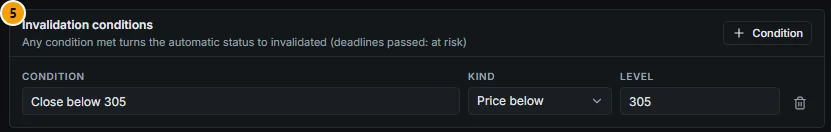

*Figure 12.22: Invalidation conditions.*

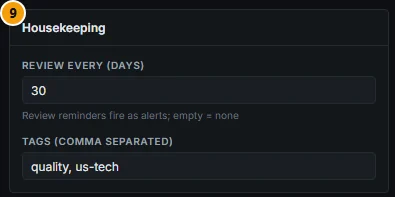

*Figure 12.23: Housekeeping.*

### Controls

#### Header

| Control | What it does |
|---|---|
| **Cancel** | Goes back without saving. |
| **Create thesis** / **Save** | Validates and saves. Create: toast "Thesis created · N linked alert rules generated." and opens the thesis page. Save: "Linked alert rules regenerated and status re-evaluated." Validation errors are listed in a red box at the top. |

#### Subject & view

| Field | What it does |
|---|---|
| Subject type | **Security**, **Sector**, **Country**, **Macro theme**, **Cross-asset**. Fixed after creation. |
| Subject | Security: "Ticker or security id (e.g. MSFT)". Sector: "Sector id (e.g. TECH)". Country: "ISO2 country (e.g. DE)". Macro theme: "Theme, optionally with a country: 'inflation' or 'US:inflation'". Cross-asset: "Cross-asset id (e.g. CL, GC, EURUSD, UST10Y)". Fixed after creation. |
| Resolved subject line | As you type, the app resolves the subject and shows its label, the price instrument with the last price and date, the default benchmark and sector benchmark, or "Unknown subject - check the id." or "no price instrument (set a proxy below for bands and performance)". |
| Title | Up to 160 characters. On a new thesis an empty title defaults to "Long", "Short" or "Watch" followed by the subject label (shown as the placeholder). |
| Direction | **Long**, **Short**, **Neutral** (neutral: no price-based status rules; target above the stop like a long for the price alerts). |
| Horizon | 1M, 3M, 6M, 12M (default), 24M, 36M+. Sets the horizon date and the touch-panel horizon. |
| Conviction | 1 to 5 (default 3). |
| Start as | New thesis only: **Idea** (default) or **Active**. |

#### Thesis

| Field | What it does |
|---|---|
| Thesis text | "Markdown: # headings, - bullets, **bold**, *italic*, `code`, [links](https://...)". Also block quotes, numbered lists, code blocks and horizontal rules. Rendered by a safe subset renderer (no HTML). |
| Key drivers | One per line (a leading `-` is removed); shown as a list on the thesis page. |

#### KPIs to watch

**+ KPI** adds a row; the bin removes it. "The threshold is the healthy condition."

| Field | Values |
|---|---|
| Label | Required (e.g. "ROIC above 50%"). |
| Kind | **Metric** (screener field id; the reference box suggests field ids), **Formula** (formula-engine expression over field ids, e.g. `roic - 0.08`), **Cross-asset** (`<asset>:<signal>`, e.g. `CL:carry`), **Macro cell** (`<CC>:<indicator>`, e.g. `US:cpi_yoy`). New rows default to Cross-asset for cross-asset subjects, Macro cell for macro themes, Metric otherwise. |
| Reference / Formula | The field id, expression or reference. Special metric ids: `composite`, `rank`. |
| Op | `≥` (default), `>`, `≤`, `<`, `between` (adds a second box for the upper bound). |
| Threshold | A number (comma or point decimals). |
| Role | **Confirms (breach → at risk)** (default), **Invalidates (breach → invalidated)**, **Watch only**. |

The server checks every KPI on save (unknown field ids, invalid expressions, a missing upper bound for `between`) and rejects the save with the reason.

#### Catalysts

**+ Catalyst** adds a row: label, date (optional) and kind (**earnings**, **macro**, **corporate**, **product**, **regulatory**, **custom**). For security subjects, **Suggested:** buttons add the next earnings dates from the earnings calendar with their source label, for example "Earnings Q4 (Provider estimate (Yahoo)) · Nov 02, 2026" or "Earnings Q1 (Model-based projection (reporting cadence))". Dated catalysts that are not earnings become reminders (one linked rule, firing 3 days ahead); all dated catalysts are timeline markers. Earnings reminders come from the separate upcoming-earnings rule.

#### Invalidation conditions

"Any condition met turns the automatic status to invalidated (deadlines passed: at risk)." **+ Condition** adds a row: label (e.g. "Loses the key contract") and kind:

| Kind | Third field | Met when |
|---|---|---|
| **Price below** | Level | Last close < level. |
| **Price above** | Level | Last close > level. |
| **KPI breached** | KPI (choose one of this thesis's KPIs) | That KPI fails its healthy condition, whatever its role. |
| **Deadline** | Date | Not "met": once the date has passed without the condition being marked, the status turns **at risk** ("confirm or mark it"). |
| **Manual** | Triggered: No / Yes | You set Yes. |

With no conditions, the stop still invalidates.

#### Price plan

"On the price instrument (USD); bands become price alerts." (the currency of the instrument)

| Control | What it does |
|---|---|
| Entry low, Entry high, Target, Stop | Prices in the instrument's trading currency (unadjusted). Checks: entry low ≤ entry high; a long needs target > stop, a short target < stop; all > 0. |
| **Entry ±3%** | Entry band 3% either side of the last close. |
| **Target +25%** | Last close × 1.25 (× 0.75 for a short). |
| **Stop -12%** | Last close × 0.88 (× 1.12 for a short). |
| Calibrated-range hints (**OPTIONAL**) | Security subjects: "Calibrated-range hints (20 sessions; calibrated to 80% / 95% over history, not a forecast)". **Entry** fills the band between the 80% band edge and the last close; **Stop** sets the 95% edge on the adverse side; **Target** the opposite 95% edge. For a long: entry from the lower 80% edge to the close, stop at the lower 95% edge, target at the upper 95% edge; mirrored for a short. |

#### Benchmarks & instrument

"Leave empty for the subject defaults." **Price instrument** (default shown; e.g. `ETF:TIP` for an inflation theme; must have prices in the snapshot), **Benchmark** (default per subject, e.g. `IDX:^GSPC`), **Sector benchmark** (security subjects: the US sector ETF, or "no US sector ETF for this sector").

#### Linked analysis

| Field | What it does |
|---|---|
| Macro scenario (W4) | **None**, a **Preset: ...** scenario or a saved scenario; drives the Scenario impact panel. |
| Studio study, Studio run | Model Studio ids (`ST...`, run id); shown as links on the thesis page. |
| Backtest strategy, Backtest run | Backtest Lab ids (`BS...`, run id); shown as links. |

#### Housekeeping

| Field | What it does |
|---|---|
| Review every (days) | "Review reminders fire as alerts; empty = none." Default 30 on a new thesis; 1 to 730. The next review is set this many days after the current as-of date. |
| Tags (comma separated) | Stored lower-case, de-duplicated; used by the board's tag filter. |

On a closed thesis the editor notes: "Closed thesis: the close reason, outcome and post-mortem are edited on the thesis page."

#### Entry points ("Create thesis")

| Where | Control | Pre-filled |
|---|---|---|
| Company 360 header | **Create thesis** next to the watchlist star (see [Company header](05a-company-fundamentals.md#company-header)) | Security, origin "company". |
| Screener | Notebook icon in the "Watchlist · create thesis" column | Security, origin "screener" with the rank. |
| Cross-asset dashboard | **Create thesis** on the asset view | Cross-asset subject, origin "cross_asset". |
| Model Studio | **Create thesis** on a completed run (see [Results](09-model-studio.md#results)) | Studio run and study ids, title "Thesis from ..."; subject type Macro theme with an empty subject: pick the subject. |
| Backtest Lab | **Create thesis** in the run results header (see [Results](11-backtest-lab.md#results)) | Backtest run and strategy ids, title "Thesis from backtest ..."; subject type Macro theme, empty subject: pick the subject. |
| Command bar | `THES` with a security or cross-asset id | Subject type and id. |

The origin is shown in the thesis page's Links panel ("Created from company (AAPL)").

### Methodology

**Linked alert rules.** Every save rebuilds the rule set from the thesis; unchanged rules are kept (with their history), changed ones replaced, and all are disabled while the thesis is closed.

| Subject | Rules generated (cooldown in days) |
|---|---|
| Any with a price instrument | `price_cross` on target, stop, entry high and entry low, each when set (1). Long / neutral: target "crosses above", stop "crosses below"; short: the reverse. Entry high "crosses below", entry low "crosses above". |
| Security | `score_change` (balanced composite, ±10 points over 7 days, 5); `earnings_upcoming` (7 days ahead, 1); `earnings_surprise` (absolute z ≥ 2 on EPS or revenue, model-based, 1); `sentiment_shift` (absolute z ≥ 2.5, 5); `price_change_pct_1d` (±7%, 1); `activist_13d` (1); `insider_buy` (cluster buy ≥ $250,000, 5); `short_interest_spike` (US only, +25%, 5); `eu_short_position` (EU / UK only, ≥ 0.5%, increases ≥ 0.1 pp, 5); `thesis_event_shock` on the issuer (z ≥ 3, 3). |
| Country | `macro_surprise` (country, absolute z ≥ 2, tier ≤ 2, 5); `regime_change` (country, any kind, level 0.5, 5); `thesis_event_shock` on the country (3). |
| Macro theme | `macro_surprise` (theme if growth / inflation / labour, country if given, 5); `regime_change` (country if given, 5); `thesis_event_shock` on the country when a country is given (3). |
| Sector | `thesis_event_shock` on the sector (3). |
| Cross-asset | `thesis_positioning` (CFTC COT index over 3 years ≤ 10% or ≥ 90%, 5) when the asset has a futures root. |
| All | One `thesis_kpi` per KPI (5); `thesis_catalyst` when a dated, non-earnings, not-done catalyst exists (3 days ahead, 1); `thesis_review` when a cadence is set (1); `thesis_status` (1). |

The Apple thesis (four price levels, three KPIs, one product catalyst, a 30-day cadence) therefore has 19 rules; the US country thesis (no target or stop, no KPIs) has 5.

**Subject resolution.** A security is matched by security id or ticker (the primary listing with the largest market capitalisation wins); a sector must exist in the taxonomy; a country must be a two-letter code; a macro theme accepts any theme name (only growth, inflation and labor are used as theme filters for macro alerts); a cross-asset id must exist in the cross-asset asset list.

### Data sources and refresh

Subject defaults, last prices and suggested catalysts come from `GET /api/v1/theses/subject-defaults` on the serving snapshot; the metric list from `GET /api/v1/screener/fields`; scenarios from the macro scenario list; the calibrated-range hints from the conformal envelope (`GET /api/v1/conformal/envelope/{id}`, nightly). Saving writes to the local application state at once.

### Validation status

The editor computes nothing itself. The calibrated-range hints use the marginal conformal bands, which validated as a by-product of the conformal gate ("on target per horizon (89.6-90.0%), about 40% narrower than the conventional 2×ATR band"; `docs/CONFORMAL_VALIDATION.md` Verdict). They are labelled "optional" and "not a forecast", and the bands carry no direction. The **Entry ±3%**, **Target +25%** and **Stop -12%** buttons are plain arithmetic, not calibrated.

### Correct usage and worked example

Write the KPI thresholds as the conditions that must stay true for the thesis to hold, and give each a role deliberately: *invalidate* for the one or two facts that would end the thesis, *confirm* for supporting evidence, *watch* for context. Add at least one invalidation condition besides the stop, and a deadline for catalysts that must happen by a date.

*Example (Figures 12.18 to 12.23).* Starting from **Create thesis** in the Apple header, the subject is pre-filled and resolved: "AAPL Apple Inc. · price instrument ... last 342.94 USD (Oct 19, 2026) · benchmark IDX:^GSPC · sector ETF:XLK". The calibrated-range hints offer entry 316.74-343.46, stop 299.76 and target 393.53 (20 sessions, 80% / 95% edges). The analyst chose a rounder plan: entry 330-345, target 400, stop 305, plus an invalidation "Close below 305" (price below 305), KPIs `gross_margin ≥ 0.47` (confirm), `roic ≥ 0.5` (confirm) and `composite ≥ 50` (invalidate), catalysts FQ4 results (30 Oct 2026, earnings) and WWDC 2027 (7 Jun 2027, product), review every 30 days and tags quality, us-tech. Saving generated the 19 rules of Figure 12.16.

### Limitations and pitfalls

- Subject type and subject cannot be changed after creation; create a new thesis instead.
- Prices in the plan are unadjusted and in the instrument's currency; for an ADR or a second listing use the instrument you actually trade.
- A Studio or Backtest entry starts with subject type Macro theme and an empty subject: choose the real subject before saving.
- The `GET /api/v1/theses/subject-defaults` response also carries suggested KPIs (for example the composite score), but the current editor offers only the suggested catalysts.
- KPI references are not checked until you save; a typo is rejected by the server with the reason.
- Earnings suggestions carry their source label: a "Model-based projection (reporting cadence)" date is an estimate, not a company announcement.

### Related mnemonics and BQL fields

`THES` with a security (`AAPL US THES`) or a cross-asset id opens this editor pre-filled; see [14. BQL console and mnemonics](14-bql-mnemonics.md). Metric KPIs use the same field ids as the [Screener](04-screener.md#screener). API: `POST /api/v1/theses`, `PATCH /api/v1/theses/{id}`, `GET /api/v1/theses/subject-defaults`.
