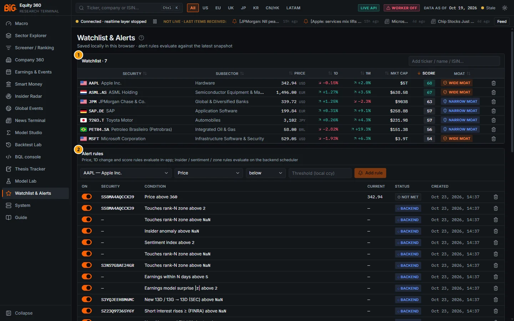
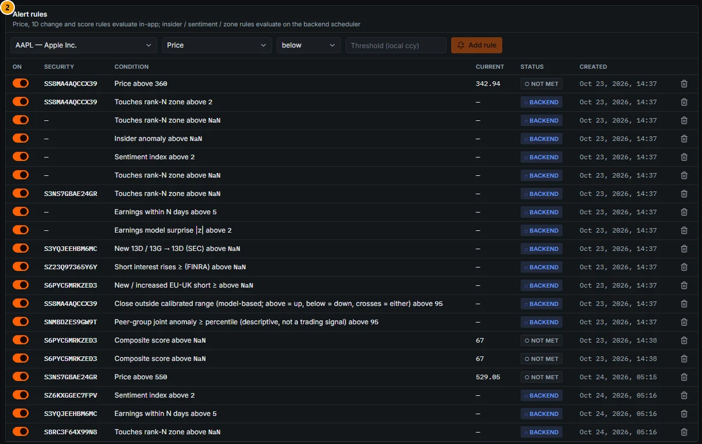
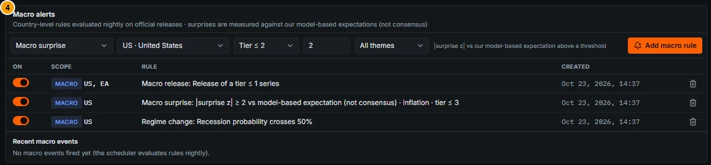
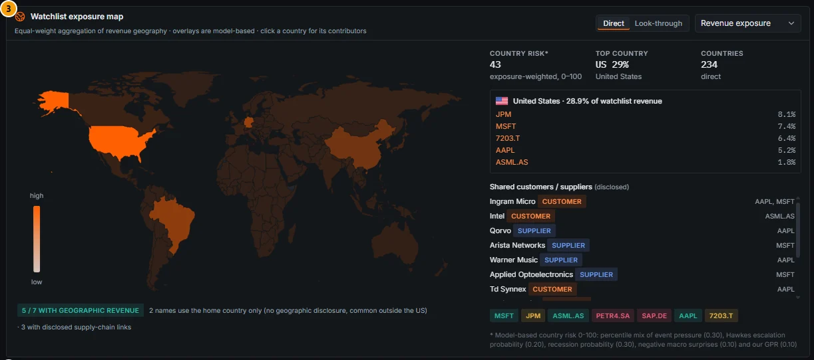

# 13. Watchlists and alerts

This chapter covers the **Watchlist & Alerts** page (`/watchlist`) and every alert rule type the app can evaluate. Alerts in BiG Equity 360 are rules stored in the local application state and evaluated against data: most of them by the nightly `alerts_eval` job on the latest snapshot, the thesis rules by `thesis_eval`, the Model Studio and Backtest Lab drift rules by their weekly re-run jobs, and the live news rules by the realtime alert consumer. A rule that fires writes an **alert event** (a message with the data date that triggered it), which appears in the live strip and feed, as a toast, on the thesis page for thesis rules, and in the Macro alerts panel for country rules.

> **Note:** The screenshots in this chapter come from a separate test instance with the Default watchlist seeded with seven names and alert rules created through the API. The live watchlist of the app is the owner's and is not shown.

---

## Watchlist & Alerts

**Route:** `/watchlist` · **Menu:** Watchlist & Alerts · **Mnemonics:** `ALRT` · **Refresh:** watchlist on every change; rules evaluated nightly (`alerts_eval`; weekly profile: Saturday); live rules by the realtime layer when it runs

### Purpose

The page keeps the names you follow and the alert rules on them. It shows the watchlist with live snapshot metrics, lets you add security-level rules (price, scores, insiders, sentiment, zones, earnings, smart money, conformal checks) and country-level macro rules, and maps where the watchlist earns its revenue. Analysts use it as a personal monitor; the rules turn the nightly refresh into a short list of things that changed.

### Screenshot

*Figure 13.1: Watchlist & Alerts (`/watchlist`), test instance, data as of 19 Oct 2026. Panels 3 and 4 are below the fold and shown further down.*

| # | Panel | What it shows |
|---|---|---|
| 1 | Watchlist · 7 | AAPL, ASML.AS, JPM, SAP.DE, 7203.T, PETR4.SA and MSFT with price in local currency, 1D and 1M change, market cap, composite score (sorted, 68 down to 54) and moat; search box to add names. |
| 2 | Alert rules | The rule editor (security, metric, operator, threshold, **Add rule**) and the table of security rules with their Not met / Backend status. |
| 3 | Watchlist exposure map | Equal-weight revenue geography of the watchlist with country overlays (direct or look-through). |
| 4 | Macro alerts | Country-level rule editor, the macro rule table and recent macro events. |

*Figure 13.2: Alert rules panel, captured before the 24 Oct 2026 fix. In that build, rules created through the API showed raw security ids or "—" and "above NaN" conditions; the current build shows the ticker (or "Watchlist: name") and a condition rebuilt from the rule's own parameters (see Controls).*

*Figure 13.3: Macro alerts panel ("Country-level rules evaluated nightly on official releases · surprises are measured against our model-based expectations (not consensus)") with three rules: Macro release (US, EA; tier ≤ 1), Macro surprise (US; absolute z ≥ 2, inflation, tier ≤ 3) and Regime change (US; recession probability crosses 50%). No macro events had fired yet.*

### Controls

#### Watchlist

| Control | What it does |
|---|---|
| Add ticker / name / ISIN... | Searches securities; the first 10 matches are listed with flag, ticker and name; a filled star marks names already watched. Click to add. |
| Star in a Company 360 header | Adds or removes the company (see [Company header](05a-company-fundamentals.md#company-header)). |
| Star in the Screener | First column ("Watchlist · create thesis"): adds or removes the row's security (see [Screener](04-screener.md#screener)). |
| Table columns | Security (flag, ticker, name), Subsector, Price (local currency), 1D, 1M, Mkt cap (USD), Score (composite), Moat. Sorted by score, highest first; click a header to re-sort. The panel header carries the **Descriptive** badge: the composite is a peer ranking, not a forecast (see [Scores and factors](04-screener.md#scores-and-factors)); hover the Score header for the out-of-sample evidence. |
| Row click | Opens Company 360. |
| Bin | Removes the security from the watchlist. |

The page holds **one** watchlist. It is kept in the browser ("Saved locally in this browser") and mirrored to a server watchlist named **Default**, which the News Terminal's watchlist alert and watchlist-targeted rules use. On start-up the app merges the two: names on the server are loaded, and local names are resolved to security ids and pushed up. Further named watchlists can be created through the API (`POST /api/v1/watchlists`), but the page shows only the Default list.

#### Alert rules (security level)

| Control | What it does |
|---|---|
| Security | A security from the watchlist (first one by default). Rules can only be added for watched names. |
| Metric | The rule type; see the table below. |
| Operator | **above** (`>`), **below** (`<`), **crosses**. Used by Price and the in-app status; mapped to a side for the calibrated-range rule; ignored by the others. |
| Threshold | Number whose unit is shown in the placeholder (for example "Threshold (local ccy)"). Required, even for rules without a threshold (type any number for the 13D rule). |
| **Add rule** | Adds the rule locally and sends it to the server. |
| On (switch) | Enables or disables the rule (mirrored to the server). |
| Bin | Deletes the rule. |

| Metric (label in the page) | Server rule | What your inputs become |
|---|---|---|
| Price | `price_cross` | Level = threshold; above or crosses → crosses above, below → crosses below. |
| 1D change % | `price_change_pct_1d` | `pct` = |threshold| / 100 (fraction); above → `direction: up`, below → `down`, crosses → `any` (|1-day move| ≥ threshold). |
| Composite score | `score_change` | Balanced profile, `mode: level`, `level` = threshold; above → crosses the level from below (`up`), below → from above (`down`), crosses → either. |
| Insider anomaly | `insider_buy` | Minimum value 0, cluster not required; the threshold is stored but not used by the server rule. |
| Sentiment index | `sentiment_shift` | Threshold used as the absolute z threshold (despite the "−1…1" unit hint). |
| Touches rank-N zone | `zone_touch` | Threshold = highest zone rank (N). |
| Earnings within N days | `earnings_upcoming` | Days ahead = N (0 is treated as the default 3). |
| Earnings model surprise absolute z | `earnings_surprise` | z threshold (model-based). |
| New 13D / 13G → 13D (SEC) | `activist_13d` | No threshold used. |
| Short interest rises ≥ (FINRA) | `short_interest_spike` | Threshold % → minimum rise (e.g. 25 → +25%). |
| New / increased EU-UK short ≥ | `eu_short_position` | Threshold = minimum net short in % of capital (floor 0.1). |
| Close outside calibrated range | `price_outside_calibrated_range` | Threshold = band level 80, 90 or 95 (else 95); above → up side, below → down side, crosses → either; horizon 1 session. |
| Peer-group joint anomaly ≥ percentile | `conformal_peer_anomaly` | Threshold as a percentile (95 or 0.95), scope group or member. |

> **Note:** Until 24 Oct 2026 the page sent the **1D change %** rule as a price-level rule without a level and the **Composite score** rule without `mode: level`; the server rejected both and the page silently kept them in the browser only, so they vanished on the next reload. Both are now sent in the contract form above (API v1.39.0 also accepts the old payload). If the server refuses a rule for any other reason, the rule is removed from the table again and a red toast **"Alert rule not saved (ticker)"** shows the server's reason. Errors when switching a rule on or off or deleting it are shown the same way.

The table shows **On**, **Security** (the ticker, resolved by the server for rules created through the API; "Watchlist: name" for watchlist-targeted rules; Model Studio and Backtest Lab drift rules show a "studio" or "backtest" badge and the study or strategy name, linking to those pages), **Condition** (rebuilt from the rule's parameters, for example "1D change ≤ −5%", "Composite score crosses above 70", "Composite score moves by ≥ 10 pts"; a rule without a threshold reads "(default threshold)", never "NaN"), **Current** (price, 1D change or composite score from the snapshot), **Status** and **Created**. Status is an **in-app** check against the current snapshot for Price, 1D change and Composite score: **● Triggered** when the value is above / below the threshold (for "crosses", within 1% of it; for 1D change, an up move of at least the threshold, a down move of at least the threshold, or either for "crosses"), **○ Not met** otherwise; every other rule shows **◌ Backend** (evaluated by the scheduler). Rules generated by a thesis and the live news rules are not listed here: they are managed on the thesis page and in the News Terminal.

#### Macro alerts

| Control | What it does |
|---|---|
| Macro rule type | **Macro release** ("a linked official series is published"), **Macro surprise** ("absolute surprise z vs our model-based expectation above a threshold"), **Regime change** ("cycle quadrant changes or a recession probability crosses a level"). |
| Country | One country (default US) or **All countries**. |
| Maximum tier | Release and surprise: **Tier 1**, **Tier ≤ 2** (default), **Any tier** (importance of the series). |
| absolute z (surprise) | Threshold, default 2. |
| Theme (surprise) | **All themes**, Growth, Inflation, Labor. |
| Regime trigger | **Quadrant or recession prob.** (default), **Cycle quadrant change**, **Recession probability**; with a recession trigger, **level** in % (default 50). |
| **Add macro rule** | Creates the rule (cooldown 1 day). |
| Rule table | On switch, scope (macro badge and country), rule description (e.g. "Macro surprise: absolute surprise z ≥ 2 vs model-based expectation (not consensus) · tier ≤ 2"), created, delete. |
| Recent macro events | The last 50 macro events: time fired, country (links to the country page) and message; unread events in full colour. "No macro events fired yet (the scheduler evaluates rules nightly)." |

#### Watchlist exposure map

*Figure 13.4: Watchlist exposure map (Direct, Revenue exposure) for the seven names: country risk 43, top country US 29%, 5 / 7 names with geographic revenue.*

| Control | What it does |
|---|---|
| **Direct** / **Look-through** | Exposure basis: the members' own revenue geography, or that plus the exposure carried through their disclosed customers. |
| Map layer | **Revenue exposure**, **Country risk**, **Event pressure**, **Escalation 30d**, **Recession prob.** |
| Click a country | Shows its share of watchlist revenue and the contributing names with their weights; click a name to open it. |
| Stats | **Country risk** with an asterisk (exposure-weighted, 0-100), **Top country** with its share, **Countries** (count, basis). |
| Coverage badges | One per name, green / amber / red for full / partial / sparse coverage; hover for "home country only". |
| "N / M with geographic revenue" | How many names disclose a geographic split; the rest use the home country only ("common outside the US"). Also the count with disclosed supply-chain links. |
| Shared customers / suppliers | Counterparties disclosed by two or more watched names, with the relation and the holders. |
| Footnote (asterisk) | "Model-based country risk 0-100: percentile mix of event pressure (0.30), Hawkes escalation probability (0.20), recession probability (0.30), negative macro surprises (0.10) and our GPR (0.10)". |

#### Fired alert events

Events appear in several places:

- the **live strip** and the **Feed** side panel (filter **Alerts**), with a bell icon (see [Live strip](00-getting-started.md#live-strip));
- a toast "Alert ·" followed by the rule type when an event arrives on the live stream (a chime for news alerts if the sound is on);
- the thesis page's **Linked alerts** panel for thesis rules (see [Thesis page](12-thesis-tracker.md#thesis-page));
- the **Recent macro events** list for country rules.

Events carry a *read* flag. The page shows unread macro events in full colour, but the current UI has no mark-as-read control; `POST /api/v1/alerts/events/mark-read` with a list of event ids marks them read, and `GET /api/v1/alerts/events?unread_only=true` lists the unread ones.

### Methodology

**Rule targets.** A security rule targets one security; a rule created through the API with a `watchlist_id` targets every member of that watchlist at evaluation time. Macro rules have no security target: they fire per country, and their events carry the target `macro:<CC>`. Thesis rules without a security fire on `thesis:<id>`; untargeted story-velocity rules on `news:<story id>`.

**Noise control.**

- **One event per rule, target and data date.** A rule never fires twice for the same security and data date, whichever job evaluates it.
- **Cooldown.** After a rule fires for a security, it does not fire again for that security until `cooldown_days` have passed. Defaults: 5 days for rules created on the page or through the API, 1 day for macro rules created on the page, 0 for the News Terminal's rules; thesis rules have their own (1 to 5 days, see the [Thesis editor](12-thesis-tracker.md#thesis-editor)).
- **Transitions.** Several rules fire on a change of state rather than a level (crossings, entering a zone, a new insider signal, entering the top decile), so a condition that stays true does not repeat.

**In-app status versus server rule.** The page's Triggered / Not met badge is a *state* check on the current snapshot ("price is below 300"). The server's `price_cross` rule fires on a *crossing* between the two latest closes. A price that has been below 300 for a week shows Triggered but does not fire again.

**Exposure map.** Each name's direct exposure is its latest annual geographic revenue split known at the as-of date (regions spread over member countries by GDP; no split = 100% home country). Second order sums, over disclosed customers with a revenue share `s_c`, `s_c ×` the customer's direct exposure; look-through = `(1 − Σ s_c) × direct + second order`. The watchlist map is the **equal-weight** average of its members. Country risk is the exposure-weighted average of the model-based country-risk score. Details in [Network & Geo](05c-company-macro-events-model.md#network--geo).

### Data sources and refresh

| What | Source and timing |
|---|---|
| Watchlist metrics | Serving snapshot (screener rows); nightly DAG (weekly profile: Saturday 08:00 Lisbon; daily profile: Tuesday-Saturday 01:30). |
| Rule evaluation | `alerts_eval` in the nightly DAG, right after the serving snapshot is built; `thesis_eval` after it. |
| Live evaluation | The realtime alert consumer evaluates `new_filing`, `insider_buy`, `macro_release`, `macro_surprise`, `watchlist_news` and `story_velocity` as items arrive, when the realtime layer runs. |
| Drift rules | `studio_scheduled` and `backtest_scheduled` jobs (weekly DAG). |
| Exposure map | Supply-chain jobs (`POST /api/v1/supply-chain/portfolio-exposure`), nightly. |
| Rules and events | Local application state; changes are immediate. |

### Validation status

The page itself computes no model. The labels of the underlying data carry over: earnings and macro surprises are measured against **model-based** expectations, not consensus; country risk and the map overlays are model-based; the conformal rules are calibrated over history (see [Alert rule reference](#alert-rule-reference)).

### Correct usage and worked example

Keep the watchlist short enough to read the nightly events, put rules on the facts you would act on, and prefer transition rules (crossings, new filings, new 13D) to level rules. Check the **Status** column after adding a rule: **◌ Backend** means the scheduler will evaluate it; a rule the server refuses is removed at once with a red toast that gives the reason.

*Example.* To be told when Apple's close falls through 300 USD: add AAPL to the watchlist (search box or the star in its header), choose Security AAPL, Metric **Price**, operator **below**, threshold 300, **Add rule**. The server stores `price_cross {level: 300, direction: below}` with a 5-day cooldown. On the snapshot of 19 Oct 2026 (close 342.94) the status shows **○ Not met**. If a later nightly run sees the close go from above 300 to 300 or below, `alerts_eval` writes "close crossed below 300 (…)" with that data date, and the event shows in the live strip.

For a macro example: **Macro surprise**, United States, Tier ≤ 2, z 2, Inflation. After each nightly run any US inflation release of tier 1 or 2 whose surprise against the app's model-based expectation is 2 standard deviations or more fires one event per country and release date, with the message ending "(not consensus)".

### Limitations and pitfalls

- **Rules evaluate on the snapshot, not intraday.** Under the weekly profile a price rule is checked once a week, on the two latest sessions only: a level crossed earlier in the week does not fire. Window-based rules (filings, 13D, short interest, EU shorts, earnings and macro surprises) do see the whole week: their window starts at the previous successful alerts run (see [Alert rule reference](#alert-rule-reference), Limitations).
- **API-only rule types.** Rules the page form cannot create are described from their parameters (`new_filing` → "New filing: annual, quarterly, current report", `model_decile` → "ML 3M prediction enters decile ≥ 9", `insider_buy`, `activist_13d`); other types without a single threshold read "(default threshold)". The server stores the full parameters; check them with `GET /api/v1/alerts`.
- **One watchlist on the page.** Other server watchlists and watchlist-targeted rules are API-only.
- **News rules are not live yet.** The realtime layer and the News Terminal (roadmap v3 N2-N4) are built but not yet switched on, so `watchlist_news` and `story_velocity` rules do not fire in the current release.
- **Insider and sentiment inputs.** The insider threshold is not used by the server rule, and the sentiment threshold is a z-score, not a sentiment level.
- **Exposure coverage.** Many non-US companies disclose no geographic split; their revenue is assigned to the home country, which overstates home exposure.
- If the watchlist shows 0 names while the exposure badges list tickers, the browser list has not been synchronised with the server (API unreachable at start-up); reload once the API is up.

### Related mnemonics and BQL fields

`ALRT` opens this page; see [14. BQL console and mnemonics](14-bql-mnemonics.md). No BQL fields expose rules or events. API: `GET/POST /api/v1/watchlists`, `POST /api/v1/watchlists/{id}/items`, `GET/POST /api/v1/alerts`, `PATCH/DELETE /api/v1/alerts/{id}`, `GET /api/v1/alerts/events`, `POST /api/v1/alerts/events/mark-read`. Related: [Thesis Tracker](12-thesis-tracker.md#thesis-board), [News alerts](08-global-events-news.md#news-alerts), [Macro cockpit](02a-macro.md#macro-cockpit).

---

## Alert rule reference

**Route:** rules on `/watchlist`, `/theses/:id`, `/news`, Model Studio and Backtest Lab; API `/api/v1/alerts` · **Mnemonics:** `ALRT` · **Refresh:** see each rule

### Purpose

This section lists every rule type in the alert contract (`contracts/schemas/alerts.yaml`, version 8): what triggers it, its parameters and defaults, which job evaluates it and when, and where it can be created. Use it when an event message needs explaining, or when creating rules through the API.

### Controls

Where each rule type can be created:

| Rule type | Watchlist page | Other page | API (`POST /alerts`) | Generated automatically |
|---|---|---|---|---|
| `price_cross` | Price | | yes | thesis price bands |
| `zone_touch` | Touches rank-N zone | | yes | |
| `score_change` | Composite score | | yes | thesis (security) |
| `price_change_pct_1d` | 1D change % | | yes | thesis (security) |
| `insider_buy` | Insider anomaly | | yes | thesis (security) |
| `sentiment_shift` | Sentiment index | | yes | thesis (security) |
| `new_filing` | | | yes | |
| `model_decile` | | | yes | |
| `earnings_upcoming` | Earnings within N days | | yes | thesis (security) |
| `earnings_surprise` | Earnings model surprise | | yes | thesis (security) |
| `activist_13d` | New 13D / 13G → 13D | | yes | thesis (security) |
| `short_interest_spike` | Short interest rises | | yes | thesis (US security) |
| `eu_short_position` | New / increased EU-UK short | | yes | thesis (EU / UK security) |
| `price_outside_calibrated_range` | Close outside calibrated range | | yes | |
| `conformal_peer_anomaly` | Peer-group joint anomaly | | yes | |
| `macro_release` | Macro alerts panel | | yes | |
| `macro_surprise` | Macro alerts panel | | yes | thesis (country, macro theme) |
| `regime_change` | Macro alerts panel | | yes | thesis (country, macro theme) |
| `watchlist_news` | | News Terminal › Alerts | yes | |
| `story_velocity` | | News Terminal › Alerts | yes (no target needed) | |
| `thesis_kpi`, `thesis_review`, `thesis_status`, `thesis_catalyst`, `thesis_positioning`, `thesis_event_shock` | | | no | thesis tracker only |
| `studio_drift` | listed (badge "studio") | Model Studio schedule | no | when a study is scheduled |
| `backtest_drift` | listed (badge "backtest") | Backtest Lab paper schedule | no | when a strategy is scheduled weekly |

Through the API every non-macro rule needs a `security_id` or a `watchlist_id` (except `story_velocity`); `cooldown_days` is 0-365 (default 5). The server fills defaults and rejects invalid parameters with the reason.

### Methodology

Each entry gives the trigger, the parameters with defaults, and the evaluator. "Window" means releases or filings whose data became known after the start of the window and up to the as-of date. The window starts at the as-of date of the last successful `alerts_eval` run (recorded in `data/state/alerts_eval.json`), never later than the previous business day and at most 31 days back; on the very first run it is one schedule period (7 days under the weekly profile, 1 under the daily profile). Every window event carries its event id (filing id, release event id, settlement date …) in the alert payload (`dedup_keys`), and an event id that already fired for the rule never fires again, so overlapping windows and re-runs are quiet.

#### price_cross

Fires when the close crosses a level between the two latest daily bars: for `above`, previous close below the level and latest at or above it; for `below`, the reverse. Parameters: `level` (required), `direction` above (default) or below, `metric` close (default) or adj_close. Message: "close crossed below 300 (305.1 -> 298.7)". Evaluator: `alerts_eval`. Thesis bands carry `band` (target, stop, entry_hi, entry_lo) and use cooldown 1.

#### zone_touch

Fires when the latest bar's high-low range enters a confluence zone that the previous bar did not touch. One event per security (the best-ranked zone entered). Parameters: `zone_rank_max` (default 3), `side` support, resistance or any (default). Message: "price entered support zone #2 [295.4-301.2]". Evaluator: `alerts_eval`. Zones as in [Confluence zones](05b-company-technicals.md#confluence-zones).

#### score_change

Composite (`profile_id`, default balanced) or factor (`factor_id`) score change. `mode` delta (default): fires when the change over `lookback_days` (default 1) is at least `delta` (default 10) in `direction` up, down or any. `mode` level: fires when the score crosses `level` (up from below, down from above, or either). Message: "composite balanced score 61.0 -> 72.5 (+11.5)". Evaluator: `alerts_eval`. Thesis rule: balanced, delta 10, any, lookback 7 days.

#### price_change_pct_1d

Fires when the 1-day change of the adjusted close is at least `pct` (required, a fraction: 0.05 = 5%) in `direction` up, down or any (default). Message: "1-day move -7.4% (threshold 7.0%, any)". Evaluator: `alerts_eval`. Thesis rule: 7%, any.

#### insider_buy

Fires when the security's insider signal newly qualifies: 30-day net open-market buying of at least `min_value_usd` (default 0) and above zero, and a cluster buy if `cluster_only` (default false). Message: "insider buying $1,250,000 (30d) — cluster buy". Evaluators: `alerts_eval`, and the realtime consumer on a live Form 4. Uses the rules-based insider signal (see [Insider Radar](07-smart-money-insiders.md#insider-radar)). Thesis rule: ≥ $250,000, cluster only.

#### sentiment_shift

Fires when the 7-day smoothed news sentiment is at least `threshold_z` (required; default 2.0 if absent) standard deviations from its mean over `window_days` (default 90; at least 10 days of history). Message: "sentiment shift z=+2.71 (positive)". Model-based (sentiment model scores). Evaluator: `alerts_eval`. Thesis rule: 2.5.

#### watchlist_news

Fires on a live news item linked to a target security (the security, or any member of the target watchlist; linked by security or issuer). Parameters: `tiers` (default [1, 2, 3]: official, major press, publishers; add 4 for GDELT web articles), `min_abs_sentiment` (0-1, default 0), `languages`, `sources`, `max_per_day` (default 10). One event per rule, security and **story** (later articles of the same story do not fire again). Message: "news (negative):" followed by the headline and the publisher. Evaluator: realtime consumer only (no-op in `alerts_eval`). The News Terminal creates it on the Default watchlist with tiers 1-3 and cooldown 0.

> **Note:** `watchlist_news` and `story_velocity` depend on the realtime layer and the News Terminal (roadmap v3 N2-N4), which are built but not yet live. Until they are switched on these rules can be created but do not fire.

#### story_velocity

Fires on a burst of articles on one story: at least `min_articles` (default 5) in the last 60 minutes, at least `min_ratio` (default 3.0) times the story's own baseline rate (floored at 0.5 per hour, so a brand-new story needs 5 articles within the hour), and at least `min_sources` (default 2) sources; optional `themes` and `countries` filters. With a security or watchlist target only stories linked to the targets fire; without a target any matching story fires. One event per rule, target and story. Message: "story burst: 9 articles in 60 min (4.5x baseline, 3 sources): ...". Evaluator: realtime consumer only. See [News alerts](08-global-events-news.md#news-alerts).

#### new_filing

Fires when the security's issuer has filings of the chosen classes in the window. Parameters: `form_classes` (default annual, quarterly, current_report; allowed also semiannual, insider, holdings, proxy, prospectus, other), optional `lookback_days`. Message: "new filing: 10-Q, 8-K". Evaluators: `alerts_eval` and the realtime consumer. API only.

#### model_decile

Fires when the security's live ML prediction enters decile `min_decile` or higher (from below). Parameters: `horizon` 1M, 3M (default) or 6M; `min_decile` 1-10 (default 9 when created through the API). Message: "model 3M decile 10 (>= 9)". Model-based: the excess-return model is one input, not proven alpha (see [Model](05c-company-macro-events-model.md#model)). Evaluator: `alerts_eval`. API only.

#### macro_release

Fires when a tracked official release is published in the window. Parameters: `countries` (ISO2 or EA), `series_ids`, `max_importance` 1-3 (default 1). One event per country and release date; target `macro:<CC>`. Message: "US CPI: CPIAUCSL = 3.1 (prior 3.0)". Evaluators: `alerts_eval` and the realtime consumer.

#### macro_surprise

Fires when the absolute surprise z of a release, measured against the app's **model-based expectation (not consensus)**, is at least `threshold_z` (default 2.0). Filters: `countries`, `themes` (growth, inflation, labor), `series_ids`, `max_importance` (default 3). Message: "US CPIAUCSL surprise z=-2.40: actual … vs model-based expectation … (not consensus)". Evaluators: `alerts_eval` and the realtime consumer. Thesis rule (country and macro theme): z 2, tier ≤ 2.

#### regime_change

`kind` cycle_quadrant: fires when a country's cycle-clock quadrant changes. `kind` recession_probability: fires when a recession probability crosses `level` (default 0.5) up or down; `methods` restricts the methods (for example `nyfed_yield_curve_official`, `yield_curve_probit`, `hmm_regime`). `kind` any (default): either. Filter `countries`. Message: "US recession probability (yield_curve_probit) crossed up 50%: 46.0% -> 52.3%". The official NY Fed series is official; the probit and HMM methods are model-based (see [Macro cockpit](02a-macro.md#macro-cockpit)). Evaluator: `alerts_eval`.

#### earnings_upcoming

Fires when the security has earnings expected within `days_ahead` (default 3; 0-60) from the as-of date; optional `date_sources` (company_announced, provider_estimate, model_projection). Fires once per expected date. The message carries the source label, and for model projections the date window: "earnings expected 2026-11-02 after the close - Q4 - Provider estimate (Yahoo)". Evaluator: `alerts_eval`. Thesis rule: 7 days ahead.

#### earnings_surprise

Fires when an actual that became known in the window has an absolute surprise z of at least `threshold_z` (default 2.0) against the **model-based expectation (not consensus)**, for `items` eps_diluted and / or revenue (default both); the largest per security. Message: "EPS surprise z=+2.80 (+6.1%): actual 1.85 vs model-based expectation 1.74 (not consensus)". Evaluator: `alerts_eval`.

#### activist_13d

Fires on a new Schedule 13D filed on the security in the window; also a 13G → 13D switch if `include_switch` (default true) and amendments if `include_amendments` (default false). Source SEC. Message: "new 13D filed by … (SC 13D, SEC)". Evaluator: `alerts_eval`. See [Activism (13D)](07-smart-money-insiders.md#activism-13d).

#### short_interest_spike

Fires when FINRA short interest published in the window rose by at least `min_chg_pct` (default 0.25 = +25%) versus the previous settlement and is at least `min_si_pct` of shares outstanding (default 0). US securities. Message: "short interest +32% to 41,200,000 shares, 2.8% of shares outstanding (settlement …, FINRA)". Evaluator: `alerts_eval`.

#### eu_short_position

Fires on a new named net short position of at least `min_pct` (default 0.5% of issued capital) published by an EU or UK regulator in the window, or an increase of at least `min_increase_pp` (default 0.1 pp) when `include_increases` (default true). Message: "new net short position:" followed by the holder, the percentage of the issuer and the position date and regulator. Evaluator: `alerts_eval`. See [EU / UK short register](07-smart-money-insiders.md#eu--uk-short-register).

#### thesis_* rules

Generated by the thesis tracker for each thesis (tagged with its id), regenerated on every save, disabled when the thesis is closed, deleted with it. Evaluated by `thesis_eval` (nightly after `alerts_eval`), on save and by **Evaluate**; no-op in `alerts_eval`.

| Rule | Fires when | Default |
|---|---|---|
| `thesis_kpi` | A KPI newly breaches its healthy condition (message "KPI ... breached: value vs condition"). | one per KPI, cooldown 5 |
| `thesis_status` | The automatic status newly turns at risk or invalidated; the message lists the risk / invalid reasons. | cooldown 1 |
| `thesis_review` | The next review date is reached ("review due …"), once per due date. | when a cadence is set |
| `thesis_catalyst` | A dated, non-earnings, not-done catalyst falls within `days_ahead` of the as-of date. | 3 days |
| `thesis_positioning` | Cross-asset subject with futures: CFTC COT index over 3 years ≤ `lo` (crowded short) or ≥ `hi` (crowded long). Official CFTC data. | lo 0.1, hi 0.9 |
| `thesis_event_shock` | Events-v2 GDELT aggregate for the issuer, country or sector with attention z ≥ `threshold_z` or absolute tone z ≥ `threshold_z` in the last 3 days, on at least 5 items (issuer) or 20 (country / sector). Model-based z. | z 3.0, cooldown 3 |

The thesis tracker also generates ordinary rules (price bands, score, earnings, smart money, macro); see the [Thesis editor](12-thesis-tracker.md#thesis-editor) for the full list.

#### backtest_drift

Created when a Backtest Lab strategy is scheduled as a weekly paper strategy (parameters `strategy_id`, `strategy_name`, `schedule`, `drift_threshold`, default 0.3). The weekly `backtest_scheduled` job re-runs it and appends an event on metric drift (Sharpe or CAGR worse, or max drawdown deeper, by more than the threshold, relative), live decay (the new days' returns more than 2 standard deviations below the backtest) or a drawdown breach (current drawdown beyond the previous worst). Removed when the schedule is set to none. See [Paper strategies and drift alerts](11-backtest-lab.md#paper-strategies-and-drift-alerts).

#### studio_drift

Created when a Model Studio study is scheduled weekly or monthly (parameters `study_id`, `study_name`, `schedule`, `drift_threshold`, default 0.2). The weekly `studio_scheduled` job re-runs due studies and appends an event when a headline metric degrades by more than the threshold (relative) or coefficients shift by more than three standard errors. See [Studies & runs](09-model-studio.md#studies--runs).

#### price_outside_calibrated_range

Fires when the move over the last `horizon` sessions (1, 5, 10 or 20; default 1), on adjusted closes, ended outside the **marginal** conformal band of `level` (80, 90 or 95%; default 95) emitted at its origin h sessions earlier; `side` up, down or any (default). Message: "close outside the 95% calibrated 1-session range (down: move -6.2% vs +-4.1%; band from …; model-based)". By construction about `100 − level` % of moves end outside the band, so at 95% roughly one session in twenty fires per security before cooldown. Evaluator: `alerts_eval`.

#### conformal_peer_anomaly

Scope `group`: fires when the security's peer group's joint-anomaly percentile is at least `percentile` (default 0.95). Scope `member`: fires when the security's absolute conditional z within its group is at or above its own trailing-year percentile `percentile` (needs 60 days of history). Scope `any` (default): either, strongest kept. Message ends "- descriptive, model-based". Evaluator: `alerts_eval`. See [Peer-group joint anomaly](05a-company-fundamentals.md#peer-group-joint-anomaly).

### Data sources and refresh

| Evaluator | Rule types | When |
|---|---|---|
| `alerts_eval` (nightly DAG) | All except thesis, drift and news rules | After the serving snapshot is built: Saturday 08:00 Lisbon chain under the weekly profile (default); Tuesday-Saturday 01:30 under the daily profile. |
| `thesis_eval` (nightly DAG) | `thesis_*` | After `alerts_eval`; also on save and **Evaluate**. |
| `studio_scheduled`, `backtest_scheduled` (weekly DAG) | `studio_drift`, `backtest_drift` | Weekly refresh. |
| Realtime alert consumer | `new_filing`, `insider_buy`, `macro_release`, `macro_surprise`, `watchlist_news`, `story_velocity` | As items arrive, when the realtime layer runs (rules re-read every 60 s). Not live in the current release. |

The nightly and live evaluators share the same idempotency (one event per rule, target and data date) and cooldown, so an event fired live is not fired again at night.

### Validation status

| Rule | Label and status |
|---|---|
| `earnings_surprise`, `macro_surprise`, `thesis_kpi` on surprise data | Model-based expectations, not consensus (the messages say so). |
| `price_outside_calibrated_range` | Marginal single-horizon conformal bands: validated by-product, "on target per horizon (89.6-90.0%)" at 90% (`docs/CONFORMAL_VALIDATION.md` Verdict and §A.2). Calibrated over history; per-regime coverage is lower in crashes (Covid window 82-88% at 90% for the EWMA scale). |
| `conformal_peer_anomaly` | Conformal B **PASS** as a calibrated descriptive measure (90.4 / 95.2% coverage); **not** a trading signal (break-away mean reversion FAIL). |
| `regime_change` | NY Fed probability official; probit and HMM methods model-based. |
| `sentiment_shift`, `thesis_event_shock`, `story_velocity` sentiment | Model-based scores (sentiment model, GDELT z-scores). |
| `model_decile` | ML excess-return model: out-of-sample rank IC about 0.035; one input, not proven alpha. |
| `insider_buy` | Rules-based insider score (the insider ML model showed no out-of-sample edge and is not used). |
| Price, filing, 13D, short-interest, EU short, earnings-date rules | Data rules on official or vendor data; no model. |
| Drift rules | Re-run comparisons; not formally validated. |

### Correct usage and worked example

Read an event as "this happened in the data", then open the page that explains it. Use thresholds that fire rarely: at a 95% calibrated range, a 1-session rule on 50 names fires on about two or three names on an average day.

*Example: building a smart-money monitor through the API.* For a watchlist id `W…`, `POST /api/v1/alerts` with `{"watchlist_id": "W…", "rule_type": "activist_13d", "params": {}}` stores `include_amendments: false, include_switch: true` and cooldown 5; each run then fires one event per member with a new 13D (or 13G → 13D switch) filed since the previous successful run (the whole week under the weekly profile), with the filer and form in the message.

### Limitations and pitfalls

- **The window follows the runs.** Window-based rules (`new_filing`, `activist_13d`, `short_interest_spike`, `eu_short_position`, `earnings_surprise`, `macro_release`, `macro_surprise`) consider items that became known since the last successful `alerts_eval` run, so a weekly run covers the whole week. If the worker was off for longer than 31 days, older items are not alerted (the cap avoids a flood); use the calendars (Earnings & Events, Release calendar, Smart Money) for that period. Cooldowns still apply: two different 13D filings on the same security within the rule's cooldown fire once.
- A changed thesis parameter replaces the rule and deletes its past events.
- Macro and thesis events have no ticker; their target is `macro:<CC>` or `thesis:<id>`.
- The model-based labels matter: a "surprise" is relative to the app's model, not to market consensus.

### Related mnemonics and BQL fields

`ALRT` (this page), `THES` (thesis tracker), `N` (News Terminal, when installed). No BQL fields. Contract: `contracts/schemas/alerts.yaml`, `contracts/schemas/alert_events.yaml`; API tag `alerts`.
