# 14. BQL console and mnemonic reference

This chapter covers the two "power-user" entry points of BiG Equity 360:

- the **BQL console** (`/bql`), where you write short declarative queries (`get(...) for(...) with(...)`) that run point-in-time over the app's data and can be exported, saved and reused elsewhere in the app;
- the **command bar** (Ctrl+K or `/`), which understands Bloomberg-style mnemonics such as `AAPL US Equity DES`, `SX5E Index GP`, `ECO US` or `WIRP EU`.

> **Note:** The **?** button next to each page title, the **Guide** menu item and the command `HELP` open this user guide.

The BQL language is "BQL-lite": it borrows the shape of Bloomberg's query language but is the app's own, smaller language. It is not compatible with Bloomberg BQL and does not access Bloomberg data.

---

## BQL console

**Route:** `/bql` (deep link `/bql?q=<query>&run=1`) · **Menu:** BQL console · **Mnemonics:** `BQL`, `BQL get(...)`, `<ticker> BQL` · **Refresh:** queries run on demand against the current serving snapshot (rebuilt by the weekly or daily refresh profile)

### Purpose

The console answers ad-hoc questions that no page answers directly: "which large European industrials have ROIC above 15% and are within 5% of their 52-week high", "how did these three stocks' P/E evolve weekly over two years in USD", "what was this screen's membership on 28 June 2024". It is used by analysts who want a screen or a panel of numbers quickly, and by anyone who wants to feed a custom expression into Model Studio or the Backtest Lab. Every query is compiled to a safe, parameterised, point-in-time SQL query; it never changes data.

### Screenshot

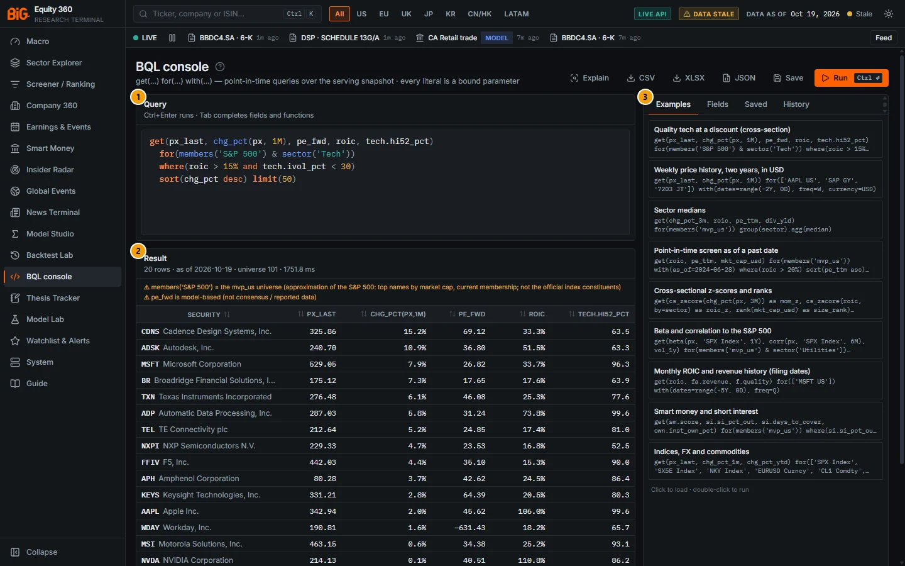

*Figure 14.1: BQL console (`/bql`) with the default example "Quality tech at a discount" run; snapshot as of 19 Oct 2026.*

| # | Panel | What it shows |
|---|---|---|
| 1 | Query | The syntax-highlighted editor with the default query. |
| 2 | Result | 20 rows · as of 2026-10-19 · universe 101 · 1,751.8 ms; two warnings (the S&P 500 approximation and "pe_fwd is model-based (not consensus / reported data)"), then the result table. |
| 3 | Side panel | Tabs Examples, Fields, Saved and History; here the nine examples ("Click to load · double-click to run"). |

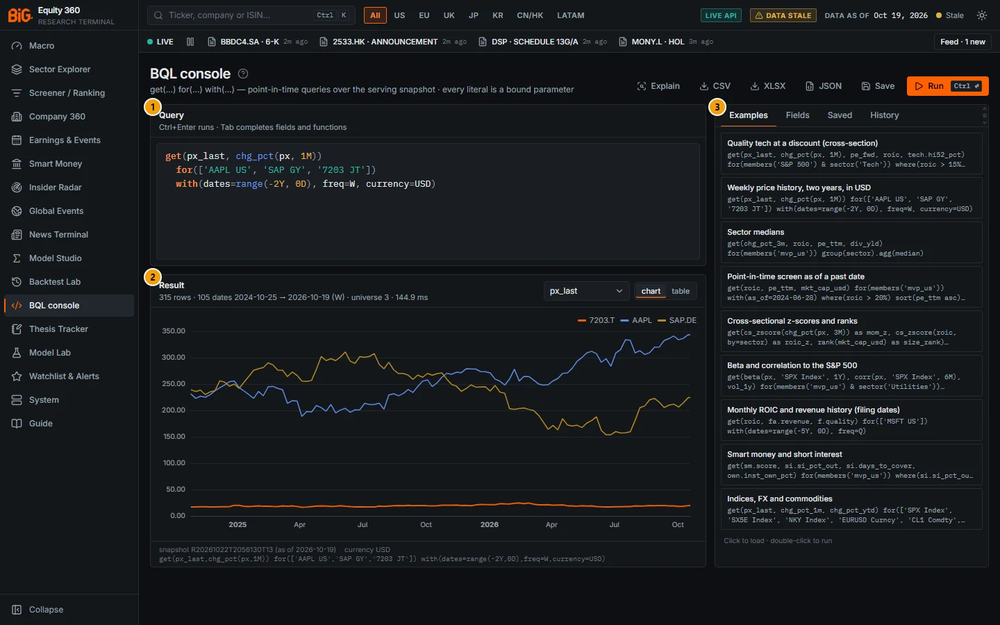

*Figure 14.2: The example "Weekly price history, two years, in USD" run: 315 rows, 105 weekly dates 2024-10-25 → 2026-10-19, chart of px_last in USD for 7203.T, AAPL and SAP.DE.*

| # | Panel | What it shows |
|---|---|---|
| 1 | Query | `get(px_last, chg_pct(px, 1M)) for(['AAPL US', 'SAP GY', '7203 JT']) with(dates=range(-2Y, 0D), freq=W, currency=USD)`. |
| 2 | Result | Chart view with the Chart column selector (px_last) and the chart / table switch; the footer shows the snapshot id, its as-of date, the currency and the canonical query. |
| 3 | Side panel | Examples tab. |

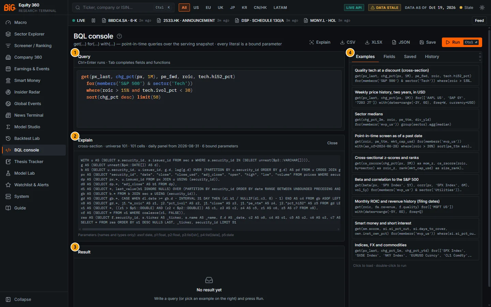

*Figure 14.3: **Explain** on the default query, before running it.*

| # | Panel | What it shows |
|---|---|---|
| 1 | Query | The default query. |
| 2 | Explain | "cross-section · universe 101 · 101 cells · daily panel from 2026-08-31 · 6 bound parameters", the compiled SQL and "Parameters (names and types only)". **Close** hides it. |
| 3 | Result | "No result yet": Explain does not run the query. |
| 4 | Side panel | Examples tab. |

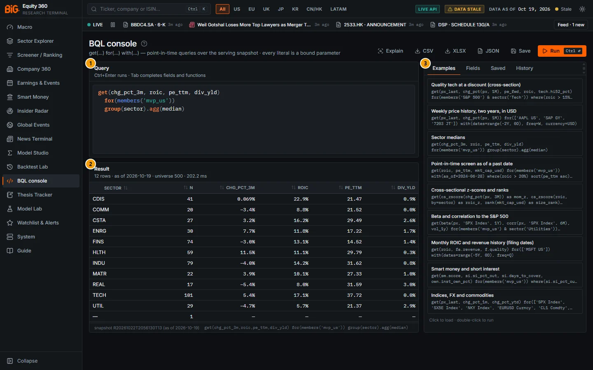

*Figure 14.4: The example "Sector medians": `group(sector).agg(median)` over mvp_us, 12 rows, universe 500.*

| # | Panel | What it shows |
|---|---|---|
| 1 | Query | `get(chg_pct_3m, roic, pe_ttm, div_yld) for(members('mvp_us')) group(sector).agg(median)`. |
| 2 | Result | One row per sector with **N** (securities in the group) and the median of each field; the last row "—" (N = 1) collects securities without a sector. |
| 3 | Side panel | Examples tab. |

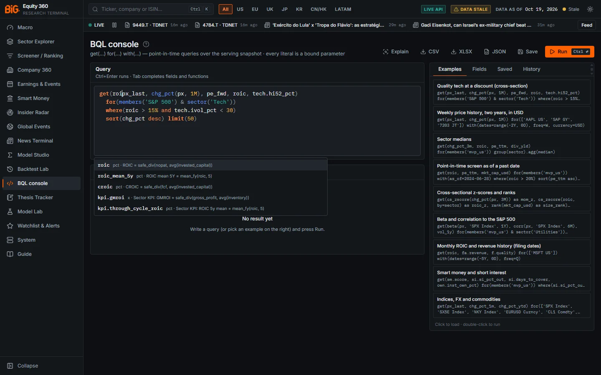

*Figure 14.5: Autocomplete after typing "roi" inside `get(`: roic, roic_mean_5y, croic, kpi.gmroi, kpi.through_cycle_roic, each with its unit and definition.*

The page has a header with the actions, the **Query** editor and the **Result** panel on the left, and a side panel with four tabs on the right:

| Area | What it shows |
|---|---|
| Header | Title, subtitle "get(...) for(...) with(...) — point-in-time queries over the serving snapshot · every literal is a bound parameter", and the buttons Explain, CSV, XLSX, JSON, Save and **Run** (Ctrl ↵). |
| Query | The syntax-highlighted editor ("Ctrl+Enter runs · Tab completes fields and functions"). |
| Explain | Appears after **Explain**: the compiled SQL and its parameters. |
| Result | The result table (or chart for time series), warnings and the footer. |
| Side panel | Tabs **Examples**, **Fields**, **Saved**, **History**. |

### Controls

#### Header and editor

| Control | What it does |
|---|---|
| **?** (next to the title) | Opens this section of the user guide. |
| **Run** / Ctrl+Enter | Runs the query in the editor. A successful run is added to History. |
| **Explain** | Compiles the query without running it and shows the mode (cross-section or time series), universe size, number of cells, whether a daily panel is needed (and from which date), the SQL and the parameter names and types (never their values). **Close** hides it. |
| **CSV**, **XLSX**, **JSON** | Run the query and download the result as `bql_<as-of>.csv`, `.xlsx` or `.json`. XLSX needs the openpyxl package on the server; otherwise an error suggests CSV or JSON. |
| **Save** | Opens a name box, a Kind switch (`query` or `screen`; hover on screen: "usable as members('screen:NAME')"), **Save** and **Cancel**. A toast confirms; for a screen it reminds you of `members('screen:NAME')`. |
| Editor | Colours clauses, functions, fields, strings, numbers / dates / durations and operators; characters outside the grammar are underlined in red. The draft is kept in this browser between visits. |
| Autocomplete | After two letters, up to nine suggestions (fields from the dictionary with unit and description, then functions). ↑ / ↓ move, **Tab** or **Enter** accepts (a function is inserted with its opening bracket), **Esc** closes. |

#### Result panel

| Element | What it shows |
|---|---|
| Subtitle | Rows (and "(truncated)"), then either "N dates start → end (freq)" for a time series or "as of ‹date›" for a cross-section, the universe size, the run time in ms and "(cached)" when served from the cache. |
| Warnings | Lines starting with ⚠: unresolved tickers, index approximations ("members('S&P 500') = the mvp_us universe ..."), model-based fields ("pe_fwd is model-based (not consensus / reported data)"), ignored options, truncation, `as_of` clamped to the snapshot. |
| View `chart` `table` | For a time series with numeric columns; the chart is the default. |
| Chart column | Which numeric column to plot when there are several. The chart shows the first 8 series ("first 8 series shown · switch to the table for all rows"). |
| Table | A **Security** column (ticker and name, linking to Company 360 or the instrument page) and one column per output. Hover a header for the field description, unit, currency and "model-based". Click a header to sort. |
| Footer | The snapshot run id and its as-of date, the result currency, and the canonical query text. |

#### Side panel

| Tab | What it does |
|---|---|
| **Examples** | Nine example queries (titles below). Click loads one into the editor; double-click loads and runs it. |
| **Fields** | Searches the field dictionary ("Search fields (pe, hi52, roic …)") with a group filter. Shows "N of 817 fields · 616 with point-in-time history"; each field has its unit, a **PIT** badge when it has history, a **model** badge when model-based, its description and aliases ("aka ..."). Hover for the point-in-time rule. A **Functions** section lists every function with its signature. |
| **Saved** | Saved queries with their kind badge (`query` or `screen`); click to load, double-click to run, bin icon to delete. Empty state: "No saved queries. Use Save next to Run; kind “screen” makes a query usable as members('screen:NAME')." |
| **History** | The last 30 queries run in this browser, with time; click to load; **Clear history**. Entries are validated when the tab loads: damaged entries in browser storage are skipped (older builds could crash the tab on them), plain-text entries from earlier versions are kept with "time unknown". |

The examples are: *Quality tech at a discount (cross-section)*; *Weekly price history, two years, in USD*; *Sector medians*; *Point-in-time screen as of a past date*; *Cross-sectional z-scores and ranks*; *Beta and correlation to the S&P 500*; *Monthly ROIC and revenue history (filing dates)*; *Smart money and short interest*; *Indices, FX and commodities*.

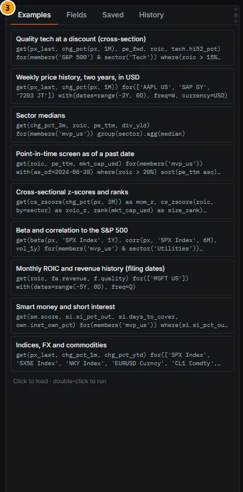

*Figure 14.6: Side panel, Examples tab.*

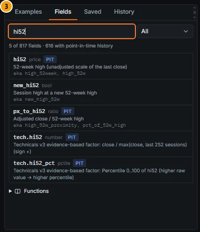

*Figure 14.7: Fields tab searching "hi52": 5 of 817 fields, 616 with point-in-time history; PIT badges and aliases; the Functions section below.*

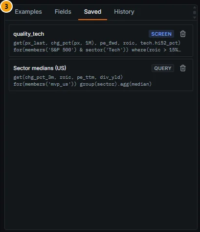

*Figure 14.8: Saved tab with a saved screen (quality_tech, SCREEN) and a saved query (Sector medians (US), QUERY).*

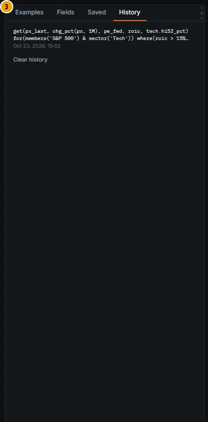

*Figure 14.9: History tab after one run, with its time and **Clear history**.*

### Methodology

A query goes through four steps on the server:

1. **Parse.** A hand-written lexer and recursive-descent parser turns the text into a syntax tree. Any character outside the grammar (for example `;` or a comment) is rejected.
2. **Resolve.** Field names are looked up in the field dictionary (`contracts/bql_fields.yaml`), tickers through the Bloomberg-style resolver, and the universe is resolved to a list of security ids.
3. **Compile.** The tree becomes one DuckDB SQL statement over the serving snapshot (and, for long histories, the data lake). Each value is evaluated at the right level: static identity, a dated stream sampled as of a date, a daily price panel, or the output grid. Time-series functions run on the daily panel, cross-sectional functions per grid date over the rows that pass `where()`.
4. **Execute** with limits, a timeout and a result cache, then return columns with their unit, currency, description and model-based flag.

The full language is in the [BQL language reference](#bql-language-reference) and the fields in the [Field dictionary](#field-dictionary).

### Data sources and refresh

- The **serving snapshot** (the read-only DuckDB the app reads), as of the snapshot date shown in the result footer. Daily price bars cover 15 years; before that, weekly bars are used.
- **Lake histories** for fields whose history is not in the snapshot (valuation, technical factors, conformal envelopes), and the lake FX history for currency conversion.
- Results reflect whatever the last refresh built: the weekly profile (Saturday 08:00 Lisbon) by default, or the daily profile. See [Data and coverage](01-data-and-coverage.md).

### Validation status

The BQL engine is a query tool, not a model, so there is no model gate. Its correctness is covered by tests: golden syntax-tree tests for the grammar, a test that every field mnemonic and alias resolves and runs, and a headless-browser check of the console on a test API in both themes (Roadmap v3 B1/B2).

The **fields** keep the validation status of the model that produced them. The console marks them with a **model** badge (Fields tab) and "model-based" (column header tooltip). Notable cases:

| Fields | Status (source) |
|---|---|
| `pe_fwd`, `fair_value`, `dcf_upside`, `implied_cagr` | Model-based forecast and DCF, **not consensus** |
| `eps_surprise`, `rev_surprise`, `earn.*`, `pead.*` | Surprises against **model-based expectations** (seasonal model on own history), not consensus |
| `ml.*` | ML excess-return model: out-of-sample rank IC about 0.035; one input, not proven alpha |
| `tech.hi52_pct`, `tech.maxret_pct`, `tech.ivol_pct` | Technicals v3 factors that **passed** (descriptive rank edge, not profitable stand-alone after costs) |
| `tech.mom*`, `tech.rmom*`, `tech.strev*`, `tech.indmom*` | Technicals v3 factors that **did not pass** the full gate; experimental (hidden by default) in the app |
| `tp.*` | Calibrated technical score: **failed** (no out-of-sample edge), experimental; `tp.h5_gate`, `tp.h20_gate`, `tp.h60_gate` give the stored verdict |
| `cf.qm_*`, `cf.band_*`, `cf.touch_20d` | Marginal conformal bands: validated (on-target coverage per horizon) |
| `sm.score`, `ins.anomaly` | Model-based scores |

See [Methodology appendix](16-methodology.md) for the full gate table.

### Correct usage and worked example

Start from an example, run it, then change one clause at a time. Use **Explain** before running a large time series to see the number of cells. Keep `where()` conditions on fields with history when you use `as_of` or `dates=`.

*Worked example (Figure 14.1, snapshot of 19 Oct 2026).* Run the default query "Quality tech at a discount". The universe `members('S&P 500') & sector('Tech')` has 101 securities; after `where(roic > 15% and tech.ivol_pct < 30)` only **20 rows** remain, so `limit(50)` does not bite. The result is sorted by the one-month change: Cadence Design Systems is first (+15.2%, forward P/E 69.12, ROIC 33.3%, hi52 percentile 63.5). Apple appears with px_last 342.94, +2.0% over the month, forward P/E 45.62, ROIC 106.0% and hi52 percentile 99.6; the ROIC matches the 106.0% in Company 360's Key ratios. Two warnings explain the result: `members('S&P 500')` is the mvp_us approximation, and `pe_fwd` is model-based, not consensus. Workday's forward P/E of −631.43 shows why you should add `pe_fwd > 0` before sorting or filtering on it.

Now add `with(dates=range(-2Y, 0D), freq=M)`: the query becomes a time series with one row per security and month-end, and `pe_fwd` is refused with "pe_fwd has no point-in-time history (snapshot only): it cannot be used with dates=", because the forward P/E is a model output stored only for the snapshot date. Replace it with `pe_ttm`, which has history.

### Limitations and pitfalls

- `members('S&P 500')` and `members('STOXX 600')` are **approximations**: the app's mvp_us and eu_broad universes (top names by market cap, current membership), not the official constituents. The result warns about this. Using them with a past `as_of` introduces **survivorship bias**.
- Identity attributes (sector, country, region, subsector) are **current**, not point-in-time, so `sector('Tech')` in a 2019 screen uses today's classification.
- Units: `pct` fields are fractions; write `15%` (= 0.15) in conditions, not `15`. `pctile` fields are 0-100.
- A daily value whose last price bar is more than 31 days old is returned empty (stale listing).
- The console reads the snapshot: intraday prices and live news are not visible.
- Grouped results include an **N** column and a "—" group for securities without a value of the grouping field (Figure 14.4); read medians of small groups with care.
- History is per browser; saved queries live in the app state on the server.

### Related mnemonics and BQL fields

- `BQL` opens the console; `BQL get(...) for(...)` runs a query from the command bar; `AAPL BQL` opens it pre-filled. See [Mnemonic reference](#mnemonic-reference).
- Fields: [Field dictionary](#field-dictionary). Other uses: [BQL elsewhere in the app](#bql-elsewhere-in-the-app).

---

## BQL language reference

### Query structure

A query is a sequence of clauses. `get` and `for` are required; the others are optional and can come in any order:

```
get(px_last, chg_pct(px, 1M), pe_fwd, roic, tech.hi52_pct)
  for(members('S&P 500') & sector('Tech'))
  with(dates=range(-2Y, 0D), freq=W, currency=USD, fill=prev)
  where(roic > 15% and tech.ivol_pct < 30)
  sort(chg_pct desc) limit(50)
```

| Clause | Meaning |
|---|---|
| `get(expr [as name], ...)` | The output columns: fields, expressions and functions, each optionally renamed with `as`. |
| `for(universe)` | The securities (see [Universes](#universes)). |
| `with(key=value, ...)` | Options: dates, frequency, currency, fill, as-of date, row cap. |
| `where(condition)` | Keeps rows that satisfy the condition. |
| `group(expr, ...).agg(fn, ...)` | Aggregates per group (and per date in a time series). |
| `sort(expr [asc or desc], ...)` | Orders the rows; ascending unless you add `desc`. |
| `limit(n)` | Keeps the first n rows (in a time series: the first n securities). |

Queries are limited to 8,000 characters. Line breaks and indentation are free.

### Universes

| Form | Meaning |
|---|---|
| `members('mvp_us')` or `members('S&P 500')`, `'SPX'`, `'SPX Index'`, `'sp500'`, `'US large caps'` | The app's US large-cap universe (approximates the S&P 500). |
| `members('mvp_global')` or `'global'` | The app's global universe. |
| `members('eu_broad')` or `'STOXX 600'`, `'SXXP'`, `'Europe'` | The app's broad European universe (approximates the STOXX Europe 600). |
| `members('full')` or `'all'` | Every active primary equity in the database. |
| `members('watch')` | Your watchlist(s). |
| `members('watchlist:NAME')`, `members('screen:NAME')`, `members('peers:GROUP')` | A named watchlist, a saved query of kind **screen**, or a peer group. |
| `region('EU')`, `country('DE')`, `sector('Tech')`, `subsector('...')` | Primary equities by region, country, sector or subsector. Sector accepts ids (`TECH`) or names and synonyms (`'Technology'`, `'banks'`, `'reits'`). |
| `type('etf')`, `exchange('XETR')`, `currency('EUR')` | By security type, listing MIC or trading currency. |
| `['AAPL US', 'SAP GY', 'SPX Index', 'EURUSD Curncy', 'CL1 Comdty']` | A ticker list (up to 1,000). Unresolved tickers are listed in the warnings. |

Combine universes with `&` (intersection), `|` (union) and `-` (difference), with parentheses: `members('eu_broad') & sector('Industrials') - country('GB')`.

**Ticker references** accepted in lists and in `corr` / `beta`: `'AAPL US'`, `'AAPL US Equity'`, `'SAP GY'`, `'SAP.DE'`, `'7203 JT'`, `'SPX Index'`, `'EURUSD Curncy'`, `'CL1 Comdty'`, an internal id (`'IDX:^GSPC'`), an ISIN, or a plain ticker (`'AAPL'`: the best listing, preferring an exact ticker, the primary listing and the largest). Index names such as SPX, INDU, CCMP, NDX, RTY, VIX, SX5E, SXXP, DAX, CAC, UKX, NKY, HSI, KOSPI, IBEX, FTSEMIB, SMI, AEX, PSI20, OMX, SHCOMP, CSI300, IBOV, MEXBOL, SPTSX, AS51, TWSE, NIFTY, SENSEX, STI, DXY, MOVE and USGG10YR map to the app's index series; commodity generics (CL, CO, NG, HO, XB, GC, SI, HG, PL, PA, C, W, S, KC, SB, CT, CC, LC, LH, ES, NQ, TY, US, EC, BP, JY, BTC, TTF and others) map to continuous front-month futures. Market codes are listed under [Command bar and mnemonics](#command-bar-and-mnemonics).

### Options

| Option | Values | Effect |
|---|---|---|
| `dates=` | `range(start, end)` or a single date; each a date (`2024-06-28`) or a duration relative to `as_of` (`-2Y`, `0D`) | Turns the query into a **time series**: one row per security and date. Without it, a cross-section at `as_of`. Spans up to 30 years. |
| `freq=` | `D`, `W`, `M`, `Q` | Grid of business days, Fridays, month-ends or quarter-ends (plus the end date). Default `D`. Ignored without `dates=` (with a warning). At most 8,000 dates. |
| `currency=` | an ISO code (`USD`, `EUR`, ...) or `local` | Converts `price` and `currency` fields with the FX history; `currency_usd` fields are always USD. Default: trading currency. |
| `fill=` | `prev` (default) or `none` | `prev` carries the last known value forward; `none` keeps only values published since the previous grid date. |
| `as_of=` | a date or a duration relative to the snapshot (`-6M`) | The knowledge cut-off: the query sees only what was known on that date. Later than the snapshot is clamped (warning); before 1980 is refused. |
| `max_rows=` | a positive integer | Row cap (default 5,000, maximum 100,000). |

### Conditions, grouping, sorting and limits

- `where()` filters the rows **before** any cross-sectional function in `get()` runs, so `cs_zscore(roic)` is computed over the rows that pass the filter.
- In a time series, `sort()` and `limit()` choose the top N **securities** by their value on the last date, and keep all their dates.
- `group(sector).agg(median)` aggregates every numeric output per group (per group and date in a time series). Aggregations: `median`, `mean` (or `avg`), `sum`, `min`, `max`, `count`, `std`. Grouped queries can only sort by an output column.
- Sorting by a name that matches several outputs is refused as ambiguous; rename with `as`.

### Functions

#### Time-series functions

Windows are either a number of observations (`21` = 21 trading sessions on daily data) or a calendar duration (`1M`).

| Function | Meaning |
|---|---|
| `chg(x, n or P)` | x minus x n observations ago (or at t − P). |
| `chg_pct(x, n or P)` | x / x[t − n] − 1, as a fraction; `chg_pct(px, 1M)` = one calendar month, `chg_pct(px, 21)` = 21 sessions. |
| `lag(x, n or P)` | x n observations ago, or at t − P. |
| `avg` `std` `min` `max` `sum` `median` `count` `(x, n or P)` | Trailing-window statistic (`mean` = `avg`). `min` / `max` with two plain expressions are `least` / `greatest`. |
| `zscore(x, n or P)` | (x − trailing mean) / trailing standard deviation. |
| `pct_rank(x, n or P)` | Percentile (0-1) of today's x within its trailing window. |
| `rolling(fn, x, n or P)` | Same as `fn(x, n or P)` for fn in avg, mean, std, min, max, sum, median, zscore. |
| `resample(x, W or M or Q, how=last)` | Aggregates x within the calendar week, month or quarter so far; `how` = last, first, mean, sum, min, max. |
| `ytd(x)` | x / last value of the previous calendar year − 1. |
| `corr(a, b, n or P)` | Rolling correlation of one-period returns of a and b (`returns=false` for levels); b can be a security, e.g. `'SPX Index'`. |
| `beta(a, b, n or P)` | Rolling OLS slope of a's returns on b's returns (same conventions). |

#### Cross-sectional functions

Computed per date over the universe rows that pass `where()`; each takes an optional `by=field` (for example `by=sector`) to compute within groups.

| Function | Meaning |
|---|---|
| `rank(x)` | Rank, 1 = largest. |
| `cs_rank(x)` | Percentile 0-1 (ascending). |
| `cs_zscore(x)` | Cross-sectional z-score. |
| `cs_demean(x)` | x minus the cross-sectional mean. |
| `cs_mean(x)`, `cs_median(x)` | Cross-sectional mean or median, repeated on every row. |

#### Scalar functions and operators

- Scalar: `abs`, `ln`, `log`, `log10`, `exp`, `sqrt`, `sign`, `floor`, `ceil`, `round(x, n)`, `least(...)`, `greatest(...)`, `coalesce(...)`, `nz(x)` (null → 0), `if(condition, a, b)`, `clip(x, lo, hi)`, `isnull(x)`.
- Arithmetic: `+`, `-`, `*`, `/`, `^` (power), unary minus.
- Comparisons: `==` (or `=`), `!=` (or `<>`), `<`, `<=`, `>`, `>=`, `in [...]`, `not in [...]`.
- Logic: `and` (or `&`), `or` (or `|`), `not`. Inside `for()`, `&`, `|` and `-` are the universe set operators.

### Literals

| Literal | Examples |
|---|---|
| Numbers | `15`, `0.15`, `1e9`, `200e9` |
| Percentages | `15%` (= 0.15) |
| Durations | `1D`, `2W`, `3M`, `1Q`, `5Y` (negative with a minus: `-2Y`) |
| Dates | `2026-01-31` |
| Strings | `'AAPL US'` or `"AAPL US"`; double a quote to escape it (`'O''Reilly'`) |
| Booleans and null | `true`, `false`, `null` |
| Lists | `['AAPL US', 'SAP GY']`, `[1, 2, 3]` (literal values only, up to 1,000) |

### Point-in-time rules

A grid date D only sees bars dated on or before D and rows whose knowledge date (filing, publication or as-of date) is on or before D:

- **Prices** (`px`, `px_last`, returns, moving averages, volatility): the daily bar of the last session on or before D; weekly bars before the 15-year daily window.
- **Fundamentals** (ratios, `fa.*`, `kpi.*`): the latest period known at D, preferring TTM, otherwise the fiscal year. A restatement of an older period never overwrites a newer period; a restatement of the same period counts from its own filing date.
- **Dated streams** (scores, factors, short interest, 13F, insider, sentiment, earnings, conformal bands): the latest row with its knowledge or as-of date on or before D (for example FINRA short interest from its publication date, 13F holdings from the quarter's filing cut-off).
- **Snapshot-only fields** (no stored history, e.g. `pe_fwd`, `grade`, `beta_1y`, `ml.*`, `macro.*`) are allowed only at the snapshot date. They are refused with `dates=`, with an earlier `as_of`, and inside a time-series function.
- **Identity attributes** (sector, country, region, ticker) are current, not point-in-time.

### Limits

| Limit | Value |
|---|---|
| Universe | 25,000 securities |
| Universe × dates | 2,000,000 cells |
| Daily bars read, including look-back | about 40,000,000 |
| Grid dates | 8,000; span 30 years |
| Ticker list / literal list | 1,000 items |
| Output rows | `max_rows`, default 5,000, maximum 100,000 (more rows are truncated with a warning) |
| Query length | 8,000 characters |
| Timeout | `BIG360_BQL_TIMEOUT_S`, default 30 s (between 0.5 and 120 s); the statement is interrupted |

### Caching

Results are cached in memory (the 128 most recent results of up to 50,000 rows), keyed by the snapshot run id, a hash of the normalised query and a hash of the resolved universe. A cached result is marked "(cached)" in the result subtitle. A new snapshot invalidates the cache automatically, and reformatting a query (spaces, line breaks) still hits the cache.

### Security

- Identifiers (tables, columns, SQL fragments of computed fields) come only from the field dictionary and the compiler's function table.
- Every literal you type (strings, numbers, dates, ticker lists) is sent as a **bound parameter**, never pasted into SQL. Explain shows parameter names and types only.
- The lexer rejects anything outside the grammar, including `;` and comments.
- Queries run on the read-only serving snapshot.

### API

The same engine is available to scripts, Excel and the C# client:

| Endpoint | Purpose |
|---|---|
| `POST /api/v1/bql` | Run a query (`query`, `max_rows`, `use_cache`). |
| `POST /api/v1/bql/explain` | Compile only: SQL, parameter names, estimates. |
| `POST /api/v1/bql/export` | Run and download (`format` = csv, xlsx or json). |
| `GET /api/v1/bql/fields` | Search the field dictionary (`q`, `group`, `limit`, `offset`); also returns the function list. |
| `GET /api/v1/bql/resolve` | Resolve a Bloomberg-style reference to a security and asset class. |
| `GET` / `POST` / `PUT` / `DELETE /api/v1/bql/saved` | Saved queries and screens. |

---

## Field dictionary

**Source:** `contracts/bql_fields.yaml`, generated from the data contracts and the serving schema plus a curated alias layer: **817 fields, 146 aliases, 616 with point-in-time history** (86 curated Bloomberg-style names such as `px_last`, `pe_fwd`, `mkt_cap_usd`, `div_yld`).

### Families

| Family (prefix) | Fields | Examples |
|---|---|---|
| Identity (no prefix) | 22 | `ticker`, `name`, `isin`, `country`, `region`, `sector`, `subsector`, `currency`, `security_type` |
| Price and return | 20 | `px`, `px_last`, `px_volume`, `chg_pct_1m`, `chg_pct_ytd`, `mom_12_1` |
| Technical (`tech.`, `setup.`, `bo.`, `zone.`, plain) | 154 | `hi52`, `sma200`, `vol_1y`, `tech.hi52_pct`, `setup.rsi14`, `bo.state` |
| Valuation (`val.`, `coc.`, plain) | 62 | `mkt_cap_usd`, `pe_ttm`, `pe_fwd`, `ev_ebit`, `fcf_yield`, `coc.wacc` |
| Fundamental (`fa.`, plain ratios) | 165 | `roic`, `gross_margin`, `revenue_growth_yoy`, `fa.revenue`, `fa.fcf` |
| Sector KPI (`kpi.`) | 54 | `kpi.rule_of_40`, `kpi.rpo_growth`, `kpi.inventory_days_change` |
| Scores (`c.`, `grade.`, `rank.`, `rank_sector.`, plain) | 30 | `composite`, `c.defensive`, `grade`, `moat`, `rank_sector.balanced` |
| Factors (`f.`) | 30 | `f.quality`, `f.value`, `f.momentum`, `f.quality.rank_sector` |
| Smart money (`sm.`, `own.`, `si.`, `shrt.`) | 95 | `sm.score`, `own.inst_own_pct`, `si.si_pct_out`, `si.days_to_cover` |
| Insider (`ins.`, plain) | 19 | `insider_signal`, `ins.cluster_buy_flag`, `ins.net_buy_value_usd_90d` |
| Sentiment (`sent.`, plain) | 22 | `sentiment`, `sent.sentiment_ewm_7d`, `sent.news_count_z`, `attention_z` |
| Earnings (`earn.`, `pead.`, plain) | 65 | `eps_surprise`, `earn.car_0_p5`, `pead.sue` |
| Conformal (`cf.`) | 57 | `cf.qm_20_90`, `cf.band_5d_90`, `cf.touch_20d` |
| Model (`ml.`) and macro exposure (`macro.`) | 18 | `ml.exp_excess_3m`, `ml.decile_3m`, `macro.beta_rates` |
| Technical score calibration (`tp.`) | 57 | `tp.technical_score_pct`, `tp.h20_hit_rate`, `tp.h20_gate` |

### Units

| Unit | Meaning and display |
|---|---|
| `pct` | Fraction (0.15 = 15%); write `15%` in queries; shown as a percentage. |
| `pctile` | Percentile points 0-100. |
| `score` | Score (0-100 for factor and composite scores). |
| `price`, `currency` | Trading currency; converted with `currency=`. |
| `currency_usd` | US dollars. |
| `x`, `ratio`, `z` | Multiple, ratio, z-score (two decimals). |
| `shares`, `count`, `days`, `rank`, `decile` | Counts and ranks (integers). |
| `text`, `bool`, `date` | Labels, flags and dates. |

### Most useful fields

H = point-in-time history (usable with `dates=` and `as_of`); S = snapshot only; M = model-based.

| Field | Family | Unit | Hist. | Meaning |
|---|---|---|---|---|
| `ticker` | identity | text | S | Display ticker (Yahoo-style suffix outside the US) |
| `name` | identity | text | S | Security name (alias `long_comp_name`) |
| `country` | identity | text | S | Issuer country, ISO2 (current) |
| `region` | identity | text | S | US, CA, LATAM, UK, EU, JP, KR, CN, HK, APAC, OTHER |
| `sector` | identity | text | S | Sector id (TECH, HLTH, FINS, ...; alias `gics_sector`) |
| `currency` | identity | text | S | Trading currency |
| `px` | price | price | H | Adjusted close (splits and dividends) |
| `px_last` | price | price | H | Last unadjusted close (alias `close`) |
| `turnover_usd` | price | currency_usd | H | Close in USD × volume |
| `chg_pct_1m` | return | pct | H | 21-session return (alias `ret_1m`) |
| `chg_pct_3m` | return | pct | H | 63-session return |
| `chg_pct_12m` | return | pct | H | 252-session return (alias `chg_pct_1y`) |
| `chg_pct_ytd` | return | pct | H | Year-to-date return |
| `mom_12_1` | return | pct | H | 12-1 month momentum: px[t−21] / px[t−252] − 1 |
| `hi52` | technical | price | H | 52-week high (alias `high_52week`) |
| `px_to_hi52` | technical | ratio | H | Adjusted close / 52-week high |
| `trend_200d` | technical | pct | H | px / 200-session average − 1 |
| `vol_1y` | technical | pct | H | Annualised volatility, 252 sessions |
| `beta_1y` | technical | x | S | 1-year beta vs the region benchmark |
| `atr14` | technical | price | S | Average true range, 14 sessions |
| `tech.hi52_pct` | technical | pctile | H | 52-week-high factor percentile (passed gate) |
| `tech.ivol_pct` | technical | pctile | H | Idiosyncratic volatility percentile (passed gate) |
| `tech.maxret_pct` | technical | pctile | H | MAX (largest daily return) percentile (passed gate) |
| `setup.rsi14` | technical | number | H | Wilder RSI(14) |
| `bo.state` | technical | text | S | Status of the latest 20 / 55-day breakout |
| `mkt_cap_usd` | valuation | currency_usd | H | Market capitalisation (alias `cur_mkt_cap`) |
| `pe_ttm` | valuation | x | H | Price / trailing EPS |
| `pe_fwd` | valuation | x | S, M | Price / next-year EPS of the base-case forecast, not consensus |
| `pb` | valuation | x | H | Price / book |
| `ev_ebit` | valuation | x | H | EV / EBIT TTM |
| `fcf_yield` | valuation | pct | H | Free cash flow TTM / market cap |
| `div_yld` | valuation | pct | H | Dividend yield (alias `eqy_dvd_yld_ind`) |
| `dcf_upside` | valuation | pct | S, M | Fair value / last close − 1 |
| `roic` | fundamental | pct | H | NOPAT / average invested capital |
| `gross_margin` | fundamental | pct | H | Gross profit / revenue |
| `fcf_margin` | fundamental | pct | H | Free cash flow / revenue |
| `revenue_growth_yoy` | fundamental | pct | H | Revenue growth year on year |
| `eps_growth_yoy` | fundamental | pct | H | Diluted EPS growth year on year |
| `net_debt_to_ebitda` | fundamental | x | H | Net debt / EBITDA |
| `fa.revenue` | fundamental | currency_usd | H | Revenue, TTM (FY otherwise), USD |
| `kpi.rule_of_40` | sector KPI | pct | H | Revenue growth + FCF margin |
| `composite` | score | score | H | Composite score 0-100, balanced profile |
| `grade` | score | text | S | Composite grade A-E |
| `moat` | score | text | S | Moat class: wide, narrow, none, insufficient_data |
| `f.quality` | factor | score | H | Quality factor 0-100 (sector-relative) |
| `f.value` | factor | score | H | Value factor 0-100 |
| `f.momentum` | factor | score | H | Momentum factor 0-100 |
| `sm.score` | smart money | score | H, M | Smart-money composite (mean group z) |
| `own.inst_own_pct` | smart money | pct | H | 13F shares held / shares out |
| `si.si_pct_out` | smart money | pct | H | FINRA short interest / shares out |
| `si.days_to_cover` | smart money | days | H | FINRA days to cover |
| `insider_signal` | insider | score | H | Rules-based insider signal score |
| `ins.cluster_buy_flag` | insider | bool | S | Three or more insiders buying |
| `sent.sentiment_ewm_7d` | sentiment | number | H | 7-day EWM of daily news sentiment |
| `sent.news_count_z` | sentiment | z | H | News attention z vs own 90 days |
| `attention_z` | sentiment | z | S | GDELT media attention z |
| `eps_surprise` | earnings | pct | H, M | EPS surprise vs the model-based expectation |
| `earn.car_0_p5` | earnings | number | H, M | CAR [0, +5] after the latest release |
| `pead.sue` | earnings | number | H, M | Standardised unexpected EPS (model-based) |
| `ml.exp_excess_3m` | model | pct | S, M | ML expected 3-month excess return |
| `macro.beta_rates` | macro | x | S, M | Beta to +100 bp in the 10-year yield |
| `cf.band_5d_90` | conformal | pct | H, M | Half-width of the 90% 5-session calibrated band |
| `cf.touch_20d` | conformal | pct | H, M | 20-session move to the 90% band edge |

Use the **Fields** tab to search the remaining fields; every field shows its point-in-time rule on hover.

### Snapshot-only fields

182 of the 817 fields (about a fifth) have no history and can only be read at the snapshot date. They include most model outputs and current-state labels: `pe_fwd`, `fair_value`, `dcf_upside`, `implied_cagr`, `shares_out`, `grade`, `rank_global`, `moat`, `moat_score`, `beta_1y`, `atr14`, `volume_z`, `new_hi52`, `ml.*`, `macro.*`, `ins.cluster_buy_flag`, `ins.anomaly`, `attention_z`, `news_count_30d`, `setup.trend`, `bo.*` and `zone.*`. Identity attributes (23 fields) also have no history but are always allowed, as current values. A query that uses one of them with `dates=`, an earlier `as_of` or inside a time-series function stops with "‹field› has no point-in-time history (snapshot only): it cannot be used ...".

---

## Command bar and mnemonics

**Opens with:** Ctrl+K anywhere, or `/` when the focus is not in a text field; the search box in the top bar · **Menu:** none (global) · **Mnemonics:** all functions below · **Refresh:** not applicable

### Purpose

The command bar is the fastest way around the app. Analysts used to a Bloomberg terminal can type a security and a function (`SAP GY FA`, `SX5E Index GP`) or a market-wide function (`ECO US`, `WIRP EU`) and press Enter; anyone else can type a company name and pick it from the list. It also runs BQL queries, explains every function with `HELP <code>` and opens this user guide with `HELP`.

### Screenshot

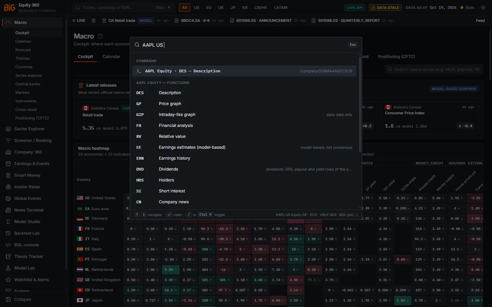

*Figure 14.10: `AAPL US ` with a trailing space: the Command item "AAPL Equity · DES — Description" (with its Company 360 path) and the "AAPL EQUITY — FUNCTIONS" list with notes such as "daily data only" and "model-based, not consensus".*

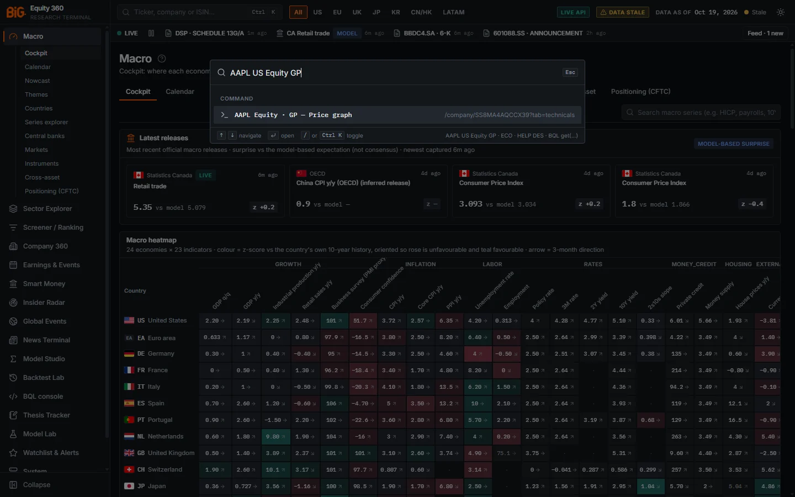

*Figure 14.11: `AAPL US Equity GP` resolved to "AAPL Equity · GP — Price graph", destination `/company/‹id›?tab=technicals`.*

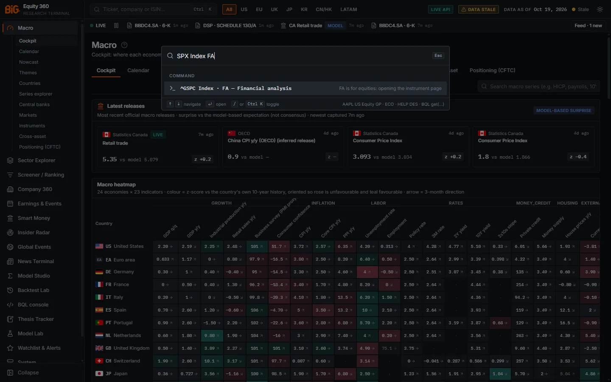

*Figure 14.12: `SPX Index FA`: the index resolves to ^GSPC and the note reads "FA is for equities: opening the instrument page".*

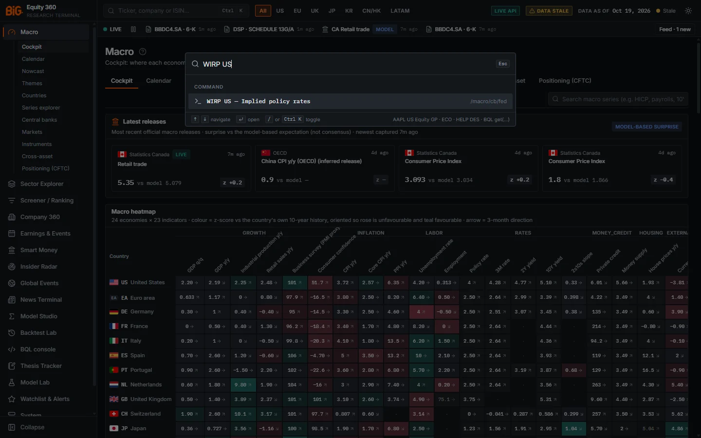

*Figure 14.13: `WIRP US` → "WIRP US — Implied policy rates", destination `/macro/cb/fed`.*

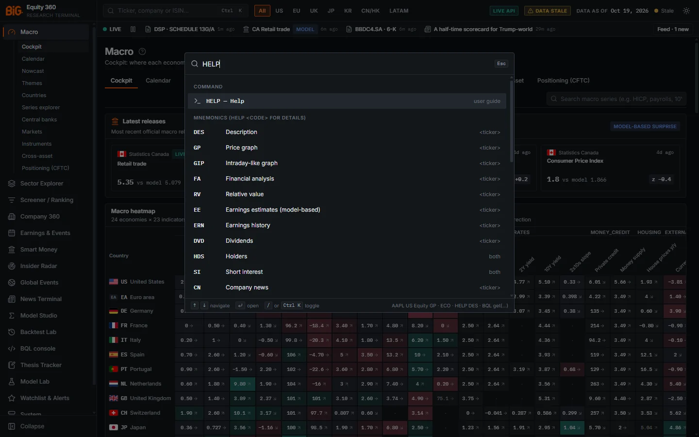

*Figure 14.14: `HELP`: the Command item "HELP — Help" (note "user guide") above the list of mnemonics with their scope (`<ticker>`, both, global).*

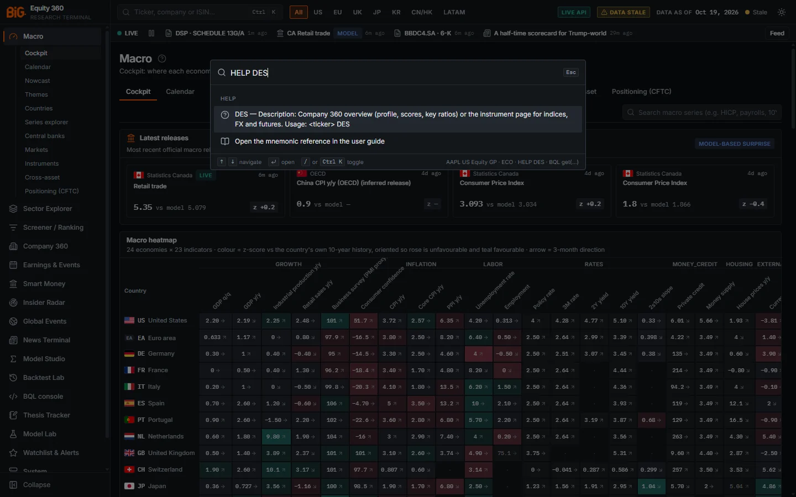

*Figure 14.15: `HELP DES`: the one-line description and "Open the mnemonic reference in the user guide".*

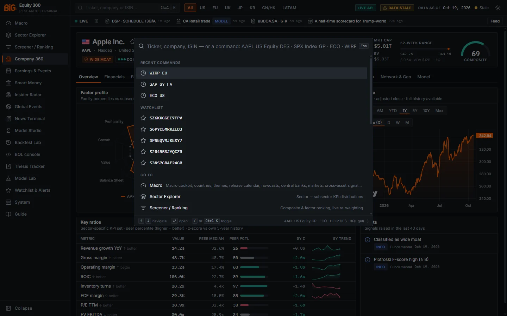

*Figure 14.16: Empty input on Company 360 (Apple): Recent commands (WIRP EU, SAP GY FA, ECO US), Watchlist and Go to.*

These images have no numbered badges: the command bar is a single dialog over the page.

### Controls

| Control | What it does |
|---|---|
| Ctrl+K | Opens or closes the command bar from anywhere. |
| `/` | Opens it when the focus is not in an input, select or text area (not in the News Terminal, where `/` focuses the headline filter). |
| ↑ / ↓ | Move through the items. |
| Enter | Opens the selected item. |
| Esc | Closes the bar (and clears the input). |
| Input | Placeholder: "Ticker, company, ISIN — or a command: AAPL US Equity DES · SPX Index GP · ECO · WIRP US · HELP". |

The list shows these groups, in order, when they apply:

| Group | Content |
|---|---|
| **Command** | The parsed command, e.g. "AAPL Equity · GP — Price graph", with its destination path or a note on the right. Disabled (greyed) when it cannot route: "unavailable: no options data", "not applicable", or "type a ticker first: AAPL DES". |
| **Help** | For `HELP <code>`: the description and usage (selecting it puts the function in the input), then **Open the mnemonic reference in the user guide**, which opens this chapter at [Mnemonic reference](#mnemonic-reference) (`/help/14-bql-mnemonics#mnemonic-reference`). |
| **Mnemonics (HELP ‹code› for details)** | For `HELP`: below the Command item "HELP — Help" (which opens the user guide), every function with its title and scope (global, `<ticker>` or both). Selecting one puts `HELP <code>` in the input. |
| **‹TICKER› ‹class› — functions** | After a security and a space: the functions for its asset class, each with its note. |
| **Functions** | When you type 1-5 letters: market-wide functions whose code starts with them. |
| **Securities** | The ordinary security search (ticker, name, ISIN, exchange). |
| **Recent commands** | With an empty input: your last 6 commands (up to 20 are kept in this browser). Selecting one puts it back in the input. |
| **Watchlist** | With an empty input: up to 8 watchlist names. |
| **Go to** | Pages whose name or description matches the input. |
| **Actions** | Switch to light / dark theme; Open example: Microsoft 360; Command bar help (mnemonics), which types `HELP`; **Open the user guide** (`/help`). |

The footer reminds you of the keys and shows examples: "AAPL US Equity GP · ECO · HELP DES · BQL get(…)".

### Methodology

**Input forms** (case-insensitive):

| Form | Example | Result |
|---|---|---|
| `<ticker> [<market>] [<yellow key>] <MNEMONIC>` | `AAPL GP`, `AAPL US Equity DES`, `SAP GY FA`, `7203 JT TECH`, `SX5E Index GP`, `EURUSD Curncy GP`, `CL1 Comdty GP` | The function for that security. |
| `<MNEMONIC> [argument]` | `ECO`, `ECO US`, `WIRP EU`, `ECST DE`, `N`, `TOP` | A market-wide function. |
| `<MNEMONIC>` alone, security function | `DES`, `GP`, `FA` | Applies to the security of the page you are on (Company 360 or an instrument page); elsewhere it asks for a ticker. Functions that work both ways (`HDS`, `SI`, `SMRT`, `PEERS`, `NET`, `EVTS`, `THES`, `BQL`) also apply to the page's security when you are on one. |
| A security with a market or yellow key | `AAPL US`, `SPX Index`, `RY CN` | Enter opens `DES`. |
| A security followed by a space | `AAPL US ` | Lists the functions for that asset class. |
| `BQL ...` or `get(...)` | `BQL get(px_last) for(['AAPL US'])` | Opens the BQL console and runs the query. |
| `HELP`, `HELP <code>` | `HELP`, `HELP WIRP` | `HELP`: Enter opens the user guide (`/help`), and the function list is shown below. `HELP <code>`: one description, plus a link to the mnemonic reference. |
| Anything else | `ASML`, `Apple`, an ISIN | Falls back to the security search and page matches. |

**Yellow keys:** `Equity`, `Index`, `Curncy`, `Comdty`. They tell the resolver which kind of instrument you mean; without one, the resolver infers it (six letters such as `EURUSD` are tried as a currency pair, known index names as indices). Generic commodity tickers may contain a space (`C 1 Comdty`).

**Market codes** (Bloomberg exchange codes):

| Region | Codes |
|---|---|
| United States | `US` (composite), `UN` (NYSE), `UW` `UQ` `UR` (Nasdaq), `UA` (NYSE American), `UP` (NYSE Arca), `UF` (Cboe BZX) |
| Canada | `CN` (Toronto and TSX Venture), `CT` (Toronto), `CV` (TSX Venture) |
| UK and Ireland | `LN` (London), `ID` (Dublin) |
| Germany | `GY` (Xetra), `GR` (Xetra and Frankfurt), `GF` (Frankfurt) |
| Western Europe | `FP` (Paris), `NA` (Amsterdam), `BB` (Brussels), `PL` (Lisbon), `IM` (Milan), `SM` (Madrid), `SW` `SE` `VX` (SIX Swiss), `AV` (Vienna) |
| Nordics and Baltics | `SS` (Stockholm), `DC` (Copenhagen), `FH` (Helsinki), `NO` (Oslo), `IR` (Iceland), `ET` (Tallinn), `LH` (Vilnius) |
| Central and Eastern Europe, Greece, Turkey | `PW` (Warsaw), `CP` (Prague), `HB` (Budapest), `RO` (Bucharest), `GA` (Athens), `TI` (Istanbul) |
| Japan, Korea | `JP` `JT` (Tokyo), `KS` (Korea Exchange), `KQ` (KOSDAQ) |
| Greater China | `HK` (Hong Kong), `CH` (Shanghai and Shenzhen), `CG` `C1` (Shanghai), `CS` `C2` (Shenzhen), `TT` (Taiwan, TWSE and TPEx), `TP` (TPEx) |
| Rest of Asia-Pacific | `AU` `AT` (ASX), `SP` (Singapore), `IN` (NSE and BSE), `IS` (NSE), `IB` (BSE) |
| Latin America | `BZ` `BS` (B3), `MM` (Mexico), `CI` (Santiago), `CB` (Colombia), `PE` (Lima), `AR` (Buenos Aires) |
| Middle East and Africa | `IT` (Tel Aviv), `AB` (Saudi Exchange), `SJ` (Johannesburg) |

**`CN` is both the Canada code and the company-news function.** On a two-word input, `CN` is read as the market: `RY CN` is Royal Bank of Canada's Toronto listing. For company news, use three or more words: `AAPL US CN`, `RY CN CN`.

**Resolution.** The security part is resolved on the server (`GET /api/v1/bql/resolve`) to a security and an asset class (FX → Curncy, futures → Comdty, indices → Index, everything else including ETFs → Equity). Indices, FX pairs, futures and ETFs open the instrument page; equities open Company 360. If nothing matches, the bar shows "Unknown security “‹text›”."

### Data sources and refresh

The security search and resolver read the serving snapshot. Recent commands are kept in this browser only (key `big360.cmd.history`, 20 entries); they are lost if browser storage is cleared and are not shared between users.

### Validation status

Not applicable (navigation). The parser and router are covered by unit tests (`frontend/src/lib/__tests__/mnemonics.test.ts`) and by the headless-browser check of Roadmap v3 B2.

### Correct usage and worked example

Type the security first and the function last, as on a Bloomberg terminal, and use the trailing-space list when you do not remember a code.

*Worked example.* Press Ctrl+K and type `SAP GY ` (with a space). The bar resolves SAP's Xetra listing and lists its functions. Add `FA` and press Enter: Company 360 opens on SAP's Financials tab, and `SAP GY FA` is saved in Recent commands. On that page, press Ctrl+K and type just `RV`: it applies to SAP and opens the Peers tab. Then type `WIRP EU`: the Central banks page for the ECB opens with its implied policy path (an approximation from official curves, see [Macro › Central bank page](02a-macro.md#central-bank-page)). Finally type `HELP EE`: the bar explains "EE — Earnings estimates (model-based): Three-statement forecast and DCF scenarios — MODEL-BASED, not consensus. Usage: ‹ticker› EE".

### Limitations and pitfalls

- A function typed on its own uses the **page's security**; on a page without one (for example the Screener), security-only functions are disabled until you type a ticker.
- `GIP` opens the same daily price graph as `GP` (the app has no intraday data).
- Equity functions on an index, FX pair or future (for example `SPX Index FA`) open the instrument page instead, with a note.
- `OMON` is listed but unavailable: the app has no options data.
- `DES AAPL` (function first) is not a command; it falls back to search. Put the ticker first.
- `N`, `TOP` and `CN` fall back to Global Events or the News & Sentiment tab when the News Terminal is not installed, with a note.

### Related mnemonics and BQL fields

- Full list: [Mnemonic reference](#mnemonic-reference). BQL from the bar: [BQL console](#bql-console).
- Keyboard shortcuts of the app shell: [Getting started](00-getting-started.md).

---

## Mnemonic reference

Every function in `frontend/src/lib/mnemonics.ts`. "Typed alone" is what happens with no ticker: the page's security on Company 360 or an instrument page, otherwise the market-wide destination.

### Security functions

| Code | Title | Classes | With a security | Typed alone (no page security) |
|---|---|---|---|---|
| `DES` | Description | all | Company 360 Overview; instruments: instrument page | needs a ticker |
| `GP` | Price graph | all | Company 360 › Technicals; instruments: instrument page | needs a ticker |
| `GIP` | Intraday-like graph | all | as `GP`, note "daily data only" | needs a ticker |
| `TECH` | Technicals | all | Company 360 › Technicals; instruments: instrument page | needs a ticker |
| `FA` | Financial analysis | Equity | Company 360 › Financials | needs a ticker |
| `RV` | Relative value | Equity | Company 360 › Peers | needs a ticker |
| `EE` | Earnings estimates (model-based) | Equity | Company 360 › Forecast, note "model-based, not consensus" | needs a ticker |
| `ERN` | Earnings history | Equity | Company 360 › Earnings | needs a ticker |
| `DVD` | Dividends | Equity | Company 360 › Financials, note "dividends: DPS, payout and yield rows of the statements" | needs a ticker |
| `CN` | Company news | Equity | News Terminal `/news?ticker=‹ticker›`; without it, Company 360 › News & Sentiment | needs a ticker |
| `HDS` | Holders | Equity | Company 360 › Ownership | Smart Money (`/smart-money`) |
| `SI` | Short interest | Equity | Company 360 › Ownership | Smart Money |
| `SMRT` | Smart money | Equity | Company 360 › Ownership | Smart Money |
| `PEERS` | Peers | Equity | Company 360 › Peers | Sector Explorer (`/sectors`) |
| `NET` | Network & geo | Equity | Company 360 › Network & Geo | Global Events › Contagion & spillovers |
| `EVTS` | Events | Equity | Company 360 › Event risk | Earnings & Events (`/earnings`) |
| `THES` | Thesis | all | New thesis on the security (`/theses/new?subject_type=security`; instruments: `cross_asset`) | Thesis Tracker (`/theses`) |
| `BQL` | BQL console | all | `/bql` pre-filled with `get(px_last, chg_pct_1m, pe_ttm, roic) for(['‹security›'])` | BQL console (`/bql`) |
| `OMON` | Option monitor | all | **unavailable: no options data** | unavailable |

For an index, FX pair or future, every equity-only function opens the instrument page with the note "‹code› is for equities: opening the instrument page". After a security and a space, the bar suggests the functions of its class: all of the above for an equity; `DES`, `GP`, `GIP`, `TECH`, `THES`, `BQL` and `OMON` (disabled) for an index, currency or commodity.

### Market-wide functions

| Code | Title | Opens | Argument |
|---|---|---|---|
| `WEI` | World equity indices | Markets overview (`/macro/markets`) | none |
| `WIRP` | Implied policy rates | Central banks (`/macro/cb`); with a country or bank, that bank's page with the implied path (approximation) | `US`, `EU` / `EZ` / `EA` (and euro-area members DE, FR, IT, ES, NL), `UK` / `GB`, `JP`, `CH`, `CA`, `AU`, `SE`, `NO`, `BR`, `MX`, `CL`, `CO`, `PE`, `IN`, `KR`, `CN`, or a bank: `FED`, `ECB`, `BOE`, `BOJ`, `SNB`, `BOC`, `RBA`, `RIKSBANK`, `NORGES`, `BCB`, `BANXICO`, `BCCH`, `BANREP`, `BCRP`, `RBI`, `BOK`, `PBOC`; unknown values open the monitor with a note |
| `ECO` | Economic calendar | Release calendar (`/macro/calendar`), model-based expectations | optional country: `ECO US`, `ECO JP` (opens the calendar filtered on that country; `UK` = GB, `EU` = EA) |
| `ECST` | Economic statistics | Country macro dashboard (`/macro/country/US` by default) | optional ISO2: `ECST DE` |
| `GC` | Curves | Central banks (`/macro/cb`), note "policy and yield curves per bank" | none |
| `FXIP` (alias `FX`) | FX | Instruments browser on FX (`/macro/markets?tab=instruments`) | none |
| `CMDTY` | Commodities | Cross-asset dashboard (`/macro/cross-asset`) | none |
| `COT` | CFTC positioning | Positioning (`/macro/positioning`) | none |
| `EQS` | Equity screening | Screener (`/screener`) | none |
| `PORT` (alias `BT`) | Portfolio / backtest | Backtest Lab (`/backtest`) | none |
| `TOP` | Top news | News Terminal › Top stories (`/news?view=top`); without it, Global Events | none |
| `N` | News terminal | News Terminal (`/news`); without it, Global Events | none |
| `ALRT` | Alerts | Watchlist & Alerts (`/watchlist`) | none |
| `MDL` | Model registry | Model Lab (`/models`) | none |
| `HELP` | Help | The user guide (`/help`, note "user guide"); the bar also lists every function. Description: "Open the user guide (and list the mnemonics); HELP ‹MNEMONIC› describes one" | optional code: `HELP DES` (one-line description and a link to the mnemonic reference) |

### HELP

- `HELP` with no argument shows a first Command item, "HELP — Help" with the note "user guide": Enter opens this user guide (`/help`). Below it, the bar lists every function with its title and scope; selecting one shows its description.
- `HELP <code>` shows one line: "‹CODE› — ‹Title›: ‹description›. Usage: ‹form›", where the form is `<ticker> CODE`, `CODE or <ticker> CODE`, or `CODE`. For example: "WIRP — Implied policy rates: Central-bank monitor; with a country / bank (WIRP US, WIRP EU) the bank page with the implied path (approximation). Usage: WIRP".
- Under the description, **Open the mnemonic reference in the user guide** opens this chapter at the mnemonic reference (`/help/14-bql-mnemonics#mnemonic-reference`).
- An unknown code gives "‹CODE›: unknown mnemonic. Type HELP for the list."
- The Actions group (empty input) also has **Open the user guide**, and typing `HE` lists `HELP` among the Functions, which opens the guide as well.

### Unavailable functions

`OMON` (option monitor) is shown so that Bloomberg users are not surprised, but it is disabled: "Not available: the app has no options data". There is no intraday data either, so `GIP` is the daily graph.

### Examples

| Type | Opens |
|---|---|
| `AAPL GP` | Apple, Company 360 › Technicals |
| `AAPL US Equity DES` | Apple, Company 360 Overview |
| `SAP GY FA` | SAP (Xetra), Financials |
| `7203 JT TECH` | Toyota (Tokyo), Technicals |
| `ASML NA RV` | ASML (Amsterdam), Peers |
| `PETR4 BZ ERN` | Petrobras preferred (B3), Earnings |
| `RY CN` | Royal Bank of Canada (Toronto), Overview |
| `AAPL US CN` | News Terminal filtered on AAPL |
| `SX5E Index GP` | Euro Stoxx 50 instrument page |
| `EURUSD Curncy GP` | EUR/USD instrument page |
| `CL1 Comdty GP` | WTI front-month instrument page |
| `ECO US` | US release calendar |
| `ECST DE` | Germany macro dashboard |
| `WIRP EU` | ECB page with the implied path |
| `COT` | CFTC positioning |
| `BQL get(chg_pct_ytd) for(['SPX Index', 'SX5E Index'])` | BQL console, query run |
| `HELP` | This user guide (`/help`) |
| `HELP SI` | Description of the short-interest function, with a link to the mnemonic reference |

---

## BQL elsewhere in the app

BQL expressions can be used in three other places.

### Screener: Open as BQL

**Route:** `/screener` · button **Open as BQL** (hover: "Open this screen in the BQL console (the filters and sort as a get / for / where query)").

The button turns the Screener's current filters and sort into a query and runs it in the console:

- universe `members('full')` narrowed by the selected regions, country, sector and subsector;
- `where()` conditions for the size bucket (mega ≥ $200 bn, large $10-200 bn, mid $2-10 bn, small $0.3-2 bn, micro < $0.3 bn), the moat class and the minimum score;
- fields `composite, mkt_cap_usd, chg_pct_1m, pe_fwd, ev_ebit, roic, f.quality, f.value, f.momentum` plus the sort column, `limit(100)`.

When a minimum score is set, a toast notes that "min score uses the stored balanced composite (the Screener re-weights live)": the Screener's custom factor weights are not carried over. Save the query as a **screen** to reuse it as `members('screen:NAME')`. See [Screener](04-screener.md#screener).

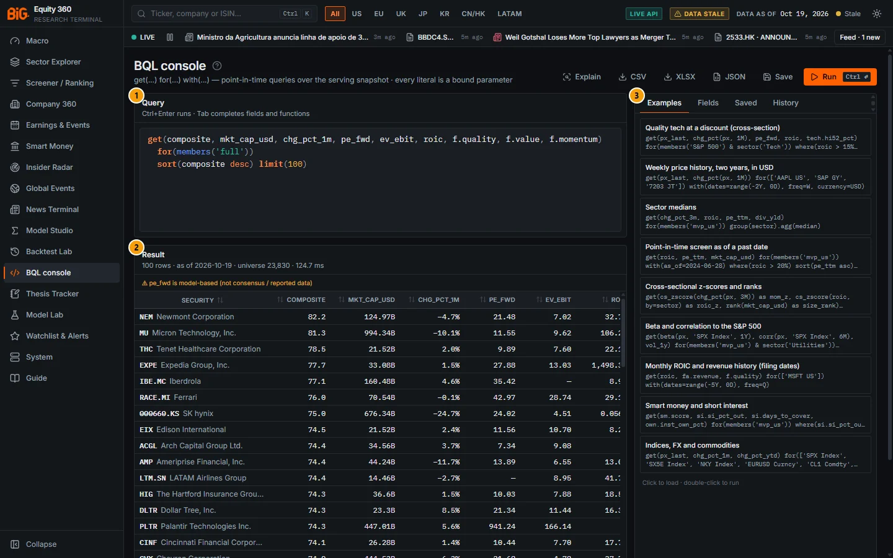

*Figure 14.17: **Open as BQL** from the Screener with no filters: the generated query over `members('full')`, 100 rows, universe 23,830, sorted by composite.*

| # | Panel | What it shows |
|---|---|---|
| 1 | Query | `get(composite, mkt_cap_usd, chg_pct_1m, pe_fwd, ev_ebit, roic, f.quality, f.value, f.momentum) for(members('full')) sort(composite desc) limit(100)`. |
| 2 | Result | 100 rows · as of 2026-10-19 · universe 23,830 · 124.7 ms, with the pe_fwd model-based warning; Newmont (composite 82.2) first. |
| 3 | Side panel | Examples tab. |

### Model Studio: BQL query variable source

In Model Studio's variable picker, the source **BQL query (expression, point-in-time on the serving snapshot)** adds any BQL expression as a dataset column ("BQL expression — evaluated point-in-time at every dataset date on the serving snapshot (cross-sectional functions run over the dataset's securities)"). Type an expression such as `cs_zscore(roic) - cs_zscore(pe_ttm)` and add it with the role you need (y, x, ...). Snapshot-only fields are refused for dated panels, as in the console. See [Model Studio](09-model-studio.md#model-studio).

### Backtest Lab: BQL expression signal source

In the Backtest Lab builder, the signal source **BQL expression (cross-sectional, point-in-time per rebalance)** takes an expression such as `cs_zscore(chg_pct(px, 3M)) - cs_zscore(pe_ttm)` (hover: "Evaluated point-in-time at every rebalance date (BQL-lite; see the BQL console for fields and functions)"). The expression is evaluated on each rebalance date with only the data known then, and cross-sectional functions run over the backtest universe. The run notes record how many rebalance dates were evaluated. See [Backtest Lab](11-backtest-lab.md#backtest-lab).
