# 15. System, Data Health and QA

The System section is where you check whether the numbers on every other page can be trusted today. It has three pages and one background guard:

| Page or component | Route | Answers the question |
|---|---|---|
| [System overview](#system-overview) | `/system` | Is the scheduler running, when did the last refresh finish, how fresh is each source, which jobs failed? |
| [Data Health](#data-health) | `/system/data-health` | What data should the app hold, what is missing or stale beyond its SLA, and how is the background gap filler repairing it? |
| [Conformal validation](#conformal-validation) | `/system/conformal` | Which conformal outputs passed their validation gate, and are they still hitting their target coverage in the nightly audit? |
| [QA guard](#qa-guard) | panel on `/system/data-health`, CLI `python -m app.qa` | Did the API contract sweep, the golden data checks and the UI smoke suite pass after the last refresh? |

All three pages are read-only views except one control: the schedule profile switch on the System page. Nothing on these pages shows an API key value; the Backend panel lists only key **names** with a tick or a cross.

---

## System overview

**Route:** `/system` · **Menu:** System › Overview · **Mnemonics:** none · **Refresh:** status is read on page load and with the **Refresh** button; the Real-time layer panel polls every 30 s

### Purpose

The System page is the operations dashboard of the app. Use it first thing in the morning, or whenever a number looks old, to confirm that the scheduler is on, that the last refresh completed, which data date each region is on, and whether any job failed. It is also where you switch the refresh schedule between the weekly and daily profiles. Portfolio managers need only the top panels (alerts, Scheduler, data as of); the source and job tables are for the app's owner and IT.

### Screenshot

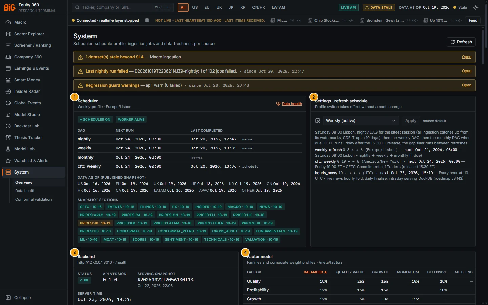

*Figure 15.1: System overview (`/system`), status read on 23 Oct 2026 14:26 Lisbon time; serving snapshot R20261022T2056130T13, data as of 19 Oct 2026.*

Above the numbered panels, the **ops alert banner** lists red (error) and amber (warn) alerts, each with an **Open** link (see "Alerts" under Methodology). In the figure it shows three amber alerts. Info alerts are not shown in the banner.

| # | Panel | What it shows |
|---|---|---|
| 1 | Scheduler | Scheduler on / off, worker alive / down, catch-up due, the next run and last completed run (with its trigger) of each DAG (`nightly`, `weekly`, `monthly`, `cftc_weekly`), the published data date per region and the snapshot section badges. Link **Data health**. |
| 2 | Settings · refresh schedule | The schedule profile select (**Weekly**, **Daily**, **Intraday (placeholder)**) with **Apply**, where the active profile came from (`source default`), the profile description and its entries (cron, time zone, next run). |
| 3 | Backend | `/health` status, API version, serving snapshot id and build time, server time, API keys configured (names only, tick or cross), universe counts. |
| 4 | Factor model | The factor families and the composite weight profiles used by the composite score (default profile starred, here **Balanced**). |
| 5 | Real-time layer | Supervisor, bus, queue and heartbeat of the live layer (`GET /live/status`), one row per stream or consumer, and this browser's SSE connection with **Pause** / **Resume**. |
| 6 | Summary stats | Sources fresh (of all region rows), Stale, Errors, Job success rate over the last completed runs, Status as of. |
| 7 | Preferences & connection | Data mode (Live API or Mock), API base URL, the number and date locale select, and the chart / map / events attributions. |
| 8 | Data sources | Freshness of every source table against its expected cadence, **Per dataset** or **Per region**. |
| 9 | Job runs | The last 100 job runs (APScheduler ingestion and analytics jobs) with status, start, duration, rows and message; filter **All**, **Failed / partial**, **Running / queued**. |

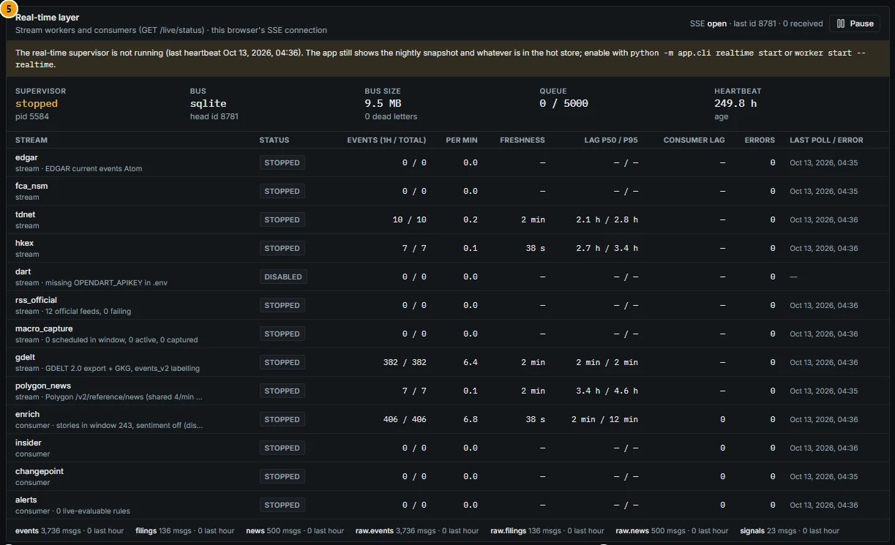

*Figure 15.2: Real-time layer (panel 5). Here the real-time supervisor is stopped (last heartbeat 13 Oct 2026); the yellow notice says the app still shows the nightly snapshot and how to start the layer. The `dart` stream is disabled because its key is not configured.*

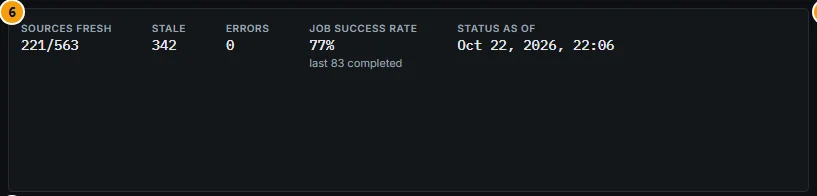

*Figure 15.3: Summary stats (panel 6): 221 of 563 source × region rows fresh, 342 stale, 0 errors, job success rate 77% over the last 83 completed runs.*

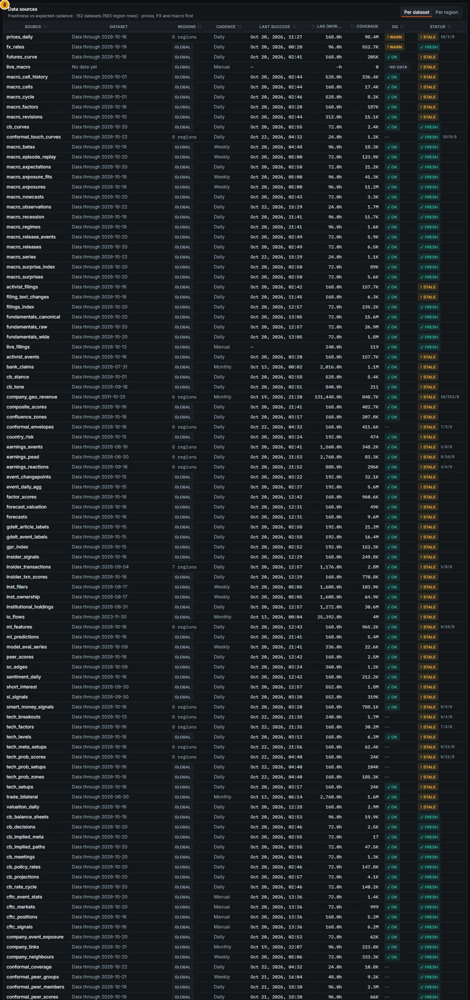

*Figure 15.4: Data sources (panel 8), **Per dataset** view: 152 datasets (563 region rows), prices, FX and macro first. Each row shows source table, "Data through" date, regions, cadence, last success, worst lag, coverage, DQ and status with fresh / stale / error counts for multi-region tables.*

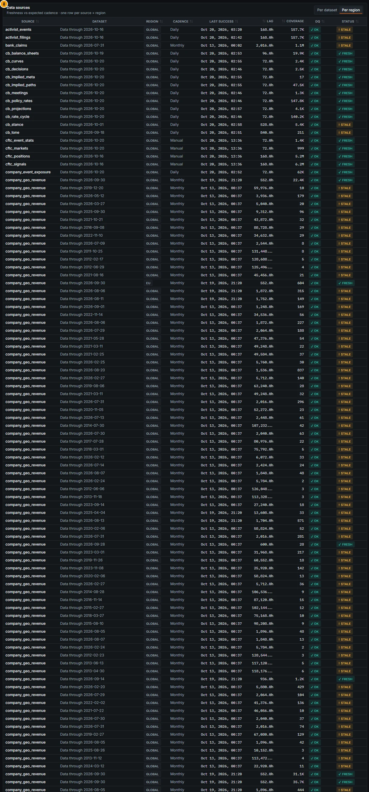

*Figure 15.5: Data sources (panel 8) in the **Per region** view: one row per source × region. `company_geo_revenue` alone has dozens of rows (one per region combination, many with data dates years old and therefore "stale"), which is why the Per dataset view is the default.*

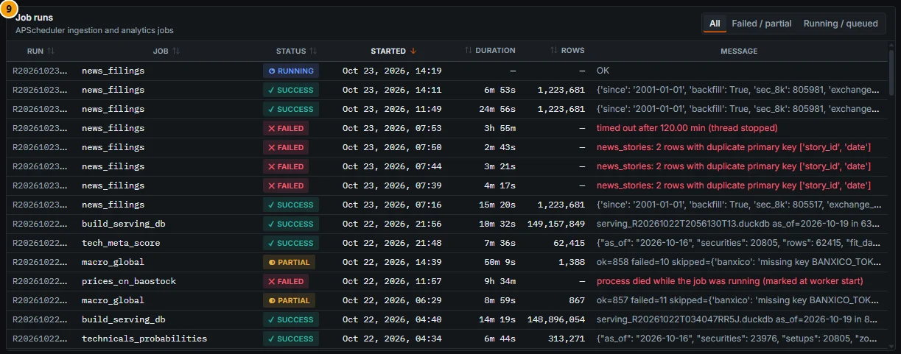

*Figure 15.6: Job runs (panel 9), filter **All**, newest first. Failed runs show their error in red (here a timeout and a duplicate-key contract violation of `news_filings`).*

### Controls

| Control | What it does |
|---|---|
| **Refresh** (page header) | Re-reads `/system/status` and the job runs. The icon spins while it loads. |
| Alert **Open** link | Jumps to the page named by the alert (`/system` or `/system/data-health`). |
| **Data health** link (Scheduler panel) | Opens [Data Health](#data-health). |
| Snapshot section badges (hover) | Show the job that feeds the section and how far it is behind the snapshot date. Green = fresh, amber = stale, red = error. |
| **Schedule profile** select + **Apply** | Switches the refresh profile (`PUT /api/v1/system/schedule`). **Apply** is disabled until you pick a profile other than the active one. A toast confirms: "The worker applies it within a few seconds" (worker running) or "Applied when the worker starts". A **worker still on …** badge shows until the worker has picked the change up. |
| SSE **Pause** / **Resume** (Real-time layer) | Pauses or resumes live updates in this browser only. It does not stop the server-side streams. |
| **Number locale** select | Sets the number and date format for the whole app in this browser: English (US), English (UK), Português (PT), Deutsch (DE), Français (FR), 日本語 (JP). |
| **Source rows**: **Per dataset** / **Per region** | Per dataset shows one row per source table (worst status across its regions; hover the Regions cell for the freshest and stalest region and their lag). Per region shows one row per source × region (Figure 15.5); click a header to sort. |
| **Job filter**: **All** / **Failed / partial** / **Running / queued** | Filters the Job runs table. |
| Table headers | Click to sort; hover the Dataset cell to see the writing job id; hover the DQ and Coverage headers for their definitions. |
| TradingView link | Opens the TradingView Lightweight Charts site (attribution). |

The tray menu offers the same profile switch (**Schedule ▸ Weekly / Daily**) and **Run refresh now**; see [Getting started](00-getting-started.md#tray-icon-and-menu).

### Methodology

#### Scheduler state and profiles

The worker maps the active profile in `config/schedule.yaml` to APScheduler triggers:

| Profile | When it refreshes | Freshness SLA used by Data Health |
|---|---|---|
| **Weekly** (default) | Saturday 08:00 Lisbon: the nightly DAG for the latest session (ingestion catches up from its watermarks, GDELT up to 10 days), then the weekly DAG, then the monthly DAG when due. CFTC Friday 19:00 ET (after the 15:30 ET release). | 9 days |
| **Daily** | The `contracts/jobs.yaml` crons: nightly Tue–Sat 01:30, weekly Saturday 06:00, monthly first Sunday 08:00 (Lisbon); CFTC Friday 19:00 ET. | 3 days |
| **Intraday (placeholder)** | Behaves like Daily today ("placeholder: behaves like daily for now"). | as Daily |

Every profile also runs `hourly_news` at :10 UTC each hour (live news fold); it never wakes the PC and is never caught up.

The environment variable `BIG360_SCHEDULE_PROFILE` wins over the stored choice; the **source** text next to **Apply** says where the active profile came from (`default`, the stored state, or the environment).

**Catch-up rule.** If the PC was asleep or off at a scheduled time, an entry is due when its most recent scheduled time has passed and no completed run of its DAG finished after it. The worker checks at start and every 15 minutes; runs older than the profile's `max_catchup_days` are not replayed. A due entry shows as **catch-up due: …** in the Scheduler panel and as a "Missed scheduled run" alert.

**Last completed.** The time the DAG last finished, with its trigger (`schedule`, `manual`, `api`, ...). A manual trigger is normal after a hand-run catch-up.

**Data as of (published snapshot).** The latest market date per region in the serving snapshot. Regions can differ by several sessions (holidays, a region whose prices did not complete).

**Snapshot sections.** Since the audit fix F16, fresh market data (prices, FX, macro) publishes even when an analytics job failed; the previous analytics outputs stay in the snapshot and their section turns amber. A failure of the data-quality checks in the same run still blocks publishing.

#### Source freshness

Each row of **Data sources** is one lake table (and region where the table is regional). Its status is computed by `GET /system/status`:

```
lag = today − last data date          (forward-looking tables: today − last ingest)
fresh  if lag ≤ tolerance of the writing DAG
stale  otherwise, or if the writing job's latest run failed after its last success
missing if the table has no rows
tolerance: max(DAG tolerance, SLA of the active schedule profile)
           DAG tolerance nightly 4 days · weekly 10 days · monthly 40 days · manual none
           profile SLA weekly 9 days · daily 3 days (the same SLA Data Health uses)
```

**DQ** is the worst data-quality result of the latest load (`ok`, `info`, `no data`, `warn`, `error`). **Coverage** is the number of entities or series covered.

Per-dataset rows are ordered by criticality for a portfolio manager: prices first, then FX, macro, fundamentals, other datasets, and live streams last; within that, errors and stale rows first.

#### Alerts

| Alert | Severity | Raised when |
|---|---|---|
| Worker not running | error | No worker heartbeat. |
| Scheduler off | warn, error after 24 h | The worker runs without its scheduler. |
| Refresh overdue | error | The last completed nightly is older than the profile period + 1 day. |
| Missed scheduled run | warn | A catch-up is due. |
| Core data stale beyond SLA | error | Prices US / EU / UK / JP, FX rates or macro releases are stale or missing in Data Health. |
| N dataset(s) stale beyond SLA | warn | Any other Data Health dataset is stale or missing. |
| Last nightly run failed | warn | The latest nightly DAG run has status failed (any job failed). |
| Low disk space | warn below 25 GB, error below 15 GB | Free space on the data drive. |
| Regression guard failed / Regression guard warnings | error / warn | The latest [QA guard](#qa-guard) run failed or ended with warnings. |
| Gap filler not running / paused | info (Data Health only) | No filler heartbeat for 5 minutes, or the resource governor paused it. |

#### Job success rate

`successful runs / (successful + failed runs)` over the completed runs among the last 100 shown; partial, skipped, queued and running runs are left out.

### Data sources and refresh

- `GET /system/status` (scheduler, freshness, DQ, snapshot sections, alerts), `GET /system/jobs/runs?limit=100`, `GET /health`, `GET /system/schedule`, `GET /meta/factors`, `GET /live/status`.
- `/system/status` is computed in the background and served from a short-lived cache (coverage v3 A7, `BIG360_STATUS_TTL_S`, default 10 s): a request never waits on the heavy reads. `as_of` is the time the payload was computed, and `cache` gives its age, state (`fresh`, `stale` while one refresh runs, `partial` when some sections failed, `warming` right after an API start, `error` when nothing could be computed yet) and the last refresh error. A failed refresh keeps the previous payload, so a contract file being edited no longer turns the header and status bar into HTTP 500s (442 of them in the 2026-11 audit). Each section (freshness, DAG runs, counts, the scheduler / alerts block, pauses) fails on its own: it keeps its last good value for at most 10 minutes (`BIG360_STATUS_SECTION_MAX_REUSE_S`; `cache.section_as_of` gives when that value was computed), then shows nothing. While a section is failing the header shows the chip **Status partially stale**, the data badge never reads fresh, the System page opens with a **Status partially stale** banner naming the sections, and the tray does not re-notify alerts it already showed. The snapshot fields (`serving_run_id`, `serving_as_of`) are always the live snapshot's.
- The **Factor model** panel ends with the composite's validation label (**Descriptive** until a profile passes the out-of-sample gate of job `composite_validation`; see [Scores and factors](04-screener.md#validation-status-1)).
- Job runs come from the runner's `job_runs` table; freshness from the lake tables and the serving snapshot.
- The page reflects the state at load time. It does not auto-refresh except the Real-time layer panel (30 s).

### Validation status

Not a model: there is no validation gate. The status logic was reworked after the functional audit of 2026-10-19 (`docs/AUDIT_2026-10-19.md`, findings F01, F03, F13, F14, F16, F22), which found that the worker had been running without its scheduler and that nothing in the UI said so. The scheduler panel, the alerts and the per-dataset grouping are the fixes.

### Correct usage and worked example

Read the page top-down: alerts first, then the Scheduler panel, then only the rows of the sources you rely on.

**Example (Figure 15.1: 23 Oct 2026, 14:26 Lisbon time; snapshot `R20261022T2056130T13`, built 22 Oct 22:06).**

1. The banner shows three amber alerts: "1 dataset(s) stale beyond SLA — Macro ingestion"; "Last nightly run failed — D20261019T223621NJZ9-nightly: 1 of 102 jobs failed"; "Regression guard warnings — api: warn (0 failed)". None is red, so the core datasets (prices US / EU / UK / JP, FX, macro releases) are within their SLA.
2. Scheduler: **SCHEDULER ON**, **WORKER ALIVE**, Weekly profile, Europe/Lisbon. Next `nightly`, `weekly` and `monthly` runs 24 Oct 08:00 (the Saturday chain); next `cftc_weekly` 24 Oct 00:00 Lisbon (Friday 19:00 ET). Last completed nightly 20 Oct 12:47, trigger `manual`; `monthly` has never completed.
3. Data as of: US 16 Oct, EU and UK 19 Oct, **JP 13 Oct** (its snapshot badge `PRICES:JP · 10-13` is amber), HK and LATAM 16 Oct. Before quoting a Japanese price-based number, open [Data Health](#data-health): Prices Japan shows lag 6 sessions against an SLA of 6, so it is still "fresh" by the rule but at its limit.
4. Backend: keys configured `fred`, `polygon`, `edinet`; `opendart`, `krx_openapi_key` and others are not configured, which explains thin Korean coverage elsewhere in the app. Universe counts (from `/system/status`): 24,961 securities, 5,022 with fundamentals, 769 with a composite score.

### Limitations and pitfalls

- **Two views of freshness.** The Data sources table judges each lake table against its DAG tolerance, never stricter than the profile SLA (9 days under Weekly), while Data Health judges curated datasets against expected calendars. Figure 15.3 was captured when the table still used fixed 4-day tolerances under the Weekly profile (342 stale of 563 rows); the two views now agree much more closely. For "is my data usable", Data Health remains the reference because it knows each dataset's calendar.
- "Fresh" means "within tolerance", not "updated today".
- The Job runs table shows only the last 100 runs.
- The header's freshness chip and this page describe the **serving snapshot**. A job that finished after the last snapshot build is not visible on other pages until the next build.
- Changing the profile changes when refreshes run, not what they contain. Switching to Daily on a laptop that sleeps at night produces catch-up runs in the morning.
- The **Report** path in the Regression guard panel (Data Health) is a local file path on the machine that ran the check.

### Related mnemonics and BQL fields

- No command-bar function opens the System pages; use the menu or the tray (**Data health**).
- No BQL fields. For scripts, `GET /api/v1/system/status` and `python -m app.cli jobs status` (from `backend\`) give the same information.
- Related: [Data and coverage](01-data-and-coverage.md#data-health-overview), [Troubleshooting and FAQ](18-troubleshooting-faq.md#troubleshooting), [Good practice: stale data](17-good-practice.md#stale-data).

---

## Data Health

**Route:** `/system/data-health` · **Menu:** System › Data health · **Mnemonics:** none · **Refresh:** on page load and with **Refresh**; the gap detector runs after every nightly build and daily from the gap filler

### Purpose

Data Health is the window onto the **Data Ops supervisor** (`docs/OPERATIONS_ROADMAP.md` O1): the app knows what data it should have, finds what is missing or stale, and fills it in the background with the same code as the live updates. Use the page to answer "can I rely on dataset X as of today?", to see why a region or a history is incomplete, and to follow long backfills. It also hosts the regression-guard result, the live-news service health and the conformal coverage audit.

### Screenshot

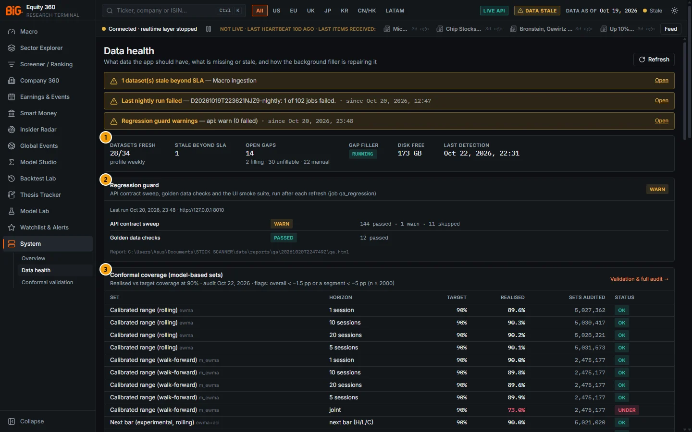

*Figure 15.7: Data Health (`/system/data-health`), 23 Oct 2026 14:26 Lisbon time, Weekly profile.*

The same **ops alert banner** as on the System page sits above the numbered panels.

| # | Panel | What it shows |
|---|---|---|
| 1 | Summary stats | Datasets fresh (with the active profile), Stale beyond SLA, Open gaps (with filling / unfillable / manual counts), Gap filler state and pause reasons, Disk free, Last detection. |
| 2 | Regression guard | The latest [QA guard](#qa-guard) run: overall status, one row per suite with counts, the first ten failed checks and the report path. |
| 3 | Conformal coverage (model-based sets) | Realised vs target coverage at 90% of the conformal sets (rolling audit and walk-forward rows) and the flagged segments; link **Validation & full audit →**. |
| 4 | Freshness heatmap | The day-level datasets × the last 21 days: share of expected entities present each day, status and data as-of; below it the table of every registered dataset. |
| 5 | Backfill campaigns | Long resumable backfills run by the gap filler, with progress bars, ETA, rate per hour and last error. |
| 6 | Gap filler & resource governor | Filler process state, pause reasons, free RAM, filler RAM, power, network, disk, priority and maximum tasks; running, waiting and recent tasks. |
| 7 | Gap queue | Every tracked gap with priority, class, status, period, actual / expected, tries and next try; filter **Active** / **Unfillable** / **Manual** / **All**. |
| 8 | Sources | Live-job health per source over 14 days and the filler's rate-budget use in the last hour. |
| 9 | SLA breaches & recent failures | Datasets beyond their SLA, failed job runs of the last 7 days, and the info alerts as badges. |

> **Note:** The current code also renders a **Live news** panel between the Regression guard and the Conformal coverage panels (real-time news service state and memory, publish-to-bus latency p50 / p95, pipeline latency, GDELT release-to-hot lag, items per hour, last feed poll and failing feeds, hourly fold, intraday store, link **News Terminal**). It is not visible in the build captured for Figure 15.7.

> **Data sync panel (API 1.41, startup sync).** Above the Regression guard, **Data sync** (anchor `#sync`, the target of the header chip) shows the last or running startup sync: state and trigger, data as of, progress (datasets checked / due / fetched / skipped, jobs done / total), duration, peak RAM, next sync, a badge per reason code, and **Sync now**. **Needs attention** lists every dataset that is not up to date, **All datasets** every row, **Jobs** the jobs the sync ran (pass, lane, status, start, duration, rows, message). Each dataset row gives the status (Up to date, Fetching, Not published yet, Source unavailable, No source, Needs API key, Failed: hover for the meaning), data as of, expected date, next update (or the retry time), the jobs run for it with their durations, and the reason or detail (missing key names, retry time, attempt). The chevron opens its entities (regions, currencies, sources, countries). Below the table: the publishes (none, section-incremental with the sections rebuilt, or full build) and the run's notes. Not shown on older APIs.
>
> **How the sync works.** About 90 s after BiG360.exe starts (once the API answers), every 30 min while the app is open, and on **Sync now** (tray or this panel), the supervisor starts `python -m app.ops.sync run`. It compares every coverage dataset with its expected latest period from real calendars (exchange closes plus a publish delay, the ECB fixing, the macro release calendar, the CFTC Friday release, the 13F deadline, the FINRA publication date, the GDELT day close), fetches only what is due in parallel network lanes, recomputes the analytics whose inputs changed (heavy steps one at a time), and republishes only the changed serving sections. Data that is not available yet is skipped with its reason and retried automatically; nothing aborts the run, and a failed job marks only its own section stale. The header shows **Syncing data… n/m**, then **Data up to date as of …** or **N skipped** (link to this panel); the tray shows a toast when a sync finishes with failures.

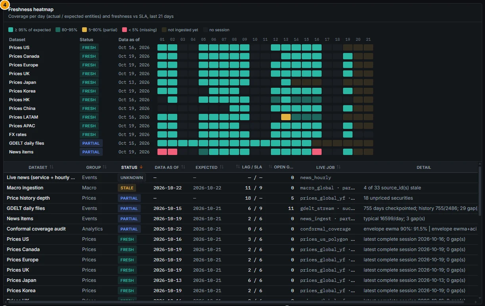

*Figure 15.8: Freshness heatmap (panel 4). Prices Japan stops at 13 Oct (later days "not ingested yet"); News items shows red "< 5% (missing)" cells on 1, 2 and 16 Oct. The dataset table below is sorted by status: Macro ingestion is the only stale dataset (lag 11 / SLA 9).*

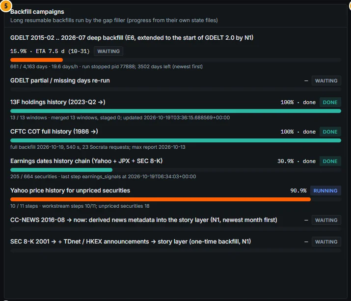

*Figure 15.9: Backfill campaigns (panel 5): GDELT deep backfill 15.9% (661 of 4,163 days, 19.6 days per hour, ETA 7.5 days), 13F and CFTC histories done, Yahoo price history for unpriced securities running at 90.9%.*

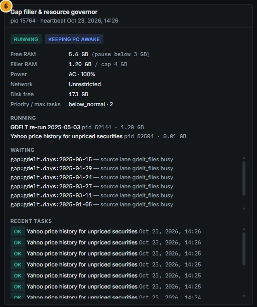

*Figure 15.10: Gap filler & resource governor (panel 6): running and keeping the PC awake; 5.6 GB free RAM (pauses below 3 GB), filler 1.20 GB of its 4 GB cap, AC power, unrestricted network, below-normal priority, at most 2 tasks. GDELT gaps wait because the `gdelt_files` source lane is busy.*

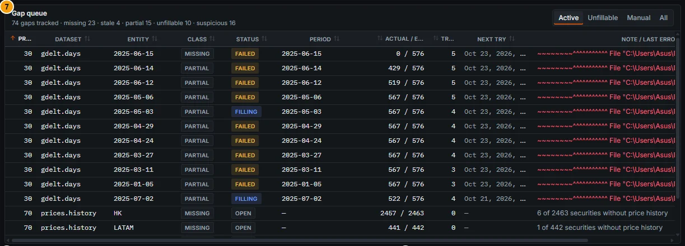

*Figure 15.11: Gap queue (panel 7), filter **Active**: GDELT days with 429–567 of 576 files are partial and being retried; two `prices.history` gaps are open.*

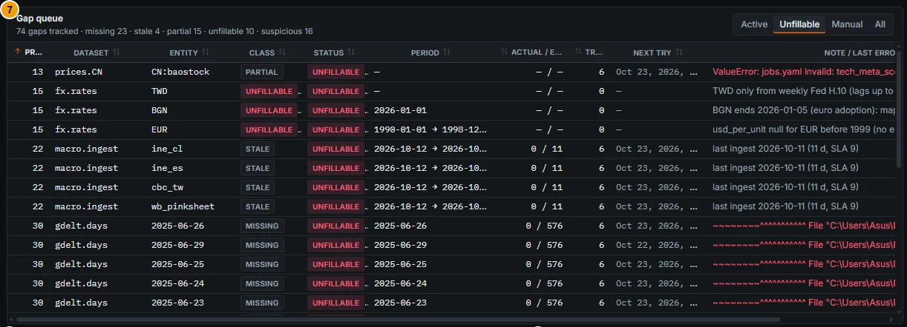

*Figure 15.12: Gap queue with the filter on **Unfillable**: Shanghai names without BaoStock (`CN:baostock`), FX gaps that no official source fills (TWD from the weekly Fed H.10 only, BGN after the euro adoption, EUR before 1999), macro sources stuck beyond their SLA (`ine_cl`, `ine_es`, `cbc_tw`, `wb_pinksheet`), and GDELT days with 0 of 576 files after 6 tries. The note column says why each gap cannot be filled.*

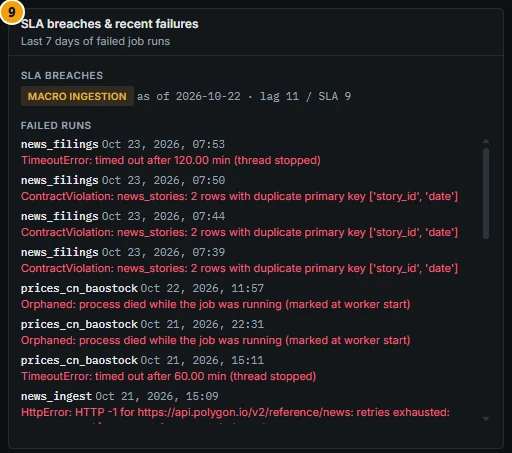

*Figure 15.13: SLA breaches & recent failures (panel 9): Macro ingestion as of 22 Oct, lag 11 / SLA 9; failed runs of `news_filings`, `prices_cn_baostock` and `news_ingest` with their error type.*

### Controls

| Control | What it does |
|---|---|
| **Refresh** | Re-reads `GET /system/data-health`. |
| Alert **Open** links | As on the System page. |
| Heatmap cells (hover or focus) | Tooltip "dataset · date: N% of expected", "no session", or "(after the data as-of: not ingested yet)". |
| Heatmap legend | ≥ 95% of expected · 80–95% · 5–80% (partial) · < 5% (missing) · not ingested yet · no session. |
| Dataset name (hover) | Shows the dataset's detail line or registry id. |
| Dataset table headers | Sort by status, data as of, expected, Lag / SLA (hover: "Sessions (or days) behind the expected date vs the profile-adjusted SLA"), open gaps, live job. |
| **Gap filter**: **Active** / **Unfillable** / **Manual** / **All** | Active = open, queued, filling and failed gaps; Unfillable = the source has no data; Manual = needs a code or data fix, not a re-fetch; All = every gap including filled ones. |
| Gap note (hover) | Shows the full last error. |
| Source last error (hover) | Shows the source note. |
| **Validation & full audit →** | Opens [Conformal validation](#conformal-validation). |

**Pausing the gap filler.** There is no pause button on the page. Use the tray menu **Pause / Resume background jobs**, which creates or removes the flag file `data\state\ops\filler.PAUSE`; the filler then reports the reason "manual pause". A pause expires: the flag carries an `until=` time, 24 h after the tray or `python -m app.ops.pause set` created it. A file without `until=` expires 7 days after it was written. The Gap filler panel shows who paused it, the reason and the expiry, and an expired flag is shown as ignored. Scheduled refreshes still run while it is paused. Stopping it entirely uses `data\state\ops\filler.STOP` or the supervisor.

### Methodology

#### Coverage registry and gap detector

Each dataset is declared in `contracts/coverage.yaml` with its expected cadence (exchange calendars for prices, official release calendars for macro, the CFTC Friday schedule, 13F deadlines), the expected set of entities, the freshness SLA, its sources, priority and a backfill function. The job `data_gaps_detect` (after `build_serving_db` in the nightly DAG, and every 24 h from the filler) compares expected with actual:

```
cell(dataset, day) = actual entities / expected entities        (null = no session that day)
lag   = sessions (or days) between the latest complete date and the expected latest date
SLA   = the dataset's SLA, adjusted to the active profile (weekly profile: 9 days)
status: fresh (lag ≤ SLA) · stale (lag > SLA) · partial (fresh but with open partial gaps) · missing · unknown
```

Each gap gets a **class** and a **status**:

| Class | Meaning |
|---|---|
| Missing | Expected data is absent (a whole session or period). |
| Stale | The dataset lags beyond its SLA. |
| Partial | Some entities are missing (for example a GDELT day with 512 of 576 files, a session with half the names). |
| Suspicious | Data exists but failed a check: DQ failure, unit or FX glitch, ticker reuse, and conformal under-coverage. |
| Unfillable | The source has no data; recorded so that nothing retries it. The note says what would fix it. |

| Status | Meaning |
|---|---|
| open → queued → filling | Waiting, scheduled and being repaired by the filler. |
| failed | The last attempt failed; it is retried with exponential back-off until `max_attempts`, then becomes unfillable. |
| manual | The filler cannot repair it (needs a code fix, a key or a decision). Known issues from the audit and `docs/PHASE3_TODO.md` are seeded here. |
| unfillable | No retry. |
| filled | No longer detected; kept with its resolution time. |

#### Gap filler and resource governor

The filler (`python -m app.ops.filler`, started by the supervisor) is a long-running low-priority process. Every 15 s it reaps finished tasks, asks the governor whether it may run, then starts the most urgent due work that fits, one task per source lane. Defaults from `config/ops.yaml`:

| Rule | Default |
|---|---|
| RAM cap of the filler's process tree | 4 GB (above 1.5 × cap the least urgent preemptible task is stopped) |
| Pause when free RAM is below / resume above | 3.0 GB / 3.5 GB |
| Maximum concurrent tasks | 2 |
| CPU priority | below normal |
| Pause on battery / on a metered network (phone hotspot) | yes / yes |
| Minimum free disk | 15 GB |
| Yield to refresh DAGs | heavy tasks stop while `nightly`, `weekly` or `monthly` runs |

Tasks are resumable, so a pause loses no work. Per-source **rate budgets** (Polygon about 5 per minute, SEC 10 requests per second, GDELT bandwidth, official-API limits) are shown in the Sources panel as "used in the last hour / per hour". The filler keeps the PC awake only while tasks run on AC power, and runs housekeeping every 6 hours (log rotation, two serving snapshots kept, disk guard).

#### Backfill campaigns

Campaigns are long backfills folded into the filler (GDELT E6 deep history, GDELT partial-day re-runs, 13F history, CFTC history, earnings-dates chain, Yahoo price history, CC-NEWS metadata, SEC 8-K / TDnet / HKEX announcements). Progress comes from each campaign's own state file; status is running, waiting, backoff or done.

#### Sources

Per source, over 14 days of live-job runs: **failing** after 3 consecutive failed runs, **degraded** after at least one failure in the current streak or when more than a third of runs failed, **ok** otherwise, **idle** without runs.

#### Conformal coverage flags

The coverage panel and the detector read the nightly audit table `conformal_coverage`. A rolling-audit segment is flagged when realised coverage is **more than 1.5 pp under target overall**, or **more than 5 pp under target in a segment with n ≥ 2,000** (`docs/CONFORMAL_VALIDATION.md`, "Coverage audit"). The detector records such segments as *suspicious* gaps with status *manual*: they are model issues, not data the filler can re-fetch. See [Conformal validation](#conformal-validation) for how to read them.

### Data sources and refresh

- `GET /system/data-health` (registry status, heatmap, gaps, campaigns, filler, sources, failures, SLA breaches, alerts, QA summary); `GET /conformal/coverage`; `GET /live/news` for the live-news panel.
- State files: `data/state/ops/coverage_status.json` (detector), `data/state/ops/filler.json` (filler), `data/state/ops/qa_regression.json` (QA).
- The heatmap covers the last 21 days. Detection runs nightly after the snapshot build and every 24 h from the filler.

### Validation status

Not a model: no validation gate. The coverage registry, detector and filler are operations tooling (O1.1–O1.8 complete; O1.9 "live switch-over and first unattended weekly run observed" was still open in `docs/OPERATIONS_ROADMAP.md` at the time of writing).

### Correct usage and worked example

Before using a dataset for a decision, find its row in the dataset table: status, data as of and Lag / SLA. If it is not fresh, check the Gap queue (filter **All**, sort by dataset) for the reason.

**Example (Figure 15.7, 23 Oct 2026; profile Weekly, SLA 9 days).**

- Summary: 28 of 34 datasets fresh, 1 stale beyond SLA, 14 open gaps (2 filling, 30 unfillable, 22 manual), filler RUNNING, 173 GB free, last detection 22 Oct 22:31.
- **Macro ingestion** is stale: "4 of 33 source_id(s) stale", lag 11 vs SLA 9. It is the only SLA breach and the cause of the amber alert. Macro releases themselves are fresh ("0 of 104 releases in the last 30 days still pending").
- **Prices Japan**: data as of 13 Oct, expected 21 Oct, lag 6 / SLA 6, status fresh. One more missing session would turn it stale.
- **GDELT daily files** are partial: "755 days checkpointed; history 755/2486; 29 gap(s)". Event-based history is still being backfilled (campaign at 15.9%).
- Gap queue, filter **Manual**: for example "SPCX/BNY/FIG" (audit F04: ticker reuse stitched into one price series) and the UK "100x flips" (audit F32) are *suspicious* data that need a fix, not missing data. Filter **Unfillable** (Figure 15.12): "TWD" (FX only from the weekly Fed H.10) and "CN:baostock" (424 Shanghai names without the BaoStock feed).
- Regression guard: WARN — API contract sweep 144 passed, 1 warn, 11 skipped; golden data checks 12 passed.

### Limitations and pitfalls

- "Fresh" is relative to the profile SLA. Under the Weekly profile a dataset can be up to 9 days behind and still be fresh.
- Datasets not in `contracts/coverage.yaml` are not tracked here (see the System page's source table for every lake table).
- *Partial* in the heatmap can mean a genuine hole or a late source. A cell after the dataset's data as-of is "not ingested yet", not a hole.
- *Suspicious* gaps with status *manual* (ticker reuse, unit flips, conformal under-coverage) do not block publishing. The affected numbers stay in the app until fixed; check the queue before relying on an outlier.
- The page shows the filler's last heartbeat; if it is older than 5 minutes the filler is treated as not running.
- Error notes in the Gap queue and the Report path of the Regression guard show local file paths of the machine (including the Windows user folder). Crop them out before sharing a screenshot outside your team.

### Related mnemonics and BQL fields

- No command-bar function; the tray menu item **Data health** opens this page.
- No BQL fields.
- Related: [System overview](#system-overview), [Conformal validation](#conformal-validation), [QA guard](#qa-guard), [Data and coverage](01-data-and-coverage.md#data-health-overview), [Good practice: coverage gaps by region](17-good-practice.md#coverage-gaps-by-region).

---

## Conformal validation

**Route:** `/system/conformal` (`/conformal` redirects here) · **Menu:** System › Conformal validation · **Mnemonics:** none · **Refresh:** nightly audit (`conformal_coverage` job); the gate itself changes only when the validation is re-run

### Purpose

This page is the audit trail of the conformal sets used on the Technicals chart (calibrated range and fan), in the touch probabilities, and in the peer-group anomaly panels. It shows which applications passed the P4 validation gate of `docs/CONFORMAL_VALIDATION.md` (and are shown in the app, labelled model-based), which failed and stay experimental in Model Studio and the Backtest Lab, and whether the nightly rolling audit still finds the target coverage. Use it when you cite a "calibrated band" or a touch probability, or when the Data Health panel shows a coverage flag.

### Screenshot

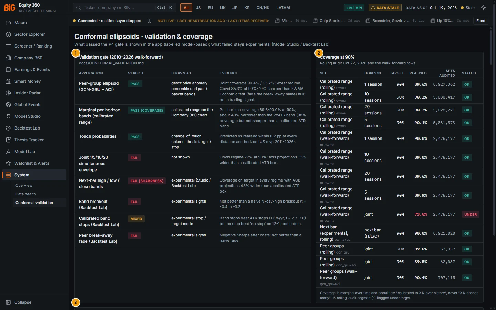

*Figure 15.14: Conformal ellipsoids · validation & coverage (`/system/conformal`), rolling audit of 22 Oct 2026.*

| # | Panel | What it shows |
|---|---|---|
| 1 | Validation gate (2010–2026 walk-forward) | One row per application: verdict badge (PASS, PASS (COVERAGE), MIXED, FAIL (SHARPNESS), FAIL), how it is shown in the app, and the evidence. |
| 2 | Coverage at 90% | Headline realised coverage at the 90% level: the rolling audit (latest date) and the walk-forward rows, with status badges and the number of flagged rolling-audit segments. |
| 3 | Production configuration | The filters and radii in production (JSON): envelopes `ewma` with a plain radius for the joint and marginal bands and ACI for the next bar, learned head not deployed; peer groups `gcn_gru` with ACI, fallback `ewma_lr`, and the model and group versions. |
| 4 | Validation report | The full text of `docs/CONFORMAL_VALIDATION.md`, with its tables rendered as monospace blocks. |

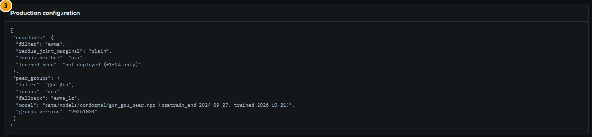

*Figure 15.15: Production configuration (panel 3).*

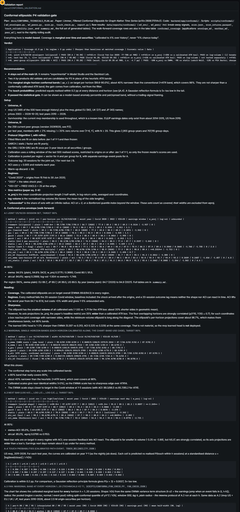

*Figure 15.16: Validation report (panel 4), the validation document rendered in the app.*

### Controls

The page has no inputs. Scroll the Validation report; wide tables scroll horizontally inside their block. The **Validation & full audit →** link on Data Health and the "calibrated band" links on the Technicals tab lead here.

### Methodology

#### The gate

The P4 gate (walk-forward 2010–2026, test years 2010 → 2026) required, per application:

1. coverage within ±1.5 pp of target (90% and 95%);
2. no regime more than 5 pp under target (Covid 2020 = origins 15 Feb – 30 Jun 2020, 2022, VIX > 25);
3. sharper than the baselines at matched coverage on **w_proj** (mean axis-projection width) — log-volume is reported too;
4. economic value in a Backtest Lab test with costs.

The verdicts shown on the page (from `GET /conformal/coverage`, field `gates`):

| Application | Verdict | Shown as | Evidence (as on the page) |
|---|---|---|---|
| Peer-group ellipsoid (GCN-GRU + ACI) | PASS | descriptive anomaly percentile and pair / basket bands | Joint coverage 90.4% / 95.2%; worst regime Covid 85.3% at 90%; 10% sharper than EWMA. Economic test (fade the break-away name) null: not a trading signal. |
| Marginal per-horizon bands (calibrated range) | PASS (coverage) | calibrated range on the Company 360 chart | Per-horizon coverage 89.6–90.0% at 90%; about 40% narrower than the 2×ATR band (98% coverage) but not sharper than a calibrated ATR band. |
| Touch probabilities | PASS | chance-of-touch column, thesis target / stop | Predicted vs realised within 0.2 pp at every distance and horizon (US mvp 2011–2026). |
| Joint 1/5/10/20 simultaneous envelope | FAIL | not shown | Covid regime 77% at 90%; axis projections 35% wider than a calibrated ATR box. |
| Next-bar high / low / close bands | FAIL (sharpness) | experimental (Studio / Backtest Lab) | Coverage on target in every regime with ACI; projections 43% wider than a calibrated ATR box. |
| Band breakout (Backtest Lab) | FAIL | experimental signal | Not better than a naive N-day-high breakout (t = −0.4 to −3.2). |
| Calibrated band stops (Backtest Lab) | MIXED | experimental stop / target mode | Band stops beat ATR stops (+6%/yr, t = 2.7–3.6) but no stop beat "no stop" on 12-1 momentum. |
| Peer break-away fade (Backtest Lab) | FAIL | experimental signal | Negative Sharpe after costs; not better than a naive fade. |

#### Rolling audit versus walk-forward rows

- **Walk-forward rows** (`envelope_wf`, `nextbar_wf`, `peer_wf`) are the fixed results of the validation itself (frozen models, test years 2010–2026). They do not change nightly.
- **Rolling audit rows** (`envelope`, `nextbar`, `peer`) are recomputed every night by `conformal_envelopes`, `conformal_peer_groups` and `conformal_coverage` on the most recent realised outcomes (about the last year of origins), per region, sector, group kind, year, macro regime and high-VIX segment.

Each row has a status: **ok** if |realised − target| ≤ 1.5 pp, **under** or **over** otherwise, **thin** if n < 200.

The headline table keeps, at the 90% level and the overall segment: the rolling marginal bands at 1, 5, 10 and 20 sessions (EWMA), the walk-forward marginal bands (m_ewma), the rolling next-bar set (ACI), the rolling peer-group joint sets, and the walk-forward peer-group set (GCN-GRU + ACI).

**Flag rule.** A rolling-audit row is flagged when it is under target by more than 1.5 pp overall, or by more than 5 pp in any segment with n ≥ 2,000. Walk-forward rows are never flagged. The count appears under the coverage table; the list is in the Data Health panel.

### Data sources and refresh

- `GET /conformal/coverage?include_doc=true` (rows, flags, gates, production configuration, the validation document).
- Nightly jobs `conformal_envelopes`, `conformal_peer_groups`, `conformal_coverage`; weekly `conformal_peer_groups_fit`.
- Gate verdicts change only when the validation scripts (`scripts/conformal/`) are re-run and the document updated.

### Validation status

This page *is* the validation status of the conformal family. In short (`docs/CONFORMAL_VALIDATION.md`, Verdict and Recommendation): the joint envelope **failed** and is not in the main UI; the next-bar set **failed on sharpness** and is experimental; the marginal single-horizon bands and the touch probabilities **validated** as by-products and are shown, labelled "calibrated band"; the peer-group ellipsoid **passed** as a calibrated descriptive measure and is **not** a trading signal. Coverage is marginal over time and securities: "calibrated to X% over history", never "X% chance today".

### Correct usage and worked example

**Example (Figure 15.14, audit dated 22 Oct 2026).** The Coverage at 90% panel showed:

| Set | Horizon | Realised | n | Status |
|---|---|---|---|---|
| Calibrated range (rolling) | 1 / 5 / 10 / 20 sessions | 89.6% / 90.1% / 90.3% / 90.2% | about 5.03 M each | ok |
| Calibrated range (walk-forward) | 1 / 5 / 10 / 20 sessions | 90.0% / 89.9% / 89.8% / 89.6% | 2,475,177 | ok |
| Calibrated range (walk-forward) | joint | 73.0% | 2,475,177 | under |
| Next bar (experimental, rolling) | next bar (H/L/C), ACI | 90.0% | 5,021,020 | ok |
| Peer groups (rolling) | joint, GCN-GRU / GCN-GRU + ACI | 89.0% / 89.5% | 62,037 | ok |
| Peer groups (walk-forward) | joint, GCN-GRU + ACI | 90.4% | 707,115 | ok |

How to read it:

- The 20-session calibrated band on a Company 360 chart can be cited as "calibrated to 90% over history (2010–2026 walk-forward: 89.6%; last year's rolling audit: 90.2%)".
- The **joint 73.0% "under"** row is expected, not a fault: it is the share of origins where all four marginal 90% bands covered at once. Marginal bands are calibrated one horizon at a time and are not simultaneous bands. Do not read the four bands of a fan as a joint 90% statement.
- 15 rolling-audit segments were flagged. Most are the experimental next-bar set on **gap days** (realised 13.0% at 90% on 26,561 days with a large overnight gap) and peer groups in specific segments (CN region 84.6% at 90%, n = 4,766; the GLOBAL contraction quadrant 82.3%, n = 2,253). These say where the sets are known to under-cover; they do not invalidate the overall result, but treat a peer-group anomaly percentile for a Chinese group, or a next-bar band on an earnings or gap day, with extra caution.

### Limitations and pitfalls

- Coverage is **marginal**: averaged over all securities and days of a pool. It is not a guarantee for one stock on one day.
- Per-regime coverage is reported, not guaranteed. No method tested meets the regime criterion for the 20-session joint set in a sudden crash (Feb–Mar 2020).
- The validation used current mvp membership and current sectors (survivorship bias), and EU / JP earnings dates only from about 2014–2015.
- The rolling audit covers roughly the last year; a calm year says little about the next stress episode.
- The PASS for peer groups is statistical only: fading the break-away member had no economic value after costs.

### Related mnemonics and BQL fields

- `GP` / `TECH` open the Technicals view where the calibrated bands and touch probabilities are drawn; `RV` opens the peer comparison with the conformal peer-group panel.
- BQL fields under `cf.*` (conformal) expose the bands and anomaly scores; see [BQL and mnemonics](14-bql-mnemonics.md#field-dictionary).
- Related: [Technicals](05b-company-technicals.md#technicals), [Methodology: conformal prediction](16-methodology.md#conformal-prediction), [Gate status of every model](16-methodology.md#gate-status-of-every-model).

---

## QA guard

**Route:** panel **Regression guard** on `/system/data-health`; summary also at `GET /api/v1/system/qa` · **Menu:** System › Data health · **Mnemonics:** none · **Refresh:** job `qa_regression` after each refresh (in the Weekly profile, inside the Saturday chain right after the snapshot is published); by hand with `python -m app.qa`

### Purpose

The regression guard (`docs/OPERATIONS_ROADMAP.md` O2.3) keeps the app's pages and APIs working after every data refresh or code change. It runs three read-only suites and reports the result on Data Health and as an ops alert. For an analyst, a green guard means the pages load, the API answers in the contracted shape, and a handful of key facts (Apple revenue, the S&P 500 level, US CPI, ...) come out right through the full data path. It does not validate any model.

### Screenshot

The guard is panel 2 of the Data Health page (Figure 15.7).

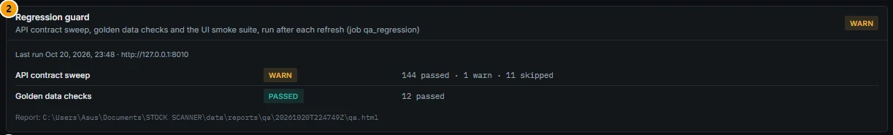

*Figure 15.17: Regression guard panel on Data Health: run of 20 Oct 2026 23:48 (Lisbon) against the live API, status WARN.*

The panel's elements (not numbered in the image):

| # | Element | What it shows |
|---|---|---|
| 1 | Status badge | passed (green), warn (amber), failed (red), pending or skipped (grey). |
| 2 | Last run line | Finish time and whether it ran against the live API or an in-process client over the serving snapshot ("in-process API (no server running)"). |
| 3 | Suite rows | **API contract sweep**, **Golden data checks**, **UI smoke suite**: status, counts ("144 passed · 1 warn · 11 skipped"), and a message (for example "API serves 1.31.0, contract 1.31.0" when they differ). |
| 4 | Failed checks | Up to ten failed items with their suite and detail, then "+N more in the report". |
| 5 | Report | Path of the HTML report of the run. |

### Controls

The panel has no controls. To run the guard by hand, from `backend\` with the project virtual environment:

```
python -m app.qa                                  # all suites against the running API (+ UI smoke when Chrome and the UI are up)
python -m app.qa api golden                       # only the API sweep and the golden checks
python -m app.qa smoke --themes dark --no-tabs    # UI smoke, dark theme only, without clicking tabs
python -m app.qa --api http://127.0.0.1:8010 --no-write   # dry run: no report, no state written
```

Exit code 0 = passed, warn or skipped; 1 = failed. Reports go to `data\reports\qa\<run>\qa.html` (and `data\reports\smoke\<run>\` for the UI suite).

### Methodology

Code in `backend/app/qa/`: `api_sweep.py`, `golden.py` + `golden.yaml`, `smoke.py` + `smoke_routes.yaml`, and `regression.py`, which orchestrates the suites and writes the summary.

| Suite (CLI name) | What it checks | Fails on |
|---|---|---|
| API contract sweep (`api`) | Every GET operation of the served OpenAPI contract, called with real ids resolved from list endpoints or search. | Non-2xx (501 = contract operation without implementation), 5xx or timeout; a JSON response that does not match the operation's schema; NaN or ±inf values; an "as of" date in the future (1-day tolerance for time zones); snapshot or region data-as-of outside the profile SLA. Slow answers and a running API older than the contract are warnings. Operations whose id has no instance (no thesis, no saved strategy) are skipped. |
| Golden data checks (`golden`) | 12 stable or bounded facts read through the app's own API (`golden.yaml`). | A value outside its tolerance or range, or an observation older than its maximum age. Some checks are warnings only. |
| UI smoke suite (`smoke`) | Headless Chrome over every route of `App.tsx` (plus extras such as `/company/7203.T`) in both themes (dark at 1440 px, light at 1280 px), clicking every tab. | Console errors or uncaught exceptions; failed requests (HTTP ≥ 400 on `/api` except an allowed list); error panels, or empty panels where data is expected; a crashed route or the 404 page; load to network-quiet over 8 s; horizontal overflow. Pending panels and slow-but-in-budget loads are warnings. On `/news`, first rows within 1,000 ms and a live update within 100 ms. Skipped, not failed, when Chrome or the UI is unavailable. |

The golden checks:

| Check | Expectation |
|---|---|
| Apple FY2024 revenue (10-K) | USD 391.035bn ± 0.5% |
| Apple FY2023 revenue | USD 383.285bn ± 0.5% |
| Microsoft FY2024 revenue | USD 245.122bn ± 0.5% |
| Microsoft shares outstanding | 7.0bn – 7.8bn |
| Apple market cap (USD) | 1.5tn – 8tn (warning only) |
| S&P 500 level | 4,000 – 12,000 |
| Nikkei 225 level | 25,000 – 80,000 (warning only) |
| US CPI-U y/y | −1% to +8%, observation ≤ 75 days old |
| EUR/USD (Fed H.10) | 0.90 – 1.40, ≤ 21 days old |
| USD/JPY (Fed H.10) | 100 – 200, ≤ 21 days old (warning only) |
| US 10Y Treasury yield | 1% – 7%, ≤ 14 days old |
| US unemployment rate | 2% – 12%, ≤ 75 days old (warning only) |

A golden failure means the served data path is broken (units, FX, period mapping, stitching), not that the market moved.

**Overall status:** failed if any suite failed, else warn if any warned, else passed; skipped suites do not change the result. **Read-only:** the smoke suite blocks every non-GET API call in the browser except a short list of compute-only POSTs (screener query, scenario run) and uses a fresh browser profile, so your saved app state is never written. The job `qa_regression` ends **partial** when a suite fails (the run itself worked; nothing downstream waits for it) and raises the ops alert `qa_regression`.

### Data sources and refresh

- Summary: `data/state/ops/qa_regression.json`, served by `GET /system/qa` and inside `GET /system/data-health`.
- Job `qa_regression` (nightly DAG, soft-depends on `alerts_eval`; timeout 60 min, no retries).
- Before the first run the panel says "Not run yet. It runs after the next refresh, or by hand with python -m app.qa (backend/)."

### Validation status

Not a model; no gate. The guard is itself the regression gate for pages and APIs. At the time of writing `docs/OPERATIONS_ROADMAP.md` lists the code as done and "First scheduled run observed" as still open.

### Correct usage and worked example

**Example: run QA20261020T224749Z (Figure 15.17; finished 20 Oct 2026 22:48 UTC, 23:48 Lisbon, live API on :8010).** Status **warn**: API contract sweep warn (153 operations: 144 passed, 1 warn, 11 skipped; served and contract version both 1.31.0; latency median 66 ms, p95 412 ms); Golden data checks passed (12 of 12). This run did not include the UI smoke suite. The ops alert reads "Regression guard warnings — api: warn (0 failed)".

What it means for you:

| Guard result | What to do |
|---|---|
| passed | Pages, API shapes and key facts are fine. Data freshness is a separate question (see [Data Health](#data-health)). |
| warn | Usable. Typical causes: a slow endpoint, an API older than the contract (restart due), a pending panel, a warning-only golden check. |
| failed: golden | Treat the numbers of that area as suspect (units, FX, period mapping) until fixed. For example a failed Apple revenue check means financial statements may be mis-scaled. |
| failed: api | Some panels may show errors or wrong shapes; the failed item names the endpoint. |
| failed: smoke | A page or tab crashed, showed an error or empty panel, or overflowed; the item names the route, tab and theme. |
| skipped (smoke) | Chrome or the UI was not reachable when the job ran; nothing was tested in the browser. |

### Limitations and pitfalls

- The guard tests that pages render and that a few facts are right. It does **not** check that models are calibrated or that every number is correct.
- Golden checks are deliberately wide ranges; they catch unit and scale errors, not small mistakes.
- Empty panels are allowed on pages whose content is user-created (`/watchlist`, `/theses`, `/studio`, `/backtest`, ...); an empty watchlist does not fail the suite.
- The smoke suite needs Chrome and a running UI. On a scheduled run without them it is skipped, and the summary still reads passed or warn.

### Related mnemonics and BQL fields

- No command-bar function or BQL fields.
- Related: [Data Health](#data-health), [System overview](#system-overview), [Troubleshooting and FAQ](18-troubleshooting-faq.md#troubleshooting).
