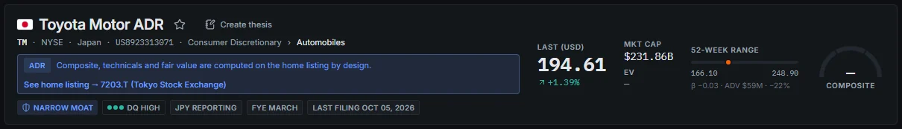

# 18. Troubleshooting and FAQ

This chapter lists the problems users and the app owner are most likely to meet, what causes them and how to fix them, followed by answers to frequent questions. Inside the app, the **?** icon next to each page title and the **Guide** menu item open this guide at the relevant section. Most problems are about **freshness** (the data is older than expected) or about **the background app not running**, not about wrong numbers.

Commands in this chapter are run in PowerShell from the `backend` folder of the project or install folder. `$py` stands for the app's Python:

```powershell
cd "C:\Users\Asus\Documents\STOCK SCANNER\backend"
$py = "..\.venv\Scripts\python.exe"     # project folder (dev tree)
# $py = "..\python\python.exe"          # installed or portable build
```

---

## Quick checks

Before anything else, these four checks locate most problems in under a minute.

| Check | How | Healthy |
|---|---|---|
| Is the app running? | Look for the BiG icon in the Windows notification area; right-click › **Status** | "Supervisor: running", a *Data as of* date, "scheduler on" |
| Does the API answer? | Open `http://127.0.0.1:8010/health` in the browser | `{"status":"ok", ...}` |
| How old is the data? | Top bar **DATA AS OF** (hover for per-region dates) and the freshness dot | Within a week for the weekly profile |
| Are background jobs healthy? | **System › Data health** | No red datasets, gap queue draining, no "error" banners |

---

## Troubleshooting

### The app does not open

**Symptoms.** You double-click `BiG360.exe` and no browser window appears, or the browser shows "This site can't be reached" at `127.0.0.1:8010`.

**Causes and fixes.**

1. **It is still starting.** The first start after a reboot takes 10 to 60 seconds; the notification *Starting... the dashboard opens at http://127.0.0.1:8010/* appears first. Wait, then double-click the tray icon.
2. **It is already running.** A second start of `BiG360.exe` does not start a second copy; it only opens the dashboard. If nothing opens, double-click the tray icon or go to `http://127.0.0.1:8010/` directly.
3. **The supervisor is not running.** Tray › **Status** shows "Supervisor: not running" or "Dashboard API ... not reachable". Quit from the tray and start `BiG360.exe` again. The tray also restarts the supervisor by itself if it dies.
4. **The API keeps crashing.** The supervisor restarts it with back-off (5 s, 15 s, 60 s, then 5 minutes), so after several crashes it can take minutes to come back. Check `data\logs\app\api.out.log` for the traceback (often an out-of-memory error during a heavy refresh) and send it to IT (see [Logs to send to IT](#logs-to-send-to-it)).
5. **Another program uses port 8010.** See [Port 8010 is busy](#port-8010-is-busy).

For IT: `& $py -m app.ops.supervisor --status` lists the children (API, worker, filler, live news) with their state, process id, restarts and memory; `& $py -m app.desktop.tray --status` prints the tray's status lines and menu.

### Port 8010 is busy

**Symptoms.** The dashboard does not load, and the supervisor log says *api already running outside the supervisor*; or the System page reports the API as "external".

**Cause.** Something else listens on 8010, usually a development API started by hand.

**Fix.**

1. Find the process: `Get-NetTCPConnection -LocalPort 8010 | Select-Object OwningProcess`, then `Get-Process -Id <pid>`.
2. Stop it if it is a leftover development API, or quit BiG360 from the tray.
3. If 8010 must stay with another program, IT changes `api_port` in `config\app.yaml` (or sets `BIG360_SUPERVISOR_API_PORT`) and restarts the app. The dashboard address changes accordingly.

The supervisor re-checks an "external" API every minute and takes over when the port is free.

### The dashboard is blank or shows "Page not found"

| Symptom | Cause | Fix |
|---|---|---|
| White or dark page with nothing on it | The browser holds an old copy of the dashboard after an update, or the API is still warming up | Reload with `Ctrl F5`. Check `http://127.0.0.1:8010/health`. |
| "Page not found" with a **Back to Macro** button | The address does not match a page (for example a mistyped route or an old bookmark) | Use the menu or `Ctrl K` |
| "Something went wrong" with a **Reload** button | A page crashed in the browser | Click **Reload**. If it repeats, note the message and the address and send them to IT. |
| `/` shows a JSON error while `/health` works | The dashboard is not being served: either the API was started in development mode on the same port, or the built dashboard (`frontend\dist_app`) is missing | See [Dev mode and the app on the same port](#dev-mode-and-the-app-on-the-same-port) |
| Pages wait a long time, especially with several app tabs open | Each app tab holds a live connection; browsers allow only 6 connections per site | Close unused app tabs. A tab hidden for more than 60 seconds releases its connection automatically. |

### The top bar shows "Data stale"

**What it means.** At least one market section of the published snapshot (prices of a region, FX, macro, filings, insider, events, news or CFTC) is behind, or core data is older than the profile's service level (9 days for weekly, 3 for daily; 6 days for prices). The numbers are correct as of their date, but newer data exists. See [Data-as-of and freshness indicators](00-getting-started.md#data-as-of-and-freshness-indicators).

**What to do.**

1. Hover **DATA AS OF** to see which region is behind, and hover the freshness dot for the list of stale sections (for example `prices:JP (stale)`).
2. Click the **Data stale** chip to open **Data health**. Find the dataset in the summary, the freshness heatmap and the gap queue:
  - if the gap filler is already *filling* it, wait;
  - if it is *failed* or *manual*, read the error under **SLA breaches & recent failures**.
3. If you need fresh data now, use tray › **Run refresh now**. A full refresh takes one to several hours; the chip clears when the new snapshot is published.
4. For IT: open the failing job's log (`data\logs\jobs\<job>\<run>.log`), fix the cause, then resume the refresh with `& $py -m app.cli jobs run-dag nightly --resume`. Prices are published even when an analytics job fails.

Related chips: **Analytics stale** / **Analytics failed** mean the market data is fine but scores, valuation, technicals or models are behind; **Prices failed** means a price section failed and is shown in red.

### The refresh failed or is overdue

**Symptoms.** A Windows notification *BiG360: refresh weekly_refresh failed* or *partial*; a banner "Last nightly run failed" or "Refresh overdue" on Data health; **DATA AS OF** has not moved for more than a week.

| Cause | Fix |
|---|---|
| The PC was asleep or off at Saturday 08:00 and did not come back within the catch-up window (6 days for weekly, 2 for daily) | Run tray › **Run refresh now**. Allow wake timers in the Windows power plan (*Power Options › Advanced › Sleep › Allow wake timers: Enable*) and leave the PC plugged in on Saturday morning. |
| One job failed and the run is marked *failed* ("1 of 102 jobs failed") | Usually harmless: the rest was published and the failed job retries on the next run. Check **SLA breaches & recent failures** on Data health for the job and its error. |
| A job ran out of memory (`MemoryError`, "Orphaned (process died)") | Avoid running other heavy work during the Saturday refresh. IT can re-run the job: `& $py -m app.cli jobs run <job_id>`, or resume the whole refresh with `jobs run-dag nightly --resume`. |
| A job timed out ("timed out after 60.00 min") | Slow source or rate limit. It is cancelled and retried automatically; if it keeps happening IT raises its `timeout_min` in `contracts/jobs.yaml`. |
| The scheduler is off | See ["Scheduler off" or "Worker off"](#scheduler-off-or-worker-off). |

"Refresh overdue" is raised when the last completed nightly refresh is older than the profile period plus one day (8 days for weekly).

### "Scheduler off" or "Worker off"

| Chip | Meaning | Fix |
|---|---|---|
| **Worker off** (red) | The worker process is not running: no scheduled refresh and no queued job will run | Quit and restart BiG360 from the tray. IT: `& $py -m app.ops.supervisor --status`. |
| **Scheduler off** (amber, red after 24 hours) | The worker runs but without its schedule, typically because it was started with `--no-schedule` or `schedule: false` in `config\app.yaml` | Restart BiG360 normally (the tray app starts the scheduler unless `schedule: false`). The System page **Scheduler** panel shows the reason. |

### The gap filler is paused

**Symptoms.** Data health shows the gap filler as *paused*, or the tray **Status** shows "Gap filler: paused (...)" with reasons.

| Reason shown | Cause | Fix |
|---|---|---|
| manual pause | You or someone used tray › **Pause background jobs**. It creates `data\state\ops\filler.PAUSE`, valid for 24 h, and Data Health shows who paused it, why and until when | Tray › **Resume background jobs**, or wait for it to expire |
| on battery | The laptop runs on battery | Plug in |
| metered network | Phone hotspot or a connection marked as metered | Use a normal network, or accept the pause |
| low free RAM | Less than 3 GB of free memory | Close heavy programs; it resumes above 3.5 GB |
| low disk | Less than 15 GB free on the data drive | Free disk space (a warning starts at 25 GB) |
| refresh running | A nightly, weekly or monthly refresh is running | Nothing: it resumes after the refresh |

The filler is a background repair service; pausing it never affects the scheduled refreshes or the dashboard.

### A panel says "Could not load data"

**What it means.** The panel's request to the API failed. The message under the title gives the reason (for example a timeout or an HTTP error).

**What to do.**

1. Click **Retry**.
2. If several panels fail at once, the API is probably restarting: check `http://127.0.0.1:8010/health` and wait a minute.
3. If one panel fails consistently for one company or one setting, note the page address and the message, and send them to IT with the time. The API log (`data\logs\api.log`) has the full error under the same request.

### A panel is empty or says "pipeline pending"

| Message | Meaning | What to do |
|---|---|---|
| "No data" (with a reason) | The query worked but there is nothing for this selection: for example no insider trades for a Japanese company in the window, or a filter that matches nothing | Widen the filter, the date range or the region |
| "Not yet available — pipeline pending" | The page exists, but the job that produces it has not run yet (for example a model that is still training, or a weekly job before its first run) | Wait for the next refresh; check Data health for the job |
| "Partial data — some inputs for this view are missing or stale" | The figures are what the pipeline published, but some inputs are missing | Use with care; check the per-panel date |
| "No regime model for {region}" and similar | No model exists for that scope, deliberately | Use a region that has the model, or the global view |

Empty panels outside the US, Japan and Europe are often a **coverage** matter, not a fault: see [Coverage by region and known gaps](01-data-and-coverage.md#coverage-by-region-and-known-gaps).

### A company is not found

1. Search with `Ctrl K` by ticker (`7203.T` or `7203`), name (`Toyota`) or ISIN. Names in Latin script work for Asian companies; the local name is shown as secondary.
2. Try the home ticker with its exchange suffix (`SAP.DE`, `ASML.AS`, `PETR4.SA`, `0700.HK`) or the Bloomberg form (`SAP GY`, `7203 JT`).
3. If the company still does not appear, it is not in the app's universe: smaller companies (US below $300M market cap or $5 share price, European issuers below €300M) and markets without an exchange list (for example India beyond the curated names) are not covered.
4. Opening an unknown id directly (`/company/XYZ`) shows "Could not load data" with an "unknown security_id" message.

To request an addition, ask the app owner; additions go through the universe seeds and the monthly universe rebalance.

### ADR pages show no scores or technicals

For an American Depositary Receipt (for example TM for Toyota, PBR for Petrobras, ASML on Nasdaq), Company 360 shows an **ADR** badge with the note *"Composite, technicals and fair value are computed on the home listing by design."* and a link **See home listing → 7203.T**. Follow the link: the home listing carries the scores, technicals and valuation. If the note says *"Home listing not found in the universe."*, the home listing is not covered and the ADR page shows only what is available for the ADR itself. Market cap on ADR pages uses a checked ADR ratio. See [Company 360](05a-company-fundamentals.md).



*Figure 18.1: Header of the Toyota Motor ADR page (`/company/TM`): the ADR note, the link "See home listing → 7203.T (Tokyo Stock Exchange)" and an empty composite gauge.*

### The first page load after a refresh is slow

After a new snapshot is published (or after the API restarts), the API warms its caches by replaying the main pages' requests in the background, one at a time, for up to about 3 minutes. During that time the first visit to a page can take a few seconds; after it, pages load in under a second. If a page stays slow, close other app tabs (see [The dashboard is blank or shows "Page not found"](#the-dashboard-is-blank-or-shows-page-not-found)) and check whether a refresh is running (tray › Status).

### A "Mock data" badge appears

**MOCK DATA** in the top bar means the dashboard runs on synthetic data: it was started in development mode with `VITE_USE_MOCK=true`. **None of the figures are real.** The Windows app never uses mock data. Close that tab and open `http://127.0.0.1:8010/`.

**MOCK FALLBACK · n** means a development build replaced n failing endpoints with synthetic data. Hover the badge for the list. Again, use the Windows app for real work.

### Dev mode and the app on the same port

The Windows app serves the dashboard and the API together on 8010. A development setup runs the API separately (often also on 8010) and the dashboard on `http://localhost:5173`.

| Situation | Effect | Fix |
|---|---|---|
| A development API runs on 8010, then BiG360.exe starts | The supervisor treats the API as "external" and the dashboard is **not** served at `/` | Stop the development API (close its window or `Ctrl C`), or run it on another port (`--port 8000` and matching `VITE_API_URL` in `frontend\.env`) |
| Development dashboard on 5173 pointing at the app's API on 8010 | Works, but you see the development build of the dashboard | Use `http://127.0.0.1:8010/` for the released build |

### The live strip says "Not live"

"NOT LIVE · LAST HEARTBEAT ... AGO · LAST ITEMS RECEIVED:" means the realtime service that collects live filings, news and macro releases is stopped; the items shown are the last ones received. The rest of the app is not affected. Turn it on with tray › **Live news on/off**; the strip turns green (**LIVE**) within a minute. On a build without the live news service, IT enables the realtime layer with `realtime: true` in `config\app.yaml`.

### Notifications

| Question | Answer |
|---|---|
| Which notifications does the app send? | Windows notifications from the tray for new operational alerts (refresh failed or overdue, data stale beyond the service level, scheduler off, worker down) and when a scheduled refresh finishes. Inside the browser, toasts for alerts fired by your alert rules. |
| I do not see any | Check that Windows *Focus assist* / *Do not disturb* is off and that notifications are allowed for the app. IT may have set `notifications: false` in `config\app.yaml`. |
| I get too many | Ask IT to set `notify_severities: [error]` in `config\app.yaml` to keep only errors, or `notifications: false`. News alert chimes are switched in News Terminal › Alerts › Alert sound. |

### "Update available" in the tray

When IT places a newer build in the update folder (`update_dir` in `config\app.yaml`), the tray menu shows **Update available: x.y.z** and a notification appears (checked once a day). Click it to open the folder, then run the installer. The installer stops BiG360 gracefully, replaces the program files and **keeps your data** and keys. IT backs up `data\db\app_state.duckdb` (your watchlists, theses and alerts) before upgrading.

### A data source reports "missing key"

A job whose API key is not installed skips that source and Data health shows it as *idle* or "missing key". Keys are optional except FRED and Polygon. To add one: `& $py -m app.desktop.credentials set <key name>` (input is hidden), then restart BiG360. See [First run](00-getting-started.md#first-run) for key names.

### Corporate network errors (for IT)

| Symptom | Fix |
|---|---|
| SSL / certificate errors on every source | The bank's TLS inspection root is not trusted by Python: set `SSL_CERT_FILE` to a PEM bundle with the bank roots, and `HTTPS_PROXY` |
| SEC returns 403 | Set `SEC_USER_AGENT="BiG Equity 360 <team mailbox>"` |
| Polygon returns 429 | Free tier limit of 5 calls per minute; do not run a backfill and the refresh in parallel |

---

## Logs and diagnostics

### Logs to send to IT

All logs are under `data\logs\` (tray › **Open logs folder**). They are JSON lines with a timestamp, level and request or job id. Secrets are redacted automatically.

| File | Contains | Send it when |
|---|---|---|
| `supervisor.log` | Starts, exits, restarts and health checks of every part | The app does not start or keeps restarting |
| `app\supervisor.json` | Live status: each child, process id, restarts, memory | Same |
| `app\api.out.log`, `app\worker.out.log`, `app\filler.out.log` | Raw output of each part; crash tracebacks land here | Anything crashed |
| `api.log` | API errors and the access log (every request with its id and duration) | A panel fails or is slow |
| `worker.log` | Scheduler and refresh runs | A refresh did not run or failed |
| `jobs\<job>\<run>.log` | One file per job run (path shown on Data health and the System page) | A specific job failed |
| `filler.log`, `filler_tasks.log` | Gap filler decisions and governor state | The gap filler misbehaves |
| `tray.log` | Tray app | The tray icon or menu misbehaves |

Include the time of the problem, the page address, and the text of any error message.

### Command-line checks (doctor, jobs status, dq summary)

For the app owner and IT, run from `backend\`:

```powershell
& $py -m app.cli doctor --offline        # keys PRESENT / MISSING (names only), disk, packages
& $py -m app.cli doctor                  # plus reachability of each data source
& $py -m app.cli jobs status             # the 30 most recent job runs (--job <id>, --status failed, --limit n)
& $py -m app.cli dq summary              # data-quality status of the last check run
& $py -m app.ops.supervisor --status     # supervisor children and their state
& $py -m app.desktop.credentials status  # which keys are stored (yes / no only)
```

Other useful commands (IT): `jobs list` (every job and its last status), `jobs run-dag nightly --resume` (resume a failed refresh), `db build-serving` (rebuild and publish the snapshot), `python -m app.ops.gaps` (run the gap detector now), `python -m app.qa` (regression guard). The HTTP probes are `/health` (liveness), `/ready` (200 when a snapshot is published and the worker is alive, otherwise 503 with the failing checks) and `/metrics`. The full runbook is `docs/it/RUNBOOK.md`.

---

## FAQ

### Why are there no consensus estimates?

There is no free, licensable source of analyst consensus. Wherever an expectation is needed, the app uses its **own model** and labels it: earnings expectations come from a seasonal time-series model on the company's own reported history (with an 80% band), and macro expectations from the app's macro models. Surprises are therefore "vs our model", not "vs consensus". `EE` in the command bar opens the forecast tab with the note "model-based, not consensus".

### Why is there no options data?

The app has no options source, so there are no implied volatilities, option-implied moves or option monitors. `OMON` is listed in the command bar as unavailable. Where a "normal move" is needed (for example around earnings), the app compares the move with the stock's usual 3-day volatility instead of an option-implied move.

### Why do numbers differ from Bloomberg?

Several deliberate differences, in rough order of frequency:

| Area | BiG Equity 360 | Typical terminal convention |
|---|---|---|
| Date | Data as of the last refresh (weekly by default), and regions can differ by a few days | Live or previous close |
| Prices | Adjusted close (splits and dividends); non-US prices from Yahoo | Exchange feed, often unadjusted by default |
| Fundamentals | Point-in-time from filings, latest period known at the date, TTM preferred | Vendor-standardised, possibly restated history |
| Valuation ratios | Computed in USD on both sides, market cap = point-in-time shares × close × FX | Local-currency conventions |
| Forward ratios (`pe_fwd`) | The app's base-case forecast (model-based) | Consensus (BEst) |
| Fair value | Blend of DCF and peer multiples, partly anchored to the market price | Analyst target prices |
| Sectors | The app's own GICS-like taxonomy, current classification only | GICS / BICS with history |
| Index membership | `'S&P 500'` / `'STOXX 600'` approximated by the app's universes | Official constituents |
| Policy-rate paths (`WIRP`) | Approximation from official curves | OIS / futures-implied probabilities |
| Macro surprises (`ECO`) | Release vs the app's model | Release vs survey median |

If a difference cannot be explained by one of these, check the per-region date and the panel's source line, then report it with the ticker, field and date.

### How often does the data update?

By default once a week, on **Saturday at 08:00 Lisbon time** (weekly profile): a full refresh of the latest sessions, then the weekly jobs, then the monthly jobs when due. CFTC positioning updates on Friday evening after its release, and live news (when switched on) every hour. The app owner can switch to the **daily** profile (Tuesday to Saturday at 01:30) from the tray or the System page. See [Refresh schedule](01-data-and-coverage.md#refresh-schedule).

### What does "model-based" mean?

A model-based number is estimated by the app's own statistical model from historical data. It is not an official statistic and not analyst consensus. Being model-based says nothing about quality by itself: each model has a validation status, and outputs that failed their gate are marked **experimental** and hidden by default. See [Reading the labels](00-getting-started.md#reading-the-labels-model-based-experimental-approximation-calibrated) and the gate summary in [Methodology appendix](16-methodology.md).

### Can I trust the probabilities?

Trust them for what they are: **frequencies calibrated over history**. A "37% chance the target is reached before the stop" means that, in walk-forward testing on past data, setups like this one reached the target first about 37% of the time, and that the model's stated probabilities matched realised frequencies. It does not mean "a 37% chance today", it does not account for news the model has not seen, and calibration was tested on liquid US, European, UK and Japanese names. Only the outputs that passed their gate are shown by default (for example the 20-session first-passage probabilities and the calibrated range fan); outputs that failed are hidden behind **show experimental**. Several validated outputs are described as having "no tradable edge" on their own: they describe risk, they do not predict returns.

### Can I export data?

Yes, where a page offers it:

- **Screener:** **CSV** button (current filters and columns).
- **Company 360 › Financials:** CSV export of the statements.
- **BQL console:** CSV, XLSX and JSON exports of any query result.
- **Backtest Lab** and **Model Studio:** export of results.
- **Thesis Tracker:** export of a thesis.

For bulk extracts (for example into SQL Server or Power BI), IT can run the snapshot export (`python -m app.ops.export`). Remember the [licensing caveats](01-data-and-coverage.md#licensing-caveats) before sharing exported data.

### Where are my watchlists and theses stored?

On this PC, in `data\db\app_state.duckdb`: watchlists, alert rules, theses and their journal, Model Studio studies, backtest definitions, scenarios and model promotions. This file cannot be rebuilt from the sources, so it should be backed up (IT procedure in `docs/it/RUNBOOK.md` §5.1). The watchlist and alert rules are also cached in your browser and resynchronised with the file when the dashboard loads. Display preferences (theme, region, locale, collapsed menu, experimental switch, recent commands, BQL history) live only in your browser.

### Is any of my input sent outside the PC?

No. The dashboard talks only to the local API on `127.0.0.1`. The app contacts external sites only to download data (official sources, Polygon, Yahoo, GDELT and so on) and, on first use, the language-model weights for sentiment.

### Can several people use the app, or run it on a server?

The current setup is single-user on one PC: the API listens only on `127.0.0.1` and there is no login. A department-server deployment is designed and partly implemented: Windows service, gateway (YARP or IIS) with corporate TLS, Entra ID / AD sign-in with viewer / analyst / admin roles, and shared state in SQL Server. A licence review of the data sources is required first. IT documentation: `docs/it/DEPLOYMENT_SERVER.md`, `docs/it/ARCHITECTURE.md`, `docs/it/SECURITY.md`, `docs/it/QUESTIONS_FOR_IT.md`, and the .NET integration guide `docs/it/INTEGRATION_DOTNET.md`.

### Why does a backtest look better than I expected?

Universe membership history starts on 10 Oct 2026. Backtests over earlier periods use today's company lists, which exclude companies that later failed or were taken over (survivorship bias), so they flatter results. Treat them as an upper bound. See [Survivorship and history depth](01-data-and-coverage.md#survivorship-and-history-depth) and [Backtest Lab](11-backtest-lab.md).
