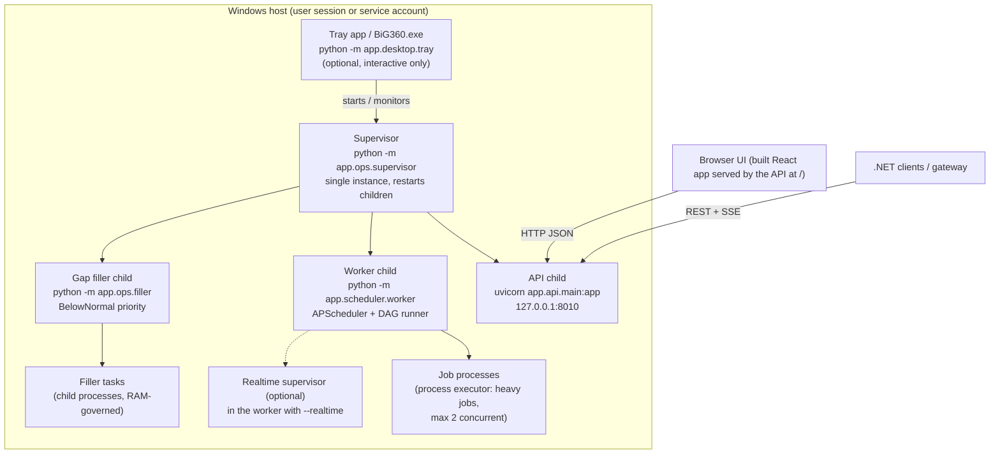
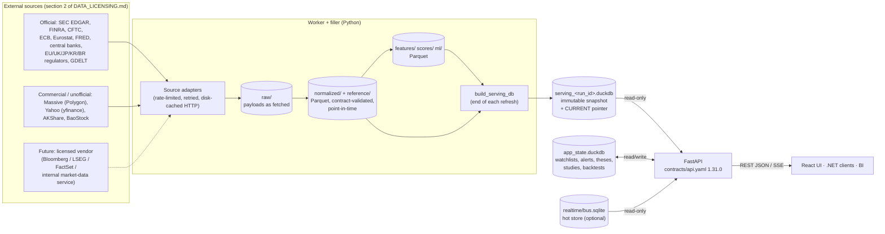

# BiG Equity 360: architecture for IT

**Audience:** BiG IT architects and .NET developers.
**Status:** 2026-10-20. Application build 1.0.0, API contract `contracts/api.yaml` 1.31.0.
**Deployment today:** Stage A, a single Windows 11 workstation with 20 threads, 32 GB RAM, no GPU and one user.
**Related documents:**
- Stage B (department server): [DEPLOYMENT_SERVER.md](DEPLOYMENT_SERVER.md).
- Stage C (.NET integration): [INTEGRATION_DOTNET.md](INTEGRATION_DOTNET.md).
- Internal design notes: [../ARCHITECTURE.md](../ARCHITECTURE.md).

---

## 1. What the system is

BiG Equity 360 is a research tool for listed equities and macro data. It ingests public and licensed sources into a Parquet data lake on a schedule. It then computes fundamentals, scores, valuation, technical, NLP and ML analytics. Each refresh publishes an immutable DuckDB "serving snapshot". A FastAPI service serves that snapshot as a versioned REST API (OpenAPI 3.1), plus a Server-Sent Events (SSE) stream. The React UI is one client of that API; a .NET service would be another.

The system has no database server. The only state outside the lake is a small DuckDB file, `app_state`, which holds the user's watchlists, alerts, theses, studies and backtests.

## 2. Components and process tree

| Process | Entry point | Role | Typical RAM (measured) |
|---|---|---|---|
| Supervisor | `python -m app.ops.supervisor [--app]` | Starts the API, worker and filler as child processes in their own process group. Restarts a crashed child with back-off of 5 s, 15 s, 60 s and 5 min. Health-checks the API through `GET /health` every minute and restarts it after 3 failures. Writes status to `data/logs/app/supervisor.json`. Single instance through a lock file. Stops on a STOP file or Ctrl+Break. | < 100 MB |
| API | `python -m app.cli serve api --port 8010` | FastAPI on uvicorn: REST, SSE and the built UI. Reads the serving snapshot read-only. Reads and writes `app_state`. | 4–7 GB. The snapshot pages are mapped and DuckDB caches are capped by `BIG360_API_DUCKDB_MEMORY` (4 GB). |
| Worker | `python -m app.scheduler.worker` | Runs the active schedule profile (APScheduler) and the job DAGs in `contracts/jobs.yaml` (159 jobs, 5 DAGs). It also polls the file job queue that the API writes when a user triggers a job. | About 100 MB idle. Jobs run in-thread, or as child processes for heavy work (1–8 GB each). |
| Gap filler | `python -m app.ops.filler` | Drains the `data_gaps` queue: missing, stale or partial data found by the gap detector. It runs under per-source rate budgets and a resource governor (RAM cap 4 GB; pauses on battery, a metered network, low RAM or while a refresh DAG runs). | 100–300 MB plus tasks |
| Realtime (optional, off) | `worker --realtime` | Polls the SEC EDGAR Atom feed, official RSS feeds, GDELT 15-minute files and macro releases into an SQLite hot store (`data/realtime/bus.sqlite`). This store feeds `/api/v1/live/*` and the SSE stream. | 200–500 MB |
| Tray (optional) | `BiG360.exe` → `python -m app.desktop.tray` | Notification-area menu: open dashboard, status, refresh now, pause, schedule profile, logs, start at login, update check. It is for an interactive user only; a server uses a Windows Service (Stage B). | < 80 MB |

Runtime stack:
- **Python 3.13:** FastAPI 0.143, uvicorn 0.54, DuckDB 1.5, Polars 1.44, PyArrow 21, APScheduler 3, XGBoost, PyTorch 2 (CPU), Hugging Face transformers.
- **UI:** React 19, Vite 8, TypeScript.

The UI is built to static files (`frontend/dist_app`), so no Node.js is needed at runtime. [sbom.json](sbom.json) lists every component.

## 3. Data flow

1. **Ingestion.** Each source is one adapter (`backend/app/ingestion/*.py`). Adapters land raw payloads under `data/raw/<source>/…/dt=YYYY-MM-DD/`. They then normalise them to the table contract (`contracts/schemas/<table>.yaml`) and write through `app.core.storage.write_table()`. That function validates columns, types, enum values, primary keys and nulls, and fails the write on a violation. Writes are atomic per partition: the new partition is written to a temporary directory, then renamed in.
2. **Point-in-time.** Every fact carries a `knowledge_date`: the filing, publication or release date. Restatements are new rows. Backtests and models only see what was known at the time.
3. **Analytics.** Jobs read earlier zones and write features, scores and ML outputs as Parquet. The order is raw → normalized → features → scores/ml.
4. **Serving snapshot.** `build_serving_db` materialises everything the API needs into a new DuckDB file, `data/db/serving_<run_id>.duckdb`, sorted by lookup keys. It then atomically rewrites `data/db/CURRENT`. The API checks `CURRENT` at most once a second. It switches new requests to the new file and closes the old connection after a 120 s grace period. A failed refresh therefore never affects the API, which keeps serving the previous snapshot. Sections whose inputs failed are marked stale (`serving_sections`). Housekeeping keeps the last 2 snapshots.
5. **API.** It reads only the snapshot (read-only connection), `app_state` and the realtime hot store (read-only). It never writes the lake. User-triggered jobs are queued as files in `data/state/queue/`, and the worker picks them up.

## 4. Storage formats and sizes (this PC, 2026-10-20)

| Store | Format | Size | Notes |
|---|---|---|---|
| `data/raw/` + `data/cache/` | json.gz, zip, csv, html as fetched; HTTP response cache | about 95–100 GB together (the remainder of the 122 GB total) | Raw is the immutable landing zone, kept 400 days except SEC documents and filings. Most of it is GDELT 2.0 files (2020 onward) and SEC bulk data. The cache is disposable. |
| `data/normalized/` + `data/reference/` | Parquet (zstd, Hive partitions) | 7.7 GB | System of record for source data: prices for 24,961 securities, fundamentals, filings, insiders, 13F, news, GDELT events, macro, FX. |
| `data/features/`, `data/scores/`, `data/ml/`, `data/modeling/` | Parquet | about 2.6 GB | Derived analytics. All of it can be rebuilt from normalized data. |
| `data/db/serving_<run_id>.duckdb` | DuckDB | 6.6 GB each, 2 kept | Immutable serving snapshot. |
| `data/db/app_state.duckdb` | DuckDB | 7 MB | User state. **This is the only data that cannot be rebuilt: back it up.** |
| `data/realtime/bus.sqlite` | SQLite (WAL) | about 10 MB | Hot store with retention: filings 14 d, news 7 d, events 72 h, macro 60 d, alerts 30 d. |
| `models_store/` | XGBoost JSON, PyTorch state_dict | about 40 MB (with `data/models`) | Trained models. They can be retrained. |
| `data/logs/` | JSON lines | 30 MB, rotated | See [RUNBOOK.md](RUNBOOK.md) §8. |
| **Total `data/`** | | **122 GB** | Reported by `GET /api/v1/system/status` → `disk_usage_gb`. |

Universe coverage: 24,961 securities from 24,645 issuers, 24,943 of them with prices. Full fundamentals and composite scores cover the 769 names in the MVP universes; fundamentals exist for 5,022 names.

## 5. Scheduling

Schedule profiles are defined in `config/schedule.yaml` and are switchable at runtime with `PUT /api/v1/system/schedule`.

| Profile | When (Europe/Lisbon unless noted) | What |
|---|---|---|
| `weekly` (default) | Saturday 08:00. CFTC on Friday 19:00 ET. | Chain: nightly DAG for the latest session, then the weekly DAG, then the monthly DAG if it is due. |
| `daily` | Tuesday–Saturday, the nightly cron | The previous US session. Asian and European sessions of that date are closed by then. |
| `intraday` | Placeholder | Enables the realtime layer plus intraday pulls. |

Behaviour:
- **Catch-up:** if the PC was asleep or off at the scheduled time, the worker runs the missed refresh at start-up or within 15 minutes. Runs older than `max_catchup_days` are skipped.
- **Wake-up:** the worker keeps the PC awake while a DAG runs (`SetThreadExecutionState`) and arms a wake timer for the next run.
- **DAG runner:** jobs have dependencies, soft dependencies, retries (default 2 with 60 s back-off), timeouts and idempotency keys. Thread jobs that time out are cancelled cooperatively, then killed. Process jobs are killed together with their process tree.

## 6. The gap filler (self-healing data)

- **Coverage registry.** `contracts/coverage.yaml` declares, per dataset, the expected cadence (exchange trading calendars, official release calendars, the CFTC Friday schedule), the expected entities, the freshness SLA, the fill action and the cost per unit.
- **Gap detector.** The `data_gaps_detect` job compares expected against actual after each refresh and daily. It classifies each gap as missing, stale, partial, suspicious or unfillable.
- **Filler.** It drains the gaps by priority, using the same ingestion code as the scheduled jobs.
  - Per-source rate budgets: Polygon about 5 requests per minute, SEC 10 requests per second, OECD 60 downloads per hour, GDELT bandwidth, and so on. These sit on top of the shared token buckets.
  - Exponential back-off per gap.
  - Long backfill "campaigns", such as the GDELT 2020–2026 history and the 13F history, report progress and ETA on the Data Health page (`GET /api/v1/system/data-health`).

## 7. Security model (Stage A)

| Aspect | Stage A (now) | Stage B (server) |
|---|---|---|
| Network exposure | The API binds to `127.0.0.1` only. No inbound firewall rule is needed. | Behind IIS/ARR or YARP over TLS. The app still binds to loopback or a private interface. |
| Authentication | None (single local user). `BIG360_AUTH=none`. | OIDC / JWT bearer tokens from Entra ID, validated in the API (`BIG360_AUTH=oidc`), with roles viewer, analyst and admin. Already implemented and tested, but switched off. |
| Authorisation | n/a | Viewer: read. Analyst: user-state writes. Admin: job trigger, schedule, model promote. See [../CONFIGURATION.md](../CONFIGURATION.md) §3. |
| CORS | Allow-list: the Vite dev origin only | The gateway origin. |
| Secrets | Windows Credential Manager (DPAPI, per user). `.env` fallback for development. Never logged; redacted in every log handler. | Service-account Credential Manager or Azure Key Vault. |
| Outbound | HTTPS to public data sources only (section 2 of [DATA_LICENSING.md](DATA_LICENSING.md)). There is no telemetry and no LLM. | Through the corporate proxy (`HTTPS_PROXY`). |
| Data at rest | NTFS permissions of the user profile | Service-account ACLs, BitLocker volume. |

Threats and controls: [SECURITY.md](SECURITY.md).

## 8. Ports and endpoints

| Port | Process | Bound to | Purpose |
|---|---|---|---|
| 8010 | API (supervisor / app mode) | 127.0.0.1 | REST `/api/v1/*`, SSE `/api/v1/live/stream`, UI `/`, `/docs`, `/openapi.json`, `/health`, `/ready`, `/metrics` |
| 8000 | API (`app.cli serve api` default; development) | 127.0.0.1 | Same |
| 5173 | Vite dev server (development only) | localhost | UI hot reload |

Operational endpoints:
- `GET /health`: liveness; always 200 while the process serves, with status ok or degraded.
- `GET /ready`: readiness; 503 until a snapshot is published and the worker heartbeat is fresh.
- `GET /metrics`: Prometheus text.
- `GET /api/v1/system/status` and `GET /api/v1/system/data-health`: operator detail.

Every response carries `X-Request-ID`, which is also written to the JSON logs.

## 9. Resource footprint

| Resource | Steady state | Peak (weekly refresh) | Guidance for a server |
|---|---|---|---|
| CPU | < 5 % idle; API requests are single-digit ms to a few hundred ms | All cores for 1–3 h on Saturday: ML training, technicals, NLP sentiment, serving build | 8 vCPU minimum, 16 recommended |
| RAM | API 4–7 GB, worker plus filler < 1 GB | 16–24 GB during heavy jobs: serving build, 13F, GDELT, ML. The filler stays under its 4 GB cap and pauses below 3 GB free RAM. | 32 GB minimum, 64 GB for headroom with several users |
| Disk | 122 GB now (data); about 13 GB of snapshots | Plus about 7 GB while a new snapshot is built | 500 GB SSD data volume (growth of about 5–10 GB/month, mostly GDELT raw) |
| Network | Idle | 1–5 GB per weekly refresh (GDELT, SEC bulk, prices) | Outbound HTTPS through the proxy, no inbound except from the gateway |

## 10. Contracts and change control

- `contracts/api.yaml` (OpenAPI 3.1) is the integration contract. The API serves it as `/openapi.json`. Changes within major version 1 are **additive only**: new endpoints, new optional fields, new enum values on outputs. Each change is logged in `docs/CONTRACT_CHANGES.md` and covered by `backend/tests/test_api_serving.py`. That test calls every operation in the contract and validates the response against the schema.
- `contracts/schemas/*.yaml` are the table contracts and `contracts/jobs.yaml` is the job graph. They follow the same change-log rule.
- [INTEGRATION_DOTNET.md](INTEGRATION_DOTNET.md) §7 gives the compatibility rules for clients.
