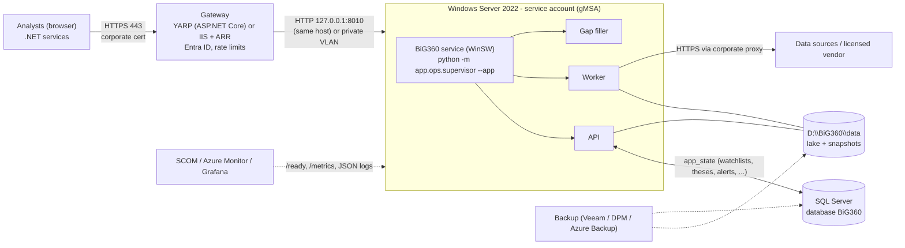

# Stage B: deployment on a department server

**Goal:** move the app from the analyst's PC to a BiG server. Several users get the dashboard and API behind corporate TLS and Entra ID, with shared state in SQL Server. Nothing is rewritten: the same Python code, contracts and data folder are used.

**Status:**
- Implemented:
  - authentication (OIDC/JWT bearer), off by default;
  - `/health`, `/ready` and `/metrics`;
  - JSON logs with request ids;
  - CORS allow-list, `root_path` and proxy-header settings;
  - snapshot export;
  - vendor adapter interface.
- Design only: SQL Server app_state (§6) and the Windows Service wrapper files.
- Decisions for IT: [QUESTIONS_FOR_IT.md](QUESTIONS_FOR_IT.md).



## 1. Hosting options

| Option | How | For | Against |
|---|---|---|---|
| **A. Windows Service (recommended first)** | WinSW wraps `python.exe -m app.ops.supervisor --app`, running under a gMSA. The portable build (`packaging/build.ps1`) gives a self-contained folder: embedded Python 3.13 and locked wheels, about 2 GB. | Matches a Windows-managed estate (SCCM / Intune, GPO, SCOM agents). No container platform needed. Same layout as the desktop app. | Python on a server must be accepted (Q7 in QUESTIONS_FOR_IT.md) |
| B. Containers | Linux image (`backend/Dockerfile` exists; adapt to the portable lock). The API and worker as separate containers sharing a volume, or one container running the supervisor. | Reproducible, easy to scale the API horizontally (read-only snapshot). | Needs a container platform (AKS, OpenShift or Docker on Windows Server with Linux containers). The data volume must be shared, read/write for the worker and read for the API. |

### 1.1 Windows Service with WinSW

`BiG360Service.xml`, placed next to `WinSW-x64.exe` (renamed `BiG360Service.exe`):

```xml
<service>
  <id>BiG360</id>
  <name>BiG Equity 360</name>
  <description>BiG Equity 360 analytics (API, scheduler, gap filler)</description>
  <executable>D:\BiG360\app\python\python.exe</executable>
  <arguments>-m app.ops.supervisor --app --api-host 127.0.0.1 --api-port 8010</arguments>
  <workingdirectory>D:\BiG360\app\backend</workingdirectory>
  <env name="BIG360_ROOT" value="D:\BiG360\app"/>
  <env name="BIG360_DATA_DIR" value="D:\BiG360\data"/>
  <env name="BIG360_AUTH" value="oidc"/>
  <env name="BIG360_AUTH_ISSUER" value="https://login.microsoftonline.com/TENANT-ID/v2.0"/>
  <env name="BIG360_AUTH_AUDIENCE" value="api://big360"/>
  <env name="BIG360_CORS_ORIGINS" value="https://big360.bank.internal"/>
  <env name="BIG360_PROXY_HEADERS" value="1"/>
  <env name="BIG360_FORWARDED_ALLOW_IPS" value="127.0.0.1"/>
  <env name="BIG360_LOG_STDERR_JSON" value="1"/>
  <env name="HTTPS_PROXY" value="http://proxy.bank.internal:8080"/>
  <env name="NO_PROXY" value="localhost,127.0.0.1,.bank.internal"/>
  <env name="HF_HUB_OFFLINE" value="1"/>
  <serviceaccount><username>BANK\svc-big360$</username><allowservicelogon>true</allowservicelogon></serviceaccount>
  <stoptimeout>360 sec</stoptimeout>        <!-- the worker finishes / cancels jobs (grace 300 s) -->
  <onfailure action="restart" delay="30 sec"/>
  <onfailure action="restart" delay="2 min"/>
  <resetfailure>1 hour</resetfailure>
  <log mode="roll-by-size"><sizeThreshold>20480</sizeThreshold><keepFiles>5</keepFiles></log>
  <priority>Normal</priority>
</service>
```

**Install.** Run `BiG360Service.exe install`, then `sc.exe failure BiG360 reset= 3600 actions= restart/30000`.

**Stop.** Both `BiG360Service.exe stop` and creating `D:\BiG360\data\state\ops\supervisor.STOP` stop the service gracefully. With the second method the supervisor exits by itself and the service stops.

Notes:
- **Keep-awake and wake timers.** The worker uses Windows APIs to keep the PC awake and to arm wake timers. Both are harmless on a server, which is always on.
- **Tray app.** It is not used on a server.
- **Service account permissions:**
  - read on `D:\BiG360\app`;
  - modify on `D:\BiG360\data`;
  - logon as a service;
  - outbound proxy access;
  - SQL Server login (§6).

## 2. Gateway: YARP or IIS/ARR

**YARP (recommended).** The full configuration (routes, Entra ID, rate limits and SSE streaming) is in [INTEGRATION_DOTNET.md §4](INTEGRATION_DOTNET.md#4-a-yarp-gateway-in-front-stage-b). Host it as an ASP.NET Core app on the same server, either on Kestrel with the HTTP.sys certificate or behind IIS with the ASP.NET Core Module.

**IIS + ARR:**
- Install URL Rewrite and ARR, enable proxy, and add a rewrite rule from `^(.*)` to `http://127.0.0.1:8010/{R:1}`.
- For `/api/v1/live/stream`, add `<serverVariables>`, set `responseBufferLimit="0"` on the ARR proxy and disable dynamic compression. Otherwise SSE frames are buffered.
- Set the ARR timeout above the SSE heartbeat (15 s); 600 s is recommended.
- IIS can do Windows Integrated Auth. The API does not read Windows identities, so either:
  - use IIS only for transport and keep authentication in Entra ID tokens, or
  - accept that IIS authentication means "any domain user" (no roles).

**Path prefix.** To publish at `https://apps.bank.internal/big360/`, have the gateway strip `/big360` and set `BIG360_ROOT_PATH=/big360`. The built UI uses relative `/api/v1` calls. A path-prefixed UI needs `npm run build:app` with `--base=/big360/`: one line in `frontend/vite.config.ts` plus a rebuild.

## 3. TLS

- TLS terminates at the gateway, with a certificate from the bank's internal PKI (for example `big360.bank.internal`). Use TLS 1.2+ and the bank's cipher policy.
- From the gateway to Python, use plain HTTP on loopback when both run on the same host, which is the recommended layout.
  - If the gateway is on another host, run uvicorn with TLS. Add `--ssl-keyfile` / `--ssl-certfile` in `app.cli serve api` (a small change) or put an IIS/YARP instance on the app host.
  - In either case, restrict the port with Windows Firewall to the gateway's address.
- For outbound calls, Python uses `certifi` by default. Add the bank's TLS-inspection root CA:
  - set `SSL_CERT_FILE` / `REQUESTS_CA_BUNDLE` to a PEM bundle containing the bank roots, or
  - install `pip-system-certs` / `truststore` in the locked environment so the Windows certificate store is used.

## 4. Identity: Entra ID / AD

**App registrations:**
1. **`BiG360 API`**:
   - Application ID URI `api://big360`.
   - App roles `BiG360.Viewer`, `BiG360.Analyst` and `BiG360.Admin`, allowed for users, groups and applications.
   - Token version v2 (`"requestedAccessTokenVersion": 2`).
   - Assign AD groups to the roles in Enterprise applications, for example `GRP-BiG360-Viewers`.
2. **`BiG360 Gateway / UI`** (SPA or web): delegated permission to `api://big360/user_impersonation`. Users sign in here.
3. **One registration per .NET service caller:** application permissions that assign the app role, using the client-credentials flow (MSAL / Azure.Identity).

**API configuration:**

| Setting | Value |
|---|---|
| `BIG360_AUTH` | `oidc` |
| `BIG360_AUTH_ISSUER` | `https://login.microsoftonline.com/<tenant-id>/v2.0` |
| `BIG360_AUTH_AUDIENCE` | `api://big360,<api-client-id>` |
| `BIG360_AUTH_ROLES_CLAIM` | `roles` (the default) |

The JWKS is discovered automatically, or set `BIG360_AUTH_JWKS_URL=https://login.microsoftonline.com/<tenant-id>/discovery/v2.0/keys`. Install `PyJWT[crypto]` in the server environment.

**Built UI sign-in.** Today the UI has no MSAL code. Two options:
- **(a)** The gateway authenticates with a cookie session (Microsoft.Identity.Web with OpenID Connect) and adds the bearer token on the proxied call. This is YARP's "BFF" pattern and needs no UI change.
- **(b)** Add `@azure/msal-react` to the UI.

Option (a) is recommended.

**On-premises AD only (no Entra ID).** Use AD FS 2019+ as the OIDC issuer. The same settings apply, with issuer `https://adfs.bank.internal/adfs`.

## 5. Corporate proxy

Every outbound call uses `httpx` or `urllib` and honours `HTTPS_PROXY` / `HTTP_PROXY` / `NO_PROXY`. yfinance uses `curl_cffi`, which also honours `HTTPS_PROXY`, but yfinance is to be removed in a bank deployment.

**Allow-list.** Give the proxy team the source hosts in [DATA_LICENSING.md](DATA_LICENSING.md). The main ones are:
- `*.sec.gov`, `data.sec.gov`;
- `api.stlouisfed.org`;
- `data-api.ecb.europa.eu`, `www.ecb.europa.eu`;
- `ec.europa.eu`, `sdmx.oecd.org`, `api.imf.org`, `stats.bis.org`, `api.worldbank.org`;
- `data.gdeltproject.org`, `api.gdeltproject.org`;
- `publicreporting.cftc.gov`, `cdn.finra.org`;
- `filings.xbrl.org`;
- `api.edinet-fsa.go.jp`, `opendart.fss.or.kr`, `dados.cvm.gov.br`, `api.company-information.service.gov.uk`;
- the vendor endpoint.

**Proxy authentication.** If the proxy requires NTLM or Kerberos, run a local authenticating forwarder (for example `px` or `cntlm`), or ask for the service account to be exempted. Python's HTTP stack does not do NTLM natively.

**TLS inspection.** See §3 for the root CA.

## 6. Shared state: app_state from DuckDB to SQL Server

**Today.** `data/db/app_state.duckdb` is about 7 MB and has 15 tables. The API owns it through `app/api/app_state.py`; the worker writes `alert_events`, thesis evaluations and scheduled study / backtest runs. The table contracts are in `contracts/schemas/<table>.yaml` (`zone: app_state`).

**Target.** SQL Server database `BiG360`, schema `app`, plus the Stage B additions:
- **ownership**: `owner_oid` (Entra object id) and `visibility` (`private` | `team` | `public`) on user-owned roots;
- **audit**: `created_by` and `updated_by`;
- **optimistic concurrency**: `rowversion`.

### 6.1 Table mapping

| app_state table (PK) | SQL Server table | Type mapping and Stage B columns |
|---|---|---|
| `watchlists` (watchlist_id) | `app.watchlists` | `watchlist_id NVARCHAR(40) PK`, `name NVARCHAR(200)`, `description NVARCHAR(MAX)`, `created_at` / `updated_at DATETIME2(3)` **+ `owner_oid UNIQUEIDENTIFIER`, `visibility`, `created_by`, `updated_by`, `row_version ROWVERSION`** |
| `watchlist_items` (watchlist_id, security_id) | `app.watchlist_items` | FK → watchlists ON DELETE CASCADE; `security_id NVARCHAR(32)`, `note NVARCHAR(MAX)`, `added_at` |
| `alerts` (alert_id) | `app.alerts` | `rule_type NVARCHAR(40)` (enum to CHECK constraint or lookup table), `params NVARCHAR(MAX)` with `ISJSON` check, `enabled BIT`, `cooldown_days SMALLINT`, `last_fired_at`, FK `watchlist_id` / `thesis_id` (nullable) **+ owner** |
| `alert_events` (event_id) | `app.alert_events` | FK alert_id; `payload NVARCHAR(MAX) JSON`, `read BIT`. Index (alert_id, fired_at DESC). Read state becomes per user: move `read` to `app.alert_event_reads (event_id, owner_oid, read_at)`. |
| `theses` (thesis_id) | `app.theses` | About 50 columns. Enums (subject_type, direction, horizon, status, close_reason, outcome, auto_status) become `NVARCHAR(24)` + CHECK. JSON columns (key_drivers, catalysts, kpis, invalidation, tags, origin, status_reasons) become `NVARCHAR(MAX)` + `ISJSON`. Markdown becomes `NVARCHAR(MAX)`. Prices are `FLOAT`, dates `DATE` **+ owner, audit, rowversion** |
| `thesis_journal` (entry_id) | `app.thesis_journal` | FK thesis_id CASCADE; `body_md NVARCHAR(MAX)`, `links` JSON **+ created_by** |
| `thesis_reviews` (review_id) | `app.thesis_reviews` | FK thesis_id; `decision` / `status` enums; `snapshot_id` FK → thesis_snapshots |
| `thesis_snapshots` (snapshot_id) | `app.thesis_snapshots` | FK thesis_id; numeric `FLOAT`; `kpi_values`, `extra` JSON |
| `studies` (study_id) | `app.studies` | `spec NVARCHAR(MAX) JSON`, `schedule`, `drift_threshold FLOAT`, `alert_id` FK **+ owner** |
| `study_runs` (run_id) | `app.study_runs` | `metrics` JSON, `spec_hash CHAR(40)`, `seed BIGINT`, timings. Large result payloads stay as files under `data/` (path column), not in SQL. |
| `peer_sets` (peer_set_id) | `app.peer_sets` | `members NVARCHAR(MAX) JSON`, counts `INT` **+ owner** |
| `backtest_strategies` (strategy_id) | `app.backtest_strategies` | `spec`, `trials`, `origin` JSON; `n_trials` / `n_oos_views BIGINT` (multiple-testing counters, never reset) **+ owner** |
| `backtest_runs` (run_id) | `app.backtest_runs` | `metrics` JSON; the equity curves, holdings and trades stay as Parquet under `data/backtest/` (referenced by run_id) |
| `macro_scenarios` (scenario_id) | `app.macro_scenarios` | `shocks`, `options` JSON **+ owner** |
| `model_promotions` (model_type, horizon) | `app.model_promotions` | `promoted_by NVARCHAR(200)` becomes the admin's UPN (admin role) |

General type mapping:

| DuckDB / contract type | SQL Server type |
|---|---|
| string id | `NVARCHAR(40)` |
| string | `NVARCHAR(400)`, or `NVARCHAR(MAX)` for `*_md`, descriptions and notes |
| json | `NVARCHAR(MAX)` + `CHECK (ISJSON(col) = 1)`, or the native `json` type on SQL Server 2025 / Azure SQL |
| bool | `BIT` |
| int16 / int32 / int64 | `SMALLINT` / `INT` / `BIGINT` |
| float64 | `FLOAT` |
| date | `DATE` |
| datetime (UTC) | `DATETIME2(3)` (UTC by convention) |
| enum | `NVARCHAR(n)` + `CHECK (col IN (...))`, generated from the contract's `values` |

### 6.2 Code change (design)

All reads and writes already go through one module, `app/api/app_state.py`, plus a few worker-side writers (alerts evaluation, thesis evaluation, scheduled studies and backtests).

The change:
1. Introduce an `AppStateStore` protocol with a `DuckDbStore`, which is today's code, and a `SqlServerStore`. The SQL Server store uses SQLAlchemy 2 + `pyodbc` with "ODBC Driver 18 for SQL Server", and Windows Integrated auth for the gMSA (`Trusted_Connection=yes`) or Entra ID tokens for Azure SQL.
2. Select it with `BIG360_APP_STATE_URL`. Empty means DuckDB; `mssql+pyodbc://@sqlhost/BiG360?driver=ODBC+Driver+18+for+SQL+Server&trusted_connection=yes` means SQL Server.
3. Every query filters on `owner_oid = :principal OR visibility <> 'private'`, using the principal from `app.api.auth.get_principal()`. With auth off, the local principal `local` owns everything, so behaviour is unchanged.
4. DDL is generated from `contracts/schemas/*.yaml` (zone `app_state`) with the mapping above, plus a migration tool (Alembic) for later additive changes.
5. Contract tests run the same API suite (`tests/test_api_serving.py`) against both stores. Run them against SQL Server in a CI container (`mcr.microsoft.com/mssql/server:2022-latest`).

Estimated effort is 5–8 days, including tests.

### 6.3 Data migration (one-off)

1. Stop the service, or pause the worker and filler and block writes.
2. Run `python -m app.ops.migrate_app_state --to <url> --owner <analyst-oid>`. This is a tool to be written with §6.2. For each table in dependency order (watchlists → items → theses → journal / reviews / snapshots → studies → runs → strategies → runs → scenarios → alerts → events → promotions), it:
   - reads from DuckDB;
   - stamps `owner_oid` = the analyst's Entra object id and `visibility='private'`;
   - bulk-inserts the rows (fast_executemany);
   - compares row counts and a checksum per table.
3. Keep `app_state.duckdb` read-only as a fallback for 30 days.
4. Switch `BIG360_APP_STATE_URL` and start the service. Smoke test with `python -m app.qa`, then open the Watchlists and Theses pages.

**Optional: snapshot to SQL Server for BI.** Load the export ([INTEGRATION_DOTNET.md §3](INTEGRATION_DOTNET.md#3-data-level-access-reporting-risk-bi)) into a separate schema `big360` after each refresh. Use a SQL Agent job or an SSIS / ADF pipeline triggered by the new `manifest.json`.

## 7. Backups

| Data | Method | Frequency | Retention |
|---|---|---|---|
| SQL Server `BiG360` (app_state) | Standard SQL backups: full daily, log every 15 min (FULL recovery) | per DBA standard | per policy |
| `app_state.duckdb` (until §6) | The API holds the file open read/write, and DuckDB locks it. Back it up from the service's backup window: stop the API child (or the service), copy `app_state.duckdb` (+ `.wal` if present), then restart ([RUNBOOK.md](RUNBOOK.md) §5). A file-level backup of the open file is not guaranteed to be consistent. | daily | 30 days |
| `data/normalized`, `data/reference`, `data/raw` | File backup (Veeam / DPM / Azure Backup), incremental. Parquet partitions are immutable files, so incremental backups are efficient. | daily | 30 days + monthly |
| `data/features`, `scores`, `ml`, `db/serving_*` | Optional. All of it can be rebuilt from normalized data with a full refresh of about 3–6 h. | weekly | 2 |
| `models_store/` | File backup | weekly | 90 days (model audit trail) |
| Config: `.env` (without secrets), `config/*.yaml`, `data/state/schedule.json` | File backup / configuration management | on change | |

Restore drills and commands: [RUNBOOK.md](RUNBOOK.md) §5.

## 8. Monitoring hooks

| Signal | Endpoint / file | SCOM | Azure Monitor | Grafana / Prometheus |
|---|---|---|---|---|
| Liveness | `GET /health` (200; `status` ok or degraded) | Web Application Availability monitor | Application Insights availability test, or Azure Monitor agent HTTP check | Blackbox exporter |
| Readiness | `GET /ready` (200 / 503 + checks) | Monitor on the status code | Availability test with a content match on `"status":"ready"` | Blackbox exporter, alert when 503 lasts more than 10 min |
| Metrics | `GET /metrics` (Prometheus text) | SCOM does not scrape Prometheus; use the counters through Azure Monitor or Grafana | Azure Monitor managed Prometheus (`azure-monitor-agent` with a scrape config) | Prometheus `scrape_configs: [{job_name: big360, static_configs: [{targets: ['127.0.0.1:8010']}]}]` |
| Logs | `D:\BiG360\data\logs\*.log`: JSON lines (`api.log`, `worker.log`, `filler.log`, `supervisor.log`, `jobs/<job>/<run>.log`) | Log File monitor on `"level": "ERROR"` | Azure Monitor Agent with a Data Collection Rule (custom JSON log) → Log Analytics table `BiG360_CL` | Promtail / Grafana Alloy → Loki |
| Windows service state | Service `BiG360` | Windows Service monitor | VM insights | windows_exporter |
| Disk | `D:\` free space; `big360_*` disk alert in `/api/v1/system/status` | Logical disk monitor (warn < 50 GB) | Agent | windows_exporter |

Suggested alerts:
- `/ready` returns 503 for more than 10 min.
- `big360_worker_up == 0` for 10 min.
- `big360_serving_snapshot_age_seconds > 9 days` (weekly profile) or `> 2 days` (daily profile).
- `big360_dataset_status{status=~"stale|missing"}` on the prices datasets.
- `big360_job_last_status{status="failed"}` for `build_serving_db`.
- `rate(big360_http_requests_total{status=~"5.."}[5m]) > 0.05`.
- p95 of `big360_http_request_duration_seconds` above 1 s.
- `big360_filler_up == 0` while the service runs.

Log fields to index: `ts`, `level`, `service`, `logger`, `request_id`, `route`, `status`, `duration_ms`, `principal`, `job_id`, `run_id`.

## 9. Sizing

| Users | vCPU | RAM | Disk (data volume, SSD) | Notes |
|---|---|---|---|---|
| 1–10 analysts (department) | 8 (16 recommended for the Saturday refresh window) | 32 GB (64 GB recommended) | 500 GB (122 GB used today; growth of about 5–10 GB per month) | One server runs everything (this design) |
| 10–50 | 16 | 64 GB | 1 TB | Same, plus gateway rate limits. Optionally a second API node reading a copy of the snapshot (the API is stateless apart from app_state, which is in SQL Server after §6). |
| More, or many .NET consumers | Split the worker (one host) from 2+ API nodes behind the gateway | 32 GB per API node, 64 GB worker | Snapshot published to the API nodes after each refresh (robocopy / DFS-R of `serving_*.duckdb` + `CURRENT`) | `/ready` keeps a node out of the pool until its snapshot arrives |

Reasoning:
- The API keeps the snapshot pages hot: 4–7 GB.
- Heavy weekly jobs peak at 16–24 GB (serving build, 13F, GDELT, ML training).
- DuckDB limits are configurable (`BIG360_DUCKDB_MEMORY`, `BIG360_API_DUCKDB_MEMORY`).
- There is no GPU requirement.
