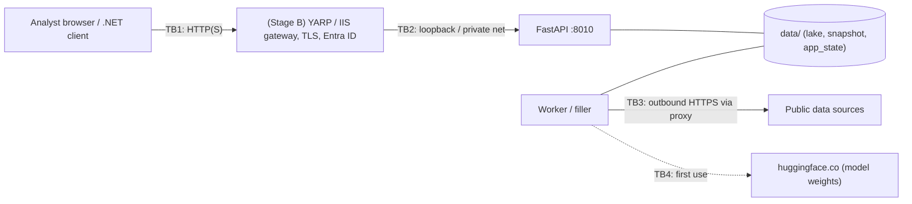

# Security

**Scope:** BiG Equity 360 at Stage A (one workstation, one user) and the controls prepared for Stage B (department server) and Stage C (.NET integration).
**Related documents:**
- [ARCHITECTURE.md](ARCHITECTURE.md) §7 (security model).
- [../CONFIGURATION.md](../CONFIGURATION.md) §3 (authentication settings).

## 1. Assets and trust boundaries

| Asset | Where | Sensitivity |
|---|---|---|
| API keys for data sources (FRED, Massive, EDINET, OpenDART, …) | Windows Credential Manager; `.env` (development) | Confidential: they give quota and billing access to the provider account |
| User state: watchlists, theses (investment rationale), alerts, studies, backtests | `data/db/app_state.duckdb` | **Internal / Confidential.** Theses and watchlists can reveal research intent. |
| Analytics lake and serving snapshot | `data/` | Internal. Derived from public data. Licensing restrictions apply (DATA_LICENSING.md). |
| Code, contracts, models | project folder, `models_store/` | Internal |
| Logs | `data/logs/` | Internal. They carry request paths and user principal names when authentication is on. Secrets are redacted. |



## 2. Threat model (STRIDE summary)

| # | Threat | Boundary | Today (Stage A) | Control at Stage B / C |
|---|---|---|---|---|
| T1 | **Spoofing:** another local or network user calls the API | TB1/TB2 | The API binds to `127.0.0.1` only, so it is unreachable from the network. Other local accounts on the PC could call it, so use a single-user PC. | OIDC bearer tokens validated in the API (`BIG360_AUTH=oidc`): issuer, audience, signature (JWKS), expiry. The gateway also authenticates. The API binds to loopback or a private interface. |
| T2 | **Tampering:** forged or modified tokens (`alg=none`, HS256 key confusion, kid injection) | TB1 | n/a (auth off) | The validator allows only RS256/384/512 from the issuer's JWKS, requires `kid`, requires keys of 2048 bits or more, and requires `exp`. `crit` headers are refused. Unit tests cover alg none, HMAC, unknown kid, tampered payload, a foreign key and short keys (`tests/platform/test_o4_auth.py`). |
| T3 | **Tampering:** data poisoning from a compromised or wrong source (unit flips, identifier reuse, bad bars) | TB3 | Contract validation on every write. Price integrity guards: identity breaks, unit flips, unfinished-bar drop. DQ rules (`dq_checks`). The regression guard (`qa_regression`) runs golden checks after each refresh. | The same, plus licensed vendor feeds (DATA_LICENSING.md §4) |
| T4 | **Repudiation:** who changed a thesis or triggered a job | TB2 | Single user. A job trigger is logged with its request id. | Access log with `principal`, `request_id`, route and status (JSON). An app_state audit trail (`created_by` / `updated_by`, DEPLOYMENT_SERVER.md §6) shipped to the SIEM. |
| T5 | **Information disclosure:** API keys leak through logs, errors or the UI | all | `SecretStr`. Log redaction of key values and key-bearing query parameters on every handler. `/system/status` shows booleans only. 5xx responses return only the exception class, not the message. | Key Vault / service-account Credential Manager. No keys on analyst PCs. |
| T6 | **Information disclosure:** one user sees another's theses | TB2 | n/a (single user) | Per-user ownership (`owner_oid`) enforced in SQL Server app_state (DEPLOYMENT_SERVER.md §6) |
| T7 | **Denial of service:** heavy queries exhaust RAM / CPU | TB1/TB2 | Single user. The filler's RAM governor. DuckDB memory caps (`BIG360_API_DUCKDB_MEMORY`). Bounded `limit` parameters (maximum 500–20,000 per endpoint). | Gateway rate limits per user (INTEGRATION_DOTNET.md §4). Server sizing. `/ready` removes an overloaded node from the pool. |
| T8 | **Elevation of privilege:** a viewer triggers jobs or promotes models | TB2 | n/a | Role policy: viewer = reads, analyst = user-state writes, admin = operations. Enforced in the API middleware and also in the gateway. |
| T9 | **Supply chain:** a malicious or vulnerable dependency (PyPI, npm, Hugging Face) | build | Locked versions (`packaging/requirements.lock.txt`, `package-lock.json`). SBOM (`docs/it/sbom.json`). No runtime downloads except Hugging Face weights on first use. | §5: pip-audit / OSV / Dependabot-equivalent in CI, internal package mirror, model weights mirrored internally (`HF_HUB_OFFLINE=1`) |
| T10 | **Injection:** SQL injection through API parameters | TB1 | DuckDB queries use bound parameters. Identifiers in dynamic SQL (sort columns, screener fields) are checked against allow-lists from the contract (`ScreenerColumnId`). The snapshot connection is read-only. | The same. SAST in CI (§5). |
| T11 | **Cross-site:** a browser page on another origin calls the API | TB1 | The CORS allow-list contains only the Vite dev origin. There is no cookie auth, so CSRF does not apply. | CORS = the gateway origin only. Bearer tokens are not cookies. |
| T12 | **Outbound exfiltration** through the data-fetch layer | TB3 | Fixed host list in code (the source adapters). No user-supplied URLs are fetched. | Proxy allow-list of the source hosts (DATA_LICENSING.md lists them) |

## 3. Secrets

| Stage | Store | How |
|---|---|---|
| A (now) | **Windows Credential Manager** (DPAPI, per Windows user), target `BiG360/<key>` | Commands: `python -m app.desktop.credentials migrate` moves the keys out of `.env`; `verify`, `status`, `set <KEY>` and `delete <KEY>` manage them. The supervisor reads them and passes them to its children as environment variables. Keys are never written to disk in plain text by the app. `.env` is accepted as a development fallback; delete it after migration. |
| B (server) | Credential Manager of the **service account** (gMSA where possible), or **Azure Key Vault** | Key Vault: the service reads the secrets at start-up through a managed identity or a certificate-based app registration, and passes them as environment variables to the children, as today. Rotation: restart the API, worker and filler (`sc stop` / `sc start`, or the WinSW restart). |
| C (.NET clients) | MSAL / Azure.Identity token caches; client secrets or certificates in Key Vault | No BiG360 secrets live in .NET code. Clients hold only Entra ID credentials. |

Rules:
- Never commit `.env`.
- Never print keys.
- `GET /api/v1/system/status` returns `keys_present` booleans only.
- `SEC_USER_AGENT` is not a secret, but it must be a real bank contact address.

## 4. Dependency inventory (SBOM)

- **File:** `docs/it/sbom.json`, CycloneDX 1.5 JSON, generated 2026-10-20.
- **Contents:** 380 components. 148 are Python distributions from the project venv. 232 are npm packages from `frontend/package-lock.json`; 122 of those are development-only and marked `scope: excluded`, because they are build tools and not in the shipped UI bundle.
- **Fields:** licences (379 of 380 components), purls, npm integrity hashes, and dependency edges.
- **Regenerate** after every dependency change:

  ```powershell
  .venv\Scripts\python.exe scripts\make_sbom.py            # -> docs/it/sbom.json
  ```

  `scripts/make_sbom.py` has no dependencies; it reads `importlib.metadata` and the npm lockfile. In the bank's CI, the standard tools are equivalent: `cyclonedx-py environment` and `cyclonedx-npm --package-lock-only`, merged with `cyclonedx-cli merge`.
- **Main runtime components:** Python 3.13, FastAPI 0.143, Starlette 1.7, uvicorn 0.54, pydantic 2.14, DuckDB 1.5.6, Polars 1.44, PyArrow 21, numpy 2, pandas 2, scikit-learn, XGBoost, PyTorch 2.14 (CPU), transformers, httpx 0.28, yfinance 1.7 (to be removed in a bank deployment), React 19, Vite 8.

## 5. Vulnerability scanning: recommendation

| Layer | Tool (pick what the bank already runs) | When |
|---|---|---|
| Python dependencies | `pip-audit -r packaging/requirements.lock.txt` (PyPA, OSV / PyPI advisories), or OSV-Scanner on `sbom.json`, or Dependency-Track ingesting `sbom.json` | Every build, plus a weekly scheduled scan |
| npm dependencies | `npm audit --omit=dev` in `frontend/` (only production dependencies are shipped), or OSV-Scanner | Every build |
| SBOM-based continuous monitoring | **OWASP Dependency-Track** (upload `sbom.json`); or Microsoft Defender for DevOps / GitHub Advanced Security if the bank uses Azure DevOps or GitHub | Continuous |
| SAST | Bandit (`bandit -r backend/app -ll`) and Semgrep (`p/python`, `p/owasp-top-ten`) for Python; ESLint security rules for TS; CodeQL if available | Every build |
| Secrets in code | gitleaks or TruffleHog over the repository | Every commit |
| Container / host (Stage B) | Trivy / Defender for Cloud on images; standard Windows Server baseline (CIS) | Release |
| Pen test | Before Stage B go-live. Focus: authentication bypass, role policy, the SSE endpoint, rate limits, the gateway header handling, path traversal in the static UI handler (`app.api.static_ui`) | Once, then yearly |

**Known gaps to close before Stage B:**
- Install `PyJWT[crypto]` so that the vetted `cryptography` verifier replaces the built-in fallback.
- Remove `yfinance`, `akshare` and `baostock` from the bank requirements (licensing).
- Pin Hugging Face model revisions (commit hashes).
- Put an internal PyPI / npm mirror in place.

## 6. Data classification note

| Data | Proposed class (BiG scheme to confirm) | Rationale |
|---|---|---|
| Market and fundamental data from public sources | **Public**, with **licence-restricted** handling | Freely published, but vendor and website terms restrict redistribution (DATA_LICENSING.md) |
| Derived scores, rankings, fair values, ML outputs | **Internal** | The bank's own analysis. All model-based outputs are labelled in the API and UI. |
| Watchlists, theses, journal, alerts, backtests, studies | **Confidential** | They reveal research intent and positions under consideration. Treat them like research notes, which is relevant to MAR / insider-list and conflict-of-interest policies. |
| Logs | **Internal** | They can contain user principal names and request paths. Retention follows the bank's log policy. |
| API keys | **Secret** | Section 3 |

The app holds **no client data, no personal data beyond user principal names (Stage B), and no positions or orders.** Integrating internal portfolios through `/supply-chain/portfolio-exposure` or watchlists would raise the classification of app_state to **Confidential / restricted**. In that case, encryption at rest (BitLocker or SQL Server TDE) and access reviews become mandatory.

## 7. Authentication implementation (for reviewers)

- **Module:** `backend/app/api/auth.py`. It is off unless `BIG360_AUTH=oidc`.
- **Middleware:** a pure ASGI middleware placed inside CORS and the request-id middleware, and outside the response cache, so cached responses are never served unauthenticated.
- **Discovery:** OIDC discovery or a configured JWKS URL. The JWKS cache lasts 1 h and refreshes on an unknown `kid` at most once a minute; this handles key rollover.
- **Errors:** 401 or 403 as `application/problem+json`, with `WWW-Authenticate: Bearer error="invalid_token" | "insufficient_scope"`.
- **Principal:** `request.state.principal` carries `oid`, `preferred_username` and the mapped roles. The access log records the principal name.
- **Crypto:** PyJWT[crypto] when it is installed; otherwise a pure-Python RSASSA-PKCS1-v1_5 verifier. The fallback is public-key only: it compares the re-encoded `EM` in constant time and does no ASN.1 parsing of the signature.
- **Tests:** `backend/tests/platform/test_o4_auth.py` uses a locally generated 2048-bit RSA key and JWKS. It covers claim checks, signature and header attacks, key rollover, the role policy, the end-to-end API with auth on, auth off by default, and fail-closed misconfiguration.
